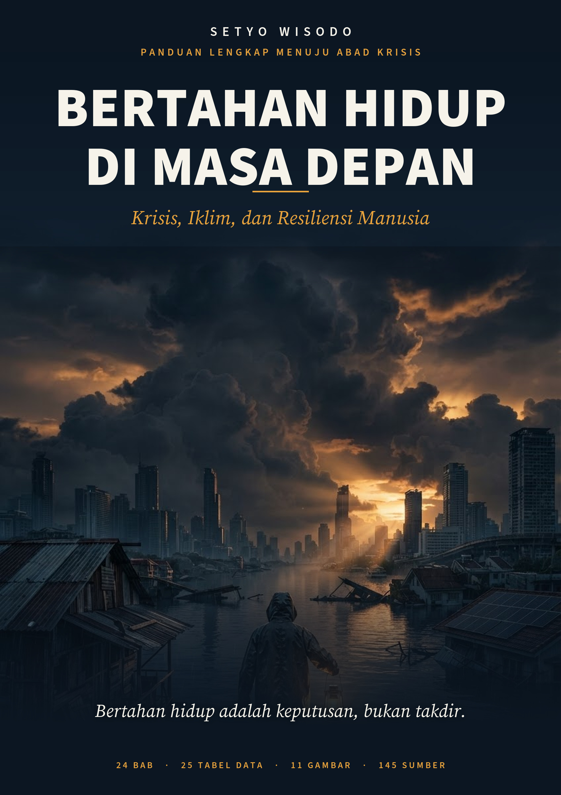
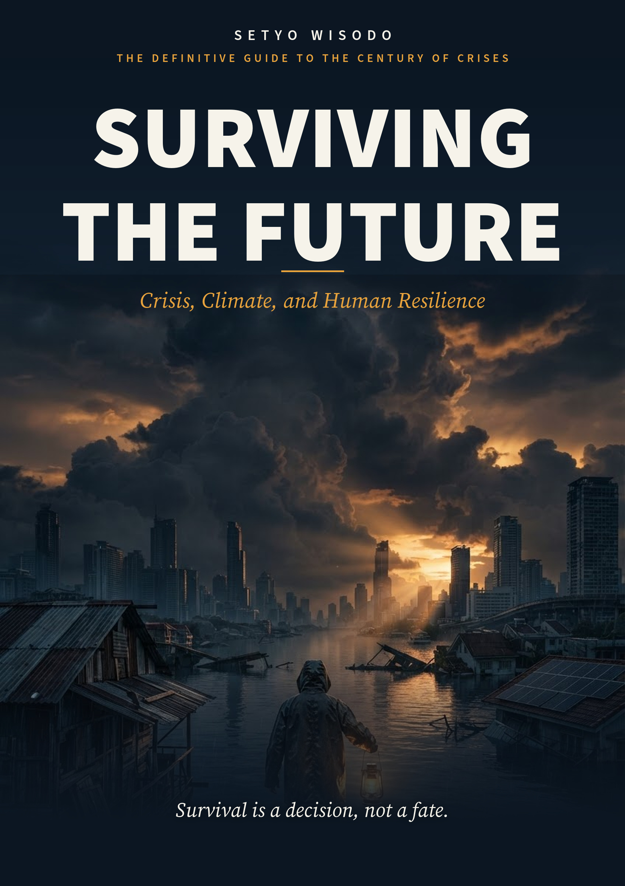

<div align="center">

  <!-- Header Banner / Typing SVG -->
  

  <h1>👋 Halo, Saya Setyo Wisodo</h1>
  <p><b>🤖 AI Development &nbsp;|&nbsp; 📋 Product Management &nbsp;|&nbsp; 📊 Digital & Growth Marketing</b></p>

  <p>
    <a href="https://github.com/SetyoWisodo">
      
    </a>
    <a href="https://github.com/SetyoWisodo?tab=followers">
      
    </a>
    <a href="https://github.com/SetyoWisodo?tab=repositories">
      
    </a>
  </p>
</div>

---

### 🧑‍💻 Tentang Saya (About Me)

Halo! Saya **Setyo Wisodo**, seorang profesional yang menggabungkan keahlian teknis dalam **Pengembangan AI**, visi strategis **Product Management**, serta eksekusi **Pemasaran (Marketing)** berbasis data untuk menciptakan produk digital yang inovatif, relevan dengan kebutuhan pasar, dan berdampak nyata.

- 🤖 **Pengembangan AI:** Merancang dan mengintegrasikan solusi *Artificial Intelligence*, *Generative AI / LLM*, serta otomasi cerdas ke dalam produk nyata.
- 📋 **Product Management:** Mengelola siklus hidup produk dari riset pengguna, perumusan strategi & *roadmap*, hingga peluncuran produk (*end-to-end execution*).
- 📊 **Pemasaran & Pertumbuhan (*Growth*):** Menyusun strategi *Go-To-Market (GTM)*, akuisisi pengguna, *digital marketing*, dan optimasi pertumbuhan bisnis.
- 👯 **Terbuka untuk kolaborasi:** Proyek inovasi AI, pengembangan produk *startup*/digital, dan strategi pertumbuhan pasar.
- 📍 **Lokasi:** Indonesia 🇮🇩

---

### 🎯 Keahlian Utama (Core Expertise)

<table>
  <tr>
    <td width="33%" valign="top">
      <h4 align="center">🤖 Pengembangan AI<br/>(AI Development)</h4>
      <ul>
        <li><b>Generative AI & LLM:</b> Integrasi model bahasa besar (OpenAI, Claude, Gemini, Open-Source LLM)</li>
        <li><b>AI Agents & Otomasi:</b> Membangun <i>workflow</i> cerdas & asisten berbasis AI</li>
        <li><b>Deep Research Agents:</b> Integrasi agen riset otomatis (GPT Researcher, STORM, Open Deep Research, NVIDIA, Tongyi, Vane, MindSearch)</li>
        <li><b>Prompt Engineering & RAG:</b> Optimasi konteks, <i>knowledge base</i>, dan akurasi respons AI</li>
        <li><b>Applied Machine Learning:</b> Analisis prediktif & pemrosesan data berbasis Python</li>
      </ul>
    </td>
    <td width="33%" valign="top">
      <h4 align="center">📋 Product Management<br/>(Manajemen Produk)</h4>
      <ul>
        <li><b>Product Strategy & Discovery:</b> Validasi ide, analisis pasar, & <i>product-market fit</i></li>
        <li><b>Roadmapping & PRD:</b> Penyusunan spesifikasi produk, prioritas fitur, & metrik sukses (OKR/KPI)</li>
        <li><b>Agile & Scrum:</b> Kolaborasi lintas tim (Engineering, Design, Business)</li>
        <li><b>User Research & UX:</b> Memahami kebutuhan pengguna untuk menciptakan pengalaman produk terbaik</li>
      </ul>
    </td>
    <td width="33%" valign="top">
      <h4 align="center">📊 Pemasaran<br/>(Digital & Growth Marketing)</h4>
      <ul>
        <li><b>Go-To-Market (GTM):</b> Strategi peluncuran produk & penetrasi pasar</li>
        <li><b>Growth & Funnel Optimization:</b> Akuisisi, retensi, dan konversi pengguna berbasis data</li>
        <li><b>Digital Campaign & SEO/SEM:</b> Pemasaran media sosial, iklan digital, & optimasi organik</li>
        <li><b>Branding & Copywriting:</b> Komunikasi nilai produk (*value proposition*) yang kuat & persuasif</li>
      </ul>
    </td>
  </tr>
</table>

---

### 🛠️ Teknologi & Peralatan (Tech Stack & Tools)

#### 🤖 AI & Software Development
<p>
  
  
  
  
  
  
  
  
</p>

#### 🔬 Deep Research & AI Agents
<p>
  
  
  
  
  
  
  
  
</p>

#### 📋 Product Management & Design Collaboration
<p>
  
  
  
  
  
  
</p>

#### 📊 Marketing, Growth & Analytics
<p>
  
  
  
  
  
</p>

---

### 🔬 Deep Research Tools & Digital Products (AI Research Agents)

Kumpulan *deep research agent* dan *AI research tool* yang saya eksplorasi, integrasikan, dan kembangkan untuk membangun produk digital berbasis riset otomatis. Setiap tool mendukung *web research*, *multi-agent workflow*, dan pembuatan laporan berbasis sumber (cited reports).

| # | Tool / Produk | Deskripsi Singkat | Tautan |
|---|---------------|-------------------|--------|
| 1 | **GPT Researcher** | Autonomous deep research agent untuk riset web & dokumen lokal, menghasilkan laporan faktual dengan sitasi. | [GitHub](https://github.com/assafelovic/gpt-researcher) |
| 2 | **Open Deep Research** | Framework deep research open-source dari LangChain (LangGraph) untuk riset otomatis berbasis LLM. | [GitHub](https://github.com/langchain-ai/open_deep_research) |
| 3 | **STORM** | Metode riset multi-perspektif dari Stanford (Synthesis of Topic Outlines through Retrieval & Multi-perspective Question Asking). | [GitHub](https://github.com/stanford-oval/storm) |
| 4 | **NVIDIA Deep Researcher Agent** | Blueprint agen riset enterprise dari NVIDIA (NeMo Agent Toolkit + LangChain Deep Agents). | [GitHub](https://github.com/NVIDIA-AI-Blueprints/deep-researcher-agent) |
| 5 | **Tongyi DeepResearch** | Model agen riset open-source Alibaba (30B MoE) setara Deep Research proprietary. | [GitHub](https://github.com/Alibaba-NLP/DeepResearch) |
| 6 | **Vane** | AI answering engine privat & self-hosted dengan mode deep research iteratif. | [GitHub](https://github.com/ItzCrazyKns/Vane) |
| 7 | **MindSearch** | Framework multi-agent pencarian web dari InternLM (mimicking human mind for deep search). | [GitHub](https://github.com/InternLM/MindSearch) |
| 8 | **Open WebUI** | Antarmuka AI open-source untuk menjalankan & mengelola LLM serta agen riset secara lokal. | [GitHub](https://github.com/open-webui/open-webui) |

<p align="center">
  <a href="https://github.com/assafelovic/gpt-researcher"></a>
  <a href="https://github.com/langchain-ai/open_deep_research"></a>
  <a href="https://github.com/stanford-oval/storm"></a>
  <a href="https://github.com/NVIDIA-AI-Blueprints/deep-researcher-agent"></a>
  <a href="https://github.com/Alibaba-NLP/DeepResearch"></a>
  <a href="https://github.com/ItzCrazyKns/Vane"></a>
  <a href="https://github.com/InternLM/MindSearch"></a>
  <a href="https://github.com/open-webui/open-webui"></a>
</p>

---

### 📚 Buku (Book)

<div align="center">

  
  &nbsp;&nbsp;
  

</div>

**Bertahan Hidup di Masa Depan: Krisis, Iklim, dan Resiliensi Manusia** (edisi Indonesia) dan
**Surviving the Future: Crisis, Climate, and Human Resilience** (edisi Inggris). Buku ini adalah panduan
praktis berbasis bukti tentang perubahan iklim bagi keluarga dan komunitas, dengan fokus pada Indonesia dan Asia Tenggara.

[](book/publish/Bertahan_Hidup_di_Masa_Depan_ID_interior.pdf)
[](book/publish/Surviving_the_Future_EN_interior.pdf)
[](book/publish/)

File siap terbit (interior PDF 6×9 inci, sampul cetak lengkap dengan punggung buku, EPUB, DOCX) beserta
cara build-nya ada di [`book/`](book/README.md).

---

### 🎃 Pumpkin Terminal — Desk Trading 6 Agen (Paper Trading)

Jawaban teknis atas thread viral "$80 → $5.432 dalam semalam". Enam agen
(**Scout → Filter → Analyst → Sniper → Guard → Scribe**) memindai pair Solana,
menolak ~99% token karena aturan risiko, dan mencatat setiap keputusan —
**tanpa wallet dan tanpa order on-chain**.

Yang menarik justru hasilnya: dengan pipeline lengkap di pasar simulasi yang ramah,
median **+174%**; tanpa keahlian sama sekali (filter dilewati, skor acak),
median **−46%** dan habis di fee 5,5% per round-trip. Klaim +6.690% di thread
berada jauh di luar ekor distribusi bahkan dari simulasi itu sendiri.

```bash
cd pumpkin-terminal && python run.py serve   # dashboard live
python run.py bench                          # uji jujur: strategi vs lempar panah
```

Kode, aturan filter/risiko, dan 25 test: [`pumpkin-terminal/`](pumpkin-terminal/README.md)

---

### 📊 Statistik GitHub (GitHub Analytics)

Statistik GitHub tersedia di profil: [github.com/SetyoWisodo](https://github.com/SetyoWisodo).

---

### 📫 Hubungi Saya (Connect with Me)

<div align="center">

  [](https://github.com/SetyoWisodo)
  [](https://linkedin.com/)
  [](mailto:your.email@example.com)
  [](https://instagram.com/)

</div>

---

<div align="center">
  <sub>✨ <i>"Menggabungkan kecerdasan buatan (AI), strategi produk yang tepat, dan pemasaran yang berdampak."</i> ✨</sub>
</div>
