# Preface: Why Future Global Warming Is Certain

Global warming is not a hypothesis; it is an observed, measured, and physically explained reality. The certainty of future warming rests on three pillars: (1) the physics of the greenhouse effect, (2) the observed accumulation of greenhouse gases in the atmosphere, and (3) the inertia of the climate system. Even if all emissions stopped today, committed warming from past emissions would continue for decades. This book is written to be debated in academic spaces: every major claim is tied to peer-reviewed literature, data, and expert statements.

### The Three Pillars of Certainty

- **Physics:** Greenhouse gases absorb outgoing infrared radiation. This is established physics, tested for over a century (Arrhenius, 1896; modern radiative transfer models).
- **Observation:** Atmospheric CO2 has risen from ~280 ppm (pre-industrial) to ~420 ppm (2024). Global mean temperature has risen ~1.1-1.2 C. These are direct measurements.
- **Inertia:** The ocean stores heat; ice sheets respond slowly. Even with zero emissions, warming continues for decades (committed warming).

Data underpinning the discussion is summarized as follows:

[[TABLE:Table P.1 Key global climate indicators (2024)]]
| Indicator | Value | Source |
|---|---|---|
| Global mean temperature rise since 1850-1900 | ~1.1-1.2 C | IPCC (2023) |
| CO2 concentration (2024) | ~420 ppm | NOAA (2024) |
| Sea level rise since 1900 | ~20-25 cm | IPCC (2023) |
| Arctic sea ice decline | ~13% per decade | NASA |
| People affected by climate disasters (annual) | ~100 million+ | IFRC |
| Economic damage from climate disasters (annual) | ~$200-300 billion | World Bank |

The expert consensus underpinning this book is summarized as follows.

> James Hansen, former director of NASA's Goddard Institute for Space Studies, argued in 2013 that two degrees of warming would be enough to expect several metres of sea-level rise, and called the consequences disastrous.

> Katharine Hayhoe, Texas Tech climate scientist (2014, after the IPCC fifth assessment): climate change is here and now rather than in some distant time or place, and the choices made today will shape what the future holds.

> Michael Mann, Penn State climatologist (2004; 2021): the scientific consensus on human-caused climate change is comparable to the consensus on gravity, because multiple independent lines of evidence converge.

> Friederike Otto, Imperial College and co-founder of World Weather Attribution (2021): the Pacific Northwest heatwave of 2021 would have been virtually impossible without human-caused climate change.

> Johan Rockström, Potsdam Institute for Climate Impact Research and Stockholm Resilience Centre (2009 Nature; 2023 update): planetary boundaries define a safe operating space for humanity, and six of the nine are now transgressed.

---

## How This Book Is Organised

The book is arranged so that a reader can enter at three different depths. The first is the argument, which runs through the chapter openings and the sections numbered x.1 to x.3: why the physical certainty of warming is settled, how a local hazard becomes a systemic failure, and what the record of the past two decades shows about which places absorbed an event and which did not. A reader who only has an evening can read those sections across all twenty-four chapters and come away with the claim of the book intact.

The second depth is the case record. Every chapter carries a numbered case study that reconstructs one event in detail — the rainfall totals, the warnings issued, the hours in which power failed, the decisions taken by named institutions — and the analysis that follows the reconstruction. The cases were chosen so that no single explanation covers them: some failed through exposure, some through vulnerability, some through the failure of a warning to reach the people it described, and a few succeeded for reasons that had nothing to do with luck.

The third depth is the appraisal. Each chapter closes with a Future Scenarios section that separates what the physical system has already committed to from what depends on decisions not yet taken, and states plainly which of its own predictions would prove it wrong. That section is the reason the book is meant to be argued with rather than simply read: a prediction that cannot be falsified is a description of the author's preferences, and the scenarios here are written to be checkable against the record as it accumulates.

Three conventions run through the text. Citations are author and year in the prose, with the full entry in the reference list; figures are the most recent authoritative values available at the time of writing, and where sources disagree the disagreement is stated rather than averaged away. Numbers that describe deaths, displacement or damage are given as the range the sources support, because the false precision of a single figure would misrepresent what is known. And the book avoids the passive construction that hides who decided what: where an institution chose not to act, the text says which institution, because responsibility that cannot be assigned cannot be examined.

A note on what this book is not. It is not a manual of climate science, though it summarises the science that the argument depends on. It is not a policy programme, though it ends with the measures that the evidence supports. It is a record of what has already happened, read closely enough to show why the next disaster will fall on some places and not others, and written in the belief that the difference is usually a decision rather than a fate.

---

# Chapter 1: Introduction: The Warming World

*Theme: the global crisis of warming and why survival begins with understanding it*

In the summer of 2022, a monsoon system carried moisture from the Arabian Sea across Pakistan for eight consecutive weeks (WMO, 2023). By the end of August, one-third of the country was under water, thirty-three million people had been affected, and the national highway network had been cut in more than a hundred places. The flood was not a single event but a sequence: heat that dried the soil, then rain that could not infiltrate it, then reservoir releases that arrived after the rivers had already filled. Six months later, the same country was negotiating with the International Monetary Fund while its farmers reported that two million hectares of cropland would not be planted that season.

A year later, in 2023, Canada burned. More than eighteen million hectares of forest burned, an area larger than England, and the smoke crossed the Atlantic and turned the skies of New York orange (CIFFC, 2023). In September of the same year, two dams above the Libyan city of Derna failed after a storm that had been forecast days in advance; the water killed more than eleven thousand people in a city that had been warned but could not act. In October 2024, a year's worth of rain fell on the Spanish province of Valencia in a few hours and killed more than two hundred people in towns that had never been mapped as floodplains.

These events are usually described as natural disasters. They are not. Each of them required a physical trigger — rain, wind, heat — but the scale of the loss was determined by conditions that people created: where houses were built, how rivers were managed, whether warnings reached the people who needed them, whether the soil had been left compacted and bare, whether the population was old, poor, or living in informal settlements. The trigger is weather. The disaster is a failure of preparation, and preparation is something human beings can change.

This book is an attempt to describe that failure and the ways out of it, in both directions: backward, into the record of what has already happened, and forward, into the range of futures that the physical system has made possible. It is not a book of prophecy. It is a book about the conditions under which communities continue to function, and the conditions under which they do not.

The five years from 2020 to 2024 were the five warmest ever measured, and 2024 was the first calendar year to average more than 1.5 °C above the 1850–1900 baseline (WMO, 2025). That milestone was expected eventually; what surprised researchers was how quickly the instrumental record left the range of previous decades. Ocean heat content reached a record high, and the rate at which the oceans absorbed heat in the past decade was roughly double the rate of the 1990s (Cheng et al., 2024). A warmer ocean stores energy that will be released into the atmosphere for centuries, which is why the numbers in this book describe a commitment as much as an event.

## 1.1 The Decade That Changed the Baseline

The 2020s began with a global pandemic and ended their first half with the four hottest years ever measured. The World Meteorological Organization confirmed that 2024 was the first calendar year to average more than 1.5°C above the 1850–1900 baseline, at about 1.55°C, with 2023 close behind at 1.45°C (WMO, 2025). The two years were lifted by a strong El Niño, but the underlying trend was not: the previous ten years were the ten warmest in the instrumental record, and every one of them exceeded the average of the decade before it.

The warming has not been evenly distributed in time or space. The Arctic has warmed three to four times faster than the global mean; the Mediterranean and the Middle East have warmed roughly twice as fast; the North Atlantic has cooled in some patches even as the ocean as a whole has gained heat, because melting ice and shifting winds have altered circulation. A global average of 1.5°C therefore describes a world in which some regions have already experienced 2.5°C or 3°C of local warming, and in which the statistics of extreme heat have shifted far more than the mean (IPCC, 2021).

The decade also changed the character of the evidence. Attribution studies that once took a year now take a month. Satellite records that began in the 1970s now span half a century. Insurance losses, crop models, hospital admissions and migration data have accumulated to the point where the effect of climate on society can be measured rather than inferred. The result is a body of evidence that is no longer primarily about the future: it is about what has already happened, to identifiable people, in identifiable places, at a cost that can be counted.

The reason a single year matters is not the year itself but the shift in the distribution that it reveals. A global average is built from billions of hourly readings, and a rise of 0.1 °C in that average corresponds to a large increase in the number of days that cross a threshold somewhere — the temperature at which a road softens, a power line sags, an outdoor worker stops being able to cool, or a night stops providing recovery from the day before (IPCC, 2021). Public discussion treats warming as a slow trend; in practice it is experienced as a change in the frequency of extremes, which is why the same average rise produces very different consequences in different places.

The phrase 'new normal' is therefore misleading. There is no stable baseline to which planning can return: every decade is warmer than the last, and the statistics that engineers, insurers and farmers rely on describe a climate that has already gone. That is why the chapters that follow use moving baselines rather than long historical averages, and why a design that was adequate in 1990 can fail in 2030 without any component of it having deteriorated.

The arithmetic of a baseline deserves a moment. Climate normals are recalculated every decade, which means the reference against which a day is called hot moves with the climate itself. A summer that would have looked extreme against the 1961–1990 average sits close to ordinary against the 1991–2020 average, and the change happens without any single event announcing it. Farmers register the shift in planting dates, insurers in the frequency of claims, and municipal engineers in the depth of storm drain they must install. The result is a quiet form of forgetting. Each generation inherits the weather of its childhood as normal and measures change against a baseline that has already moved, which is why older residents and younger ones can argue about the same summer and both be describing what they actually experienced.

## 1.2 The Anatomy of a Global Crisis

A global crisis is not simply a large disaster. It is a set of stresses that arrive together, reinforce one another, and exceed the capacity of institutions to respond. Climate change qualifies because it acts on every sector at once: it raises food prices by reducing yields, raises insurance costs by increasing losses, raises migration by making some places uninhabitable, and raises the cost of borrowing by increasing uncertainty. Each effect is modest in isolation. Together they consume the fiscal and administrative space that governments need to cope with the next shock.

The reinforcement is the part that is usually missing from public discussion. A drought reduces the harvest; the reduced harvest raises food prices; higher food prices increase poverty; poverty increases vulnerability to the next flood; the flood destroys the assets that the household would have used to recover. The sequence can turn a single bad season into a decade of lost development, and it explains why the same hazard produces a few dozen deaths in one country and thousands in another.

This is also why the language of 'natural disaster' is misleading in a second sense. It suggests a boundary between the hazard and the society exposed to it, when in reality the boundary is the thing that policy controls. A levee, a building code, a crop insurance scheme, a heat action plan and a functioning weather service are all ways of moving that boundary. The chapters that follow examine each of them, but the logic is the same throughout: the physical hazard sets the pressure, and the social system determines whether the pressure becomes a catastrophe.

The scale of the crisis is best measured in the language of risk rather than catastrophe: hazard multiplied by exposure multiplied by vulnerability. The United Nations Office for Disaster Risk Reduction estimates that the number of recorded disaster events has roughly quadrupled since the 1970s, driven less by more storms than by more people and assets in harm's way (UNDRR, 2022). Average annual losses from disasters are now in the hundreds of billions of dollars, and the losses fall hardest on countries with thin insurance markets and limited fiscal space, so that a single event can erase years of development spending.

The timing matters as much as the overlap. Crises become unmanageable when the interval between them is shorter than the time needed to recover, and that interval has been shrinking in many regions. A flood that arrives before the previous flood's repairs are finished leaves the same households in temporary shelter twice, exhausts the same municipal budget, and teaches people that rebuilding is pointless. Recovery time is not a fixed quantity either: it depends on insurance payments, labour, materials and permits, all of which are themselves disrupted by the event. The practical consequence is that a sequence of moderate hazards can do more cumulative damage than a single severe one, and that disaster statistics built on individual events systematically miss this.

A hazard becomes a global crisis through four channels, and each one transmits harm further than the event itself. Trade is the first: a harvest failure raises the price of a staple in every market that imports it, and a factory that loses power delays components for assembly lines on other continents. Finance is the second: a sovereign that borrows to rebuild raises its debt service, and the cost is paid in the budget for schools and clinics. Movement is the third: people displaced from a coast or a delta arrive in cities that were not prepared for them. Information is the fourth, and it works in both directions, because a rumour travels faster than a warning and a photograph can mobilise help or panic.

## 1.3 From Local Hazard to Systemic Failure

Most climate impacts begin as local events, but their consequences travel through markets, supply chains and migration routes. The 2011 floods in Thailand are the standard example: a sequence of monsoon rains inundated industrial estates north of Bangkok, global hard-drive production fell by about a quarter, and computer prices rose around the world. The flood was national; the shortage was global. The same mechanism now operates through semiconductor production in Taiwan, wheat exports from the Black Sea, and container shipping through the Red Sea.

Systems fail when a shock exceeds redundancy. A power grid with spare capacity survives a heatwave; a grid without it cascades. A port with alternative routes survives a blockage; a port that is the only route does not. The 2021 Texas winter storm, the 2022 European gas crisis, and the 2023 Panama Canal drought all demonstrated the same principle in different sectors: the failure was not caused by the weather alone but by the absence of slack that would have absorbed it. Climate change is, among other things, a systematic reduction in slack.

For households, the translation is direct. A family that depends on one income, one water source, one road and one food market is exposed to every shock that touches any of them. Diversification — of income, of water storage, of food sources, of social contacts — is the household equivalent of redundancy in a grid. It is also the reason preparedness is not a single purchase but a set of overlapping capabilities, each of which buys time when another fails.

The systemic dimension is what makes climate risk different from a sequence of bad accidents. Modern societies depend on tightly coupled networks — power, water, transport, communications, finance, health — and a shock that begins in one network can travel through the others faster than any single agency can respond. The Texas winter storm of 2021 is the clearest recent example: a fuel-supply failure became a power failure, which became a water failure, which became a health emergency. Analysts describe this as cascading risk, and it means that the vulnerability of a system is set by its weakest coupling, not by its strongest component.

River transport is the clearest recent example. In 2018 and again in 2022, low water on the Rhine forced barges to run partly loaded, and the river carries a large share of Germany's coal, chemicals and mineral oil. Chemical plants that depend on continuous barge deliveries cut output; the price of transport rose; and the effects reached factories that had no direct contact with the river. Nothing in that chain was unusual in isolation — low water happens, and supply chains reroute — but the combination of a slow-onset hazard and a tightly scheduled production system turned a hydrological fact into an industrial one. The same pattern appears wherever a system has removed its own buffers: a just-in-time warehouse, a single-source supplier or a single bridge can transmit a local shock across a continent.

The mechanism that turns a local hazard into a systemic failure is dependency rather than severity. A storm that closes a port interrupts the fuel supply to the generators that keep a hospital running; a flood that submerges a substation disables the pumps that would have drained the streets; a heatwave that melts a road prevents the trucks that carry the water. Each link is individually ordinary and collectively fragile, which is why the loss from a moderate event in a tightly coupled system can exceed the loss from a severe event in a loosely coupled one. Engineers call this a cascade, insurers call it a contingent business interruption, and the household that loses power, water and wages at the same time experiences it as a single catastrophe.

## 1.4 The Human Cost: What the Record Shows

The human cost of climate change is usually reported through disasters, and the disaster statistics are stark enough. The Centre for Research on the Epidemiology of Disasters recorded more than 7,000 major disasters between 2000 and 2019, affecting 4.2 billion people and killing 1.2 million (UNDRR, 2022). Weather and climate events accounted for the large majority of them. In the 2020s the pattern has continued: the 2022 Pakistan floods affected thirty-three million people; the 2023 Turkey–Syria earthquakes — geological rather than climatic, but a reminder of compound vulnerability — killed more than fifty thousand; the 2024 Valencia floods killed more than two hundred in a high-income country with a modern warning system.

But disasters capture only the visible part of the cost. The World Health Organization projects that climate change will cause about 250,000 additional deaths a year between 2030 and 2050 through heat, diarrhoea, malaria and undernutrition, and the true toll is probably higher. Heat is already lethal: the European summer of 2022 is estimated to have caused about 61,700 deaths, most of them among older people (Ballester et al., 2023). Air pollution, much of it from the same fuels that drive warming, kills about seven million people a year.

The economic record is equally uneven. The World Bank estimates that climate-related losses in developing countries already exceed US$200 billion a year, and that the figure understates the true cost because it counts damaged assets rather than lost development (World Bank, 2021). A child who is malnourished during a drought does not recover the cognitive development that was lost; a farmer who sells livestock to survive a season does not rebuild the herd at the same rate. These effects are rarely counted in disaster statistics, but they are the mechanism by which a temporary shock becomes a permanent reduction in welfare.

The human cost is systematically undercounted, and the undercount is not accidental. Deaths from heat are recorded as cardiovascular or renal failure; deaths from drought are recorded as malnutrition or infection; deaths from displacement are recorded in the places people move to, often months later. The most careful estimates come from excess mortality analysis, which compares observed deaths with the number expected in a normal period. Those studies consistently find tolls several times larger than official counts, and they are the reason this book prefers ranges to single figures.

What the record misses is as revealing as what it contains. Disaster databases count deaths, injuries and damaged buildings, because those are the categories that agencies collect. They do not count the school year lost when a building is used as a shelter, the vaccination schedule interrupted when clinics close, the harvest that is smaller because the soil was washed away, or the year of income lost by a family that moved to a city and found informal work. These losses are real, cumulative and largely invisible in the statistics that governments use to set budgets. The consequence is a systematic bias in public reasoning: hazards that kill quickly and visibly attract money, while hazards that erode health, learning and income over years are treated as background conditions.

The human cost of a decade of extremes is easiest to grasp through a handful of numbers and hardest to grasp through any of them. More than half a million people have died in the heat events of the last quarter-century; floods have displaced tens of millions in a single season in a single country; a drought in one region has killed a quarter of a million people before a famine was declared (Romanello et al., 2024). Each number is an estimate with a method behind it, and the method matters because it determines who is counted. The deaths that are recorded are the ones that a system noticed, and the people who are most exposed are often the ones whose deaths are least likely to be recorded as anything in particular.

## 1.5 Why the Worst Outcomes Are Not Yet Fixed

The physical system has inertia, and that inertia is usually presented as bad news: the warming already committed will continue for decades, sea level will rise for centuries, and some changes are irreversible. All of that is true. But the same inertia means that the future is not yet determined, because the emissions that would produce the worst outcomes have not yet happened. The difference between 1.8°C and 4.4°C at the end of the century is not a difference in physics; it is a difference in cumulative carbon, and cumulative carbon is still being decided (IPCC, 2021).

The remaining carbon budget makes the arithmetic explicit. To have a fifty per cent chance of holding warming to 1.5°C, the world can emit roughly 250 billion tonnes of carbon dioxide more — about six years at current rates (IPCC, 2021). For 2°C the budget is roughly 1,150 billion tonnes. These numbers are uncertain at the margins, but their order of magnitude is not, and it implies that every year of delay consumes a substantial share of the remaining budget. It also implies that the choice is not between action and no action but between action now and much larger, more expensive action later.

There is a second reason for qualified optimism. The cost of the technologies that reduce emissions has fallen faster than almost anyone predicted. Solar photovoltaic costs have fallen by roughly ninety per cent since 2010, onshore wind by about seventy per cent, and lithium-ion battery packs by about eighty-five per cent (IRENA, 2023). In 2023 the world added more renewable generating capacity than fossil capacity for the first time, and the International Energy Agency now expects renewables to account for the majority of new power capacity through 2030. The obstacle is no longer primarily engineering; it is the speed at which grids, permits and political coalitions can change.

Some of the worst outcomes are already locked in by physics, and some are not. The distinction matters for policy. Warming that has already occurred commits the world to further sea-level rise and to more intense heat extremes, because the ocean and ice sheets respond slowly to emissions. Other outcomes depend on decisions still being taken: how quickly power systems are rebuilt, whether cities invest in drainage, whether social protection reaches the households that need it. The book is organised around that distinction between the committed and the contingent.

It helps to separate three kinds of lock-in, because they respond to different policies. Physical lock-in is the warming already stored in the ocean and the sea-level rise already committed by ice that has begun to move; it cannot be reversed on any human timescale. Infrastructure lock-in is the power plants, buildings and roads that will operate for decades and whose emissions are effectively decided when they are built. Behavioural lock-in is the pattern of settlement and consumption that makes high emissions convenient — the suburb without transit, the office without shade. Only the second and third are still open to rapid change, and they are where the leverage lies. A tenth of a degree avoided is not a rounding error; it is a smaller tail of extremes, a shorter fire season and a slower rate of sea-level rise for everyone who comes after.

The worst outcomes are not yet fixed because the fix is institutional rather than technological, and institutions move at the speed of politics. The warning system that would have saved the people who died in a flood is usually available and usually unfunded; the building code that would have kept a roof on is on the books and not enforced; the evacuation plan that would have emptied a valley was written and never rehearsed. None of that is a mystery, and none of it is expensive in the terms of a national budget. What it requires is the patience to fund maintenance, the courage to enforce a code against a developer, and the habit of treating a forecast as an instruction rather than as information.

## 1.6 What 'Surviving' Actually Means

The word survival suggests a single moment: the storm passes, the flood recedes, the family is alive. In practice, survival is a process that extends long after the water leaves. A household that survives the flood but loses its documents, its savings and its access to credit may not survive the next two years. A city that survives the heatwave but loses its power grid for a week may lose thousands of people to hospitals that cannot run. The relevant question is not whether a system survives the event but whether it returns to a level of functioning from which it can absorb the next one.

This book therefore treats survival at three levels. Personal survival is about water, food, shelter, health and the knowledge to use them. Community survival is about mutual aid, local institutions and the physical infrastructure that connects households to services. Societal survival is about the fiscal capacity, the legitimacy and the administrative competence that allow a state to keep functioning when several crises arrive at once. The levels are nested: a household cannot be secure in a failed state, and a state cannot be stable when its households are desperate.

The nesting also explains why purely individual preparation is insufficient. A family that stores water and food is better off than one that does not, but it still depends on a functioning water utility, a supply chain, a hospital and a road. Preparedness that ignores the collective is a bet that everyone else will continue to provide the services on which the prepared household depends. That bet may pay off in a short emergency; it fails in a prolonged crisis, which is precisely the scenario that climate change makes more likely.

Survival, as this book uses the term, has three thresholds rather than one. The first is immediate physical safety: staying out of floodwater, avoiding heatstroke, having air to breathe during a smoke episode. The second is recovery: retaining shelter, income, documents and health care long enough to rebuild. The third is systemic: living in a place whose institutions can absorb the next shock without collapsing into scarcity and conflict. Most public discussion focuses on the first and neglects the second and third, which is why so many people survive the event and are ruined by the aftermath.

Two words are often confused in this discussion. Resilience is the capacity to absorb a shock and return to the previous state; robustness is the capacity to keep functioning without returning to it. A city that rebuilds the same bridge in the same place after every flood is resilient in the first sense and foolish in the second. The distinction matters because climate change moves the baseline: returning to the previous state means returning to a state that is already too exposed. The more useful goal is to bend without breaking and to change deliberately rather than under pressure — to move the hospital generator above the new flood line before the flood, not after it, and to widen a road for evacuation while the weather is quiet.

Surviving, in the sense this book uses the word, is not the same as being rescued. Rescue is an event that happens to a person; survival is a condition that a household, a community and an institution maintain over time, through the event and the months that follow. A household that is evacuated and then spends two years in a container is not surviving in this sense, and neither is a city that rebuilds its waterfront to the old standard. The test is whether the arrangements that protected people in one event are still in place for the next one, and whether they protect the people who were least able to protect themselves.

It is worth turning the definition into four tests that a household, a city or a country can apply to itself without a consultant. The first is continuity: would the water, the power, the clinic and the school keep working, at a reduced level, for a week. The second is reach: would the warning and the assistance arrive at the household that is hardest to reach, which is usually the one headed by an older woman in a settlement without a street address. The third is recovery: would the household be back in a habitable home and an income within a year, or would it be in a container for three. The fourth is memory: would the institution that failed be able to say what it changed, and would the change still be funded after the next election. A place that answers yes to all four is surviving in the sense this book means, and very few places answer yes to more than two.

## 1.7 Knowledge, Preparedness and Adaptive Capacity

Adaptive capacity is the ability of a system to adjust to change while remaining functional. It is not the same as wealth, though wealth helps; it is the combination of information, resources, institutions and social trust that allows a community to anticipate, absorb and recover. Bangladesh has far less wealth than the United States, but its cyclone preparedness is widely regarded as superior, because it has invested in shelters, volunteers, early warnings and drills that reach the village level. Adaptive capacity is therefore a choice about where to invest, not simply a by-product of income.

Knowledge is the cheapest component and the one most often neglected. A household that knows which road floods first, which neighbour has a generator, and which clinic stays open can make better decisions in the first six hours than one that has to discover those facts in the middle of the emergency. A city that knows which neighbourhoods have the oldest residents and the least tree cover can target cooling measures before the heatwave arrives. The information is rarely secret; it is simply not assembled, not practised, and not shared.

The chapters that follow treat knowledge as infrastructure. That means writing down the plan, testing it, updating it, and making sure the people who need it can find it in a language and format they can use. It also means distinguishing between knowledge that is stable — the physics of heat, the geography of a floodplain — and knowledge that changes, such as the location of a shelter or the phone number of a clinic. A plan that does not distinguish between the two will either become obsolete or become too vague to act on.

Adaptive capacity is the product of resources, institutions, information and social connection, and its determinants have been studied for decades. Yohe and Tol (2002) showed that the capacity to adapt depends on economic wealth, technology, education, information and social capital, and that these factors interact rather than substitute for one another. A wealthy city without trusted information adapts poorly; a poor community with strong networks and accurate warnings often adapts better than its income would predict. That finding is the reason this book gives as much attention to institutions and relationships as to technology.

Adaptive capacity is usually described as a stock of four capitals: human (skills, health, education), social (networks, trust, institutions), physical (infrastructure, savings, equipment) and natural (soil, water, ecosystems). Households and cities differ in the mix, and the mix explains why income alone predicts survival poorly. A poor neighbourhood with dense kinship networks and a functioning mosque, church or community association often responds faster than a richer one where nobody knows their neighbours. The last mile of any warning system runs through those networks. A forecast that reaches a phone but not a person who can act, in a language that person understands, at an hour when acting is possible, is not a warning; it is data.

Adaptive capacity has three components, and they do not advance at the same speed. The first is economic: a household with savings, insurance and a second income can absorb a shock that would ruin a household without them. The second is technical: a country with a modern meteorological service, a functioning grid and a building code can convert a warning into an action. The third is institutional, and it is the one that lags, because it depends on the unglamorous work of mandates, budgets and accountability. The evidence from four decades of disaster research is that the third component explains most of the variation in outcomes between countries with similar incomes and similar hazards.

## 1.8 The Argument of This Book

The argument can be stated in four propositions. First, the climate has already changed enough to produce measurable harm, and the harm will increase because of warming that is already committed. Second, the harm is not distributed evenly: it falls hardest on people with the fewest resources, in places with the weakest institutions, and on hazards — heat, drought, flood — that are least insured. Third, the capacity to reduce harm exists and is largely a matter of preparation, governance and investment rather than of inventing new technology. Fourth, the difference between a manageable future and a catastrophic one is still a political choice, made year by year, in decisions about energy, land use and finance.

The book is organised around those propositions. The first part establishes the physical and observational basis: how warming works, how it is measured, and why the record is trustworthy. The second part examines the main channels through which harm arrives — heat, water, food, ecosystems, health, economies, migration and conflict. The third part turns to response: infrastructure, education, information, household preparedness, emergency health, social capital, technology and governance. The fourth part presents case studies and closes with action plans that a household, a community or a city can use.

Each chapter follows the same discipline. It begins with field conditions — what has actually happened, where, and to whom. It then brings in the research literature to explain why those conditions produced those outcomes, and it distinguishes between what is well established, what is contested, and what is not yet known. It ends with a set of future scenarios built from historical data, present observations and explicit assumptions. The aim is not to persuade the reader of a conclusion but to give the reader the materials to reach one.

The method of the book is deliberate. Each chapter begins with a documented field condition — a storm, a drought, a blackout, a hospital, a harvest — and asks what actually happened and why. It then brings in the research literature that has examined the same question, including where the literature disagrees. It closes by combining the two into an argument about what the case implies for the next decade. Where the evidence is thin, the text says so. Where an estimate is contested, it gives the range rather than a single number.

The four propositions are arranged so that each one constrains the next. If the harm were not already measurable, adaptation would be speculative; if it were not going to grow, preparation could wait; if it were not unevenly distributed, a single global policy would suffice; and if the worst outcomes were fixed, planning would be pointless. Each chapter therefore tests one link in that chain rather than restating the conclusion. The chapters also refuse a habit common in climate writing: the confident single number. Where the science gives a range, the book gives a range; where the evidence is thin, it says so; and where a projection depends on a policy choice, the choice is named rather than hidden inside the figure.

The argument of this book is that the difference between a hazard and a catastrophe is a set of arrangements, and that the arrangements are known, affordable and mostly boring. It is not an argument that disasters are avoidable, because they are not, nor that technology will rescue the century, because it will not. It is an argument about the margin. Two countries can experience the same storm and record death tolls that differ by two orders of magnitude, and the difference is rarely the storm. Reading the chapters that follow as a single argument means watching for the same variables in each of them: who was warned, who could move, who was insured, who was counted, and who was forgotten.

## 1.9 How the Chapters Fit Together

The first six chapters are diagnostic. Chapters 1 to 3 establish the physical science and the observation systems; chapters 4 to 6 examine heat, water and flooding as the three hazards that account for most direct losses. Chapters 7 to 12 follow the consequences through food, ecosystems, health, economies, migration and conflict. These chapters are ordered by the sequence in which a shock typically propagates: heat and water arrive first, food and health follow within weeks, economies and migration follow within months, and conflict, where it occurs, emerges from the interaction of all of them.

Chapters 13 to 21 are about response. They cover infrastructure, education, data and misinformation, household preparedness, emergency health, social capital, renewable energy, psychology and governance. The order is deliberate: physical infrastructure is the most visible response and the slowest to build; education and information are the cheapest and the most durable; social capital is the resource that determines whether the other responses reach the people who need them. Governance appears last because it determines whether any of the others can be sustained.

Chapters 22 to 24 are applied. Two chapters of case studies examine what happened in specific places — heatwaves, fires, floods, droughts, food crises and security emergencies — and what distinguished the responses that worked from those that did not. The final chapter provides action plans at three scales: the household, the community and the city. Readers who need immediate guidance can begin there and return to the analytical chapters later; readers who want to understand the reasoning can read in order.

The chapters are arranged in three arcs. The first arc, chapters 2 to 6, establishes the physical and human baseline: how the climate system works, how heat and water and ice are changing, and what those changes do to cities and coasts. The second arc, chapters 7 to 13, follows the consequences through food, ecosystems, health, money, migration, conflict and infrastructure. The third arc, chapters 14 to 24, turns to response: literacy, data, household preparation, emergency health, social capital, energy, psychology, justice and action plans. Readers who need a particular answer quickly can use the contents; readers who want the argument should follow the arcs.

The three arcs are also three questions. The diagnostic arc answers what is happening and why; the response arc answers what can be done, by whom and at what cost; the applied arc answers what it looks like when a specific place tries. The order matters, because a reader who begins with the checklists in chapter 24 without the diagnosis in chapters 3 to 12 will prepare for the wrong hazard. The case studies in chapters 22 and 23 sit at the end deliberately: they are not illustrations of the argument but tests of it, and each one is chosen because some part of the story refused to behave as the general model predicted.

The chapters are arranged in four parts, and the arrangement is deliberate rather than chronological. The first part establishes the physical baseline: what is warming, by how much, and how it is measured. The second part follows the harm into the systems that people depend on: food, water, cities, health, energy. The third part examines the institutions that determine whether the harm becomes a disaster: warning, evacuation, insurance, reconstruction, public health. The fourth part looks forward, at the scenarios, the economics, the justice claims and the practical checklist. A reader with limited time can start with the fourth part and work backward, because it names the decisions that the earlier chapters explain.

## 1.10 Reading in an Emergency

A book is a poor instrument in an emergency, and this one is designed with that limitation in mind. If a hazard is imminent, the priority is to act on the guidance of local authorities, not to consult a chapter. If the hazard has passed and the household is safe, the chapter on household preparedness provides a checklist for the next seventy-two hours and the next three months. If the reader is a planner or a teacher, the chapters on infrastructure, education and governance are the relevant starting points.

The book is also designed to be updated. Climate science, disaster statistics and technology costs change faster than books can be reprinted, and a reader who relies on a number without checking its date will eventually be misled. Each chapter therefore identifies the kind of evidence that would change its conclusions, and the final chapter lists the data sources that are updated most frequently. The habit of checking the date of a claim is itself a survival skill, because misinformation often consists of true statements that were true once.

Finally, the book is written for readers who are not specialists. Technical terms are explained when they first appear; numbers are given with their units and their dates; and uncertainty is stated rather than concealed. The aim is not to make the reader a climate scientist but to make the reader capable of following an argument, detecting an exaggeration, and deciding what to do. That capacity — not the memorisation of facts — is what allows a community to adapt when the facts change.

A book is not an emergency plan. If a warning has been issued where you are, the authority's instructions take precedence over anything printed here, because they reflect conditions on the ground that no book can know. What this chapter offers instead is preparation for the hours when instructions are late, contradictory or absent: knowing which hazards affect your area, where the nearest shelter is, how much water you have, who depends on you and who will check on you. Those answers are collected in chapter 16 and summarised in chapter 24, and they are worth having before you need them.

The book can be used at three speeds. In the twenty-four hours before a known hazard, chapter 24 and the checklists in chapter 16 are the only pages that matter. In the weeks after, chapters 17 and 18 cover health, shelter, finance and the reconstruction politics that decide whether recovery is fair. In the months between events — the normal condition of most places — the diagnostic and response chapters are the ones worth reading slowly, because that is when a household, a school or a council has the time to change something. The one instruction that overrides the rest is to trust the local authority's warning over any general advice printed here, since the book cannot know the street, the tide or the bridge.

A book read in an emergency is read differently from a book read in a library. The reader who is preparing for a season will want the checklists and the sections on warning and evacuation; the reader who is recovering will want the chapters on insurance, claims and reconstruction; the reader who is teaching will want the case studies and the data. The chapters are written so that each can be entered without the ones before it, and the cross-references point to the section rather than to the page. The one habit worth adopting is to read a chapter and then explain it to somebody else, because the act of explanation is the most reliable test of whether the material has been understood.

## 1.11 Case Study: The 2022 Pakistan Floods

The floods began in June 2022 with monsoon rain that was heavy but not unprecedented. What made them catastrophic was the sequence. A spring heatwave had melted snow and glaciers early and baked the soil into a crust; when the rain arrived, it ran off instead of infiltrating. The Indus and its tributaries rose together, and the dams and barrages that had been built to control them released water downstream to protect their own structures. By late August, the government had declared a national emergency, and satellite imagery showed a lake stretching across Sindh.

The numbers are a case study in how climate impacts are counted. About 33 million people were affected, 1,700 died, and 2.2 million houses were damaged or destroyed. The Post-Disaster Needs Assessment estimated damage at US$14.9 billion and economic losses at US$15.2 billion, together about 4.8 per cent of GDP (UNDRR, 2023). Agriculture lost most of a season: two million hectares of crops were destroyed, and the cotton harvest fell by about a third. The damage was concentrated in Sindh and Balochistan, the two poorest provinces, which is a pattern repeated in disaster after disaster.

Attribution research found that climate change made the extreme rainfall more likely, though the magnitude of the effect varied between studies and depended on the definition of the event (Clarke et al., 2022). But attribution explains only the trigger. The vulnerability had been built over decades: irrigation systems that had silted up, embankments that had not been maintained, housing in floodplains, and a population whose livelihoods depended on a single crop season. The flood was a climate event; the disaster was a development event.

The response revealed both the strengths and the limits of international aid. Donor pledges eventually exceeded US$10 billion, but they arrived over months, while the most urgent needs were in the first weeks. The Pakistani military, which has the country's largest logistics capacity, led the relief effort; provincial governments coordinated shelters; and local charities, particularly religious foundations, distributed food faster than the formal system. The pattern — rapid local response, slow international finance — is typical, and it is why the chapters on governance and social capital treat local institutions as part of the infrastructure.

Recovery has been uneven. By 2024, many households had rebuilt with the same materials in the same places, because they had no alternative and because reconstruction assistance covered only a fraction of the cost. The lesson is not that Pakistan should have prevented the rain. It is that recovery which restores the pre-existing vulnerability is not recovery; it is the preparation of the next disaster. The same lesson appears in the case studies of every chapter that follows.

For readers outside Pakistan, the case has three implications. It shows that a climate hazard can erase years of development in a single season. It shows that vulnerability is produced by decisions about land, water and housing that are made long before the hazard arrives (Adger, 2006). And it shows that the difference between a disaster and a catastrophe is often the speed and reach of the response — which is a matter of institutions, not of meteorology.

The official Post-Disaster Needs Assessment, conducted jointly by the government of Pakistan and international institutions, put total damage and losses at more than US$30 billion and estimated recovery needs at about US$16 billion, of which a fraction had been committed when the pledging conference closed (World Bank, 2022). The gap between assessed need and available finance is the practical form that climate injustice takes: a country with less than one per cent of cumulative emissions financing its own reconstruction while servicing external debt.

The geography explains the sequence. Pakistan's upper Indus basin holds thousands of glaciers, and the spring heat that preceded the monsoon accelerated their melt; the rivers carried that water down to plains that had already lost soil moisture to the same heat, so the rain that followed ran off rather than soaking in. In the south, Lake Manchar rose until engineers deliberately breached a protective embankment in September to keep the water away from larger towns, flooding villages that had been told to evacuate and some that had not. The result was a flood that lasted for months in places, not days, and that produced a second wave of harm — waterborne disease, lost winter wheat, and hundreds of thousands of people still in tents when the cold season arrived.

The relief operation that followed the Pakistan floods of 2022 was constrained by a factor that the photographs did not show: the road network (WMO, 2023). The water did not recede for months in the southern provinces, the embankments that would have protected the towns had been breached or built in the wrong place, and the villages that were cut off could be reached only by boat. The humanitarian system responded with a scale that was unprecedented for the country, and the coordination between the government, the United Nations and the local organisations was uneven. The lesson that the evaluation drew was that the response was limited less by the supply of aid than by the accessibility of the people who needed it.

A second flood makes the same point from another continent. In March 2019, Cyclone Idai came ashore near Beira, Mozambique, and pushed the sea up the Pungue and Buzi rivers instead of letting it drain away; more than a thousand people died across the three affected countries and roughly three million were affected, in a city whose drainage had not been maintained for years (IFRC, 2022). Pakistan and Mozambique share the mechanism: extreme rainfall is only half of a flood, and the other half is the condition of the ground the water crosses. Neither country lacked a warning. Both lacked the capacity to act on one, which is why the next two decades cannot be forecast from rainfall alone.

## 1.12 Future Scenarios and Predictions: What the Next Two Decades Hold

Everything that follows in this book rests on a trend that is already measurable. Since 1970, global surface temperature has risen by about 0.18°C per decade, sea level by about 3.4 millimetres per year, and the frequency of extreme heat has increased by a factor of roughly three in many regions (IPCC, 2019b). The number of weather-related disasters reported to EM-DAT has risen from about 100 a year in the 1970s to more than 300 a year in the 2010s, though part of that increase reflects better reporting. The losses, adjusted for inflation, have grown by about 5 to 7 per cent a year, faster than exposure alone would predict.

The present position is that the world is on a trajectory consistent with about 2.7°C of warming by 2100 if current policies are maintained, according to the International Energy Agency's assessment of announced pledges and implemented measures. That is below the 4.4°C of the highest scenario but well above the 1.5°C target (IPCC, 2021). The near-term trajectory is largely locked in by emissions already released and by infrastructure already built: even if every country met its net-zero pledge, the next two decades would still warm by about 0.4°C above the current level (IPCC, 2021).

The scenarios below are therefore not predictions of what will happen but conditional projections of what could happen under stated assumptions. They differ mainly in the speed of decarbonisation and in the response of slow variables such as ice sheets and the overturning circulation. Each is anchored to observed data: the 2024 concentration of 424 parts per million, the 1.55°C annual anomaly, the 4.5 millimetres per year of sea-level rise, and the current rate of energy transition (NOAA, 2024).

The next two decades can be read as a sequence rather than a blur. The 2020s are the decade in which individual years cross 1.5 °C while the multi-year average remains below it; the 2030s are the decade in which the average itself approaches that line under current policies; and by the 2040s the difference between the high and low paths becomes visible in the frequency of extremes rather than only in the global mean (IPCC, 2021). Four indicators are worth watching because they move early and are hard to fake: ocean heat content, the mass balance of the Greenland and Antarctic ice sheets, the extent of Arctic sea ice in September, and the fraction of the land surface in drought at any moment. Each is measured continuously, published openly and difficult to reinterpret.

[[TABLE:Table 1.1 Three futures for the next two decades]]
| Scenario | Assumption | 2035 | 2050 | Signature impacts |
|---|---|---|---|---|
| Accelerated transition | Emissions peak before 2025, halve by 2035, net zero by 2060 | ~1.7°C | ~1.8°C | Heat extremes stabilise; sea-level rise ~0.3 m by 2050; coral reefs still decline |
| Current policies | Implemented measures only, slow tightening after 2030 | ~1.9°C | ~2.1°C | Severe heatwaves annual in South Asia; crop losses 5–10%; 200 million displaced by 2050 |
| Delayed transition | Emissions plateau until 2040, rapid catch-up afterwards | ~2.1°C | ~2.4°C | Arctic summers ice-free; reef collapse; 400 million in coastal flood zones |

The difference between the first and third rows is about half a degree by 2050 and nearly a degree by 2100, but the difference in consequences is much larger than the temperature numbers suggest. Half a degree is the difference between a heatwave that kills hundreds and one that kills tens of thousands; between a harvest that fails once a decade and one that fails every other year; between a reef that bleaches and recovers and one that dissolves (IPCC, 2018). The reason is that impacts are non-linear: they depend on thresholds, and thresholds are crossed at particular temperatures rather than spread evenly across the range.

What would change these projections? A faster collapse in the cost of storage would make the first row more likely; a sustained failure of international cooperation would make the third more likely. A large release of methane from permafrost or a faster loss of Antarctic ice would push all three rows upward. The one thing that would not change them is better forecasting: the projections already incorporate the best available science, and the uncertainty that remains is dominated by choices, not by ignorance.

---

# Chapter 2: The Physical Science of Global Warming

*Theme: the physical science of global warming and its history*

In March 1958, a thirty-year-old geochemist named Charles David Keeling hauled a gas analyser up the northern slope of Mauna Loa, a volcano in Hawai'i, and began measuring the carbon dioxide content of clean Pacific air. The first readings came in at about 315 parts per million (NOAA, 2024). Keeling had chosen the site for the same reason meteorologists choose mountain tops: the air there has travelled thousands of kilometres over open ocean and carries no local smoke, no city traffic, no factory exhaust. What it carries is the background composition of the atmosphere. Within two years the measurements showed something no laboratory experiment could show — the background itself was rising, year after year.

That single instrument turned a nineteenth-century physics argument into an accounting problem. Fourier, Foote, Tyndall and Arrhenius had established that carbon dioxide absorbs infrared radiation and that more of it should warm the surface (Dessler, 2021). Keeling established the other half of the ledger: how fast humans were adding it. By 2024 the same series stood at roughly 424 parts per million, about fifty per cent above the pre-industrial value, with the increase still accelerating (NOAA Global Monitoring Laboratory, 2025). No other number in this book is measured so directly, over so long a period, by so few instruments.

The physics matters for the rest of the book because it sets the boundary conditions for everything else. A heatwave in Karachi, a harvest failure in the Brazilian Cerrado, an insurance withdrawal in Florida and a flood in Emilia-Romagna are different events with different proximate causes, but they share a common denominator: an atmosphere holding more energy and more water vapour than it did a century ago. This chapter establishes that denominator. It explains the mechanism that warms the surface, the gases that drive it, the evidence that the warming is real, the accounting that attributes it, and the range of futures consistent with what is already in the pipeline.

It also shows where the certainty stops. The direction of change is not in serious dispute; the magnitude of the response to a given concentration still is, within limits that matter enormously for policy. The difference between a climate that warms by 1.8°C and one that warms by 4.4°C by 2100 is not a matter of scientific taste (IPCC, 2021). It is the difference between a world in which adaptation is expensive and a world in which parts of it are impossible, and it turns on assumptions about emissions that no physical model can settle on its own.

The physics that makes the greenhouse effect work was worked out long before anyone could measure it. Joseph Fourier described in the 1820s how the atmosphere could retain heat; John Tyndall demonstrated in the 1850s that certain gases absorb infrared radiation; and Svante Arrhenius calculated in 1896 that doubling atmospheric carbon dioxide would raise global temperature by several degrees. Their estimates were crude by modern standards, but the mechanism they identified is the same one that satellites now measure from orbit, which is why the science is not seriously contested at the level of first principles.

## 2.1 The Greenhouse Effect

The argument began with a puzzle about temperature. In 1824 Joseph Fourier calculated that a body at the Earth's distance from the Sun should be colder than the Earth actually is, and proposed that the atmosphere slows the escape of heat — a blanket, in his image, though he did not know what the blanket was made of. Thirty-two years later, Eunice Foote ran a simple experiment with glass cylinders in sunlight and found that a cylinder filled with carbon dioxide heated more than one filled with ordinary air, writing that an atmosphere of that gas 'would give to our earth a high temperature'. In 1859 John Tyndall built an apparatus sensitive enough to measure which gases absorb infrared radiation and found that water vapour was the strongest absorber, with carbon dioxide and ozone close behind (Tyndall, 1861).

The mechanism those experiments revealed is straightforward. Sunlight arrives mostly as visible light, to which the atmosphere is largely transparent. The surface absorbs it and re-emits the energy as infrared radiation, and it is at those wavelengths that greenhouse gases intercept the outgoing beam. They re-radiate in all directions, including downward, so the effective altitude at which the planet finally loses heat to space rises. Because the air at higher altitude is colder, it radiates less efficiently, and the surface must warm until the outgoing energy again balances the incoming sunlight. In 1896 Svante Arrhenius carried out the first quantitative calculation of this balance, estimating that a doubling of carbon dioxide would raise global temperature by roughly five degrees Celsius — an estimate strikingly close to modern values, reached with pencil, paper and a great deal of patience.

The most common objection to this account is that carbon dioxide is a trace gas, four hundredths of one per cent of the atmosphere, and that something so scarce cannot govern the temperature of a planet (IPCC, 2021). The objection misunderstands how absorption works. A gas does not need to be abundant to be opaque at particular wavelengths; it needs only to be present in sufficient quantity to absorb the radiation that tries to pass. At the centre of the carbon dioxide bands the atmosphere is already nearly opaque, so added molecules matter most at the edges of those bands, where absorption is incomplete. That is why the warming effect grows roughly with the logarithm of concentration rather than in direct proportion: each doubling adds about the same increment of forcing as the one before, regardless of how high the starting point already is.

The greenhouse effect is often described as a blanket, and the metaphor is useful but imprecise. What actually happens is that sunlight passes through the atmosphere largely unabsorbed and warms the surface; the surface then radiates heat upward at infrared wavelengths; and gases such as carbon dioxide, methane and water vapour absorb part of that outgoing radiation and re-emit it in all directions, including back toward the surface. The result is that the planet loses heat to space more slowly than it would without those gases, and the surface must warm until the energy budget balances again.

The spectrum explains why a trace gas matters. Carbon dioxide absorbs strongly in a narrow band around fifteen micrometres, in the thermal infrared where the Earth sheds heat to space, and water vapour absorbs across much of the rest of the spectrum. Between roughly eight and thirteen micrometres lies a relative window in which little absorption occurs and heat escapes freely. Adding carbon dioxide widens the shoulders of its band, so the gas intercepts radiation at wavelengths where the atmosphere was previously transparent. The band's centre is already opaque, which is why the first tonnage has a different effect from the last; the shoulders are what change. Stratospheric cooling is the same process seen from the other side, and it is one of the fingerprints that distinguishes greenhouse warming from a brighter Sun.

## 2.2 Greenhouse Gases and Their Sources

Four gases do almost all of the work. Carbon dioxide is the largest single contributor and the one that accumulates; methane is far more potent per molecule but short-lived; nitrous oxide is potent and long-lived in roughly equal measure; and a family of fluorinated industrial gases, present in minute quantities, traps heat thousands of times more effectively than CO2 (Friedlingstein et al., 2023). In 2024 the global average concentration of carbon dioxide reached about 424 parts per million, methane about 1,934 parts per billion and nitrous oxide about 336 parts per billion — values that have no precedent in the ice-core record of the last 800,000 years (NOAA, 2025; IPCC, 2021).

The sources are known with unusual precision because they are counted twice: once from the bottom up, by adding up fuel sales, land-use change and industrial processes, and once from the top down, by measuring the changing composition of the atmosphere and the ocean. The two accounts now agree to within a few per cent. Fossil fuel combustion and industry released about 37.4 billion tonnes of CO2 in 2024, land-use change perhaps four billion more (Friedlingstein et al., 2024). Energy use accounts for roughly three-quarters of total greenhouse gas emissions; agriculture, forestry and land use for about a fifth; the rest comes from industry and waste (IPCC, 2022b).

The difference in lifetimes between the gases is the most policy-relevant fact in this section. A molecule of methane survives in the atmosphere for about a decade before it is oxidised, so cutting methane emissions reduces warming within years rather than centuries. Carbon dioxide is different: perhaps a third of what is emitted today will still be in the atmosphere in a thousand years. That asymmetry explains why climate strategy pursues two tracks at once — rapid methane cuts to slow the rate of warming in the near term, and deep CO2 cuts to determine where the warming finally stops. Confusing the two tracks is a common source of bad policy, because a methane success can look like progress on the problem while the cumulative CO2 ledger continues to grow.

The gases differ enormously in potency and lifetime, and the difference matters for policy. Carbon dioxide is the largest single contributor because it is emitted in vast quantities and persists for centuries; methane is far more powerful per molecule over a twenty-year window but breaks down within a decade; nitrous oxide is potent and long-lived; and the fluorinated gases, though emitted in small amounts, can trap thousands of times more heat than carbon dioxide. A ton of methane avoided is therefore worth much more in the near term than a ton of carbon dioxide, which is why rapid cuts in methane are treated as a near-term lever.

Two of the four gases are usually left out of public discussion, and both matter. Nitrous oxide comes mainly from nitrogen fertiliser and manure, is nearly three hundred times more potent than carbon dioxide per molecule and lasts about a century; it is also the largest remaining threat to the ozone layer. The fluorinated gases — hydrofluorocarbons, perfluorocarbons and sulphur hexafluoride — are present in tiny quantities and are used in refrigeration, air conditioning and industrial processes; some have warming potentials in the thousands. The Kigali Amendment to the Montreal Protocol, agreed in 2016, schedules their phase-down and is expected to avoid a measurable fraction of a degree. Neither gas can be addressed by energy policy alone, which is why agricultural and industrial policy belong in any credible climate plan.

Carbon dioxide is the largest contributor to the change in the energy balance, but it is not the only one, and the others behave differently. Methane has a much shorter atmospheric lifetime and a much stronger warming effect per molecule over a century, which is why reducing it buys time that carbon dioxide reductions cannot buy as quickly. Nitrous oxide comes largely from fertiliser and manure, has a lifetime measured in a century, and is also an ozone-depleting substance. The fluorinated gases are emitted in small quantities and trap heat thousands of times more effectively than carbon dioxide, which is why the Kigali Amendment to phase them down was one of the cheapest climate agreements ever concluded.

## 2.3 Evidence of Warming

The evidence for warming does not rest on a single thermometer or a single group. Surface stations, weather balloons, satellites, ocean buoys, glacier surveys, tide gauges, boreholes, the timing of spring, the poleward movement of fish stocks and the retreat of mountain glaciers all point the same way. Each system has its own errors and its own blind spots; what makes the conclusion robust is that the errors are different and the signal is common. When independent records built from different instruments by different groups agree, the probability that all of them are wrong in the same direction falls sharply (IPCC, 2021, Chapter 2).

The last two years illustrate both the strength and the subtlety of the evidence. The World Meteorological Organization estimated 2023 at about 1.45°C above the 1850–1900 average and 2024 at about 1.55°C, the warmest year in the instrumental record (WMO, 2025). Neither figure should be read as 'the climate has reached 1.5°C'; a single year bounces above and below the trend because of El Niño, volcanic aerosols, solar variability and the weather of the ocean (Haigh, 2020). The trend itself, averaged over a decade, is currently rising at roughly 0.2°C per decade — about twenty times faster than the average rate of change since the last ice age (IPCC, 2021).

A related dispute concerns the satellites. Microwave sounding units have measured the temperature of the lower troposphere since 1979, and early analyses appeared to show less warming than the surface record. The discrepancy was traced to the slow drift of satellite orbits, which changed the time of day at which measurements were taken, and to the decay of the instruments themselves. Once those effects were corrected, the satellite record agreed with the surface stations within their respective uncertainties, and both agreed with model simulations driven by observed forcings (IPCC, 2021). The episode is worth remembering because it illustrates a general rule: a disagreement between two measurement systems is usually a clue about the instruments, not a refutation of the phenomenon they are both trying to measure.

The evidence for warming comes from several independent directions, and their agreement is the strongest part of the case. Surface thermometers show a rise of about 1.1–1.3 °C since the late nineteenth century; satellites measuring microwave emissions show a warming troposphere and a cooling stratosphere, the opposite of what a solar-driven change would produce; boreholes show subsurface warming; glaciers retreat on every continent; and the timing of seasons has shifted (Friedlingstein et al., 2023). No single line of evidence carries the conclusion, and no alternative explanation accounts for all of them.

The strongest single piece of evidence is not the surface thermometer but the pattern of change across the atmosphere. Greenhouse warming should warm the troposphere and cool the stratosphere, because the heat that would have escaped is being intercepted lower down. A brighter Sun would warm both. Measurements show the first pattern, and the difference has widened since satellite records began. The same logic applies to the daily cycle: nights have warmed faster than days in many regions, because cloud and humidity changes trap outgoing radiation, and to the seasonal cycle: winters have warmed faster than summers in the mid-latitudes. Taken together, these are pattern tests rather than single numbers, and they are much harder to explain away than a rising average.

The evidence for warming does not rest on a single instrument, and that is what makes it robust. Surface thermometers show the trend, but so do satellites measuring microwave emissions from the atmosphere, radiosondes carried aloft twice a day, ocean buoys and Argo floats, boreholes measuring the temperature of the ground, the retreat of mountain glaciers, the earlier leafing of plants and the poleward movement of species. These records have different error structures, different histories and different operators, and they converge on the same rate of change. When a single record is challenged, the others remain, and the convergence is the strongest part of the case.

## 2.4 Temperature Records and Trends

A global temperature record is not a single measurement but a statistical construction, and it is worth knowing how it is built because the construction is where most public argument about it goes wrong (Hausfather et al., 2023). Stations move, instruments change, cities grow around once-rural sites, and ships once measured sea temperature by dipping buckets and now measure it at the engine intake. Each of these changes introduces a bias of a few tenths of a degree, and each bias has to be estimated and removed. Four independent groups — HadCRUT in Britain, NASA GISS in the United States, Berkeley Earth and NOAA — do this work with different methods, and their global series agree to within about 0.05°C (Morice et al., 2021; Lenssen et al., 2019; Rohde and Hausfather, 2020; Hausfather et al., 2023).

What the corrected record shows is a rise of about 1.2°C since the late nineteenth century, unevenly distributed: land has warmed faster than ocean, the Arctic three to four times faster than the global average, and nights faster than days (IPCC, 2021). The record also shows that the warming has not been smooth. There are decades of little change, sharp El Niño years, and pauses that lasted a decade; all of them sit on an upward slope that has steepened since the 1970s. The apparent contradiction between short pauses and long trends is the single most exploited feature of the record in public debate, and it is resolved by the same rule that governs financial markets: look at the trend, not the last quarter.

The exceptional warmth of 2023 and 2024 has a partial explanation that is worth separating from the trend. An El Niño event transferred heat from the tropical Pacific to the atmosphere; the eruption of Hunga Tonga in 2022 injected water vapour, itself a greenhouse gas, into the stratosphere; a sharp reduction in sulphur emissions from shipping removed a reflective aerosol that had been masking part of the warming; and the solar cycle was near its maximum. Each of these contributed a fraction of a degree. Taken together they can explain why the two years sat above the trend line, but not why the trend line itself is where it is. That distinction — between the noise on the signal and the signal — is the difference between a weather story and a climate one.

Temperature records require careful treatment of inhomogeneities. Stations move, instruments change, urban areas expand around them, and observing practices shift — and each of these can create an artificial trend if uncorrected. The major datasets handle the problem with different methods: NASA GISS interpolates anomalies, HadCRUT uses a gridded approach with coverage limits, Berkeley Earth applies a statistical model to station data, and NOAA uses its own homogenisation routine. Their agreement within a few hundredths of a degree is evidence that the trend is a property of the climate rather than of any one analysis.

Every station record is adjusted, and the adjustments are the part most often attacked and least often understood. Thermometers move, screens change, observing times shift, and cities grow around sites that were once rural. Homogenisation detects abrupt breaks by comparing each station with its neighbours and corrects them in a way that is documented and reproducible. The corrections are usually small and go in both directions; in the global average they slightly increase the trend, because rural stations have warmed a little more than the urban ones that were over-represented in early records. The independent Berkeley Earth reanalysis, begun by a physicist who was sceptical of the existing records, reached a nearly identical result — one of the more useful examples of a challenge that ended by strengthening the thing it challenged.

Temperature records are a sequence of numbers that has been corrected more times than most people realise, and each correction has a reason. A station that moved from a field to an airport apron reads warmer; one that was automated reads differently from one read by a person; one that is now surrounded by a car park records the heat island rather than the region. The adjustments are small, documented and tested, and they do not change the trend, which is the finding that has survived every reanalysis. The trend itself is about one degree of global average warming since the late nineteenth century, with most of it in the last fifty years and the fastest part in the last four decades.

## 2.5 Industrial Revolution and Emissions

For most of human history the carbon content of the atmosphere was remarkably stable, varying by only a few parts per million between ice ages and warm periods. That stability ended with coal. The concentration had been about 280 parts per million for thousands of years; by 1900 it had reached roughly 296, and the curve began to bend upward sharply after 1950, when oil, gas and industrial agriculture were added to coal (NOAA, 2024). Historians of the environment call this inflection the Great Acceleration: in a single generation after the Second World War, population, fertiliser use, water consumption, vehicle ownership and carbon emissions all rose together, faster than at any previous point in human history (Steffen et al., 2015).

The arithmetic of that rise is usually summarised by an identity rather than a story. Emissions equal population multiplied by income per person, multiplied by the energy needed for each unit of income, multiplied by the carbon emitted for each unit of energy. Improvements in the last two terms have been real and substantial; they have simply been outpaced by growth in the first two. The same identity explains why emissions are so unequally distributed. The richest tenth of the world's population accounts for roughly half of consumption-based emissions, while the poorest half accounts for about twelve per cent (Chancel, 2022). That distribution is not a moral footnote; it is the reason historical responsibility remains the most contested question in climate negotiations.

The geography of emissions has shifted faster than the geography of responsibility. China is now the largest annual emitter, responsible for roughly thirty per cent of current fossil CO2, followed by the United States at about eleven, the European Union at about seven and India at about seven (Friedlingstein et al., 2024). Measured cumulatively since 1850, the order is different: the United States and Europe together account for roughly forty per cent of historical emissions, China for about fourteen and India for about four. Per person, the gap is wider still: an average American emits several times more than an average Indian or African. Which accounting is used determines which obligations follow, and that is why the choice of metric is itself a political act.

The industrial revolution is the conventional starting point because it marks the moment when human emissions began to exceed the small natural fluxes that had balanced the carbon cycle for millennia. Cumulative emissions since 1750 are roughly 2,500 gigatonnes of carbon dioxide, with about 40 per cent of that emitted since 1990 (Friedlingstein et al., 2024). That timing matters for the fairness debates in chapter 21: a large share of the total was produced by countries that had already industrialised before the consequences were understood, and before most present-day states existed.

The history of the carbon pulse has three phases, and they explain the shape of the curve. Coal built the first, from the early nineteenth century into the twentieth, concentrated in Britain, Germany and the United States. Oil and gas built the second, after 1950, and moved the centre of gravity toward the automobile, the suburb and the petrochemical industry. The third began around 2000, when Chinese industrialisation added a large and rapid source that within two decades made the country the largest annual emitter while its cumulative contribution remained below that of the early industrialisers. Annual emissions plateaued between 2015 and 2023 without falling, which is the signature of a world that has slowed the growth of the problem without yet reversing it.

The choice of a start date for the industrial era is a choice about who is responsible for what. The conventional baseline of 1850 coincides with the beginning of systematic temperature records and with the early expansion of coal use in Europe and North America. A baseline of 1750 would capture the earliest coal burning and would attribute more of the cumulative total to Britain; a baseline of 1990 would attribute almost all of it to the present generation. The Paris Agreement uses a baseline that is close to the pre-industrial period, and the choice matters because the carbon budget that remains depends on how much has already been emitted since that date.

## 2.6 IPCC Assessments

The Intergovernmental Panel on Climate Change was created in 1988 by two United Nations bodies, the World Meteorological Organization and the UN Environment Programme, in response to a simple political problem: governments needed an authoritative account of a scientific literature that none of them could read in full. Its method is unusual. Hundreds of scientists volunteer to assess published research, they produce a technical report running to thousands of pages, and then governments negotiate the summary for policymakers line by line. The process is slow, conservative and occasionally painful to read, but it has one great virtue: no single government, industry or scientist can determine its conclusions.

The sixth assessment cycle, published between 2021 and 2023, is the most important single source in this book. Its first working group concluded that it is 'unequivocal that human influence has warmed the atmosphere, ocean and land', and that the best estimate of the warming already experienced is about 1.1°C above 1850–1900 (IPCC, 2021). The second group found that roughly 3.3 to 3.6 billion people live in contexts that are highly vulnerable to climate change (IPCC, 2022a). The third found that the policies in place at the time of writing would produce warming of about 2.7°C by the end of the century (IPCC, 2022b). Those three sentences, taken together, are the empirical spine of the argument that follows.

Reading an IPCC summary requires attention to its grammar. The panel uses a calibrated vocabulary in which 'likely' means a probability between 66 and 100 per cent, 'very likely' between 90 and 100, and 'virtually certain' above 99 (IPCC, 2021). It also distinguishes between an assessed range, which reflects the judgement of the author team across all available evidence, and the spread of model results, which reflects only the models. Statements such as 'warming of 1.5°C will be reached in the early 2030s' are assessments, not model outputs, and they carry the authority and the caution of that distinction. Readers who quote the panel without that grammar tend to overstate either its certainty or its doubt.

The Intergovernmental Panel on Climate Change does not conduct research; it assesses the published literature, and its authority comes from the breadth of that assessment and the transparency of its review. Each report is written by hundreds of scientists, reviewed by hundreds more, and approved line by line by governments, which is a political process that sometimes softens language but also binds states to the findings. The Sixth Assessment Report concluded that it is unequivocal that human influence has warmed the atmosphere, ocean and land — the strongest attribution statement the body has ever made.

The panel's authority is procedural rather than experimental, and the procedure is worth knowing. Each chapter is drafted by a team of authors, reviewed by hundreds of experts, and then approved line by line by representatives of member governments, which is why the summaries carry unusual weight in negotiations and unusual caution in wording. The three working groups divide the problem: the physical science, the impacts and adaptation, and the mitigation options. A sentence in a summary for policymakers can therefore represent a negotiation between what the literature says and what governments will accept in writing — which is why the underlying chapters, where the uncertainties are stated at length, are often more informative than the summary that quotes them.

The IPCC does not do research itself; it assembles and assesses what has been published, and the process shapes the product. Three working groups cover the physical science, the impacts and adaptation, and the mitigation, and each produces a report of more than a thousand pages that is then compressed into a summary for policymakers. That summary is approved line by line by representatives of governments, which is why the language is calibrated to the point of awkwardness: 'likely' means a probability between 66 and 100 per cent, 'very likely' between 90 and 100, and the calibration is a negotiated agreement about how confident the evidence allows the authors to be (IPCC, 2021).

## 2.7 Ocean Heat and Sea Level

The ocean has absorbed about ninety per cent of the excess heat trapped by greenhouse gases, and roughly a quarter of the carbon dioxide. That absorption is why the surface has not warmed faster, and it is also why the consequences arrive late. Water has an enormous heat capacity, so the ocean integrates warming over decades and then releases it slowly. Ocean heat content has set a record every year for the past decade; the increase in the upper two kilometres between 2022 and 2023 alone was larger than the total energy used by humanity in a year (Cheng et al., 2024). Marine heatwaves have roughly doubled in frequency since the 1980s, and the fourth global coral bleaching event was declared in 2024 (IPCC, 2019b).

Sea level is the slowest and most consequential of these responses. Global mean sea level rose about 21 centimetres between 1900 and 2018, and the rate has accelerated from roughly 1.3 millimetres a year in the early twentieth century to about 4.5 millimetres a year today (IPCC, 2021; NASA, 2024). Roughly forty per cent of that rise comes from thermal expansion, a quarter from glaciers and a quarter from the ice sheets, with the remainder from changes in land water storage. Because the processes that drive it respond slowly, sea level will continue to rise for centuries even if emissions fall to zero. The practical question is therefore not whether to adapt, but how much and how soon — and the answer differs by an order of magnitude between a low-emission and a high-emission trajectory.

The coast is where the global average becomes a local emergency. Global mean sea level is an abstraction; what floods a street is relative sea level, which combines the global rise with local subsidence, sediment compaction and changing storminess. Jakarta has been sinking at rates of several centimetres a year in some districts, so its relative sea level rises far faster than the global average; Semarang and parts of Manila face similar combinations. About 1.1 billion people live in low-elevation coastal zones and about 900 million of them in Asia (Neumann et al., 2015). For those populations, the difference between 0.4 and 0.8 metres of rise by 2100 is not a scientific interval; it is the difference between a managed retreat and an unmanaged one.

The ocean has absorbed roughly 90 per cent of the excess heat trapped by greenhouse gases, and that absorption has consequences beyond sea level (Cheng et al., 2024). Warm water expands, which accounts for about a third of observed sea-level rise; warm water also holds less dissolved oxygen, which stresses marine life, and it provides the energy that intensifies tropical cyclones. Marine heatwaves — periods of anomalously warm water — have become more frequent and longer, and they have caused mass mortality in coral reefs, seagrass meadows and kelp forests, which are the nursery habitats for a large share of commercial fish.

Sea level is measured in two independent ways, and their agreement is the reason the trend is trusted. Tide gauges, some of them running for more than a century, measure water level relative to land at a point; satellites measure the height of the sea surface over the whole ocean since 1993. The two records must be joined carefully, because the early gauge network was concentrated in the northern hemisphere and because the land itself moves. The rise has two parts: thermal expansion, as warming water occupies more volume, and the addition of water from melting land ice. Satellites that weigh the ocean's mass, and those that map the height of the surface, can separate the two — and they show that the ice contribution has grown while the expansion continues steadily.

The ocean has absorbed more than ninety per cent of the excess energy that the greenhouse gases have trapped, and that absorption is why the atmosphere has warmed as slowly as it has (IPCC, 2019b). The heat is not spread evenly: it accumulates in the upper layers first, it penetrates the gyres, and it emerges in marine heatwaves that can cover an ocean basin and persist for months. The consequence for the coast is twofold, because warm water expands and because the same heat drives the melting of the ice sheets that add water to the sea. The sea level record shows the sum of those effects, rising at about four and a half millimetres a year and accelerating.

## 2.8 Ice Loss and Cryosphere

The cryosphere is where the climate system keeps its slowest and least reversible commitments. Arctic sea ice has declined by roughly 12 to 13 per cent per decade in September since satellite records began in 1979, and the remaining summer ice is thinner and younger than it was a generation ago (Notz and Stroeve, 2016). The Greenland ice sheet has been losing mass at about 260 billion tonnes a year, Antarctica at roughly 150 billion tonnes, and the world's glaciers at about 270 billion tonnes a year outside the ice sheets (Shepherd et al., 2020; IMBIE, 2018; Zemp et al., 2019). Each of those numbers is small relative to the total ice stored on the planet and large relative to anything human infrastructure has had to absorb before.

Three consequences follow. The first is a feedback: white ice reflects sunlight that dark ocean absorbs, so lost ice accelerates local warming. The second is freshwater forcing: meltwater changes the density of the North Atlantic and can slow the circulation that carries heat northward, with consequences for European weather that remain actively debated (Caesar et al., 2021; Ditlevsen and Ditlevsen, 2023). The third is commitment: ice sheets respond to temperature over centuries, so the sea level implied by today's warming will continue to arrive long after the emissions that caused it have stopped. This is why the difference between 1.5°C and 2°C matters far more for coasts than the difference between two decades of weather.

The Arctic case also illustrates how definitions carry consequences. 'Ice-free' does not mean an ocean without ice; it means less than one million square kilometres of ice at the September minimum, a threshold chosen because it is roughly the area at which the remaining ice becomes fragmented and mobile. Under all plausible emission trajectories the Arctic is expected to reach that state at least once before 2050, and under high emissions it becomes the normal summer condition (Notz and Stroeve, 2016). The consequences extend beyond the region: darker water absorbs more sunlight, the jet stream responds to the changed temperature gradient, and new shipping routes open across a sea that was once a barrier.

Ice loss is the component of the system with the largest long-term commitment and the greatest uncertainty. The Greenland ice sheet is losing mass at roughly 250–300 gigatonnes a year, and Antarctica's contribution has grown as its outlet glaciers have accelerated (Shepherd et al., 2020). Mountain glaciers outside the polar regions are shrinking almost everywhere, threatening dry-season water supplies for hundreds of millions of people in the Andes, the Himalayas and the highlands of East Africa. The uncertainty is not about whether ice is being lost but about how quickly the loss will translate into sea level.

The distinction between sea ice and land ice is the one most often lost in public argument. Arctic sea ice floats, and its melting does not raise sea level by any measurable amount; its importance lies in the albedo feedback, the effect on ecosystems and the way it opens a coastline and a shipping route. Land ice — the Greenland and Antarctic sheets, and the glaciers — adds water to the ocean when it melts, and that addition is the largest long-term commitment in the system. Mountain glaciers matter disproportionately for people: they store winter snow and release it in summer, so their retreat changes the seasonality of river flow long before it changes the total, which is why the first impacts are felt by farmers and hydropower operators in the dry season.

The cryosphere is where the change is most visible and where the consequences are most durable. Arctic sea ice has lost roughly half of its extent at the end of summer since the satellite record began, and the ice that remains is younger and thinner. The Greenland ice sheet is losing mass at a rate that has increased, and Antarctica is losing mass in the west and gaining in parts of the east, with the net negative. Mountain glaciers are the water towers of the continents, and the hundreds of millions of people who depend on their melt for the dry season will see the flow rise and then fall, which is a hazard that arrives in two stages.

## 2.9 Carbon Cycle and Feedbacks

Of every tonne of carbon dioxide released by human activity, roughly half stays in the atmosphere. The other half is taken up in approximately equal measure by the ocean and by land ecosystems, and that service is the reason atmospheric concentrations have risen more slowly than emissions. The service is not guaranteed. Measurements suggest that the fraction absorbed by land and ocean sinks has been declining as a share of emissions, and that the land sink in particular is becoming more variable as droughts and fires reduce uptake (Friedlingstein et al., 2024). A weakening sink means that the same emissions produce a larger atmospheric increase — a feedback that is already visible in the data.

The ocean also absorbs carbon dioxide chemically, and the resulting change in seawater chemistry is direct and measurable: surface pH has fallen by about 0.1 units since the pre-industrial period, equivalent to a roughly thirty per cent increase in hydrogen ion concentration (IPCC, 2021). Organisms that build shells from calcium carbonate are sensitive to that change, which is why acidification is treated in this book as a parallel crisis rather than a footnote to warming. The same arithmetic that makes the ocean a buffer makes it a slow victim: it has absorbed the heat and the carbon, and it will pay for both for centuries.

The carbon budget is the bridge between physics and policy, and its arithmetic is brutally simple (Le Quéré et al., 2023). Every tonne of CO2 emitted adds roughly the same amount of warming, regardless of when it is emitted; the total that can be emitted while holding warming below a given threshold is therefore a finite quantity. The best estimate for a fifty per cent chance of staying below 1.5°C was about 500 billion tonnes of CO2 from 2020, and continued emissions have since reduced it to roughly 250 billion — about six years at current rates (IPCC, 2021; Friedlingstein et al., 2024). The budget does not care about pledges, announcements or targets; it responds only to the tonnage that actually leaves the ground (UNEP, 2022).

The carbon cycle is not a passive reservoir, and its feedbacks are where much of the scientific uncertainty lies. The land and ocean currently absorb about half of human emissions, but the efficiency of that sink is declining as forests are degraded, soils warm and the ocean's capacity to take up carbon weakens. Permafrost thaw releases carbon dioxide and methane that were stored for millennia; wildfires convert forest from a sink into a source; and a warmer ocean holds less carbon dioxide in solution. Each of these processes amplifies warming, which is why the carbon budget is smaller than a simple mass-balance calculation would suggest.

The land and ocean sinks are services that human emissions receive for free, and there is no guarantee they continue. The ocean sink is limited by chemistry and by stratification, which slows the mixing of surface water into the deep. The land sink depends on how much extra carbon dioxide plants can use, on how much nitrogen and water they have, and on how much of the uptake is offset by fire, drought and land clearing. Forests that absorbed carbon for decades can become sources in a bad fire year, and peatlands that stored it for millennia release it when drained. The consequence is that the fraction of emissions remaining in the atmosphere — about forty per cent on average — can rise, which would make a given emission path warmer than expected (Friedlingstein et al., 2024).

The land and the ocean currently absorb about half of the carbon dioxide that human activity emits, and the stability of that fraction is one of the things that cannot be assumed. Forests take up carbon while they are growing and release it when they burn, and the fire seasons of the last decade have turned some sinks into sources. The ocean absorbs carbon and becomes more acidic, which affects the organisms that build shells and the fisheries that depend on them. Permafrost holds carbon that has been frozen for millennia, and thawing releases it in a form that warms the atmosphere further, which is the definition of a feedback.

## 2.10 Attribution of Warming

Attribution is the discipline of asking not whether the climate has changed but why. Its central tool is the fingerprint: climate models are run with all known forcings, then with human influences removed, and the resulting spatial patterns are compared with observations. The pattern of greenhouse warming — tropospheric warming with stratospheric cooling, more warming over land than ocean, more at high northern latitudes — is distinctive, and no combination of solar and volcanic variability reproduces it (Hegerl et al., 1996; IPCC, 2021). This is why the sixth assessment could describe human influence as unequivocal rather than merely likely.

A younger branch of the field applies the same logic to individual events. Event attribution compares the probability or intensity of a heatwave, flood or drought in a world with and without human influence, using large ensembles of model simulations constrained by observations. The method has produced conclusions that are now widely cited: the 2021 Pacific Northwest heat dome was judged virtually impossible without climate change, and the 2023 Derna flood in Libya was made far more likely by warming sea surface temperatures (Philip et al., 2022; Otto et al., 2021). The method has limits — it says little about vulnerability, and single-event results carry wide uncertainty — but it has changed the terms of the compensation debate, because it allows a specific loss to be connected to a specific cause.

Attribution also has a geography of evidence. Events in wealthy countries tend to be studied quickly because they are insured, instrumented and politically salient; events in poorer countries are studied later, if at all, and often with fewer observations. The result is an asymmetry in what can be said, not in what is happening. Researchers call this the attribution gap, and it matters for compensation: a country that cannot demonstrate attribution finds it harder to claim loss and damage, even when the physical case is strong. Closing the gap is therefore a matter of both science and justice.

Attribution has moved from a research question to an operational service. The method compares large ensembles of model simulations with and without human influence, and asks how the probability or intensity of a specific event changed. For the 2022 Pakistan floods, attribution studies found that climate change increased the intensity of the extreme monsoon rainfall; for the 2021 Pacific Northwest heat dome, they concluded the event would have been virtually impossible without warming; for the 2018 European heat, they found a substantial human contribution (Clarke et al., 2022). These findings are now produced within weeks, which makes them usable in recovery planning and litigation.

Attribution has limits that are worth stating plainly, because overclaiming undermines it. A study can estimate how much more likely a heatwave was because of greenhouse gases; it cannot say that a particular death was caused by climate change, and it is not designed to. The reason is that hazard, exposure and vulnerability combine multiplicatively: the same heatwave kills few people in a city with air conditioning, shaded streets and a warning system, and thousands in one without them. Attribution therefore answers a question about the physical event, not about the harm, and the harm depends on decisions that have nothing to do with the atmosphere. Courts and compensation debates that confuse the two tend to end in disputes about evidence rather than about responsibility.

Attribution of warming is a different exercise from detection, and the difference is worth understanding. Detection asks whether the observed change is larger than the internal variability of the climate system; attribution asks what caused it. The evidence for the human cause rests on a pattern that natural forcings cannot produce: the lower atmosphere warms while the stratosphere cools, the nights warm faster than the days, the oceans warm from the surface downward, and the isotopic signature of the carbon in the atmosphere carries the fingerprint of fossil fuel. Solar activity has been flat or declining over the same period, and volcanic eruptions produce short cooling that is visible in the record and does not explain the trend.

The single most useful thing a reader can take from this chapter is the difference between a stock and a flow. Emissions are a flow, measured in tonnes per year, and they can be cut with policy in a decade. Concentrations are a stock, measured in parts per million, and they respond to the cumulative total rather than to the current rate. Temperature responds to the stock, sea level responds to the temperature with a delay of decades to centuries, and ice sheets respond to the sea level with a delay of centuries more. Almost every political argument about climate policy is really an argument about which of those four clocks the speaker is looking at, and most of the disagreement dissolves once the clocks are named. A government that has cut its annual emissions by half has done something real and has not yet changed the stock by very much; a government that has promised to reach net zero by 2050 has made a commitment about a flow in a year when it will not be in office (Friedlingstein et al., 2023).

## 2.11 Case Study: The Keeling Curve

The most consequential measurement in climate science began as a side project. Charles David Keeling, a chemist by training, had developed a technique for measuring carbon dioxide with far greater precision than his contemporaries, and in 1956 he took a set of flasks to the Olympic Peninsula in Washington State and to the mountains of California to test it. The results surprised him: background concentrations were higher than the accepted value, and they varied with the season in a way nobody had documented. When he presented the finding, Roger Revelle and Hans Suess at the Scripps Institution of Oceanography invited him to continue the work as part of the International Geophysical Year.

The location he chose — Mauna Loa Observatory, 3,400 metres above the Pacific — gave the record its authority (NOAA, 2025). Air arriving there has spent days or weeks over open ocean, so it samples the global background rather than a local plume. Keeling insisted on calibrating his instrument against a set of reference gases, on continuous operation rather than occasional sampling, and on publishing the raw data alongside the analysis. Those choices, which seemed pedantic at the time, are the reason the curve has survived decades of scrutiny without revision of its central finding.

The data themselves tell a story in two layers. The first is a saw-tooth: carbon dioxide rises through the northern winter and falls through the northern summer as the forests of Siberia, Canada and Europe take up carbon during the growing season. That annual pulse is the breathing of the biosphere, and its amplitude has grown as the land has warmed. The second is the trend beneath it: a steady climb from about 315 parts per million in 1958 to roughly 424 in 2024, with no year below the previous decade's average since the record began (NOAA, 2024).

The curve is also a record of what one instrument cannot see. It measures the atmosphere at one latitude and one altitude; it says nothing directly about the ocean, which absorbs most of the added heat, or about the land, which absorbs a quarter of the carbon. Those measurements came later, from ships, buoys, aircraft and satellites, and they are consistent with the mountain-top series. The Keeling record functions as a keystone rather than a complete arch: remove it and the rest still stands, but the structure becomes much harder to date and to defend.

The project was nearly cancelled twice. In the 1960s the funding agency cut the budget on the grounds that the work was routine monitoring rather than research, and Keeling had to fight to keep the instruments running; a decade later similar pressures returned. Each time the record was preserved by a small group of scientists who understood that a time series is only valuable if it is unbroken. The episode is instructive for anyone designing a monitoring system today: continuity is a scientific asset that is easy to destroy and impossible to reconstruct.

What the curve did politically was to make the abstract concrete. Before Mauna Loa, the greenhouse effect was a calculation; after it, it was a graph that a parliamentarian could hold up. The same function is served today by the satellite record of sea level and by the global temperature series, and the lesson generalises beyond climate: a long, clean, public measurement is one of the most powerful instruments a society can build, because it converts a contested claim into a shared reference point.

There is a final, quieter lesson in the project's design. Keeling published his data in full, including the seasonal wiggles that his colleagues found distracting, and he insisted that the calibration gases be exchanged between laboratories so that independent groups could compare results. That practice — open data, shared standards, documented methods — became the template for every subsequent global observing system. It is also the reason the curve has survived political attack: a record that anyone can check is much harder to dismiss than a conclusion that must be trusted.

The Keeling Curve is also a record of scientific persistence. Charles David Keeling began measurements at Mauna Loa in 1958 with funding from the International Geophysical Year, and when that funding lapsed he continued with support from the National Science Foundation, insisting on calibration standards that later allowed the record to be compared across decades. The sawtooth pattern he documented — annual rise and fall driven by Northern Hemisphere vegetation — became one of the most recognisable images in science, and the underlying series is now the longest continuous record of atmospheric carbon dioxide anywhere in the world.

The record has a second kind of test, and it arrived by accident. When Mount Pinatubo erupted in June 1991, it injected roughly twenty million tonnes of sulphur dioxide into the stratosphere, where it formed a sulphate aerosol layer and cooled the global surface by about half a degree for two years (IPCC, 2021). The cooling appeared in the same instruments that measure the Keeling curve, and its magnitude matched what the physics predicted. That episode carries more weight than it is usually given: the system responded to a known forcing in a measurable way, which is why the response to a known accumulation of carbon dioxide is not seriously in dispute.

## 2.12 Future Scenarios and Predictions: The Physical Science

Any statement about the physical future of the climate is conditional, and it is worth being explicit about the condition. The atmosphere responds to the total accumulated carbon dioxide, not to the annual rate at which it is emitted. That single fact determines the shape of every projection in this chapter: two trajectories that emit the same cumulative total produce roughly the same peak warming, whether they reach that total quickly or slowly. What differs is the damage along the way, the options available for adaptation, and the risk of crossing thresholds that cannot be reversed on human timescales.

The historical record supplies the baseline. Concentrations were stable at about 280 parts per million for six thousand years before 1750; they reached 315 in 1958, about 370 in 2000 and roughly 424 in 2024, with cumulative emissions since 1850 now close to 2,500 billion tonnes of CO2 (Friedlingstein et al., 2024). Global mean temperature has risen about 1.2°C over the same period and is currently rising at roughly 0.2°C per decade (IPCC, 2021). Sea level, which lagged the temperature rise for most of the twentieth century, is now accelerating.

The present position can be stated with unusual precision. For a fifty per cent chance of holding warming below 1.5°C, the remaining carbon budget is roughly 250 billion tonnes of CO2 — about six years of current emissions (Friedlingstein et al., 2023). For 2°C the budget is larger but still finite, and the policies in place in 2025 imply warming of about 2.7°C by 2100 rather than the 1.5°C target governments have endorsed (IPCC, 2022b; Friedlingstein et al., 2024). Three trajectories bracket the plausible range, and each rests on a different assumption about policy, technology and behaviour.

The first assumes rapid decarbonisation: emissions fall by about half by 2030 and reach net zero around mid-century, with carbon removal compensating for residual sources (Friedlingstein et al., 2023). Warming peaks near 1.8°C and declines slowly thereafter. The second assumes that current policies continue and are strengthened gradually, producing net zero late in the century; warming reaches about 2.7°C. The third assumes that decarbonisation stalls and that coal, oil and gas remain dominant; warming reaches roughly 4.4°C, with the largest increases over land and at high northern latitudes (IPCC, 2021, Table 4.5).

A useful thought experiment clarifies what is already committed. If every emission stopped tomorrow, the atmosphere would stop accumulating CO2 within a few years, but global temperature would stabilise rather than fall, and sea level would continue to rise for centuries as the ocean and the ice sheets finished responding to the warming that has already occurred (IPCC, 2021). The commitment is not a reason for fatalism; it is a reason to distinguish between the warming that cannot now be avoided and the warming that can still be prevented. The first determines how much adaptation is necessary, the second determines whether adaptation remains possible.

Regionally, the three trajectories diverge far more than the global averages suggest. Under the high trajectory, the Mediterranean and the Middle East approach conditions in which summer heat becomes a chronic hazard rather than an episodic one; South Asia faces combinations of heat and humidity that exceed the physiological limits of outdoor work for part of the year; and the Arctic warms by several degrees more than the global mean. Under the low trajectory those outcomes are attenuated but not eliminated. The difference between the scenarios is therefore not a difference in global average temperature; it is a difference in which regions remain habitable in the way their inhabitants currently understand the term.

[[TABLE:Table 2.1 Three physical trajectories to 2100 (relative to 1850–1900)]]
| Trajectory | Policy assumption | 2050 | 2100 | Observable markers |
|---|---|---|---|---|
| Rapid decarbonisation (SSP1-2.6) | Emissions halve by 2030, net zero around 2060 | ~1.6°C | ~1.8°C (1.3–2.4) | Atmospheric CO2 peaks below 450 ppm; sea-level rise near 0.4 m |
| Current policies strengthened (SSP2-4.5) | Slow tightening, net zero late century | ~2.0°C | ~2.7°C (2.1–3.5) | CO2 near 500 ppm by 2060; Arctic summers ice-free before 2050 |
| Stalled decarbonisation (SSP5-8.5) | Fossil dominance continues to 2100 | ~2.6°C | ~4.4°C (3.3–5.7) | CO2 above 700 ppm; sea-level rise above 0.8 m and accelerating |

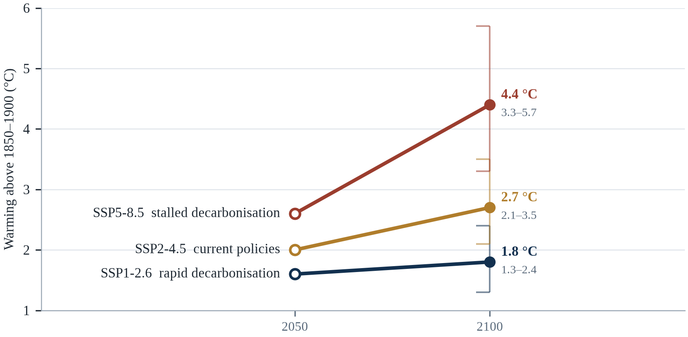||Source: Table 2.1. Bars show the 2100 range; SSP scenarios as summarised in IPCC (2021, 2023).

What would change these numbers is worth stating as plainly as the numbers themselves. A larger climate sensitivity than the central estimate, a faster loss of the land carbon sink, or an earlier collapse of Arctic summer sea ice would all push the outcomes toward the upper end. A faster decline in methane, a stronger aerosol effect from air-quality policy, or large-scale carbon removal would push them down. None of these possibilities can be resolved by argument; they will be resolved by measurement, and the measurements that matter are the ones this chapter has described — concentration, temperature, ocean heat, ice mass and sea level.

For the reader, the practical implication is a shift in attention. The question is no longer whether the physics is settled; it is which of three trajectories is being followed, and how quickly the answer becomes visible. That question is answered not by climate models but by the energy system, which is the subject of the chapters that follow.

---

# Chapter 3: Climate Systems, Feedbacks and Monitoring

*Theme: climate systems, feedback mechanisms and monitoring*

A climate is not a temperature. It is a machine with several moving parts — an atmosphere, an ocean, a cryosphere, a biosphere and a land surface — coupled so tightly that a change in one is felt in all the others, usually after a delay. The atmosphere responds in days, the ocean in decades, the ice sheets in centuries. This difference in response time is the single most important fact for anyone trying to understand why the consequences of emissions arrive long after the emissions themselves, and why some of those consequences cannot be reversed on any timetable that matters to the people experiencing them.

The couplings also explain why the climate does not warm smoothly. Heat stored in the ocean can be released years later; a shift in wind patterns can cool a continent for a decade while the planet as a whole warms; a volcanic eruption can suppress global temperature for two or three years. These internal variations are not noise in the sense of meaningless — they are the weather of the climate system, and they determine whether a particular harvest fails or survives, whether a particular city floods this year or next.

Feedback is the mechanism that turns a small push into a large response, or a large push into a small one. Warming increases atmospheric water vapour, which is itself a greenhouse gas, which produces more warming; that is a positive feedback, and it roughly doubles the effect of carbon dioxide alone. Warming melts reflective ice, exposing dark ocean that absorbs more sunlight; another positive feedback. But warming also increases the radiation the planet emits to space, which is a negative feedback and the reason the system has not run away. The balance between these effects, not the strength of any one of them, determines how sensitive the climate is.

This chapter is about that balance, about the thresholds where it can change abruptly, and about the instruments that allow us to watch it happen. It closes with the least glamorous and most consequential subject in climate science: data quality, and the question of what a measurement can and cannot tell you.

Climate is not weather averaged over a long time; it is a system with components that exchange energy, water and carbon across timescales from hours to millennia. The atmosphere responds within days, the ocean within years to centuries, ice sheets within centuries to millennia, and the biosphere within seasons to decades. That difference in response times is why the climate system carries memory: the ocean holds heat that will be released later, the ice sheets hold water that will raise seas for generations, and the carbon cycle holds gases that will warm the planet long after emissions stop.

## 3.1 The Climate System

The Earth receives about 340 watts of solar energy for every square metre of its surface, averaged over day and night and over the seasons. Roughly thirty per cent of that is reflected back to space by clouds, ice and bright surfaces — the albedo — and the remainder is absorbed by the atmosphere, the ocean and the land. Because the planet is neither heating nor cooling catastrophically on human timescales, the energy leaving must roughly equal the energy arriving. The greenhouse effect works by slowing the departure, not by adding energy; the system compensates by warming until the outgoing radiation again balances the incoming sunlight (Trenberth, Fasullo and Kiehl, 2009).

What makes the system complicated is that its components have different memories. The atmosphere forgets a temperature anomaly within weeks; the surface ocean remembers it for months to years; the deep ocean for centuries; an ice sheet for millennia. A pulse of heat injected into the atmosphere is therefore partitioned: some escapes to space immediately, some is absorbed by the ocean and returned decades later, and some is consumed melting ice. The same is true of carbon dioxide, which is exchanged continuously among the atmosphere, the biosphere and the ocean, with a small fraction remaining airborne for thousands of years.

The practical consequence is that the climate responds to a change in forcing with a lag that depends on the component being observed. Surface temperature responds within a few years, sea level over centuries, and ice sheets over millennia. Policymakers who expect a rapid visible response to emission cuts are therefore looking at the wrong variable; the response is real but it arrives first in the ocean and only later at the coast.

The components are coupled in ways that make prediction difficult. The atmosphere drives ocean circulation through wind stress; the ocean stores and transports heat; sea ice changes the reflectivity of the surface; the biosphere exchanges carbon and water with the atmosphere; and the cryosphere responds slowly but with large consequences. A change in one component propagates through the others with delays that range from days to centuries, which is why the system can appear stable for long periods and then reorganise quickly once a threshold is crossed.

The components are coupled through the flows of energy, water and carbon, and each flow has its own clock. Solar energy arrives within minutes and is absorbed or reflected within hours; the atmosphere redistributes it within days; the ocean stores it for centuries; ice sheets respond over millennia. This hierarchy of timescales is the reason a climate can be described as a state rather than a weather event, and the reason a change in forcing produces consequences that arrive in a fixed order. The fast components set the conditions that the slow components experience, while the slow components set the baseline against which the fast ones vary. A heatwave is a fast event inside a slow state, and the slow state is what determines whether that heatwave is unusual or routine.

The climate system is a set of coupled components, and the coupling is what makes the behaviour hard to predict. The atmosphere responds within days, the ocean within years, the ice sheets within centuries and the carbon cycle within millennia, and the interaction between them produces the variability that a single season cannot reveal. Energy arrives from the sun, is redistributed by the winds and currents, and leaves as infrared radiation, and the balance between the incoming and the outgoing is what a greenhouse gas changes. A small change in that balance, sustained over decades, is what produces a large change in temperature, because the imbalance accumulates in the ocean.

## 3.2 Atmosphere and Ocean Circulation

The atmosphere moves heat from the tropics toward the poles through three great cells in each hemisphere: the Hadley cell, which lifts moist air at the equator and brings it down over the subtropics; the Ferrel cell, which drives the mid-latitude westerlies; and the polar cell. The boundaries between these cells are where the jet streams run, and the position of the jets determines whether a winter storm reaches Lisbon or stalls over the North Sea. As the tropics warm faster than the poles, the temperature gradient weakens and the jets tend to shift poleward, though the effect is uneven and remains an active research question (IPCC, 2021, Chapter 4).

The ocean moves heat in parallel, and more slowly. The Atlantic Meridional Overturning Circulation carries warm surface water northward, cools it in the Nordic seas, and returns it southward as cold, dense deep water; the Gulf Stream is its most visible surface expression. The circulation transports roughly eighteen million cubic metres of water per second — about a hundred times the flow of the Amazon — and delivers heat to Europe that helps keep its winters milder than those of comparable latitudes in Canada. It is driven by differences in temperature and salinity, which is why added freshwater from Greenland's melting ice is watched so closely.

Superimposed on these steady circulations are oscillations: the El Niño–Southern Oscillation, which shifts heat across the tropical Pacific every two to seven years and alters rainfall from Peru to Indonesia; the North Atlantic Oscillation, which governs European winter weather; the Indian Ocean Dipole; the Southern Annular Mode. These patterns do not create the long-term trend, but they determine which years are hot, which are wet, and where the damage falls.

The large-scale circulation patterns that shape regional climate are themselves responding to warming, and the responses are not uniform. The Atlantic Meridional Overturning Circulation, which carries warm water north and cold water south, is projected to weaken, though the magnitude and timing are debated; the Hadley circulation is expanding, which shifts subtropical dry zones poleward; and the jet streams are becoming more variable, which allows cold air to spill south in some winters even as the average warms. Those regional shifts matter more for adaptation than the global mean.

The large-scale circulation is best imagined as an engine that moves heat from the equator toward the poles, and its patterns are shaped by the continents as much as by the physics. The trade winds and the Hadley cells lift moist air in the tropics and deposit it as rain, which is why the wettest places on land are where the rising branches sit and the driest are where the descending branches do. The mid-latitude jet streams steer storms and are disturbed by the temperature difference between the tropics and the Arctic, a difference that is narrowing. El Niño and La Niña shift the whole pattern across the Pacific for a year or two at a time. A warming world does not switch this machinery off; it changes the settings, and a change in settings redistributes rain in ways that matter more to farmers than the global average.

## 3.3 Positive and Negative Feedback Loops

The largest feedback is also the least visible. Warmer air holds more water vapour — about seven per cent more for each degree of warming, following the Clausius–Clapeyron relation — and water vapour is a powerful greenhouse gas (IPCC, 2021). The increase in water vapour roughly doubles the warming that carbon dioxide would produce on its own, which is why the climate sensitivity to a doubling of CO2 is about three degrees rather than one and a half. This is not a speculative mechanism; it is measured, and it is the reason the same physics that gives a modest direct effect gives a large total one (IPCC, 2021, Chapter 7).

Ice and snow provide a second positive feedback. White surfaces reflect sunlight; dark ocean and dark land absorb it. When ice retreats, the newly exposed surface absorbs more energy, which warms the region, which melts more ice. The feedback is strongest in the Arctic, where it contributes to the three- to fourfold amplification of warming relative to the global mean. A third comes from the carbon cycle: warming increases the respiration of soil microbes and the frequency of fire, releasing carbon that had been stored, which produces further warming.

Against these stand the negative feedbacks that keep the system stable. The planet radiates more energy as it warms, following the Stefan–Boltzmann law; the lapse rate — the rate at which temperature falls with altitude — adjusts in a way that damps the response in the tropics; and increased weathering of silicate rocks removes carbon dioxide from the atmosphere over geological time. Clouds are the great uncertainty: low clouds reflect sunlight and cool, high clouds trap heat and warm, and how their balance changes with warming remains the largest single source of spread among climate models.

A feedback is a process that amplifies or dampens an initial change, and the sign of the feedback determines whether the system is stable. Ice-albedo feedback is positive: warming melts ice, exposing darker ocean or land, which absorbs more sunlight and warms further. Water-vapour feedback is also positive, because warmer air holds more moisture, and water vapour is itself a greenhouse gas. Cloud feedback remains the largest source of uncertainty in climate sensitivity, because clouds can either reflect sunlight or trap heat depending on their height, thickness and droplet size.

Feedbacks are the difference between a modest calculation and a serious risk assessment. Water vapour is the strongest and fastest: warmer air holds more moisture, moisture is itself a greenhouse gas, and the extra warming it produces roughly doubles the response to carbon dioxide alone. Ice and snow loss darkens the surface, which absorbs more sunlight. Cloud responses are the largest remaining uncertainty, because clouds both reflect sunlight and trap outgoing heat, and the balance depends on their height, thickness and droplet size. The Planck response — the increase in outgoing radiation as the surface warms — is the stabilising term that would otherwise let the system run away. Climate sensitivity is simply the net of these terms, which is why two models can agree on the physics of a molecule and disagree about the temperature of a planet.

Feedbacks are the processes that amplify or damp a change, and the sign of each one determines whether the climate settles or runs. Water vapour is the strongest amplifier, because warm air holds more of it and water vapour is itself a greenhouse gas. The ice-albedo feedback is the most visible, because white ice reflects sunlight that dark water absorbs, so that melting accelerates melting. Clouds are the largest uncertainty, because they can cool by reflecting sunlight and warm by trapping heat, and the balance differs by altitude and by type. The slow feedbacks, from the carbon cycle and the ice sheets, are the ones that determine the eventual temperature rather than the rate of change.

## 3.4 Tipping Points and Abrupt Change

Some parts of the climate system do not respond gradually. They behave like a see-saw held just past its balance point: a small additional push produces a large, rapid and often irreversible change. Researchers call these tipping elements, and a 2022 assessment identified sixteen of them, including the Greenland and West Antarctic ice sheets, the Atlantic overturning circulation, the Amazon rainforest, boreal permafrost and warm-water coral reefs (Armstrong McKay et al., 2022; Steffen et al., 2018). The assessment found that several would be at risk at warming levels between 1.5 and 2°C, which is to say within the range that current policies are likely to produce.

The concept is easy to misunderstand. A tipping point is not a cliff edge at a precise temperature; it is a region of the parameter space in which the system loses stability, and the exact location is uncertain because the systems are complex and poorly observed. Nor does crossing a threshold always produce an instantaneous change: the Greenland ice sheet may take centuries to disappear once committed, and the Amazon may degrade over decades through fire and drought. What changes at the threshold is not the speed of the change but its reversibility.

The policy implication is asymmetric. If the system were linear, overshooting a target and returning later would be an acceptable strategy. If it contains thresholds, overshoot becomes a gamble with a permanent loss on the other side. That asymmetry, rather than any single temperature number, is the strongest argument for treating 1.5°C as a limit to be approached with caution rather than a target to be traded against other priorities (Armstrong McKay et al., 2022).

Tipping points are thresholds beyond which a component of the system reorganises into a different state, often irreversibly on human timescales (Lenton et al., 2008). Candidates include the collapse of the West Antarctic ice sheet, the dieback of the Amazon rainforest, the thaw of boreal permafrost, the shutdown of the Atlantic overturning circulation, and the bleaching of warm-water coral reefs. Lenton et al. (2008) argued that several of these could be triggered at 1.5–2 °C of warming, and later work has refined the ranges while confirming that the risk rises sharply with each fraction of a degree.

A tipping point is not a cliff edge in the ordinary sense; it is a threshold beyond which a feedback takes over from the external forcing and continues the change on its own. The characteristic signature is hysteresis: the system does not return to its previous state when the forcing returns to its previous level, because it has settled into a different basin. The Atlantic overturning circulation, the Greenland ice sheet, the Amazon rainforest, the permafrost and the tropical coral reefs are the elements most often discussed, and they differ enormously in how close the threshold is and how fast the transition would be. The honest summary is that some are more fragile than a decade ago, none can be dated with confidence, and the risk of crossing several at once is the part that models handle least well.

Tipping points are the elements of the system that can change abruptly once a threshold is crossed, and the difficulty is that the threshold is not observable in advance. The Atlantic overturning circulation, the West Antarctic ice sheet, the Amazon forest and the permafrost are the most discussed, and the estimates of their thresholds have large uncertainties. What matters for policy is not the exact temperature at which each would tip but the fact that the risk rises with every increment of warming, and that some of the changes would be irreversible on a human timescale. A risk framework that treats a tipping point as a cliff edge underestimates it; the danger is a slope whose steepness increases.

## 3.5 Temperature and Satellite Monitoring

The global temperature record is assembled from about thirty thousand land stations, several thousand ships and buoys, and a handful of satellite instruments, all processed by four independent groups using different methods. Satellites have measured the temperature of the lower troposphere since 1979, first with microwave sounders and later with infrared interferometers; they provide global coverage but suffer from orbital drift, calibration changes and the difficulty of separating the signal of the lower atmosphere from that of the surface. Reanalysis products, which combine observations with a weather model, fill the gaps and provide consistent fields of temperature, wind and humidity over the whole planet (Hersbach et al., 2020).

Each system has a characteristic error. Surface stations are precise but unevenly distributed, with dense coverage in Europe and North America and sparse coverage in parts of Africa and South America. Satellites are uniform but indirect, measuring radiance rather than temperature and requiring a radiative transfer model to convert one into the other. Reanalyses are complete but inherit the biases of their models. The skill of the system comes from the disagreement: when independent methods converge, the result is robust; when they diverge, the divergence points to a problem worth investigating.

The architecture of that system is itself a policy achievement. The Global Climate Observing System, established in 1992, sets standards for instruments, data exchange and continuity, and the Paris Agreement's transparency framework depends on it (United Nations, 2015b). When a country reports its emissions or its progress, it relies on measurements that are only credible because they are comparable across borders. Monitoring, in other words, is not a technical appendix to climate policy; it is the infrastructure that makes policy verifiable.

Monitoring is a global public good that is unevenly funded. The Global Climate Observing System defines the essential variables that must be measured, but many countries lack the stations, instruments and trained staff to measure them, and the gaps are concentrated in Africa, South America and parts of Asia — precisely where vulnerability is highest. Satellites fill some gaps, but they require calibration against ground truth, and a satellite programme that lapses takes years to replace.

The temperature record that reaches a headline is an index assembled from four kinds of measurement: land stations, ocean buoys and ships, weather balloons and satellites. Each has a different error structure and a different coverage. Ships measure the temperature of water drawn in for engine cooling, which warmed with engine design and had to be corrected; buoys measure at fixed depths; satellites measure the radiance of broad layers rather than a point. Reanalyses combine these with a weather model to produce a physically consistent grid. The agreement among independent groups is what makes the trend credible, and the disagreements in the last decimal place are what honest error bars are for, not what refutations are made of.

Temperature monitoring is a patchwork that works because the pieces are calibrated against one another. Weather stations measure at two metres above the ground and have been moved, automated and surrounded by buildings over the decades, so the records must be adjusted for those changes; the adjustments are documented and tested, and independent groups applying different methods reach similar answers (Hausfather et al., 2023). Satellites measure the temperature of the lower atmosphere by microwave sounding and have their own drift and inter-calibration problems, which is why they are anchored to the surface record and to radiosondes. Reanalyses such as ERA5 combine observations with a weather model to produce a consistent grid, and their agreement with the other records is a form of triangulation.

## 3.6 Ocean and Ice Monitoring

The ocean was, until recently, the least observed part of the climate system — a gap that mattered because it stores more than ninety per cent of the excess heat (IPCC, 2019b). That changed with Argo, an international programme that began deploying autonomous profiling floats in 2000 and now maintains roughly four thousand of them (IPCC, 2019b). Each float sinks to two thousand metres, measures temperature and salinity as it rises, transmits its data by satellite and repeats the cycle every ten days. The result is a three-dimensional picture of the ocean's heat content, updated continuously, available to anyone with an internet connection.

Ice is observed by a different combination of instruments. Satellite altimetry, which has measured sea surface height since 1992, also measures the height of ice sheets; the GRACE mission, launched in 2002, weighs them by detecting tiny changes in the Earth's gravity field. Radar and laser altimeters measure thinning, and microwave sensors map the extent of sea ice every day. Each method has blind spots — altimetry struggles at the steep margins of ice sheets, gravity missions have coarse spatial resolution — but together they have produced a consistent picture of accelerating loss (Shepherd et al., 2020).

The data from these systems are open, which is unusual for expensive infrastructure and essential for credibility. A government that disputes a sea-level projection can download the altimetry, the tide-gauge record and the gravity data and check the arithmetic itself. That openness does not settle political disputes, but it narrows the space in which they can be conducted by assertion rather than evidence.

The Argo array transformed ocean observation. Before it, subsurface temperature and salinity were measured mainly by research ships on sparse tracks, leaving vast areas unobserved; after it, about 4,000 autonomous floats drift at depth and surface every ten days to transmit profiles. The array has produced a continuous record of ocean heat content since the early 2000s, and it is the basis for estimates that the ocean has warmed at an accelerating rate (Cheng et al., 2024). Its existence is also a lesson in international cooperation: the floats are contributed by more than thirty countries and the data are freely available.

Ocean measurements changed the subject. Before the 2000s, the interior of the ocean was sampled at a few thousand points a year from research ships, mostly along trade routes, and the resulting estimates of heat content had error bars wide enough to hide a decade of change. The Argo array, a fleet of autonomous floats that sink, drift and resurface to transmit profiles, turned that sparse map into a routine census. Satellites added the mass of the ocean and the height of its surface. The result is that ocean heat content is now regarded by many scientists as the single most reliable indicator of the planet's energy imbalance, because it integrates everything the surface does and because it is less noisy than the air temperature above it.

The ocean and the ice are measured by instruments that most people never see. About four thousand Argo floats drift with the currents, dive to two thousand metres and surface to transmit their profiles, and together they give the ocean the equivalent of a weather network. Satellite altimeters have measured sea level continuously since 1993, and the record shows a rise that has accelerated from about two millimetres a year to more than four (IPCC, 2019b). Gravity-measuring satellites weigh the ice sheets and the aquifers, and their data show that Greenland and Antarctica are losing mass at rates that have increased. Glacier monitoring relies on a few hundred stakes and a great deal of fieldwork, and it is the record that shows the clearest global signal.

## 3.7 Extreme Event Attribution

Attribution began with a question about a single heatwave. After the European summer of 2003 killed tens of thousands of people, a team led by Peter Stott asked whether the probability of such an event had changed because of human influence, and answered by comparing model simulations with and without greenhouse gases (Stott, Stone and Allen, 2004). The answer — that the risk had roughly doubled — established a method that has since been applied to hundreds of events, from the Russian heatwave of 2010 to the floods of 2022 in Pakistan (WMO, 2023).

The method has become faster and more standardised. The World Weather Attribution group, founded in 2014, now produces rapid analyses within weeks of an event, using peer-reviewed protocols and large ensembles of model runs. Its findings are stated as changes in probability or intensity rather than as certainties: the 2021 Pacific Northwest heat dome was judged to be virtually impossible without climate change; the 2022 Pakistan floods were made more likely by warming, though vulnerability and land management determined the scale of the disaster; the 2023 Derna flood in Libya was linked to warmer-than-usual Mediterranean waters (Philip et al., 2022).

Attribution has limits that are easy to forget. It is more reliable for heat than for rainfall, more reliable at continental than at local scales, and weakest where observations are sparse — which is usually where the most vulnerable populations live. It also says nothing about who is responsible or who should pay; those are political questions that attribution can inform but cannot answer. Used carefully, it converts a diffuse sense of injustice into a defensible claim; used carelessly, it invites the expectation that every disaster has a single attributable cause.

Attribution studies distinguish between the influence on the magnitude of an event and the influence on its probability, and the distinction is often lost in public discussion. A heatwave may be 2 °C hotter because of climate change and also several times more likely; a rainfall event may be 10 per cent more intense without any detectable change in frequency (Clarke et al., 2022). Reporting only one of these numbers can mislead, which is why careful attribution studies report both and explain what each means for decisions about infrastructure, insurance and compensation.

Event attribution works by constructing a counterfactual world. Thousands of model runs are produced with the observed concentrations of greenhouse gases and thousands with pre-industrial concentrations, and the frequency of the event in each ensemble is compared. The ratio is expressed as a risk ratio or a change in probability, and the answer is often a statement about likelihood rather than magnitude. The method has become fast enough that studies appear within weeks of a disaster, which has changed public argument: a heatwave can now be assigned a share of its probability before the damage has been counted. The limits are real, especially for rainfall and for events driven by rare combinations, but the direction of the field is toward routine, rapid and cautious assessment.

Extreme event attribution answers a question that is narrower than it sounds: not whether climate change caused an event, but how much it changed the probability or the intensity. The technique compares two model worlds, one with the greenhouse gas concentrations that exist and one without, and counts how often each produces an event of the observed magnitude. The result is a statement about odds, and its strength depends on the quality of the models and the length of the observational record. A complementary approach constructs a physical narrative of the event and asks how the warming influenced each ingredient, which is more informative for a single case and less easily quantified.

## 3.8 Early Warning Systems

Early warning is the most cost-effective adaptation measure available, and it is still missing where it is needed most. The United Nations' Early Warnings for All initiative, launched in 2022, estimated that about half of the world's countries lack a multi-hazard early warning system, and that where systems exist they often fail at the last mile — the warning reaches a capital city but not a village, or arrives in a language and format that the people at risk cannot use (UNDRR and WMO, 2023; WMO, 2022). The same reports estimate that a twenty-four-hour warning of a coming storm can reduce damage by about thirty per cent.

Bangladesh is the standard example of what is possible. After the Bhola cyclone of 1970 killed an estimated three hundred thousand people, the country built a system of cyclone shelters, volunteer networks and mobile-phone alerts that has cut fatalities dramatically: Cyclone Amphan in 2020, a storm of comparable strength, killed roughly a hundred people (CRED, 2023). The improvement was not primarily technological. It came from shelters placed where people live, warnings issued in local languages, and drills that made evacuation routine.

Heat is the harder case, because heat kills quietly and without a visible landfall. Ahmedabad's heat action plan, adopted after a 2010 heatwave killed more than a thousand people, combines colour-coded forecasts, cooling centres, altered working hours and outreach to vulnerable groups; evaluations suggest it has reduced mortality substantially (Hess et al., 2018). The lesson generalises: a warning is only an early warning if it arrives with the capacity to act on it.

An early warning system is a chain rather than a device: observation, forecast, interpretation, decision, message, reception and action. The weakest link determines the outcome, and in most systems the weakest link is the transition from message to action. The World Meteorological Organization estimates that about one-third of the world's population is still not covered by adequate early warning systems, and that the gap is largest in Africa, where the human and economic returns on investment would be highest (WMO, 2023).

An effective warning is a chain rather than a message. A forecast produces a probability; an authority converts it into a threshold; the threshold triggers a decision; the decision reaches a person who can act. Each link can fail, and the weakest one is usually the last. Bangladesh's cyclone warning system works because the threshold, the shelters and the volunteers who knock on doors were designed together. Heat warning systems fail more often at the level of the household, because the advice to stay cool assumes a cool place to stay. The design trade-off is unavoidable: a lower threshold catches more events but produces more false alarms, and false alarms erode the trust on which the next warning depends.

An early warning system has four parts, and a system that has only the first is a broadcast rather than a warning. The first part is the forecast, which is the science. The second is the translation of the forecast into a message that a household can act on: how high the water will be, which road will close, where the shelter is. The third is the delivery, which must reach the people who are least connected rather than the people who are easiest to reach. The fourth is the response capacity, which is the shelter, the transport and the plan. The last mile is the part that failures are made of, and it is usually the cheapest part to fix.

## 3.9 Data Quality and Uncertainty

Uncertainty is not the same as ignorance, and the distinction matters for how scientific statements should be read. A measurement can be uncertain in a way that is precisely quantified — plus or minus a tenth of a degree, with a stated confidence interval — and a projection can be uncertain in a way that reflects genuine disagreement among plausible models. The first kind of uncertainty shrinks with better instruments; the second shrinks with better understanding, and sometimes not at all. Confusing the two leads either to false confidence or to unwarranted paralysis.

Climate science distinguishes between internal variability, which is the unpredictable component generated by the system itself; model uncertainty, which is the spread produced by different representations of the same physics; and scenario uncertainty, which reflects the fact that future emissions depend on choices not yet made. Only the first is reduced by more data, and only the third is reduced by policy. When a projection is presented as a range, the width of that range is usually dominated by scenario uncertainty at the end of the century and by model uncertainty in the near term.

There is also a discipline problem that the field has only recently begun to address. A dataset that is used to make a political argument will be scrutinised in a way that a dataset used only for research is not, and the scrutiny often targets the processing rather than the physics. The defence is transparency: open code, documented adjustments, published uncertainty ranges, and an explicit account of what would change the conclusion. Those practices are now standard in the major temperature and sea-level products, and they are the reason the records have survived decades of political attack.

Uncertainty in climate data has three distinct sources, and conflating them produces bad arguments. Observational uncertainty comes from instrument error and incomplete coverage; structural uncertainty comes from imperfect models; and scenario uncertainty comes from not knowing future emissions. For the next two decades, structural and observational uncertainty dominate, which means that projections of near-term warming are relatively robust; for the end of the century, scenario uncertainty dominates, which means that the choice of emissions pathway matters more than any model improvement.

Uncertainty in climate information comes in three kinds, and confusing them is the source of most bad argument. Internal variability is the noise of a chaotic system: the same forcing can produce different sequences of years, which is why a cold winter says nothing about the trend. Parameter uncertainty is ignorance about the exact value of a quantity, such as how clouds respond. Structural uncertainty is the possibility that the model's architecture is wrong in a way no parameter can fix. Ensembles address the first two by sampling them; only model evaluation and physical reasoning address the third. A single model run is a scenario, not a prediction, and quoting one number from it as a forecast is a category error.

Uncertainty in climate data takes several forms, and confusing them produces bad decisions. Observational uncertainty is the error bar on a measurement, and it is usually small. Structural uncertainty is the disagreement between models, and it is largest for precipitation and for regional projections. Scenario uncertainty is the spread that comes from not knowing what emissions will be, and it dominates the far future. Internal variability is the natural wobble of the system, and it dominates a single decade. A decision that needs the 2050 rainfall in a specific valley must combine all four, which is why the honest answer is usually a range rather than a number.

## 3.10 Using Data for Decisions

The final step is the one most often skipped: converting a probabilistic projection into a decision. The standard approach in engineering is to design for a return period — a flood defence built for the one-in-a-hundred-year event — but that approach assumes a stationary climate, which is precisely what no longer holds. A defence designed for the statistics of the twentieth century will be overtopped more often than its designers intended, not because it was badly built but because the statistics it was built against have moved.

The alternative is robust decision-making: rather than optimising for a single best estimate, identify the options that perform acceptably across a wide range of futures, and prefer those that can be adjusted as information arrives. The Netherlands' Delta Programme, which plans for sea-level rise up to several metres while building in stages that can be accelerated or paused, is the clearest example. The Thames Barrier, designed in the 1970s for a scenario that now looks optimistic, is another: its closure rate has risen from a few times a year to several times a year, and the decision to raise it further is taken on the basis of monitoring rather than prediction.

What these examples share is a willingness to treat uncertainty as a design parameter rather than an obstacle. That requires institutions capable of revisiting decisions, budgets that can be reallocated, and a public that understands why a plan might change. The technical tools are available; the constraint is almost always institutional, which is why the chapters that follow devote as much attention to governance as to physics.

Decision-making under uncertainty does not require a single best estimate. It requires a range, a probability attached to each part of the range, and a judgement about how much risk is acceptable — which is a political and ethical question, not a scientific one. Engineers already work this way when they design for a hundred-year flood; the difficulty with climate change is that the hundred-year event is itself moving, which means that design standards based on historical statistics systematically understate future risk.

Decision-makers rarely need a best estimate; they need a range of futures and a choice that performs acceptably across it. That is the logic of robust decision-making, which asks not what will happen but which option fails least badly under the widest set of plausible conditions. It favours measures that pay off whether or not the worst arrives: shade that reduces heat deaths and improves comfort, drainage that handles ordinary rain and extreme rain, water storage that serves a drought year and an ordinary one. The approach also identifies the thresholds at which a decision should change, which converts a political argument about belief into an engineering argument about triggers.

Data become useful for decisions when they are converted into a standard, and the standard is usually a return period. A drainage system designed for a one-in-fifty-year storm is a statement about the probability of flooding in any given year and about the cost that the city has decided to bear. When the climate changes, the return period of a given rainfall total shortens, and a system that met its standard when it was built may no longer do so. The practical response is to update the design standard, to add freeboard to the structures that cannot be rebuilt, and to publish the assumptions so that the people who live behind the system know what it protects them against.

## 3.11 Case Study: Argo and the Ocean That Was Hiding

Before 2000, the ocean's interior was sampled the way a continent might be mapped by a few dozen travellers: ships lowered instruments at chosen points, took a reading, and moved on. The coverage was sparse, biased toward shipping lanes, and concentrated in the northern hemisphere. Estimates of ocean heat content therefore carried uncertainties large enough to obscure the trend for a decade at a time, which meant that the largest reservoir of the climate system was also the least measured.

Argo changed that with a design of remarkable simplicity. A float is dropped from a ship; it sinks to a programmed depth, drifts with the current, then rises while measuring temperature and salinity. At the surface it transmits its data and its position by satellite, then sinks again. Each cycle takes about ten days, each float lasts about four years, and the international programme maintains roughly four thousand of them, distributed across every ocean basin (IPCC, 2019b). The data are released within a day and are free to use.

The scientific consequences were immediate. Ocean heat content became measurable with an uncertainty small enough to detect the annual increase; the seasonal cycle of the upper ocean became visible; and the deep ocean's role in absorbing heat could be quantified rather than inferred. When the record was extended backward with older ship data and forward with Argo, it showed a steady accumulation of heat that has continued every year since, with the last decade the warmest in the record (Cheng et al., 2024).

Argo also demonstrates a governance lesson. The programme works because countries contribute floats, share data and accept common standards without a central authority that can compel them. It is coordinated by a small international secretariat and sustained by the self-interest of the participants, each of whom gets access to the whole dataset in exchange for contributing a share. That model — voluntary, standardised, open — has proved more durable than many formal treaties.

The gaps that remain are instructive. Ice-covered seas, marginal seas and the deep ocean below two thousand metres are still poorly sampled, and the floats themselves are biased toward regions where deployment is easy (IPCC, 2019b). The next generation of instruments, including deep Argo and under-ice floats, is being deployed to close those gaps. The lesson for other domains is that a monitoring system is never finished; it is a commitment to keep looking, renewed each time the technology changes.

Argo also corrected a bias that had distorted earlier estimates. Expendable bathythermograph probes, dropped from ships for decades, recorded temperatures with small systematic errors that varied by manufacturer and depth, and those errors propagated into ocean heat content calculations. Reprocessing the historical record against the more accurate Argo profiles revealed that earlier estimates had understated the rate of ocean warming, which in turn raised estimates of the Earth's energy imbalance — the excess energy that the planet is accumulating because greenhouse gases slow its loss to space.

The floats are simple machines with a difficult job. Each one drifts at a depth of about a kilometre, changes its buoyancy to sink to two thousand metres and rise again, measuring temperature and salinity as it goes, and surfaces for a day to transmit its profile and fix its position by satellite (IPCC, 2019b). A float survives four or five years if it is lucky; ice, biofouling and battery failure end most careers early. The data are released within hours in near-real time and then reprocessed months later, when drift in the sensors can be corrected against reference measurements. That delayed-mode product is slower and far more accurate, and the discipline of publishing both has become a model for how observational science can be both fast and honest.

Argo measures temperature; a later generation of instruments measures mass. The GRACE satellites, launched in 2002, detect the minute variations in Earth's gravity that correspond to the movement of water and ice, and they let glaciologists weigh ice sheets rather than estimate their volume from the surface. The result was a correction: Greenland and Antarctica were losing mass faster than the older estimates suggested, and the loss has continued (Shepherd et al., 2020). Argo and GRACE turned the ocean and the ice from inferred quantities into measured ones, which is why the sea-level projections in this chapter carry a narrower range than those published a decade ago.

## 3.12 Future Scenarios and Predictions: Systems, Feedbacks and Thresholds

The future of the climate system is not a single number but a set of conditional paths, and the condition is the same one that governs the previous chapter: the cumulative carbon emitted. What this chapter adds is the possibility of abruptness. The historical record shows that the system has changed gradually for most of the last ten thousand years, and that it has also changed abruptly in the more distant past — the Younger Dryas cold snap, the collapse of ice sheets at the end of the last glaciation — when a threshold was crossed (IPCC, 2021). The question for the next century is whether the thresholds now being approached will be crossed slowly or quickly.

The present position is that several of the slower variables have already begun to move. The Atlantic overturning circulation is weaker than at any time in the last millennium according to proxy reconstructions, though the size and significance of the decline remain contested (Caesar et al., 2021). Arctic sea ice is on a trajectory to be essentially absent in September before mid-century under all but the lowest emission scenarios. Warm-water coral reefs have already suffered four global bleaching events, and the interval between them has shortened.

The slow variables matter as much as emissions. If the overturning circulation weakens moderately, European winters cool slightly while the tropics warm faster; if it collapses, the regional consequences are severe and the global consequences are still debated. If the Greenland ice sheet is committed to long-term loss, sea level rises for centuries regardless of what happens to emissions after mid-century. These are not alternative theories; they are different positions on a continuum of probability, and the monitoring systems described above are what allow the probabilities to be updated.

The possibility that matters most for this chapter is not a gradual trend but a threshold crossed without warning. Several of the candidate tipping elements would announce themselves through changes in variability before they changed state: the overturning circulation would become more erratic, a forest would take longer to recover from drought, an ice sheet would calve more frequently. Those signals are subtle and require long, uninterrupted records to detect. The practical conclusion is not that catastrophe is imminent but that monitoring is a form of insurance: a system that stops measuring because the measurements are inconvenient has removed its own ability to see the transition coming.

[[TABLE:Table 3.1 System thresholds and what to watch for]]
| Element | Threshold of concern | Time to observe change | Signal to monitor |
|---|---|---|---|
| Atlantic overturning | Weakening beyond ~15% of baseline | Decades | Florida Strait transport; Labrador Sea density |
| Arctic summer sea ice | Below 1 million km² in September | Years | NSIDC extent; ice thickness from CryoSat |
| Greenland ice sheet | Committed loss above ~1.5°C | Centuries | GRACE gravity; surface melt days |
| Amazon rainforest | Dieback beyond ~20–25% forest loss | Decades | Fire counts; dry-season length; carbon flux |
| Coral reefs | Frequent bleaching at 1.5°C; collapse at 2°C | Years | Degree-heating weeks; reef surveys |

Two implications matter for decisions. The first is that monitoring is not a scientific luxury but an early-warning system for the planet: the sooner a threshold is detected, the more options remain. The second is that the standard tools of cost-benefit analysis are poorly suited to a system with thresholds, because they average over outcomes that are not interchangeable. A small probability of an irreversible change is not equivalent to a larger probability of a recoverable one, and any appraisal that treats them as equivalent will systematically underinvest in prevention.

A clear, sustained weakening of the overturning circulation would raise the urgency of every adaptation decision in Europe and West Africa. A decade without further Arctic sea-ice decline would suggest that the system is more resilient than the models assume. Neither is likely to be decisive on its own, and that is the nature of a system observed at the pace of decades: the evidence arrives slowly, and the decisions cannot wait for it.

---

# Chapter 4: Extreme Heat and Urban Health

*Theme: extreme heat, urban heat islands and the physiology of heat death*

Heat is the deadliest climate hazard in most years, and the least visible. A flood leaves debris, a fire leaves ash, a hurricane leaves a coastline that can be photographed from space. A heatwave leaves bodies in apartments, morgues that fill quietly, and death certificates that list cardiac arrest rather than exposure (Red Cross, 2020). The number of people killed by heat is therefore almost always discovered later, by epidemiologists comparing the deaths that occurred with the deaths that would have been expected, rather than by officials counting at the scene.

The physical basis is simple. The human body produces heat continuously and must lose it to the environment. It does so by radiation, convection, evaporation of sweat and, to a small extent, by breathing. When air temperature approaches skin temperature, radiation and convection stop working and evaporation becomes the only route. When humidity is also high, evaporation slows, and the body's core temperature begins to rise. At a wet-bulb temperature near 35°C — the theoretical limit at which sweat can no longer cool the body — even a healthy adult at rest will overheat within hours (Vecellio et al., 2022).

Cities make this worse in ways that are measurable. Concrete and asphalt absorb solar radiation during the day and release it at night, so the urban heat island is strongest after sunset, when the body most needs relief. Buildings block wind, traffic adds waste heat, and the loss of trees removes shade and transpiration. The result is that a heatwave of the same meteorological magnitude can be survivable in a village and lethal in a city, and that the difference is concentrated in the neighbourhoods with the least green cover and the oldest housing.

This chapter examines heat as a physical hazard, as a physiological stress, as an urban design problem and as a public health emergency. It pays particular attention to the question that determines whether a heatwave becomes a disaster: who is exposed, who is warned, and who has somewhere cooler to go.

A flood destroys buildings that can be photographed; a heatwave leaves buildings intact and kills people inside them. In Europe alone, the World Health Organization attributes more than 175,000 deaths a year to heat (WHO, 2023; Vicedo-Cabrera et al., 2021). The Lancet Countdown estimates that heat-related mortality among people over 65 has risen by 167 per cent compared with the 1990s (Romanello et al., 2024). Those figures are estimates built from excess mortality studies, because heat is rarely recorded as a cause of death on a certificate.

## 4.1 Measuring Heat: Temperature, Humidity and Wet-Bulb

A thermometer in the shade measures air temperature, but the body responds to a combination of temperature, humidity, wind and radiation. The heat index, familiar from weather forecasts, approximates the apparent temperature by combining temperature and relative humidity. Wet-bulb temperature goes further: it is the lowest temperature to which a surface can be cooled by evaporation, and it is the variable most closely tied to the body's ability to shed heat. A dry 45°C is dangerous; a humid 35°C wet-bulb is close to unsurvivable for more than a few hours (Vecellio et al., 2022).

The theoretical limit of 35°C wet-bulb was proposed by Sherwood and Huber (2010) on the basis of a resting metabolic rate. Laboratory work since then has found that the critical wet-bulb temperature for healthy young adults at rest is closer to 31°C, and lower still during light activity (Vecellio, Wolf, Cottle and Kenney, 2022). Older people, people with cardiovascular disease, pregnant women and children reach their limits earlier. The practical implication is that conditions once considered rare are already occurring in South Asia and the Persian Gulf, and that the margin between discomfort and death is narrower than the 35°C figure suggests.

Heat is also cumulative. A single hot day is survivable; a week of hot nights is not, because sleep is when the body recovers. Public health agencies therefore increasingly report heat in terms of consecutive days above a threshold, or degree-days, rather than daily maxima. The distinction matters for warnings: a forecast of 40°C for one afternoon is a different emergency from a forecast of 35°C for seven consecutive days with nights above 28°C (Ebi et al., 2021).

Wet-bulb temperature is the measure that matters physiologically because it captures the combined effect of heat and humidity on the body's ability to cool by sweating. A dry 45 °C day is survivable for a healthy adult in shade with water; a humid 35 °C day is not, because sweat cannot evaporate and the body's core temperature rises (Ebi et al., 2021). The theoretical limit of about 35 °C wet-bulb was identified by Sherwood and Huber (2010); experimental work by Vecellio et al. (2022) found that even 31 °C wet-bulb can be dangerous for older adults at rest, which means the practical limit is lower than the textbook figure.

The measure has become useful to city governments for a practical reason: it can be computed from the temperature and humidity that a weather station already records, so a heat action plan can set its trigger in wet-bulb terms without new equipment. That matters because the trigger is where most plans fail. A threshold set in dry-bulb temperature will fire on hot afternoons that harm nobody and stay silent on humid days that kill, and the error runs in the direction that produces no complaints and no learning. Setting the threshold in wet-bulb terms forces the plan to be calibrated to the physiology of the people it protects, and it makes the trigger reviewable, which is the property that lets a city improve it after a bad summer instead of discovering the flaw in the mortality statistics.

Heat is measured in several ways and the choice of measure determines who is warned. Air temperature is what the thermometer reports and what a forecast usually quotes; it does not tell a person how the body will respond. Wet-bulb temperature accounts for humidity, because the evaporation of sweat is the mechanism of cooling, and it is the better measure of physiological danger. The heat index combines the two into a number that is intended for the public, and the wet-bulb globe temperature adds solar radiation and wind for the purposes of work and sport. A warning that quotes the air temperature alone will underestimate the danger in a humid city and overestimate it in a dry one.

## 4.2 The Physiology of Heat Illness

Heat illness progresses along a continuum. Heat cramps are painful muscle spasms caused by salt loss; heat exhaustion produces weakness, dizziness, headache and nausea as blood pools in the skin and the heart struggles to maintain blood pressure; heatstroke occurs when the core temperature exceeds about 40°C and the body's thermoregulation fails (Ebi et al., 2021). Heatstroke is a medical emergency with a mortality rate that can exceed 50 per cent if cooling is delayed, and it can leave survivors with permanent neurological damage (Ebi et al., 2021).

The pathway to death is often cardiovascular rather than thermal. During a heatwave, the heart works harder to pump blood to the skin for cooling, while sweating reduces blood volume. People with narrowed coronary arteries, heart failure or kidney disease can die of a heart attack or kidney failure without ever reaching the temperature that defines heatstroke. This is why excess mortality during heatwaves is dominated by cardiovascular and respiratory causes, and why death certificates rarely mention heat.

Certain medications increase risk. Diuretics reduce blood volume; beta-blockers limit the heart's ability to increase output; anticholinergics reduce sweating; some antidepressants impair the perception of thirst. People who live alone may not notice the onset of symptoms, and people with dementia may not be able to seek help. The physiological and the social therefore combine: the same temperature that causes discomfort in a healthy adult can be lethal to an isolated elderly person on the top floor of a building without shade.

Heat illness progresses along a spectrum that is easy to misjudge. Heat cramps and heat exhaustion are reversible with rest, shade and fluids; heatstroke is a medical emergency in which core temperature exceeds 40 °C and the central nervous system begins to fail, and it can develop within an hour of exertion in severe conditions (Ebi et al., 2021). The organs most vulnerable are the brain, kidneys, heart and liver, and survivors of heatstroke often carry long-term neurological and renal damage. Because symptoms can appear late, the people most at risk may not recognise what is happening until they are unable to act.

The cascade begins with blood. To move heat from the core to the skin, the heart increases output and redirects blood away from the gut and kidneys, which is why heat illness often presents as fainting, nausea or kidney injury rather than as heatstroke. Sweating loses water and salt, thickening the blood and raising the risk of clots; dehydration reduces blood volume, so the heart must work harder at the moment it has less to work with. Older people begin with less reserve, and many take drugs — diuretics, beta blockers, antidepressants — that interfere with sweating or with the cardiovascular response. Acclimatisation is real but slow: a week or two of gradual exposure increases sweat rate and lowers salt loss, which is why the first hot spell of a season kills more than a later one of equal temperature.

Heat illness is a sequence rather than a single condition, and the sequence is what makes it easy to miss. Heat cramps come first, then heat exhaustion, with dizziness, nausea and a rapid pulse, and then heat stroke, when the core temperature passes forty degrees and the body's cooling mechanism fails. Between exhaustion and stroke there is a window in which a person can be cooled and saved, and the window closes quickly for the old and the ill. The physiology explains the epidemiology: the people who die are not the ones who ignored a warning, but the ones whose bodies could not mount the response that the warning assumed.

## 4.3 The Urban Heat Island

The urban heat island is one of the best-documented effects of human settlement. Cities are typically 3 to 7°C warmer than their rural surroundings during the day and can be more than 10°C warmer at night (IPCC, 2022a). The causes are well understood: dark surfaces absorb more solar radiation, buildings have a high thermal mass and release heat slowly, the geometry of streets traps radiation, vehicles and air-conditioning units release waste heat, and vegetation that would otherwise cool the air through transpiration is scarce.

The intensity varies enormously within a single city. Satellite measurements of land surface temperature in Jakarta, Delhi, Manila and São Paulo show differences of 5 to 10°C between neighbourhoods a few kilometres apart, with the hottest areas corresponding to dense informal settlements, industrial zones and bare ground, and the coolest to parks, tree-lined streets and water bodies (IPCC, 2022a). Because these differences track income, the urban heat island is also a map of inequality: the people with the least capacity to buy cooling live in the hottest places.

Urban form determines how the heat island will change. A city that grows through sprawl with dark roofs and wide asphalt roads will intensify it; a city that protects green space, plants street trees, uses reflective materials and preserves ventilation corridors can keep it in check even as the climate warms. The decisions are made in building codes, zoning rules and investment plans, which is why heat policy is inseparable from urban planning.

The urban heat island is produced by materials and geometry rather than by climate alone. Asphalt and concrete absorb solar radiation and release it slowly; buildings trap heat between them and block the wind; vehicles and air conditioners add waste heat; and the loss of trees removes shade and evapotranspiration. The result is that a city can be several degrees warmer than its surrounding countryside, and the difference is largest at night, which is precisely when the body needs relief.

A city is not uniformly hot. On the same afternoon, a shaded street with mature trees can be several degrees cooler than a bare asphalt square a kilometre away, and the difference is explained by four factors: the fraction of sky visible from the ground, the thermal mass and reflectivity of surfaces, the heat released by vehicles and air conditioners, and the presence of vegetation that cools by transpiration. Urban geometry matters as much as material: a narrow street with tall buildings traps heat and blocks the night-time radiation that would otherwise cool it. Measurement therefore requires more than one official station, which is usually sited in a park or at an airport, and the intra-urban differences are large enough to determine who dies in a heatwave.

The urban heat island is the difference between the temperature of a city and the temperature of the countryside around it, and it is produced by the materials rather than by the climate. Asphalt and concrete absorb solar radiation and release it slowly, the geometry of streets traps the heat that would otherwise escape, vehicles and air conditioners add waste heat, and the vegetation that would have cooled the air through evaporation has been replaced by surfaces that cannot. The difference is typically a few degrees, and it is largest at night and during calm, clear weather, which is precisely when the danger to health is highest. Within a city the difference is not uniform: the hottest neighbourhoods are usually the ones with the least shade and the least money.

## 4.4 Who Dies in a Heatwave

The epidemiology of heat mortality is remarkably consistent across countries. The elderly account for the majority of deaths, particularly those over 75 and those living alone. People with pre-existing cardiovascular, respiratory, renal or psychiatric conditions are at elevated risk. Outdoor workers, construction labourers, agricultural workers and delivery riders are exposed to the highest temperatures for the longest periods. Homeless people, prisoners, refugees and people in informal settlements are exposed both to heat and to the absence of cooling.

The Chicago heatwave of July 1995 is the canonical study (Klinenberg, 2002). More than 700 people died in five days, most of them in their homes, and the distribution was not explained by temperature alone. Eric Klinenberg's social autopsy found that neighbourhoods with similar demographics and similar temperatures had very different death rates, and that the difference was associated with social isolation, fear of crime, and the quality of the local social infrastructure — whether people knew their neighbours, whether they trusted the city, whether they were willing to leave their apartments (Klinenberg, 2002).

The European heatwave of August 2003 killed an estimated 70,000 people, with France alone accounting for nearly 15,000 (Robine et al., 2008). The deaths were concentrated among the elderly, many of whom were left in apartments without air conditioning while their families were on holiday, and the crisis exposed the absence of a public health plan for heat. The 2022 European summer, by contrast, killed about 61,700 people despite a much better warning system, which suggests that warnings alone are insufficient when the underlying vulnerability remains (Ballester et al., 2023).

Each of those factors is a mechanism as well as a marker: age reduces the capacity to sweat, cardiovascular disease reduces the capacity to compensate, living alone removes the person who would have noticed, and a top-floor flat turns a warm night into a lethal one. Klinenberg's study of Chicago in 1995 found that social isolation was a stronger predictor than income, and subsequent research has confirmed that the presence or absence of people who notice your absence determines survival more than the temperature of the room.

The largest excess is among people over seventy-five, particularly women living alone, followed by people with cardiovascular or respiratory disease, serious mental illness, dementia, and those who are socially isolated. Outdoor workers, the homeless and prisoners are exposed by circumstance rather than frailty. Social contact is protective in a way that is easy to underestimate: a neighbour who knocks on the door in the afternoon finds the person who has collapsed, and a telephone call from a clinic does the same at a distance. The Chicago heatwave of 1995 made this visible when the distribution of deaths followed the map of isolation rather than the map of temperature, and the lesson has been confirmed repeatedly since (Klinenberg, 2002).

The people who die in a heatwave are not a random sample of the population. Age is the strongest predictor, because the physiology of thermoregulation weakens with time, and the risk rises sharply for people over seventy-five. Isolation is the second, and it is the one that explains why so many deaths occur indoors, in flats where nobody came to check. Poverty determines the housing, the ability to run a cooler, and the ability to leave. Pre-existing illness, and the medication that treats it, can impair the body's ability to sweat or to regulate blood pressure. The pattern is consistent across countries and decades, which is why the interventions that work are targeted rather than general.

## 4.5 Counting the Dead: Excess Mortality

Heat deaths are counted by comparing the number of deaths observed during a heatwave with the number expected from historical averages for the same period. The difference is excess mortality. The method is robust to the misclassification of individual death certificates, because it does not require the certifier to recognise heat as a cause; it only requires that the total number of deaths be counted accurately. This is why epidemiological estimates of heat deaths are usually much higher than official counts.

The method has limitations. Heat can displace deaths that would have occurred within weeks — a phenomenon known as mortality displacement, or harvesting — which means that a heatwave may accelerate deaths rather than cause them. Studies generally find that displacement accounts for a minority of excess deaths, especially for severe heatwaves, but the size of the effect is contested. Excess mortality also captures deaths from other causes that rise during heatwaves, such as heart attacks and kidney failure, which may not be recorded as heat-related.

The global burden is large. The World Health Organization estimates about 489,000 heat-related deaths a year between 2000 and 2019 (WHO, 2023). The figure is an estimate, not a count, and it depends on assumptions about temperature-mortality relationships that vary by location. But the direction is unambiguous, and the trend is one of the clearest signals that climate change is already affecting human health.

Excess mortality analysis compares the number of deaths observed during and shortly after a heat event with the number expected from seasonal baselines, and it typically finds tolls several times higher than the number of death certificates that mention heat. The method has limitations — baselines are estimates, and displacement of deaths can bias results — but it is the best available way to measure the true burden. Countries that maintain weekly mortality registries can produce estimates within weeks; countries without them rely on retrospective studies that may never be done.

Excess mortality compares the deaths observed during a hot period with the deaths that would have been expected from the same weeks in an ordinary year, and the choice of baseline changes the answer. A baseline built from the previous five years is simple but vulnerable to a bad flu season; a baseline that models temperature and mortality jointly can separate the effect of heat from the effect of an epidemic. The method then faces the displacement problem: some of the people who die during a heatwave would have died within weeks anyway, so the net loss may be smaller than the raw count. Studies generally find that displacement accounts for a minority of the excess, but the disagreement is large enough that the same event can be reported with figures that differ by half.

Counting the dead in a heatwave requires a method rather than a list, because heat is rarely written on a death certificate. The standard approach is to count all deaths during the hot period and compare them with the number that would have been expected from the same days in other years, and the difference is the excess. The choice of the comparison period, the length of the window and the treatment of the harvest effect — the short-term depletion of people who were already frail — all change the answer. In countries with incomplete registration the count is an estimate built from surveys, and the estimates are usually lower than the true toll, which is one reason the official figures understate the problem.

## 4.6 Heat Action Plans and Early Warning

Ahmedabad, India, adopted one of the first heat action plans in South Asia after a 2010 heatwave killed more than 1,300 people (Hess et al., 2018). The plan combines a colour-coded forecast system, cooling centres in public buildings, adjusted working hours for outdoor labourers, water distribution, and outreach to slum communities through community health workers. An evaluation published in 2018 estimated that the plan had prevented about 1,190 deaths a year, though the authors cautioned that the estimate depended on assumptions about the counterfactual (Hess et al., 2018).

The components of an effective plan are now fairly standard. A warning system that triggers specific actions at specific thresholds; a communication strategy that reaches people in their own languages through channels they trust; a registry of vulnerable people, particularly the elderly living alone; designated cooling spaces that are open, accessible and free; and a protocol for hospitals and emergency services to prepare for surges. The weakest link is usually the last mile: the warning exists, but the person at risk does not hear it, cannot act on it, or has nowhere to go.

Plans also fail when they are designed for the wrong hazard. A plan built around daily maximum temperature will miss a heatwave with moderate daytime temperatures and very hot nights, which is precisely the pattern that kills in humid cities. Plans built around a single city will miss rural workers and informal settlements outside the administrative boundary. And plans that are not rehearsed will not be implemented when the emergency arrives, because the agencies involved will be learning their roles in real time.

Heat action plans work, and the evidence is unusually strong for an adaptation measure. Ahmedabad's plan, developed after a 2010 heatwave killed more than 1,300 people, combined forecast-triggered warnings, cooling centres, changes to work hours and outreach to vulnerable residents; Hess et al (Hess et al., 2018). (2018) estimated that it prevented about 1,190 deaths a year. The key design feature is not the warning but the pre-agreed actions that follow it, and the fact that responsibility is assigned to specific agencies rather than left to individuals.

Urban heat is distributed unequally within a single city, and the inequality is measurable from space. Land surface temperature maps derived from satellite data show differences of five to ten degrees Celsius between neighbourhoods a few kilometres apart, and the hottest areas are consistently the ones with the least tree cover, the most asphalt and the poorest residents. Research in United States cities has found that formerly redlined neighbourhoods are several degrees hotter than the areas that were not, because the historical refusal of mortgage lending shaped decades of investment in trees, parks and shade. Heat is therefore not only a climate phenomenon; it is an inherited pattern of public investment.

The binding constraint on a heat plan is usually not the plan but the register it depends on. Knowing that a city has four hundred thousand residents over seventy is useless; knowing which of them live alone, lack cooling and have a cardiac condition is what allows a volunteer to knock on the right door (Klinenberg, 2002). The cities with functioning registers built them from general practice lists, utility accounts and pharmacy records, with a consent procedure that satisfied data protection law, and the ones that failed tried to build them during the first heatwave. A register is therefore an ordinary piece of administration that has to be commissioned in a cool month by someone who will not be thanked for it.

## 4.7 Heat at Work: Productivity and Labour

Heat affects economies through labour as well as through death. The International Labour Organization estimates that heat stress already reduces global working hours by about 2.2 per cent, equivalent to 80 million full-time jobs, and that the loss could rise to 2.4 per cent by 2030 under a high-emission scenario (ILO, 2019). Agriculture accounts for about 60 per cent of the lost hours, followed by construction and industry (ILO, 2019). The losses are concentrated in South Asia, Sub-Saharan Africa and Southeast Asia, where outdoor work is common and cooling is scarce.

The mechanism is physiological. Above about 26°C wet-bulb, the body must divert blood to the skin to dissipate heat, which reduces the blood available to muscles and the brain (Vecellio et al., 2022). Physical capacity declines, error rates rise, and the risk of accidents increases. Workers adapt by taking breaks, shifting hours to early morning or night, and drinking more water, but these adaptations have limits, and they are often unavailable to workers paid by output rather than by time.

The economic consequence is not only lost output but lost income. A construction worker who cannot work during the hottest hours loses a fraction of daily wages; a farmer whose crop fails loses a season. Because informal workers rarely have heat insurance or sick leave, the cost is transferred to the household. Heat policy is therefore also labour policy, and the most effective interventions often involve collective bargaining, enforceable rest breaks and access to shade and water on site.

Heat reduces labour productivity through two channels: it slows work, and it forces rest breaks that reduce output. The International Labour Organization estimates that heat stress already costs the equivalent of more than 2 per cent of total working hours globally, and that the loss is concentrated in agriculture and construction in tropical regions (ILO, 2019). The economic loss falls on workers paid by output, which means that the people most exposed to heat are also the people with the strongest incentive to keep working through it.

The most replicated heat intervention in the global South is the city heat action plan, and its diffusion began in India. Ahmedabad's plan, developed after the 2010 heatwave, combined a forecast trigger, colour-coded warnings, cooling centres and outreach through community health workers, and evaluations estimated that it prevented more than a thousand deaths a year (Hess et al., 2018). The Indian government subsequently asked states to prepare similar plans, and by 2023 more than twenty had done so, with wide variation in quality. The lesson from the Indian experience is that the plan is cheap and the implementation is political: the cities that acted had a municipal health officer who owned the problem.

Heat reduces the capacity to work before it makes anyone ill. Above roughly 25 °C wet-bulb, the body's ability to lose heat by sweating begins to limit sustained physical effort, and the effect is largest for work that cannot be moved indoors or scheduled at night: agriculture, construction, brick kilns, garment factories, delivery (Vecellio et al., 2022). Piece-rate pay converts the physiological limit into an economic one, because a worker who slows down earns less and has an incentive to ignore the warning signs. The result is a productivity loss that is concentrated in countries with the least capacity to absorb it, and an occupational safety gap in which the standards that protect workers in rich countries are often absent where the heat is worst. Shade, water, rest and schedules are cheap; enforcement is not.

Heat at work is measured in productivity rather than in deaths, and the loss is largest in the sectors that cannot be moved indoors. A construction worker, a farm labourer, a garment worker in a factory without ventilation and a delivery rider each slow down as the temperature rises, and the slowdown is a physiological necessity rather than a choice. The estimates of the loss to the global economy run into several percentage points of working hours by mid-century, and the loss falls on the countries where the work is outdoors and the wages are low. The piece rate is the mechanism that makes it worse: a worker paid by the unit takes fewer breaks, and the fewer breaks are the ones that protect the kidneys.

## 4.8 Cooling, Energy and Equity

Air conditioning saves lives, and its spread is one of the reasons heat mortality has fallen in high-income countries even as heatwaves have become more severe. The International Energy Agency counted about 1.6 billion air-conditioning units in 2016 and projected that the number could reach 5.6 billion by 2050, with most of the growth in developing countries. Cooling already accounts for about a tenth of global electricity consumption, and demand peaks during exactly the hours when the grid is most stressed.

The equity problem is that the people who most need cooling are least able to afford it. In many cities, electricity is unreliable, the upfront cost of an air conditioner is prohibitive, and landlords do not pay for efficiency improvements. Passive cooling — shade, insulation, reflective roofs, cross-ventilation, courtyards, trees — is cheaper and does not increase emissions, but it requires design decisions that are locked in for decades and is difficult to retrofit into informal housing.

There is also a feedback loop. Air conditioning releases waste heat into the street, raising the outdoor temperature and increasing the demand for cooling in neighbouring buildings. The effect is small relative to the heat island but measurable in dense districts. The solution is not to discourage cooling but to combine it with efficiency standards, building codes, urban greening and protection for people who cannot pay — a package that treats cooling as infrastructure rather than as a consumer good.

Air conditioning saves lives and creates a new set of problems. It reduces heat mortality substantially where it is available and affordable, but it raises electricity demand precisely when the grid is most stressed, it releases waste heat into streets, and it uses refrigerants that are potent greenhouse gases if they leak. The policy response is not to discourage cooling but to make it efficient, to pair it with building design that reduces the need, and to ensure that the households least able to pay are not the ones left without it.

Air conditioning saves lives and creates problems at the same time, and both parts are true. It reduces heat mortality sharply where it is available and affordable, which is why the spread of cooling in rich countries has decoupled heat deaths from temperature to some degree. But it raises electricity demand precisely when the grid is most stressed, it releases heat into the street, and it adds emissions unless the power is clean. Ownership is unequal within cities and between them: the households most at risk are often those least able to buy and run a unit. The policy that follows is not to discourage cooling but to combine efficiency standards, passive design, protection for those who cannot pay, and a grid that can carry the summer peak.

Cooling is becoming the largest new source of electricity demand in the world, and the distribution of that demand is a justice problem. The households that most need cooling are often the ones that cannot afford the appliance or the bill, and the utility that must meet a summer peak builds capacity that sits idle for most of the year. The result is a loop: heat raises demand, demand raises emissions, emissions raise heat. Breaking the loop requires efficiency standards that make the appliance cheaper to run, building codes that reduce the need for it, and tariff structures that protect the people who cannot pay. The alternative, which is to let the market allocate comfort, produces a world in which the survivors of a heatwave are the ones with air conditioning.

## 4.9 Designing Cooler Cities

Urban heat can be reduced by design, and the interventions are well understood. Street trees are the most effective single measure: a mature canopy can lower surface temperature by 10 to 15°C and air temperature by 2 to 4°C within its shade (Iungman et al., 2023). Reflective roofs and pavements raise albedo and reduce heat absorption. Green roofs and walls insulate buildings and cool the air through transpiration. Water features, parks and ventilation corridors allow cool air to move through the city.

The evidence base has improved. A study of 601 European cities estimated that increasing tree cover to 30 per cent could have prevented about 2,600 heat deaths a year, roughly a third of the total, and that the benefit was largest in southern and eastern Europe (Iungman et al., 2023). Modelling of US cities found that reflective roofs and street trees could reduce afternoon temperatures by 1.5 to 3°C in dense neighbourhoods. The interventions pay for themselves through reduced cooling demand, improved air quality and lower mortality.

The obstacle is not knowledge but implementation. Trees take decades to mature, compete for space with utilities and parking, and require maintenance that municipal budgets often lack. Reflective roofs need building codes that are enforced. Ventilation corridors need planning rules that resist the pressure to build on every open space. The cities that succeed tend to have a dedicated heat office, a long-term budget and a political constituency that treats heat as a public health issue rather than an inconvenience.

Urban design can lower temperatures by several degrees without mechanical cooling. Street trees provide shade and release water vapour; reflective roofs and pavements reduce heat absorption; green roofs and walls insulate buildings; parks and water bodies create cool islands; and building orientation and ventilation allow night-time flushing of heat. The measures are well understood, and the main barriers are cost, maintenance and the distribution of benefits, because trees planted in wealthy neighbourhoods improve the microclimate for people who already have air conditioning.

The cheapest cooling is urban form. Trees cool by shade and by transpiration, and a mature canopy can lower surface temperatures by several degrees; their limits are water and space, and the species that survive a hotter, drier future are not always the ones planted today. Cool roofs reflect sunlight and reduce indoor temperatures at low cost, but they work best where the building envelope is otherwise poor. Street orientation, building height and the width of the gap between blocks determine how much heat is trapped at night. None of these measures requires new technology; all of them require coordination between agencies that rarely plan together, and maintenance that outlives a political cycle.

Designing a cooler city is mostly a matter of geometry and surface, and the interventions are well understood. Streets that are oriented to channel the prevailing breeze, buildings that are tall enough to shade the street but not so tall that they trap the air, trees that shade the pavement and transpire water, roofs that reflect rather than absorb sunlight, and surfaces that allow water to infiltrate instead of running off. Each measure has a measurable effect, and the effects combine. The obstacle is not the physics but the ownership: the street is public, the building is private, the tree takes twenty years to grow, and the budget is annual. Cities that have succeeded have made shade a design requirement rather than an amenity.

## 4.10 The Limits of Adaptation

Adaptation to heat has real limits. Once wet-bulb temperatures approach the physiological threshold, no amount of shading, cooling or behaviour change can make outdoor work safe, and even indoor spaces without mechanical cooling become lethal. The regions most exposed — the Indus Valley, the Persian Gulf, the North China Plain, parts of West Africa — are also regions with large populations, limited air conditioning and fragile grids. In those places, adaptation buys time but does not remove the hazard.

The second limit is economic. Cooling for everyone would require a massive expansion of electricity generation, much of which would need to be low-carbon to avoid worsening the problem it addresses. The International Energy Agency estimates that efficient cooling could halve the growth in demand relative to a business-as-usual path, but efficiency requires standards, financing and enforcement that many countries lack. The third limit is behavioural: people underestimate their own vulnerability, especially if they have survived previous heatwaves, and warnings that are repeated without visible consequences lose credibility.

These limits do not make adaptation pointless. They define the boundary between what can be managed and what must be prevented. A city that plants trees, insulates homes, protects outdoor workers and opens cooling centres can prevent most heat deaths at 1.5°C or 2°C of warming (Ebi et al., 2021). At 3°C or 4°C, the same city will face conditions that no amount of planning can fully offset (Iungman et al., 2023). That is why heat policy must be paired with emission reduction: adaptation and mitigation are not alternatives but two halves of the same decision.

Adaptation to heat has limits that are physical, economic and social. Physiological limits are the clearest: above a certain wet-bulb temperature, no amount of shading, water or rest allows a resting adult to avoid a rise in core temperature. Economic limits appear when cooling becomes unaffordable for households or when the grid cannot meet peak demand. Social limits appear when the people most at risk are also the least able to change their behaviour — outdoor workers, homeless people, prisoners, and elderly residents who cannot leave home.

There is a ceiling to adaptation, and it is lower than the ceiling to emissions reduction. For a healthy adult at rest in shade with unlimited water, survival is possible well beyond the temperatures most cities experience; for an outdoor worker in the sun, the limit arrives much sooner; for an older person in a flat without cooling, sooner still (Sherwood & Huber, 2010). When heat and humidity combine beyond the point at which sweat evaporates, no behaviour saves the body, and the only remaining options are mechanical cooling and retreat. The practical implication is that adaptation buys time and reduces deaths at moderate warming, but it cannot make a 4 °C world survivable in the tropics, which is why the two agendas are complements rather than substitutes.

Adaptation to heat has a ceiling, and the ceiling is physiological rather than economic. The human body cools itself by evaporating sweat, and the rate at which it can do so depends on the humidity of the air. Beyond a wet-bulb temperature of about thirty-five degrees, evaporation cannot keep the core temperature within a survivable range, even for a healthy adult at rest in the shade. Research since has shown that the threshold is lower for older people and for those with cardiovascular disease, and that it is approached more often than the global maps suggest. The implication is that cooling, shade and behaviour change can reduce harm in a warmer world, and that there are conditions under which no arrangement of them is sufficient.

## 4.11 Case Study: The European Summer of 2022

The summer of 2022 was the hottest in Europe since records began, and it was preceded by a spring drought that had already lowered rivers and dried soils. Temperatures exceeded 40°C in Britain for the first time, reached 47°C in Portugal, and persisted across the Mediterranean for weeks. Wildfires burned more than 800,000 hectares across the continent, the largest area in the European record, and the combined effect of heat and drought reduced maize and sunflower harvests by double-digit percentages (Ebi et al., 2021).

The mortality estimate published in Nature Medicine attributed about 61,700 deaths to the summer, with the highest numbers in Italy, Spain, Germany and France (Ballester et al., 2023). The figure was lower than the 70,000 of 2003 in absolute terms, but the summer was hotter, which suggests that adaptation had reduced the death rate per degree even as the absolute burden remained enormous. The authors noted that the estimate depended on the choice of temperature-mortality model and that the true figure could be higher.

The pattern of deaths revealed the limits of adaptation. Most deaths occurred among people over 75, many with cardiovascular or respiratory disease, and many in households without air conditioning. Southern European countries with older housing stock and less air conditioning had higher death rates than northern countries with cooler climates but better building standards. The lesson is that vulnerability is not simply a function of latitude: it is a function of housing, income, age structure and the presence of a plan.

The policy response varied. France, which had built a national heat plan after 2003, activated a colour-coded alert system, opened cooling centres and sent text messages to vulnerable households. Spain and Italy introduced restrictions on outdoor work during the hottest hours. Britain, which had no comparable plan, declared a national emergency for the first time and cancelled appointments at hospitals that were already under pressure. The differences in outcome are difficult to isolate because many factors changed at once, but the comparison suggests that plans reduce deaths when they are specific, funded and rehearsed.

The summer also exposed the interaction between heat and other systems. Railways buckled in Britain, nuclear plants in France reduced output because river water was too warm for cooling, and hospitals cancelled surgeries because operating theatres could not be kept cool. These failures were not caused by the temperature itself but by infrastructure designed for a cooler climate. They illustrate the central point of this chapter: heat becomes a disaster when it encounters systems that were not built to tolerate it.

For planners, the case suggests three priorities. The first is to treat heat as a health emergency with a dedicated budget, not as a weather inconvenience. The second is to identify the people at risk before the heatwave, through registries of elderly and isolated residents, rather than trying to find them during it. The third is to protect the infrastructure that heat disables — power, water, transport, hospitals — because a heatwave that shuts down the grid becomes a different and much larger emergency.

The 2022 summer was the first large test of the systems built after 2003, and the honest reading of the result is that they worked partially. France activated its plan, opened cool rooms and used its register of vulnerable residents to make thousands of check-in calls; Spain and Italy recorded high mortality and implemented local measures later than they might have. The published estimate, discussed above, was lower per degree of heat than in 2003, which is the signature of adaptation: the same temperature produced fewer deaths because the institutions had changed. The residue is the part that matters for the rest of this book, because a summer that kills thousands of people in countries with universal health care and functioning warning systems is a reasonable estimate of what a hotter summer will do in countries with neither.

The comparison also contains a warning about how adaptation is measured. A falling death rate per degree is the standard evidence that a health system has adapted, and it is a reasonable measure, but it can improve while the absolute burden rises because the exposure is growing faster than the protection. Europe's population is ageing, its cities are hotter than their surroundings, and its summers are lengthening; a plan that halves the risk per degree while the number of hot days doubles has not reduced the toll. The honest metric is therefore deaths per summer rather than deaths per degree, and by that metric the European record since 2003 is a decline followed by a plateau rather than a continuing success (Robine et al., 2008).

The European summer of 2022 produced the highest excess mortality ever recorded for a European heat season, and the estimate of about sixty-one thousand seven hundred deaths was published months after the event (Ballester et al., 2023). The delay is characteristic, because the death certificates are coded slowly and the comparison with the baseline takes time. The geography of the deaths was also revealing: the toll was highest in the countries of southern and western Europe where the temperatures were highest, and in the cities where the housing stock was least adapted. The summer established that heat is now the deadliest natural hazard in Europe, ahead of floods and storms, and that the adaptation has not kept pace with the exposure.

The east provides the comparison. In the summer of 2010 a blocking high settled over western Russia for six weeks, Moscow recorded 38.2 °C, and the death toll has been estimated at around fifty-six thousand, with smoke from peat and forest fires compounding the heat (IPCC, 2022a). The European summer of 2022 and the Russian summer of 2010 differ in geography and not in mechanism: a persistent ridge, a stagnant atmosphere, and a population housed for a different climate. Both were treated as emergencies when they arrived and as design conditions only afterwards, which is the gap the predictions in this chapter assume will narrow.

## 4.12 Future Scenarios and Predictions: Heat in a Warmer World

Heat is the hazard whose link to mortality is clearest. The number of days with extreme heat has increased on every continent, the frequency of heatwaves has risen by a factor of roughly three since the 1950s, and the hottest year on record has been exceeded repeatedly in the past decade (Ebi et al., 2021). Heat mortality has risen with it: the Lancet Countdown estimates that heat deaths among people over 65 have increased by 167 per cent since the 1990s, and that the trend is accelerating in Europe and South Asia (Watts et al., 2021).

The exposure is not uniform. In Delhi, the summer of 2024 produced weeks of temperatures above 45°C and a record electricity demand; in Jakarta, the combination of high humidity and a strong urban heat island produces wet-bulb conditions that are already dangerous for outdoor workers; in Karachi, the 2015 heatwave killed more than 1,200 people in a city where many neighbourhoods lack reliable water and power (Vecellio et al., 2022). These are not future scenarios. They are the baseline from which the projections begin.

Adaptation will matter as much as emissions. If cities invest in shade, cooling, warning systems and housing, mortality can fall even as temperatures rise. If they do not, mortality will rise faster than the temperature because exposure is growing with urbanisation and ageing. The scenarios below combine the two: they show what happens to heat risk under different emission paths and different levels of adaptive investment.

The useful way to think about future heat is not the global average but the number of days above a dangerous threshold. A world at 1.5 °C and a world at 3 °C differ relatively little in their mean temperature and enormously in the frequency of extremes: an event that was once a once-in-fifty-years heatwave becomes a once-in-five-years event, and in some tropical regions becomes close to annual (Ebi et al., 2021). That change is what drives mortality, labour loss and cooling demand, and it is what infrastructure must be designed for. The number of days above 35 °C is a more honest planning variable than the global mean, because it is what a household, a hospital or a construction site actually experiences, and because it can be projected for a city rather than for the planet (Iungman et al., 2023).

[[TABLE:Table 4.1 Heat exposure in selected cities, present and 2050]]
| City | Days above 35°C now | Days above 35°C in 2050 (SSP2-4.5) | Wet-bulb risk | Critical adaptation |
|---|---|---|---|---|
| Delhi | ~100 | ~140 | High in monsoon | Cooling centres; outdoor work bans |
| Karachi | ~60 | ~100 | Very high | Water supply; power reliability |
| Jakarta | ~30 | ~70 | Very high | Shade; drainage; social housing |
| Lagos | ~20 | ~60 | High | Grid; informal settlement upgrading |
| Athens | ~30 | ~55 | Moderate | Building codes; tree canopy |
| Phoenix | ~110 | ~150 | Low but extreme | Cooling for homeless; grid capacity |

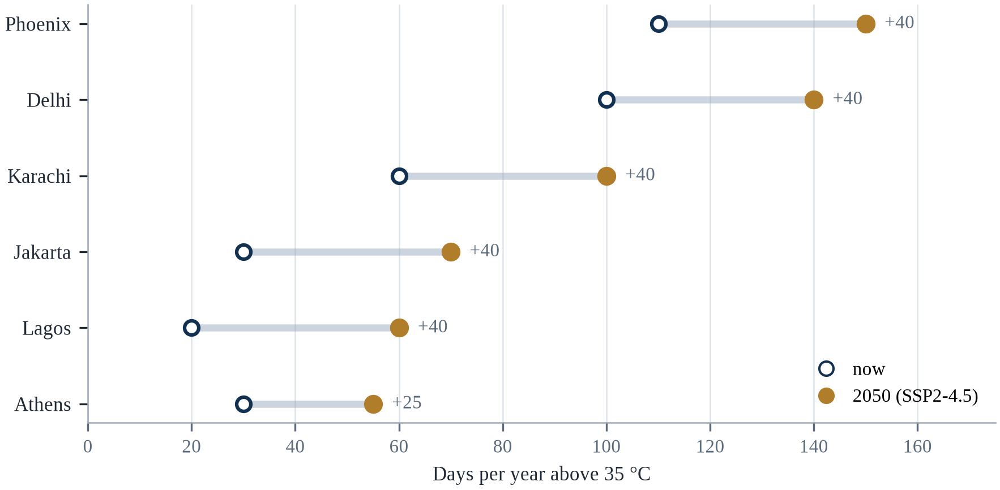||Source: Table 4.1; SSP2-4.5 for the 2050 column.

The evidence supports two conclusions. The first is that heat risk is not determined by temperature alone: the same number of hot days produces very different mortality depending on housing, water, power and social protection. The second is that the largest gains come from interventions that are boring and cheap — shade, water, warnings, check-ins on elderly neighbours — rather than from technologies that are expensive and unproven. A city that does the boring things well can save thousands of lives at 1.5°C and still save many at 2.5°C, though the margin narrows (Iungman et al., 2023).

A breakthrough in cheap, efficient cooling would reduce mortality in hot countries but would increase electricity demand and emissions unless it were paired with clean generation. A collapse of the power grid during a heatwave would turn a manageable event into a catastrophe, as happened in Texas in 2021 and in India in 2012. And a wet-bulb event above the physiological threshold would create a situation in which adaptation is impossible and only evacuation remains.

---

# Chapter 5: Water Scarcity and Drought

*Theme: water scarcity, drought and the politics of a finite resource*

In June 2019, the reservoirs that supply Chennai, a city of about nine million people, fell to one per cent of their capacity (Gleick, 2023). The city government declared a water emergency, trucks delivered water to neighbourhoods that had none, and trains carried water from the Cauvery river more than three hundred kilometres to the city. Offices asked employees to work from home. Restaurants closed. The monsoon arrived in October, and within weeks the reservoirs were full again — but the crisis had lasted four months, and it had been predicted for more than a decade.

Chennai is not an arid city. It receives about 1,400 millimetres of rain a year, more than London or Paris (Gleick, 2023). The crisis was not caused by a lack of rainfall in the long term but by a sequence of weak monsoons, the loss of lakes and wetlands to construction, the depletion of groundwater, and a supply system that had not kept pace with growth. The city had built its prosperity on the assumption that water would always be available somewhere nearby, and the assumption failed.

The same assumption is failing across much of the world. Fresh water is a small fraction of the planet's water — about 2.5 per cent — and most of that is locked in glaciers or buried deep underground (Gleick, 2023). The water that is accessible, in rivers, lakes and shallow aquifers, is renewed by rainfall and snowmelt at a rate that is essentially fixed. Humanity uses about half of that renewable supply, and in many regions it uses more, mining groundwater that took thousands of years to accumulate.

This chapter examines water scarcity as a physical, economic and political problem. It distinguishes between drought, which is a temporary shortage of rain, and scarcity, which is a persistent imbalance between demand and supply. It examines the agricultural, urban and industrial demands that drive the imbalance, and the adaptations — storage, efficiency, reuse, desalination, pricing and institutions — that can restore it. It closes with the question that will shape the next century: what happens when a shared river no longer carries enough water for the people who depend on it.

The geography of water is brutally uneven. About 97 per cent of the planet's water is saline, and of the remaining three per cent, most is locked in glaciers and ice caps (Gleick, 2023). The fresh water that is readily available — in rivers, lakes, soils and shallow aquifers — is a small and unevenly distributed fraction, and it is replenished by a hydrological cycle that warming is already changing. Wet regions are generally becoming wetter and dry regions drier, while rainfall that does fall is arriving in shorter, more intense bursts that soils cannot absorb.

## 5.1 The Physics and Geography of Fresh Water

The global water cycle moves about 500,000 cubic kilometres of water through evaporation and precipitation each year, but only about 40,000 cubic kilometres falls on land, and only a fraction of that is accessible to humans at a reasonable cost (Gleick, 2023). Rivers and lakes hold about 90,000 cubic kilometres; groundwater holds about 10 million cubic kilometres, but most of it is deep, saline or unrenewable (Gleick, 2023). The renewable freshwater supply that humanity can use is therefore a thin and unevenly distributed layer of the planet's water.

Distribution is as important as quantity. Nine countries hold about half of the world's renewable freshwater, while forty countries have less than 1,000 cubic metres per person per year — the threshold commonly used to define water scarcity (Gleick, 2023). The Middle East and North Africa are the most water-scarce regions, but scarcity is also severe in parts of India, Pakistan, Mexico and South Africa, where growing populations and economies have outgrown the supply that rainfall provides.

Climate change alters the cycle in three ways. It increases evaporation as temperatures rise, which reduces the water available in soils and reservoirs. It changes precipitation patterns, making rain more concentrated in intense events and less reliable as a steady supply. And it reduces snowpack and glacier storage, which acts as a natural reservoir that releases water slowly through the dry season. The third effect is especially important in the Himalayas, the Andes and the Alps, where millions of people depend on meltwater.

These physical facts do not by themselves produce scarcity. Scarcity is produced by the interaction between supply and the institutions that allocate it. A country can have abundant water and still experience shortages if its infrastructure leaks, its agriculture is inefficient, its cities grow without planning, or its water rights are allocated to uses that no longer make sense. Understanding that distinction is the first step toward treating scarcity as a problem that can be governed rather than as a fate that must be endured.

The hydrological cycle is driven by evaporation, which increases with temperature, and by atmospheric circulation, which determines where the moisture falls. Warming increases both the supply of water vapour and the capacity of air to hold it, at roughly 7 per cent per degree Celsius, which means that the same weather system can deliver more rain in a shorter time (Gleick, 2023). The consequences are asymmetric: more intense rainfall raises flood risk, while longer dry spells between events raise drought risk, and both can occur in the same region in the same year.

The planet's water is almost entirely unusable for the purpose people need it. More than ninety-seven per cent sits in the ocean, and most of the remainder is locked in ice; the share that moves through rivers, lakes and shallow aquifers — the water that fills a cup, irrigates a field and turns a turbine — is a small fraction of one per cent of the total (Gleick, 2023). That fraction is renewed by precipitation, and the renewal is uneven in time as well as in space. Some regions receive their annual rainfall in a few weeks of monsoon, which means that the engineering problem is not only how much water arrives but how long it can be held. Water also moves through the atmosphere as vapour and returns as rain somewhere else, which is why the deforestation of one basin can reduce rainfall in another and why the geography of water is a geography of connection rather than of borders.

## 5.2 Drought: Four Definitions

Drought is usually defined in four ways. Meteorological drought is a prolonged period of below-average rainfall. Agricultural drought is a shortage of soil moisture during the growing season, which can occur even when rainfall is normal if the rain falls at the wrong time or runs off compacted ground. Hydrological drought is a depletion of rivers, reservoirs and groundwater, which usually develops more slowly than the other two. Socioeconomic drought occurs when the shortage begins to affect the supply of goods and services, including food, energy and water.

The four definitions explain why drought is often declared late. A government may see normal rainfall and conclude that there is no drought, while farmers are already losing a season because the rain came in one week instead of eight. Hydrological drought may persist for years after the rain returns, because aquifers and reservoirs recover slowly. The 2022 Horn of Africa drought was declared after five consecutive failed rainy seasons, by which time more than twenty million people were acutely food insecure (IPCC, 2022a).

Drought also has a long tail. The economic losses extend beyond the harvest: livestock die, rural incomes collapse, migration accelerates, and children drop out of school. A study of the 2011–2017 drought in the Horn of Africa found that the effects on nutrition and education persisted for years after the rains returned. Drought is therefore not an event that ends when the rain begins; it is a shock whose consequences are transmitted through households and institutions.

The four definitions of drought — meteorological, hydrological, agricultural and socioeconomic — describe different stages of the same process, and they move at different speeds. A meteorological drought appears within weeks of below-average rainfall; an agricultural drought appears when soil moisture falls below what crops need; a hydrological drought appears when rivers, reservoirs and aquifers fall below normal, often months later; and a socioeconomic drought appears when the resulting shortage begins to affect people, prices and production. Confusing the stages produces bad policy, because a response designed for the first cannot address the fourth.

The four definitions of drought are not academic refinements; they describe different failures that arrive at different times. Meteorological drought is a deficiency of rainfall against the long-term average, and it is the first to appear. Hydrological drought is a deficiency in rivers, reservoirs and groundwater, and it arrives weeks to years later because catchments store water and release it slowly. Agricultural drought is a deficiency of soil moisture during the growing season, and it can occur even when rainfall totals are normal if the rain falls at the wrong time. Socioeconomic drought is the point at which the shortage begins to affect people's livelihoods and the price of food. The sequence matters because a government that measures only rainfall will declare the drought over when the rain returns, while the wells and the reservoirs remain empty for another year.

Meteorological drought is a deficit of rainfall against a long-term average. Agricultural drought is a deficit of soil moisture during the growing season, which can arrive before the rainfall deficit is visible. Hydrological drought is a deficit in rivers, reservoirs and groundwater, and it arrives last because the catchment buffers the rainfall for months or years. Socio-economic drought is the point at which the shortage begins to constrain the water that people can actually use. The lag between them is what makes drought hard to govern: the rain can return while the reservoir is still empty, and a declaration based on rainfall will end the emergency before the water does.

## 5.3 Groundwater: The Invisible Reserve

Groundwater is the largest accessible store of fresh water on Earth and the source of drinking water for about half the world's population. It is also the most vulnerable to overuse, because it is invisible: a farmer who pumps a well cannot see the aquifer declining, and a city that licenses new wells cannot easily measure the cumulative effect. The result is a global pattern of depletion that has been called a slow-moving crisis.

The Ogallala aquifer under the US Great Plains is the canonical example. It supplies water to about 30 per cent of US irrigated land, and parts of it have lost more than half their saturated thickness (Gleick, 2023). In some areas of Kansas and Texas, the water table has fallen by more than 50 metres, and farmers have abandoned irrigation (Gleick, 2023). The aquifer recharges at a rate of a few millimetres a year, while withdrawals are measured in metres, which means that the resource is being mined rather than used.

Similar patterns appear in the Indo-Gangetic Plain, the North China Plain, Mexico's central plateau, and the Arabian Peninsula. In Jakarta, groundwater extraction has caused land subsidence of up to 25 centimetres a year in some districts, which increases flood risk and has contributed to the decision to move the national capital (Gleick, 2023). The common feature is that the water is being used faster than it is replenished, and that the users have no direct incentive to stop because the cost of depletion falls on someone else, often on future generations.

There are success stories. Arizona's Groundwater Management Act of 1980 required new developments to demonstrate a hundred-year water supply, and it slowed depletion in the most populated areas, though it did not eliminate it (Gleick, 2023). Israel's water economy combines drip irrigation, recycled wastewater and desalination to support agriculture and a growing population with less water per capita than any other developed country. The lesson is that groundwater can be governed, but only with measurement, enforcement and a legal framework that treats the aquifer as a shared resource.

Groundwater is the largest accessible reservoir of fresh water on Earth and the least visible. It supplies roughly half of drinking water globally and about 40 per cent of irrigation, and in parts of India, the Middle East and North Africa it supplies the majority (Gleick, 2023). Because it is hidden, it is easily overused: pumping can continue for years after recharge has fallen, and the consequences appear as falling water tables, land subsidence, drying wells and, in coastal areas, saltwater intrusion that can permanently contaminate an aquifer.

Groundwater is the largest reserve that most people never see, and its invisibility explains both its importance and its mismanagement. Aquifers store water for decades or centuries, buffer farms against a failed monsoon, and supply a large share of drinking water in Asia and Latin America. Recharge, however, is slow and local: it depends on rainfall infiltrating through soil and rock, and in many areas it is measured in millimetres a year while abstraction is measured in metres. When withdrawal exceeds recharge, the water table falls, wells must be deepened, and the land itself can subside as the pore spaces collapse. Along coasts, the falling water table draws seawater inward and salinates the wells. Because the resource is invisible, the depletion is discovered late, usually when a pump that worked last year produces sand.

Groundwater is the reserve that nobody sees and half the world drinks from, and its governance is the weakest part of water policy. A farmer who pumps a well takes water that belongs to a shared aquifer, and the law in most countries gives the first person to pump the strongest claim. The result is a race that every participant is rational to run and that ends in a depleted basin, a subsiding city and a well that must be drilled deeper. Satellites now measure the change in the total mass of water in a basin, which makes the depletion visible from space and, in principle, auditable.

## 5.4 Rivers Under Stress

The great rivers of the world are the clearest visible measure of water stress. The Colorado River no longer reaches the sea in most years; its flow has declined by about 20 per cent since the early twentieth century, and the two largest reservoirs, Lake Mead and Lake Powell, fell below 30 per cent of capacity in 2022 (Gleick, 2023). The river supplies water to about 40 million people and 1.2 million hectares of farmland across seven US states and northern Mexico, under an allocation system designed in 1922 that assumed a flow larger than the river has delivered (Gleick, 2023).

The Yellow River in China has been fully allocated since the 1990s and sometimes fails to reach the sea; the Indus supplies a basin that is home to more than 250 million people and is dependent on snow and glacier melt that is projected to decline; the Murray–Darling in Australia has experienced severe droughts and ecosystem collapse in its lower reaches (Gleick, 2023). In each case, the river is both a water supply and an ecosystem, and the two uses compete for the same flow.

The politics of rivers are upstream-downstream politics. A dam built upstream reduces the flow available downstream; a city that withdraws water for its residents reduces the water available for farmers; a country that claims a share based on historical use may be claiming water that other countries believe is theirs. International river basins cover about half the land surface of the planet and are home to about 40 per cent of its population, which is why water is often described as a source of both cooperation and conflict (Gleick, 2023).

Rivers are under pressure from three directions at once: reduced flow from upstream withdrawals, altered timing from snowmelt and rainfall changes, and increased pollution from agriculture and cities. The Colorado has not reliably reached the sea since the 1960s; the Indus is abstracted so heavily that its delta has been shrinking for decades; and the Yellow River ran dry for much of the 1990s. These are not natural failures but allocation decisions, which means they can be reversed by different decisions.

Rivers are under stress from three directions at once, and only one of them is climate. Dams and diversions change when and where water arrives; sediment trapped behind dams starves the deltas downstream, which then sink and erode; pollution loads the water with nutrients and chemicals that cost more to treat. Climate adds a fourth pressure by altering the timing of snowmelt, the intensity of rainfall and the frequency of drought. The combination is what makes a river like the Indus or the Colorado so difficult to manage: the same volume that once supported farms, cities and ecosystems is now asked to support more of each, with less predictability. Environmental flows — the water left in the river — are usually the first allocation to be cut and the last to be restored, although they are what keeps the fishery and the delta alive.

Rivers under stress fail in two ways that are often confused: a decline in the total volume of water and a change in the timing of when it arrives. In basins fed by snow and ice, warming moves the spring melt earlier, which reduces the flow in the summer when the crops need it most, even if the annual total is unchanged. In basins fed by monsoon rain, a larger share of the precipitation arrives in fewer, more intense events, which increases the runoff and reduces the infiltration. Allocation rules written for the old pattern then distribute water that no longer exists in the season it was promised, and the disputes that follow are as much about the calendar as about the volume.

## 5.5 Water Quality and the Hidden Scarcity

Water can be physically present and still unusable. Contamination by pathogens, nitrogen and phosphorus from agriculture, heavy metals, arsenic and industrial chemicals reduces the supply of safe water as effectively as a drought. The World Health Organization estimates that about 2.2 billion people lack access to safely managed drinking water, and that contaminated water is associated with hundreds of thousands of diarrhoeal deaths a year, most of them among children under five (WHO & UNICEF, 2023).

Arsenic is a particularly insidious example. Wells drilled in Bangladesh and West Bengal in the 1970s to provide microbiologically safe water inadvertently tapped aquifers contaminated with naturally occurring arsenic. Tens of millions of people were exposed, and the health consequences — skin lesions, cancers, cardiovascular disease — appeared decades later. The episode is a reminder that a technological solution can create a new problem while solving an old one, and that water quality must be monitored as carefully as water quantity.

Salinity is another hidden form of scarcity. In coastal aquifers, over-extraction draws seawater inland; in irrigated regions, rising water tables bring salts to the surface, where evaporation concentrates them. Salinisation has degraded hundreds of millions of hectares of farmland and continues to spread in the Indus basin, the Tigris–Euphrates plain and parts of Australia. Unlike a drought, salinity does not end when the rain returns; it can make land unusable for decades.

Water scarcity is as much about quality as quantity, and quality is often the binding constraint. A river that carries enough water but is too polluted to drink, irrigate or support fish is not a usable resource. Roughly 80 per cent of wastewater worldwide is released without adequate treatment, and the resulting nutrient and pathogen loads degrade the ecosystems that would otherwise help to purify water, creating a cycle in which pollution increases the cost of treatment and reduces the supply of clean water (Gleick, 2023).

Water can be abundant and still unsafe, which is why scarcity is partly a quality problem. Arsenic and fluoride occur naturally in the geology of parts of South Asia, Africa and Latin America, and wells drilled to provide clean water can deliver poison instead. Nitrate from fertiliser and manure seeps into shallow aquifers; pathogens from inadequate sanitation contaminate supplies during floods; industrial chemicals enter rivers and are detected only when someone looks. Treatment is expensive, and monitoring is uneven, so the burden falls on households that must choose between a distant safe source and a nearby contaminated one. The gender and time cost of that choice is rarely counted, although it shapes school attendance, employment and exposure to violence, which makes water quality a social issue as much as an engineering one.

Water quality is the hidden half of scarcity, because a litre that is contaminated is not a litre that can be used. Salinity intrusion into coastal aquifers makes the water undrinkable for decades, and it is driven by sea level rise and by over-pumping that pulls the saltwater inland. Untreated wastewater contaminates the rivers that downstream cities draw from, and the treatment plant that would fix it is expensive and invisible. Agricultural runoff carries nutrients that produce algal blooms, which consume the oxygen and kill the fish. The result is that a country can be counted as water-rich on the basis of its rainfall and still be unable to supply safe water to its cities.

## 5.6 Agriculture: The Largest User

Agriculture accounts for about 70 per cent of global freshwater withdrawals, and in some developing countries the share is closer to 90 per cent (Gleick, 2023). Irrigation underpins about 20 per cent of cultivated land but produces about 40 per cent of global food, which means that any constraint on irrigation has an outsized effect on food security. The efficiency of that use is often low: flood irrigation loses large amounts to evaporation and runoff, and poorly maintained canals leak before the water reaches the field.

The gains from improving efficiency are large but not automatic. Drip irrigation can reduce water use by 30 to 50 per cent compared with flood irrigation while maintaining or increasing yields, but it requires capital, maintenance and a reliable supply of clean water (Gleick, 2023). In India, the world's largest user of groundwater, subsidised electricity for pumping has encouraged over-extraction, and the response has been a mix of subsidies for drip systems, restrictions on new wells and, in some states, direct payments to farmers who switch to less water-intensive crops.

The deeper problem is that water is usually priced below its cost. A farmer who pays nothing for water has no incentive to economise, and a city that charges less than the cost of supply cannot maintain its pipes. Pricing reform is politically difficult because water is a basic need and because farmers are organised. The alternatives — quotas, tradable rights, tiered tariffs that protect basic consumption while charging more for luxury use — are all attempts to impose a price signal without denying people the water they need to survive.

Agriculture consumes about 70 per cent of global freshwater withdrawals, and the share is higher in arid regions (Gleick, 2023). Irrigation is essential for feeding a growing population, but it is also inefficient: flood irrigation loses large volumes to evaporation and seepage, and many systems deliver more water than crops can use. Improving efficiency is not always sufficient, because water saved by efficiency is often reallocated to expand irrigated area rather than returned to the environment — a phenomenon economists call the rebound effect.

Groundwater is the buffer that makes drought survivable, and it is being drawn down faster than it recharges in most of the world's major aquifers. Satellite gravimetry has made the depletion visible: studies of the Central Valley in California, the North China Plain and the Indus basin have documented sustained losses of groundwater storage that are not offset by recharge. The consequence is a slow reduction in the capacity to absorb the next drought, which is precisely the reserve that irrigation systems were designed to draw on. A drought that would have been manageable in 1990 is now a crisis because the buffer has been spent.

Agriculture uses the majority of the world's fresh water, and the efficiency debate is more subtle than it looks. Drip irrigation can cut water use per hectare, but the water saved is often used to irrigate more land rather than returned to the river, so the basin-wide saving is smaller than the field-level saving; this is the irrigation efficiency paradox. Flood irrigation recharges aquifers in some systems, and eliminating it can reduce groundwater storage downstream. What a farmer grows matters as much as how: rice in a flooded paddy consumes several times the water of wheat or millet, and the choice is often driven by subsidy, procurement and habit rather than by hydrology. The energy subsidy that makes pumping cheap is, in many countries, the single most important driver of groundwater depletion, which makes agricultural and energy policy the real water policy.

Agriculture consumes about seventy per cent of the fresh water that humanity withdraws, and the share is higher in the regions where the water is scarcest (FAO, 2022). The crop that uses the most is often the one that is least nutritious per litre, because the market pays for the calorie and not for the water, and the water is usually free to the farmer who pumps it. The result is a system in which the allocation of water is determined by the price of the crop rather than by the value of the water, and in which the shift to a more efficient crop is a loss of income for the household that makes it. Pricing water is the economist's answer and the politician's problem.

## 5.7 Urban Water Systems

Cities concentrate demand and lose water before it reaches the tap. Non-revenue water — the difference between what a utility produces and what it bills — averages about 30 per cent globally and exceeds 50 per cent in some cities (Gleick, 2023). The losses come from leaking pipes, illegal connections, metering errors and unbilled public use. In a city with a shortage, repairing the distribution network can be cheaper than building a new reservoir.

Urban growth also consumes the landscapes that once stored water. Chennai's lakes and wetlands were built over as the city expanded; Jakarta's groundwater was pumped because the piped network did not reach most neighbourhoods; Mexico City's aquifers were drained faster than they could recharge. The result is that the city becomes dependent on distant sources, which increases cost, vulnerability and political tension with the regions that supply it.

The responses that work combine supply, demand and storage. Singapore's water strategy — local catchment, imported water, desalination and recycled water, known as the four national taps — is the most cited example, and it has allowed a city-state with no natural aquifer to achieve water security. Windhoek, Namibia, has been recycling wastewater directly into the drinking supply since 1968. These cases show that scarcity is not simply a function of rainfall; it is a function of how deliberately a city manages the cycle.

The institutional obstacle is rarely the engineering. A utility that sells water by volume loses revenue when it repairs its leaks, so a successful efficiency programme can leave it with higher costs and a smaller income, which is a perverse incentive that regulators have had to correct explicitly. The cities that have cut losses furthest have usually changed the tariff structure at the same time, decoupling revenue from volume sold or allowing the utility to keep part of the saving, and the lesson generalises to almost every adaptation measure that saves money by reducing demand. The measure pays for itself in physical terms and does not pay for the institution that has to carry it out, unless someone designs the incentive.

Jakarta is the clearest case of a water crisis produced by extraction rather than drought. Groundwater pumping has driven land subsidence of up to twenty-five centimetres a year in parts of the city, so that the ground is sinking faster than the sea is rising, and the two together determine the flood risk. The city's response has combined a piped water expansion, a sea wall and, most controversially, a plan to move the capital. Studies of the subsidence find that it is largely caused by industrial and household pumping by users who are not connected to the network, which makes the problem a service-delivery failure as much as a hydrological one.

Cities lose a startling share of the water they treat before it reaches a customer. Leakage of thirty to fifty per cent is common in systems that have been maintained on the principle that repairs can wait, and the loss is invisible because it happens underground and because the utility is paid for the water it supplies rather than the water it produces (Gleick, 2023). Intermittent supply makes the problem worse: pipes that alternate between full and empty draw in contaminants, and households compensate by installing rooftop tanks and pumps that pull more water through the leaks. Pressure management, district metering and a repair crew with a budget solve more of the problem than a new reservoir, but they are unglamorous, and ribbon-cutting is easier to finance than maintenance. Where utilities are bankrupt, the cheapest water is the water that is no longer lost.

Urban water systems are engineering networks that were sized for a city that no longer exists, and their performance is measured by a number that few cities publish. Non-revenue water is the difference between what enters the network and what is billed, and in many cities it is between a quarter and a half of the total, which means that the reservoir is being drawn down for water that nobody uses. The losses come from leaks, from illegal connections and from metering errors, and the repair programme is expensive, disruptive and invisible. The cities that have reduced the losses have done it with district metering, pressure management and a crew that is paid to find the leaks.

## 5.8 Drought, Food and Prices

Drought transmits to the economy through food prices. When a major producing region loses a harvest, global prices rise, and the effect is largest for poor households that spend a large share of their income on food. The 2010–2011 drought in Russia and the subsequent export ban contributed to the global food price spike that year; the 2022 drought in Europe reduced maize and sunflower output and added to the price pressures already caused by the war in Ukraine.

The transmission is not automatic, because trade, storage and substitution can absorb part of the shock. But those buffers are thinner than they appear. Global grain stocks are held by a small number of countries, and exporters sometimes restrict shipments in a crisis, which amplifies the price increase. Importing countries respond by buying more, which amplifies it further. The result is that a regional drought can become a global price event through the interaction of policy responses rather than through the physical shortage alone.

For households, the consequence is a change in diet. When prices rise, families substitute cheaper staples, reduce protein and fresh produce, and sometimes skip meals. The nutritional effect persists long after prices fall, particularly for children, whose growth and cognitive development can be permanently affected. Drought is therefore a food security problem as much as a water problem, and the two cannot be addressed separately.

The link between drought and food prices runs through both production and expectations. A failed harvest reduces supply, but the price effect is amplified by export restrictions, panic buying and speculative trading, which is why prices can rise far more than the production loss would justify. The 2007–2008 crisis demonstrated the pattern: wheat prices more than doubled, rice tripled, and more than thirty countries experienced food riots, even though global production had fallen only modestly.

A poor harvest in a major exporting country reduces supply, but the price effect is amplified when governments restrict exports, traders anticipate shortages, and importers scramble to build stocks. The episodes of 2007–2008 and 2010–2012 followed this pattern: a series of weather shocks in different breadbaskets, a wave of export bans, and a price spike that had more to do with policy than with the aggregate harvest. The consequence is that the poorest consumers, who spend a large share of income on food, are hit hardest by a shortage they had no part in creating. Stocks and transparency dampen the spiral; export restrictions intensify it, which is why the politics of a drought often matters more than its meteorology.

The link between drought and food prices is short and the link between prices and hunger is shorter. A harvest failure in a major exporting country reduces the supply that is available for trade, and because the demand for staple grains is inelastic, the price rises much more than the shortfall would suggest. Exporting countries then restrict their own sales to protect domestic consumers, which removes more supply from the world market and amplifies the spike. The episode of 2007 and 2008 followed exactly that sequence, and the riots that followed were concentrated in countries where the cost of bread is a large share of the household budget.

## 5.9 Water Conflict and Cooperation

Water has been called a source of war, but the historical record is more complex. The Pacific Institute's Water Conflict Chronology records thousands of water-related tensions, most of them local, and far more instances of cooperation than of armed conflict over water. The Nile, the Indus, the Mekong and the Rhine all have long histories of negotiation, and some of the most durable treaties in the world are water treaties.

That does not mean water is not a source of conflict. It means that the conflict usually takes the form of displacement, dispossession and violence within countries rather than war between them. Dam construction displaces communities; irrigation withdrawals deprive downstream farmers; pollution destroys fisheries; water tariffs provoke protests. The risk of interstate war over water is real but rare, and it is highest where water scarcity interacts with existing political hostility and weak institutions.

The cooperative record offers lessons. The Indus Waters Treaty of 1960 survived three wars between India and Pakistan and has been remarkably resilient, because it created a joint commission with technical authority and a dispute-resolution mechanism. The Nile Basin Initiative, the Mekong River Commission and the Senegal River Organisation show that shared basins can be governed when the parties have an interest in the information and the rules that the institution provides. Water is more often a reason to talk than a reason to fight.

Water conflict is often described as inevitable, and the evidence suggests otherwise. Studies of historical water disputes find that cooperation is far more common than violence: the Oregon State University water conflict database records thousands of cooperative events against a much smaller number of violent ones. Violence tends to occur where water disputes overlap with ethnic or territorial conflict, and where institutions for allocation are weak or have collapsed.

Water disputes are more often managed than resolved, and the historical record is more encouraging than the headlines suggest. Thousands of treaties and basin agreements govern shared rivers, and violent conflict over water is rare compared with the frequency of negotiation, even in basins with hostile neighbours. What recurs is a pattern in which upstream development is perceived as a threat downstream, and the dispute becomes a surrogate for wider political tensions. The Nile, the Indus and the Colorado each show a different version of the same problem: a legal allocation fixed in a wetter or emptier past, a growing demand, and a climate that no longer matches the assumptions of the agreement. Cooperation tends to be technical before it is political, which is why shared data and joint monitoring are often the most durable achievement.

The record on water conflict is more cooperative than the headlines suggest, and the reason is that the alternatives to cooperation are worse for everyone. More than three thousand treaties and agreements govern shared waters, and the disputes that turn violent are a small minority (Gleick, 2023). The cooperation takes forms that rarely make the news: joint monitoring of flows, shared forecasting, coordinated releases from dams, and the data-sharing arrangements that allow a downstream country to plan. The basins where the risk is highest are those where the treaty is absent or outdated, where the data are withheld, and where the river is one of several grievances in a wider conflict.

The water chapter ends where most water policy begins, which is at the question of who decides. A river basin that crosses three provinces and two countries has no single authority unless one is created, and the authorities that exist are usually organised around supply rather than around allocation: a utility that delivers water, an irrigation agency that sells it, a regulator that sets the tariff, and a ministry that signs the treaty. The reason agreements hold is not that they are fair but that they specify what happens in a dry year, when the arithmetic no longer works for everyone. Treaties that allocate only the average flow fail in the drought that motivated them, and the basins that have survived their droughts are the ones whose agreements contain a shortage clause, a review cycle and a dispute mechanism that meets before the reservoir empties.

There is a practical test that a reader can apply to any water plan, and it takes one question: what happens in the third consecutive dry year. A plan that answers with restrictions has a demand measure; a plan that answers with a new source has a supply measure; a plan that answers with a reallocation has a political decision. Most plans contain only the first two, because the third requires naming the users who will receive less, and naming them is the part that no engineer can do. The cities that have survived their droughts are the ones whose councils were willing to make that decision in public before it was forced on them, and the ones that have not are the ones where the decision was made by a reservoir level.

## 5.10 Adaptation: Storage, Efficiency and Reuse

The portfolio of water adaptations is well known. Storage — dams, reservoirs, aquifer recharge, rainwater harvesting — bridges the gap between wet and dry seasons. Efficiency — drip irrigation, leak repair, industrial recycling — produces more output per cubic metre. Reuse — treating wastewater for irrigation or industry — turns a waste stream into a resource. Desalination — removing salt from seawater or brackish groundwater — creates new supply at a cost in energy and money.

Each option has limits. Dams displace people and silt up; the world has built most of the good sites. Efficiency can be offset by rebound effects, in which farmers use the saved water to expand irrigated area. Desalination is expensive, energy-intensive and produces brine that must be disposed of carefully; it is affordable for wealthy coastal cities but not for inland agriculture. Reuse requires treatment, monitoring and public acceptance, which is often the hardest part.

The most important adaptation is institutional. Water is managed through rights, prices, quotas and basin agreements, and the difference between a well-managed basin and a poorly managed one is often larger than the difference between a wet year and a dry one. Australia's Murray–Darling Basin Plan, which caps total withdrawals and allows water to be traded, is an example of an attempt to manage a basin as a system rather than as a collection of individual claims. It has been criticised for the environmental outcomes it has not delivered, but it demonstrates that the institutional design is at least as important as the engineering.

Adaptation to water scarcity has a well-established hierarchy. Demand management comes first because it is cheapest and fastest: pricing, metering, restrictions, leak repair and efficient appliances. Storage comes second, whether in reservoirs, aquifers or tanks, because it bridges the gap between rainfall and demand. Alternative sources come third: reuse, desalination and rainwater harvesting, all of which are technically proven but energy-intensive and expensive. The sequence matters, because building supply before managing demand locks cities into higher costs.

The menu of water adaptation is well known and mostly about timing rather than volume. Storage — reservoirs, tanks, soil moisture, aquifers — moves water from the season of abundance to the season of need. Managed aquifer recharge deliberately puts floodwater underground, where it does not evaporate and does not displace people. Rainwater harvesting at household and neighbourhood scale reduces demand on the mains and provides a buffer during interruptions. Reuse of treated wastewater for irrigation and industry frees freshwater for drinking, provided the treatment and the monitoring are real. Desalination is reliable but energy-intensive, and the brine it discharges must be managed. Demand management, through pricing, metering and fixture standards, is the cheapest option and the most politically difficult, because it makes the cost of water visible to the people who use it.

The menu of water adaptation is short, and each item has a cost that is easy to underestimate. Storage in dams and reservoirs captures the water when it falls and releases it when it is needed, and it is expensive, it displaces people, and it silts up. Groundwater recharge, which spreads floodwater over permeable ground so that it infiltrates, is far cheaper and is now being revived in India, California and the Netherlands. Efficiency in irrigation reduces the largest use, and the savings are often taken by expansion rather than by leaving water in the river. Reuse of treated wastewater is growing in Singapore and Windhoek, and desalination is reliable and energy-hungry. The order in which these are pursued matters more than the technology.

## 5.11 Case Study: Chennai's Day Zero

Chennai's water crisis did not arrive without warning. The city depends on four reservoirs and on groundwater, and the reservoirs had been declining for years as urban expansion covered the lakes that once captured monsoon rain. In 2018 the northeast monsoon failed, and by June 2019 the reservoirs held about one per cent of their capacity (Gleick, 2023). The city government declared a water emergency and began to truck water to neighbourhoods, while the state arranged for trains to carry water from the Cauvery.

The crisis affected different residents differently. Households with private wells and storage tanks managed; households in informal settlements, which depended on public taps and tanker deliveries, queued for hours. Schools closed, restaurants reduced service, and information technology companies asked staff to work from home. The economic cost was estimated in the hundreds of millions of dollars, and the political cost was higher: the crisis became a symbol of the failure of urban water management in a rapidly growing city.

The response included short-term measures — tankers, trains, restrictions on non-essential use — and longer-term investments in desalination, sewage treatment and rainwater harvesting. The city also began to restore some of the lakes and wetlands that had been built over, recognising that the cheapest storage was the landscape itself. By 2024, the reservoirs had recovered, but the underlying imbalance had not been resolved: the city still depends on a monsoon that is becoming less reliable and on groundwater that is being depleted.

The case illustrates a pattern that appears in cities around the world. Water crises are rarely caused by a single year of low rainfall; they are caused by the accumulation of decisions that reduced storage, increased demand and deferred maintenance. The crisis is the moment when the accumulated deficit becomes visible. Because the deficit is institutional, the solution must be institutional: a plan that combines supply, demand, storage and governance, and that is implemented before the reservoirs empty.

For other cities, the lessons are specific. First, measure and publicly report the water balance, including losses in the distribution network and the rate of groundwater depletion. Second, protect the landscapes that store water — lakes, wetlands, floodplains and recharge areas — before they are built over. Third, diversify supply, including reuse and desalination where affordable, and price water in a way that funds maintenance. Fourth, identify the households that will be hit first and build a delivery system that reaches them, because the crisis will expose the difference between a city that has water and a city that has access to it.

Chennai's crisis also illustrated how quickly a modern city can be reduced to trucks and queues. When the city's reservoirs ran dry, tanker deliveries became the main source, and the price of a tanker load rose severalfold within weeks, pricing poorer households out of an adequate supply. Hotels and businesses bought water on contract; slum residents relied on municipal taps that ran intermittently, or on shared borewells that were themselves depleting. The infrastructure failure was visible, but the distribution failure was the part that determined who went thirsty.

Chennai's crisis was a story of failed infrastructure as much as failed rain. The city depends on four reservoirs that once captured the monsoon, but urban expansion filled many of the lakes and tanks that historically absorbed rainfall and recharged the aquifer, so the same rain produced less storage. Groundwater was abstracted faster than it recharged, and the desalination plants that were meant to provide a hedge operated below capacity. When the 2018 monsoon failed, the deficit arrived quickly. Tankers became the supply of last resort, their prices rose, and households that could not pay queued at public taps. The lasting response was a mandate for rooftop rainwater harvesting, which speaks to the diagnosis: the city did not only lack water, it had removed the systems that had once held it.

Cape Town supplies the counter-case, and it is the reason this chapter does not end in despair. In 2018 the city approached Day Zero with its reservoirs near a fifth of capacity, and it avoided the shut-off by cutting consumption by more than half over three years through tariffs, pressure management and the public reporting of daily use (Gleick, 2023). The difference between Chennai and Cape Town was not rainfall but governance: one city discovered its shortfall in the middle of a crisis, the other measured it in advance and put a price on it. Both are coastal cities of similar size, and both now plan for a drier century.

## 5.12 Future Scenarios and Predictions: Water in 2050

Freshwater is the resource where the gap between demand and supply is closing fastest. Global water withdrawals have roughly tripled since 1950, driven by population growth, irrigation and industrial demand. Groundwater depletion has accelerated in the past two decades, and the area of land affected by drought has increased. The World Bank estimates that water scarcity could reduce GDP growth in some regions by up to 6 per cent by 2050, and the United Nations Convention to Combat Desertification estimates that drought could displace 700 million people by 2030 (World Bank, 2021).

Demand already exceeds reliable supply in many basins. About 4 billion people experience severe water scarcity for at least one month a year, and 2.2 billion lack safely managed drinking water (Gleick, 2023). Agriculture uses about 70 per cent of withdrawals, and in many basins the allocation of water exceeds the renewable supply (Gleick, 2023). The gap is filled by groundwater mining, which cannot continue indefinitely. The question is not whether the deficit will be closed but how: by efficiency, by reallocation, by new supply, or by crisis.

Population, diet, technology and governance will decide the water balance. A world that converges toward efficient irrigation, recycles more water and limits groundwater withdrawal can meet demand with less water than it uses today. A world that continues current trends will face a shortfall of about 40 per cent between available supply and projected demand by 2030, according to the 2030 Water Resources Group (Addams et al., 2009). The scenarios below show what the main basins might look like under different assumptions.

The water gap of 2050 will be determined less by total rainfall than by the intersection of three curves: demand, which rises with population and income; supply, which falls as glaciers retreat and aquifers deplete; and quality, which deteriorates with pollution and salinisation (Gleick, 2023). Regions where the three curves cross earliest are the ones already under stress — the Indo-Gangetic plain, the North China plain, the Middle East, the Sahel, the Central Valley of California and the highlands of Ethiopia. The scenarios differ mainly in how quickly demand is brought under control through efficiency, crop choice and reuse. The measures to watch are groundwater levels in the great aquifers, the seasonal flow of glacier-fed rivers, and the share of wastewater that is treated rather than discharged.

[[TABLE:Table 5.1 Water stress in major basins, present and 2050]]
| Basin | Population (million) | Current stress | 2050 gap (SSP2-4.5) | Main adaptation |
|---|---|---|---|---|
| Indus | ~300 | Extreme | 30–40% | Drip irrigation; groundwater regulation |
| Colorado | ~40 | Extreme | 20–30% | Demand caps; reuse; fallowing |
| Nile | ~280 | High | 25–35% | Storage; efficiency; basin agreement |
| Citarum (Java) | ~25 | Very high | 20–30% | Wastewater treatment; reforestation |
| Murray–Darling | ~2.4 | High | 10–20% | Water trading; environmental flows |
| Tigris–Euphrates | ~60 | Very high | 30–40% | Dam coordination; irrigation reform |

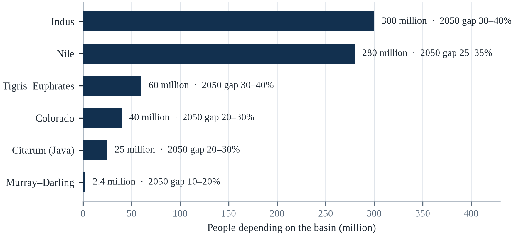||Source: Table 5.1; gap is the shortfall against projected demand under SSP2-4.5.

Two lessons emerge from this. The first is that the gap is largest in basins where agriculture dominates and groundwater is unregulated, which means that the most important interventions are agricultural rather than urban. The second is that the gap can be closed with existing technology; the obstacle is the political cost of reallocating water from one user to another. A basin that caps withdrawals will produce less in the short term, and the farmers who lose water will resist.

A breakthrough in cheap desalination would expand supply for coastal cities but not for inland agriculture. A change in diet toward less water-intensive food would reduce demand substantially, since meat and dairy require far more water per calorie than grains. And a sustained increase in precipitation in some basins, which some climate projections suggest, would relieve pressure in those places — but the same projections show declines in others, and the uncertainty is largest where the stakes are highest.

---

# Chapter 6: Floods and Sea Level Rise

*Theme: floods, coastal risk and the slow emergency of rising seas*

On 29 October 2024, a line of thunderstorms stalled over the province of Valencia in eastern Spain and released more rain in eight hours than the region normally receives in a year. The Turia and Magro river systems filled within minutes. Cars were swept out of underpasses, bridges collapsed, and more than two hundred people died, most of them in towns that had been built on floodplains but had not experienced a flood of that magnitude in living memory (CRED, 2023). The regional government's alert reached mobile phones after the water had already risen.

Floods are the most frequent and most costly of climate disasters. Between 1995 and 2015, floods accounted for about 47 per cent of all weather-related disasters and affected 2.3 billion people, according to the United Nations Office for Disaster Risk Reduction. They kill in two ways: by drowning and trauma during the event, and by disease, displacement and loss of livelihood in the months that follow. The World Health Organization estimates that floods affect more people than any other natural hazard.

The physical mechanism is simple and getting stronger. Warmer air holds more water vapour, about seven per cent more for each degree of warming, following the Clausius–Clapeyron relation (IPCC, 2021). When that moisture condenses, it falls in heavier bursts. At the same time, land surfaces have been made less absorbent by compaction, paving and the loss of wetlands, so a larger fraction of the rain becomes runoff. The combination means that a storm of the same meteorological magnitude delivers more water to rivers and streets than it did a century ago.

Sea level rise adds a second, slower dimension. The ocean has risen about 20 to 25 centimetres since 1880, and the rate has increased to about 4.5 millimetres a year (IPCC, 2019b). That sounds small until it is combined with storm surge, high tide and subsidence: a city that has sunk 20 centimetres and faces a sea 20 centimetres higher experiences a 40-centimetre change in the effective height of its defences. This chapter examines both dimensions, because in most coastal cities they arrive together.

Floods are the most frequent and most costly of climate hazards, and the number of people exposed to them has grown faster than the population. The reason is not only heavier rainfall but where people live: roughly one in five people worldwide lives in a river floodplain, and about 10 per cent lives in coastal zones below a once-in-a-century flood level (IPCC, 2022a). Economic growth has concentrated assets in those same places, so a storm that would have caused modest damage a generation ago now causes billions.

## 6.1 The Physics of Flooding

Flooding occurs when the volume of water arriving at a place exceeds the capacity of the channel, the soil or the drainage system to carry it away. The volume is determined by rainfall intensity, the area that drains into the channel, the moisture already in the soil, and the speed with which water moves across the surface. A catchment that is dry and vegetated can absorb a storm that would overwhelm the same catchment after a wet month or after the vegetation has been removed.

The intensification of rainfall is one of the most robust findings in climate science. Observations show that extreme precipitation has increased in most regions, and that the increase is consistent with the Clausius–Clapeyron relationship. A warmer atmosphere can hold more water, and when the conditions for condensation are met, more of it falls at once. The effect is not uniform: some regions are becoming drier, and in those regions the same mechanism can produce shorter, more violent storms separated by longer droughts.

Land use determines how much of that rain becomes flood. Urbanisation typically increases peak runoff by a factor of two to five, because pavement and roofs replace soil and vegetation. Deforestation in upland catchments increases erosion and reduces infiltration. Drainage systems designed for the rainfall of 1970 cannot carry the rainfall of 2024. The result is that floods are produced by the interaction of the atmosphere and the landscape, and that engineering a channel without managing the landscape upstream often moves the problem downstream.

Flooding is produced by the interaction of three factors: the amount and intensity of rainfall, the capacity of the landscape to absorb and store water, and the capacity of channels and drainage to convey it. Urbanisation changes all three. Paving and compaction reduce infiltration, drainage channels are straightened and narrowed, and runoff arrives at the river faster, so that a storm of the same depth produces a higher peak flow than it would have over fields.

A warmer atmosphere holds more water vapour, and the relationship is close to exponential: for each degree of warming, the air can hold roughly seven per cent more moisture before it condenses (IPCC, 2021). That does not mean rainfall increases by the same amount everywhere, because the circulation that delivers the rain also changes, but it does mean that when the conditions for a storm are present, there is more water available to fall. The consequence is a shift toward heavier bursts separated by longer dry spells, which is exactly the pattern that overwhelms drainage and damages soil. The catchment then decides what happens next: a steep basin with thin soil delivers water to the river within hours, a flat basin with wetlands delivers it over weeks, and the same rainfall produces a flash flood in one and a slow inundation in the other.

Design storms are where the past is quietly imposed on the future. A drain, culvert or spillway is sized for a rainfall intensity that is expected once in a given number of years, and that number is calculated from the historical record of the nearest gauge. When the record is short, or when the climate that produced it has changed, the structure is sized for a storm that no longer represents the risk. Some cities have begun to update their curves and to design for a non-stationary climate; most have not, because the update is expensive and because a drain that fails is invisible until it rains. The gap between the design storm and the actual storm is one of the largest sources of avoidable flood damage in cities that believe themselves protected.

## 6.2 River Floods and the Great Deltas

The largest concentration of flood risk is in the deltas of Asia. The Ganges–Brahmaputra, the Mekong, the Irrawaddy, the Indus and the Yangtze carry enormous volumes of water and sediment into low-lying plains that are home to hundreds of millions of people. The deltas are fertile because rivers deposit sediment there; they are vulnerable because the same sediment is subsiding, and because the channels that carry the water are constrained by embankments that prevent the floodplain from absorbing the flood.

The Mekong Delta is the clearest example. It supports about 17 million people and produces more than half of Vietnam's rice, but it is sinking as groundwater is pumped and as sediment is trapped behind dams upstream (IPCC, 2022a). Saltwater intrusion has advanced tens of kilometres inland during dry seasons, damaging rice fields and forcing farmers to switch to shrimp or to leave. The combination of subsidence, reduced sediment and sea level rise means that the delta is losing height relative to the sea even while the sea itself is rising.

The Indus delta illustrates a different mechanism. Upstream dams and barrages have reduced the flow reaching the delta, which has caused seawater to intrude and mangroves to retreat. The 2022 floods demonstrated that the river still carries enormous volumes in extreme years, but the infrastructure built to control those volumes — embankments, canals, barrages — had been designed for a different pattern of flow and failed in ways that concentrated the damage in particular districts. The lesson is that flood control infrastructure is only as good as the assumptions about flow on which it was designed.

The great deltas are the most flood-exposed places on Earth, and they are also where hundreds of millions of people live. The Ganges-Brahmaputra, the Mekong, the Nile, the Indus and the Niger all combine high rainfall, low elevation and rapid subsidence caused by the extraction of groundwater and the trapping of sediment behind upstream dams. A delta that is sinking by several centimetres a year faces a rising sea and a sinking land at the same time, which means that modest global sea-level rise translates into large relative rise locally.

Deltas are the places where the problem is most concentrated, because they combine low elevation, fertile soil, dense population and a sinking land surface. A delta is built by sediment: each flood deposits a layer that raises the land against the sea, and the river shifts across the plain over decades. Embankments interrupt that process. They protect the land from ordinary floods, but they also prevent the sediment from arriving, so the delta stops growing while compaction and groundwater extraction continue to lower it. The result is a paradox of protection: the levee that makes the land safe in the short term makes it more vulnerable in the long term, because the gap between the land and the water widens with every year the river is kept out.

River floods are worst in deltas, and the reason is that deltas are sinking while the rivers are being starved of the sediment that built them. A dam upstream traps the silt that would have replenished the delta, the compaction of drained peat adds to the subsidence, and the groundwater that is pumped out from beneath the city removes the support that kept the surface up. The result is a triple exposure: the sea is rising, the land is falling, and the river is delivering more water in a shorter season. The Ganges-Brahmaputra, the Mekong, the Nile and the Mississippi all carry this combination, and the populations that live on them are counted in the hundreds of millions.

## 6.3 Coastal Flooding and Sea Level Rise

Coastal flooding has three components: mean sea level, tides and storm surge. Mean sea level is rising because ocean water expands as it warms and because land ice is melting. Tides are predictable, which is why the timing of a storm matters: a surge that arrives at high tide can overwhelm defences that would hold at low tide. Storm surge is the temporary rise in sea level caused by wind and low pressure, and it is the component that does most of the damage in tropical cyclones.

Subsidence is the fourth component and often the largest. Many coastal cities are built on deltas or on reclaimed land, and they sink as groundwater is extracted and as the sediment beneath them compacts. Jakarta has subsided by up to four metres in some districts over the past three decades; Bangkok, Manila, Ho Chi Minh City and Shanghai have all subsided by tens of centimetres (IPCC, 2022a). In these cities, the effective rate of sea level rise is the global rate plus the local rate of sinking, which can be ten times larger.

The consequences are already visible in the frequency of nuisance flooding. Miami Beach now experiences tidal flooding on sunny days several times a year, a phenomenon that barely occurred a generation ago. Jakarta experiences routine flooding during the monsoon and during high tides, even without rain. These events are not catastrophic individually, but they impose costs on transport, sanitation and property values, and they signal that the defences are being overtaken by the water.

Coastal flooding has three drivers, and their relative importance varies by location. Thermal expansion and ice melt raise mean sea level; storm surge raises the water level temporarily; and waves add run-up on top of the surge. The combination is what determines damage, which is why a modest rise in mean sea level can produce a disproportionate increase in the frequency of damaging floods, because it raises the baseline on which surges and tides act.

Coastal flooding is a combination rather than a single number. The sea level sets the baseline; the tide adds and subtracts; a storm surge piles water against the coast; waves run it up the beach; and rain falling at the same time prevents the water from draining away. A rise in mean sea level of a few tens of centimetres therefore does not simply add a few centimetres to the peak of a flood, because the same surge now starts from a higher base and reaches further inland over defences that were designed for a lower one. The practical measure is the return period: a flood that was expected once in a century becomes a once-in-a-decade event, and then a nuisance that occurs several times a year. That shift is what makes sea-level rise expensive long before it becomes dramatic.

Coastal defences fail in three ways, and each has a different consequence. Overtopping happens when water runs over the crest and drains away afterwards; breaching happens when the structure itself gives way and the water does not recede; seepage happens when water passes through or under the defence and undermines it from below. A defence designed only against overtopping can still fail by the other two, and the failure mode determines whether a flood is a nuisance or a catastrophe. This is why modern coastal engineering designs for the probability of failure rather than for the height of the water, and why the residual risk behind a defence is stated explicitly rather than assumed away.

Coastal flooding is the hazard whose exposure is growing fastest, and the growth is demographic as much as it is climatic. The number of people who live in the low elevation coastal zone has risen steadily, the value of the property they occupy has risen faster, and the probability of the water that reaches them has risen with the sea. A coastal flood that was a one-in-a-hundred-year event in 1980 is now a one-in-a-few-decades event in many places, and the engineering response, a wall or a levee, is a decision to defend a particular line for a particular time. The alternative, a managed retreat from the lowest ground, is cheaper in the long run and politically almost impossible.

## 6.4 Jakarta: The Sinking Capital

Jakarta is the most studied example of a city losing its race with the sea. About 40 per cent of the city lies below sea level, and some northern districts have subsided by more than four metres since the 1970s. The subsidence is caused mainly by groundwater extraction: only about half the population is connected to the piped water network, and the rest pumps from aquifers. The city has 13 rivers and a network of canals, and it receives about 1,700 millimetres of rain a year, concentrated in a wet season that regularly produces floods (IPCC, 2022a).

The 2020 New Year flood displaced about 400,000 people and killed more than 60 (CRED, 2023). The 2013 and 2007 floods were comparable or worse. The city has responded with a sea wall, pumping stations, dredging and a giant offshore dyke project, but the project has been delayed by land acquisition, funding and disputes about its design. In 2022, the government passed a law to move the national capital to Nusantara in East Kalimantan, citing congestion, inequality and environmental vulnerability, including flooding.

The capital move does not solve Jakarta's problem; it relocates the state's administrative functions while leaving about 30 million people in the metropolitan area (UN-Habitat, 2022). The lesson is not that relocation is wrong but that it is not a substitute for managing subsidence. Stopping groundwater extraction, providing piped water to the whole city, restoring natural drainage and building defences are all necessary, and all are slow, expensive and politically difficult. Jakarta is therefore a test case for whether a large city can adapt faster than the ground beneath it sinks.

Jakarta's subsidence is not a natural process. It is caused by decades of unregulated groundwater extraction by households and industry that cannot rely on the piped network, and by the weight of construction on soft alluvial soils. Measurements by Indonesian and international researchers found subsidence rates of up to 25 centimetres a year in some northern districts in the 2010s, several times the rate of global sea-level rise, which is why the city's flood defences had to be raised repeatedly simply to maintain the same standard of protection (IPCC, 2022a).

Jakarta is the clearest case of a city that is being lowered as well as flooded. Parts of the northern districts sit several metres below sea level, protected by a sea wall and pumped continuously, and the pumping is necessary because the land continues to subside as groundwater is extracted by households and industry that the piped network does not reach. The rivers that cross the city are canalised and lined with informal settlements, and the canals are the only drainage for a basin that receives intense tropical rain. Each element of the system is a reasonable response to a real problem, and together they create a dependence on pumps and walls that has no natural end. The decision to build a new capital was, among other things, an acknowledgement that the old one cannot be defended indefinitely.

Jakarta is the clearest case of a capital that is being lost to a combination of its own hydrology and its own engineering. North Jakarta has subsided by metres over three decades, and parts of it now lie below sea level, protected by a wall and pumped by stations that fail when the power does. The subsidence is driven by the extraction of groundwater by the industries and households that the piped network does not reach, and the extraction continues because the alternative is to have no water. The sea wall, the dredging and the pumping are a holding operation. The decision to move the capital to Borneo is the recognition that the holding operation may not succeed.

## 6.5 Flash Floods and Urban Drainage

Flash floods are the most lethal type of flood because they arrive with little warning. They occur when intense rainfall falls on steep terrain or on urban surfaces that cannot absorb it, and the water can rise within minutes. The Valencia flood of 2024, the Kuala Lumpur flash floods of 2021 and the Seoul floods of 2022 all followed this pattern: a convective storm, a drainage system designed for a milder climate, and a population that did not know which roads had become rivers.

Urban drainage design uses return periods: a pipe or canal is sized for a storm expected once every 5, 10 or 50 years. The assumption is that the climate is stationary and that the return period is stable. Both assumptions have failed. A system designed for a 10-year storm in 1990 may now experience that storm every three or four years, and the design storm itself has become more intense. The result is that cities are being flooded by storms that their engineers reasonably expected them to survive.

The responses are known but slow. Separating stormwater from sewage reduces contamination and increases capacity. Green infrastructure — permeable pavements, rain gardens, retention ponds, constructed wetlands — absorbs and slows runoff. Zoning that keeps floodplains free of construction reduces exposure. Early warning systems that target drivers and pedestrians, rather than only river levels, save lives in flash floods. The common obstacle is that these measures require coordination across agencies and budgets that are usually organised by sector.

Flash floods occur when intense rainfall falls on steep terrain or saturated ground, producing a rapid rise in small channels that may be dry minutes earlier. Urban flash floods are particularly dangerous because streets become channels, underpasses become traps and basements fill within minutes. Most deaths occur in vehicles or in low-lying buildings, which is why warnings that say 'do not drive' save more lives than warnings that describe rainfall totals.

Flash floods are the deadliest kind of flood in high-income countries, and the reason is the mismatch between the speed of the water and the speed of the warning. Urbanisation multiplies the problem: paving and roofs prevent infiltration, drains are sized for a design storm that was calculated decades ago, and the water arrives in the low point of a road network within minutes. A vehicle is the most dangerous place to be, because thirty centimetres of moving water can float a car and the driver usually cannot judge the depth of the road ahead. The engineering response is to design streets to carry water rather than to hide it, and the behavioural response is the rule that is repeated in every flood-safety guide because it is the one that saves lives: turn around, do not drown.

Flash floods are the hazard that urban drainage was designed to prevent, and the design assumptions no longer hold. A storm sewer is sized for a rainfall intensity that was estimated from the historical record, and the record has shifted. The impervious surface that drains into the sewer has increased as the city has grown, so a rainfall that once infiltrated now runs off in minutes. The result is that a storm of the size that used to cause a nuisance now fills underpasses and basements. The counter-measures are known, from permeable pavement to retention ponds to the restoration of the streams that were paved over, and the obstacle is the cost of retrofitting a city that is already built.

## 6.6 Who Dies in Floods

Flood mortality is concentrated in a few well-understood groups. People who are poor, elderly, disabled or living in informal settlements are at highest risk; so are people who attempt to cross flooded roads, which is the leading cause of death in flash floods in high-income countries. In low-income countries, drowning in homes and on agricultural land is more common, and women are often at higher risk because of restrictions on mobility and because they are less likely to have been taught to swim.

The 1970 Bhola cyclone in Bangladesh killed an estimated 300,000 to 500,000 people, making it one of the deadliest disasters in history (CRED, 2023). The 1991 cyclone killed about 138,000. In both cases, the deaths were concentrated among the poor who lived on low-lying islands and had no shelters. The subsequent investment in cyclone shelters, early warning and volunteer networks reduced deaths in later storms by orders of magnitude, which demonstrates that flood mortality is a function of preparedness rather than of the hazard alone.

The indirect mortality is larger and less visible. Floods contaminate water supplies, destroy crops, disrupt health services and displace populations, and these effects produce deaths from diarrhoeal disease, malnutrition and untreated chronic illness in the weeks and months after the water recedes. The 2010 Pakistan floods, which affected about 20 million people, were followed by a surge in waterborne disease and child malnutrition (CRED, 2023). Counting only the bodies found during the flood therefore understates the human cost.

Flood mortality is concentrated among people who cannot leave. Studies of flood deaths consistently find higher rates among older people, young children, people with disabilities, people in vehicles, and people in low-income housing in low-lying areas. The pattern is so consistent across countries that it suggests the main determinant is not the depth of the water but the ability to reach higher ground in time — which is a function of mobility, information and social connection.

The delta cities of Asia are the places where the arithmetic of subsidence and sea-level rise is most acute, and the responses are being tested in real time. Semarang and Demak on Indonesia's north coast have lost villages to the sea and built sea walls that sink with the land; Dhaka and Kolkata rely on embankments that are maintained unevenly; and Ho Chi Minh City has invested in tidal gates while continuing to extract groundwater. The common lesson is that a sea wall without groundwater control is a temporary structure, and that the cheapest intervention is often to stop the subsidence rather than to build higher.

The pattern of flood mortality differs from that of heat, and the difference shapes preparedness. Heat kills the old and the isolated over days; floods kill people who are mobile and in the wrong place for a few minutes, often in vehicles, often at night, often while trying to reach a house or a field. Children and the elderly are over-represented in low-income countries where warning is short and housing is flimsy, and men are over-represented among adults who die attempting to cross water. The reason is not recklessness but the ordinary business of protecting property: a person who wades into a flooded street to check on a house or livestock is making a decision that feels rational at the time and is lethal more often than anyone expects.

The people who die in floods are not a random sample, and the pattern of who dies depends on the type of flood. In a flash flood, the victims are often people in vehicles, who underestimated the depth of the water and were swept away; in a river flood, they are often the old and the immobile, who could not leave in time; in a coastal surge, they are the people in the lowest-lying housing, which is usually the cheapest and is occupied by the poorest. The common factor is a mismatch between the speed of the water and the speed at which a person can move, and the mismatch is greatest for people with disabilities, for the sick and for those who are caring for them.

## 6.7 Levees, Dams and Polders

Engineering has protected many cities from flooding, and it has also created new risk. Levees and embankments keep water out of the protected area, but they raise the water level in the channel and increase the consequences if they fail. The Netherlands has built the most sophisticated flood defence system in the world — the Delta Works, a network of dams, storm surge barriers, dikes and pumps that protects about a quarter of the country below sea level — and it maintains that system with a national programme and a statutory budget.

New Orleans is the counter-example. The city's levees failed during Hurricane Katrina in 2005, killing about 1,800 people and causing more than US$125 billion in damage (Brunkard et al., 2008). Investigations found that the failure was not caused by the storm exceeding the design height but by defective construction, inadequate maintenance and a design that had not accounted for the subsidence of the land and the loss of coastal wetlands that had once absorbed surge. The lesson is that a defence is a system, and that its reliability depends on maintenance and on the condition of the landscape around it.

Polders — areas enclosed by dikes and drained by pumps — are a model for coastal cities with the resources to maintain them. They require continuous pumping, regular inspection and a political commitment that outlasts electoral cycles. Tokyo's underground reservoirs, Rotterdam's water plazas and Singapore's ABC waterways show a different approach: instead of keeping water out, they create space for it to go during extreme events. The choice between resistance and accommodation depends on the local geography and on how much risk a society is willing to accept.

Levees and dams reduce the frequency of small and moderate floods but can increase the severity of extreme ones, because they encourage settlement in protected areas and because they fail catastrophically when overtopped. Engineers describe this as the levee effect: the presence of protection raises the value of the land behind it, which raises the consequences of failure. The Netherlands has managed this trade-off for centuries by combining hard defences with strict spatial planning, which is as important as the engineering itself.

Levees, dams and polders are the most visible form of flood protection and the easiest to over-trust. A levee reduces the probability of flooding behind it, but it concentrates the consequence when it fails, and it attracts development into the protected area, so the damage from a breach grows faster than the probability falls. Dams provide the same service on a larger scale and add a second risk: a dam that fails releases a wall of water that no downstream warning can outrun. The Netherlands has spent a generation reversing the logic of its own success, giving rivers more room and moving dikes inland where the alternative was to raise them indefinitely. The lesson is not that protection is wrong but that it must be designed with residual risk in view, including the risk that the standard it was designed for is no longer the standard the climate delivers.

Dams carry a risk that is easy to forget because the probability is low and the consequence is extreme. A spillway is designed for a probable maximum flood, an estimate that depends on the meteorology of the catchment and is revised when the estimate changes; a dam built in 1960 may be undersized by the standards of 2026. Sediment filling the reservoir reduces storage and can block outlets; ageing concrete and gates are a maintenance problem that competes poorly with visible projects. The 2023 collapse of the Derna dams in Libya, where a storm that would have been destructive anyway became catastrophic because two dams failed, is the clearest recent reminder that the worst flood is often the one created by the failure of the structure meant to prevent it.

Levees, dams and polders are the instruments of a strategy that assumes the water can be excluded, and the assumption has a cost that is paid later. A levee protects the land behind it and encourages development on that land, so that the damage when the levee is overtopped is larger than the damage it prevented. The Dutch have managed the risk with a standard that is reviewed against the changing climate and with a policy of making room for the river, which is the recognition that a wall is a deferral rather than a solution. The engineering is well understood; the politics of raising a standard after the land behind it has been built on is what fails.

## 6.8 Insurance, Retreat and Managed Realignment

Insurance is the financial technology that allows a society to absorb flood losses, and it is retreating from the most exposed places. In the United States, the National Flood Insurance Program has been insolvent for years and has been forced to raise premiums, which has made some properties unaffordable. Private insurers have withdrawn from parts of California and Florida, where wildfire and hurricane risk have increased faster than premiums could adjust.

When insurance becomes unavailable, the market begins to price the risk, and property values fall. That process is already visible in some coastal communities, where homes are sold at a discount or abandoned. The alternative to a disorderly retreat is a managed one: buyouts of the most exposed properties, restoration of floodplains, and relocation assistance for households that cannot afford to move on their own. The Netherlands has used managed realignment for decades, returning some polders to the rivers to reduce flood levels elsewhere.

Retreat is politically difficult because it is seen as giving up. But in many places it is the only option that is economically rational, and delaying it increases the eventual cost. The communities that have managed retreat best are those that began early, compensated households fairly, and combined relocation with investment in the places people moved to. Those that have managed it worst waited until a disaster forced the issue, which is the most expensive and least equitable way to adapt.

Managed retreat is the hardest adaptation option politically and the most honest economically. It involves moving people and assets out of areas that cannot be defended at acceptable cost, and it requires compensation, resettlement planning and consent. Examples include the relocation of villages in Fiji, buyout programmes in the United States after repeated flooding, and the Dutch policy of returning some polders to rivers. Where it is done well, it is gradual and voluntary; where it is done badly, it compounds the losses it is meant to reduce.

Flood insurance is the instrument through which societies have chosen to share flood risk, and it is being redesigned under pressure. The United States National Flood Insurance Program was long criticised for charging premiums that did not reflect risk, and its Risk Rating 2.0 reform moved toward individual property pricing, which raised premiums sharply in the most exposed places. The political difficulty is that accurate pricing produces visible losers, and the alternative — subsidised premiums — encourages construction in places that will flood again. Every wealthy country with a flood problem is now navigating the same trade-off between actuarial honesty and social protection.

Insurance is where the economics of flooding becomes visible, because a market that cannot price a risk withdraws from it. Insurers have left parts of coastal and wildfire-prone regions, raised premiums, or restricted cover, and the result is that the risk is transferred to households and to the state. Managed retreat is the response that no politician wants to name and many are beginning to implement: buying the most exposed properties, restoring the land to floodplain or wetland, and helping residents move to higher ground. Done early and voluntarily, it is cheaper and more humane than a rescue and rebuild cycle. Done late and coercively, it becomes a source of injustice, because the households with the least political voice are usually the last to be offered a way out.

Insurance is the instrument that is supposed to transfer the risk, and it is in retreat in the places where the risk is rising fastest. Premiums in the most exposed parts of Florida and California have risen sharply, several insurers have withdrawn, and the state-backed insurer of last resort has become the largest in some markets. When insurance disappears, the housing market does not collapse immediately; it freezes, because a buyer cannot obtain a mortgage on a house that cannot be insured. Managed retreat, which is the planned relocation of the most exposed, is the alternative, and it is politically difficult, administratively slow, and far cheaper than repeated reconstruction.

## 6.9 Ecosystem-Based Protection

Natural systems protect coasts at a fraction of the cost of engineering. Mangrove forests reduce wave height and attenuate storm surge; coral reefs break waves before they reach the shore; sand dunes and beaches absorb energy; wetlands store floodwater and release it slowly. A study of 59 coastal defence projects found that mangrove belts can reduce wave heights by 60 to 70 per cent over a few hundred metres, and that the benefit is greatest for small storms, which are the most frequent (Kulp & Strauss, 2019).

The protection is not absolute. Mangroves cannot stop a tsunami or a category 5 storm surge, and they require space and suitable conditions to survive. Coral reefs are themselves dying from warming and acidification, so the protection they provide is declining at the moment it is most needed. Dunes migrate and require space to migrate; seawalls prevent that migration and cause the beach to erode. Ecosystem-based protection works best as part of a layered strategy, not as a replacement for all engineering.

The economics are favourable. Restoring mangroves is cheaper than building seawalls, and it provides additional benefits: fisheries nursery habitat, carbon storage, timber and tourism. Indonesia has the largest mangrove area in the world and has committed to restoring hundreds of thousands of hectares, though the record of restoration projects has been mixed because planting has sometimes occurred in places where mangroves cannot survive. The lesson is that ecosystem-based adaptation requires the same rigour as engineering: site selection, monitoring and maintenance.

Ecosystem-based protection is often cheaper than engineering and delivers additional benefits. Mangroves attenuate wave energy and stabilise coastlines; salt marshes absorb surge and rise with sea level; reefs break waves before they reach shore; and floodplains that are allowed to flood store water that would otherwise reach cities. The evidence from the 2004 Indian Ocean tsunami and from subsequent storm events found that areas with intact mangroves and reefs suffered less damage than areas where they had been cleared.

Nature provides flood defence that is cheap to maintain and expensive to replace. Mangrove belts reduce wave height and trap sediment; coral reefs break waves before they reach the shore; dunes and salt marshes absorb surge and migrate inland if they have space; floodplain forests slow the passage of water and store it. None of these is a substitute for a levee in a city below sea level, but all of them reduce the height of the defence that engineering must provide. Their weakness is that they need space and time: a mangrove takes years to establish, a dune needs a supply of sand, and a salt marsh drowns if the sea rises faster than it can accrete. Restoration therefore works best where it is planned as infrastructure rather than as decoration.

Ecosystem-based protection works by using the physics of a natural barrier against the energy of a flood. Mangroves attenuate waves, absorb surge and stabilise the sediment, and measurements during cyclones have shown that a belt of forest can reduce the height of a wave by a substantial fraction over a short distance. Coral reefs break the swell before it reaches the shore, sand dunes absorb the run-up, and floodplains store the water that would otherwise arrive downstream all at once. The measures are cheaper than concrete and they maintain themselves, and they have limits: a mangrove will not hold back a surge that is deeper than the trees are tall, and a restored reef takes decades to grow.

## 6.10 Warning, Evacuation and Recovery

Most flood deaths are preventable with warning and evacuation, and the countries that have invested in both have seen mortality fall dramatically. Bangladesh's cyclone preparedness programme, built after the disasters of 1970 and 1991, combines forecasts, shelters, volunteers and drills, and it has reduced deaths in comparable storms from hundreds of thousands to dozens. The programme works because it is embedded in communities, not because it relies on technology alone.

Effective warning requires four elements: a forecast that is accurate enough to justify action; a message that reaches the people at risk in a language and format they understand; a population that knows what to do and has somewhere to go; and a decision-making system that is willing to act before the event is certain. The failure of any one element can turn a warning into a false alarm or a missed evacuation. The Valencia flood of 2024 failed at the second and third elements: the warning arrived late and the population did not know how quickly the water would rise.

Recovery determines whether a flood becomes a long-term disaster. Households that receive timely compensation, temporary housing and support to rebuild recover faster; those that do not may remain displaced for years. The 2004 Indian Ocean tsunami and the 2011 Japan earthquake both showed that recovery is fastest when reconstruction is combined with livelihood support and when local institutions are strengthened rather than bypassed. Floods are events; recovery is a process, and the process determines the final cost.

Warning and evacuation reduce flood deaths more reliably than any structural measure, because they move people out of harm's way before the water arrives. The elements are known: forecasts that are specific about location and timing, messages that tell people what to do rather than what is happening, multiple channels including ones that work without power, pre-identified routes and shelters, and drills that make the response routine. The gap is almost always in the last mile, where a technically correct warning fails to reach or persuade the people who need it.

Flood warning has improved enormously and flood response has not improved at the same rate. Forecasts now give days of notice for river floods and hours for flash floods, and the models that produce them are accurate enough that the remaining uncertainty is often about what people do with the information rather than about where the water will go. Evacuation rates depend on trust, on the perceived safety of the destination, on whether pets and livestock can be brought, and on whether the warning arrives from someone the household knows. Recovery depends on insurance, on the speed of compensation, and on whether the rebuilt house is built to a better standard. The lesson from decades of disaster research is consistent: the technical part of the system is the part that works, and the social part is the bottleneck.

Reconstruction is where the next disaster is decided. A house rebuilt to the old standard in the old place is a claim that the flood will not return, and that claim is usually wrong. Building back better is easy to say and hard to do, because it requires money that arrives late, skills that are scarce after a disaster, and a willingness to impose standards on people who are desperate for a roof. Where it has worked, it has usually involved a single agency with a clear mandate, pre-agreed finance, and a community that was consulted before the designs were drawn. Where it has failed, the pattern is familiar: the emergency money builds quickly, the reconstruction money arrives after the political attention has moved, and the same street floods again within a decade.

The measure that would change the arithmetic fastest is not a new dam but a different rule about where building may happen. Flood losses in every case in this chapter were concentrated on structures that had been permitted on land the river uses, and the permission was usually granted when the river had not used that land for a generation. Updating the floodplain map to the current climate, publishing it, and then enforcing it against the political pressure that follows is the least popular and most effective intervention available to a municipality. The cities that have done it describe the same sequence: a map, a fight, a compromise that exempts existing buildings, and then a decade in which the losses fall because nothing new was built in the way.

## 6.11 Case Study: Jakarta and the Sea

Jakarta's flood problem is the product of three histories. The first is geological: the city sits on a delta of thirteen rivers, built on soft sediment that compacts under the weight of construction. The second is hydraulic: colonial and post-colonial engineers built canals to drain the city, but the canals were designed for a smaller population and a cooler climate. The third is political: the city grew rapidly in the second half of the twentieth century, and much of that growth occurred in areas that were already floodplains or that were reclaimed from swamps.

The result is a city that sinks. Groundwater extraction, driven by the absence of a reliable piped supply, has lowered the water table and compacted the aquifers. In northern Jakarta, land has subsided by up to four metres since the 1970s, and the subsidence continues at rates of 1 to 15 centimetres a year (IPCC, 2022a). Because the sea is also rising, the relative rate of sea level rise in the city is several times the global average. The 2020 New Year flood, the 2013 flood and the 2007 flood each displaced hundreds of thousands of people.

The response has been a combination of engineering and retreat. The city has built pumping stations, dredged canals, raised embankments and begun a sea wall. A giant offshore dyke, the National Capital Integrated Coastal Development project, was designed to enclose the bay and create a reservoir for water supply, but it has been delayed by land acquisition, financing and concerns about its environmental impact on fishing communities. In 2022, the government began moving the capital to Nusantara, citing Jakarta's congestion, inequality and environmental vulnerability.

The capital move is the largest planned relocation in Indonesia's history, and it is not a solution to Jakarta's flooding. It moves the administrative apparatus, not the 30 million people in the metropolitan area, and it may reduce the political attention that the city needs (UN-Habitat, 2022). The government has paired the move with investment in Jakarta's water supply and flood defences, but the scale of the investment is uncertain and the subsidence continues.

The case illustrates a general problem: cities can adapt to sea level rise if they have resources, institutions and time, but the three are rarely available together. Jakarta has resources, but its institutions are fragmented between the national government, the provincial government and the surrounding municipalities. It has time, but less than it thinks, because subsidence is faster than the global rate. And it has a plan, but the plan requires a level of coordination that has not yet been achieved.

For other coastal cities, the lessons are clear. Stop groundwater extraction before the land sinks; provide piped water to everyone, because otherwise people will pump. Protect and restore mangroves and wetlands, which cost less than seawalls and provide additional benefits. Build defences in stages that can be raised as the sea rises. And plan for retreat from the most exposed areas, because some of them cannot be defended at any acceptable cost.

Valencia's DANA also exposed a planning failure that had been documented for years. The Paiporta and Turia channels had been modified to carry floodwater around the city, but the surrounding municipalities had expanded onto the floodplain, and local drainage systems were designed for rainfall intensities well below those recorded. Hydrologists had warned that the metropolitan area's growth had increased runoff, and that the warning system relied on a national alert that arrived after many people had already begun their evening commute.

Jakarta's floods arrive from four directions, and each requires a different remedy. Rain falling on the city overwhelms the canals; water from the hills to the south arrives through rivers that were once forested; the sea pushes in through the bay and through a coast that has retreated; and the land itself continues to sink. The 2007 flood covered much of the city, displaced hundreds of thousands and exposed the limits of the canal system; the 2013 and 2020 floods repeated the pattern on a smaller scale. The response has combined a sea wall, pumping stations, dredging, and the construction of a new capital, an unusual admission that the cheapest option may be to move some of the state rather than to defend all of the city.

Jakarta is not the first city to face this sequence, and the American case shows what the end of it looks like. New Orleans was built on drained wetland that continues to subside, was protected by levees that failed in 2005, and lost about half its population after Hurricane Katrina; the city that rebuilt did so behind a larger and more expensive system of defences, and it still sits below sea level (Brunkard et al., 2008). Jakarta is at an earlier point on the same curve: subsidence of up to twenty-five centimetres a year in the north, a sea wall that is partly built, and a government that has chosen to move the capital rather than defend the whole city.

## 6.12 Future Scenarios and Predictions: Coasts in 2100

The ocean's rise is the slowest number in this book and the hardest to reverse. Global mean sea level has risen by about 20 to 25 centimetres since 1880, and the rate has accelerated from about 1.4 millimetres per year in the early twentieth century to about 4.5 millimetres per year today (IPCC, 2019b). The frequency of coastal flooding has increased even where the sea level rise is modest, because flooding depends on the combination of sea level, tide, surge and waves, and because subsidence and coastal development have increased exposure.

The exposure is concentrated on the coasts. About 600 million people live in low-elevation coastal zones less than 10 metres above sea level, and about 1 billion live within 100 kilometres of a coast (Neumann et al., 2015). The value of assets in these zones is enormous: in the United States alone, coastal property worth trillions of dollars is exposed to storm surge. In developing countries, the exposure is concentrated in informal settlements that have no insurance and little public protection.

The sea-level range depends on the emission path, the response of the ice sheets and the rate of subsidence. Under the low-emission scenario, sea level is projected to rise by about 0.3 to 0.4 metres by 2100; under the high-emission scenario, by 0.6 to 0.8 metres; and if the West Antarctic ice sheet becomes unstable, by more than a metre (IPCC, 2019b). The difference matters less for the global average than for the frequency of extreme events: a 0.5-metre rise can turn a once-in-a-century flood into a once-in-a-decade flood, and in some places into an annual one (IPCC, 2022a).

The coast of 2100 will be determined by emissions in this century and by ice sheets in the next, which is an uncomfortable combination of timescales (Kulp & Strauss, 2019). The plausible range for sea-level rise by 2100 is wide, and the upper end cannot be excluded; the commitment after 2100 is larger still, because the ocean and the ice sheets respond slowly and the warming that has already occurred has not finished working through them. What cities can control is the relative sea level: subsidence from groundwater extraction, loss of sediment supply, and the destruction of protective ecosystems all add to the global rise, and all are amenable to policy. The measure that matters for planning is not the mean but the height of the water in the worst week of the year.

[[TABLE:Table 6.1 Coastal exposure in selected cities]]
| City | Subsidence (cm/yr) | People exposed to 1-in-100 flood | 2050 sea level (SSP2-4.5) | Adaptation |
|---|---|---|---|---|
| Jakarta | 1–15 | ~2.5 million | +0.15 m | Sea wall; water supply; relocation |
| Manila | 1–5 | ~1.5 million | +0.17 m | Drainage; mangrove restoration |
| Bangkok | 1–3 | ~1 million | +0.16 m | Polders; groundwater control |
| Ho Chi Minh City | 1–3 | ~1 million | +0.16 m | Embankments; delta management |
| Miami | 0.2–0.5 | ~0.4 million | +0.18 m | Pumps; elevation; managed retreat |
| Alexandria | 0.3–0.6 | ~0.5 million | +0.17 m | Sea wall; beach nourishment |

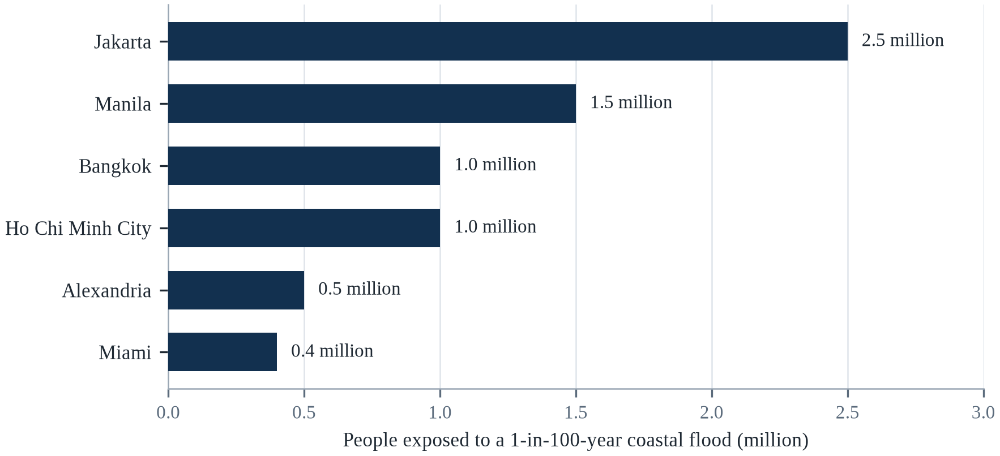||Source: Table 6.1; exposure counts include subsidence where reported.

There are two consequences here. First, the dominant variable in many cities is not global sea level rise but local subsidence, which is caused by human decisions and can be slowed or stopped. Second, the cost of adaptation rises faster than the sea, because each increment of rise requires a larger and more expensive defence, and because the probability of failure increases as the design threshold is approached.

A collapse of the West Antarctic ice sheet would make the high-end projections much more likely and would shift the policy focus from protection to retreat. A breakthrough in cheap, large-scale pumping or in floating construction could allow some cities to remain in place longer. And a reduction in emissions would slow the rise, but it would not stop it, because the ocean and the ice sheets respond over centuries. For coasts, mitigation determines the speed of the emergency; adaptation determines whether the city survives it.

---

# Chapter 7: Food Security and Agriculture

*Theme: food security, crop physiology and the fragility of the global harvest*

In May 2022, the government of India banned wheat exports with a single notification. The trigger was a heatwave in March that had arrived earlier and lasted longer than any recorded spring heat in the wheat belt, and had cut the harvest by an estimated five per cent (World Bank, 2022). The ban was small in global terms — India accounts for a modest share of world wheat trade — but it arrived when the war in Ukraine had already removed a large part of the Black Sea supply, and prices that had been rising for a year rose further.

In July 2023, India restricted rice exports, and the effect was larger. India accounts for about forty per cent of the global rice trade, and the restriction, combined with an El Niño that was reducing production in other Asian countries, pushed rice prices to their highest level since 2008 (FAO, 2023). Panic buying in the Philippines, Indonesia and West Africa amplified the increase. The rice was not physically scarce in most importing countries; the expectation of scarcity was enough to empty shelves.

These episodes show how food security fails. It is not only a matter of how much the world grows; it is a matter of how the harvest is distributed, stored, traded and priced. A heatwave in one region becomes a price shock in another through export restrictions, speculative buying and the thinness of global stocks. The poorest households, which spend half their income on food, absorb the shock first, and they absorb it by eating less and eating worse.

This chapter examines the physical effects of climate on crops, livestock and fisheries, and the economic and political mechanisms that turn those effects into hunger. It pays particular attention to the crops that feed most of humanity — wheat, maize and rice — and to the smallholders who grow much of the food consumed in low-income countries. It closes with the adaptations that are known to work and the reasons they are not spreading fast enough (Howden et al., 2007).

Food is the sector where climate change is most directly experienced, because every harvest is a climate experiment. Crops are sensitive to temperature during specific growth stages, to the timing and amount of water, and to extreme events at critical moments. A heatwave of a few days during flowering can reduce yields sharply even if the rest of the season is favourable, which is why average climate statistics understate the damage that extremes cause.

## 7.1 How Heat Affects Crops

Plants grow within a narrow temperature range, and the range differs by crop and by stage of development. Wheat and rice perform best around 20 to 25°C; maize around 25 to 30°C (IPCC, 2019a). Above the optimum, photosynthesis slows, respiration increases, and the plant partitions less energy into grain. The effect is not linear: a few days above 35°C during flowering can reduce grain set by a large fraction, even if the rest of the season is favourable.

Night temperature matters as much as daytime heat. Cool nights allow the plant to recover from the day's water loss and to complete the metabolic processes that fill grain. When nights remain above 25°C, respiration continues through the night, consuming the carbohydrates that would otherwise become yield (IPCC, 2019a). Studies in the Indo-Gangetic Plain have found that night temperature is a stronger predictor of rice yield than daytime maximum, which is one reason climate projections that report only daytime averages underestimate the risk.

The combined effect of warming and CO2 is complex. Higher CO2 increases photosynthesis in C3 crops such as wheat, rice and soy, an effect known as CO2 fertilisation, which can offset part of the heat penalty (Zhao et al., 2017). But the effect is smaller in field conditions than in greenhouses, because nutrients and water become limiting, and it reduces the concentration of protein, zinc and iron in the grain. A crop that yields slightly more but is less nutritious is not necessarily an improvement for the people who eat it.

The effect of heat on crops is nonlinear and threshold-based. Photosynthesis begins to decline above an optimum temperature that varies by crop — roughly 30 °C for wheat and rice, higher for maize and sorghum — and above a critical threshold, pollen becomes sterile and grain filling stops (Zhao et al., 2017). Zhao et al. (2017) analysed hundreds of studies and estimated that each degree of warming reduces global wheat yields by about 6 per cent, rice by 3.2 per cent, maize by 7.4 per cent and soybeans by 3.1 per cent, before accounting for adaptation or carbon fertilisation.

The crop-level mechanism is more specific than the headline that heat reduces yields. Photosynthesis has an optimum temperature, and above roughly thirty degrees Celsius the enzyme that fixes carbon begins to lose efficiency, while respiration keeps consuming sugars. The damage is worst when high daytime temperatures are combined with warm nights, because the plant cannot recover the carbon it burned during the day. Ortiz-Bobea and colleagues estimated in 2021 that anthropogenic warming has already reduced global agricultural productivity growth by roughly twenty-one per cent since 1961, and that the loss is concentrated in the tropics, where the margin above the optimum was always narrower (Lobell et al., 2011).

The damage heat does to a crop depends on when it arrives as much as on how hot it gets. During flowering, a few days above a threshold can sterilise pollen and reduce the number of grains that set; during grain filling, heat shortens the period in which the plant accumulates starch, so the grains are smaller; during ripening, it can reduce quality without reducing weight. Night-time temperature matters more than daytime for some crops, because the plant respires through the night and loses carbon that it would otherwise store. The result is that a heatwave which looks tolerable in a daily average can destroy a harvest, and that the same heatwave in a different week can leave the harvest almost intact, which is why farmers remember specific weeks rather than seasons.

Heat affects a crop through three mechanisms that operate at different times of the day and the season. The first is the direct damage to the photosynthesis machinery, which becomes inefficient above a threshold that differs by species. The second is the failure of pollination, which occurs when the pollen is sterilised or the flower aborts during a short window. The third is the demand for water, which rises with the temperature and which the plant may not be able to meet, so that a heatwave becomes a drought even when the soil is wet. The three mechanisms interact, which is why a modest rise in the average temperature can produce a large fall in the yield in a bad year.

## 7.2 Water, Soil and the Limits of Irrigation

Agriculture consumes about 70 per cent of global freshwater withdrawals, and irrigation is the largest single use (FAO, 2022). In regions where rainfall is unreliable, irrigation is what makes the difference between one harvest and two, or between survival and failure. But irrigation depends on water that is increasingly contested: aquifers are being depleted, rivers are fully allocated, and snowmelt that feeds many systems is declining.

Soil is the other invisible input. A healthy soil holds water, cycles nutrients and supports the microbial communities that make them available to plants. Erosion, compaction and the loss of organic matter reduce that capacity, which makes crops more vulnerable to drought even when rainfall is unchanged. The global loss of topsoil is estimated at 24 billion tonnes a year, and the degradation of arable land is one of the reasons yields have stagnated in some regions despite improved varieties (FAO, 2022).

These constraints interact. A field with depleted soil and no irrigation cannot benefit from a heat-tolerant variety; a farmer who cannot afford fertiliser cannot compensate for nutrient dilution by adding more. The result is that the same climate shock produces very different losses on different farms, and that adaptation must address soil, water and seeds together rather than one at a time.

Irrigation has been the main source of yield growth for half a century, and it is reaching limits in many regions. Aquifers are being depleted faster than they recharge in the North China Plain, the Indian Punjab, the US High Plains and parts of the Middle East; rivers are fully allocated; and the energy cost of pumping is rising as water tables fall. Expanding irrigation further would require either new storage or new sources, both of which are increasingly expensive and contested.

Irrigation is the largest single adaptation in agriculture, and it has limits that are physical rather than financial. A field can be watered only from a source that is recharged, and in many regions the source is an aquifer that is being mined. Soil matters as much: salinisation from poorly drained irrigation accumulates salt in the root zone, and a field that was productive for fifty years can be abandoned within five as the salt rises. The water that is available must also arrive at the right time, which is why the timing of snowmelt and monsoon matters more than the annual total. Where all three constraints bind at once — depleted aquifer, saline soil, unreliable timing — the adaptation menu shrinks to changing crops, changing practice, or leaving.

Irrigation is the largest single use of fresh water in the world, and it is also the practice through which the most water is wasted. Flood irrigation on a level field can lose half of what is applied to evaporation and runoff, and the losses are invisible because the water simply disappears into the air or returns to the river. Drip irrigation delivers water to the root zone and can cut consumption by a third, and it costs money that a smallholder may not have. The deeper problem is the source: in the Indo-Gangetic plain and the North China Plain, the water is being pumped from aquifers that recharge far more slowly than they are drawn down, which means that the irrigation is mining a reserve.

## 7.3 Pests, Pathogens and Pollinators

Warmer temperatures expand the range of many agricultural pests and change their life cycles. The fall armyworm, a moth native to the Americas, spread across Africa and then Asia in the 2010s and has become a major pest of maize; its expansion was aided by trade and by warmer winters that allowed it to survive in new regions. Aphids, whiteflies and locusts respond to temperature and rainfall in ways that are difficult to predict but increasingly favourable to outbreaks.

Plant diseases follow the same pattern. Fungal pathogens that were once limited to warm regions are moving poleward and upward; coffee leaf rust, which devastated Central American plantations in 2012–2013, was associated with higher temperatures and more variable rainfall. The response is often more pesticide, which raises costs and creates resistance, or the abandonment of susceptible crops, which reduces diversity.

Pollinators are a separate vulnerability. About three-quarters of the world's leading food crops depend at least partly on animal pollination, and pollinators are themselves sensitive to heat, drought and the loss of habitat. Studies in tropical regions have found that bee diversity declines with warming, and that the decline reduces yields of crops such as coffee, cocoa and many fruits and vegetables. The effect is easy to overlook because it is gradual, but it accumulates in the same way that soil loss does.

Pests and pathogens are responding to warming in ways that are difficult to model. Warmer winters reduce overwintering mortality, which allows populations to build earlier in the season; longer growing seasons provide more generations; and shifts in the range of vectors expose new regions to diseases such as wheat rust and maize lethal necrosis. Farmers respond with pesticides, which raises costs and selects for resistance, and the resulting treadmill is one of the reasons agricultural input use has risen faster than outputs.

Pest and disease risk is changing faster than the crops themselves can adapt, and the mechanism is largely thermal. Insects have faster generation times at higher temperatures, so populations can build within a season rather than across years; fungal pathogens spread more readily in humid heat; and the geographic range of many pests is expanding poleward. The FAO estimates that plant pests and diseases already destroy a substantial share of global crop production each year, and modelling studies project that warming will increase both the range and the reproductive rate of major pests such as the fall armyworm, which has spread across Africa and Asia since 2016 (FAO, 2023).

Pests and pathogens respond to climate faster than crops do, because their generation times are shorter. Warmer winters allow more individuals to survive; earlier springs allow an extra generation in a season; and shifts in rainfall change where a fungal disease can establish. The result is a moving map of pest pressure in which a farmer's inherited knowledge of what to spray and when becomes less reliable. Pollinators are affected by heat, drought and the loss of habitat, and their contribution to yields is largest for the fruit and vegetable crops that carry the most micronutrients. The combination matters for nutrition, not just for tonnage: a harvest that is large in calories but poor in diversity is not food security in any useful sense.

A warmer and drier growing season also changes the chemistry of the harvest in ways that are invisible at the market. Drought stress increases the concentration of mycotoxins produced by fungi, particularly aflatoxin in maize and groundnuts, which damages the liver and is associated with stunting in children. The contamination is not visible, not removed by ordinary cooking, and most dangerous in the subsistence systems where the grain is eaten by the family that grew it. Surveillance is expensive and rarely funded at the scale required, so the exposure is measured mainly when an outbreak of liver disease draws attention. This is one of the clearest examples of a climate impact that is mediated entirely by biology and almost entirely absent from public discussion.

Pests, pathogens and pollinators are the biological part of the food system, and the climate rearranges all three. Insects are cold-blooded, so a warmer winter allows more of them to survive and a warmer summer allows more generations in a season, which is why the range of several crop pests has moved poleward. Fungal toxins, such as those produced by the moulds that attack maize and groundnuts, are sensitive to heat and drought and are a cause of liver disease in the tropics. Pollinators are affected by the mismatch between the time a plant flowers and the time an insect emerges, and the mismatch is a different problem from the loss of habitat.

## 7.4 Extreme Events and Harvest Failure

Most of the year-to-year variability in global production comes from extreme events rather than from gradual warming. A drought during the grain-filling period, a flood at planting, a heatwave during flowering or a frost at the wrong moment can remove a large share of a national harvest. Because global stocks are thin relative to consumption, a series of such events in different regions can produce a global crisis.

The 2007–2008 food price crisis is the classic example. Drought in Australia, poor harvests in Europe and the United States, and the diversion of maize to biofuel combined to draw down stocks, and when major exporters restricted shipments, prices doubled. The result was riots in more than thirty countries and a reversal of poverty reduction in many others. The physical shortfall was modest; the policy response turned it into a catastrophe.

The 2022–2023 period repeated the pattern with different triggers. Heat in India, drought in the Horn of Africa, the war in Ukraine and an El Niño that was forecast to reduce rice output in Asia combined to raise prices and reduce availability in importing countries. Each event was within the range of natural variability; together they exceeded the capacity of the trade system to buffer, which is exactly what climate change is expected to make more frequent.

Extreme events cause damage that is disproportionate to their share of the season. A flood during harvest can destroy a crop that was already mature; a hailstorm can strip fruit from trees; a late frost can kill blossoms after a warm spell has advanced flowering. Because these events are becoming more frequent, the variance of yields is rising even where the mean is stable, which increases price volatility and the frequency of local shortages.

Extreme events damage harvests in ways that a seasonal average conceals. A flood at planting can delay sowing beyond the window in which the crop can mature; a flood at harvest can destroy a crop that was already secure; a cyclone flattens the stalks that hold the grain; a hail storm strips the fruit from a tree in ten minutes. The losses are localised and therefore easy to dismiss in national statistics, but they are catastrophic for the households that experience them, and they recur in the same places because the same land is exposed. Insurance against a single event is expensive and often unavailable; the alternative is diversification of income, which is what most rural households already do and what the poorest have the least capacity to attempt.

The timing of an extreme event matters more than its magnitude, because a crop is vulnerable only during the weeks when it is flowering or filling grain. A heatwave that arrives a month before flowering does little damage; the same heatwave during anthesis can sterilise the pollen and cut the yield by a third. This is why the aggregate relationship between temperature and yield hides so much variation, and why a season that looks normal in the annual average can produce a local disaster. The Russian heatwave of 2010 and the Indian heatwave of 2022 both fell in the sensitive window, and both were followed by export restrictions that turned a national harvest problem into a global price problem.

## 7.5 Livestock and Pastoralism

Livestock keep about 1.3 billion people employed and provide protein, traction and savings for pastoral communities (FAO, 2022). Heat affects animals directly: dairy cows reduce milk production when the temperature-humidity index exceeds about 72, poultry suffer mortality in hot weather, and grazing animals lose condition when rangelands dry out. The 2022 drought in the Horn of Africa killed millions of animals, destroying the savings of pastoral households.

Pastoralism is a system adapted to variability. Herders move with the rains, keep mixed herds of different species, and use social networks to share animals and information. Climate change stresses that system by making rainfall less predictable, reducing the number of good seasons, and increasing the frequency of droughts that occur before herds have recovered from the previous one. The result is not a single disaster but a slow erosion of the asset base.

The livestock sector is also a major source of emissions, contributing about 12 per cent of global greenhouse gases through enteric fermentation, feed production and land-use change (IPCC, 2019a). That creates a tension in policy: reducing livestock numbers would reduce emissions and free land for other uses, but it would also affect the livelihoods and nutrition of the poorest households. The solution is not a single global target but a set of context-specific changes: better feed, better breeds, better grazing management and a shift in high-income countries toward less meat-intensive diets.

Pastoralism is a livelihood built for variability, and it is being tested beyond its limits. Herders move livestock to follow rainfall, using traditional routes and reciprocal agreements with farming communities. Warming, drought, the expansion of agriculture onto rangelands, and conflict have all reduced the space and flexibility on which the system depends, which is why livestock losses in recent droughts have been catastrophic in the Horn of Africa and the Sahel.

Pastoralism is the food system that climate policy most often misunderstands. Herders manage variability rather than maximise yield, moving animals to follow rainfall, and their mobility is an adaptation that settled policy has repeatedly restricted. Studies of the Horn of Africa find that herds recover from drought if they can move and if a core breeding stock survives; when movement is blocked by fences, farms or conflict, the herd loses its ability to rebound and the household is pushed out of pastoralism permanently. The policy lesson is to protect corridors and markets, not to settle herders.

Livestock carry the heat burden twice: the animals suffer it directly, and the forage they eat grows less when it is hot and dry. Cattle and poultry reduce feed intake and fertility above a threshold that varies by breed, and milk yield falls before the animal shows obvious distress. Pastoralists manage variability by moving, and their system is well adapted to a variable climate but not to a climate that is both hotter and more variable, because the pasture that would have recovered in a wet year does not recover when the wet year fails to arrive. The loss of herds is not only an economic event; it is the loss of savings, of dowry, of status and of the knowledge that is transmitted with the animals.

Livestock are a store of wealth in the drylands, which is why a drought that kills them destroys savings rather than income. A pastoral household that sells animals during a drought receives a low price, because everyone is selling, and buys them back afterwards at a high price, because everyone is buying. The result is a ratchet that moves wealth out of the household with every cycle, and the households that do not recover are those that crossed the threshold at which they no longer have the animals to rebuild the herd. Heat stress adds a second pressure, because cattle and poultry eat less and convert feed less efficiently when the temperature rises, which raises the cost of every kilogram of meat and milk.

## 7.6 Fisheries and Aquaculture

Fisheries provide about 17 per cent of the animal protein consumed globally, and more than three billion people depend on fish as a significant source of protein and micronutrients (FAO, 2023). Climate change affects fish through warming, acidification, oxygen loss and the movement of species toward cooler water. The result is that stocks are shifting away from the tropical regions where dependence is highest, and toward the poles where fishing fleets are less able to follow.

Coral reefs are the most vulnerable fishery habitat. Reef fish depend on the structure and productivity of live coral, and when reefs bleach and die, the fish community changes: herbivorous species take over, larger predatory fish decline, and catch rates fall. In Southeast Asia and the Pacific, where reef fisheries support millions of coastal households, the loss is both nutritional and economic. Warming of 2°C is projected to eliminate most of the world's reefs (IPCC, 2018).

Aquaculture is the fastest-growing food sector and can offset part of the decline in capture fisheries, but it has its own vulnerabilities. Coastal ponds are exposed to sea level rise, storm surge and saline intrusion; the feed supply depends on wild fish and on crops that are themselves affected by climate; and disease outbreaks spread more easily in warm water. Aquaculture can be part of the adaptation, but it is not a substitute for protecting the ecosystems that underpin wild stocks.

Fisheries are affected by warming through several mechanisms: fish stocks shift toward cooler water and deeper depths, which moves them across national boundaries; coral bleaching destroys nursery habitat; acidification affects shellfish and plankton; and deoxygenation creates dead zones. The result is that catches decline in tropical regions even where global catches appear stable, because the losses are concentrated in countries with fewer alternatives for protein and employment.

The Mekong Delta is the food system most immediately exposed to saltwater intrusion, and the exposure is measured in crop failures. Rising sea levels and reduced dry-season flow have pushed the saline boundary tens of kilometres inland, and rice farmers in Ben Tre and Soc Trang have converted fields to shrimp ponds because the water is no longer fresh enough for rice. The conversion raises incomes for some households and increases debt and risk for others, and it illustrates a general pattern: adaptation at the farm level is often profitable individually and destabilising collectively, because it changes the regional water balance that everyone depends on.

Fisheries are affected by warming through the movement of species, and the movement is generally toward the poles and into deeper water. A stock that shifts across a maritime boundary becomes a diplomatic problem; a stock that shifts out of the reach of small boats becomes a food problem. Coral reefs, which nurse a large share of tropical fish, are among the most heat-sensitive ecosystems on Earth. Aquaculture can compensate for some of the loss and brings its own problems: disease spreads quickly at high density, feeds depend on wild fish, and the sites most suitable for farming are often the coastal waters most affected by warming and acidification. The overall picture is a system that is being asked to produce more while its foundations are being destabilised.

Fish move, and the institutions that manage them do not. As the ocean warms, stocks shift toward the poles and into deeper water, and a species that was within the exclusive economic zone of one country becomes a straddling stock that another country can legitimately harvest. The mackerel dispute in the North Atlantic is the clearest example: as the stock moved north-west, Iceland and the Faroes began to fish it, and the agreement that had allocated it among the European Union, Norway and Russia broke down. Aquaculture is often proposed as the substitute, and it has its own vulnerabilities, because it depends on wild fish for feed and on water temperatures that are also rising.

## 7.7 Prices, Trade and Stocks

The global food trade buffers local production shocks, but it also transmits them. A country that experiences a drought imports more, which raises prices for everyone else; an exporting country that restricts shipments to protect its own consumers amplifies the shortage. The result is that the price effect of a climate shock can be larger than the physical effect, and that the poorest countries, which are most dependent on imports, pay the highest price.

Stocks are the first line of defence, and they are thinner than they appear. Global grain stocks are held by a small number of countries and by private traders who have no obligation to release them in a crisis. Official stocks are sometimes low because holding them is expensive and because governments prefer to intervene in markets when prices rise. The 2007–2008 crisis revealed that the stocks meant to stabilise the market were insufficient once exporters began to hoard.

Trade policy is therefore climate policy. A world that maintains open markets, limits export restrictions and invests in storage can absorb a series of regional shocks without a global crisis. A world that responds to every shortage with export bans and panic buying converts regional harvest failures into global price spikes, and the spikes fall hardest on the households with the least capacity to absorb them.

Global food trade has cushioned climate shocks, but it has also concentrated risk. A small number of exporting countries dominate the trade in wheat, maize, rice and soybeans, so a drought in one of them affects prices everywhere. Export restrictions during the 2007–2008 and 2022 crises amplified price spikes, and the countries that imposed them were often the ones with the largest stocks. The lesson is that trade rules and stock management are adaptation instruments, not merely economic policy.

Trade is the mechanism that moves food from where it is grown to where it is eaten, and it works best when it is predictable. A drought that reduces a harvest in one region can be covered by imports from another, provided the exporting country does not restrict sales and the shipping system is functioning. The episodes of the past two decades show how quickly that logic breaks: a poor harvest, an export ban, a price spike, and a wave of panic buying that turns a local shortage into a global one. Stocks are the buffer that dampens the cycle, and the ratio of stocks to consumption is one of the best early indicators of a food crisis. It has been declining for years, which means the system has less slack exactly when the shocks are becoming more frequent.

Global grain stocks are thinner than most consumers imagine, and the thinness is what converts a local harvest failure into a price shock. The ratio of stocks to consumption for wheat and maize has fallen over the past two decades, and the stocks that exist are held by a small number of countries that can decide to keep them. When a major exporter restricts sales, the importers that depend on it have no substitute at short notice, and the price rises until demand is destroyed among the poorest consumers. Futures markets can smooth the adjustment for those who can access them, and they cannot smooth it for a household that buys its flour by the day.

## 7.8 Smallholders and the Poorest Consumers

Smallholder farms produce about a third of the world's food and a much larger share in low-income countries, but they manage only a small fraction of the investment and irrigation. They are the most exposed to climate shocks and the least able to absorb them, because they lack insurance, credit, storage and access to markets. A single failed season can force a household to sell assets, withdraw children from school and borrow at high interest, which reduces its capacity to cope with the next season.

Women are disproportionately affected. In many countries they are responsible for water, fuel and food processing, and they often have weaker land rights and less access to extension services. When a drought increases the time needed to collect water or fuel, girls are often the first to be withdrawn from school. The result is that a climate shock does not simply reduce income; it changes the trajectory of a household, sometimes permanently.

Social protection is the most effective instrument for preventing that trajectory. Cash transfers, school feeding, employment guarantee schemes and crop insurance can keep households from selling productive assets during a shock. Ethiopia's Productive Safety Net Programme, India's Mahatma Gandhi National Rural Employment Guarantee Act and Mexico's Progresa-Oportunidades have all been shown to reduce the impact of droughts on consumption, and they are often more cost-effective than emergency assistance after the crisis.

Smallholders and poor consumers are exposed through different channels. Smallholders depend on their own harvest for food and income, so a failed season is simultaneously a food shock and an income shock, and they often lack insurance, storage or credit. Poor consumers spend a large share of their income on food, so a price rise of 20 per cent can force them to cut meals or shift to cheaper, less nutritious food (FAO, 2023). Both groups are therefore vulnerable to the same event for different reasons.

The distributional fact that organises this chapter is that most hungry people are net food buyers. Smallholders who produce a surplus benefit from higher prices, while smallholders who buy part of their food and landless labourers lose, and the losers outnumber the winners in most low-income countries. This is why food price spikes produce both rural prosperity and rural destitution in the same season, and why agricultural policy that focuses on production can miss the households that need the most help. Cash transfers, school feeding and price stabilisation reach the net buyers; seed subsidies often do not.

The poorest consumers are the most exposed and the least responsible. A household that spends half its income on food experiences a price rise as a reduction in everything else: medicine, school fees, fuel, protein. Farmers who are net sellers can benefit from higher prices, but most smallholders in the countries where hunger is concentrated are net buyers, so a price spike hurts them twice — once as consumers and once through the cost of inputs. The result is that the same drought produces bankruptcy for some and profit for others, and the distribution depends on land, storage, credit and market access. That is why food security policy is never only about production; it is about who can buy, store and sell.

The rural poor are usually net buyers of food, which means that a rise in the price of grain hurts them even when they are farmers. The household that grows a fraction of what it eats and buys the rest is exposed on both sides: its own harvest may fail, and the price of what it must buy rises at the same time. The coping strategies follow a sequence that is documented across continents: cheaper and less nutritious food, then the sale of livestock, then the sale of tools, then the withdrawal of children from school, then migration. Each step is rational for the household and each one reduces its capacity to recover, which is why the timing of a transfer matters as much as its size.

## 7.9 Adaptation: Seeds, Soil, Water and Insurance

The portfolio of agricultural adaptation is well established. Heat- and drought-tolerant varieties, earlier planting, crop diversification, improved irrigation, soil conservation and agroforestry can reduce losses under moderate warming. Climate-smart agriculture, a term that covers many of these practices, has been adopted widely in development policy, though the evidence for its effectiveness varies by context and by how it is measured.

Genetic improvement is the most powerful tool and the slowest to deploy. Breeding a new variety takes eight to twelve years, and the climate that the variety will face when it is released is not the climate for which it was selected. Gene banks hold the diversity that breeders need, but they are underfunded, and the traits that matter — heat tolerance at flowering, deep roots, resistance to new pests — are often found in landraces that are being lost as farmers adopt modern varieties.

Insurance and finance are the enabling conditions. A farmer who cannot borrow cannot invest in irrigation or improved seed; a farmer without insurance may avoid risk by planting low-yielding but reliable crops. Index-based insurance, which pays out when rainfall or temperature crosses a threshold, has been promoted as a solution, but its uptake has been limited by basis risk, cost and trust. The most successful programmes combine insurance with credit, extension and access to markets, because insurance alone does not solve the underlying problem of low productivity.

Adaptation in agriculture has a well-tested menu: heat- and drought-tolerant varieties, adjusted planting dates, conservation agriculture that preserves soil moisture, agroforestry that provides shade and diversifies income, improved irrigation, index-based insurance, and social protection that reaches farmers before they sell assets. The constraint is rarely the availability of any single measure; it is the extension systems, credit and market access that determine whether farmers can adopt them.

Adaptation in agriculture is a portfolio rather than a silver bullet. Better seed, including varieties that tolerate heat, drought and salt, is the most visible element, but it only delivers when farmers have access to it, can afford it, and have the extension support to manage it. Soil measures — mulching, cover crops, reduced tillage, organic matter — improve water retention and are cheap where labour is available. Water measures include drip, alternate wetting and drying of rice paddies, and managed aquifer recharge. Index insurance can pay out quickly after a drought without the cost of assessing every field, but it carries basis risk: the index can fail to trigger in a field that genuinely lost its crop, and a farmer who experiences that once may not buy again.

Seed systems deserve separate attention because they determine how fast any of the rest can spread. A new variety reaches a farm through a chain of public breeders, private companies, multipliers, agrodealers and neighbours, and the chain is weakest in the countries where adaptation is most urgent. Public breeding has been underfunded for decades, and the private sector concentrates on crops and markets that can pay for the research. Farmer-saved seed, which supplies most of the world's smallholders, is diverse and locally adapted but rarely improved at the speed the climate requires. The result is a gap between the varieties that exist in trial plots and the varieties that are actually in the ground, and closing it is a matter of institutions rather than of genetics.

The adaptation menu for agriculture is longer than the adaptation budget, and the items on it differ in cost and in speed. Improved seeds are the most discussed and the slowest, because a new variety takes a decade to develop and to reach a farmer. Soil and water practices are cheaper and faster, and they include the retention of residue, the construction of small water-harvesting structures and the shift to a crop that fits the season. Insurance is the instrument that transfers the risk that the practices cannot remove, and it is the one that is least available to the farmers who need it most. The sequencing matters: a seed that is not matched by a practice will fail in the same season.

## 7.10 The Food System as a Whole

Food security is not only a question of production. It depends on storage, transport, processing, retail and waste. About a third of the food produced is lost or wasted, and reducing that waste is equivalent to increasing production without using more land or water. It depends on diets: about a third of crop calories are fed to animals, and a shift toward less meat-intensive diets in high-income countries would free land and water for human food (FAO, 2022).

It depends on the political economy of food. Subsidies that encourage water-intensive crops in dry regions, tariffs that protect inefficient producers, and land tenure systems that exclude smallholders all reduce the system's capacity to adapt. The barriers are rarely technical; they are institutional and distributional, which is why the chapters on governance and justice are as relevant to food as the chapters on agronomy.

The final point is that the food system and the climate system are coupled. Agriculture, forestry and land use account for about a fifth of global greenhouse gas emissions, and food loss and waste add more. A transformation that reduces emissions from agriculture — through better fertiliser management, less deforestation, healthier diets and less waste — would also make the food system more resilient, because it would reduce the pressure on land and water that makes it fragile.

The food system as a whole is both a victim of climate change and a contributor to it, responsible for roughly a quarter to a third of global greenhouse gas emissions when land use, fertiliser, livestock, transport and waste are included. That dual role means that food system reform is simultaneously mitigation and adaptation: reducing food loss and waste lowers emissions and increases available supply; shifting toward more plant-rich diets reduces land pressure; and improving soil health increases both carbon storage and resilience to drought.

The systems view is not a rhetorical preference; it is what the evidence supports. Food security depends on production, but also on storage, transport, trade, cold chains, credit, land tenure and social protection, and the binding constraint in most crises is one of the latter rather than the harvest itself (Wheeler & von Braun, 2013). The 2007–2008 crisis demonstrated that grain was available while people went hungry, and the 2022 crisis demonstrated that trade policy could substitute for a failed harvest. A food system that is resilient is therefore one with redundancy at each link, not one that maximises output at a single point.

The food system is a chain of dependencies, and the weakest link is usually the one nobody is responsible for. Fertilisers depend on natural gas; tractors and transport depend on diesel; cold chains depend on electricity; processing depends on water; and all of them depend on a functioning road network. A shock in any of these inputs can reduce output as effectively as a drought. The concentration of the system adds a second vulnerability: a small number of exporting countries supply most of the traded grain, a small number of ports handle it, and a small number of companies control the trade. Efficiency has been purchased by removing redundancy, and redundancy is what a shock consumes. Building resilience back into the system means accepting some slack, which is politically difficult when the slack is visible as cost.

## 7.11 Case Study: The 2023 Rice Shock

Rice is the most important food crop in the world by the number of people who depend on it. About 3.5 billion people obtain a fifth or more of their calories from rice, and most of them live in Asia, where the crop is often produced by smallholders and consumed close to where it is grown (Zhao et al., 2017). The global rice trade is thin relative to production — only about ten per cent of output crosses a border — which means that a small disruption in a major exporter can move prices for everyone.

In 2023, that is what happened. India, which accounts for about forty per cent of global rice exports, restricted shipments after a poor monsoon and rising domestic prices. The restriction coincided with an El Niño that was reducing production in Thailand, Vietnam and the Philippines, and with a global market that was already nervous after the war in Ukraine. Rice prices rose by about 30 per cent in a few months, and importing countries responded by buying more, which pushed prices higher (FAO, 2023).

The effects were felt far from the harvest. In West Africa, where rice is a staple and imports account for a large share of consumption, governments subsidised purchases and released stocks. In the Philippines, the government capped rice prices, which reduced supply and created queues. In Indonesia, the state logistics agency increased imports and distributed rice through social assistance. None of these countries had experienced a harvest failure; they were experiencing the transmission of a policy decision through a thin market.

Food security is a systems problem, and the rice shock shows why. The physical shock was a weak monsoon, which is within the range of natural variability. The crisis was produced by the interaction of that shock with export restrictions, thin stocks, panic buying and the concentration of trade in a few exporters. Climate change increases the probability of the physical shock, but the severity of the crisis depends on how the trade system responds.

The lessons for importers are specific. First, they should hold strategic reserves and diversify their suppliers, rather than relying on the cheapest source. Second, exporting countries should coordinate restrictions rather than impose them unilaterally, because unilateral restrictions invite retaliation and panic. Third, international institutions should monitor stocks and prices in real time, so that governments can distinguish a physical shortage from a speculative one. Fourth, social protection should be in place before the crisis, because the households that are pushed into hunger by a price spike cannot wait for a new programme to be designed.

The 2023 rice decision had a global dimension that is often missed. India accounts for about 40 per cent of the world's rice exports, and its restriction removed a large volume from a market that was already tight because of El Niño conditions (FAO, 2023). Prices for Thai and Vietnamese rice rose to their highest levels in more than a decade, and importing countries in West Africa and Southeast Asia scrambled for supplies. The episode showed how quickly a national food-security decision can become a global food-security problem.

The rice shock of 2023 showed how a climate event becomes a market event. India, the largest exporter of rice, restricted shipments after a delayed and uneven monsoon and concerns about domestic prices, and the restriction affected a category of rice traded widely in Africa and Asia. Importers that depended on Indian supply scrambled for alternatives; prices rose in countries that had done nothing to cause the shortage; and the poorest consumers reduced quantity and quality. The harvest itself was not a catastrophe, and that is the point: in a thin market, a modest production shortfall plus a policy response can produce a large price shock, and the shock is transmitted to people who never see the original failure.

The rice shock of 2023 was produced by a combination of a weather event and a policy decision, and the policy decision did most of the damage. India, which supplies a large share of the globally traded rice, restricted the export of non-basmati varieties in July 2023 after a late monsoon and concerns about domestic prices. The restriction removed a substantial volume from a market that is thin and thinly traded, and the price of rice in the importing countries of West Africa and Southeast Asia rose sharply. The episode repeated the pattern of 2007 and 2008, and it demonstrated again that the instrument a government reaches for in a food crisis is often the one that makes the crisis worse for its neighbours.

The rice shock of 2023 has an earlier twin. When wheat prices doubled in 2010 and 2011, the countries that restricted exports were not the largest producers, and the market tightened within weeks; the unrest that followed in North Africa and the Middle East had many causes, but its timing followed food prices closely (Mach et al., 2019). Rice and wheat behave the same way: only a small share of world production is traded, so a restriction by one exporter moves the world price far more than its share of output would suggest. What differed in 2023 was that the restriction came from one country holding forty per cent of the export market.

## 7.12 Future Scenarios and Predictions: Feeding the World in 2050

The effect of warming on food is no longer hypothetical. A meta-analysis of field experiments found that each degree of warming reduces global wheat yields by about 6 per cent, maize by 7.4 per cent, rice by 3.2 per cent and soybeans by 3.1 per cent, before adaptation (Zhao et al., 2017). The losses are larger in tropical regions, where crops are already close to their heat limits, and smaller in temperate regions, where longer growing seasons can partly offset the heat.

The food system rests on a narrowing margin. Global food production has kept pace with population growth for most of the past half-century, but the rate of yield improvement has slowed, and about 735 million people were undernourished in 2022 (FAO, 2023). The food system is also responsible for about a third of global greenhouse gas emissions, which means that it must reduce emissions while increasing production — a combination that is difficult but not impossible.

Population growth, diet, technology and trade will decide the harvest. A world that stabilises population, reduces food waste, shifts toward healthier diets and invests in adaptation can feed a larger population with less land and water. A world that continues current trends will face rising prices, increasing dependence on imports and a growing number of climate-driven food emergencies. The scenarios below show the range.

Feeding the world in 2050 is less a question of total calories than of distribution, resilience and diet. Global production has kept pace with population for half a century, and the rate of improvement has slowed as the easiest gains have been taken. The scenarios diverge mainly on three variables: how much warming occurs, how quickly yields adapt, and how much land and water are diverted to other uses. A world that invests in research, irrigation and trade can feed a larger population at a higher standard; a world that delays will see the gains concentrated and the failures localised, which is exactly the pattern that produces famines in a world that grows enough food.

[[TABLE:Table 7.1 Crop yield sensitivity and 2050 projections]]
| Crop | Yield change per °C | 2050 change (SSP2-4.5) | Main adaptation | Key region |
|---|---|---|---|---|
| Wheat | −6% | −10 to −15% | Heat-tolerant varieties; earlier sowing | South Asia; Europe |
| Maize | −7.4% | −15 to −20% | Drought tolerance; diversification | Sub-Saharan Africa; US |
| Rice | −3.2% | −5 to −10% | Flood-tolerant varieties; irrigation | South and Southeast Asia |
| Soybean | −3.1% | −5 to −8% | Crop rotation; heat tolerance | Brazil; US; Argentina |
| Coffee | −10 to −20% | −25 to −50% | Shade; altitude shift; new varieties | Ethiopia; Colombia; Vietnam |
| Livestock | −5 to −10% (milk) | −10 to −20% | Shade; breeds; feed quality | South Asia; Sahel |

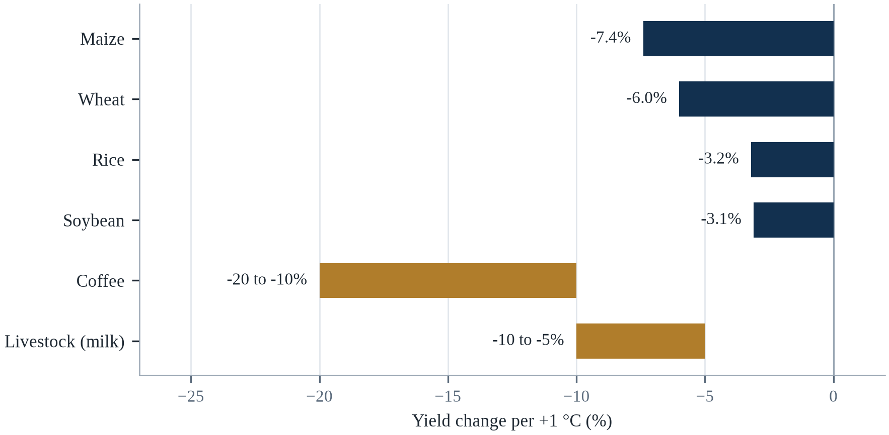||Source: Table 7.1. Bars for coffee and livestock show the reported range.

Two points deserve emphasis. First, the crops that feed the poorest people are the most sensitive to heat, and the regions where they are grown are the ones where adaptation is least funded. Second, the projected losses are not catastrophic in the global aggregate, but they are severe in particular places, and they interact with poverty, conflict and weak institutions to produce famine rather than shortage.

A breakthrough in heat-tolerant varieties, or in the efficiency of photosynthesis, would reduce the losses, but it would take a decade or more to reach farmers. A shift toward plant-based diets in high-income countries would reduce demand for feed grains and free land for human food. And a sustained increase in investment in irrigation, storage and rural roads would reduce the post-harvest losses that currently account for a large share of the gap. The most important variable, however, is emissions: the difference between 1.5°C and 3°C is the difference between a food system that can adapt and one that cannot (FAO, 2023).

---

# Chapter 8: Ecosystems and Biodiversity Loss

*Theme: ecosystem collapse, extinction risk and the services that nature provides*

In the first half of 2024, the Great Barrier Reef experienced its fifth mass bleaching event in eight years. Surveys by the Australian Institute of Marine Science found that about 73 per cent of surveyed reefs had bleached, with the highest levels in the southern section, which had previously escaped the worst heat (IPCC, 2019b). Bleaching is not death: a bleached coral has expelled the algae that feed it and can recover if the water cools quickly. But the interval between events has become shorter than the time a reef needs to recover, and that is what turns a recurring disturbance into a permanent decline.

The reef is the most visible example of a general pattern. Warming is reorganising the living world: species are moving toward the poles and up mountains, the timing of seasons is shifting, and the disturbances that ecosystems evolved with — fire, drought, storms — are becoming more frequent and more severe. The result is not a uniform decline but a reshuffling, in which some species thrive, many decline, and the relationships among them change in ways that are difficult to predict.

The consequences for people are not sentimental. Ecosystems provide food, fibre, clean water, pollination, flood protection, carbon storage and medicine. They regulate the climate and the water cycle, and they underpin the livelihoods of billions of people. When a reef dies, the fish that depend on it decline, and the coastal communities that depend on the fish lose protein and income. When a forest dries out, it stops absorbing carbon and starts releasing it, which accelerates the warming that caused the drying.

This chapter examines the main mechanisms by which climate change affects ecosystems, the thresholds beyond which the changes become irreversible, and the services that are at stake. It pays particular attention to three systems that are both highly vulnerable and highly consequential: coral reefs, tropical forests and permafrost. It closes with the conservation and restoration strategies that can buy time, and with an honest assessment of what they cannot save.

Biodiversity loss and climate change are usually treated as separate crises, and they are in fact the same crisis observed from different angles. Warming changes where species can live, when they reproduce and how they interact; habitat loss reduces the populations that could otherwise shift or adapt; and the resulting decline in ecosystem function reduces the capacity of land and ocean to absorb carbon, which accelerates warming. The two problems reinforce each other, which is why addressing one while ignoring the other tends to fail.

## 8.1 The Biodiversity Baseline

The living world is already under pressure from land conversion, overexploitation, pollution and invasive species, and climate change is arriving on top of those pressures. The Intergovernmental Science-Policy Platform on Biodiversity and Ecosystem Services estimated in 2019 that about one million species are threatened with extinction, and that the average abundance of native species in most major terrestrial biomes has fallen by at least 20 per cent since 1900 (IPBES, 2019). The Living Planet Index, which tracks monitored vertebrate populations, recorded an average decline of 69 per cent between 1970 and 2018 (WWF, 2022).

These numbers describe a system already in deficit. Climate change adds a new set of pressures: heat stress, altered rainfall, ocean acidification, rising sea level and more frequent extreme events. The interaction is what makes the situation dangerous. A forest fragment that is already degraded by logging has less capacity to survive a drought; a coral reef that is already polluted has less capacity to recover from bleaching; a species whose range has been reduced by land clearing has fewer places to move when its remaining habitat becomes too warm.

The baseline also matters for what can be saved. Ecosystems that retain their structure and diversity are more resilient than those that have been simplified, and the difference can be large. A intact mangrove forest attenuates storm surge; a cleared one does not. A diverse grassland recovers from drought; a monoculture may not. Protecting what remains is therefore as important as restoring what has been lost, and it is usually cheaper.

The consequence for the argument of this chapter is not the number itself but what it does to the reference point. Conservation targets are usually set against a recent baseline, which means that each generation inherits a slightly emptier world and measures its own losses against that. The mechanism is easiest to see in fisheries, where the definition of a healthy stock has been revised downward as the large fish disappeared, and it operates in forests, grasslands and soils as well. A baseline that moves cannot function as a target, which is why an index of this kind is more useful as a rate than as a level: the question that matters is not how much remains but how fast it is going.

The biodiversity baseline is harder to establish than the climate baseline, because no single number captures the state of life on Earth, and any figure quoted without its definition invites a false argument. The Living Planet Index, for instance, averages the trends of monitored vertebrate populations rather than counting animals, so a decline of seventy per cent does not mean that seven in ten individuals have died (WWF, 2022). The extinction-risk measure is a different instrument again: it extrapolates from the species that have been assessed, which is a small and biased sample of the total. Reading the three together is legitimate; comparing one with a headline from another is not, and most of the confusion in public argument about biodiversity comes from exactly that substitution.

Each of the three indicators answers a different question, and the confusion in public argument comes from using one to answer another. Habitat extent answers whether there is room for a species to persist; population abundance answers whether the ecosystem is still functioning; extinction risk answers whether a loss would be permanent. A policy that targets extent alone can restore a forest that is empty of the species it once held, and a policy that targets abundance alone can preserve a population that has lost the genetic diversity to survive the next shock. The argument of this chapter needs all three, and the reason the numbers are so often quoted in isolation is that each of them, alone, supports a stronger headline than the three together.

## 8.2 Range Shifts and Phenology

Species respond to warming by moving. On land, they move up mountains and toward the poles; in the ocean, they move toward cooler water and greater depths. A meta-analysis of observed shifts found that terrestrial species have moved to higher elevations at an average of about 11 metres per decade and toward the poles at about 17 kilometres per decade, while marine species have shifted at about 72 kilometres per decade (Chen et al., 2011). The rates are fast in ecological terms and slow in comparison with the rate at which the climate is changing.

The problem is that many species cannot move fast enough, and some have nowhere to go. A species that lives on a mountain top has no higher ground; a species that lives in a lake has no other lake; a species that lives on a low island has no landward refuge if the coast is developed. The result is that range shifts benefit mobile generalists and penalise specialists, which changes the composition of communities even when total biodiversity is maintained.

Phenology — the timing of seasonal events — is shifting even faster. Earlier springs advance the emergence of insects, the flowering of plants and the arrival of migratory birds, but the shifts are not synchronised across species. A bird that arrives at its breeding ground on its traditional date may find that the insects it feeds on have already peaked. These mismatches are difficult to observe and can reduce breeding success without any obvious change in the landscape.

Species are moving, and they are moving uphill and poleward at rates that are measurable but often too slow to keep pace with the shifting climate. Meta-analyses find average range shifts of several kilometres per decade toward the poles and several metres per decade uphill, while the climate zones themselves are moving faster. The gap between the two — climate velocity minus dispersal capacity — determines which species will be stranded in unsuitable conditions, and it is largest for plants, amphibians and slow-reproducing species.

Range shifts are measurable, and the measurements are among the cleanest evidence that warming is reorganising the living world. A meta-analysis by Chen and colleagues in 2011 found that species have been moving poleward at roughly seventeen kilometres per decade and upslope at eleven metres per decade, with the fastest movement among insects and marine species. Parmesan and Yohe documented similar shifts in the timing of seasonal events, with spring arriving earlier. The averages conceal winners and losers: species that disperse well and have broad tolerances move successfully, and specialists on mountaintops or isolated ranges have nowhere to go.

Species respond to warming in three ways, and each has a different consequence for people. They move, tracking the climate they are adapted to, at a speed that depends on how far they must travel to find suitable conditions; they shift the timing of their lives, breeding or flowering earlier; or they stay and decline. The first strategy fails where a coastline, a mountain top or a city blocks the route, which is why species on islands and mountaintops are the most vulnerable. The second can desynchronise a food chain: a bird that arrives on its traditional date finds that its caterpillars have already hatched, and a plant that flowers early finds that its pollinator has not emerged. That mismatch is invisible in a species list and decisive in an ecosystem.

Range shifts and phenology are the two ways that species respond to warming, and the mismatch between them is where the harm occurs. A bird that times its migration by the length of the day arrives at the same date every year, while the insects it feeds on emerge earlier, so that the chicks hatch after the food has gone. A plant that flowers earlier may miss the pollinator that has not yet emerged. The evidence for the shifts is strong: the average species has moved toward the poles and up the slopes, and the average spring event has advanced by several days per decade. The species that cannot move, because the mountain is too short or the soil is too dry, are the ones that disappear.

## 8.3 Coral Reefs

Coral reefs occupy less than one per cent of the ocean floor but support about a quarter of marine species and provide food, income and coastal protection for hundreds of millions of people (IPBES, 2019). They are also among the most sensitive ecosystems to warming, because the symbiotic algae that live in coral tissue are expelled when the water exceeds their thermal tolerance. The result is bleaching, and if the heat persists, the coral dies.

The frequency of bleaching has increased sharply. Before the 1980s, mass bleaching was rare; since 1998 there have been four global bleaching events, and the interval between them has shortened from about twelve years to about six. The Great Barrier Reef has bleached five times since 2016, and the 2024 event affected reefs that had previously been considered refuges because they lived in cooler water. Global coral cover has declined by about half since the 1950s, and the decline has accelerated.

The projections are stark. At 1.5°C of warming, about 70 to 90 per cent of warm-water reefs are projected to decline; at 2°C, more than 99 per cent (IPCC, 2018). These are not gradual declines; they are the loss of the physical structure that supports the ecosystem, followed by the collapse of the fish community. Some corals may survive in cooler refuges, and some may adapt, but the reef as a functioning system is unlikely to persist in the form that has existed for thousands of years.

Coral reefs occupy less than 1 per cent of the ocean floor and support roughly a quarter of marine species at some stage of their lives (IPBES, 2019). They are also among the most temperature-sensitive ecosystems on Earth: a sustained anomaly of 1–2 °C above the local summer maximum can trigger bleaching, in which corals expel the symbiotic algae that feed them (IPCC, 2019b). The Great Barrier Reef has experienced five mass bleaching events since 2016, and the fraction of reefs that have bleached at least once is now large enough to have changed the composition of the ecosystem (Great Barrier Reef Marine Park Authority, 2024).

Coral reefs are the ecosystem where the arithmetic of warming is least forgiving, and the numbers are now well established. The Great Barrier Reef has experienced five mass bleaching events since 2016, and the 2024 event affected more than seventy per cent of the reef in some surveys (Great Barrier Reef Marine Park Authority, 2024). Hughes and colleagues have argued that repeated bleaching has reduced the recovery interval below the time the reef needs to regrow, which converts a disturbance into a trajectory. Reefs support roughly a quarter of marine species at some stage of their life cycle, and the fisheries that depend on them feed hundreds of millions of people.

Coral reefs are the clearest example of a system whose tolerance is narrow and whose value is enormous. Reef-building corals live within a degree or two of their thermal limit, in partnership with algae that supply most of their energy and give them their colour. When the water stays too warm for too long, the partnership breaks, the coral expels the algae and bleaches. A bleached coral is not dead, and it can recover if the water cools in time, which is why the interval between events matters more than the severity of any single one. When events arrive before recovery is complete, the reef shifts from coral to seaweed and rubble, and the fish and the people who depend on it lose the structure that supported them.

Coral reefs are the ecosystem that most clearly shows what a small change in temperature can do, because the relationship is visible within weeks. A reef that is stressed by heat expels the algae that live in its tissue and provide most of its food, and the result is the white skeleton that gives bleaching its name. A bleached coral can recover if the temperature returns to normal quickly, and it dies if the heat persists. The global record shows that the frequency of bleaching events has increased to the point that some reefs now bleach in consecutive years, which leaves no time to recover, and the projections for a world at two degrees are for the loss of most of the reefs that exist.

## 8.4 Tropical Forests and the Amazon

Tropical forests store about half of the carbon in terrestrial vegetation and support a large share of the world's biodiversity. They also influence rainfall over vast regions: the Amazon recycles moisture that falls as rain across South America, and the Congo basin does the same for central Africa. When forests are cleared or degraded, both the carbon and the rainfall are lost, and the two losses reinforce each other.

The Amazon is the most studied case. About 17 per cent of the forest has been cleared, and a further fraction is degraded by logging and fire (IPCC, 2019a). Climate models and observational studies suggest that beyond a threshold of about 20 to 25 per cent deforestation, the forest may lose its ability to recycle moisture and begin to convert to savannah in the eastern and southern parts (Lovejoy & Nobre, 2018). The 2023–2024 drought, the most severe in the instrumental record, lowered river levels to historic lows and created conditions for fires that burned millions of hectares.

The forest is also a carbon bomb. If it dies back, the carbon it stores will be released, accelerating warming and making the dieback more likely. The Amazon therefore contains a positive feedback that is not fully represented in most climate models, and the uncertainty is asymmetric: the risk of a rapid transition is small in any given decade but the consequences are irreversible on human timescales. Protecting the forest is therefore both a mitigation measure and an adaptation measure, and it is one of the cheapest available.

The Amazon is a system with its own rainfall, and that is what makes it vulnerable. Moisture recycled by the forest falls as rain further west and south, so deforestation in the east reduces rainfall in the west. Models suggest that beyond roughly 20–25 per cent deforestation, parts of the forest could shift to a savanna-like state, with consequences for carbon storage, biodiversity and regional agriculture (Lovejoy & Nobre, 2018). Droughts in 2005, 2010 and 2015–2016, and the severe drought of 2023–2024, have been interpreted as early warnings of that transition.

The Amazon is the ecosystem where a physical threshold could turn a gradual change into an abrupt one, and the mechanism is reasonably well understood. The forest recycles rainfall through transpiration, and when enough of it is cleared or degraded the recycling weakens and the interior becomes drier (Lovejoy & Nobre, 2018). Lovejoy and Nobre argued in 2018 that a tipping point could be reached at around twenty to twenty-five per cent deforestation, beyond which large parts of the forest would convert to savannah. Deforestation in the Brazilian Amazon has oscillated with political cycles, which shows that the threshold is governable as well as physical.

Tropical forests hold an extraordinary share of terrestrial biodiversity and an extraordinary share of the world's land carbon, and both are being lost by the same mechanism. Deforestation removes the trees and fragrances the remainder, and a fragment has more edge and less interior, which favours species that tolerate disturbance and drives out the ones that need deep shade. Warming and drying add a second pressure: the forest that remains transpires less, which reduces the rainfall that sustains it. The combination is what makes the Amazon a candidate for a tipping point, because a forest that is drier and more fragmented burns more easily, and a burned forest regenerates as something simpler. The threshold is uncertain; the direction is not.

## 8.5 Permafrost and the Tundra

Permafrost — ground that remains frozen for at least two consecutive years — covers about a quarter of the Northern Hemisphere and stores an estimated 1,400 to 1,600 billion tonnes of carbon, roughly twice the carbon in the atmosphere (IPCC, 2019b). As the Arctic warms three to four times faster than the global average, the ground thaws, and microbes decompose the organic matter that has been frozen for millennia, releasing carbon dioxide and methane.

The release is already measurable. Arctic rivers carry increasing amounts of dissolved organic carbon; thaw slumps and thermokarst lakes are appearing in regions that were previously stable; and winter carbon dioxide emissions from northern soils have increased. The processes are slow relative to fossil fuel emissions, but they are large and difficult to reverse, and they are not included in the carbon budgets that governments use to plan emission reductions.

Thawing permafrost also damages infrastructure. Roads, pipelines, buildings and airports built on frozen ground deform when the ground subsides, and the cost of repair is already significant in Alaska, Canada and Russia. For communities that depend on ice roads and frozen ground for transport, the loss of permafrost is a direct threat to access to food, fuel and medical care.

Permafrost covers about a quarter of the Northern Hemisphere's land surface and holds roughly twice as much carbon as the atmosphere currently contains. As it thaws, microbial activity releases carbon dioxide and methane, and the process is self-reinforcing because thaw exposes more organic matter to decomposition. The emissions are not yet large enough to dominate the global budget, but they are outside human control once triggered, which is why permafrost is treated as a tipping element rather than a manageable source.

Permafrost is ground that has stayed frozen for at least two years, and it holds more carbon than the atmosphere does. When it thaws, the organic material it contains becomes available to microbes, which release carbon dioxide where oxygen is present and methane where it is not. The process is slow and irreversible on human timescales, and it is one of the feedbacks that models handle with the greatest uncertainty, because the pace depends on how deep the thaw penetrates and on how wet the soil becomes. In the Arctic the consequence is already visible: roads buckle, buildings sink, and communities built on frozen ground face a choice between expensive engineering and relocation.

Permafrost is ground that has stayed below freezing for at least two consecutive years, and it covers about a quarter of the northern hemisphere's land surface. It holds carbon in the form of frozen plant material that has never fully decomposed, and the quantity is on the order of twice the carbon that is currently in the atmosphere. As it thaws, the material becomes available to microbes, which release carbon dioxide and, where the ground is waterlogged, methane. The thaw also changes the physics of the ground: the surface subsides, the trees tilt, and the foundations of buildings, pipelines and roads crack. In parts of Siberia, whole towns are built on ground that is no longer stable.

## 8.6 Freshwater Ecosystems

Freshwater ecosystems — rivers, lakes, wetlands and aquifers — are among the most degraded and the most important for people. They provide drinking water, irrigation, fisheries, transport and flood protection, and they support a disproportionate share of biodiversity. Climate change affects them through warming, changed flow, reduced snowmelt, increased evaporation and more frequent droughts and floods.

Warming lakes stratify earlier and more strongly, which reduces the mixing that brings nutrients from the bottom and oxygen from the surface. The result is low-oxygen zones that kill fish and release phosphorus and methane from sediments. Rivers fed by glaciers change from snowmelt-dominated to rain-dominated flow, which reduces summer flow precisely when demand is highest. Wetlands dry out, releasing the carbon they stored and losing their capacity to buffer floods.

Freshwater species are declining faster than terrestrial or marine species. The Living Planet Index for freshwater populations shows an average decline of about 83 per cent since 1970, driven by dams, pollution, water abstraction and invasive species, with climate change now adding to those pressures (WWF, 2022). The loss matters directly to people: inland fisheries provide protein for hundreds of millions of people, and the loss of river connectivity blocks the migration of fish that communities depend on.

What makes the freshwater decline different from the others is that it is engineered. Terrestrial habitat is lost mostly to conversion, which is at least visible on a map, while river habitat is lost to structures that are deliberately built and can be deliberately removed. A dam fragments a river into a series of pools, blocks the migration that many fish require in order to complete their life cycle, and traps the sediment that would otherwise rebuild the delta downstream. The removal of dams in Europe and North America over the past two decades is the clearest evidence that the loss is reversible where the political will exists, and the fish return faster than the models predicted.

Peatland fires in Indonesia are the clearest case of an ecosystem feedback that becomes a public health emergency. Drained peat burns underground for weeks, releasing carbon that accumulated over millennia, and the 2015 and 2019 fire seasons produced haze that closed schools across Sumatra, Kalimantan and neighbouring countries and was associated with tens of thousands of premature deaths. The restoration agency established after 2015 has re-wetted parts of the landscape, and the results are mixed: rewetting works where the water table can be maintained, and fails where drainage canals remain in private hands. The restoration record shows governance to be the binding constraint, not planting.

Freshwater ecosystems are the most degraded and the least protect. Rivers are fragmented by dams that block fish migration and trap sediment; wetlands are drained because their value is hard to see until a flood arrives; lakes stratify more strongly as they warm, which separates the oxygenated surface from the nutrient-rich bottom; and the nutrients that wash in from farmland produce algal blooms that consume oxygen when they die. The consequence is that the species most in need of protection are often found in the water that people have already altered most, and that restoration requires dealing with the catchment rather than with the water alone.

Freshwater ecosystems cover about one per cent of the Earth's surface and hold around a tenth of its species, which makes them the most concentrated and the most exposed habitats on the planet (IPBES, 2019). Rivers are fragmented by dams that block the movement of fish and the transport of sediment, lakes are depleted by abstraction and enriched by nutrients, and wetlands are drained for agriculture because their value is only visible when they are gone. The Aral Sea is the extreme case: a sea that was the fourth largest lake in the world became a salt flat within a generation, and the fishing towns that depended on it are now a hundred kilometres from water.

## 8.7 Ocean Acidification and Deoxygenation

The ocean absorbs about a quarter of the carbon dioxide that humans emit, and when carbon dioxide dissolves in seawater it forms carbonic acid. The result is that surface ocean pH has fallen from about 8.2 to 8.1 since the pre-industrial period, a 30 per cent increase in hydrogen ion concentration (IPCC, 2019b). The change is large by geological standards, and it is occurring far faster than at any time in the past 65 million years.

Acidification affects organisms that build shells and skeletons from calcium carbonate. Corals, oysters, mussels, pteropods and some plankton are particularly sensitive, especially in the cold waters where carbonate is least available. Experiments show reduced calcification, thinner shells and slower growth, and field observations in the Southern Ocean and the Arctic already show effects. The consequences propagate through food webs, because the organisms affected are often at the base of the chain.

Deoxygenation is a related problem. Warmer water holds less dissolved oxygen, and nutrient runoff from agriculture increases the growth of algae that consume oxygen when they decompose. The result is an expansion of low-oxygen zones in coastal waters and the open ocean, which forces fish into shallower water and reduces the habitat available to species that need cold, oxygen-rich water. The combination of warming, acidification and deoxygenation is sometimes called the triple threat to marine life.

Ocean acidification is sometimes called the other carbon dioxide problem, because it follows directly from chemistry rather than from warming. Carbon dioxide dissolved in seawater forms carbonic acid, which lowers pH and reduces the availability of carbonate ions that corals, molluscs and some plankton need to build shells and skeletons. Surface ocean pH has fallen by about 0.1 units since the pre-industrial period, a 30 per cent increase in acidity, and the rate is accelerating (IPCC, 2019b).

Ocean acidification is the other carbon problem, and it is less familiar than warming. The ocean has absorbed roughly a quarter of anthropogenic carbon dioxide, and the resulting chemical change has lowered surface pH by about 0.1 units since the pre-industrial period, a thirty per cent increase in hydrogen ion concentration (Cheng et al., 2024). The biological consequence is most severe for organisms that build shells and skeletons from calcium carbonate: corals, pteropods, oysters and some plankton. Experiments in naturally acidified waters around volcanic vents show that ecosystems reorganise rather than collapse, which is a more complicated and less reassuring finding than the headlines suggest.

Ocean acidification is a separate problem from warming, and its chemistry is simpler and more certain. Carbon dioxide dissolves in seawater to form carbonic acid, which releases hydrogen ions and lowers pH; the same chemistry consumes carbonate ions, which corals, oysters and some plankton need to build shells and skeletons. Since the industrial revolution, surface pH has fallen by about a tenth of a unit, which sounds small until it is understood as a roughly thirty per cent increase in hydrogen ion concentration (IPCC, 2019b). Deoxygenation accompanies it: warmer water holds less oxygen, and nutrient runoff drives the formation of low-oxygen zones. The two together narrow the habitat available to fish that people depend on.

Ocean acidification is the other consequence of the carbon that the sea absorbs, and it is invisible in a way that bleaching is not. Carbon dioxide dissolves in sea water to form carbonic acid, which lowers the pH and reduces the availability of the carbonate that shellfish, corals and plankton need to build their shells. The change is measurable and it is already affecting the oyster hatcheries of the Pacific north-west, where the larvae failed and the industry had to adapt its water chemistry. Deoxygenation adds a second pressure, because warm water holds less oxygen and the zones of low oxygen in the open ocean are expanding.

## 8.8 Extinction Risk and Climate Velocity

Extinction is the endpoint of a process that begins with range contraction, population decline and loss of genetic diversity. Climate change contributes to that process by reducing habitat, changing the timing of life cycles and increasing the frequency of extreme events. The species most at risk are those with small ranges, low mobility, specialised habitat requirements and long generation times — which includes many amphibians, mountain species, island endemics and large mammals.

The concept of climate velocity measures how fast a species would have to move to stay within its preferred temperature range. In flat terrain, the velocity is high because a small change in temperature corresponds to a large change in latitude; in mountainous terrain, it is lower because the species can move up a short distance. The concept helps explain why species in plains and on low islands are more vulnerable than species in mountains, and why connectivity between habitats is essential.

Projections of extinction risk depend on assumptions about dispersal and adaptation, and the range is wide. A widely cited analysis found that at 2°C of warming, about 18 per cent of insects, 16 per cent of plants and 8 per cent of vertebrates would lose more than half their geographic range, and that at 3.2°C the figures rise to 49 per cent, 44 per cent and 26 per cent (Warren et al., 2018). Range loss is not extinction, but it is the precursor, and it is much easier to measure.

Extinction risk from climate change is usually estimated with species distribution models, which project where suitable climate will exist and ask whether a species can reach it. The estimates vary widely — from a few per cent to a third of species committed to extinction under high warming — and the variation reflects differences in assumptions about dispersal, adaptation and the availability of habitat. What is consistent across studies is that risk rises steeply with warming and is highest for species with small ranges, low mobility and specialised requirements.

Extinction risk is a function of exposure, sensitivity and adaptive capacity, and the most useful question is not how many species will go extinct but how quickly the pressure arrives. Climate velocity — the speed at which a species must move to track its climate — is a way of measuring that, and it is fastest on flat land, in shallow water and on mountains with limited height. Species with small ranges, long generation times and poor dispersal are the most exposed. Conservation can buy time by protecting large connected areas, by restoring habitat and by moving species deliberately, but it cannot make evolution run faster than the climate changes, which is why the reduction of emissions remains the primary biodiversity policy.

Climate velocity is the speed at which a species must move to stay within the climate it is adapted to, and for many species it is faster than they can travel. In flat terrain the velocity can be several kilometres per decade, which a plant can manage only if its seeds are carried; on a mountain it is measured in metres of elevation, which is easier, until the species reaches the summit and has nowhere to go. The species that are most at risk are those with small ranges, low dispersal, long generation times, and dependence on a specific host or a specific temperature. The fossil record shows that species have moved before; it also shows that many did not move fast enough.

## 8.9 Ecosystem Services and Human Dependence

The value of ecosystems to people is usually described as services: provisioning services such as food, fibre and fresh water; regulating services such as climate, flood and disease regulation; supporting services such as soil formation and nutrient cycling; and cultural services such as recreation and spiritual significance. The categories are a useful accounting device, but they understate the extent to which the services are interdependent and irreplaceable.

Pollination is a clear example. About three-quarters of the leading food crops depend at least partly on animal pollinators, and the value of that service is estimated in the hundreds of billions of dollars. If pollinators decline, the effect is not a uniform reduction in food supply but a shift toward crops that do not need them — wind-pollinated grains — which reduces dietary diversity and increases the cost of fruits, vegetables and nuts.

Coastal protection is another. Mangroves, reefs and dunes reduce wave energy and storm surge, and the loss of these systems increases the cost of coastal defence. A study of the 2004 Indian Ocean tsunami found that villages behind intact mangroves suffered fewer casualties and less damage than villages on exposed coasts, though the effect depended on the thickness of the belt and the angle of the waves. Ecosystem services are not a luxury; they are part of the infrastructure.

Ecosystem services are the benefits that people derive from functioning ecosystems, and they are not optional extras. Pollination supports a large share of food crops; forests regulate rainfall and store carbon; wetlands filter water and buffer floods; coral reefs and mangroves protect coastlines; and soil formation underpins all agriculture. The economic value of these services is difficult to price, but estimates of the cost of losing them consistently exceed the cost of protecting them.

Ecosystem services are usually described in the abstract, and their value becomes concrete when a service fails. Mangroves reduce storm surge and wave energy, and studies after the 2004 Indian Ocean tsunami found that villages behind intact mangrove belts suffered fewer deaths and less damage than villages on open coastlines. Pollination is worth hundreds of billions of dollars annually in crop output, and its loss would reduce yields of fruits, vegetables and oilseeds disproportionately. These services are underpriced because they are not traded, which is why the economic case for protecting them is routinely made and routinely ignored.

Ecosystem services are the benefits that nature provides without an invoice, and they are easiest to appreciate where they have already been lost. Pollination enables a large share of the world's crops; coastal wetlands absorb storm surge; forests filter water and hold soil; mangroves and reefs support fisheries; and the ocean absorbs the heat and carbon that would otherwise stay in the atmosphere. The economics of these services is awkward because they are not traded, which is why they are undercounted in national accounts and overused in practice. Payments for ecosystem services, natural capital accounting and insurance against coral loss are attempts to put a price on the benefit before the source disappears.

The services that ecosystems provide are usually invisible until they fail, and their value is easiest to see when it is replaced by something expensive. Pollinators contribute to the production of a large share of the crops that provide micronutrients, and their loss would show up not as famine but as a narrowing of diets and a rise in the cost of fruit and vegetables. Forests filter water, moderate floods and hold soil, and a city that loses its catchment pays for the filtration at a treatment plant. Coastal wetlands buffer storm surge, and the insurance value of a mangrove belt is measured in the damage that does not happen. The difficulty is that none of this is priced, which is why it is usually the first thing to be traded away.

## 8.10 Conservation, Restoration and Their Limits

Conservation can buy time. Protecting large, connected areas allows species to move; reducing non-climate pressures such as pollution, overfishing and invasive species increases resilience; restoring degraded habitats can recover some of the services that have been lost. The Kunming–Montreal Global Biodiversity Framework, adopted in 2022, set a target of protecting 30 per cent of land and sea by 2030, and many countries have committed to it (CBD, 2022).

Restoration is harder than protection. Planting trees is easy; growing a forest that stores carbon, supports biodiversity and provides livelihoods is not. Restored mangroves often fail because they are planted in the wrong place or because the hydrology that sustains them has been altered. Restored coral reefs are limited by the same warming that killed them. Restoration can recover structure within a decade or two, but recovery of biodiversity and function takes much longer, and some systems cannot be restored at all.

The limits are ultimately set by temperature. Conservation can protect species from land conversion, hunting and pollution, but it cannot protect them from a climate that exceeds their tolerance. That is why the biodiversity crisis and the climate crisis are the same crisis, and why the targets for one cannot be met without the targets for the other. Protecting 30 per cent of the planet is necessary but not sufficient; the other 70 per cent, and the atmosphere above it, determine whether the protected areas remain viable (CBD, 2022).

Conservation has a record of success that is often overlooked. Protected areas have expanded to cover about 17 per cent of land and 8 per cent of ocean; species such as the giant panda, the Iberian lynx and the humpback whale have recovered; and restoration projects have brought back forests, wetlands and grasslands (IPBES, 2019). The limit is that protected areas alone cannot protect species that need to move, which is why connectivity, corridors and landscape-scale management are now central to conservation planning.

Restoration works, but it is slower and more expensive than conservation, and it rarely produces what it replaces. A replanted forest may take centuries to acquire the structure and soil of an old one; a restored coral reef may survive if the water cools and the rubble is stabilised, but it is unlikely to recover its full diversity within a generation. The most successful programmes share three features: they work at a scale at which ecosystems function, they engage the people who live in them, and they are financed for decades rather than for the life of a project. Protected areas remain the most effective instrument, and their effectiveness depends on whether they are enforced, which is a question of budgets, rangers and local agreement.

Restoration is not the same as protection, and treating them as substitutes is one of the ways that conservation policy fails. A restored mangrove or peatland takes decades to recover the carbon and the habitat that a mature one holds, and some of what is lost cannot be restored at all. The arithmetic of avoided loss is therefore more favourable than the arithmetic of repair: an intact forest that is protected stores carbon immediately, while a cleared forest that is replanted may take half a century to match it. The target of protecting thirty per cent of land and sea by 2030 was agreed for that reason, and the harder question is whether the protection is enforced where the pressure is greatest (CBD, 2022).

## 8.11 Case Study: The Great Barrier Reef

The Great Barrier Reef is the largest living structure on Earth, extending more than 2,300 kilometres along the Queensland coast and comprising about 3,000 individual reefs (IPCC, 2019b). It is a UNESCO World Heritage site, a source of income for tourism worth billions of dollars, and a cultural landscape for the Traditional Owners who have managed its waters for thousands of years. It is also the best-documented example of an ecosystem being pushed beyond its thermal limits.

Five bleaching events have hit the reef since 2016: in 2016, 2017, 2020, 2022 and 2024. The 2016 event killed about half the corals in the northern section; the 2017 event affected the central section; the 2020 event was the most widespread on record; and the 2024 event affected reefs that had previously escaped because they lived in cooler water. Between events, coral cover recovered in some places, particularly in the southern section, but the recovery has been repeatedly interrupted.

Other pressures compound the heat. Runoff from agriculture carries sediment, nitrogen and pesticides into coastal waters, which reduces water quality and encourages algal growth. Crown-of-thorns starfish outbreaks consume coral; cyclones break it; and fishing removes herbivorous fish that would otherwise control algae. Management has addressed some of these pressures — runoff targets, fishing closures, starfish control — but it cannot address the heat.

The Australian government has invested in adaptation: coral breeding programmes, assisted migration of heat-tolerant corals, shading and cooling experiments, and research on cloud brightening. These are small-scale and uncertain, and they cannot protect 2,300 kilometres of reef (Great Barrier Reef Marine Park Authority, 2024). The most effective adaptation is emission reduction, which is outside the jurisdiction of the reef's managers, and that is the central dilemma of coral conservation: the people with the authority to protect the reef do not control the variable that determines its future.

The lessons reach beyond the reef itself. First, repeated disturbances are more damaging than isolated ones, because recovery time is essential. Second, local pressures compound climate stress, so reducing them buys time even if it cannot stop the decline. Third, adaptation technologies are not a substitute for mitigation, and presenting them as one delays the action that matters. Fourth, the loss of a reef is not only an ecological event; it is an economic and cultural event for the communities that depend on it.

The reef's decline has been uneven, and that unevenness is instructive. Some reefs in the northern and central sections have recovered between bleaching events, while others have shifted to algal-dominated states from which recovery is slow or unlikely. The difference is associated with local conditions — water quality, fishing pressure, the presence of herbivorous fish — which suggests that reducing local stressors buys time for reefs facing global heat stress, and that management at the local scale is not futile even when the main driver is global.

The Great Barrier Reef is the most-studied reef system in the world and the clearest illustration of the interval problem. It has bleached repeatedly since 1998, and five events in eight years have left it with less coral than it had two decades ago and a different mix of species. The reef is protected along most of its length, the water quality has been improved, and crown-of-thorns starfish have been controlled, and yet it has declined, because none of those measures addresses the temperature of the sea. The reef's value to Australia's tourism economy, and to the traditional owners who have managed its waters for thousands of years, is enormous and is concentrated in a few thousand square kilometres of coastal water.

The reef's history is longer than the record usually quoted. The first global bleaching event, in 1998, coincided with a strong El Niño and bleached reefs in every ocean basin; it was treated then as an anomaly, and it has since become the baseline (IPCC, 2018). The sequence that followed—2002, 2010, 2016, 2017, 2020, 2022 and 2024—is not a series of accidents but one mechanism returning at a shortening interval. That is the difference between a reef that has a bad year and a reef that no longer has time to recover between bad years, and the projections in this chapter turn on which of the two the Great Barrier Reef has become.

## 8.12 Future Scenarios and Predictions: The Living World in 2100

The natural world is where the cost of warming first becomes visible. The Living Planet Index recorded a 69 per cent average decline in monitored vertebrate populations between 1970 and 2018; global coral cover has halved since the 1950s; and the area of primary forest lost each year remains above 10 million hectares (WWF, 2022). These declines predate the worst of the warming, which means that the climate pressure is arriving on an already weakened system.

The picture is not one of uniform decline. Some ecosystems retain the capacity to recover: the southern Great Barrier Reef recovered much of its coral cover after the 2016–2017 events, and some forests regrow after logging. Others have crossed thresholds: the Amazon is emitting more carbon than it absorbs in some regions, and parts of the Arctic are now net sources of carbon rather than sinks. The difference between the two groups is the key to understanding what can be saved.

Ecosystem outcomes will turn on the emission path, land-use change and conservation. Under a low-emission path, many species and ecosystems can persist, though in altered form. Under a high-emission path, the projections converge on widespread loss: coral reefs as we know them disappear, tropical forests decline, and a large fraction of species face range loss. The scenarios below summarise the range.

The living world of 2100 will not be a depleted version of the one we know; it will be a different assemblage. Species will have moved, some beyond the boundaries of reserves, and the ecosystems that look familiar at a distance will contain different combinations of organisms doing similar things. That is why the most useful conservation measures are those that give nature room to reorganise: large connected areas, corridors and river networks, and the protection of refuges that stay cool and wet when everything around them changes. The scenarios in which reefs and rainforests persist are those in which emissions fall quickly and local pressures are reduced at the same time, because neither alone is sufficient.

[[TABLE:Table 8.1 Ecosystem thresholds and projected change]]
| Ecosystem | Threshold of concern | Change at 2°C | Change at 3°C | Service at risk |
|---|---|---|---|---|
| Coral reefs | 1.5°C; frequent bleaching | 70–90% decline | >99% decline | Fisheries; coastal protection |
| Amazon forest | 20–25% deforestation + warming | Dieback in east/south | Large-scale conversion | Carbon storage; rainfall |
| Boreal forest | Fire and pest outbreaks | Increased burning | Shift to shrub/grass | Carbon; timber |
| Permafrost | Thaw onset | 10–20% thaw | 30–50% thaw | Carbon; infrastructure |
| Mangroves | Sea level > migration rate | 10–30% loss | 30–50% loss | Coastal defence; nurseries |
| Freshwater | Flow and temperature change | 20–30% species loss | 40–60% species loss | Water; inland fisheries |

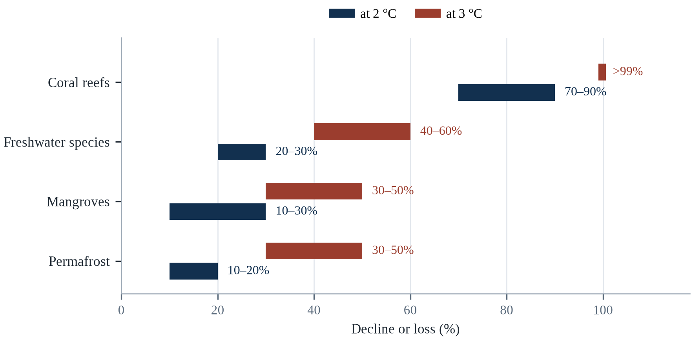||Source: Table 8.1. Coral value at 3 °C is the reported “greater than 99 per cent”.

The analysis points to two conclusions. First, the difference between 2°C and 3°C is the difference between a world where coral reefs survive in reduced form and one where they are largely gone, and between a forest that stores carbon and one that releases it (IPCC, 2018). Second, the loss is not evenly distributed: tropical ecosystems, which hold the most biodiversity and support the most vulnerable people, are the most exposed.

A rapid reduction in deforestation would buy time for the Amazon and reduce emissions. A breakthrough in coral restoration, or the discovery of heat-tolerant symbionts, could preserve some reefs, but it would not restore the physical structure at scale. And a change in the fire regime — through better management and less ignition — would reduce the conversion of forest to savannah. None of these substitutes for emission reduction, but together they can reduce the rate of loss while the climate policy is negotiated.

---

# Chapter 9: Health Impacts of Climate Change

*Theme: climate-sensitive disease, health systems and the epidemiology of a warming world*

In 2024, the Pan American Health Organization recorded more than 12 million cases of dengue in the Americas, the highest number ever reported and roughly three times the previous record. Brazil alone reported more than six million suspected cases. The epidemic was driven by a combination of factors: warmer temperatures that shortened the incubation period of the virus inside the mosquito, heavier rainfall that created breeding sites, urbanisation that brought people and mosquitoes together, and the movement of people and goods that carried the virus across borders (Cissé et al., 2022).

Dengue is one of the clearest examples of a disease that is climate-sensitive. The Aedes aegypti mosquito that transmits it thrives in warm, humid cities, and its range has expanded as temperatures have risen. The virus replicates faster in warmer mosquitoes, which means that a mosquito that would have been infectious after twelve days may become infectious after seven. The result is that a city which was too cool for sustained transmission a generation ago may now experience regular outbreaks.

The health effects of climate change are broader than infectious disease. Heat kills directly and indirectly; air pollution from wildfire smoke and fossil fuel combustion damages lungs and hearts; droughts and floods reduce food production and contaminate water; and extreme events disrupt the health systems that would otherwise treat the sick (WHO, 2021). The World Health Organization estimates that climate change will cause about 250,000 additional deaths per year between 2030 and 2050 from heat, malnutrition, malaria and diarrhoea alone, a figure that excludes many of the pathways described in this chapter.

This chapter examines those pathways, the populations they affect most, and the capacity of health systems to respond. It pays particular attention to the difference between direct effects, which are relatively easy to attribute to a heatwave or a flood, and indirect effects, which operate through ecosystems, food systems and infrastructure and are therefore harder to measure but often larger.

The World Health Organization's estimate that climate change will cause about 250,000 additional deaths a year between 2030 and 2050 — from heat, diarrhoea, malaria, undernutrition and coastal flooding — is widely quoted and almost certainly too low, because it counts only a subset of pathways and assumes continued adaptation. More recent work that includes heat alone finds tolls of a similar magnitude, and the Lancet Countdown argues that the health burden is already measurable in every region (Romanello et al., 2024). The uncertainty runs in one direction: the estimates have been revised upward as the evidence has improved.

## 9.1 Direct Effects: Heat, Injury and Displacement

The direct effects of climate on health are the easiest to see. Heat causes heatstroke, cardiovascular collapse and kidney injury, and it exacerbates pre-existing conditions; the European summer of 2022 was associated with about 61,700 deaths (Ballester et al., 2023). Floods cause drowning, trauma and electrocution, and they displace people into temporary shelters where disease spreads easily. Storms cause injuries during the event and infections in the aftermath, when wounds are exposed to contaminated water.

The direct effects are concentrated in specific moments, which makes them visible and therefore politically salient. A heatwave produces a spike in deaths that can be measured within weeks; a flood produces images that circulate globally. But the concentration also creates a bias in how the health burden is understood: the deaths that occur during an event are counted, while the deaths that occur months later, from the disruption of health services, the loss of income or the deterioration of chronic disease, are not.

Displacement is the bridge between direct and indirect effects. People who lose their homes to a flood or a fire may live in crowded shelters, lose access to medication and treatment, and face months of uncertainty. The health consequences of displacement — infectious disease, mental distress, interruption of chronic care — often exceed the direct consequences of the event that caused it.

Direct effects are the easiest to attribute and the easiest to undercount. Heat causes cardiovascular and renal deaths that are recorded under other causes; floods cause drowning, injury and electrocution, but also infections in the weeks that follow; storms cause trauma and, through displacement, the loss of continuity of care for chronic conditions. Displacement is a health exposure in its own right, because it interrupts medication, vaccination, antenatal care and mental health treatment, and the interruption is often longer than the event itself.

Occupational injury is the part of the direct-effect burden that official health statistics rarely capture. Heat raises the risk of workplace accidents because it impairs concentration, slows reaction time and increases fatigue, and the industries most exposed — construction, agriculture, mining, delivery — are also the ones with the weakest safety enforcement. Studies of workers' compensation claims in several countries have found that injury rates rise with temperature above a threshold, with the largest increases in the afternoon and among new workers. The clinical presentation is a fracture, not heatstroke; the cause is the heat.

The direct effects of climate on health are the ones that are easiest to see and hardest to count. Heatstroke is rare and visible; the thousands of heart attacks that a heatwave accelerates are neither. Injuries during floods and fires, especially among people who are trying to save property; drowning on roads that appear shallow; and the displaced population that loses access to medicine for chronic disease are all part of the picture. Displacement itself is a health exposure: crowded shelters facilitate outbreaks, interrupted supply chains raise the price of insulin and dialysis, and the loss of a clinic that has been closed for a week is measured in complications a month later. The accounting problem is that these effects arrive after the disaster is out of the news.

The direct effects of climate on health are the ones that are counted in the emergency room, and they are the smallest part of the burden. Heat stroke, drowning, injury from a falling structure and burns from a fire are the causes that appear on a death certificate, and each is the visible tip of a much larger set of conditions that the event worsened. A heatwave that kills a hundred people directly may contribute to a thousand deaths from cardiovascular and respiratory causes in the following weeks, and a flood that drowns twenty may leave thousands with an infection, a lost home and a chronic illness that the health system did not anticipate (Ebi et al., 2021).

## 9.2 Vector-Borne Diseases

Malaria, dengue, chikungunya, Zika and yellow fever are all sensitive to temperature and rainfall. The mosquitoes that transmit them have temperature optima for survival, reproduction and virus development, and their ranges are bounded by cold and by dryness. Warming expands the suitable range, lengthens the transmission season and accelerates the development of the pathogen inside the vector.

Malaria is the most consequential. About 249 million cases and 608,000 deaths were reported in 2022, mostly in sub-Saharan Africa and mostly among children under five (WHO, 2023). The relationship between malaria and climate is complex: too much rain can wash away breeding sites, and too little can eliminate them; the effect depends on the species of mosquito and the local ecology. But the overall trend is toward a larger transmission zone, particularly in the highlands of East Africa and the Andes, where warmer temperatures allow the parasite to complete its cycle.

Dengue has expanded even faster. The Aedes aegypti mosquito has spread to more than 150 countries, and the virus now circulates in urban areas where it was previously absent. The 2024 epidemic in the Americas was the largest on record, and similar surges occurred in Southeast Asia and the Western Pacific. The expansion is driven by urbanisation and travel as well as by climate, which is why the response must combine vector control, surveillance and health system preparedness rather than climate policy alone.

Vector-borne diseases are expanding their range in ways that are measurable. The transmission potential of dengue, carried by Aedes aegypti and Aedes albopictus, has risen substantially in most tropical and subtropical regions, and local transmission has been recorded in parts of southern Europe. Malaria is appearing in highland areas of East Africa and the Andes that were previously too cool for sustained transmission. The expansion is not uniform, because land use, vector control and health systems mediate it, but the direction is clear.

Vector-borne disease risk is shifting geographically in ways that are easier to predict than to observe. Mosquitoes that transmit dengue and malaria are sensitive to temperature, humidity and standing water, and warming expands the altitude and latitude at which they can complete their life cycle. Nepal, which historically had little dengue, recorded its first major outbreak in 2022, and cases have appeared in highland districts that were previously too cool (Cissé et al., 2022). The pattern is not uniform: in some places drier conditions reduce breeding sites, and in others irrigation and urban water storage create them. The reliable prediction is that the map will change, not that it will expand everywhere.

Vector-borne diseases are sensitive to climate in a way that is easy to summarise and hard to predict. Mosquitoes need warm water for their larvae, warm nights for their metabolism, and their pathogens need a temperature range to develop inside them; all of these have thresholds and optima rather than simple trends. Dengue has expanded, the transmission season has lengthened in many regions, and the altitudinal limit has risen in tropical highlands. Malaria has declined overall through better treatment and bed nets, and its geography is shifting at the margins. The same warming that expands a range can also make it too hot for transmission, which is why the projection for any particular district is a computation rather than an extrapolation.

Vector-borne diseases are the class of infection whose geography is most sensitive to temperature, and the shift is already visible. The mosquito that carries dengue has expanded into regions that were previously too cool for it, and the altitude at which malaria transmission is possible has risen in the highlands of East Africa and the Andes. The relationship is not simple: a warmer temperature can shorten the incubation period of the parasite and increase the biting rate, and it can also dry the breeding sites and reduce the population. The net effect differs by location, which is why the confident projections are for the places that are already warm and wet.

## 9.3 Waterborne and Foodborne Disease

Floods and droughts both increase the risk of waterborne disease, through different mechanisms. Floods overwhelm sanitation systems, contaminate wells and carry pathogens into homes; droughts concentrate pathogens in scarce water and reduce the water available for hygiene. Cholera, typhoid, hepatitis A and diarrhoeal diseases all follow this pattern, and children under five are the most vulnerable.

The 2022 Pakistan floods produced a surge in diarrhoeal disease and malaria, and the 2010 Haiti earthquake and subsequent cholera outbreak showed how quickly a contaminated water supply can become a national emergency. In drought-affected regions, the problem is often not the absence of water but its quality: as sources dry up, people use whatever water is available, including water that is contaminated with sewage or agricultural runoff.

Foodborne disease is also climate-sensitive. Warmer temperatures increase the growth rate of bacteria such as Salmonella and Campylobacter in food, and flooding can contaminate crops with pathogens (FAO, 2021). The European Centre for Disease Prevention and Control has documented increases in foodborne infections during heatwaves, and the risk is highest in countries with limited cold-chain infrastructure. The result is a health burden that is rarely attributed to climate but is nonetheless part of it.

Waterborne and foodborne diseases rise with temperature through several mechanisms. Warmer water supports faster bacterial growth; heavy rainfall flushes pathogens into drinking water sources and overwhelms sewage systems; and drought concentrates contaminants in the water that remains. Cholera, typhoid, and diarrhoeal disease in children all show this pattern, which is why the health response to a flood must begin before the water recedes, with chlorination, oral rehydration and surveillance for outbreaks.

Waterborne disease after floods follows a sequence that is well documented and preventable. The immediate risk is contamination of drinking water by sewage and agricultural runoff; the secondary risk is crowding in shelters, where respiratory and diarrhoeal infections spread quickly. Pakistan's 2022 floods were followed by a surge in malaria and diarrhoeal disease that affected millions, and the response depended on chlorination, latrines and oral rehydration delivered at scale (WMO, 2023). The lesson from successful responses is that the health system does not need new tools; it needs the logistics to deliver old ones to the right place within days.

Waterborne and foodborne disease are the health consequences of floods and droughts that arrive weeks after the water has gone. Floods contaminate wells and overwhelm sewers; droughts concentrate pathogens and prompt households to use sources that were not meant for drinking; both interrupt the cold chains that keep food safe. Cholera and diarrhoeal disease are the best-known, and their burden is concentrated in children under five. The prevention is unglamorous and well understood: protected water sources, sanitation, handwashing and rapid surveillance. What climate change does is move the baseline: it makes the interruption more frequent and the recovery slower, so a system that was just adequate becomes inadequate without anything about it changing.

Waterborne and foodborne diseases are the oldest climate-sensitive infections, and they respond to temperature in ways that are well documented. Cholera and other diarrhoeal pathogens multiply faster in warm water, and the risk rises when flooding contaminates wells and when drought concentrates the contaminants that remain. Salmonella and Campylobacter in food follow the same pattern, which is why food poisoning notifications rise with the temperature. The Yemeni cholera epidemic that began in 2016 was the largest in modern history, and it was produced by the collapse of water and sanitation in a war rather than by the climate alone, which is the pattern: warming raises the baseline, and conflict removes the protection.

## 9.4 Air Pollution and Wildfire Smoke

Air pollution is the largest environmental health risk in the world, causing about seven million deaths a year according to the World Health Organization (WHO, 2023). Much of that pollution comes from the same fossil fuels that drive climate change, which means that reducing emissions produces immediate health benefits — the co-benefit that is often the strongest argument for climate action in the short term.

Wildfire smoke is a growing component. The 2023 Canadian fires burned more than eighteen million hectares and sent smoke across North America and the Atlantic, exposing tens of millions of people to particulate matter concentrations that exceeded health guidelines (CIFFC, 2023). The 2019–2020 Australian fires exposed millions of people to smoke for weeks and were associated with thousands of hospital admissions and hundreds of deaths. Smoke is particularly dangerous because it contains fine particles that penetrate deep into the lungs and enter the bloodstream.

The health effects of air pollution are not limited to the respiratory system. Fine particles are associated with cardiovascular disease, stroke, diabetes and adverse birth outcomes. Ozone, which forms more readily at higher temperatures, damages lung tissue and reduces crop yields. The combination means that climate change increases air pollution at the same time that air pollution increases climate change, through the deposition of black carbon on snow and ice.

Air pollution and climate change share most of their sources, which makes them a combined problem rather than two. Burning fossil fuels releases both greenhouse gases and fine particulate matter; wildfire smoke adds another burden that is growing as fire seasons lengthen; and ozone formation accelerates at higher temperatures. The health toll is large: outdoor air pollution is associated with roughly 4 million premature deaths a year, and household air pollution from solid fuels with another 3.7 million (Watts et al., 2021).

Air pollution and climate change share sources, and the health arithmetic of that overlap is large. Fine particulate matter from fossil fuel combustion causes an estimated several million premature deaths each year, and the same combustion drives warming. Studies of the co-benefits of decarbonisation find that the health gains in the first decade often exceed the climate gains in monetary terms, because they are local and immediate while the climate benefit is global and delayed. This asymmetry explains why air quality has been a more effective political entry point for climate policy than climate itself in several countries, including China and India.

Burning fossil fuels releases greenhouse gases and fine particulate matter at the same time; wildfire smoke adds an episodic burden that grows with fire seasons; ozone forms faster at higher temperatures. The health effects are well quantified: cardiovascular and respiratory disease, reduced lung function, preterm birth and cognitive effects in children. The policy implication is unusually favourable, because the measures that reduce one usually reduce the other. The exception is a warming climate that increases dust and wildfire smoke independently of fossil fuel burning, which is why cleaner air cannot be achieved by decarbonisation alone.

## 9.5 Nutrition and Child Development

The health effects of climate change on nutrition are indirect and profound. Higher temperatures reduce crop yields, lower the nutrient content of grains and raise food prices, which reduces the quantity and quality of food that poor households can afford. The result is an increase in undernutrition, which weakens immune systems and increases vulnerability to infectious disease.

Children are the most affected. Undernutrition during the first thousand days of life — from conception to age two — causes stunting, which is irreversible and reduces cognitive development, school performance and lifetime earnings. The World Health Organization estimates that climate change will cause an additional 95,000 child deaths per year from undernutrition by 2050, and that the burden will fall disproportionately on South Asia and sub-Saharan Africa.

The CO2 fertilisation effect adds a subtle dimension. Higher carbon dioxide concentrations increase the yield of C3 crops but reduce the concentration of protein, zinc and iron in the grain (Zhao et al., 2017). Experiments on rice, wheat and soy show declines of 5 to 10 per cent in protein and micronutrients under elevated CO2, which means that a harvest of the same weight may be less nutritious. For populations that depend on a single staple crop, this 'hidden hunger' can matter as much as a decline in calories.

Nutrition is the pathway with the largest long-term consequences and the least visible damage. Heat and drought reduce yields and raise prices, which reduces dietary diversity for poor households; higher carbon dioxide concentrations lower the protein, zinc and iron content of staple crops such as wheat and rice; and maternal undernutrition in pregnancy affects cognitive development in ways that persist for a lifetime. The result is a slow-moving health crisis that is measured in stunting rather than in deaths.

Nutrition is where climate change enters the body most quietly. Heat and drought reduce yields of staple crops, elevated carbon dioxide lowers the protein and micronutrient content of wheat, rice and soybeans, and displacement disrupts infant feeding. The result is not necessarily famine but a rise in stunting and wasting, which are irreversible after the first thousand days of life. Modelling studies estimate that climate change could add millions of children to the stunted population by mid-century under high-emission pathways, and the burden falls on the same regions that already carry the highest child mortality. A nutrition programme that ignores climate is planning for a baseline that no longer exists.

A child who is stunted in the first thousand days does not recover fully; the loss appears as reduced schooling, lower earnings and worse health across a lifetime. Climate affects nutrition through the quantity and quality of food, through diarrhoeal disease that prevents absorption, and through the prices that determine what a family can buy. Elevated carbon dioxide itself reduces the protein, iron and zinc content of staple grains, which means that the same loaf of bread is less nutritious than it was a generation ago. That effect is invisible to the person eating it and measurable only through chemical analysis and careful epidemiology.

Nutrition is the channel through which a climate shock becomes a developmental deficit that lasts a lifetime. A child who is undernourished in the first thousand days is more likely to be stunted, to learn less at school and to earn less as an adult, and the effect is not reversed by a later improvement in diet. The climate affects that window in three ways: through the yield and the price of the food the household buys, through the water and the sanitation that determine whether the nutrients are absorbed, and through the heat that reduces the appetite and the ability to work. A crop failure is therefore an event in a village and a developmental outcome in a generation.

## 9.6 Mental Health

The mental health effects of climate change are increasingly recognised. Acute events produce post-traumatic stress, anxiety and depression, particularly among people who lose homes, livelihoods or family members. Slow-onset changes — drought, sea level rise, the loss of a familiar landscape — produce a more diffuse distress that researchers describe as solastalgia, the pain of seeing one's home environment change beyond recognition.

The 2019–2020 Australian bushfires were followed by a documented increase in psychological distress, and the 2021 floods in Germany and Belgium produced similar effects. Farmers in drought-affected regions show elevated rates of depression and suicide, and the effect is not confined to the people directly affected: entire communities experience the loss of social networks and economic security that accompanies environmental change.

The mental health burden is undercounted because it is not captured by disaster statistics and because stigma prevents people from seeking help. It is also undertreated: mental health services are scarce in most low- and middle-income countries, and they are rarely included in disaster preparedness plans. The consequence is that the psychological effects of climate change persist long after the physical damage has been repaired.

Mental health consequences are increasingly recognised as a core part of the burden rather than a secondary concern. Disasters produce post-traumatic stress, depression and anxiety; slow-onset change produces grief and solastalgia; and the anticipation of future harm produces anxiety, particularly among young people. Health systems rarely count these outcomes and rarely fund services to address them, which is why the treatment gap after disasters is so large.

Dengue in Indonesia is the health impact that most directly tracks the climate, and the surveillance data show it. Case counts rise in the wet season, and the mosquito that carries the virus breeds in the water containers that households keep when piped supply is intermittent — which means that water insecurity and disease risk are the same problem. Indonesia reported one of the world's largest dengue burdens, with hundreds of thousands of cases in a bad year, and the interventions that work are environmental management and community cleaning rather than clinical care. A health system that waits for cases has already lost the argument.

Mental health has moved from an afterthought to a recognised consequence, and the categories are now fairly well defined. Acute stress in the aftermath of a disaster, post-traumatic stress in a significant minority, depression and anxiety in the longer term, and a form of grief for lost places that has no settled diagnosis. Heat itself is associated with irritability, aggression and worse symptoms in people with existing mental illness, who are also more likely to be homeless or poor. The services to meet this burden are thin everywhere and thinnest where the hazards are greatest, which makes community support and the maintenance of social routines the most realistic first-line response.

The mental health consequences of climate change are the least measured and among the most persistent, because they outlast the event that caused them. Populations exposed to a disaster show elevated rates of post-traumatic stress, depression and anxiety, and the rates remain elevated for years after the physical recovery is complete. Slow-onset change produces a different kind of harm, which has been described as solastalgia: the distress that comes from the loss of a place that is still there but is no longer the same. Surveys of young people across many countries have found that a large majority report being worried about the future, and nearly six in ten report being very or extremely worried.

## 9.7 Health Systems Under Stress

Health systems are themselves vulnerable to climate change. Hospitals are damaged by floods and storms; power outages disable ventilators and refrigeration; roads are cut, preventing patients from reaching care; and staff are affected by the same events as their patients. The result is that the demand for health care rises at the same time as the capacity to provide it falls.

The 2022 European heatwave illustrated the problem. Hospitals cancelled surgeries because operating theatres could not be kept cool; emergency departments were overwhelmed by heat-related admissions; and ambulance response times increased. In Puerto Rico, Hurricane Maria in 2017 caused a prolonged failure of the electricity system that was associated with an estimated 2,975 excess deaths, many of them from chronic conditions that could not be treated (Kishore et al., 2018).

Preparedness requires investment in infrastructure, supplies and planning. Hospitals need backup power, cooling, water storage and flood protection. Health systems need surge capacity, stockpiles of medicines and vaccines, and plans for continuity of care during disruptions. They also need surveillance systems that can detect outbreaks early, and a workforce trained to recognise climate-sensitive disease. Most of these measures are inexpensive relative to the cost of failure, but they are rarely prioritised until an emergency occurs.

Health systems are stressed from both sides: demand rises while capacity falls. Heat increases emergency admissions; floods damage facilities and block access; power outages disable equipment; and staff are themselves affected by the same event. The COVID-19 pandemic demonstrated how quickly a system can be stretched and how the stretching concentrates harm among people who already had limited access, which is why health resilience is now a central concern of adaptation planning (Watts et al., 2021).

Health systems are stressed by climate change in ways that are cumulative rather than dramatic. Demand rises during heatwaves and epidemics, supply chains are disrupted by the same events, and staff are affected as residents before they are affected as responders. The 2020 pandemic demonstrated how quickly a surge can exhaust reserves of beds, oxygen and protective equipment, and climate shocks test the same reserves with less warning. The WHO's operational framework for climate-resilient health systems identifies six building blocks, but the binding constraint in most countries is financing: adaptation is funded as a project rather than as a recurring cost of running the system.

Health systems are climate infrastructure whether or not they are planned as such. They depend on electricity for refrigeration and life support, on water for sanitation and dialysis, on roads for supplies, on telecommunications for referral, and on a workforce that also has families to protect. A hospital with a generator and a week of fuel is a different institution from one with neither, and a system with surge capacity is different from one running at full occupancy. The investment that makes the difference is unglamorous: backup power, water storage, resilient roofs, staff training, and a plan for what to do when the staff cannot travel. Most of it is cheaper than the failure it prevents.

Health systems fail under climate stress in ways that are predictable and rarely planned for. The surge in demand during a heatwave or an epidemic arrives at a facility whose staff are also affected, whose supply chain is disrupted, and whose cold chain depends on a grid that may be down. Evacuating a hospital is a slow and dangerous operation that requires another facility to receive the patients, and the 2005 flooding of New Orleans showed what happens when that plan does not exist. The resilience measures that work are unglamorous: backup power that is tested, water storage, a stock of medicines, staff who have exercised the plan, and a regional agreement about where patients will go.

## 9.8 Vulnerable Populations

The health burden of climate change is not distributed evenly. Children, pregnant women, older people, people with disabilities, outdoor workers and people living in poverty are at higher risk, and the same groups are less likely to have access to care. The World Health Organization estimates that children under five bear about 88 per cent of the disease burden from climate change, because their immune systems are immature, their bodies are small, and they depend on adults for protection (WHO, 2023).

Pregnancy is a particularly vulnerable period. Heat exposure is associated with preterm birth, low birth weight and stillbirth, and the effects are strongest among women who work outdoors or live in housing without cooling. Air pollution has similar effects. The 2023 Lancet Countdown reported that heatwaves affected pregnant women in all regions, and that the health systems in most countries were not prepared to protect them (Watts et al., 2021).

Disability and age interact with poverty. A person who uses a wheelchair may be unable to evacuate a building without an elevator; a person with dementia may not understand a heat warning; an older person living alone may not be able to open a window or reach a cooling centre. These vulnerabilities are not inevitable; they are the result of design choices and social arrangements that can be changed.

Vulnerability within populations follows familiar lines. Older adults, infants, pregnant women, people with chronic illness or disability, outdoor workers, homeless people, prisoners and indigenous communities face higher risks for reasons that are physiological, occupational and social. Because these groups are often absent from routine data collection, their risk is underestimated, and because they have less political voice, the services they need are underfunded.

Vulnerability is not distributed evenly within a hazard. Pregnant women, children under five, older people, people with disabilities, outdoor workers, prisoners, and people living in informal settlements carry more risk than the average. The reasons are biological in some cases and social in others: a wheelchair user cannot climb stairs to a cooling centre, a migrant worker has no entitlement to local services, a woman in a temporary shelter may have no safe place to sleep. The policy response that works is not a single targeted programme but a routine equity screening: asking, for every heat plan, flood warning and vaccination campaign, who cannot act on it and why.

Vulnerability to climate-sensitive disease is concentrated in groups whose exposure and access are both worse than average. Pregnant women are more susceptible to heat and to some vector-borne infections, and the effects can persist into the child's development. Children under five carry most of the burden of diarrhoeal disease and malaria, and their physiology makes dehydration more dangerous. Outdoor workers cannot avoid the heat that their income depends on. People with disabilities face barriers in evacuation, in shelters and in access to cooling. Migrants and undocumented people are often excluded from the systems that would protect them, which turns a public health problem into a surveillance problem.

The vulnerability of a group is usually a combination rather than a single attribute, and the combination is what makes it invisible to a programme designed around one characteristic. A household in an informal settlement that is exposed to heat, to air pollution and to flooding, whose members work outdoors, who have no insurance and no legal title, is not captured by a policy for older people or by a policy for workers. The compounding is the rule rather than the exception in the places where the burden is highest, and the programmes that reach those households are the ones that ask about the combination rather than screening for one category at a time.

## 9.9 Surveillance and Early Warning

Early warning is the most effective health adaptation. Heat warning systems that trigger cooling centres, outreach to vulnerable people and changes in hospital staffing can reduce deaths substantially, as the Ahmedabad experience demonstrates. Disease surveillance systems that detect outbreaks early can mobilise vector control and treatment before the epidemic peaks, and climate forecasts can be used to predict where conditions are favourable for transmission.

The integration of climate and health data is improving. The Lancet Countdown publishes annual indicators that track exposure, vulnerability and adaptation across countries, and the World Health Organization has developed a climate and health monitoring framework (Romanello et al., 2023). Several countries now operate heat-health warning systems, and some are developing malaria early warning systems that use rainfall and temperature forecasts to predict outbreaks.

The gap is in implementation. A warning system is only useful if it reaches the people at risk and if they have the capacity to act on it. In many countries, the warning is issued at the national level but not translated into local action; in others, the data exist but are not shared between health and meteorological agencies. Closing that gap is less a matter of technology than of institutional coordination and trust.

Surveillance is the part of health adaptation that pays for itself fastest. Syndromic surveillance, which tracks emergency visits, pharmacy sales and ambulance calls in near real time, can detect an outbreak or a heat impact days before formal reporting. Excess mortality analysis provides the retrospective measure of what actually happened. Countries that built these systems during COVID-19 are better prepared for climate-related health shocks, because the infrastructure is the same (Watts et al., 2021).

Surveillance is the part of public health that pays for itself invisibly. A system that detects an outbreak early is indistinguishable from no outbreak at all, which is why it is chronically underfunded. Climate change makes surveillance more valuable because it makes the unexpected more likely: a disease appearing in a region where it was not endemic, a syndrome arriving out of season, a cluster of deaths that does not fit the usual pattern. The most effective systems combine indicator-based reporting from clinics with event-based reporting from the community, including the media and social media, and they are built in ordinary times so that they exist when the extraordinary arrives.

Surveillance is the part of public health that nobody notices when it works, and its weakness is the reason outbreaks are detected late. A system that counts cases as they arrive at a clinic depends on the clinic existing, on the clinician recognising the disease, and on the result reaching a laboratory that can confirm it, and in much of the world one of those links is missing. Syndromic surveillance, which tracks the symptoms rather than the diagnosis, can detect an outbreak before the laboratory does, and it requires only that the data are collected and shared. Genomic sequencing has shortened the time needed to identify a pathogen from weeks to days, and it has not shortened the time needed to act on the identification.

Surveillance has been transformed by two technologies that were not designed for climate health, and both are underused. Wastewater monitoring detects a pathogen in a population before the clinics see the cases, and it is cheap once the sampling network exists. Genomic sequencing identifies a variant in days, and the networks that share the sequences are what turn a local finding into a global warning. The gap that remains is between the human and the animal systems, because the diseases that cross the species barrier are the ones that a health-only surveillance tends to detect late.

## 9.10 Co-Benefits and the Health Case for Climate Action

The health argument for climate action is stronger than the environmental argument, because it is immediate and personal. Reducing fossil fuel combustion reduces air pollution, which prevents millions of deaths a year. Increasing walking and cycling reduces obesity and cardiovascular disease while reducing emissions. Improving building insulation reduces energy demand and protects people from heat and cold. Shifting toward plant-rich diets reduces emissions and improves health.

These co-benefits are often larger than the costs of the policies that produce them, particularly in countries with high air pollution. A study of the health benefits of meeting the Paris targets in China estimated that the reduction in air pollution would prevent hundreds of thousands of premature deaths a year, a benefit that is not counted in the conventional cost of decarbonisation.

The health frame also changes the politics. Climate policy is often presented as a cost to be borne for the sake of future generations; health policy is presented as a benefit to be delivered now. The same measures — clean energy, efficient buildings, active transport, healthy diets — can be justified in either language, and the health language often travels further because it speaks to what people experience in their own bodies.

The co-benefit argument is the strongest case for rapid climate action on health grounds. Phasing out coal reduces particulate emissions and saves lives within years, long before any climate benefit is measurable; shifting to active transport increases physical activity and reduces obesity and cardiovascular disease; and plant-rich diets reduce emissions and lower rates of heart disease, diabetes and some cancers. These benefits are local, immediate and quantifiable, which makes them politically persuasive in a way that global temperature targets are not.

The health case for mitigation is stronger than the health case for adaptation, and it is usually argued the other way round. Reducing fossil fuel combustion lowers particulate matter and ground-level ozone immediately, and the health gains from cleaner air are large, local and fast: studies of air quality improvements in China and the United States have found measurable increases in life expectancy within years. Those gains accrue to the same communities that bear the burden of climate impacts, which makes air quality an unusually effective political entry point. The co-benefit argument does not replace the climate argument; it gives it a shorter feedback loop.

Phasing out coal reduces heart attacks and asthma attacks in the same district within a few years; designing a walkable city reduces obesity, diabetes and road deaths alongside emissions; planting trees cools streets and improves mental health. These co-benefits are large enough that some health economists argue that the health gains alone would justify the transition even if the climate gains were ignored. The argument is politically useful because it moves the debate away from global averages and toward things a mayor can measure in a single electoral term.

The strongest argument for rapid decarbonisation is not about the climate at all; it is about the seven million premature deaths a year that are attributed to air pollution (WHO, 2023). The measures that reduce greenhouse gases also reduce the particulates that damage lungs and hearts, and the health benefit arrives immediately in the city where the measure is taken. Insulating a house cuts emissions and deaths from cold; shifting to public transport cuts both emissions and road injuries; eating less red meat cuts emissions and the risk of heart disease. The co-benefit argument is politically powerful because it does not ask people to accept a cost for a distant benefit, and it is why health ministries have become climate ministries.

## 9.11 Case Study: The 2024 Dengue Epidemic

Dengue is a viral infection transmitted by Aedes mosquitoes, and it has been expanding for decades. The virus causes fever, severe headache, joint pain and, in a small fraction of cases, haemorrhagic fever that can be fatal. There is no specific treatment, and the vaccines that exist are only partially effective and are not recommended for everyone. Control depends on reducing mosquito breeding sites and on timely diagnosis and supportive care.

The 2024 epidemic in the Americas was the largest on record. More than 12 million cases were reported, with Brazil accounting for about half. The epidemic followed a year of record heat and heavy rainfall, which expanded the habitat of the mosquito and accelerated the replication of the virus. It also followed the relaxation of vector control programmes during the COVID-19 pandemic, which had left fewer resources for surveillance and spraying.

The response varied by health system. Brazil deployed mobile testing teams and expanded hospital capacity; Argentina and Paraguay declared epidemiological alerts; and the Pan American Health Organization coordinated surveillance and laboratory support. But the epidemic exposed the limits of reactive response: by the time cases are detected, the mosquito population has already expanded, and the measures that reduce transmission — eliminating standing water, covering tanks, using repellent — depend on household behaviour that is difficult to sustain.

The connection between climate and health systems runs through capacity. The weather created the conditions for transmission, but the scale of the epidemic depended on the capacity of health systems to detect, treat and control it. Countries with strong surveillance and vector control reported fewer severe cases and deaths than countries with weaker systems, even when the climate conditions were similar.

For health systems the lessons are practical. First, vector control must be continuous, not episodic; the mosquito does not wait for an outbreak to be declared. Second, surveillance must integrate climate data, so that health authorities can anticipate where conditions are favourable and act before cases appear. Third, health systems need surge capacity for the diseases that climate change is expanding, including staff, beds, tests and medicines. Fourth, communities must be engaged, because the most effective interventions — eliminating standing water, using bed nets and repellents — happen in homes, not in hospitals.

The 2024 epidemic also exposed a data problem that shapes the response. Reported cases depend on laboratory confirmation, and most countries have limited testing capacity, so the ratio of reported to actual infections varies widely. Brazil, which has a relatively strong surveillance system, reported more cases than its neighbours partly because it looked harder. That artefact complicates comparisons and can mislead governments into believing that countries with fewer reported cases have less transmission, when the opposite may be true.

The dengue epidemic of 2024 in the Americas was the largest on record, with more than twelve million cases reported and a concentration in countries whose health systems were already stretched (Cissé et al., 2022). The epidemic was driven by a combination of warm and wet conditions that shortened the virus's incubation inside the mosquito, urbanisation that created breeding sites, and a mosquito species that has adapted to live closely with people. The response combined vector control, clinical protocols, and public communication about standing water. The lesson is about thresholds: transmission does not rise smoothly with temperature, it crosses from sporadic to sustained when a set of conditions align, which makes early warning a matter of watching several variables at once.

The dengue epidemic of 2024 broke records across the Americas and much of Southeast Asia, and the response exposed a shortage that the market had not solved. The vaccine that is available requires two doses and a screening test, the supply is limited, and the cost puts it beyond the reach of the public programmes in the countries where the burden is highest. The vector control that remains the main instrument depends on a workforce that must visit households, and the workforce is expensive to maintain between epidemics. The programmes that have shown an effect are the ones that combined the surveillance, the larval control and the community engagement into a routine rather than a campaign.

Malaria makes the same point with a different vector. The disease was historically absent from the Ethiopian highlands above about two thousand metres, because the parasite could not complete its cycle in the cool nights; warming has moved that boundary uphill, and epidemics have appeared in districts with no acquired immunity and no mosquito programme (Cissé et al., 2022). Dengue in Nepal and malaria in Ethiopia are the same process seen at two latitudes: a temperature threshold that health systems had treated as fixed has begun to move, and the populations on the far side of it are the least prepared. In both places the first obstacle is not treatment but diagnosis, because the disease is not yet the one a doctor thinks of first.

## 9.12 Future Scenarios and Predictions: Health in 2050

The health effects of warming are already being counted, not forecast. Heat-related mortality among people over 65 has increased by 167 per cent since the 1990s; the transmission season for dengue has lengthened in many regions; and the area burned by wildfire has increased, exposing more people to smoke (Romanello et al., 2024). These trends are not projections; they are observations, and they are consistent with the physical changes described in earlier chapters.

The disease burden is already global. About 3.5 billion people live in areas suitable for dengue transmission; malaria transmission is expanding in highland regions; and air pollution remains the largest environmental health risk, causing about seven million deaths a year (Watts et al., 2021). Health systems in low-income countries are the least prepared, with fewer beds, fewer health workers and less capacity to detect outbreaks.

The disease burden will follow the emission path, population growth, ageing, urbanisation and the strength of health systems. A world that reduces emissions and invests in health systems can prevent much of the projected burden; a world that does neither will face a burden that grows faster than the climate because the population is ageing and urbanising at the same time. The scenarios below summarise the range.

The health burden of the next two decades will be determined less by the climate than by the health systems that receive it (Watts et al., 2021). The same warming produces very different outcomes in a country with universal coverage, reliable cold chains, and a surveillance system that works, and in one where a fever is treated at a pharmacy counter and a hospital is a day's travel away. The scenarios in this chapter therefore differ mainly in what is assumed about investment and capacity. The signals that matter are unglamorous: the share of the population with access to safe water, routine immunisation coverage, hospital bed and ventilator capacity, and the number of health workers per thousand people.

[[TABLE:Table 9.1 Climate-sensitive health risks, 2050]]
| Risk | Climate driver | Change at 2°C | Change at 3°C | Main adaptation |
|---|---|---|---|---|
| Heat mortality | Heatwaves | +50–100% | +150–300% | Warning; cooling; housing |
| Malaria | Warming; rainfall | Expanding highlands | Wider range | Bed nets; treatment; surveillance |
| Dengue | Warming; urban water | +100–200% | +200–400% | Vector control; surveillance |
| Undernutrition | Crop yields; prices | +50–100k deaths/yr | +100–200k deaths/yr | Social protection; nutrition |
| Air pollution | Fossil fuels; fires | Falling with policy | Rising without policy | Clean energy; smoke warnings |
| Displacement health | Floods; drought | +50–100 million exposed | +100–200 million exposed | Shelter; health services |

The evidence supports two conclusions. First, the health burden is dominated by indirect pathways — nutrition, infectious disease, air pollution — rather than by the direct effects that make headlines. Second, the burden is preventable with known interventions: clean energy, vector control, water and sanitation, heat warnings, and strong health systems. The gap between what is known and what is done is the central problem of climate and health.

A breakthrough in dengue vaccines or in gene-drive mosquito control could reduce transmission substantially. A rapid expansion of clean energy would reduce air pollution and heat simultaneously. And a strengthening of primary health care in low-income countries would improve the response to every climate-sensitive disease. None of these is a substitute for emission reduction, but each would reduce the human cost of the warming that is already committed.

---

# Chapter 10: Economic Impacts and Financial Resilience

*Theme: the economics of climate damage, insurance and the cost of delay*

In August 2017, Hurricane Harvey stalled over Houston and dropped more than 1,500 millimetres of rain in five days. The damage was estimated at US$125 billion, most of it from flooding rather than wind. A few weeks later, Hurricane Irma struck the Caribbean and Florida, and Hurricane Maria struck Puerto Rico, with losses of US$77 billion and US$90 billion respectively (Kishore et al., 2018). The three storms together produced losses of about US$300 billion, of which only about a third was insured (UNDRR, 2023).

The 2017 season illustrates a pattern that is becoming more common. The physical damage is only the first layer of economic loss. Businesses that close do not pay wages; workers who lose wages spend less; local governments that lose tax revenue cut services; insurers that pay claims raise premiums; and households that lose their savings reduce consumption for years. The indirect losses can exceed the direct damage, and they fall hardest on the people with the least cushion.

Climate economics has moved from the margins of the discipline to its centre because the damage is no longer hypothetical. The estimates vary widely, but they converge on a conclusion: the cost of inaction is larger than the cost of action, and the difference grows with every year of delay. The debate is no longer about whether to act but about how to allocate the cost, who bears the risk, and how to finance the transition.

This chapter examines the economic channels through which climate change affects households, firms and states. It distinguishes between direct damage and indirect loss, between stock and flow, and between the risks that can be insured and those that cannot. It closes with the financial instruments that can build resilience — reserve funds, parametric insurance, catastrophe bonds, and the public balance sheets that ultimately backstop them (OECD, 2021).

The economics of climate change has moved from a niche field to a central question of macroeconomic policy, and the reason is that the damages are no longer hypothetical. Global economic losses from weather disasters have averaged several hundred billion dollars a year over the past decade, and the trend is rising faster than output (UNDRR, 2022). More importantly, the losses are not evenly distributed: a large share falls on uninsured households and on governments that must divert budgets from development to reconstruction.

## 10.1 Direct Damage and Indirect Loss

Disaster economics distinguishes between damage, which is the cost of repairing or replacing physical assets, and loss, which is the cost of lost economic activity. A factory that is destroyed represents damage; the production that the factory would have generated during the months it is rebuilt represents loss. The two are often reported together, but they behave differently: damage is a one-time cost, while loss can persist until the factory is rebuilt and the market recovers.

The distinction matters for policy. Compensation that covers damage but not loss leaves businesses unable to pay wages and households unable to replace income, which prolongs the disruption. The 2011 Thailand floods damaged industrial estates that produced a large share of the world's hard drives; the damage was repaired in months, but the global production shortfall lasted longer and raised computer prices for a year. The loss was transmitted through supply chains to firms and consumers who never saw the flood.

Indirect losses are difficult to measure because they are counterfactual: they describe what would have happened without the disaster. Economists estimate them using input-output models, computable general equilibrium models, or econometric comparisons of affected and unaffected regions. The estimates vary, but they consistently find that indirect losses are larger in economies with tighter linkages, weaker social protection and less fiscal space to respond.

Direct damage is what insurance assessors measure: buildings, infrastructure, vehicles and crops. Indirect loss is what happens afterwards: businesses that cannot operate, workers who lose income, supply chains that are interrupted, and public services that are disrupted. Indirect losses often exceed direct damage in the months after an event, and they are systematically under-recorded because they are diffused across the economy rather than concentrated in a place that can be photographed.

The distinction between damage and loss is the first thing a serious economic assessment separates. Damage is what happens to the asset — the house, the road, the factory, the hospital — and it is visible, photographable and relatively easy to value. Loss is what happens to the flow of income that the asset produced: the shop that did not trade for three months, the harvest that was not planted, the wages that were not paid, the tourists who did not come. Direct damage is a stock; indirect loss is a flow, and the two are measured in different units and over different periods. Recovery spending is a third category again, because repairing a bridge costs money that could have built a school, and that opportunity cost never appears in the damage report.

The economics of a disaster is not the value of the damage; it is the value of the damage plus everything that does not happen afterwards. A factory that is destroyed shows up in the statistics as a loss of capital, and the workers who lose their jobs, the suppliers who lose their orders and the children who lose a year of school do not. Economists distinguish direct damage, which is the physical stock that is destroyed, from indirect loss, which is the flow of economic activity that is interrupted, and the second is usually larger and harder to measure. The measurement matters because the recovery budget is usually allocated against the first number, which is the smaller one.

## 10.2 Productivity, Labour and Heat

Heat reduces economic output through labour productivity. The International Labour Organization estimates that heat stress already reduces global working hours by about 2.2 per cent, equivalent to 80 million full-time jobs, and that the loss could reach 2.4 per cent by 2030 (ILO, 2019). Agriculture accounts for about 60 per cent of the lost hours, followed by construction, manufacturing and transport (ILO, 2019).

The mechanism is physiological and behavioural. Above a certain wet-bulb temperature, workers must slow down, take breaks and drink water; in the absence of those adaptations, heat exhaustion and heatstroke occur. Firms respond by shifting hours, installing cooling, or automating tasks, but each response has a cost. For workers paid by output, the cost is borne directly as lost income; for firms, it appears as lower productivity and higher capital expenditure.

The distributional effect is important. Outdoor workers, agricultural labourers and construction workers are the most exposed, and they are often the least able to insure against lost income. In countries where a large share of employment is informal, heat does not appear in official productivity statistics, because the work is not measured in the first place. The result is that the economic cost of heat is systematically underestimated in the places where it is highest.

The effect is also visible in national accounts. Studies using industry-level data find that output declines on hot days in sectors that require outdoor or non-cooled indoor work, and that the effect is largest in countries with hot climates and limited air conditioning. A cross-country analysis of temperature and economic production found that output rises with temperature only up to an optimum of about 13 °C in average annual temperature and falls sharply above it, so that warming does not simply slow growth everywhere but moves it from hot countries to cool ones (Burke et al., 2015). Estimates for the hottest regions suggest that heat already costs several percentage points of GDP in parts of South Asia and sub-Saharan Africa, and that the loss will grow as temperatures rise.

Field evidence shows how the loss reaches households rather than national totals. Studies in South and Southeast Asia find that workers slow down, take longer breaks and shift hours, and that piece-rate pay transfers the cost of the slowdown to the worker, so the loss is a regressive economic shock that surfaces in the statistics as a national problem. Official estimates are conservative for a second reason: they count only the capacity to work, not the decisions that firms make when heat renders outdoor work uneconomic, and not the informal work that never enters the hours data at all.

Most macroeconomic models have understated this channel because they treat heat as a temporary shock rather than a permanent change in the conditions of work. A harvest lost to drought can be replanted; two hours of safe working time lost every afternoon for thirty years cannot be recovered. The loss therefore accumulates in the capital stock as lower investment and in the labour force as slower skill formation, and it appears in the accounts as a growth rate slightly lower than it would otherwise have been. That is why the damage is easy to understate and hard to reverse: no single year looks like a catastrophe, and no single ministry is responsible for the trend.

## 10.3 Food Prices and Inflation

Climate shocks to food production are transmitted to the wider economy through prices. When a major producer loses a harvest, global prices rise, and the effect reaches consumers through retail prices and, in poor countries, through the cost of the food basket that dominates household budgets. Central banks have begun to include climate shocks in their inflation models, because food and energy price spikes can destabilise expectations even when core inflation is stable.

The 2022 food price crisis is an example. The war in Ukraine was the immediate trigger, but it arrived on top of a series of climate-related harvest failures in Europe, South Asia and the Horn of Africa. Food prices rose by more than 20 per cent globally, and the increase was largest in countries that import a high share of their calories (FAO, 2023). The result was a rise in poverty and a decline in dietary quality that persisted after prices fell.

The inflationary effect is not only a problem for households; it is a problem for governments. Food and energy subsidies are politically difficult to remove and fiscally expensive to maintain, and they tend to expand precisely when revenues are falling because the economy is contracting. The result is a pro-cyclical fiscal burden that can turn a climate shock into a debt crisis, particularly in countries with limited access to international capital markets (IMF, 2022).

Food prices transmit climate shocks through the economy in ways that are difficult to predict and politically explosive. A drought raises the price of staples, which raises the cost of living for households that spend a large share of income on food, which reduces demand for other goods and can trigger wage demands and protests. The 2007–2008 and 2010–2011 price spikes demonstrated how quickly a food shock can become a macroeconomic and political event, and how far the effects travel from the region where the harvest failed.

Food prices are the channel through which climate reaches every household budget. A drought that reduces a harvest raises the price of a staple, and the increase reaches consumers through milling, transport and retail. Because food is a large share of the basket in poor countries and a small share in rich ones, the same price shock is inflationary in one place and a rounding error in another. Central banks have begun to treat climate-driven food inflation as a persistent risk rather than a one-off, because the frequency of the shocks has increased and because expectations adapt: once households expect food prices to rise, they negotiate wages accordingly and the effect becomes self-sustaining.

Food inflation is a climate variable in a way that headline inflation is not, because the supply of food depends on the weather and the demand for it does not. A harvest failure raises the price of the affected commodity, and through the cost of animal feed it raises the price of meat, eggs and dairy, and through the cost of fuel and fertiliser it raises the price of the next harvest. Central banks respond to the headline number, and a rate rise cannot produce rain, which is why food price shocks are the most difficult kind of inflation to manage. The episodes of 2008, 2011 and 2022 followed the same sequence, and each one pushed millions of households into poverty.

## 10.4 Sovereign Risk and the Cost of Capital

Climate change affects the cost at which governments and firms borrow. Credit rating agencies have begun to incorporate climate vulnerability into sovereign ratings, and the effect is already visible in the spreads that some countries pay on their debt. A country that is exposed to repeated disasters, dependent on climate-sensitive exports and lacking fiscal buffers is a riskier borrower than one that is not, even if its current debt level is the same.

The mechanism operates through several channels. Disasters reduce tax revenue and increase expenditure at the same time, which worsens the fiscal balance. Repeated disasters can reduce potential growth by destroying capital and discouraging investment. And the expectation of future losses can raise the risk premium that investors demand, which increases the cost of servicing debt and reduces the resources available for adaptation.

The result is a vicious circle for the most vulnerable countries. They face the highest adaptation costs, the highest cost of capital and the least fiscal space, and the combination can make adaptation unaffordable even when the returns are high. International financial institutions have begun to address the problem through concessional finance, debt swaps and pre-arranged emergency lending, but the scale remains small relative to the need.

Sovereign risk is where climate change enters the financial system. A country that is repeatedly hit by disasters must borrow to rebuild, which raises its debt burden; investors demand a premium for that risk, which raises its cost of capital; and a higher cost of capital discourages the investment needed to adapt. Several studies have found that climate vulnerability is already reflected in sovereign credit ratings, and that the effect is strongest for small island states and low-income countries with limited fiscal buffers.

Sovereign risk is where climate change becomes a question of the price of money. Credit rating agencies have begun to include climate exposure in their assessments, and research on sovereign spreads finds that countries with higher vulnerability pay more to borrow, even after controlling for income and institutional quality. The mechanism is not only physical damage; it is the expectation of future fiscal stress, which raises the risk premium before any damage occurs. For small island states and low-income countries with high debt service, the premium can exceed the cost of the adaptation investment that would reduce the risk, which is a trap rather than a market signal.

Sovereign risk is where climate change enters the cost of capital, and the entry is quiet. A country whose credit rating is downgraded because of exposure to hurricanes, drought or sea-level rise pays more to borrow, not only for reconstruction but for schools and hospitals. Small island states and climate-vulnerable African economies face a premium that is a direct transfer of resources to lenders, and the premium is often larger than the adaptation finance they receive as grants. The result is a perverse incentive: the countries least responsible for emissions and most in need of investment pay the most for money. Barbados and Belize have led a small movement to restructure debt in exchange for marine conservation, an approach that treats the balance sheet as an instrument of climate policy.

Sovereign risk is the channel through which a local hazard becomes a national fiscal problem, and the channel runs through the bond market. A country that is hit by a disaster borrows to rebuild, and lenders charge a premium that reflects the probability of the next event as well as the current debt. The premium rises for the countries that are most exposed, which raises the cost of the borrowing that the reconstruction requires, which reduces the resources available for the next defence. The result is a penalty that compounds, and it is one of the reasons the adaptation finance gap is widest in the countries with the least fiscal space.

## 10.5 Insurance and the Limits of Risk Transfer

Insurance is the mechanism that allows losses to be spread across many policyholders and over time. It works when the risk is measurable, the events are independent, and the premiums cover the expected losses plus a margin. Climate change violates all three conditions: the risk is changing, the events are becoming correlated across regions, and the losses are rising faster than premiums can adjust.

The result is retreat. Insurers have withdrawn from parts of California and Florida, where wildfire and hurricane risk have increased; they have raised premiums in coastal areas; and they have reduced coverage for floods and storm surge. In the United States, the National Flood Insurance Program has been insolvent for years and has been forced to raise premiums, which has made insurance unaffordable for some homeowners and reduced property values.

When insurance fails, the cost shifts to governments and households. Governments provide disaster relief, which is often untargeted and slow; households draw down savings, borrow at high interest, or abandon property. The shift is regressive, because wealthy households can self-insure and poor households cannot. The result is that climate risk becomes a mechanism for transferring wealth from those who cannot bear it to those who can.

Insurance is the main mechanism for transferring climate risk, and it is withdrawing from the places where risk is highest. Insurers have reduced exposure in parts of California, Florida and Australia, and premiums have risen sharply in areas exposed to wildfire, flood and storm. When insurance becomes unavailable or unaffordable, the cost of a disaster shifts to households and governments, which is why the withdrawal of insurers is treated as a signal of uninsurable risk rather than a commercial decision.

Insurance retreat is the clearest early signal that a market has stopped pricing a risk and started avoiding it. In 2023 State Farm, the largest home insurer in the United States, stopped accepting new applications for homeowners' policies in California, citing wildfire risk and construction costs, and several smaller insurers had already withdrawn. When private insurance withdraws, the state becomes the insurer of last resort, which socialises the loss and removes the price signal that might have discouraged building in the most exposed places. The sequence — repricing, withdrawal, public backstop — is now visible in several markets and is a preview of what climate adaptation will look like in rich countries.

Insurance works by pooling independent risks, and climate change makes risks less independent. When a hurricane season produces several landfalls in the same region, or a fire season burns across a continent, the losses arrive together and the pool is exhausted by a single event. That is why reinsurers, who insure the insurers, have raised prices and shortened their horizons, and why some markets have withdrawn from coastal and wildfire zones altogether. Public insurance schemes can fill the gap, but they transfer the risk to the taxpayer rather than removing it. The alternative to insurance is not safety; it is uninsured loss, which falls on households, on local government and eventually on the national budget.

Insurance transfers risk only when the risk can be priced, and the climate is making that harder. A premium is calculated from the history of losses, and the history is a poor guide when the distribution is shifting; the insurer responds by raising the price, restricting the cover, or withdrawing, and each response has a different consequence for the household. The protection gap, which is the difference between the losses that occur and the losses that are insured, is widening in the exposed regions of both rich and poor countries. The state then becomes the insurer of last resort, which means that the risk is socialised after the event rather than priced before it.

## 10.6 Stranded Assets and Transition Risk

The transition away from fossil fuels creates a different kind of financial risk: assets that were expected to produce revenue may become uneconomic before they are fully depreciated. Coal plants, oil fields, gas pipelines and the infrastructure that supports them could be stranded if demand falls faster than expected or if policy restricts their use. The value of those assets is reflected in the balance sheets of companies, banks and pension funds, which means that a rapid transition could create losses across the financial system.

The risk is not hypothetical. Coal companies in the United States and Europe have written down assets as gas and renewables have displaced coal; oil majors have faced pressure from investors to disclose their climate assumptions; and central banks have begun to stress-test banks against transition scenarios. The magnitude of the risk depends on the speed of the transition and on whether it is orderly or disorderly.

The policy implication is that transition risk and physical risk must be managed together. A disorderly transition, in which policy changes abruptly and assets are written down suddenly, can destabilise financial institutions; a delayed transition, in which physical risk continues to accumulate, can destabilise them even more. The goal is an orderly transition that signals policy direction early, phases out the most exposed assets gradually and protects the workers and communities that depend on them.

Stranded assets are investments that lose value before the end of their expected life, and climate policy creates them in two ways. Fossil fuel assets can be stranded by regulation, by falling demand for their output, or by the cost of carbon; and physical assets can be stranded by chronic heat, repeated flooding or permanent inundation. Investors who ignore the risk misprice assets today, and the loss materialises later as a sudden write-down, which is why central banks now include climate risk in financial stability assessments.

Stranded assets are the accounting expression of a physical constraint. If the world limits warming to well below two degrees, a substantial share of proven fossil fuel reserves cannot be burned, which means the valuation of companies that own those reserves depends on a policy scenario rather than on geology. The Carbon Tracker Initiative popularised the term in 2011, and the idea has since been incorporated into central bank stress tests and disclosure rules. The risk is not only to shareholders: pension funds, sovereign wealth funds and banks hold the same assets, which is why climate risk has become a financial stability question rather than an environmental one.

Transition risk is the other half of the financial story, and it is the one that affects wealthy investors. A coal mine, an oil field or a gas terminal is valued on the assumption that its reserves will be extracted and sold; a policy that restricts emissions reduces the value of those reserves, and the reduction can be sudden. The stranded asset problem is not a prediction that fossil fuels will become worthless; it is an observation that the value depends on policy, and policy can change faster than the asset can be depreciated. The same logic applies to coastal real estate, to water rights in over-allocated basins, and to farmland in regions that are becoming too hot to farm, which is why financial supervisors now treat climate as a prudential issue rather than an ethical one.

Stranded assets are the fossil fuel reserves that cannot be burned if the temperature targets are met, and the financial system has been slow to price them. A coal mine, an oil field or a gas terminal is valued on the assumption that its output will be sold for decades, and the assumption is inconsistent with a carbon budget that is already mostly spent. The transition risk is the loss that the owners would take if the assumption were corrected, and the correction can happen suddenly, as it did when the market revalued coal in the 2010s (UNDRR, 2023). The exposure is concentrated in pension funds and in the public budgets of the producer countries.

## 10.7 The Cost of Inaction

Estimating the cost of inaction requires comparing a future with climate change to a future without it, and the comparison depends on assumptions about growth, adaptation and discounting. Early integrated assessment models, such as the DICE model developed by William Nordhaus, produced estimates of a few per cent of global GDP by the end of the century, and those estimates were criticised for understating the risk of catastrophic and irreversible impacts.

More recent estimates are larger. A 2024 study in Nature found that a high-emission pathway would reduce global income by about 19 per cent by 2050 relative to a no-climate baseline, with damages of about US$38 trillion a year, and that the losses would fall disproportionately on countries with low historical emissions (Kotz, Levermann and Wenz, 2024). The Swiss Re Institute estimated that climate change could reduce global GDP by 10 per cent by 2050 in a severe scenario, and the World Bank has estimated that poor countries could lose 1.2 to 3.3 per cent of GDP by 2030 (World Bank, 2021).

The estimates differ because they use different assumptions, but they share a conclusion: the cost of inaction is larger than the cost of action, and the difference is growing. The economics of climate change is therefore not primarily about whether to act but about how quickly, how fairly and how effectively. The longer the delay, the larger the physical risk and the more abrupt the transition that will be required to avoid it.

The cost of inaction is usually expressed as a comparison between the cost of reducing emissions and the cost of the damages avoided, and the comparison has shifted decisively. The Stern Review estimated in 2006 that acting early would cost about 1 per cent of GDP a year while inaction would cost 5–20 per cent; since then, the cost of renewable energy has fallen by an order of magnitude and estimates of damages have risen (Stern, 2007). On current evidence, the question is no longer whether action is cheaper than inaction but how much cheaper.

The cost of inaction has been estimated many times, and the estimates have grown as the methodology has improved. A 2024 study in Nature by Kotz and colleagues projected that climate damages could reach roughly thirty-eight trillion dollars a year by 2050 under current emission trends, equivalent to a substantial share of global income, and that the losses would fall disproportionately on tropical and low-income countries. Earlier estimates were lower because they omitted tipping points, productivity effects and intangible losses. The policy implication is not that the number is precise but that the range of plausible estimates has moved decisively above the cost of action.

The cost of inaction is estimated by comparing a world that adapts and mitigates with one that does not, and the estimate depends heavily on the discount rate. A high discount rate makes distant damages small in present value and therefore makes action look expensive; a low rate makes them large and action look cheap. The choice is ethical rather than technical, because it amounts to deciding how much weight to give to people who are not yet born. Integrated assessment models embed a rate that is rarely debated in public and that can change the conclusion by an order of magnitude. That is why the honest way to present the economics is as a range of scenarios rather than a single number, and why the most defensible estimates tend to be the ones that use low rates and explicit assumptions.

The cost of inaction is the number that every climate policy debate turns on and that no one can measure precisely, because it is the difference between two futures that will never both be observed. The estimates are produced by damage functions that relate a temperature to a loss of output, and they are sensitive to assumptions about adaptation, about the value of a statistical life and about the discount rate. The range that results is wide enough to support both the argument that the cost is manageable and the argument that it is catastrophic. What the range does not support is the conclusion that inaction is cheap, because the low estimates rely on assumptions that the recent evidence has not borne out.

## 10.8 Who Bears the Loss

The economic burden of climate change is distributed unevenly across countries, sectors and households. Low-income countries are more exposed because their economies depend on agriculture, their infrastructure is less resilient, and their fiscal capacity to respond is smaller. Within countries, poor households are more exposed because they live in more hazardous places, work outdoors, and have fewer savings and less insurance.

The distributional effect is compounded by the fact that the countries and households that contributed least to emissions are often the most exposed. This is the basis of the loss and damage debate in international climate negotiations, which led to the creation of a fund at COP27 in 2022 (UNEP, 2023). The fund is small relative to the need, and its governance and disbursement remain contested, but it establishes the principle that climate losses are a matter of justice, not only of charity.

The household-level distribution is equally important. A disaster that destroys a poor household's home can push it into poverty permanently, because it has no savings, no insurance and no access to credit. A wealthier household can absorb the same loss and rebuild. The result is that a single event can widen inequality for a generation, and that social protection is as important as physical infrastructure in determining who recovers.

The distribution of losses is determined by insurance, government assistance and social protection, and in most countries the three together leave a large gap. Uninsured losses fall on households, and they fall hardest on those with the fewest savings, which means that a disaster can convert a modest income shock into permanent poverty. Because the poorest households also live in the most exposed places, the losses are concentrated where the capacity to absorb them is weakest.

Who bears the loss is a distributional question that economics alone cannot answer. Within a country, the loss falls on people with the least insurance, the least savings and the least mobility: renters rather than owners, informal workers rather than salaried ones, smallholders rather than agribusiness. Across countries, it falls on those with the smallest historical contribution to emissions. The instruments that address this are transfers — loss and damage finance, concessional loans, debt relief, and social protection that pays out after a shock. Each has a design problem: transfers can create dependency, loans add to the debt burden that made the country vulnerable, and insurance premiums can be unaffordable for the people who most need cover.

The distribution of loss is the part of climate economics that the aggregates conceal, and it runs in two directions at once. Between countries, the losses fall disproportionately on the ones with the least capacity to absorb them, because the exposed economies are agricultural and the fiscal space is narrow. Within countries, the losses fall on the households without insurance, without savings, and without the political weight to be compensated first. The uninsured gap is the measure of that inequality, and it is largest in the places where the hazard is highest. The instruments that could close it exist, from sovereign risk pools to parametric insurance, and the obstacle is the price of the premium rather than the design of the product.

## 10.9 Financial Instruments for Resilience

Several instruments can transfer or finance climate risk. Sovereign catastrophe bonds pay out when a predefined event occurs, providing rapid liquidity after a disaster. Parametric insurance does the same at a smaller scale, using rainfall or wind speed as a proxy for loss. Contingent credit lines allow governments to borrow quickly when a disaster is declared. Reserve funds accumulate savings in good years for use in bad ones.

Each instrument has strengths and weaknesses. Catastrophe bonds are expensive and require sophisticated legal and financial infrastructure; parametric insurance suffers from basis risk, because the index may not match the actual loss; contingent credit depends on the government's creditworthiness; and reserve funds require fiscal discipline that is difficult to maintain. The most effective approach combines several instruments and layers them so that small events are covered by reserves, medium events by insurance and large events by sovereign or international support.

The deeper issue is that risk transfer does not reduce risk; it only spreads it. A country that insures against floods still experiences the flood, and the premium it pays reduces the resources available for prevention. The most cost-effective financial strategy is therefore to invest in reducing risk first, and to use insurance for the residual risk that cannot be eliminated. That sequencing — prevention before transfer — is the core principle of financial resilience.

Financial instruments for resilience have proliferated: catastrophe bonds, parametric insurance that pays out when a predefined trigger is met, regional risk pools, contingent credit lines and resilience bonds. Their advantage is speed and certainty, because payout does not depend on an assessment of damages. Their limitation is basis risk, the possibility that the trigger is not met even when damages occur, which is why they are best used alongside traditional instruments rather than as replacements.

Financial instruments for resilience have multiplied without solving the core problem. Catastrophe bonds, parametric insurance, resilience bonds and debt-for-nature swaps all transfer or defer risk, and the catastrophe bond market recorded record issuance in 2023 as insurers sought capital. Each instrument works by making a future loss legible to an investor, which is also its limitation: risks that are difficult to model, such as slow-onset drought or cascading infrastructure failure, are precisely the ones that remain uninsured. The instruments complement public finance; they do not substitute for a government that can tax and spend.

The financial instruments that build resilience are mostly boring and need to arrive before the disaster. Pre-arranged contingent credit lines release money within days rather than months; parametric insurance pays out on a measured trigger rather than on an assessment; catastrophe bonds transfer risk to capital markets; and resilience bonds finance the infrastructure that reduces future losses. Social protection schemes can be designed to scale up automatically when a drought is declared, which delivers cash to households before they sell their assets. Each instrument has a cost and a basis risk, and the countries that need them most often have the least access because their markets are thin and their credit is weak.

The financial instruments that could pay for resilience are well designed and under-used. A catastrophe bond transfers a defined risk to capital markets and pays out when a trigger is met, and a parametric policy pays when a rainfall threshold is crossed rather than after a loss adjuster has visited, which is faster and cheaper. Sovereign risk pools allow small states to buy cover together at a lower premium than any of them could obtain alone, and the Caribbean pool has paid out within weeks of a hurricane. The obstacle is not the instrument but the fiscal space to pay the premium, which is why the most useful reform is a subsidy for the poorest countries rather than a new product.

The reason the ex-ante instruments remain unused is not a lack of design but a lack of political reward, and the mechanism is worth naming. Money that is spent before an event is invisible: there is no ribbon, no photograph and no constituency that can see what it prevented. Money that is spent after an event is visible, and the official who releases it is credited with the response. The incentive therefore runs toward relief and away from pre-arrangement, even when every evaluation finds that the pre-arranged money saves several times its cost. The reform that has shifted the balance is not a new product but a rule that requires a share of the disaster budget to be committed before the season begins, so that the release is a decision that was already made rather than a decision that has to be taken under pressure.

## 10.10 The Macroeconomics of a Warming World

At the macroeconomic level, climate change affects growth through several channels: it destroys capital, reduces productivity, diverts investment from productive uses to reconstruction, and increases uncertainty, which discourages long-term investment. The combined effect is a reduction in potential output that persists long after the event that caused it.

Its effect is not uniform across countries. Economies that depend on agriculture, tourism or outdoor labour are more exposed; economies with diversified production and strong institutions are more resilient. The result is that climate change is likely to widen the gap between rich and poor countries, reversing some of the convergence that globalisation produced in the late twentieth century.

Three pillars make up the policy response. The first is mitigation, which reduces the magnitude of future damage. The second is adaptation, which reduces vulnerability to the damage that is already committed. The third is financial resilience, which ensures that households, firms and governments can absorb the shocks that cannot be prevented. The three are complementary: mitigation without adaptation leaves people exposed to unavoidable impacts; adaptation without mitigation eventually exceeds its limits; and both without financial resilience leave the poorest to bear the cost.

Three forces pull the macroeconomics of a warming world in different directions. Damages reduce output and raise inflation through supply shocks; adaptation investment raises demand and can raise productivity; and the transition away from fossil fuels reallocates capital and labour. Central banks have begun to model these effects, and the emerging consensus is that climate change is a structural driver of volatility rather than a one-off shock, which changes how monetary policy should respond to it.

Fiscal exposure of small and low-income states is the part of the economic story that the macro models handle worst. The Vulnerable Twenty group of finance ministers has argued for a decade that its members face a borrowing premium that reflects climate risk, and the Bridgetown Initiative has proposed reforms to the international financial system on the basis of that argument. Indonesia's own exposure runs through the state budget: disaster reconstruction is funded from a contingency reserve that is small relative to a major event, and the shortfall is met by reallocating spending from infrastructure and health. The cost of a disaster is therefore paid twice, once in damage and once in the development that does not happen.

Productivity, capital and uncertainty are what the macroeconomics of a warming world is largely about. Productivity falls where heat and disaster damage accumulate; capital is diverted from investment to repair; and uncertainty raises the cost of finance for everything that might be affected. The result is a slower growth path that is difficult to attribute in any single year and easy to see over a decade. Some of the effect is offset by investment in adaptation and in the energy transition, which creates demand and jobs, and some is offset by the falling cost of renewable technology. Whether the net effect is positive depends on how quickly the transition happens and how unequally its costs are distributed.

What matters is less the cost of a disaster than the drag on growth, and the drag is the number that compounds. Estimates of the effect of future warming on global income by mid-century range from a few per cent to nearly a fifth, and the range reflects differences in how the models treat adaptation, trade and the persistence of damages. A reduction of a few per cent of global income is not a recession; it is a permanent change in the level of output, which accumulates over decades into a much larger loss of consumption. The models that produce the low estimates tend to assume that capital will simply move to where it is more productive, which is an assumption about politics as much as economics.

## 10.11 Case Study: The 2017 Atlantic Hurricane Season

Few Atlantic seasons have been as destructive as 2017. Hurricane Harvey made landfall in Texas in August and stalled, dropping more than 1,500 millimetres of rain over Houston, with losses put at US$125 billion. Hurricane Irma followed in September, devastating several Caribbean islands and inflicting losses of US$77 billion. Hurricane Maria struck Puerto Rico two weeks later, destroying the electricity grid and inflicting damage of about US$90 billion (Kishore et al., 2018).

Total damage came to about US$300 billion, of which only about a third was insured. The gap was concentrated in Puerto Rico and the smaller Caribbean islands, where insurance penetration is low and where the losses were largest relative to the size of the economy. In Puerto Rico, the storm caused an estimated 2,975 excess deaths in the months after landfall, most of them from the failure of the electricity and health systems rather than from the storm itself (Kishore et al., 2018).

Its economic effects persisted for years. In Puerto Rico, the population declined by several per cent as residents moved to the mainland; businesses closed; and the reconstruction of the grid took more than a year and cost billions of dollars. In Texas, the recovery was faster because the state had resources, insurance and access to federal assistance, but the damage to housing was concentrated in low-income neighbourhoods that lacked flood insurance.

The season illustrates the difference between insured and uninsured loss, and between the capacity of rich and poor jurisdictions to recover. It also illustrates the importance of infrastructure: the failure of the Puerto Rican grid turned a hurricane into a public health emergency, and the failure of the Texas power system during a winter storm four years later showed the same pattern in a different season. In both cases, the physical hazard was within the range of what the infrastructure was supposed to withstand; the failure was in the design, maintenance and governance of the system.

What followed was financial as well as physical. First, insurance penetration is a determinant of recovery, and it is lowest where the need is greatest. Second, infrastructure resilience is a form of financial protection, because it reduces the liability that governments and households must bear after an event. Third, the poorest households need grants and social protection, not loans, because a loan against future income is not a recovery strategy for someone who has lost their livelihood. Fourth, the cost of reconstruction is rising, and the willingness of donors and insurers to pay is not.

The gap matters because of what replaces insurance when it is absent. Households without cover draw down savings, postpone repairs, and borrow at informal rates; governments absorb the remainder through emergency appropriations that arrive months later; and humanitarian agencies fill the space in between. Each of those channels is slower and less complete than a claim, and the delay is itself a cost, because a roof repaired in three months preserves a household's schooling and health in a way that the same roof repaired in three years does not. This is the argument for risk pools and parametric cover, which pay out against a measured trigger rather than an adjusted claim: the payment can arrive in weeks, and it does not require an assessor to reach a road that no longer exists.

What the 2017 season documents is how a single year of disasters is absorbed. Harvey stalled over Houston and produced rainfall that exceeded every design assumption in the region; Irma stripped several Caribbean islands of the infrastructure that supports tourism; Maria destroyed Puerto Rico's grid and produced a death toll that was revised upward for years as excess mortality was calculated. The insured losses were large, the uninsured losses were larger, and the reconstruction that followed was slower than the economy could afford. The season also showed how quickly a disaster becomes a fiscal event: governments borrowed, insurers repriced, and the cost of capital for the affected islands rose.

The Pacific supplies the comparison for loss accounting. Typhoon Haiyan crossed the central Philippines in November 2013 with winds near three hundred kilometres an hour and killed about six thousand people, while direct damage came to roughly two billion dollars—small relative to the losses, because what was destroyed was modest (UNDRR, 2022). The Atlantic hurricanes of 2017 caused far more damage in dollars and far fewer deaths. The difference is not the severity of the storms but the value of what stood in their path, and that is why the economics of disasters is a story about wealth at least as much as about weather.

## 10.12 Future Scenarios and Predictions: The Economic Cost to 2050

The bill for climate change is already being paid, and not evenly. The total damage from weather-related disasters, adjusted for inflation, has grown by about 5 to 7 per cent a year since the 1970s, faster than exposure alone would predict (UNDRR, 2022). Insured losses have grown even faster, because more assets are concentrated in exposed areas and because insurance has expanded into new markets.

The losses are large and still growing. Global losses from weather-related disasters are estimated at US$200 to US$300 billion a year, of which about half is insured (UNDRR, 2023). The uninsured half falls on households, firms and governments, and it is concentrated in low- and middle-income countries. The cost of adaptation is estimated at US$100 to US$300 billion a year by 2030 for developing countries, and the finance available is a fraction of that.

The economic cost will depend on the emission path, adaptation and the discount rate used to compare present and future costs. A low discount rate makes future damages look larger and justifies more spending now; a high discount rate makes them look smaller and justifies delay. The choice of discount rate is therefore an ethical choice as much as an economic one, because it determines how much weight is given to people who are not yet born.

The economic future of the next three decades is likely to be dominated less by the total cost of climate change than by its distribution and its timing. Costs that arrive gradually can be financed; costs that arrive in a cluster cannot, because the losses coincide with the moment at which the tax base is damaged and the borrowing need is highest. That is why the finance agenda has shifted from estimating the total to arranging liquidity in advance. The numbers that reveal the direction are the insurance penetration rate, the share of sovereign debt exposed to climate-sensitive revenue, the level of pre-arranged contingent finance, and the gap between the cost of capital in vulnerable and resilient economies.

[[TABLE:Table 10.1 Economic losses under three pathways, 2050]]
| Indicator | Low emissions | Current policies | High emissions | Main driver |
|---|---|---|---|---|
| Global GDP loss vs no-climate baseline | −3 to −5% | −8 to −12% | −15 to −20% | Labour; agriculture; capital |
| Annual damage (US$ trillion) | 1.5–2.5 | 4–6 | 7–10 | Extreme events; slow onset |
| Uninsured losses (share) | 40% | 50% | 60% | Insurance retreat |
| People pushed into poverty (million) | 50–100 | 100–200 | 200–400 | Food prices; displacement |
| Adaptation finance needed (US$ bn/yr) | 100 | 200 | 300+ | Infrastructure; social protection |

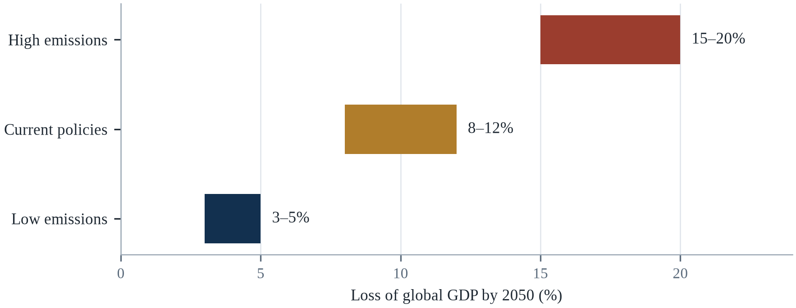||Source: Table 10.1; loss is measured against a no-climate baseline.

Two lessons emerge from this. First, the difference between the low and high pathways is measured in percentage points of global GDP, which is to say in trillions of dollars and in hundreds of millions of people pushed into poverty. Second, the losses are not a future that arrives in 2050; they accumulate year by year, and the countries that are least able to adapt are already paying the highest share (UNDRR, 2023).

A rapid diffusion of cheap clean energy would reduce both the physical damage and the transition risk, and it is already happening faster than most models assumed. A breakthrough in adaptation finance — through reform of multilateral institutions, debt relief or new levies — would reduce the burden on the poorest countries. And a change in the discount rate used by governments would make long-term damages look larger and justify more investment now. None of these is certain, but the direction of the economics is: delay costs more than action.

---

# Chapter 11: Migration and Displacement

*Theme: climate migration, displacement and the politics of moving people*

Tuvalu is a country of nine coral atolls with a population of about eleven thousand people and a highest point of less than five metres above sea level (UNHCR, 2023). At high tide, the capital, Funafuti, is flooded in places; at spring tides, seawater bubbles up through the ground. The government has been negotiating the terms of its own disappearance for more than a decade, and in November 2023 it signed an agreement with Australia, the Falepili Union, that provides for the movement of Tuvaluans to Australia under a special visa arrangement while preserving Tuvalu's sovereignty and maritime boundaries.

Tuvalu is the clearest case, but it is not the largest. Most climate migration is internal, rural-to-urban, and temporary. People move from a village to a city after a drought, from a floodplain to higher ground after a flood, or from a coast to an inland town after salt water contaminates the wells. They move within their own country, often return when conditions improve, and rarely cross an international border. The image of a wave of climate refugees crossing borders is misleading; the reality is millions of small movements, most of them within national boundaries.

The scale is difficult to measure because climate is rarely the only reason for moving. A farmer who leaves a drought-affected village may be moving because of debt, because his children have no school, or because a relative in the city has offered work. Climate change is one pressure among many, and it is often the pressure that tips a decision that was already being considered. That makes attribution difficult and prediction uncertain, but it does not make the phenomenon any less real.

This chapter examines the drivers of climate migration, the difference between voluntary and forced movement, and the destinations that receive people. It pays particular attention to the places that cannot adapt in place — small islands, low deltas and drought-prone rangelands — and to the legal and political frameworks that determine whether movement is managed or chaotic. It closes with the question that receiving communities face: how to absorb people without creating new vulnerability.

Migration is the oldest adaptation strategy humans have, and it is usually described in the language of crisis rather than agency. Most people who move in response to environmental stress move short distances, stay within their own country, and return when conditions allow; only a small minority cross borders. The image of a mass exodus from the global South to the global North is not supported by the evidence, and policies built on that image tend to be punitive rather than protective.

## 11.1 Definitions: Migration, Displacement and Relocation

Migration is a broad term that includes voluntary movement in search of opportunity and forced movement in response to threat. Displacement usually refers to movement caused by a specific event, such as a flood or a conflict, and it implies that people intend to return. Planned relocation refers to the organised movement of a community to a new site, usually with government support. The distinctions matter because they determine which legal protections apply and which forms of assistance are available.

Climate change can produce all three. A flood displaces people temporarily; a drought may push people to migrate permanently; a village that is repeatedly flooded may be relocated by the state. The same household may experience several of these in sequence: displacement to a shelter, return to a damaged home, migration to a city, and eventually relocation to a new settlement. The categories are useful for policy but they do not describe a linear process.

The legal framework is incomplete. The 1951 Refugee Convention defines a refugee as a person fleeing persecution on the basis of race, religion, nationality, social group or political opinion; it does not cover people fleeing environmental change. There is no binding international instrument that grants climate migrants a right to enter another country or to receive protection. Some countries have created humanitarian visas, and regional agreements have begun to address the gap, but the protection available to a person whose island is disappearing depends on where they happen to be born.

The distinctions matter because they determine legal status and entitlement. Migration is a voluntary movement, even when the pressures behind it are severe; displacement is involuntary and usually temporary; and relocation is planned movement organised by a government or agency. A person who leaves a drought-stricken village to find work is a migrant under international law and has few protections; a person who flees a flood is displaced within their own country and depends on national law; and a person moved from a coastline by a resettlement programme has a different set of rights again.

The vocabulary of human mobility is precise and often used loosely. Migration is a movement that may be voluntary or forced, internal or international, and it may be planned; displacement is movement that is forced and usually temporary; relocation is a planned movement organised by an authority; and trapped populations are people who cannot move even though they are exposed. The distinction matters because the policy response differs. Displacement requires shelter, protection and a route home; migration requires labour markets and legal channels; relocation requires land, compensation and consent. Most public argument collapses all of these into a single image of a wave, which makes the phenomenon sound simpler and more threatening than it is.

The vocabulary of migration is contested because the categories determine the rights. A refugee is defined by the 1951 Convention as a person with a well-founded fear of persecution, and the definition does not include a person who leaves because the rains failed. A displaced person is defined by being inside their own country, which gives them a different and weaker set of protections. A migrant is a broader category that carries no automatic right at all. The Nansen Initiative and the subsequent platform were an attempt to fill the gap for cross-border disaster displacement, and they produced guidance rather than obligation, which is the most that the states involved would accept.

## 11.2 Rapid-Onset and Slow-Onset Drivers

Rapid-onset events — floods, storms, wildfires — displace people immediately, often in large numbers. The Internal Displacement Monitoring Centre recorded about 26.4 million disaster displacements in 2023, the majority from floods and storms. Most of these displacements are short-lived: people return home within weeks or months, once the water recedes and the damage is repaired. But repeated displacement erodes the assets and social networks that make recovery possible.

Slow-onset changes — sea level rise, desertification, salinisation, glacier retreat — displace people gradually, and the movement is harder to see. A household whose well becomes saline may first buy water, then reduce its herd, then send a son to the city, and finally abandon the farm. By the time the village is recognised as uninhabitable, most of its population may already have left. The slow-onset process is less visible than a flood but often more permanent.

The two interact. A community weakened by repeated drought may be unable to recover from a flood; a coastal city that is subsiding may be overwhelmed by a storm surge that would have been manageable a generation ago. The sequence of shocks matters as much as the magnitude of any single event, which is why vulnerability is best understood as a trajectory rather than a state.

Rapid-onset events displace far more people than slow-onset ones, but slow-onset events produce more permanent movement. Floods and storms displace millions each year, and most people return within weeks; drought, salinisation and sea-level rise displace fewer people at a time but make return impossible, so the movement becomes permanent. The Internal Displacement Monitoring Centre records around 26 million new disaster displacements a year, and the figure understates slow-onset movement because it counts events rather than attrition.

Rapid-onset disasters displace people suddenly and visibly, and most of them return home within weeks. Slow-onset processes — drought, salinisation, sea-level rise, land degradation — displace people gradually and invisibly, and they rarely return. The two require different responses: rapid-onset displacement is a humanitarian problem with a clear timeline, while slow-onset displacement is a development problem with no clear beginning. The slow version is also harder to attribute, because a household that moves from a drying village to a city may be described as an economic migrant, and the climate may be one factor among several. The result is that the largest movements are the least counted.

The legal difference between rapid-onset and slow-onset displacement is that the first is visible and the second is not, and the invisibility has consequences. A flood produces images, a declaration, and an appeal; a drought produces a family that leaves quietly, one member at a time, and arrives in a city where nobody records the reason for the arrival. The data on slow-onset movement are therefore much weaker than the data on disaster displacement, and the weakness is not neutral, because it determines who qualifies for assistance. The people who cannot move at all are the third category, and they are the most exposed, because immobility is a form of vulnerability that the policy debate rarely counts.

The categories that the data systems use determine which people are visible, and the three that matter are displacement, migration and immobility. Displacement is the movement that follows a disaster and is tracked by the agencies that respond; migration is the slower movement that is tracked, if at all, by the censuses; immobility is the condition of the people who stay because they cannot leave, and it is tracked by nobody. The last group is the largest among the poorest, and its needs are the ones that a policy designed around movement will miss. The data gap is therefore not neutral: it determines who is assisted.

## 11.3 How Much Migration Is Climate-Related?

Estimating the number of people who move because of climate change is difficult because climate is rarely the sole cause. Researchers use household surveys, satellite data on vegetation and rainfall, and econometric models to identify the effect of climate variables on migration decisions, controlling for income, conflict, land tenure and social networks. The estimates vary widely, but they consistently find that climate shocks increase migration, particularly from rural areas and particularly among households that depend on agriculture.

The World Bank's Groundswell reports projected that 216 million people could move within their own countries by 2050 in six regions under a high-emission scenario, with most of the movement in Sub-Saharan Africa, South Asia and Latin America (World Bank, 2021). The same reports found that most of the movement could be avoided through adaptation — irrigation, crop diversification, social protection and urban planning — which is why they are framed as a call to action rather than a prediction.

The number of people who cross international borders for climate reasons is much smaller, and it is likely to remain so. International migration is expensive, requires documents and networks, and is often deterred by border controls. The people who are most exposed to climate risk are usually the least able to migrate internationally, which is why the most vulnerable often stay in place. This phenomenon — the immobility of the most exposed — is one of the most important and least discussed features of climate migration.

Estimating how much migration is climate-related is methodologically difficult, because climate is rarely the only driver and people seldom describe their motives in those terms. Surveys typically find that economic factors dominate, with environmental stress acting as an amplifier rather than a single cause. The widely quoted projection of 200 million climate migrants by 2050 dates from work published in 1995 and has been criticised for its methods; later estimates range from 44 million to more than 200 million depending on assumptions about adaptation and development.

The 216 million figure is a modelling result rather than a count, and it depends on assumptions about population growth, adaptation and the definition of movement. Its value is comparative: it shows that the overwhelming majority of movement will be internal and that the poorest regions will supply most of it. Its danger is that it is often quoted as a forecast of international migration, which it is not.

Estimating how much migration is climate-related is genuinely difficult, and the difficulty is not an excuse for inaction. A household moves because of a combination of income, security, family networks, land and weather, and no survey can separate the components cleanly. What can be said is that climate variables are statistically associated with movement in the expected directions: drought increases rural-to-urban migration in some contexts, floods displace people temporarily, and heat reduces agricultural income in ways that make departure more likely. The useful estimates are therefore conditional — how many people might move under a given scenario with a given set of policies — rather than a single global figure presented as a prediction.

The estimates of how many people will move because of the climate range from tens of millions to a billion by mid-century, and the range reflects the difficulty of the question rather than a disagreement about the data. A person who moves from a drought-affected village to a city is moving for a combination of reasons, and the climate is one of them, which means that the attribution is a matter of degree rather than of kind. The people who cannot move are the ones that the aggregate numbers miss, and they are often the poorest, because mobility requires money, a network and a legal status. The trapped population is a category that the policy debate has only recently begun to count.

## 11.4 Pastoralists, Farmers and the Sahel

Pastoralists are among the most climate-exposed groups because their livelihoods depend on grazing that varies with rainfall. In the Sahel, herders have long moved seasonally between dry and wet season pastures, and those movements were governed by customary agreements with farming communities. As rainfall has become more variable and pastures have degraded, the movements have become longer, more frequent and more contested.

The result is conflict over land and water, particularly where the state is weak and where farmers have expanded into corridors that herders once used. The conflict is often described as ethnic or religious, and those identities matter, but the underlying driver is frequently a dispute over access to a shrinking resource. Climate change does not create the conflict, but it intensifies the competition that makes it more likely.

Farmers respond to drought in a different way. They may migrate temporarily to cities, send a family member to work, diversify into non-farm activities, or sell livestock to buy food. The strategies are cumulative, and each one reduces the household's capacity to return to farming. A household that sells its animals and its tools may not be able to restart even if the rains return, which is why drought can produce permanent de-agrarianisation in regions that have experienced it repeatedly.

Pastoralists in the Sahel illustrate how mobility functions as adaptation. Herders move livestock along routes that have been negotiated over generations, using wells and pasture that are shared under customary rules. When drought reduces pasture, mobility allows herds to reach areas that still have grass; when borders, farmland or conflict block the routes, the same drought becomes a livelihood collapse. The crisis is therefore produced as much by the loss of mobility as by the lack of rain.

Pastoralists and smallholders are the groups for whom migration is a traditional strategy rather than a failure. Herders move with the seasons and follow the rain, and their system is well adapted to variability; it becomes maladaptive when the variability exceeds the range the system was designed for, or when the routes are blocked by fences, farms and borders. Farmers diversify by sending a young family member to the city, which spreads risk across a household rather than across a landscape. The Sahel shows both patterns: mobility that has sustained livelihoods for centuries, and displacement that follows when the pasture fails and the route is closed.

Pastoralists move as a matter of routine, and the distinction between that mobility and distress migration is the condition of the herd. A household that moves with a healthy herd along a familiar route is practising adaptation; a household that moves because the pasture has failed and the animals are dying is fleeing. The routes often cross the territories of farmers, and the tension at those crossings is as old as the practice, and it has become more frequent as the pasture has contracted. The interventions that reduce the conflict are the least dramatic: guaranteed access to water points, agreed corridors, and early warning that allows both sides to plan.

Index-based livestock insurance is the instrument that has come closest to solving the pastoralist problem, and it works because it pays on the rainfall rather than on the death of the animal. A satellite or a rain gauge measures the pasture condition, and when the measure falls below a threshold the policy pays, without a loss adjuster and without the delay of a claim. The herder receives the money before the animals die, which is the point at which the money preserves the herd. The scheme has been piloted in Kenya and Ethiopia and the evaluations find that it protects the assets of the households that hold it, and that the uptake is limited by the premium and by the trust in the insurer.

## 11.5 Small Island States and Coastal Communities

Small island developing states are the most exposed to sea level rise because their land area is small, their elevation is low, and their populations are concentrated on the coast. Tuvalu, Kiribati, the Marshall Islands and the Maldives have average elevations of a few metres, and their freshwater supplies depend on thin lenses of groundwater that are vulnerable to saltwater intrusion. For these states, adaptation in place has physical limits.

The responses have three tracks. The first is coastal defence: sea walls, reclamation, and raised infrastructure. The second is adaptation within the island: rainwater harvesting, desalination, salt-tolerant crops and the relocation of settlements to higher ground. The third is migration: agreements with other countries that allow citizens to move, work and eventually settle. The Falepili Union between Tuvalu and Australia is the most recent example, and it combines a visa pathway with Australian recognition of Tuvalu's maritime boundaries and a commitment to assist in the event of a major disaster.

The politics of these agreements is delicate. Island states do not want to be seen as giving up, and they do not want to lose their sovereignty or their maritime zones, which are vast relative to their land area. Australia and New Zealand have been willing to accept limited numbers of migrants, but not to recognize a legal category of climate refugee. The result is a patchwork of bilateral arrangements that provides a pathway for some people but not a right for all.

Small island states face a form of displacement that has no precedent in international law: the loss of territory itself. A country whose land is submerged does not have a population that can return, and the legal question of whether statehood survives the loss of territory is unresolved. Some governments have begun to purchase land abroad as a form of insurance, and some have negotiated migration pathways with larger neighbours, but neither solves the question of sovereignty or of cultural continuity.

Small island states have produced the most innovative legal responses to displacement, because they face the possibility that their territory will become uninhabitable while their statehood persists. The Falepili Union between Tuvalu and Australia, signed in 2023, created a pathway for Tuvaluans to migrate with access to services while preserving Tuvalu's sovereignty, and it was explicitly framed as a response to climate change (UNHCR, 2023). The agreement is small in scale — a few hundred people a year — and large in principle, because it treats mobility as a right to be facilitated rather than a failure to be deterred.

Small island states are the clearest case of a population whose territory is at risk, and their situation is misdescribed by the word migration. A person who moves from a sinking atoll does not simply change address; they lose a state, a culture, a language and a set of maritime rights. The Falepili Union between Tuvalu and Australia is significant because it creates a legal pathway while preserving sovereignty and the maritime boundary, which is an attempt to decouple the movement of people from the disappearance of the state. Whether that model can be replicated depends on the willingness of larger countries to accept an obligation that has no precedent in international law.

Small island states are the test case for the whole agenda, because the adaptation options that exist for a continental country do not exist for an atoll. A sea wall can protect a city; it cannot protect a country whose entire land area is a few metres above the sea and whose freshwater lens is being salinised. The population of Tuvalu is about eleven thousand people on twenty-six square kilometres, and the state has negotiated a treaty with Australia for the movement of its people while retaining its maritime zone and its legal personality (UNHCR, 2023). The case establishes a precedent that no other category of state had needed: a country can continue to exist as a legal entity after its territory becomes uninhabitable.

## 11.6 Floods, Displacement and Return

Floods displace more people than any other climate hazard. The 2022 Pakistan floods displaced about eight million people, many of whom lived in temporary camps for months; the 2010 floods in the same country displaced about 14 million (WMO, 2023). In Bangladesh, cyclones and floods regularly displace hundreds of thousands, and the people who are displaced are disproportionately poor, landless and living in informal settlements.

Most flood displacement is temporary, but return is not always possible. A household whose home has been destroyed may have nowhere to return to, particularly if it rented or occupied land informally. A household whose land has been eroded by a river may have lost its livelihood permanently. And a household that has been displaced repeatedly may decide not to return, even if the house is repaired, because the risk of another flood is too high.

The quality of displacement matters as much as its duration. People in camps face overcrowding, poor sanitation and limited access to health care and education; people who stay with relatives may be less visible but equally vulnerable. The decision to return is often driven by the availability of work and housing rather than by the level of risk, which means that the poorest are the most likely to return to hazardous places.

Return after a flood is the part of displacement that receives least attention and determines the long-term outcome. Households return when their homes are habitable, their livelihoods are restored and their children can attend school; they stay away when housing is destroyed, land is contaminated or services are absent. The factors that predict return are therefore the same factors that predict recovery, which is why displacement policy and housing policy cannot be separated.

Flood displacement is usually short and local, and its harm is concentrated in the return. A household that spends three weeks in a shelter may return to a house that is structurally sound but has no clean water, no electricity and no school for the children. The return is where the health effects accumulate and where the decision to rebuild in the same place is made, often because there is no alternative and because the land is the only asset the family has. Repeated displacement erodes the assets that would allow a household to move permanently, which is why the same families appear in the statistics year after year.

Flood displacement is measured in the weeks after the water arrives, and return is measured in the years after it recedes. The households that return fastest are the ones with secure title, a habitable house and a reason to be there, and the ones that do not return are the tenants, the undocumented and the ones whose land was taken while they were away. In Pakistan in 2022, more than eight million people were displaced at the peak, and the reconstruction was slowed by the debt crisis that had preceded the flood (WMO, 2023). The pattern repeats: the recovery reproduces the inequality that existed before the event, unless a deliberate effort is made to interrupt it.

## 11.7 Cities as Destinations

Most climate migrants move to cities, and most cities are not prepared for them. New arrivals often settle in informal areas that are themselves exposed to floods, heat and landslides, and they lack access to water, sanitation, health care and formal employment. The result is that migration transfers vulnerability from the countryside to the city rather than resolving it.

Cities that plan for migration do better. Providing land for affordable housing, extending water and sanitation to informal settlements, and creating work opportunities reduces the risk that newcomers will be pushed into hazardous areas. Some cities have adopted policies that explicitly recognize climate migrants, including access to services and temporary shelter. But most have not, and the arrival of large numbers of people in a short period can overwhelm services and create political tension.

The receiving communities matter as much as the migrants. A city that absorbs people successfully is one where the labour market is growing, the infrastructure is adequate and the social fabric is inclusive. A city that is already stressed by unemployment, housing shortages and weak services may experience conflict. The difference is largely a matter of governance and investment, which means that migration policy is also urban policy.

Cities absorb most climate migration, and they do so informally. New arrivals typically settle in peripheral neighbourhoods with cheap housing and limited services, often in areas exposed to floods or landslides. The result is that migration transfers vulnerability from rural areas to urban ones without reducing it, unless the receiving city invests in housing, infrastructure and services at the rate the population is growing.

Cities are the destination for most climate migration, and the receiving end is where policy usually fails. Migrants arriving in informal settlements often occupy the most exposed land — floodplains, steep slopes, drainage corridors — because that is what is affordable and available. Research on urban displacement in Dhaka, Lagos and Jakarta finds that newcomers rely on social networks for housing and work, and that the networks determine whether they end up in a safer or a more dangerous location. Integration policy is therefore not a separate concern from adaptation; it determines whether migration reduces or concentrates risk.

Cities are the destination for most climate migration, and the way they receive people determines the outcome. A city that permits informal settlement, tolerates informal work and provides basic services absorbs arrivals at low cost and turns them into taxpayers within a generation. A city that demolishes informal housing and restricts work pushes arrivals into precarity and slows their integration. The receiving areas are usually the least served neighbourhoods, which is why climate migration is often described as an urbanisation problem rather than a border problem. The infrastructure that matters is water, sanitation, transport and schools, not walls.

Cities are where most climate migration ends, and the way they receive it determines whether the movement is a crisis or an adaptation. A household that arrives in a city with a contact, a skill and a legal status can become a contributor within a year; a household that arrives without them joins the informal settlement on the floodplain. The cities that manage the arrival well have a register, a settlement policy, and services that extend to the newcomers rather than stopping at the boundary of the formal city. The ones that do not produce a population that is exposed to the next hazard and excluded from the response to it.

## 11.8 Remittances and Transnational Adaptation

Migration is not only a failure of adaptation; it is also a strategy of adaptation. Households that send a member to work elsewhere receive remittances that can be used to invest in irrigation, housing, education and health. In 2023, remittances to low- and middle-income countries reached about US$669 billion, more than foreign direct investment and more than official development assistance. For many countries, remittances are the largest source of external finance.

Remittances can increase resilience. A household that receives regular transfers can buy food during a drought, rebuild after a flood, and keep children in school. They can also finance adaptation: a new roof, a water tank, a solar system, or a small business that is less dependent on rainfall. The effect depends on the reliability of the transfers and on how they are used, but the evidence generally shows that remittances reduce vulnerability.

There is a darker side. Migration can separate families, increase the burden on women who remain behind, and expose migrants to exploitation and dangerous work. The remittances may also create dependence on a single source of income that is itself vulnerable to economic shocks in the destination country. The policy challenge is to maximize the benefits of migration while reducing its costs, which requires safe migration pathways, portable social protection and financial systems that reduce the cost of transfers.

Remittances are one of the most effective forms of adaptation finance, and they are rarely counted as such. Money sent home by family members working abroad exceeds official development assistance in many countries, and it arrives directly, quickly and without conditions. Research in Bangladesh, Nepal and Central America finds that remittance-receiving households invest more in housing, education and preparedness, and recover faster after disasters, which makes migration a strategy for those who stay as well as those who leave.

Remittances are the largest source of external finance for many low-income countries, and they are also a form of adaptation finance that no agency administers. Households that receive money from relatives abroad use it to rebuild after a flood, to diversify livelihoods and to pay for schooling, and studies of remittance flows after disasters find that they arrive faster than official aid and are targeted more precisely. The limitation is that remittances depend on migrants having work abroad, so a policy that restricts migration reduces the flow of money that makes adaptation possible at home.

Remittances are the largest international financial flow to many vulnerable countries, and they are also a form of adaptation. A household with a relative abroad has an income that does not depend on the local harvest, which allows it to survive a drought without selling its assets and to rebuild after a flood without waiting for aid. The money also finances adaptation directly: a concrete roof, a water tank, a solar panel. The dependence is a vulnerability of its own, because remittances fall during global recessions and because the migrants who send them are often exposed to hazards in their destination. The system works, and it is invisible in almost every policy discussion.

Remittances are the largest source of external finance for many vulnerable countries, and they function as a form of insurance that no institution designed (World Bank, 2024). A household with a relative abroad receives money after a disaster without an application, a collateral requirement or an interest rate, and the money arrives faster than most official assistance. The volume sent to low- and middle-income countries is well over six hundred billion dollars a year, which is several times the global aid budget. The instrument has limits: it depends on the migrant having a job, it falls when the destination economy is also hit, and the transaction costs still take a larger share from the poorest senders.

## 11.9 Legal and Political Frameworks

The legal framework for climate migration is fragmented. The Refugee Convention does not cover environmental displacement; the International Organization for Migration is not a protection agency; and the UN Framework Convention on Climate Change established a task force on displacement but not a right to admission. The result is that most climate migrants depend on ordinary immigration rules, which are designed for other purposes and are often restrictive.

Some progress has been made. The Global Compact for Safe, Orderly and Regular Migration, adopted in 2018, recognizes climate and environmental factors as drivers of migration and commits states to cooperate on admission and protection. The Nansen Initiative and its successor, the Platform on Disaster Displacement, have developed guidance on planned relocation and cross-border displacement. Several countries have created humanitarian visas or temporary protection regimes for people affected by disasters.

The political obstacle is that admission is a sovereign decision, and publics in receiving countries are often hostile to migration. The result is that governments prefer to fund adaptation in countries of origin, which is cheaper and politically easier, rather than to open legal pathways. Adaptation is necessary, but it cannot protect everyone, and the people it cannot protect need somewhere to go. The absence of a legal pathway does not prevent movement; it only makes the movement irregular, dangerous and expensive.

The 1951 Refugee Convention does not recognise environmental drivers, and a person fleeing a flood is generally not a refugee; the Kampala Convention covers internally displaced people in Africa but only within the continent; and the Global Compact for Migration is non-binding. Several regional agreements have created humanitarian visas and labour pathways, but coverage remains partial and dependent on political willingness.

Indonesia's capital relocation is the largest planned move of a national government in modern history, and it is being justified partly in climate terms. Jakarta's subsidence and flooding are among the reasons given for moving to Nusantara in East Kalimantan, although the relocation also reflects a long-standing desire to redistribute development away from Java. The early phases have raised the questions that all planned relocation raises: whether the new site is itself exposed to fire and drought, who will be able to afford to move, and what happens to the millions who remain. The case is a reminder that planned relocation is never only an environmental decision.

The legal framework for climate mobility is a patchwork. The 1951 Refugee Convention does not cover people who move because of environmental change, and no treaty creates a right to enter a country for that reason. Regional agreements, bilateral arrangements and humanitarian visas fill some of the gap, and the Global Compact for Migration provides principles without obligations. The consequence is that most climate movement is internal and therefore governed by national law, which is often silent on the subject. The people who cross a border usually do so through existing channels — work, family, study — rather than as recognised climate migrants, which is why the category exists in research and barely exists in law.

The legal framework for climate displacement is a patchwork of instruments that were designed for other purposes, and the gaps are where people fall. The refugee convention does not cover a person who leaves because the rains failed; the human rights instruments establish obligations but not admission; the disaster law of most states addresses the emergency and not the years that follow. The Nansen Initiative produced a set of practices rather than a treaty, and the Global Compact for Migration recognised the category without creating a right. The result is that the protection a person receives depends on the country they reach and on the discretion of an official, which is the definition of an arbitrary system.

## 11.10 Planned Relocation

Planned relocation is the organised movement of a community to a new site, usually because the original site has become unsafe. It is the most difficult form of adaptation, because it involves the loss of land, livelihoods, social networks and cultural identity. Relocation projects have a long history of failure when they have been imposed without consultation, compensated inadequately, or sited in places that are themselves vulnerable.

The successful cases share several features. Communities are consulted early and repeatedly; compensation covers land, housing and livelihood; the new site has access to water, employment and services; and the process is paced to allow people to move when they are ready. Fiji's planned relocation of coastal villages, supported by a national framework, is one of the more studied examples; it has been slower than the government intended, but it has generally respected community consent.

The hardest question is who decides. A community may prefer to stay even when the government considers the site unsafe; a government may consider relocation necessary even when the community disagrees. The tension is unavoidable, and it is resolved differently in different political systems. The principle that has emerged from international guidance is that relocation should be a last resort, that it should be voluntary wherever possible, and that it should preserve the rights and dignity of the people who move. Those principles are easier to state than to implement.

Planned relocation is the option that governments avoid until it becomes unavoidable, and the record of doing it well is thin. Successful cases share several features: they are voluntary where possible, they involve communities in choosing the site and design, they provide compensation that restores livelihoods rather than only housing, and they maintain social networks by moving groups rather than individuals. Where those features are absent, resettlement sites become places of secondary displacement and dependency.

Planned relocation is the hardest adaptation option because it requires a government to tell people that their home will not be defended. Fiji has become the most studied case, having relocated several villages from coastlines exposed to erosion and storm surge, starting with Vunidogoloa in 2014. Evaluations find that outcomes depend on land availability, compensation, and whether the community was involved in choosing the site; where relocation was imposed, resistance and return were common. The lesson is that relocation is not a technical operation but a negotiated one, and that the negotiation takes years.

Planned relocation is the hardest adaptation to do well and the easiest to do badly. Done well, it is voluntary, it is organised around livelihoods rather than only housing, it compensates at replacement cost, and it keeps communities together. Done badly, it moves people from a hazard to a site without water, work or transport, and the site becomes a second displacement. The record of resettlement projects over the past half-century is not encouraging, mostly because the economics of the destination were not assessed and because the consultation happened after the decision. The cases that worked share a feature: the community chose the site and the timing, and the state financed the move rather than ordering it.

## 11.11 Case Study: Tuvalu and the Falepili Union

Tuvalu consists of nine atolls and reef islands scattered across about 1.3 million square kilometres of ocean, with a total land area of about 26 square kilometres (UNHCR, 2023). The population is about 11,000, and the highest point is less than five metres above sea level. The country has no rivers, no significant groundwater beyond thin freshwater lenses, and no high ground to which it could retreat. Its territorial waters, by contrast, are vast, and its exclusive economic zone is its most valuable asset.

The physical pressures are already measurable. Sea level at Funafuti has risen by about 3.4 millimetres a year since records began, close to the global average, and the frequency of flooding at high tide has increased (IPCC, 2019b). Saltwater intrusion has contaminated wells and reduced the productivity of taro pits, a staple crop. Coral bleaching has damaged reefs that provide food and coastal protection. The government has built sea walls and raised some roads, but the costs are high relative to the national budget.

The Falepili Union, signed with Australia in November 2023, is the most comprehensive bilateral arrangement of its kind. It provides a special visa pathway for Tuvaluans to live and work in Australia, with an initial cap and growth over time; it commits Australia to assist Tuvalu in the event of a major natural disaster or a security threat; and it recognizes Tuvalu's maritime boundaries and statehood even if the land is lost to the sea. The agreement is reciprocal: Australia gains strategic influence in the Pacific, and Tuvalu gains a pathway for its people.

The agreement has been criticized. Some Tuvaluans argue that it encourages emigration and undermines the incentive to adapt in place; others argue that it is the only realistic option for a country that cannot defend itself against the sea. The government has framed it as an insurance policy rather than a surrender, and it has continued to invest in coastal defence and adaptation. The debate reflects a broader tension in climate policy: whether to invest in places that may become uninhabitable, or to plan for the movement of people before the crisis arrives.

The case has implications beyond Tuvalu. It shows that legal pathways for climate migration can be created through bilateral agreements, even in the absence of a global framework. It shows that the recognition of statehood and maritime boundaries can be separated from the physical territory, which is a legal innovation with implications for other island states. And it shows that the choice between adaptation and migration is not binary: a country can do both, and the balance shifts as the physical risk increases.

The Falepili Union also illustrates the limits of bilateral deals as a model. It provides a pathway for a specific number of Tuvaluans a year, which is small relative to a population of about 11,000 and to the scale of eventual displacement; it does not create a category of climate refugee; and it depends on the continuing goodwill of the larger partner (UNHCR, 2023). Its value lies less in the numbers than in the principle it establishes: that a state facing territorial loss can negotiate a future for its people before the loss occurs.

Tuvalu's situation is a test of how the international system handles a state that is disappearing by degrees. The country has a population of about eleven thousand, a land area of about twenty-six square kilometres, and an exclusive economic zone larger than many continents (UNHCR, 2023). It has negotiated a treaty with Australia that provides a migration pathway while preserving sovereignty, and it has pursued a legal opinion on the obligations of states to prevent the loss of territory. The strategy is not to evacuate but to keep the state alive while its people move, which inverts the usual logic of migration policy and which no other country has yet had to attempt.

The Falepili Union between Australia and Tuvalu is the first agreement that addresses the legal continuity of a state whose territory is being submerged, and its significance is in the detail. Australia provides a pathway for the movement of Tuvaluans, and in return Tuvalu grants Australia a veto over security arrangements with third countries. The agreement recognises that the maritime zone of Tuvalu, and therefore its legal personality, would continue even if the land were lost, which is a principle that no treaty had previously stated. The arrangement is not a model that every small state would accept, and it establishes the precedent that the international system will need.

Tuvalu is the most legally inventive case, not the only one. Kiribati, thirty-three atolls scattered across three and a half million square kilometres of ocean, bought about twenty square kilometres of land in Fiji in 2014 as a hedge against the loss of its own territory, and it funds a programme it calls migration with dignity rather than displacement (UNHCR, 2023). The two countries chose different instruments—a treaty with a neighbour in one case, land purchase and skills migration in the other—and both answer the same legal question: what becomes of a state whose territory is no longer habitable? The difference matters for prediction because treaties can be renegotiated and land cannot be un-bought.

## 11.12 Future Scenarios and Predictions: Migration to 2050

Migration is the oldest form of adaptation and the hardest to measure. The Internal Displacement Monitoring Centre recorded about 26 million disaster displacements in 2023, and the World Bank estimates that 216 million people could move within their own countries by 2050 under a high-emission scenario (World Bank, 2021). These figures are not predictions of a single wave; they describe millions of individual decisions, most of them short-distance and temporary.

Those who move are a minority of those exposed. About 3.5 billion people live in contexts that are highly vulnerable to climate change, and about 1 billion live in low-elevation coastal zones (IPCC, 2022a). The countries that are most exposed are also the ones with the least capacity to manage migration: they have weak registration systems, limited social protection and few legal pathways to other countries.

Displacement will follow the emission path, adaptation and the openness of receiving countries. A world that invests in adaptation in places of origin can reduce the number of people who are forced to move; a world that opens legal pathways can make the movement safer and more orderly. A world that does neither will face a larger number of people moving irregularly, with higher costs for migrants and for the countries that receive them.

The migration of the next three decades will be mostly internal, mostly short-distance and mostly into cities that are already growing. The projection that 216 million people could move within their own countries by 2050 under a high-emission scenario is best read as an indicator of pressure rather than a forecast of events; the actual number depends on how much is invested in the places people leave (World Bank, 2021). The scenarios in this chapter differ mainly on two variables: the pace of warming and the level of development in the regions of origin. A world that invests in rural livelihoods, water and education produces less forced movement than one that does not, and the difference is measured in millions of decisions rather than in a single wave.

[[TABLE:Table 11.1 Projected climate migration by 2050]]
| Region | Internal migrants (million) | Main driver | Adaptation priority | Policy risk |
|---|---|---|---|---|
| Sub-Saharan Africa | ~85 | Drought; pastoralism | Water; social protection | Conflict; weak states |
| South Asia | ~40 | Floods; heat; sea level | Urban planning; embankments | Informal settlements |
| Latin America | ~17 | Drought; storms | Rural livelihoods; insurance | Urban violence |
| East Asia and Pacific | ~48 | Sea level; storms | Coastal defence; relocation | Land acquisition |
| North Africa | ~19 | Drought; water | Irrigation; employment | Political instability |
| Small island states | ~2–3 | Sea level rise | Relocation; legal pathways | Sovereignty; culture |

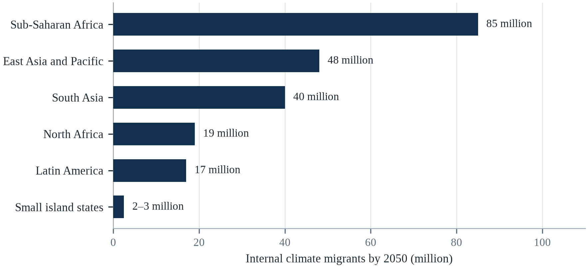||Source: Table 11.1; estimates are internal movements, not cross-border refugees.

There are two consequences here. First, the scale of climate migration is large but manageable if it is anticipated; the danger is not the number of people but the absence of systems to receive them. Second, most migration will be internal, which means that the responsibility falls primarily on national and municipal governments, not on international institutions.

A rapid reduction in emissions would reduce the number of people who are forced to move, but it would not eliminate the movement that is already committed by the warming that has occurred. A major expansion of adaptation finance would allow more people to remain in place. And a shift in public opinion in receiving countries would make legal pathways more feasible, which would reduce the human cost of movement even if the number of movers did not change.

---

# Chapter 12: Conflict, Security and Stability

*Theme: climate, conflict and the security of states and communities*

The Lake Chad basin was once one of the largest inland water bodies in Africa. In the 1960s it covered about 25,000 square kilometres; today it covers roughly a tenth of that, having shrunk through a combination of reduced rainfall, increased irrigation and population growth (Gleick, 2023). The retreating water left behind a landscape of dry lakebed, competing claims to fishing grounds and pasture, and a population that depends on an ecosystem that no longer supports it. The region is now home to one of the world's longest-running insurgencies and about 10.7 million people in need of humanitarian assistance.

The connection between the shrinking lake and the insurgency is real but not simple. Boko Haram did not emerge because the lake dried; it emerged from a combination of political marginalisation, economic neglect, religious radicalisation and weak institutions. What the environmental change did was to remove the livelihoods that might have provided an alternative, to displace people into camps where recruitment is easier, and to weaken the local economy that might have sustained resistance. Climate change acted as a threat multiplier, not as a cause.

The same pattern appears in other regions. Drought in the Sahel has intensified competition between herders and farmers; water scarcity in the Nile basin has raised tensions between Egypt, Sudan and Ethiopia; food price spikes have preceded riots in dozens of countries. In each case, the environmental stress interacts with political, economic and social conditions that determine whether the outcome is cooperation, protest or violence.

This chapter examines that interaction. It reviews what the research actually shows about climate and conflict — a literature with strong claims and serious disagreements — and then examines the pathways through which environmental stress can contribute to violence. It pays particular attention to the role of institutions, because the same drought that produces famine in one country can produce protest in another and nothing at all in a third. The chapter closes with the question of what security institutions can do, and what they cannot.

The relationship between climate and conflict is one of the most contested questions in the field, and the contest is productive. Early work found strong statistical associations between temperature and violence; later work questioned the causal mechanisms, the sensitivity of the results to model specification, and the risk of generalising from one context to another. The current consensus is narrower and more useful: climate change is a risk multiplier that acts through livelihoods, prices, migration and state capacity, and its effect depends on institutions.

## 12.1 What the Research Shows

The field became quantitative when two things arrived at once: global data sets of civil conflict and gridded climate reconstructions that could be matched to them. That combination allowed researchers to ask whether years or places that were unusually warm or dry also saw more violence, and the first generation of studies answered yes across many settings. The method carried an obvious weakness, because a correlation between temperature and conflict across countries can be produced by poverty, institutions or geography rather than by heat, and the argument since then has been about how to separate those channels. The literature is therefore less a settled finding than a long argument about identification, and its conclusions have narrowed as the methods improved.

The results of that first generation were summarised in a widely cited meta-analysis by Hsiang, Burke and Miguel (2013), which Hsiang and Burke (2014) later extended into a broader synthesis on climate, conflict and social stability. It was influential and contested in equal measure. Critics, notably Buhaug (2015), argued that the studies suffered from selection bias, that they aggregated very different forms of violence, and that the effect sizes were small relative to political and economic factors. Later work, including a review in Nature by Mach et al. (2019), concluded that climate has affected armed conflict risk in some contexts but that the evidence is strongest for low-level violence and weakest for civil war, and that confidence in the overall relationship is limited.

The disagreement is not about whether climate can contribute to conflict; it is about how much, where, and under what conditions. The consensus that has emerged is that climate is a risk multiplier rather than an independent cause. It acts on societies that are already vulnerable, through mechanisms that are political and economic rather than meteorological, and its effect is largest where institutions are weak and where livelihoods depend on climate-sensitive resources.

Three strands run through the quantitative literature. One finds that higher temperatures and rainfall anomalies are associated with more conflict at large scales, with Hsiang et al. (2013) reporting that a one standard deviation increase in temperature raises intergroup conflict by about 14 per cent and interpersonal violence by about 4 per cent. A second strand finds that the effects are small, conditional or absent once political and economic factors are controlled. A third, including Mach et al. (2019), concludes that the influence is real but modest relative to other drivers.

Part of the disagreement between those strands is a disagreement about what counts as conflict. A riot, a civil war and a homicide rate are different phenomena measured by different agencies with different thresholds, and a coefficient estimated on one is not directly comparable with a coefficient estimated on another. Studies that pool them find larger and more consistent effects than studies that keep them apart, which suggests that some of the apparent contradiction is an artefact of aggregation. The practical implication for anyone using this literature is to ask which outcome was measured before asking how large the effect was.

Three phases have marked the research, and the third is the most useful. The first asked whether there is a link and found scattered correlations that were easy to over-read. The second built large datasets of subnational violence and weather and found a consistent but modest association: a standard deviation of temperature or rainfall is associated with a small increase in the risk of local violence, communal conflict and riots, most reliably in places that are already poor and already tense. The third phase asks who is affected, through what mechanism, and under what conditions, and it is the phase that produces usable policy. The honest headline is that climate is a risk multiplier rather than a cause, and that multipliers matter most where the base is fragile.

The field has moved from a claim that the climate causes wars to a more careful account of how it shifts probabilities. The meta-analyses find a consistent association between temperature and rainfall anomalies and the incidence of conflict at the local level, and a much weaker association at the level of a civil war, which has many causes. The mechanisms that the models identify are economic, demographic and institutional, and the strength of each depends on the state that is exposed. The conclusion that the field supports is not that the climate is a threat multiplier in every case, but that it is one in the cases where the state is already weak and the grievance is already present.

## 12.2 Pathways: Livelihoods, Prices and Migration

Economics is the first pathway. When a drought destroys a harvest or a flood destroys a factory, incomes fall and unemployment rises. Young men who cannot find work are easier to recruit into armed groups; households that cannot feed themselves are more willing to accept protection from whoever offers it. The effect is not automatic, but it is one of the most consistent findings in the literature: negative income shocks increase the risk of violence.

Food prices are the second pathway. When prices rise, urban populations protest, and governments that respond with repression can escalate the protest into conflict. The 2010–2011 food price spike coincided with riots in more than thirty countries and with the political transitions of the Arab Spring, though the causal relationship is debated and varies by country. The mechanism is plausible and well documented: food is the largest expenditure for poor households, and a sudden increase can make the difference between coping and collapse.

Migration is the third pathway. The movement of people can create tension in receiving areas, particularly when it is rapid, when it is perceived as unfair, and when the state is unable to provide services. But migration can also be a source of resilience, through remittances and labour. The outcome depends on the capacity of receiving communities and institutions to absorb people, which is why the same inflow can produce integration in one place and conflict in another.

They are easier to describe than to measure. Climate shocks reduce agricultural income, which reduces the opportunity cost of joining an armed group; they raise food prices, which can trigger protests and riots; they displace people, which can create competition in receiving areas; and they reduce state revenue, which weakens the capacity to respond. Each pathway is plausible, and each is mediated by institutions, which is why the same drought can produce unrest in one country and not in another.

Livelihoods, prices and movement are the channels, and each has an observable signature. A drought reduces agricultural income, which reduces the opportunity cost of joining an armed group and increases competition for water and pasture. Higher food prices can trigger urban unrest, as the 2007–2008 and 2010–2011 episodes demonstrated across several continents (FAO, 2023). Displacement can overwhelm the services and social structures of a receiving area and produce tension between hosts and arrivals. None of these pathways is deterministic: the same drought produces migration in one place and conflict in another, and the difference is usually found in institutions, in the availability of a peaceful alternative, and in whether the state responds to the grievance or represses it.

The research on climate and conflict identifies three pathways, and the strength of each depends on the context. The first is economic: a temperature or rainfall shock reduces agricultural income, lowers the opportunity cost of violence, and increases the incentive to join an armed group. The second is migration: the movement of people into areas that are already contested creates friction over land, water and political representation. The third is institutional: a state that is weakened by a disaster loses the capacity to mediate the first two. The statistical evidence is strongest for the first pathway at the local level, and weakest for the claim that climate is a primary cause of any specific war.

## 12.3 The Sahel and the Lake Chad Basin

The Sahel is the region where the climate-conflict relationship is most often invoked and most difficult to disentangle. Rainfall has declined since the 1970s, though it has partially recovered in some areas; temperatures have risen faster than the global average; and the population has grown rapidly. Pastoralists and farmers compete for land and water, and the state is weak across much of the region.

Conflict in Mali, Burkina Faso and Niger has killed thousands and displaced millions. The causes are political and military as much as environmental: the collapse of the Libyan state in 2011 flooded the region with weapons; jihadist groups exploited local grievances; and governments responded with strategies that alienated rural populations. Climate stress contributed by undermining livelihoods and by making it harder for the state to deliver services, but it did not create the conflict on its own.

The Lake Chad basin repeats the pattern with a different mechanism. The lake's shrinkage has been driven by reduced rainfall, increased irrigation and population growth, and it has destroyed fishing and farming livelihoods across four countries. The resulting poverty and displacement created a reservoir of recruits for Boko Haram and its offshoots, and the military response has displaced millions more. The lesson is not that the lake caused the insurgency; it is that environmental change can create the conditions in which insurgency becomes possible.

The lake shrank from about 25,000 square kilometres in the 1960s to a few thousand at its lowest, but the shrinkage was driven by upstream abstraction and regional drought together, and it affected a region that was already poor, weakly governed and contested (Gleick, 2023). Boko Haram's insurgency exploited the resulting loss of livelihoods, but it also had its own ideological and political drivers that no environmental account can explain.

What the basin illustrates is how a slow environmental change becomes a security problem through livelihoods rather than through scarcity alone. The lake has contracted dramatically since the 1960s, and the surrounding region has seen the emergence of Boko Haram and the displacement of millions of people. The causal chain is contested: the contraction is partly climatic and partly the result of upstream irrigation, and the insurgency has its own political and ideological roots. What is not contested is that the loss of fishing and farming livelihoods removed the economic base that had sustained a dense population, and that young men without prospects were easier to recruit.

It is often cited as a climate-conflict case, and the citation is usually oversimplified. The lake has shrunk dramatically since the 1960s, and the shrinking is real, but it is driven by irrigation withdrawals and rainfall variability as much as by warming, and the basin's population has grown several-fold over the same period. The insurgency that has devastated the region emerged in a context of weak governance, marginalised peripheries, and a security response that alienated the population. Climate change is present in the story as a stress on livelihoods and a driver of displacement, not as the cause of the war. Saying so does not diminish the seriousness of the situation; it makes the remedy more likely to work.

The Lake Chad basin is the case that best shows how a climate stress, a demographic pressure and an insurgency can reinforce each other without any of them being the cause. The lake has shrunk dramatically since the 1960s, and the shrinkage is partly climatic and partly the result of the water that was diverted for irrigation upstream. The population around it has grown, the pasture has contracted, and the fishing and farming livelihoods that depended on the lake have become more precarious. The insurgency that emerged in the basin exploited the resulting grievances, and the military response displaced the population that the lake had supported, which completed the loop.

## 12.4 Syria and the Politics of Attribution

The Syrian conflict is often cited as the first climate war. Between 2006 and 2010, a severe drought hit the country's northeastern agricultural region, destroying crops and livestock and pushing as many as 1.5 million people toward the cities (Kelley et al., 2015). The drought was the worst in the instrumental record, and studies have found that climate change made it more likely.

The causal chain from drought to war is contested. Some analyses argue that the drought, combined with the Assad government's failure to manage water and agriculture, created a rural crisis that fed the uprising. Others, notably Selby et al. (2017), argue that the drought was one factor among many, that the migration was not as large or as sudden as sometimes claimed, and that the regime's repressive response to peaceful protest was the proximate cause of the war. The second view does not deny the role of climate; it insists on a more careful account of how it operated.

The Syrian case illustrates a general problem in climate-conflict research: the temptation to tell a simple story that connects a weather event to a war. The stories are politically useful because they dramatise the stakes, and they are analytically dangerous because they obscure the political decisions that turn vulnerability into violence. A government that responds to drought with redistribution and relief may face protest; a government that responds with repression may face war.

Syria is the case where attribution is most contested. The 2006–2010 drought was the worst in the instrumental record, and it displaced an estimated 1.5 million people from rural areas to cities (UNHCR, 2023). Kelley et al. (2015) argued that the drought was made more likely by climate change and contributed to the conflict; Selby et al. (2017) argued that the drought's role has been overstated and that political economy explains more. Both agree that the drought interacted with grievance and weak institutions, which is the defensible position.

What the exchange established, and what the field now generally accepts, is a division of labour between the two claims. The attribution of the drought to warming is well supported: the models and the rainfall record agree that the event was made substantially more likely, and the question is how much. The attribution of the uprising to the drought is not, and neither Kelley nor Selby defends it in that form; what the evidence supports is a contribution to the conditions, in a country that had already absorbed a million and a half displaced people and had already withdrawn much of its agricultural support. The case is therefore best read as a lesson in how to be precise about a chain rather than as a claim that climate caused a war.

A severe multi-year drought between 2006 and 2010 displaced large numbers of farming families into cities that were already straining under a influx of Iraqi refugees. Studies found that climate change had made the drought more likely, and some argued that the drought contributed to the unrest that became civil war. The careful conclusion is that the drought was a contributing stress among several, that the regime's mismanagement of water and agriculture was decisive, and that no serious analyst attributes the war to climate alone. The episode is a warning about how a defensible finding can become an indefensible headline.

## 12.5 Water Disputes and Cooperation

Water is the resource most often associated with climate conflict, and the record is more cooperative than the headlines suggest. The Pacific Institute's Water Conflict Chronology records thousands of water-related incidents, most of them local, and far more treaties than wars. The Indus Waters Treaty survived three wars between India and Pakistan; the Nile Basin Initiative has kept dialogue alive among ten countries with competing claims; and the Senegal River Organisation has managed a shared basin for decades.

That does not mean water is not a source of tension. The Grand Ethiopian Renaissance Dam on the Blue Nile has been the subject of a decade of negotiations among Egypt, Sudan and Ethiopia, and the dispute remains unresolved. Egypt depends on the Nile for almost all of its fresh water and has treated the river as a existential resource; Ethiopia argues that it has the right to develop its own hydropower. The dispute has not become a war, but it has shaped regional politics and delayed cooperation on other issues.

The factors that determine whether water disputes escalate are political, not hydrological. Countries that have institutions for sharing information, dispute-resolution mechanisms and a history of cooperation are more likely to manage scarcity without violence. Countries that lack them, or that are already hostile, are more likely to treat water as a zero-sum resource. The lesson is that water treaties are a form of adaptation, and that their erosion is a security risk.

Water disputes between states are more often managed than fought. The Indus Waters Treaty has survived three wars between India and Pakistan; the Nile Basin Initiative has kept dialogue alive despite the dispute over the Grand Ethiopian Renaissance Dam; and the Mekong Cooperation mechanism has created channels for data sharing. The record suggests that treaties, even imperfect ones, reduce the risk of violence by creating expectations and procedures for resolving disputes.

Water disputes are more often managed than resolved, and the historical record is more cooperative than the headlines suggest. The Nile dispute between Egypt, Sudan and Ethiopia over the Grand Ethiopian Renaissance Dam has produced a decade of negotiation without agreement, and it has not produced war. Research on international water treaties finds that shared basins generate far more cooperative agreements than violent conflicts, and that the violence which does occur is usually within states rather than between them. The danger is not a water war but a failure to adapt allocation rules to a changing supply.

Shared rivers are covered by thousands of treaties and basin agreements, and violence over water is rare next to the frequency of negotiation, even where neighbours are openly hostile. The recurring pattern is that upstream development is read downstream as a threat, and the dispute becomes a proxy for wider political tension. The Nile, the Indus and the Colorado each show a version of the same problem: an allocation fixed in a wetter or emptier past, a growing demand, and a climate that no longer matches the assumptions of the agreement. Cooperation tends to be technical before it is political, which is why shared data is often the most durable achievement.

Water disputes between states are more often settled than fought, and the mechanism that settles them is usually a river commission with a mandate to share data. The Nile, the Mekong and the Indus each have a commission, and each has been tested by a unilateral project upstream that the downstream state regarded as a violation. The commissions that have survived are the ones that combined a legal allocation with a technical process for monitoring the flow, because the trust that the allocation requires is built by the shared measurement rather than by the treaty text. The basins without a commission are the ones where the risk is highest.

## 12.6 Fisheries, Maritime Boundaries and the Arctic

Climate change is opening new areas of the ocean and creating new disputes. As Arctic sea ice retreats, shipping routes, fishing grounds and hydrocarbon reserves become accessible, and the states bordering the Arctic have competing claims to the continental shelf. The Arctic Council has provided a forum for cooperation, but the withdrawal of some members after the war in Ukraine has weakened it.

In the tropics, warming is driving fish stocks toward cooler water and across maritime boundaries. Countries whose fleets have historically fished in their own waters may find that the stocks have moved into the waters of a neighbour, which creates disputes over access and enforcement. The resulting tensions are rarely violent, but they can escalate, particularly where fishing is a major source of employment and where enforcement capacity is weak.

Fisheries also illustrate the role of international institutions. Regional fisheries management organisations set quotas and allocate access, and their effectiveness depends on the willingness of states to comply. Climate change makes their task harder because the stocks they manage are moving, and because the scientific advice on which they rely is uncertain. The result is a governance gap that is filled by unilateral action, which is precisely the outcome that institutions are supposed to prevent.

The Arctic illustrates how climate change can create new strategic competition even without direct resource scarcity. Retreating sea ice opens shipping routes, exposes fisheries and hydrocarbon reserves, and changes the military geography of the region. Arctic states have negotiated agreements on search and rescue and on fisheries, but the underlying competition for influence is intensifying, and the exclusion of some states from the Arctic Council after 2022 has reduced the forums available for managing it.

Fisheries disputes are the clearest example of climate change shifting a resource across a legal boundary. Fish stocks are moving poleward as waters warm, and the movement crosses exclusive economic zones that were fixed by treaty decades ago. The mackerel dispute between Iceland, Norway and the European Union, and the 'mackerel wars' that followed, showed how a shifting stock can produce a diplomatic conflict among countries that had previously shared a stable arrangement. The Arctic is the frontier case: as sea ice retreats, new fishing grounds and shipping routes open in waters whose legal status is contested.

The Arctic is where climate change is redrawing the map fastest, and the redrawing has security consequences. Retreating sea ice opens shipping routes that shorten the distance between Asia and Europe, exposes fishing grounds that were previously inaccessible, and makes hydrocarbon deposits reachable. It also removes the ice that has protected coastlines and the platforms from which indigenous communities hunt. States have submitted overlapping claims to the continental shelf under the law of the sea, and the Arctic Council has continued to function as a technical forum even when wider relations have deteriorated. Fisheries agreements in the central Arctic Ocean, signed before the fishing began, are a rare example of governance arriving ahead of the exploitation.

Maritime boundaries were drawn for a world in which fish stayed put, and the fish are moving. The Law of the Sea gives each coastal state a zone within two hundred nautical miles, and the stocks that migrate across those lines are managed by regional bodies that were designed around the historical distribution. When a stock shifts, the allocation becomes a dispute about who is entitled to a resource that has moved into their water, and the dispute is difficult because the underlying science is contested and the economic stake is large. The Arctic is the extreme case, where the retreat of the ice is opening a new ocean and the states around it are asserting rights that the law has not settled.

## 12.7 State Capacity and Fragility

The most important variable in the climate-conflict relationship is the capacity of the state. A state that can deliver relief, maintain order and provide services during a shock can prevent the spiral from drought to famine to violence. A state that cannot — because it is poor, corrupt, illegitimate or already at war — is where the spiral is most likely to occur.

Fragile states are also the most exposed to climate change. They tend to be agriculture-dependent, to have weak infrastructure and to lack the fiscal capacity to respond to disasters. The combination creates a feedback loop: climate shocks weaken the state, and a weakened state is less able to respond to the next shock. The result is that climate change can contribute to state failure, and state failure can make climate impacts much worse.

The policy implication is that climate adaptation and peacebuilding are the same project in fragile states. Building irrigation, restoring rangelands and providing social protection are adaptation measures, but they are also conflict-prevention measures, because they reduce the competition over resources that fuels violence. The reverse is also true: a peace agreement that does not address access to land and water is unlikely to hold.

A country with effective institutions can absorb a drought by importing food, expanding social protection and managing distribution; a country with weak institutions cannot. The same climate shock that produces price spikes and protests in one state produces humanitarian crisis and armed recruitment in another, and the difference is governance rather than meteorology.

State capacity is the variable that determines whether climate stress becomes conflict. A government that can deliver food, adjudicate land disputes, pay soldiers and police, and respond to a disaster can absorb a shock that would overwhelm a weaker state. Research on fragility finds that the combination of high climate exposure and low governance capacity is associated with the highest risk of instability, and that the association is strongest where livelihoods depend on rain-fed agriculture. The policy implication is that climate adaptation in fragile states is state-building by another name, which is why it is difficult to fund and difficult to evaluate.

State capacity is the variable that explains most of the variance in outcomes. A state that can deliver a warning, evacuate a coast, pay compensation and rebuild has turned a hazard into an inconvenience; a state that cannot has turned it into a humanitarian emergency and sometimes into a conflict. Capacity is not the same as wealth, although wealth helps; it is the combination of administrative competence, legitimacy, and a fiscal base. The countries where climate and conflict overlap most are usually those with a long history of centre-periphery tension, where the state is experienced as an extractive presence rather than a protective one. In those places, a climate shock is read through the history of that relationship.

State capacity is the variable that determines whether a climate shock becomes a security crisis, and it is measured in unglamorous ways. A state that can collect tax, pay civil servants, maintain a road and deliver a vaccination has the machinery to deliver a relief payment, and a state that cannot do the first things will not do the last. Fragility is not a binary: many states can respond in the capital and cannot reach the province, which is why a disaster can be managed in the city and catastrophic in the countryside. The international system tends to substitute for the state rather than to build it, which is faster in the short run and self-defeating in the long one.

## 12.8 Security Institutions and Climate Risk

Military and intelligence institutions have begun to treat climate change as a security issue. The United States Department of Defense has described climate change as a threat multiplier that will increase demand for military missions, damage installations and destabilise regions. NATO has incorporated climate considerations into its planning, and several countries have appointed climate security advisers.

The military's role is controversial. Some argue that framing climate as a security threat militarises a problem that requires development and diplomacy; others argue that the military is one of the few institutions with the logistics capacity to respond to disasters and that its planning assumptions shape how governments understand risk. The balance depends on the country and on whether security institutions are accountable to civilian authority.

The most useful contribution that security institutions can make is often analytical and logistical rather than kinetic. Early warning systems, scenario planning, disaster response capacity and the protection of critical infrastructure are all within the remit of security institutions and all contribute to resilience. The risk is that a security framing crowds out the development and governance responses that address the root causes of vulnerability.

Security institutions have begun to treat climate change as a threat multiplier, and their framing has consequences. The United States Department of Defense has described climate change as a risk to installations and operations; NATO has commissioned assessments of climate risks to missions; and several national intelligence agencies have included climate in their strategic forecasts. The risk is that a security framing prioritises border control over protection, and that it militarises a problem whose solutions are mostly civilian.

Security institutions have begun to treat climate as a planning assumption rather than an advocacy topic, and the shift is visible in documents. The United States Department of Defense has described climate change as a threat multiplier in its quadrennial reviews since 2010, and NATO has added climate risk to its strategic concepts. The reasons are institutional: bases flood, supply lines are disrupted, and humanitarian disasters generate demands for military logistics. The risk of this trend is that framing climate as a security issue can justify securitised responses — borders, surveillance, fortification — rather than the development investments that address the underlying vulnerability.

Security institutions have begun to treat climate as a planning assumption rather than an environmental issue. Ministries of defence map which installations are exposed to flooding and heat, which operations are affected by water scarcity, and which regions are likely to require humanitarian support. The framing is contested, because a security framing can justify spending on borders rather than on adaptation, and because it can securitise migration in ways that harm the people it claims to protect. The more defensible version of the argument is narrower: climate change increases the demand for disaster response, peacekeeping and humanitarian logistics, and those capabilities take years to build.

Security institutions have become climate institutions whether or not their mandates say so, because they are the ones called when a disaster exceeds the capacity of the civil authority. Militaries evacuate, transport, build bridges and restore order, and they do it with equipment that was bought for other purposes. The risk of that role is mission creep and the securitisation of a humanitarian problem; the benefit is that the only organisation with the logistics to reach a cut-off valley is often the army. The reforms that make the role useful are the boring ones: joint exercises with civil agencies, a clear division of responsibility, and a budget line for the domestic response that does not compete with the defence budget.

## 12.9 Food, Prices and Political Instability

The relationship between food prices and political instability is one of the best-documented in the social sciences. The 2007–2008 price spike was followed by riots in more than thirty countries, and the 2010–2011 spike coincided with the Arab Spring. The mechanism is straightforward: when the price of the staple food rises beyond what households can afford, the result is hunger, anger and, often, protest.

The effect is not deterministic. Some countries with high food prices experienced no unrest, and some unrest occurred in countries with relatively low prices. The difference is explained by the presence of other grievances, the capacity of the state to respond and the willingness of the security forces to repress. Food prices are a trigger, not a cause; they ignite conflicts that are already smouldering.

Climate change makes the trigger more likely by increasing the frequency of harvest failures and by increasing the volatility of prices. It also makes the response more difficult, because governments that are already fiscally stressed may be unable to subsidise food or to provide relief. The result is that the same price shock can be absorbed in one country and produce a crisis in another.

The mechanism that turns a harvest failure into a global price spike runs through policy rather than weather. When a major exporter restricts or bans exports to protect its own consumers, importers lose their supply and bid for what remains, and a restriction that each government adopts defensibly on its own produces a collective outcome that none of them intended. The episode of 2007 and 2008 followed this pattern closely, and the lesson that agencies drew from it was that price monitoring and trade policy belong in the same early-warning system as rainfall and yield forecasts.

Aceh is the counter-example that keeps the climate-conflict literature honest. The province experienced a thirty-year insurgency, a devastating tsunami in 2004 and a peace agreement in 2005, and the reconstruction that followed is one of the largest post-disaster efforts ever mounted. The peace held because the tsunami created a political opening that the parties used, and because the reconstruction delivered visible benefits to ex-combatants and civilians alike. The lesson is not that disasters build peace — they usually do not — but that a disaster can create a window in which political settlements become possible, and that the window closes quickly.

The reason food prices are treated as a security variable rather than a welfare one is that the transmission is fast and the affected population is concentrated. A staple that doubles in price transmits to the household budget within days, and urban households that spend half their income on food have no buffer to absorb it, which is why the political consequences arrive before the nutritional ones are visible in any survey. Countries with functioning social protection can convert a price shock into a budget cost; countries without it convert the same shock into a political one. That is the channel through which a drought in one hemisphere becomes a riot in another, and it is why food policy and fiscal policy are the same conversation.

Food prices are among the most reliable predictors of urban unrest, and the mechanism is simple enough to be uncomfortable. A household that spends half of its income on food has no buffer when the price doubles, and the anger that follows is directed at the government that appears unable to act. The price spikes of 2008, 2011 and 2022 were each followed by protests in dozens of countries, and the correlation does not prove that the price was the only cause. It does suggest that a government which manages the price of bread is managing a form of political risk, and that the management is cheaper than the response to the riot.

## 12.10 Prevention, Early Warning and Peacebuilding

Conflict prevention is cheaper than conflict response, and climate adaptation can be a form of prevention. Early warning systems that identify areas at risk of drought or flood can trigger relief before people are forced to migrate or to compete for resources. Dialogue mechanisms that bring herders and farmers together can resolve disputes before they become violent. Land reform that clarifies tenure can reduce the uncertainty that fuels conflict.

The evidence for these interventions is mixed but encouraging. The United Nations Development Programme's climate security projects in the Sahel have supported local mediation and early warning, and some evaluations report reductions in conflict. The challenge is scale: the interventions are small relative to the size of the problem, and they depend on local institutions that are often weak.

The deepest lesson is that climate security is not primarily a military problem. It is a problem of development, governance and justice. The countries that are most vulnerable to climate-driven conflict are those where people lack secure access to land, water and food, and where the state is unable or unwilling to provide them. Addressing those conditions is the most effective security policy available, and it is also the most neglected.

Prevention is cheaper than response, and the evidence is strongest for approaches that address livelihoods and governance rather than those that focus on security. The United Nations Development Programme's work in the Sahel has combined water infrastructure, pastoral corridors and local dispute resolution, and evaluations report reduced conflict in treated areas. Early warning systems that link rainfall forecasts to conflict risk can trigger preventive action, but only if the political will to act exists before the violence begins.

Prevention and peacebuilding are the parts of the climate-security agenda with the weakest evidence and the highest potential. Early warning systems for food prices and pastoral conflict have been piloted in the Horn of Africa and the Sahel, and evaluations suggest they can reduce response times when local institutions are involved in designing them. UNEP's environmental peacebuilding work has mediated disputes over grazing land and water points, with modest but real success. The common finding is that the intervention which works is the one that strengthens an existing local institution, not the one that creates a new international mechanism.

Prevention is cheaper than response and harder to finance, because it produces nothing visible. The measures that reduce conflict risk are the same ones that build adaptive capacity: secure land tenure, functioning local government, water infrastructure, social protection that does not exclude young men, and a justice system that settles disputes over pasture and water before they become violent. Early warning systems that combine rainfall, vegetation, prices and local reporting can anticipate the moment at which a drought becomes a crisis. Peacebuilding and climate adaptation are usually financed by different institutions with different timelines, which is why the integration of the two remains more rhetorical than operational.

Prevention is the part of the climate-security agenda with the best evidence and the least funding, because it works through institutions that are slow and unphotogenic. Early warning systems that are shared across a border build confidence between the parties that share a river, and the data exchange is often the first technical cooperation between hostile neighbours. Programmes that are designed with a conflict analysis avoid the mistake of reinforcing the elite that captured the relief. Peacebuilding and climate adaptation are usually funded from different budgets and implemented by different agencies, and the places where both are needed are the places where neither is coordinated.

What the conflict literature implies for policy is narrower than its authors sometimes claim. If climate acts as a risk multiplier that matters most where institutions are weak, then the effective intervention is institutional rather than climatic: a functioning water authority, a dispute mechanism that farmers trust, a price-stabilisation fund, and a police service that responds to a grievance before it organises. Those are not climate policies, and they are the ones that the evidence supports. The implication is uncomfortable for a field that would prefer to recommend mitigation, and it is the honest reading of two decades of quantitative work: the climate signal is real, modest, and mediated by arrangements that have nothing to do with the weather.

## 12.11 Case Study: The Lake Chad Basin

Lake Chad sits at the junction of Chad, Niger, Nigeria and Cameroon, and it has supported human settlement for thousands of years. In the 1960s it covered about 25,000 square kilometres, making it one of the largest lakes in Africa (Gleick, 2023). By the 2000s it had shrunk to about 2,500 square kilometres, a decline of roughly 90 per cent, driven by reduced rainfall, increased irrigation and the growing demands of a population that rose from a few million to more than 30 million in the basin (Gleick, 2023).

The shrinking lake destroyed livelihoods. Fishing communities lost their catch; pastoralists lost access to water and pasture; farmers lost the flood-recession land that had produced their crops. The result was a population that was poorer, more mobile and more dependent on whatever work was available. At the same time, the region was marginalised politically and economically, with weak state presence and few public services.

Boko Haram emerged in this context. The group was founded in north-eastern Nigeria in the early 2000s and became violent in 2009 after a government crackdown. Its ideology was religious, but its recruitment drew on grievances that were economic and political: unemployment, corruption, neglect and the collapse of traditional livelihoods. The shrinking lake did not create the group, but it created the conditions in which the group could recruit and operate.

The conflict has killed more than 35,000 people and displaced more than two million (UNHCR, 2023). The military response, which includes forces from Nigeria, Chad, Niger and Cameroon, has retaken territory but has not restored the livelihoods that would allow people to return. Humanitarian access is limited, and the region has one of the highest rates of food insecurity in the world. The lake itself continues to fluctuate, and the inter-basin water transfer project that was proposed to restore it has not been built.

The case illustrates the limits of a purely security response. Military action can reduce the capacity of an insurgency, but it cannot restore the livelihoods that make recruitment attractive. A durable solution would require investment in irrigation, fisheries, pastoralism and local governance, combined with a political process that addresses the grievances that the insurgency exploited. Those are development measures, but they are also security measures, which is the central point of this chapter.

The basin also shows how humanitarian and environmental crises compound. The region hosts large refugee and internally displaced populations, which increases pressure on water and pasture; the shrinking of the lake has reduced fishing and farming livelihoods; and restrictions on movement imposed by armed groups have cut herders off from the pastures that would otherwise allow them to cope. Each factor reduces the capacity to absorb the next, which is the definition of a fragility trap.

Lake Chad's retreat is a case where the physical change is real, the attribution is complicated, and the consequences are unambiguous. The lake covered about twenty-five thousand square kilometres in the 1960s and about a tenth of that by the 2000s, having shrunk through reduced rainfall, increased irrigation and the demands of a population that grew from a few million to more than thirty million (Gleick, 2023). The retreat left dry lakebed, competing claims to fishing grounds and pasture, and a population dependent on an ecosystem that no longer supports it. The insurgency that followed exploited those grievances rather than creating them, which is the pattern that the research on climate and conflict most consistently describes.

Lake Chad is not the largest case of its kind. The Aral Sea was the fourth largest lake in the world in 1960, and the diversion of its two feeder rivers for cotton irrigation reduced it to a fraction of its former area by the 2000s; the fishing towns that remain stand tens of kilometres from water, and the exposed seabed has become a source of salt and dust (Gleick, 2023). The Aral is the clearest demonstration that a shared water body can be destroyed by decisions taken upstream while the communities downstream continue to plan as if it will remain. The Lake Chad basin is smaller in scale and harder in its politics, and the mechanism is identical.

## 12.12 Future Scenarios and Predictions: Conflict Risk to 2050

War is where climate explanations are most often oversold. The number of armed conflicts has fluctuated, and the end of the Cold War produced a decline that had little to do with climate. What the record does show is that climate shocks are associated with higher risk of low-level violence, riots and local conflict, particularly in places that are already fragile.

Fragility is the common denominator. About 2 billion people live in countries affected by conflict, and a large share of them are in regions that are highly exposed to climate change (Mach et al., 2019). The Sahel, the Horn of Africa, the Middle East and parts of South Asia combine high climate exposure with weak institutions and existing conflicts, which is the combination that the research identifies as most dangerous.

Security risk will track the emission path, development and governance. A world that reduces emissions and invests in institutions can reduce the risk; a world that does neither will face a larger number of climate shocks arriving in places that are less able to absorb them. The scenarios below summarise the range, with the caveat that conflict is inherently uncertain and that the confidence in any quantitative projection is low.

The conflict risk of the next three decades will be concentrated in a set of regions where high exposure overlaps with low capacity: the Sahel, the Horn of Africa, parts of the Middle East, Central Asia and the river deltas of South and Southeast Asia. The scenarios differ less in how much the climate changes than in how much governance improves. In a world that invests in local institutions, water and social protection, a warmer climate produces hardship and migration but not necessarily war; in a world that does not, the same climate produces a series of local crises that connect to each other through displacement, arms and prices. The data worth tracking are food prices, pasture condition, rainfall anomalies and the number of people in need of assistance.

[[TABLE:Table 12.1 Climate exposure and conflict risk in fragile regions]]
| Region | Climate exposure | Institutional capacity | Conflict risk at 2°C | Priority |
|---|---|---|---|---|
| Sahel | Very high | Low | High | Land tenure; pastoral corridors |
| Lake Chad | Very high | Low | Very high | Livelihoods; local governance |
| Horn of Africa | Very high | Low | High | Drought relief; early warning |
| Nile basin | High | Medium | Medium | Water agreement; storage |
| South Asia | High | Medium | Medium | Heat; food prices; migration |
| Central America | High | Medium | Medium | Drought; rural employment |

Two points deserve emphasis. First, the risk of climate-driven conflict is concentrated in places that are already fragile, which means that prevention must be targeted rather than universal. Second, the most effective prevention is development: secure land rights, functioning water institutions, social protection and accountable local government reduce the competition that turns scarcity into violence.

A major peace agreement in a fragile region could reduce the risk substantially, as could a sustained improvement in governance. A prolonged global recession could reduce the resources available for adaptation and increase the risk. And a rapid reduction in emissions would reduce the frequency of the shocks that trigger conflict, though it would not eliminate the underlying vulnerabilities that make conflict possible.

---

# Chapter 13: Infrastructure, Shelter and Energy Resilience

*Theme: the built environment, power systems and the design standards of a changing climate*

In February 2021, a polar vortex pushed Arctic air into Texas and stayed for a week. Temperatures fell below −10°C across a state whose power system had been designed for summer peaks, not winter lows. Natural gas wells froze, pipelines lost pressure, and thermal plants tripped offline. The grid operator, ERCOT, ordered rolling blackouts to prevent a total collapse; at the peak, more than 4.5 million homes and businesses had no power (FERC & NERC, 2021). Pipes burst in houses and in municipal water systems, and about 14 million people were placed under boil-water notices.

The storm killed at least 210 people, according to the state's own estimate, and caused about US$195 billion in damage, making it the costliest disaster in Texas history (NOAA National Centers for Environmental Information, 2024). The deaths were not caused by the cold alone. People died of carbon monoxide poisoning from generators and charcoal grills used indoors, of hypothermia in unheated homes, and of dialysis and oxygen failures when clinics lost power. The infrastructure failure turned a weather event into a public health emergency.

Texas is a wealthy jurisdiction with a modern grid, and that is the point. The failure was not caused by poverty or by a lack of engineering capacity; it was caused by design standards that assumed a climate that no longer exists, by a market structure that did not pay for winterisation, and by the interdependence of systems that were each planned separately. The same pattern appears in poorer countries with less capacity to respond, where the consequences are larger and the recovery slower.

This chapter examines the built environment as a climate problem. It looks at housing, power, water, transport, hospitals and schools, and at the standards, financing and maintenance regimes that determine whether they survive a shock. It pays particular attention to the interdependence of systems, because the failure of one often causes the failure of others, and to the question of who pays for resilience when the benefits accrue over decades.

Engineering codes are written as if the climate of the twentieth century will continue, and that assumption is now the largest unrecorded liability on the world's balance sheet. A structure designed for a rainfall intensity that has a one-in-fifty chance of being exceeded in any year will see its design storm arrive far more often as the distribution shifts. The failure is not usually dramatic collapse; it is a bridge that closes for repairs, a substation that floods twice a decade, a housing estate whose drainage was adequate when it was built and is not adequate now.

## 13.1 Infrastructure and the Assumption of a Stationary Climate

Engineering design is based on statistics: the 100-year flood, the 50-year wind, the design temperature that is exceeded on a handful of days each year. Those statistics are derived from historical records and assume that the climate is stationary — that the future will resemble the past. Climate change violates that assumption, which means that infrastructure designed to the old statistics is being asked to perform in conditions it was never intended to withstand.

The consequences are visible in every sector. Roads buckle in heat that exceeds the softening point of asphalt; rail tracks expand and derail; power lines sag and transformers overheat; bridges are scourged by floods larger than the design flow; drainage systems are overwhelmed by rainfall intensities that were once rare. The failures are not caused by poor engineering in the original design; they are caused by the moving baseline against which the design was calibrated.

Adapting infrastructure requires updating the statistics and the standards that depend on them. Some countries have begun to do this: the Netherlands has revised its flood protection standards to account for sea level rise; the United Kingdom has updated its rainfall projections for drainage design; and several cities have raised their design temperatures for roads and rail. But the updates are slow, uneven and often voluntary, and the infrastructure that is already built cannot be redesigned overnight.

The phrase that organises this field was written by Milly and colleagues in 2008: stationarity is dead, and water management must stop assuming that the past is a sufficient guide to the future. Their argument was technical rather than apocalyptic. Reservoir yield, flood frequency, and spillway capacity are all calculated from historical records, and those records no longer describe the distribution from which the next decade will draw. Where engineers once had a century of stable statistics, they now have a moving target, and the profession has responded slowly because the alternative — assigning probabilities to a climate that is being actively changed — is expensive and politically awkward.

Infrastructure is designed against a climate that no longer exists, and this is the single most expensive legacy of the twentieth century. A bridge is sized for a flood with a given return period, a substation for a temperature range, a road for a rainfall intensity, an airport for a wind speed. The design values were calculated from records that ended decades ago, and the assumption was that the future would resemble the past. When the future does not resemble the past, the structure does not fail immediately; it fails at the tail, in the week when the water is higher or the air is hotter than the margin allowed. The cost of that failure is paid suddenly, and the cost of preventing it is paid slowly, which is why maintenance and upgrading lose to projects that can be inaugurated.

Infrastructure is designed against a climate that is assumed to repeat, and the assumption is written into every standard in the engineering manual. A bridge is sized for a flood with a stated return period, a rail is laid with an allowance for thermal expansion, a roof is specified for a snow load, a substation is sited above a flood level that was estimated from the record. The estimates were reasonable when they were made and they describe a climate that no longer exists. The result is a stock of assets that is not failing because it was badly built, but because it was built for a distribution of hazards that has shifted underneath it.

## 13.2 Housing and Shelter

Housing is the first line of protection against climate, and it is also the largest stock of assets that households own. A well-built house protects against heat, cold, wind and rain; a poorly built one exposes its occupants to all of them. The difference is largely determined by building codes, construction quality and maintenance, which are in turn determined by incomes, regulation and the availability of finance.

Informal settlements are the most vulnerable. About one billion people live in slums or informal settlements, often on land that is exposed to floods, landslides or industrial pollution, and often in structures that are not designed to resist wind or heat (UN-Habitat, 2022). Upgrading those settlements — providing tenure, water, sanitation, drainage and safer construction — is one of the most cost-effective adaptation measures available, but it requires political commitment and land reform that go beyond engineering.

In high-income countries, the problem is often the age of the stock and the location of the housing. Buildings constructed before modern codes may lack insulation, cooling, flood protection or fire resistance, and retrofitting them is expensive. Housing in floodplains and on coastlines is exposed to hazards that were underestimated when it was built. The result is that the same storm produces very different losses in different neighbourhoods, and that the differences track income and race.

Housing is where the abstraction becomes flesh. UN-Habitat estimates that around 1.1 billion people live in informal settlements, and the great majority of those dwellings were built without engineering review of any kind. Building codes, where they exist, govern the formal sector; they do not govern the self-built city that houses a quarter of urban humanity. The 2023 Türkiye–Syria earthquakes killed more than fifty thousand people, and the subsequent investigations concentrated on the gap between what the code required and what was actually poured into the formwork, including thousands of buildings regularised under successive construction amnesties (WHO Regional Office for Europe, 2023).

Informal settlements are not a residual category that will disappear with development; they are the fastest-growing form of urban housing in much of the world. UN-Habitat estimates that around a quarter of the world's urban population lives in them, and the share is rising in cities where formal housing costs more than a household can afford. The adaptation implication is blunt: a city cannot retrofit what it has not mapped, and most informal settlements are absent from the cadastral and drainage records that engineering departments rely on. Community mapping, where residents and technicians produce the maps together, has proved the most practical way to close the gap.

Housing is where climate adaptation is most personal and least regulated. A house is expected to protect its occupants from heat, cold, rain, wind and flood, and the standards that govern its construction are usually the weakest in the places where the hazard is greatest. In informal settlements, housing is built incrementally by the household itself, using materials and techniques that are cheap and familiar, and it is often located on land that nobody else wanted: floodplains, steep slopes, railway margins, landfill. Improving it does not require a new city; it requires secure tenure, incremental finance, and technical advice that is available at the moment a family decides to add a room or a roof.

Housing is where the physical hazard meets the household, and the quality of the shelter determines the outcome more than the severity of the event. A well-built house with a safe room and a defensible perimeter can survive a fire that destroys a timber shack; a flat with a single window and no shade can become lethal in a heatwave that is merely uncomfortable in a villa with a courtyard. The vulnerability is concentrated in the informal stock, which is where the poorest households live and where the codes are least likely to be applied. Retrofitting that stock is expensive and slow, and it is the single largest opportunity in the built environment.

## 13.3 Power Systems

Electricity is the backbone of modern infrastructure: hospitals, water treatment, communications, transport and food refrigeration all depend on it. Power systems are also vulnerable to climate in several ways. Heat reduces the efficiency of thermal plants and the capacity of transmission lines; drought reduces hydropower output and the water available for cooling; storms damage lines and substations; and floods inundate equipment that was built at ground level.

The Texas failure in 2021 is the most studied example in a high-income country. The grid was designed for summer peaks, and the winter storm exposed the absence of weatherisation, the dependence on gas supply that froze at the wellhead, and the lack of interconnection with the rest of the country. The failure was compounded by the water system: pumps lost power, pipes burst, and the loss of water pressure created a public health emergency that lasted for days after the power returned.

The solutions are known. Weatherising generators and fuel supply, burying or reinforcing lines, diversifying generation, improving forecasting, and connecting grids so that surplus power can flow from one region to another all reduce risk. The obstacle is cost and incentives: the benefits of resilience accrue over decades and are difficult to attribute to any single decision, while the costs are immediate and visible. Markets that reward the cheapest electricity often fail to reward reliability, which is why regulation is needed.

Power systems fail in ways that are socially stratified. When Winter Storm Uri pushed Texas temperatures below minus ten degrees Celsius in February 2021, more than four million customers lost power, and the deaths that followed — by the official count, several hundred — were concentrated among people who could not afford to leave, could not afford generators, and lived in poorly insulated housing (FERC & NERC, 2021). The grid itself was built for a climate that rarely produced sustained freezing, and its isolated design prevented imports from neighbouring interconnections. Reliability standards written for normal weather became a mechanism for distributing risk downward.

Power systems fail in heat for reasons that are partly physical and partly economic. Thermal plants lose efficiency as the ambient temperature rises and cooling water becomes scarcer; transmission lines carry less current when they are hot and sag into vegetation; and demand rises as households and businesses switch on air conditioning. The result is a coincidence of maximum stress and minimum capacity, which is why heatwaves produce blackouts in systems that are adequate for the rest of the year. Building for the peak is expensive, and the alternative is demand management, storage and interconnection, none of which is visible and all of which requires coordination that fragmented markets do not always provide.

Power systems are vulnerable at the points where the climate meets the physics of generation and transmission. A thermal plant needs cooling water, and a river that is too warm or too low forces a derating or a shutdown; a transmission line carries less current when the air is hot, which is exactly when demand is highest; a substation built on a floodplain is a single point of failure for a city. The failures that matter most are the ones that combine: a heatwave that raises demand, dries the river, and heats the line that must carry the load. Texas in February 2021 showed the same logic in the cold, with four and a half million customers without power.

## 13.4 Water and Sanitation Systems

Water systems are climate-sensitive at every stage. Source water depends on rainfall and snowmelt; treatment depends on energy and on water quality; distribution depends on pipes that leak and pumps that need power; and wastewater treatment depends on flows that change with storms and droughts. A failure at any stage can interrupt supply for days or weeks.

Floods are the most visible threat. They inundate treatment plants, contaminate wells and overwhelm sewers, producing a surge in waterborne disease. Droughts are slower but equally damaging: reservoirs fall, groundwater is over-pumped, and utilities are forced to ration. In both cases, the poorest households are the most affected, because they are the least likely to have storage, backup supply or alternatives.

Resilience requires redundancy and diversification. Multiple sources, interconnected networks, backup power, storage and treatment that can operate under variable conditions all reduce the risk of failure. So does demand management: reducing losses in the distribution network, which average about 30 per cent globally, is often cheaper than developing new supply (Liemberger & Wyatt, 2019). The case of Windhoek, Namibia, which has recycled wastewater into drinking supply since 1968, shows that diversification can secure a city in an arid region.

Water systems lose more than they deliver. The World Bank estimates that non-revenue water — treated water that never reaches a paying customer — accounts for roughly a third of supply in developing-country utilities, and the losses are both a financial drain and a resilience failure, because a system already leaking a third of its input has no reserve when a source fails. Cape Town's approach to Day Zero in 2018 showed the opposite possibility: a city of four million cut consumption by more than half in three years through tariffs, pressure management and public reporting, and the crisis was deferred rather than suffered (Gleick, 2023). Maintenance is cheaper than emergency.

Drainage is the most neglected climate infrastructure in cities, and its failures are routine rather than exceptional. Urban drainage is designed for a rainfall intensity that was estimated from a record, and the record no longer describes the distribution; but even where the design storm is adequate, maintenance determines performance. Studies of urban flooding in Southeast Asia find that a large share of failures occur in channels that were blocked by waste, silt or construction debris. The cheapest adaptation is therefore a maintenance schedule and a budget line, which is also the least politically attractive because it produces no new structure.

Water and sanitation systems are the infrastructure most directly affected by climate and the least visible when they work. A treatment plant depends on a reliable source, on power, on chemicals and on staff who can reach it; a sewer system depends on gravity and on pumps that fail when the power does; and a distribution network depends on pipes that are already leaking a large share of what they carry. Floods contaminate wells and overwhelm combined sewers; droughts concentrate pollutants and reduce dilution. The measures that build resilience are unglamorous and well understood: source protection, storage, backup power, pressure management and the separation of stormwater from sewage.

Water and sanitation systems fail in ways that are invisible until they fail completely. A treatment plant that is flooded stops producing potable water, and the boil-water notice that follows can last for weeks; a sewer that is infiltrated by storm water overflows into the streets; a pipe network that is losing a third of its water through leaks cannot deliver the pressure that firefighting requires. The cascade from water to health is short: a city without safe water within three days is a city facing an outbreak. The Texas freeze produced a boil-water notice for about fourteen million people, which is a larger public health event than the storm itself.

## 13.5 Transport and Supply Chains

Transport networks are exposed to heat, flood, wind and coastal erosion. Roads soften and crack in extreme heat; rail tracks buckle; bridges are scourged by floods; ports are closed by storms; and airports are affected by heat that reduces air density and requires longer runways or reduced payloads. The failures are individually manageable, but they accumulate across a network and can isolate communities for days.

Supply chains depend on the same networks. A flood that closes a road can prevent food from reaching a city; a heatwave that closes a rail line can delay coal deliveries; a storm that closes a port can disrupt imports for weeks. The 2011 Thailand floods showed how a single node in a global supply chain can affect production on other continents, and the 2021 Texas storm showed how a failure of power can cascade into water, health and transport failures.

Resilience measures include raising and waterproofing critical links, building alternate routes, improving drainage, and diversifying suppliers. The most cost-effective measures are often organisational rather than physical: better forecasting, pre-positioned supplies, and contingency plans that have been tested. The problem is that these measures are rarely visible, and therefore rarely funded, until a failure occurs.

Transport networks carry the signature of the climate they were built for. In November 2021, atmospheric rivers in British Columbia washed out sections of the Trans-Canada Highway and both national rail lines, severing Vancouver from the rest of Canada for weeks and forcing rationing of fuel and food. In 2022, low water on the Rhine forced barges to load at a fraction of capacity, raising the cost of coal and chemicals across Germany. In 2023 and 2024, drought restrictions at the Panama Canal cut daily transits, and shipping rerouted around Africa. Each event was local; each propagated through prices and schedules across continents.

Transport adaptation is usually framed as protecting assets, and the more important question is protecting access. A washed-out bridge can be rebuilt, but a community cut off for a week loses income, medical care and food supply, and the loss is concentrated among those who cannot afford to stockpile. The 2021 British Columbia floods severed every road and rail link to Vancouver, and the response included rationing and helicopter resupply. Designing for access means identifying the single points of failure — one bridge, one pass, one ferry — and building redundancy before the event, which is expensive and invisible.

Transport systems are vulnerable at their nodes rather than their lengths. A road network is usually resilient to the loss of one segment because traffic can divert, but a port, a bridge, a tunnel or a rail junction has no substitute, and the loss of a node can isolate a region. Heat buckles rail and softens asphalt; floods wash out embankments and submerge underpasses; permafrost thaw deforms roads built on it; and coastal flooding threatens the airports and ports on which trade depends. The resilience measures are often low-tech: raising critical equipment, restoring wetlands that absorb floodwater, and building redundancy into networks that were designed for efficiency rather than for failure.

Transport and supply chains are the systems through which a local hazard becomes a national shortage, and their vulnerability is a function of their efficiency. A supply chain that holds little inventory and depends on a single route is cheap to run and fragile to interrupt; a rail network that runs close to capacity has no slack when a section is closed by a flood. The failures are usually mundane: a road under water for two days, a port closed by a storm, a rail buckled by heat. The consequence is a shortage that appears in a supermarket a thousand kilometres away, and the fix, a diversion or a stockpile, is a cost that the efficiency of the system was designed to avoid.

## 13.6 Hospitals, Schools and Critical Facilities

Some buildings must keep functioning during a disaster: hospitals, clinics, emergency services, water treatment plants and shelters. Their failure turns a hazard into a catastrophe, because they are the institutions that would otherwise provide care and coordination. A hospital that loses power loses ventilators, sterilisation, refrigeration for vaccines and medicines, and the ability to treat the people injured by the event.

The record is poor. Hospitals are often located in floodplains, built to standards that do not account for current hazards, and dependent on the same grid and water systems as everyone else. Hurricane Sandy in 2012 forced the evacuation of several New York hospitals; the 2022 Pakistan floods damaged hundreds of health facilities; and the COVID-19 pandemic showed how quickly health systems can be overwhelmed when demand rises and staff are absent (WMO, 2023).

Schools are equally important. They are shelters during emergencies, they provide continuity for children, and they are often the buildings with the largest community function. A school that is unusable for months after a flood disrupts education and forces families to choose between work and childcare. Building schools to higher standards, using them as designated shelters, and equipping them with water, power and communications are relatively cheap interventions with large returns.

Hospitals are the clearest case of a facility that must function precisely when its surroundings do not. When Hurricane Maria struck Puerto Rico in 2017, hospitals ran on generators for months, and the island's pharmaceutical manufacturing — a substantial share of United States consumption of certain intravenous solutions — was disrupted for even longer (Kishore et al., 2018). During the 2021 floods in Germany's Ahr valley, care homes and hospitals were evacuated in the dark (Kreienkamp et al., 2021). The design lesson is old and repeatedly unlearned: backup power, water, oxygen and communications must be sized for the duration of the disruption, not for the duration of the commissioning test.

Backup power is the clearest example of a standard that meets the letter of resilience and misses its purpose. Hospital accreditation typically requires a generator that can carry critical loads for a defined number of hours, and the fuel contract, the testing regime and the load calculation are all specified. The weakness is that the standard assumes a single facility failure, not a regional outage in which fuel deliveries stop and staff cannot reach the building. During Hurricane Maria, Puerto Rican hospitals ran generators for weeks, and the limiting factor was diesel, not equipment. Resilience standards need to specify the duration of the system failure, not the duration of the generator test.

Hospitals, schools and emergency facilities are the buildings whose failure is least acceptable and most likely, because they are old, large and expensive to upgrade. A hospital that loses power in a heatwave loses cooling, ventilation, refrigeration and life support; a school used as a shelter needs water, sanitation and cooking capacity it was never designed to provide; a fire station that floods cannot respond. The investment that matters is specific: elevate generators and switchgear, secure a water supply that does not depend on the municipal network, harden the envelope against wind and heat, and rehearse the plan for continuing to operate when the staff cannot reach the building.

Hospitals, schools and emergency operations centres are the facilities whose failure converts a hazard into a catastrophe, and their resilience is a design problem with a known solution. The requirements are a site above the flood level, a structure that meets the seismic and wind standard of the region, a power supply with a tested backup, a water supply that does not depend on the municipal network, and a plan for the continuity of the service during the recovery. The cost of building to that standard is a small percentage of the cost of the facility, and the cost of retrofitting an existing one is larger. The schools matter for a second reason, because they are the shelters that the plan usually relies on.

## 13.7 Resilient Design and Retrofitting

Resilient design begins with siting: avoiding floodplains, steep slopes and exposed coastlines is cheaper than defending them. It continues with form and materials: raised floors, reflective roofs, shading, cross-ventilation, reinforced connections and flood-resistant materials all reduce vulnerability. And it depends on redundancy: backup power, water storage, multiple exits and alternate routes.

Retrofitting existing buildings is harder and more expensive than building new ones well. Insulation, shading, roof reinforcement, elevated mechanical equipment and flood barriers can be added, but the cost may exceed the value of the building, particularly in low-income housing. The result is that retrofitting is often targeted at public buildings and at households that can afford it, leaving the poorest exposed.

The economics of resilient design are favourable when the full lifecycle is considered. A study by the World Bank and the Global Facility for Disaster Reduction and Recovery found that every dollar invested in resilience saves about four dollars in future losses, and that the ratio is higher for infrastructure than for post-disaster reconstruction. The problem is that the savings accrue to future budgets and future governments, while the costs are borne now, which is why resilience is systematically underfunded.

Retrofitting is usually presented as a cost, and the evidence presents it as a return. A series of studies by the National Institute of Building Sciences in the United States found that each dollar spent on hazard mitigation through federal grants saved society roughly six dollars in future losses, with ratios above ten to one for riverine flood protection and seismic retrofitting in high-risk areas. Those figures exclude the disruption that never happens and the lives that continue, which is precisely why governments underinvest: the benefit is invisible, distributed across decades, and accrues to people who did not pay for it.

The infrastructure gap in Southeast Asia is being financed through a mix of public budgets, multilateral lending and Chinese investment, and each channel carries a different resilience standard. The Asian Development Bank has integrated climate risk screening into its project appraisal, and the projects that pass tend to include drainage, elevation and slope protection that are invisible once built. The Belt and Road projects that skipped those measures have produced roads that wash out in the first heavy season, and the repair costs fall on the governments that own them. The lesson for resilience is that the standard is set at the point of financing, and it is difficult to retrofit afterwards.

Resilient design is cheaper than repair and harder to sell. The additional cost of building to a higher standard is usually a small percentage of the construction cost, and the benefit accumulates over decades in avoided damage; but the cost is paid by the builder and the benefit accrues to the occupant or the next owner, which is a classic misalignment. Building codes solve it only when they are enforced, and enforcement is weakest in the places where construction is fastest. Retrofitting existing stock is more expensive than building new stock well, and it is where most of the opportunity lies in rich countries, where the buildings that will be standing in 2050 have already been built (IPCC, 2022a).

Resilient design has moved from a specialty to a mainstream requirement in the building codes of the most exposed regions, and the shift is recent enough that its effect is measurable. A building that is designed to keep its occupants alive in a heatwave needs shade, ventilation and a room that can be cooled without the grid; one that is designed to survive a flood needs the electrical equipment above the flood level, a foundation that can be wet, and a drainage path. The retrofits that deliver the most for the money are the cheap ones: sealing a roof, shading a window, raising a boiler, clearing a drain. The expensive ones are the ones that appear in the renderings.

## 13.8 Decentralised Systems and Microgrids

Centralised systems are efficient in normal conditions and fragile in extremes. A single failure can affect millions of people; a single point of control can determine whether power flows. Decentralised systems — microgrids, solar with battery storage, local water treatment, community shelters — reduce that fragility by creating islands that can operate independently when the main grid fails.

The technology has become cheaper and more reliable. Solar panels and batteries can now provide continuous power for a clinic or a community centre at a cost that is competitive with diesel generators, and they do not depend on fuel deliveries that may be disrupted. Microgrids can connect to the main grid when it is available and disconnect when it is not, providing resilience without sacrificing efficiency.

The barriers are regulatory and financial rather than technical. Utilities may resist distributed generation because it reduces their revenue; regulations may not allow local grids to sell power; and financing may not be available for small projects. The communities that would benefit most are often those with the least access to capital, which is why public investment and concessional finance are needed to make decentralised resilience available to the poor.

Decentralisation is not a moral position; it is an engineering trade-off. A microgrid that can island itself keeps a clinic lit when the transmission network collapses, but it also multiplies the number of assets that must be maintained and the number of people who must be trained. Bangladesh's solar home programme, which installed more than four million systems through the Infrastructure Development Company Limited, demonstrated that distributed hardware can reach households no grid would reach for a generation; it also demonstrated the difficulty of collecting fees and replacing batteries a decade later (IRENA, 2023). Scale and resilience pull in different directions.

Decentralised systems are the resilience answer for places that the grid does not reach reliably, and they have become cheap enough to compete. A rooftop solar system with a battery keeps a clinic's vaccine refrigerator cold through an outage; a microgrid can keep a neighbourhood's water pump running when the transmission line fails; a solar home system replaces kerosene and provides light for study and work. The technology is no longer the constraint; the constraints are finance, maintenance and the institutional arrangements that allow a small system to be repaired by someone local. Where those exist, decentralisation delivers resilience that a central grid cannot, because it fails small rather than all at once.

Decentralised systems and microgrids are the infrastructure answer to the single point of failure, and their value is measured in the services that keep running. A hospital with its own solar array, battery and controls can maintain intensive care, the cold chain and the operating theatre when the grid goes down; a village microgrid can keep the water pump and the clinic running when the national network is out for a week. The economics have improved as the cost of solar and storage has fallen, and the obstacle has moved from the equipment to the maintenance, because a system that nobody is trained and paid to service fails within a few years.

## 13.9 Maintenance, Finance and the Build-Neglect-Rebuild Cycle

The most common cause of infrastructure failure is not a design flaw but a maintenance deficit. Bridges corrode, drains silt up, pumps wear out, and levees settle. The deficit accumulates slowly and invisibly, and it is revealed only when an event tests the system. By then, the cost of repair is much higher than the cost of maintenance would have been.

The build-neglect-rebuild cycle is a political economy problem. Building new infrastructure attracts credit and visibility; maintaining it does not. Donors prefer to finance new projects; governments prefer to inaugurate them; and voters do not see the maintenance that did not fail. The result is a systematic bias toward new construction and against the routine spending that keeps existing systems working.

Breaking the cycle requires institutions that make maintenance visible and fundable: asset registers, lifecycle budgets, performance contracts and independent audits. Some countries have created dedicated maintenance funds and require utilities to report on service quality, which has improved performance. The principle is simple: resilience is not a project but a practice, and it must be budgeted every year.

Neglect is not an accident; it is what the incentive structure rewards. New construction produces a ribbon and a photograph; maintenance produces nothing visible and therefore loses every budget negotiation. The American Society of Civil Engineers has graded United States infrastructure at roughly a C for two decades and estimated a multi-trillion dollar backlog of deferred work. The consequence is that assets fail earlier than their design life, and the failure is then attributed to the weather rather than to the thirty years of skipped inspections, replaced seals and unpainted steel that preceded it.

Asset management is the discipline that turns maintenance from an emergency into a schedule, and it is weakly institutionalised in the public sector. The ISO 55000 family of standards defines the practices — an asset register, condition assessment, risk-based prioritisation, lifecycle costing — and the organisations that adopt them tend to know what they own and what it will cost to keep. Most municipalities do not, which is why maintenance budgets are cut first in a fiscal squeeze and why the resulting failures arrive as surprises. A register is not a bureaucratic artefact; it is the precondition for asking whether a bridge should be repaired or replaced.

The constraint is political rather than technical. A new bridge can be inaugurated; a maintenance programme cannot. Maintenance budgets are the first to be cut in a fiscal tightening and the last to be restored, and the consequence is a slow accumulation of deferred work that eventually produces a failure much more expensive than the work that was skipped. The same logic applies to drainage, to levees, to water treatment and to the power grid. Breaking the cycle requires either a legal ring-fence around maintenance spending or a political cost for neglect that is high enough to outweigh the political reward for new construction, and neither is easy to create.

The cost is deferred rather than avoided. A new bridge is a ribbon-cutting, a maintained bridge is a line item, and the line item is the first thing cut in a tight budget. The result is an asset that is maintained until it fails, rebuilt at several times the cost of the maintenance that was deferred, and then maintained no better than before. The remedy is asset management: a register, a condition assessment, a maintenance schedule and a budget that is protected by law. It is the least visible reform in this book and one of the most valuable.

The adaptation deficit is the term for the gap between the protection a place needs and the protection it has paid for, and it is the most useful single number in this part of the book even though it is rarely calculated. It can be estimated from the record: take the losses from the last comparable event, subtract the losses that a competent standard would have prevented, and the remainder is the deficit. In most of the cases in this book the deficit is larger than the cost of the works that would have closed it, which is the central economic fact of adaptation and the reason the word investment is used rather than cost. The reason the works are not built is not that the arithmetic is disputed; it is that the benefit arrives as an absence, and an absence has no ribbon.

There is a second reason the deficit persists, which is that the standard is usually set by the last disaster rather than by the next climate. A levee built to the hundred-year flood of 1980 is a levee built to a flood that now arrives every forty years, and the engineering is correct while the specification is obsolete. The countries that have managed this best have made the standard itself a moving target: a review clause that requires the design flood to be recalculated whenever the climate data are updated, so that the infrastructure is rebuilt on a schedule rather than after a failure. That clause is unglamorous, it costs almost nothing, and it is the difference between a defence that improves and one that quietly decays.

## 13.10 Codes, Standards and Governance

Building codes and engineering standards are the most powerful instruments for infrastructure resilience, because they determine what is built before any individual decision is made. A code that requires flood-resistant foundations, wind-resistant roofs and heat-resistant materials shapes millions of buildings over decades. A code that is not enforced shapes nothing.

Enforcement is the weak link. In many countries, codes exist but are not applied, particularly in informal construction and in small projects. Inspectors may be underfunded or corrupt; builders may lack the skills to comply; and homeowners may not know the standards. The result is a gap between the code on paper and the building on the ground, which is often widest where the risk is highest.

Governance determines whether standards are updated as the climate changes. That requires institutions that monitor hazards, revise codes, train professionals and enforce compliance, and it requires a political system that is willing to impose costs on developers and homeowners for benefits that may not be visible for years. The countries that do this well tend to have strong professional bodies, well-funded regulators and a public that understands the risk. The countries that do it poorly tend to discover the gap only after a disaster.

Codes are only as strong as their enforcement, and enforcement is where the gap between law and building opens. After the 2010 Haiti earthquake, and again after Türkiye in 2023, investigators found that the technical standards on paper were broadly adequate and that the buildings which killed people had not followed them. The remedies are unglamorous: independent inspection, licensing of engineers, liability that survives bankruptcy, and public registers of what was built and to which standard. A code without inspection is a statement of intent.

Codes, standards and governance determine whether resilience is built into the ordinary practice of construction or left to the discretion of individual owners. A code sets the minimum, and a standard sets the method; the difference between a well-enforced code and a poorly enforced one is measured in lives during a disaster. Enforcement requires inspectors, and inspectors require a budget and a culture in which their independence is protected. The most effective reforms are often unglamorous: publishing the flood maps, requiring disclosure of hazard exposure at sale, and making insurance premiums reflect the risk. Each of these makes the hazard visible at the moment a decision is made.

Codes and standards are the cheapest form of adaptation that exists, because they change what is built before the money is spent. A building code that requires a roof to be tied to the walls, a foundation to be raised above the flood level, and a window to be shaded costs a few per cent of the construction and prevents most of the damage. The difficulty is enforcement, which depends on inspectors who are trained, funded and independent, and on a construction sector that does not capture the inspection. Florida's code, strengthened after Hurricane Andrew, is the best-known demonstration that the instrument works when it is enforced.

The codes that govern new construction are only half of the instrument, because most of the buildings that will be standing in 2050 have already been built (IPCC, 2022a). The retrofit obligation is the other half, and the instruments that have worked are the ones that attach the requirement to a transaction rather than to a date. An energy performance certificate that must be produced when a building is sold or rented creates an incentive for the owner to improve it; a flood risk disclosure that must accompany a sale changes the price; a rental standard that must be met before a lease is signed moves the cost to the party that can act. The instruments are less ambitious than a retrofit mandate and they are far more likely to be enforced.

## 13.11 Case Study: The Texas Grid Failure of 2021

Winter Storm Uri arrived in Texas on 13 February 2021 and remained for a week. Temperatures fell to levels that the state had not experienced in decades, and the demand for electricity rose to a winter record. The grid operator had planned for summer peaks, not winter extremes, and it had limited interconnection with the neighbouring grids that could have provided emergency power.

The failures cascaded. Natural gas wells and processing plants froze, reducing fuel supply; thermal plants tripped offline; wind turbines, some of them not weatherised, also failed; and the grid lost more than a third of its generating capacity (FERC & NERC, 2021). ERCOT ordered rolling blackouts, but the outages lasted for days in many areas, and more than 4.5 million customers lost power at the peak. Pipes burst in homes and in municipal systems, and about 14 million people were placed under boil-water notices.

The human cost was concentrated among the vulnerable. At least 210 people died, according to the state, and independent estimates were higher (Texas Department of State Health Services, 2023). Many died of carbon monoxide poisoning from generators and grills used indoors; others died of hypothermia, of dialysis that could not be performed, and of oxygen that could not be delivered. The deaths were not evenly distributed: they were higher in low-income neighbourhoods and among people who could not afford to evacuate or to heat their homes.

The economic cost was about US$195 billion, making it the costliest disaster in Texas history. Insured losses were a fraction of that, because much of the damage was uninsured. The political aftermath was intense: the grid operator's leadership resigned, the state legislature required weatherisation of generating facilities, and the federal regulator recommended that the state connect its grid to the rest of the country, a recommendation that has not been implemented.

The Texas case yields three lessons. First, infrastructure failures are systemic: the power failure became a water failure, which became a health failure, which became a housing failure. Second, design standards matter: a grid designed for summer failed in winter, not because the engineers were incompetent but because the assumptions were incomplete. Third, the costs of failure are borne disproportionately by the poor, even in a wealthy jurisdiction. The same lessons apply in countries with far less capacity to respond.

The reconstruction of New Orleans after Hurricane Katrina is the most studied case of infrastructure rebuilt under a changed risk assumption. The levee system was rebuilt to a one-in-one-hundred-year standard, a level of protection that engineers had already described as inadequate before the storm, and the city's population has still not returned to its pre-2005 level. The lesson is not that the engineering failed — the new works performed as designed — but that protection defined by a return period cannot settle the question of how much risk a community is willing to inhabit.

Winter Storm Uri exposed a grid that had been designed for summer peaks and regulated for a climate that did not include a week below minus ten. Natural gas wells froze, pipelines lost pressure, and thermal plants tripped, and the operator ordered rolling blackouts to prevent a total collapse. More than four and a half million homes and businesses lost power, pipes burst in houses and municipal systems, and about fourteen million people were placed under boil-water notices (FERC & NERC, 2021). The failure was not a surprise to the engineers who had warned about it; it was the predictable result of a market design that did not pay for winterisation and a regulatory culture that treated rare events as negligible.

The Texas grid failure of February 2021 was investigated by the federal regulator and the findings were blunt: the generating units were not winterised, the gas supply was not protected, and the market design did not pay for the capacity to be available in an extreme event. Four and a half million customers lost power, the water systems that depended on the electricity failed, and about fourteen million people were placed under a boil-water notice (FERC & NERC, 2021). The state subsequently required the winterisation of the generators and the gas infrastructure, and the reform is being tested by every subsequent cold snap. The case is the clearest illustration in this book of the difference between a market that is efficient and a system that is reliable.

Texas is not the only grid that failed in the same decade. Hurricane Maria destroyed most of Puerto Rico's transmission system in September 2017, power was not restored to every customer for eleven months, and the official death count of 64 was later revised to an estimated 2,975 excess deaths, most of them in the months when the outage continued (Kishore et al., 2018). The Texas failure was caused by cold and the Puerto Rican failure by wind, but both exposed one design assumption: a system built to a single hazard profile, operated without redundancy, and restored on a schedule set by procurement rather than by need.

## 13.12 Future Scenarios and Predictions: Infrastructure in 2050

Infrastructure fails at the moment it is needed most. The number of weather-related power outages in the United States has risen from a few hundred a year in the 1990s to several thousand, and the costs of extreme weather to infrastructure have grown faster than the value of the assets exposed. The trend is not driven by worse engineering; it is driven by more extreme weather and by ageing systems.

The infrastructure deficit is the binding constraint. The American Society of Civil Engineers grades US infrastructure at C−, with a funding gap of trillions of dollars over the next decade. Globally, the Global Infrastructure Hub estimates that the world needs about US$94 trillion of infrastructure investment by 2040, and that current spending is well below that. Much of the new investment will be in countries that are highly exposed to climate change and have limited capacity to maintain what they build.

Infrastructure outcomes will depend on the emission path, retrofitting and the standards adopted. A world that builds to higher standards and maintains what it has can reduce failures even as the climate worsens; a world that continues the build-neglect-rebuild cycle will face rising costs and more frequent cascading failures. The scenarios below summarise the range by sector.

The infrastructure of 2050 will be mostly the infrastructure of today, which is why adaptation is a maintenance problem as much as a construction one (IPCC, 2022a). The buildings, roads, pipes and grids that will be in use in thirty years have already been built, and the question is how much of them can be upgraded before the climate that tests them arrives. The scenarios in this chapter differ mainly in how much is invested in that upgrade and how quickly standards are tightened. The variables that decide the outcome are the age of the stock, the share of critical facilities with backup power and water, the maintenance backlog, and the frequency of service interruptions during extreme weather.

[[TABLE:Table 13.1 Infrastructure resilience by sector, 2050]]
| Sector | Main climate stress | Failure mode | Adaptation | Cost signal |
|---|---|---|---|---|
| Power | Heat; storms; drought | Cascading outages | Weatherisation; microgrids | High upfront; high return |
| Water | Flood; drought | Contamination; rationing | Storage; reuse; redundancy | Medium; high return |
| Transport | Heat; flood | Network isolation | Elevation; alternate routes | High; medium return |
| Hospitals | Heat; flood; outage | Loss of critical care | Backup power; flood proofing | Low; very high return |
| Housing | Heat; flood; wind | Displacement; death | Codes; retrofit; tenure | Medium; high return |
| Schools | Heat; flood | Education disruption | Shelter design; cooling | Low; high return |

The analysis points to two conclusions. First, the highest returns come from the least glamorous investments: maintenance, backup power, drainage, and building codes. Second, the sectors that matter most for survival — water, health and shelter — are often the least funded relative to their importance.

A large public investment programme could close the maintenance gap, but it would require political decisions that are difficult in countries with constrained budgets. A breakthrough in cheap distributed energy could reduce the vulnerability of power systems, but it would not solve the water and transport problems. And a change in building codes could improve new construction, but it would not address the existing stock. The most important variable is the same as in other chapters: the speed of emission reduction determines how much adaptation is needed, and the speed of adaptation determines how much damage the committed warming causes.

---

# Chapter 14: Climate Literacy and Education

*Theme: climate literacy, curriculum and the transmission of usable knowledge*

In 2019, Italy became the first country to make climate change and sustainable development compulsory subjects in all state schools (UNESCO, 2020). The law, which took effect in the 2020–2021 school year, requires about thirty-three hours a year of climate education at every level, from primary school to upper secondary, integrated into existing subjects rather than taught as a separate course. Teachers were trained, materials were developed, and the ministry framed the reform as an obligation to the next generation rather than a matter of political preference.

The Italian case is unusual because most countries have not made climate education compulsory. A UNESCO survey found that only about half of national curricula mention climate change at all, and that where it is mentioned it is often confined to a single subject, taught without connection to local conditions, and assessed in ways that reward memorisation rather than understanding. The result is that many students leave school without the knowledge they need to interpret a weather forecast, evaluate a climate claim or prepare for a hazard.

Climate literacy is not the same as climate science. It includes understanding the basic mechanisms, but it also includes the ability to read a graph, interpret uncertainty, identify a reliable source, and connect global trends to local conditions. It includes practical knowledge — what to do during a heatwave, how to store water, how to read a flood map — and it includes the disposition to act on that knowledge rather than to ignore it.

This chapter examines what climate literacy is, what the evidence says about how much of it exists, and how it can be taught. It pays particular attention to the difference between information and understanding, to the role of teachers, and to the risk that climate education becomes either indoctrination or a superficial ritual. It closes with the question of how to measure whether education is working, which is harder than it sounds.

Climate literacy is often measured by what people can recall, and that measurement is the least useful thing about it. A farmer who cannot define radiative forcing but knows which month the rains now arrive has functional knowledge that no multiple-choice test captures. The field has therefore shifted from counting correct answers to asking whether people can act, judge sources, and recognise when a claim is being sold to them. That shift matters for policy, because the interventions which raise test scores are not always the interventions which change behaviour.

## 14.1 What Climate Literacy Means

A climate-literate person understands that the climate is warming, that human activity is the main cause, and that the consequences are already measurable. But literacy goes beyond the headline facts. It includes an understanding of how scientific knowledge is produced, why uncertainty is not the same as ignorance, and how to distinguish a projection from a prediction. It includes the ability to evaluate evidence, which requires some familiarity with data, graphs and statistics.

It also includes practical competence. A household that knows how to prepare for a heatwave, store water, secure a roof or interpret a flood warning is climate-literate in a sense that matters more immediately than the ability to explain radiative forcing. The two forms of literacy are related: understanding the mechanism makes the practical advice coherent, and practical experience makes the mechanism concrete.

Finally, literacy includes the disposition to use knowledge. Many people understand the risks and still do not prepare, because preparation is costly, inconvenient or frightening. Education can address that gap by making preparedness normal, by providing concrete steps, and by connecting individual action to collective outcomes. The behavioural component is the hardest to teach and the most important to measure.

The dominant model of public understanding for three decades was the deficit model: ignorance produces inaction, therefore information produces action. Kahan and colleagues tested it in 2012 and found something uncomfortable — among people with high science literacy, climate concern became more polarised along political lines, not less. The interpretation is not that knowledge is useless but that knowledge is filtered through identity, and that a message which threatens a group's standing will be resisted more skilfully by its more educated members. Literacy without trust does not travel.

Climate literacy is not the same as knowing that the climate is changing. It is the ability to read a forecast, to interpret a probability, to understand the difference between weather and climate, to recognise a misleading graph, and to act on information that is uncertain. A person who believes the science but cannot read a flood warning is not literate in the sense that matters during an emergency. The distinction shifts the educational task: it is less about transmitting a body of facts and more about building a set of competences that are applied under pressure. That is why the most effective programmes teach climate through the local hazard, the local water supply and the local decision, rather than through a global overview.

Climate literacy is not the ability to recite the concentration of carbon dioxide; it is the ability to reason with the concepts that the number represents. A literate person understands that the climate is a distribution rather than a temperature, that a trend is different from a single year, that uncertainty is a range rather than a weakness, and that the choices which determine the future have not yet been made. Those four ideas are enough to resist most of the misinformation in circulation, and they are not taught by a list of facts. The test of literacy is whether a person can explain a climate claim to somebody else and say what evidence would change their mind.

## 14.2 What the Evidence Shows About Public Understanding

Surveys consistently find that most people in most countries believe the climate is changing, but that the proportion who understand the causes, the consequences and the solutions is much smaller. In the United States, the Yale Climate Opinion Maps report that about 72 per cent of adults think global warming is happening, but only about 61 per cent understand that it is mostly caused by human activities, and the figures vary widely by state and county (Yale Program on Climate Change Communication, 2023).

Understanding is uneven across countries and across groups. People with more education, more exposure to science and more trust in institutions tend to know more, but the relationship is not linear, and political identity can override education. In some countries, the gap between what scientists know and what the public believes is widening, not because the science is uncertain but because the issue has become a marker of political identity.

The evidence also shows that information alone does not change behaviour. Campaigns that provide facts without addressing the social context, the perceived cost and the sense of efficacy often fail. What works better is a combination of clear information, social norms, practical support and trusted messengers. That is why education is most effective when it is embedded in communities rather than delivered from a distance.

UNESCO's 2021 survey of national curriculum frameworks found that nearly half of the countries examined made no reference to climate change at all, and that where the topic appeared it was usually confined to science with little attention to social or emotional dimensions (UNESCO, 2021). The same survey reported that a minority of teachers felt confident teaching the local consequences of climate change, even when they were willing. The gap is therefore not primarily one of public indifference; it is a gap in the supply of prepared teachers, usable materials and timetabled space, concentrated in exactly the countries where exposure is highest.

The gap between what students are taught and what they need is partly a measurement problem. International assessments such as PISA test science literacy but include few items on climate systems, and national examinations rarely test the applied reasoning that adaptation requires. A curriculum can therefore report high science scores while students remain unable to interpret a flood map or evaluate an attribution claim. The reform that follows from this is not more content but better assessment: tasks that ask students to use evidence, compare sources and explain uncertainty, which are also the skills that make a citizen resistant to misinformation.

Surveys of public understanding show a consistent pattern across countries. Most people accept that the climate is changing, a smaller share attributes it mainly to human activity, and a much smaller share can explain the mechanism or name a policy. The gap between belief and understanding is where misinformation operates most effectively, because a person who accepts the conclusion without the reasoning has no way to evaluate a challenge to it. The pattern also varies by age, education and political identity, and the political identity effect is strongest where climate has become a marker of group membership. Education that reduces the gap tends to be practical, local and repeated rather than abstract and one-off.

The evidence on public understanding of the climate does not support the model that scientists once assumed, which is that people would accept the evidence if they were given it. The surveys find that awareness is high, that acceptance of the basic science is widespread, and that the gap between acceptance and action is explained by values, by trust and by the perceived cost rather than by a deficit of information. The implication for education is that more facts will not close the gap on their own, and that the programmes which work engage the values and the local consequences rather than repeating the global numbers.

## 14.3 Misconceptions and Their Sources

Some misconceptions are simple errors that can be corrected with clear explanation: the difference between weather and climate, the role of the ozone hole, the difference between a prediction and a projection. Others are more resistant because they are connected to identity, ideology or economic interest. The belief that climate change is a hoax, or that it is too late to act, or that individual action is pointless, is not usually the result of a lack of information.

Misinformation spreads through social media, through partisan media and through the normal mechanisms of human communication: vivid stories travel further than statistics, and confident claims travel further than cautious ones. The result is that a single misleading graph can circulate for years after it has been debunked, and that corrections often fail to reach the people who saw the original claim.

Education can help by teaching how to evaluate sources, how to recognise the techniques of manipulation, and how to hold uncertainty without abandoning the consensus. That is a form of media and scientific literacy that is valuable far beyond climate. It is also more durable than memorising a list of facts, because it equips students to evaluate new claims that no one has anticipated.

Misconceptions are not random errors; they are coherent alternative theories. The most durable is the conflation of climate change with the ozone hole, because both involve the atmosphere, both were framed as emergencies, and both were solved by banning something. A second is the belief that because carbon dioxide is a small fraction of the atmosphere it cannot matter, which confuses concentration with potency. A third is that consensus is a vote among scientists rather than a summary of evidence. Each survives because it is learned from a plausible source and never tested against a measurement.

Misinformation about climate is often technically accurate and misleading in framing, and the distinction matters for teaching. A graph of Antarctic sea ice can be presented as evidence that the planet is not warming, because Antarctic sea ice expanded for several decades while Arctic ice declined; the framing omits that the two are governed by different mechanisms and that the global trend is unambiguous. Teaching students to ask what is being measured, over what area and against what baseline is more useful than teaching them a list of correct facts, because the list will be out of date and the framing tricks will not.

Misconceptions about climate tend to cluster around a small number of intuitions that are reasonable in ordinary life and wrong at planetary scale. The first is that carbon dioxide is harmless because it is natural and present in small concentrations; the second is that a cold winter refutes a warming trend; the third is that the climate has always changed, so this change must be natural; the fourth is that scientists disagree. Each has an answer that is short and a deeper explanation that takes longer, and the evidence from education research is that correcting the misconception without replacing the underlying intuition produces a bounce-back. The most durable correction connects the new fact to something the learner already believes.

The misconceptions that people hold about the climate are not random, and each has a source that can be addressed. The confusion between weather and climate comes from the experience of a cold week, which is more vivid than a global average. The belief that the science is unsettled comes from the presentation of a debate about policy as a debate about evidence. The idea that the problem is distant comes from the way a global figure is reported without a local consequence. The misconceptions that persist are the ones that are reinforced by an identity, and the correction that works engages the identity rather than attacking it.

## 14.4 Curriculum and Schools

Climate change can be taught in many subjects: geography, biology, physics, chemistry, mathematics, history, civics and economics. The most effective programmes integrate it across subjects rather than confining it to one, because climate is inherently interdisciplinary. A mathematics lesson can use temperature data; a history lesson can examine how societies have responded to environmental shocks; a civics lesson can discuss how decisions are made.

The Italian reform is an example of integration. It does not create a separate subject; it requires teachers to incorporate climate and sustainability into existing lessons, with a target of about thirty-three hours a year. The approach avoids overloading the timetable, but it depends on teachers having the knowledge and confidence to teach the material, which is why training is essential.

Curriculum reform is slow and contested. In some countries, the content of climate education is politically disputed; in others, it is crowded out by exam pressures and by subjects that are tested. The result is that climate education is often present on paper but thin in practice, and that the students who most need it — those in under-resourced schools — are the least likely to receive it.

Curricula change slowly because they are negotiated documents. Italy became the first country to make climate change and sustainable development compulsory in schools, announcing in 2019 that every grade would receive roughly thirty hours a year, and the implementation revealed the difficulty: thirty hours is not a subject, and without trained teachers and assessment it becomes an annual assembly rather than a competence. Indonesia's Merdeka curriculum has taken a different route, embedding climate themes in project work rather than in a dedicated subject, which gives teachers flexibility and makes coverage uneven.

Assessment is where a curriculum either becomes real or evaporates. A topic that is not examined is a topic that teachers ration, and climate change has historically sat outside the examined core in most systems. The reform that matters is therefore not a new unit in a textbook but a change in what students are asked to do: interpret a local rainfall record, compare two news reports of the same event, explain why a projection has a range. Those tasks are harder to mark than recall questions, which is the practical reason they spread slowly, and they are also the tasks that predict whether a student can act on climate information as an adult.

Curriculum reform is slower than the problem and more consequential than most governments assume. A national curriculum takes years to revise, years to print and years to reach a classroom, and the teachers who deliver it may not have been trained in the subject. Italy's decision to make climate and sustainable development compulsory in all state schools is notable less for its content than for its ambition: it embedded the subject in existing lessons rather than creating a separate course, which avoided the problem of an optional subject that schools drop when timetables tighten. The risk of the approach is dilution: if every subject mentions climate, no subject may teach it properly.

The curriculum is where a country decides what every child will know, and climate has entered it unevenly. In some systems it is a strand of geography, in others of science, in others a separate subject, and in many it is absent or optional. The most effective programmes integrate the subject across the curriculum rather than adding a module, because the climate touches the physics of energy, the biology of ecosystems, the economics of cost and the civics of a decision. They also teach the local case, because a pupil who has measured the temperature of a schoolyard understands the global figure in a way that a textbook diagram does not achieve.

## 14.5 Teacher Training and Professional Support

Teachers are the limiting factor in climate education. Most teachers have not been trained in climate science, many are uncertain about the facts, and some are anxious about discussing a politically charged topic. A survey by the United Kingdom's Royal Meteorological Society found that many primary teachers lacked confidence in teaching climate change, even when they believed it was important.

Good training addresses both knowledge and pedagogy. Teachers need a solid understanding of the science, but they also need strategies for handling controversy, for connecting global trends to local experience, and for teaching without inducing despair. The last point is important: young people who learn about climate change without learning about solutions are more likely to experience anxiety and disengagement.

Professional support can come from many sources: universities, science centres, professional associations, and peer networks. The most effective programmes are sustained rather than one-off, and they involve teachers in designing the materials they will use. A workshop that gives teachers a set of slides is less effective than a community of practice that helps them adapt materials to their own students.

Teacher training is the bottleneck that everyone acknowledges and few fund. A teacher asked to explain why the local rainy season has shifted needs three things that pre-service education rarely provides: subject knowledge, local data, and a repertoire for handling the political discomfort that follows. Where programmes exist, they tend to be short workshops without follow-up, and the evidence on professional development is consistent that one-off training changes classroom practice very little. The effective model is sustained coaching with shared materials, which is expensive and therefore rarely scaled.

The evidence on teacher professional development is unusually consistent for an education field. Reviews by Darling-Hammond and colleagues find that programmes with sustained duration, coaching and opportunities for practice change classroom behaviour, while one-off workshops do not. The implication for climate education is that a teacher who has never examined local rainfall data cannot teach students to do so, and that the training must therefore include the data and the local context, not only the science. The countries that have scaled this successfully have embedded it in initial teacher education rather than in intermittent in-service events.

Teacher training is the bottleneck that determines whether a curriculum becomes a classroom practice. A teacher who is not confident in the science will avoid it, teach it as a controversy, or rely on a textbook that is out of date. The most effective training is subject-specific, practical and sustained: a teacher who has measured local rainfall, mapped a flood risk or run a school energy audit will teach the material with a conviction that no lecture produces. The cost is modest compared with the cost of the curriculum itself, and it is the first item cut when budgets tighten, which is one of the clearest examples of a false economy in education policy.

Teacher training is the bottleneck in climate education, and it is a bottleneck of confidence as much as of knowledge. Many teachers received their own education before the subject existed, they are asked to teach a topic that is politically contested in their community, and they have no time in the timetable to prepare. The programmes that work give teachers the content, the classroom activities and the licence to teach the controversy as a controversy about policy rather than about physics. A teacher who is confident enough to say that the science is settled and the politics is not will handle the subject well; one who is uncertain will avoid it.

## 14.6 Universities and Research Capacity

Universities produce the research that underpins climate understanding, and they train the professionals who will design infrastructure, manage water, plan cities and deliver health care. The capacity to do that is unevenly distributed: a small number of countries produce most of the research, while many of the countries most exposed to climate change have limited research capacity and few opportunities for graduate training.

The gap matters for adaptation. A country that cannot monitor its own glaciers, aquifers or rainfall cannot plan for their changes; a country that cannot train engineers in climate-resilient design cannot build resilient infrastructure. International collaborations, open data and scholarship programmes can help, but they are not a substitute for domestic capacity.

Universities also have a responsibility to avoid reproducing the conditions that produce vulnerability. Research agendas that are set entirely by external funders may not address local priorities; curricula that are imported wholesale may not fit local contexts. The most effective institutions combine international standards with local relevance, and they build partnerships that transfer capability rather than dependence.

Universities matter less for what they teach undergraduates than for what they can measure. The Sixth Assessment Report of the IPCC drew on 234 authors from sixty-six countries, and the geography of authorship still reflects the geography of research funding: Africa contributed a small fraction of authors and an even smaller fraction of the regional studies the report needed (IPCC, 2023). Indonesia has more than four thousand higher education institutions, yet its share of climate research in international journals remains modest relative to its population and exposure. Capacity is built by funding observation and by keeping researchers in the country.

Research capacity is measured in more than publications, and the measures that matter for adaptation are local. A country needs its own observational records, its own downscaled projections and its own engineers to interpret them, because the global models are too coarse to answer the questions a district government asks. Indonesia spends a small fraction of its GDP on research and development compared with the countries that produce most climate science, and the gap is visible in the data available for its own archipelago. Building capacity means funding observation networks and retaining researchers, not only publishing in international journals.

Universities supply the researchers, engineers, planners and teachers on whom adaptation depends, and the supply is uneven. The countries most exposed to climate change often have the fewest climate scientists per capita, the least research funding and the weakest links between universities and the agencies that make decisions. Capacity building therefore has to be institutional rather than individual: a scholarship that trains a student abroad produces a graduate who may not return, while a partnership that builds a lab and a data service produces capacity that stays. Open data and open access have reduced the cost of participation, and regional research networks have begun to fill the gap that national systems leave.

Universities matter for adaptation because the knowledge that a country needs is often the knowledge that only a local institution can produce. A rainfall record, a crop trial, a groundwater survey and a building code are all local products, and a country that imports them wholesale will find that they do not fit. The research capacity gap between the countries that emit the most and the countries that are most exposed is one of the structural inequalities of the field, and it is reinforced by the migration of trained researchers toward better-funded institutions. Building a department that stays is slower than funding a scholarship, and it is the only intervention that compounds.

## 14.7 Informal Learning and Public Communication

Most learning about climate happens outside school. Museums, science centres, documentaries, news media, social media and community organisations all shape what people know and believe. The best of them make the abstract concrete: a science centre that lets visitors see the heat-trapping effect, a museum that tells the story of a local flood, a community group that organises a preparedness workshop.

Communication that works tends to be local, specific and actionable. A message that says the planet is warming is less effective than one that says the local river will flood more often and here is what to do about it. A message that presents only catastrophe induces paralysis; a message that presents only solutions can seem naive. The balance is honest hope: a clear account of the risk, combined with a clear account of what can still be done.

Journalists are important intermediaries. Their training in climate science is often limited, and the pressure to produce balanced coverage can create a false equivalence between the scientific consensus and its critics. Organisations that provide specialised training, data and expert networks have improved coverage in many countries, but the improvement is uneven and vulnerable to commercial pressure.

Most climate learning happens outside school, through weather presenters, documentaries, social media and conversation. The Yale programme on Climate Change Communication has tracked American public opinion for more than a decade and consistently finds that the population divides into segments — Alarmed, Concerned, Cautious, Disengaged, Doubtful, Dismissive — whose sizes are relatively stable and whose information habits differ sharply. Messaging designed for the Alarmed reaches the Dismissive as confirmation that the issue is a cultural marker. Effective communication begins with knowing which audience is being addressed.

Informal learning has become more important than formal education for most adults, and the platform economy has made it more fragmented. Documentary films reach large audiences and can shift attitudes, but their effect decays within weeks; museums and science centres produce durable gains in understanding among visitors who already have an interest; and social media produces engagement without comprehension. Evaluations of climate communication consistently find that trusted messengers matter more than production quality, which is why a local doctor or a weather presenter can outperform a national campaign.

A museum exhibit, a documentary, a news report and a conversation with a neighbour all shape what a person believes, and they are not held to the standards of a classroom. Informal learning is where misinformation competes most directly with science, and where the messengers who are trusted are usually not scientists. The programmes that work use local intermediaries — nurses, farmers, faith leaders, sports coaches — because a message about heat risk delivered by a trusted nurse is believed in a way that a public campaign is not. Trust, not information, is the scarce resource.

Most climate learning happens outside the classroom, and the messengers who matter most are the ones that people already trust. Television weather presenters are among the most credible voices on the subject in many countries, because they explain the weather every night and their livelihood depends on being right. Museums, zoos and science centres reach audiences that would never enrol in a course. The obstacle is the norm of silence: many professionals avoid the subject because they fear a political reaction, and the silence is read by their audiences as evidence that the subject is uncertain.

## 14.8 Literacy for Adaptation

Adaptation requires a specific kind of literacy: the ability to read a hazard map, interpret a forecast, understand a warning, and act on it. That knowledge is practical, local and often held by institutions rather than individuals. The gap between the institution and the household is where many warnings fail.

Teaching adaptation literacy means teaching people how to prepare for the hazards that are likely in their area, how to interpret official information, and how to help others. It means teaching children what to do if a heatwave arrives while they are at school, and teaching adults how to make a household plan. It also means teaching the limits of individual action, so that people do not blame themselves for risks that require collective responses.

The most effective programmes are embedded in existing institutions: schools, clinics, religious organisations and local government. They use local languages and local examples, and they are repeated regularly so that knowledge does not decay. A single campaign is not enough, because memory fades and because new people arrive in the community. Preparedness is a practice, not a lesson.

Adaptation requires a different literacy from mitigation. Mitigation asks people to understand a global mechanism and accept a cost now for a benefit later; adaptation asks them to read a local risk and change a practice this season. The knowledge that matters is therefore procedural — how to interpret a flood map, how to read a seasonal forecast, how to judge whether a contractor's drainage plan is adequate. Evaluations of participatory risk mapping in South Asia and East Africa find that the maps themselves change little; what changes behaviour is the process of producing them with the people who will use them.

Climate information services are the practical form of adaptation literacy, and their record is instructive. Projects that delivered seasonal forecasts to farmers in Africa and South Asia found that the forecasts were used when they arrived before the planting decision, in a language the farmer spoke, and through a messenger the farmer trusted. Where any of those conditions failed, the forecast was ignored even when it was accurate. The finding has been replicated often enough to be a design principle: the value of a forecast is determined at the point of use, not at the point of production.

Literacy for adaptation is different from literacy for mitigation, and it is more urgent for the people most at risk. It means knowing which road floods first, how long the water supply lasts in an outage, what the warning signals mean, where the nearest shelter is, and whom to call. It is local, practical and best taught through drills rather than through lessons. Schools are an efficient delivery system because they reach families through children, and because a child who takes home a checklist can change a household's behaviour. The evidence from disaster education is that knowledge alone changes little; rehearsal changes a great deal.

Literacy for adaptation is a different skill from literacy about the climate, and it is the one that saves lives. It means knowing what a warning means, how much water a household needs, which route is above the flood level, what the insurance policy actually covers, and whom to call when the power fails and a neighbour needs help. It is practical, local and testable, and it is rarely taught because it falls between the school curriculum, the emergency agency and the household. The communities that have it tend to be the ones with a strong local organisation, which is why the same intervention works in one place and not in another.

## 14.9 Education in Emergencies

Climate change disrupts education directly, through the destruction of schools and the displacement of families, and indirectly, through the loss of livelihoods that forces children to work or marry early. The 2022 Pakistan floods damaged thousands of schools and interrupted the education of millions of children; the 2020 cyclones in Bangladesh destroyed schools that had served as shelters; and drought in the Sahel has pushed families to withdraw girls from school (WMO, 2023).

The interruption has long-term consequences. Children who miss a year of school are less likely to return, particularly girls; the loss of learning reduces future earnings and increases vulnerability to the next shock. Education is therefore both a victim of climate change and a determinant of adaptive capacity, which is why protecting it is a form of adaptation.

The responses include building schools to higher standards, using them as shelters, providing remote learning when schools are closed, and supporting families so that children are not forced to work. The most effective programmes combine physical investment with social protection, because a school that is rebuilt but whose students are hungry or working will not restore learning.

Education is one of the first systems to be interrupted and one of the last to be restored. The 2022 floods in Pakistan damaged or destroyed more than twenty thousand schools, and months later children were still learning in tents or not at all; the COVID-19 closures had already shown that a year without school produces measurable losses in literacy that persist (WMO, 2023). Displacement adds a second layer, because a child who moves three times in a year loses records, teachers and language. Emergency education is therefore climate infrastructure, and it is usually funded last.

The Philippines has done more than most countries to embed disaster risk reduction in schooling, and the reform is instructive. The 2010 Disaster Risk Reduction and Management Act made DRR a responsibility of local government and a component of the school curriculum, and schools are required to conduct drills and maintain evacuation plans. Evaluations find that the drills improve immediate response and that the curriculum component is uneven because it depends on teacher training. The Philippine case also shows the limit: schools are used as evacuation centres, which protects the community and interrupts the education of the children who need it most.

Education in emergencies is the part of the system that climate change attacks most directly. A school used as a shelter, a flood that destroys the building, a drought that forces children to walk further for water, and a family that migrates and leaves a school year behind: each of these interrupts learning at the moment when continuity matters most. The interruption is not neutral. Children who miss a year rarely catch up fully, and girls are more likely to leave school permanently after a displacement. The response that works is to keep schools functioning as long as possible, to hold classes in temporary spaces, and to treat education as part of the emergency response rather than as a phase that begins after recovery.

Education in emergencies is the part of the system that determines whether a disaster produces a lost generation or a disrupted year. A school that reopens within weeks provides continuity, a place for children to be while their parents rebuild, and a signal that normal life is returning. The obstacles are practical: the building may be a shelter, the teachers may be displaced, the records may be lost. The groups that lose most are girls, who are withdrawn first when a household is under stress, and children with disabilities, who are the last to be re-enrolled. Heat is the newest interruption, with school days lost in places that never needed a calendar for it.

## 14.10 Measuring Impact and Avoiding Indoctrination

Measuring the impact of climate education is difficult. Test scores can measure knowledge but not behaviour; surveys can measure attitudes but not understanding; and the outcomes that matter most — preparedness, resilience, informed decisions — are difficult to attribute to any single intervention. The result is that many programmes are evaluated by their inputs rather than their effects.

The risk of indoctrination is real and should be taken seriously. Education should teach students how to think, not what to think; it should present the evidence, explain the uncertainties, and give students the tools to reach their own conclusions. That does not mean presenting false balance between the scientific consensus and its critics; it means being honest about what is known, what is uncertain and why.

The best programmes combine rigour with humility. They teach the physics, the evidence and the uncertainties; they invite students to examine their own assumptions; and they connect knowledge to action in ways that respect the students' autonomy. That combination is more demanding than either advocacy or neutrality, and it is the only one that produces citizens who can think for themselves when the facts change.

The charge that climate education is indoctrination deserves a serious answer rather than a dismissal. Indoctrination is teaching a conclusion as immune to evidence; education is teaching the evidence and the reasoning that connects it. In practice the distinction is visible in assessment: a course that tests whether students can explain the greenhouse effect and evaluate a policy is not indoctrinating, while one that tests whether they endorse a slogan is. The harder question is what to do with a student who reaches a different conclusion from the same evidence, which is a question about the limits of consensus, not about teaching method.

Evaluating climate education is methodologically difficult, and the difficulty is used as an excuse for not trying. Randomised trials are rare because curricula are not delivered at random, and pre-post designs cannot separate learning from maturation or testing effects. The designs that work are quasi-experimental: comparing schools that adopted a programme with comparable schools that did not, measuring knowledge, attitudes and behaviour at multiple points, and reporting the results even when they are disappointing. The field's credibility depends on publishing null results, which is exactly what advocacy organisations are least likely to do.

Measuring the impact of climate education is difficult, and the difficulty has allowed the field to be captured by anecdote. The outcomes that matter are behavioural and long-term: whether a household prepares, whether a community acts on a warning, whether a graduate chooses a relevant career. These are hard to measure with the instruments that education systems usually use, which favour test scores and attendance. The risk of indoctrination is real and is best addressed by teaching the method rather than the conclusion: how a measurement is made, how uncertainty is expressed, how a claim can be checked. A student who can evaluate evidence has learned something that survives a change in the facts.

Measuring the impact of climate education is difficult, and the difficulty has allowed a great deal of activity with no evidence behind it. Knowledge tests measure recall rather than behaviour, and behaviour is what matters; attitudes are easy to shift in a classroom and easy to abandon outside it. The designs that can say something useful compare schools, follow pupils over years, and measure what households actually do rather than what pupils say. The other risk is indoctrination: a programme that tells pupils what to conclude will produce resistance in some and compliance in others, and neither is the outcome that a curriculum should aim for.

## 14.11 Case Study: Italy's Compulsory Climate Curriculum

In November 2019, Italy's education minister announced that climate change and sustainable development would become compulsory in all state schools. The reform took effect in the 2020–2021 school year and requires about thirty-three hours a year of climate education at every level, from primary to upper secondary. The hours are integrated into existing subjects rather than taught as a separate course, and the ministry framed the change as a response to the demands of students and to the obligations of the state.

The design reflects a deliberate choice. Rather than adding a new subject to an already crowded timetable, the reform asks teachers of geography, science, history, civics and other subjects to incorporate climate content into their lessons. That approach reaches more students and connects climate to the rest of the curriculum, but it depends on teachers having the knowledge and confidence to teach the material.

The implementation has been uneven. Teacher training was expanded, and the ministry provided guidelines and resources, but surveys found that many teachers felt unprepared and that the actual number of hours varied widely between schools. The COVID-19 pandemic interrupted the first year, and the pressure of the conventional curriculum limited the time available for the new content (UNESCO, 2021).

The case illustrates both the promise and the limits of top-down curriculum reform. The promise is that a legal requirement can create space for a subject that markets and schools would otherwise neglect, and that it can signal to teachers and parents that climate is a core part of education. The limit is that a requirement on paper does not guarantee learning in practice; it must be supported by training, resources, assessment and time.

For other countries, the lessons are specific. First, integration across subjects is more effective than a separate course, but it requires coordination. Second, teacher training is the binding constraint, and it must be sustained rather than one-off. Third, assessment shapes what is taught, so climate content must be included in examinations if it is to be taken seriously. Fourth, the content must be connected to local conditions, because abstract global trends do not prepare students for the hazards they will face.

The most instructive case is not a country but a profession. Meteorologists in several countries have moved from broadcasting forecasts to explaining attribution, and audiences respond differently when a presenter says that this week's heat was made more likely by warming rather than that the climate is changing in general. Evaluations of such broadcasts find modest but real gains in understanding, and they also find that presenters need institutional cover: a public broadcaster that will defend an attribution segment against political complaint is doing as much for literacy as any curriculum reform.

Italy's compulsory climate curriculum is the most ambitious national reform attempted so far, and its early lessons are about implementation. The law requires about thirty-three hours a year at every level, integrated into existing subjects rather than taught separately. That design avoided the fragility of an optional subject, but it placed the burden on teachers of geography, science and civic education who had not been trained for it. The ministry invested in teacher training and materials, and the reform was framed as an obligation to the next generation rather than a political preference, which insulated it from some of the partisan contest that climate education attracts elsewhere.

Italy is the first country; it is not the only jurisdiction. New Jersey became the first American state to require climate change to be taught in every grade and every subject, adopting the requirement in 2020 and writing it into its standards two years later. The Italian model is national and compulsory, the American one is state-level and cross-curricular, and both were designed to make climate literacy a condition of graduation rather than an elective. The difference that matters for the next two decades is not which model is better but whether either survives a change of government, which is why this chapter treats curriculum as infrastructure rather than as policy.

## 14.12 Future Scenarios and Predictions: Education in 2050

The longest lever in this book is education: literacy rates have risen from about 12 per cent in 1900 to more than 85 per cent today, and the number of students in tertiary education has grown from a few million to more than 200 million (Roser & Ortiz-Ospina, 2018). The expansion has been uneven, and climate change is now threatening to reverse some of the gains in the most exposed regions.

The starting point is a learning gap. About 250 million children are out of school, and about 222 million are affected by emergencies and protracted crises. Only about half of national curricula mention climate change, and the share is lower in the countries that are most exposed. The gap between the need for climate literacy and the provision of it is largest where the consequences of ignorance are most severe.

The education outcome will turn on curriculum reform, teacher training and the impact of climate shocks on schooling. A world that invests in education can produce a generation that understands the risks and is capable of adapting; a world that fails to act will produce a generation that is exposed to hazards it does not understand and cannot prepare for. The scenarios below summarise the range.

The education scenarios of 2050 differ mainly in what is assumed about teachers and about continuity (UNESCO, 2021). In one, climate literacy is embedded in every national curriculum, teachers are trained and supported, and schools remain open through most disruptions. In another, curricula are revised but implementation is patchy, and repeated closures erase the gains. The difference is measured not in what students know about the greenhouse effect but in whether a community acts on a warning, whether a household stores water, and whether a graduate can design a drainage system. Those outcomes are the real test, and they are observable within a generation.

[[TABLE:Table 14.1 Climate education indicators, 2050]]
| Indicator | Low reform | Current trends | High reform | What it enables |
|---|---|---|---|---|
| Curricula with climate content | 50% | 70% | 95% | Basic understanding |
| Trained teachers | 20% | 50% | 85% | Effective teaching |
| Students in climate-vulnerable areas | 1.2 billion | 1.1 billion | 0.9 billion | Reduced exposure |
| Schools used as shelters | 20% | 40% | 70% | Community protection |
| Green skills in workforce | 8% | 15% | 30% | Transition capacity |
| Learning loss from disasters | High | Medium | Low | Human capital |

The evidence supports two conclusions. First, climate literacy is a precondition for adaptation: people cannot prepare for hazards they do not understand, and communities cannot demand protection they do not know they need. Second, the countries that invest least in education are the ones that will face the largest learning losses from climate shocks, which means that the gap between rich and poor will widen unless education is prioritised.

A rapid expansion of teacher training would improve the quality of climate education even without curriculum reform. A shift toward online and community-based learning could reach students in areas where schools are closed, though it would not replace the social function of schooling. And a change in assessment policy could make climate content a core part of what is taught, rather than an optional extra. As in other chapters, the pace of emission reduction is what counts, because it determines how much adaptation the next generation will need to learn.

---

# Chapter 15: Data, Statistics and Misinformation

*Theme: climate data, statistical reasoning and the contest over evidence*

On 26 September 2024, Hurricane Helene made landfall in Florida's Big Bend as a Category 4 storm and then travelled inland for hundreds of kilometres, dropping extreme rainfall across Georgia, South Carolina, North Carolina and Tennessee. The flooding in the southern Appalachians was catastrophic: whole towns were cut off, the French Broad River in Asheville reached a level not seen in more than a century, and at least 230 people died across six states (NOAA National Centers for Environmental Information, 2024). Damage was estimated at more than US$78 billion.

Within hours of landfall, a second event was unfolding online. Posts claimed that the federal government had engineered the storm, that relief agencies were confiscating donations, that rescue teams were refusing to help people with certain political views, and that officials were seizing land for lithium mining. None of it was true. The Federal Emergency Management Agency set up a page to rebut the rumours; local officials pleaded for people to stop sharing them; and meteorologists reported threats against their staff.

The misinformation did not stay online. It affected whether people evacuated, whether they applied for aid, and whether they trusted the warnings that arrived before the next storm. In a disaster, information is infrastructure: it determines whether people move, whether they shelter, and whether they accept help. When it fails, the physical response fails with it.

This chapter is about how climate knowledge is produced, how it is misread, and how it is deliberately distorted. It explains what climate data actually are, how scientists measure consensus and attribute extreme events, and which statistical mistakes recur most often. It then turns to the mechanics of misinformation and to what actually works against it. The aim is not to make every reader a statistician but to make every reader harder to fool.

A climate number is a measurement plus a set of choices, and the choices are where most public argument happens. The same global temperature can be reported as 1.1, 1.2 or 1.3 degrees of warming depending on the baseline, the averaging period and the dataset, and each of those figures is defensible (Hersbach et al., 2020). Understanding this is not relativism; it is the difference between treating a number as a fact and treating it as a claim that can be interrogated. The skill the public needs is not arithmetic but provenance.

## 15.1 What a Climate Number Actually Means

The statement that 2024 was the first calendar year more than 1.5 °C above pre-industrial levels is precise only in relation to a baseline, and the baseline is a choice. Pre-industrial usually means 1850–1900, the period when instrument coverage became global enough to estimate a planetary average. Change the baseline and the number changes: relative to 1981–2010, 2024 was about 1.2 °C warmer; relative to the last glacial maximum it is a different quantity altogether (WMO, 2025).

Climate numbers are usually expressed as anomalies rather than absolute temperatures, because anomalies are more comparable across space and time. A station in Siberia and one in Indonesia have very different absolute temperatures, but their year-to-year changes can be averaged meaningfully. The convention avoids being distorted by the uneven distribution of weather stations, but it also makes the numbers abstract, which is one reason they are easy to misrepresent.

Every climate number also carries an uncertainty range, and the range is not a sign of weakness. It reflects incomplete coverage, instrument error, and the choice of method. The global mean surface temperature estimated by NASA, NOAA, the Met Office and Berkeley Earth agree within a few hundredths of a degree, which is a remarkable convergence given that they use different station networks and different interpolation methods. Convergence of independent methods is the strongest evidence a reader can ask for.

The choice of baseline is the most consequential and least discussed. A warming figure relative to 1850–1900 describes the change since industrialisation began; the same absolute temperature expressed relative to 1981–2010 will be lower because that period was already warm. The 1.5 degree target is defined against the pre-industrial baseline and measured as a twenty-year average, which means a single hot year does not breach it and a single cool year does not refute it. Most public disagreement about whether the threshold has been crossed is disagreement about definitions rather than about physics.

A climate number is a statement about a distribution, not a point. When a report says that global temperature was 1.45 °C above the pre-industrial baseline, it is describing an average of millions of measurements, adjusted for known biases, expressed relative to a baseline that is itself an estimate (WMO, 2025). The uncertainty is not a weakness; it is the information that allows a decision to be calibrated. What matters for a reader is to know which baseline, which period, which variable and which uncertainty range, because a change in any of these can turn a modest figure into an alarming one or the reverse. The most common manipulation in public argument is not a false number but a true number presented without its context.

A climate number means something only when the baseline, the area and the period are attached to it. A global average temperature of 1.5 degrees above pre-industrial is an anomaly against a baseline that is itself reconstructed, over a period of decades rather than a year, and for a surface that is measured unevenly (WMO, 2025). A local number, such as two degrees of warming in a city, may be larger or smaller than the global figure and is not directly comparable. The failure to attach the qualifiers is not a technicality: it is the mechanism by which a true statement becomes a misleading one.

## 15.2 Where the Data Come From

The instrumental record is assembled from land stations, ocean buoys and ships, weather balloons, aircraft, and satellites. Each has strengths and weaknesses. Land stations give long records but are unevenly distributed, with dense coverage in Europe and North America and sparse coverage in parts of Africa and South America. Ocean measurements cover two-thirds of the planet but were historically taken by merchant ships along trade routes, leaving gaps that models must fill.

Satellites provide global coverage but only since the late 1970s, and they measure different things: microwave sounders estimate lower-troposphere temperature, radar altimeters measure sea level, and radiometers measure sea-surface temperature. Satellite records must be calibrated across successive instruments, and small differences in calibration can produce apparent trends that are artefacts rather than signals — a fact that has been exploited by campaigns against the data.

Reanalysis products such as ERA5 combine observations with a weather model to produce a physically consistent reconstruction of the atmosphere going back to 1940, and proxy records — tree rings, ice cores, corals, sediments — extend the picture back thousands of years. The proxies are less precise but they establish the context: the current warming is far faster than anything in the Holocene, and the concentration of carbon dioxide is higher than at any point in at least 800,000 years, and probably three million (IPCC, 2021).

The global temperature record is not one instrument but a reconciliation of many. Three independent surface series — NASA's GISTEMP, NOAA's NCEI and the Hadley Centre's HadCRUT — use different station sets, different ocean datasets and different interpolation methods, and they agree closely because the underlying signal is large. Satellites measure a different quantity, the temperature of the lower troposphere, and the two main satellite products have disagreed with each other for decades over how to merge instruments. The existence of disagreement at the margins is evidence of active science, not evidence that nothing is known.

Climate data come from instruments, and every instrument has a history. A thermometer has a screen, a height and an exposure; a satellite has a calibration that drifts and an orbit that decays; a buoy has a sensor that fouls and a battery that fails; a tide gauge has a harbour that is dredged and a land that subsides. The archives that hold these records are maintained by agencies with different standards, and the merge of the records is a research project in itself. Knowing this does not undermine the data; it explains why the data are published with metadata, why reanalyses differ in the last decimal, and why an argument that rests on a single station or a single year is usually an argument about noise.

Climate data are produced by an apparatus that most readers never see, and knowing its shape explains its limits. National meteorological services operate the stations, universities maintain the archives, satellite agencies provide the global coverage, and a small number of centres produce the reanalyses that combine them. The coverage is dense in Europe and North America and thin in parts of Africa, South America and the oceans, and the thinness is not random: it follows the distribution of research funding. The result is that the places with the least observational data are often the places where the projections are most consequential.

## 15.3 Measuring Scientific Consensus

The claim that about 97 per cent of climate scientists agree that human activity is warming the planet comes from several independent studies (Cook et al., 2013). Doran and Zimmerman (2009) surveyed Earth scientists and found that 97 per cent of those who actively publish climate research agreed that human activity is a significant contributing factor. Cook et al. (2013) examined nearly 12,000 abstracts and found that among those expressing a position, 97.1 per cent endorsed the consensus, a figure later revised upward when the sample was corrected.

Lynas et al. (2021) reviewed 88,125 climate-related papers published between 2012 and 2020 and found that more than 99.9 per cent of them endorsed the consensus. That is an extraordinary level of agreement for any scientific question, comparable to the consensus on plate tectonics or the germ theory of disease. It does not mean that the science is settled in every detail; it means that the central claim is not seriously disputed by specialists.

The gap between scientific consensus and public perception is itself measured. Surveys in the United States find that the public estimates the share of scientists who agree at around 70 per cent, well below the actual figure, and that this underestimate is associated with lower support for policy (Yale Program on Climate Change Communication, 2023). The gap is sometimes called the consensus gap, and it is produced by the same mechanisms that produce other misconceptions: repetition, selective exposure and the prominence of dissenting voices disproportionate to their number.

Consensus studies are frequently cited and frequently misunderstood. Oreskes examined 928 abstracts in 2004 and found none that disputed the consensus position; Cook and colleagues coded nearly twelve thousand abstracts in 2013 and found that among those expressing a view, 97 per cent endorsed human causation; Lynas and colleagues examined 88,125 papers in 2021 and found the figure above 99 per cent (Cook et al., 2013). None of these studies prove that the theory is correct — science does not work by headcount — but they refute the claim that the scientific community is divided.

The consensus figure is itself a target of misinformation, and the attack has a predictable form. A paper is cited as evidence that scientists disagree, the citation is traced to a petition or a blog rather than a study, and the correction never travels as far as the claim. The 97 per cent figure has been described as a myth by commentators who confuse the denominator — abstracts expressing a position rather than all abstracts — and the confusion is difficult to correct in a headline (Cook et al., 2013). The practical response is to show the method rather than the number: how many papers were examined, how they were coded, and what the authors say the figure does and does not mean.

Measuring scientific consensus is a small industry with a consistent result and a persistent misreading. Studies of the peer-reviewed literature find that the overwhelming majority of papers taking a position on the cause of recent warming attribute it to human activity, with the exact percentage depending on how the sample is defined. Surveys of scientists find a similar result, strongest among those who publish in the field. The misreading is to treat the percentage as a vote, when it is a summary of a literature in which the evidence, not the headcount, is what matters. The consensus is a useful signal for a non-specialist that the question is not seriously contested among experts, and it is not a substitute for the evidence itself.

The measurement of scientific consensus is a small industry with a consistent result, and the method matters more than the number. The studies that find a consensus above ninety per cent count the peer-reviewed papers that take a position and find that the overwhelming majority endorse the human cause; the studies that find a lower figure count all papers, including those that take no position, which dilutes the denominator (Lynas et al., 2021). The presentation of the disagreement is usually a disagreement about the framing rather than about the science. The consensus is not evidence in itself, and it is a useful signal about the weight of the evidence to a reader who cannot evaluate it directly.

## 15.4 Attribution Science

Event attribution asks a counterfactual question: how likely would this heatwave, flood or drought have been in a world without human influence? The method compares large ensembles of climate model simulations with and without historical greenhouse gas emissions, and sometimes combines them with observed trends. It does not say that climate change caused a specific storm, because weather always has multiple causes; it says that the probability or intensity of the event has shifted.

The field has matured quickly. World Weather Attribution, a collaboration of scientists in Europe and the United States, now produces rapid analyses within days or weeks of an event. Studies have found that the 2021 Pacific Northwest heatwave was made at least 150 times more likely by climate change, that the 2022 Pakistan flooding was made more intense by warming, and that the 2024 European heat was made substantially more likely and hotter (Philip et al., 2022).

Attribution is powerful because it connects global statistics to local experience, but it is also easy to misrepresent. A finding that an event was made twice as likely does not mean it was twice as severe, and a finding that no human signal was detected in a particular event does not mean climate change is not happening. Absence of attribution for one event is not evidence against the broader trend, just as a single cold week is not evidence against a warming climate.

Event attribution has changed what can be said after a disaster, and it has limits that are usually lost in translation. The standard method compares a world with observed greenhouse gas concentrations to a counterfactual world without them, using ensembles of climate models, and reports either a change in probability or a change in intensity. World Weather Attribution has applied this within weeks of major heatwaves, finding that some events would have been virtually impossible without warming. Attribution speaks to physical risk; it does not establish legal liability, which requires proof of harm, duty and causation that no climate model provides.

Attribution has become a practical service in the global South, not only an academic exercise. World Weather Attribution has analysed heatwaves in India, drought in the Horn of Africa and flooding in Pakistan within weeks of the events, and the analyses are used by governments and by negotiators arguing for loss and damage finance. The methodological constraint is data: attribution requires long observational records and high-resolution models, and both are scarcer in the regions where the question matters most. The practical consequence is that attribution is most confident where the evidence is abundant and least confident where the harm is greatest.

Attribution science answers a question that is often asked too late: how much did climate change contribute to this event? The method compares the probability or intensity of the event in a world with human emissions and in a world without them, using large ensembles of model simulations. The answer is usually a statement about likelihood — this heatwave was made twice as likely — rather than about magnitude. The results have become faster and more standardised, and they are now produced for events within weeks. The limits are substantial for rainfall, for small-scale events and for compound events, and the honest reporting of those limits is what separates attribution from advocacy.

Attribution science has entered public life faster than any other part of climate research, and the way its numbers are reported is now part of the subject. A statement that an event was made a hundred and fifty times more likely is a statement about a probability ratio, and it is easily read as a statement that the event was caused by the climate, which it is not. The courts have begun to use the findings as evidence of causation, and the defence has begun to argue that the uncertainty in the models is a reason to exclude them. The discipline that reporting needs is to give the ratio, the baseline and the confidence, and to resist the headline that compresses them into a certainty.

## 15.5 The Statistical Fallacies That Recur

The most common fallacy is cherry-picking the baseline. A widely repeated claim that warming stopped in 1998 depends on choosing a year with an exceptionally strong El Niño as the starting point. Begin the analysis three years earlier or later and the trend is clear. The same technique is used to argue that sea ice is recovering, that the 1930s were hotter, or that a particular glacier is growing: select the window that produces the desired slope.

A second fallacy is confusing weather with climate. A cold snap in one region does not disprove a global trend any more than a hot day proves it. The relevant question is whether the frequency and intensity of events are changing over decades and across regions, which requires aggregating data rather than selecting anecdotes. Anecdotes are vivid and statistics are abstract, which is why the fallacy persists.

A third is misreading correlation and causation, usually in the claim that carbon dioxide follows temperature rather than causing it. In the ice-core record, carbon dioxide does rise after temperature at the onset of glacial terminations, because the initial warming is driven by orbital cycles and the ocean then releases carbon dioxide, which amplifies the warming. That is a feedback, not a refutation; the physics of carbon dioxide absorbing infrared radiation was established in the nineteenth century and is not in dispute.

The most common statistical error in climate argument is the choice of endpoints. A trend calculated from 1998 to 2012 shows little warming because 1998 was an exceptionally hot El Niño year and 2012 a cooler La Niña one; start in 1997 or end in 2015 and the same data show a clear rise. This is not a trick unique to climate — it appears in finance, medicine and sports — but it is unusually effective here because the noise is large and the public has no independent way to judge whether a chosen window is arbitrary. Sensitivity testing, where the trend is recalculated across many start and end years, is the antidote and is almost never shown.

Statistical significance is routinely confused with importance, and climate coverage suffers for it. A trend estimate with a wide confidence interval can be described as 'no trend' in one outlet and 'a clear trend' in another, because both are reading the same regression differently. The better practice, recommended in the climate literature, is to report the estimate with its uncertainty and to state what would change the conclusion. Audience research finds that presenting uncertainty honestly does not reduce trust in the science; it reduces trust in the messenger only when the messenger appears to be hiding it.

The statistical fallacies that recur in climate argument are few and recognisable. Cherry-picking a start year produces a flat trend from a rising series. Confusing weather with climate produces a refutation from a cold week. Ignoring base rates produces alarm from a rare event. Comparing a model's projection for 2100 with a single observation produces a false mismatch. Reading a correlation as a cause produces a narrative where the data support only an association. Quoting a percentage without its denominator produces a dramatic figure from a small base. Each of these is a normal human shortcut, which is why they are found in journalism and in policy documents as often as in hostile commentary.

The same statistical fallacies recur in almost every climate argument, and naming them is the fastest way to defuse them. The first is the choice of a start date, which can make a rising trend look flat by beginning at a peak; the second is the confusion of a level with a trend, which produces the claim that a cold winter disproves a warming climate; the third is the base-rate error, which treats a rare event as impossible; the fourth is the single-station fallacy, which generalises from a local record to the globe. Each of them is a violation of a principle that a first course in statistics would cover, and each is deployed by people who are entirely sincere.

## 15.6 Misinformation in Disasters

Disasters create ideal conditions for misinformation: uncertainty is high, official information is slow, emotions are strong, and people are desperate for explanations. Rumours fill the vacuum. After Hurricane Katrina in 2005, reports of widespread violence and hundreds of deaths in the Superdome circulated widely and were later found to be largely false; after the 2011 Tōhoku earthquake, false claims about radiation spread faster than official advisories.

The pattern has intensified with social media. During Hurricane Helene in 2024, false claims about weather modification, land seizure and diverted aid reached millions of people, and officials reported that they interfered with relief. FEMA created a rumour-response page, and the North Carolina authorities warned that misinformation was deterring people from applying for assistance. The effect is measurable: trust in warnings falls, and evacuation and aid uptake decline.

Artificial intelligence has made the problem harder. Generated images of flooded streets or destroyed neighbourhoods can be produced in minutes and are difficult to distinguish from real photographs, especially on a phone screen during an emergency. Detection tools lag behind generation, and the platforms that distribute the content have limited incentive to slow it. The result is that the evidentiary value of a photograph has fallen, which is a problem for journalists, insurers and courts as well as for emergency managers.

Disasters produce information voids, and voids are filled quickly. After the 2013 typhoon in the Philippines, false reports of looting and of a second storm spread through social media faster than official corrections, and after the 2023 wildfires in Maui, conspiracy theories about directed energy weapons reached millions before agencies had published a preliminary cause. Research on rumour during emergencies suggests that corrections work best when they come from a trusted local source, arrive early, and offer an alternative explanation rather than a bare denial. Speed and local legitimacy matter more than production quality.

Platform policy has become part of disaster response, and its record is uneven. During the 2024 floods in Valencia, false claims about the cause and about the rescue effort circulated faster than official updates, and the regional government's alerts arrived late relative to the water. Research on information disorders in disasters distinguishes misinformation, which is false and shared in good faith, from disinformation, which is false and deliberate, and from malinformation, which is true but weaponised. The distinction matters because the remedies differ: correction for the first, removal and attribution for the second, and context for the third.

Misinformation in disasters is not a new phenomenon, but its speed and reach are. During Hurricane Helene, false claims about the federal response spread faster than the official corrections, and local officials spent time refuting rumours instead of delivering aid. The mechanism is well understood: uncertainty is high, attention is concentrated, and the algorithms that rank content reward engagement. The most effective countermeasures are pre-positioned: a trusted local voice, a single authoritative source, and a correction that arrives before the falsehood has been repeated. Debunking after the fact works less well than prebunking before, which is why the field has moved toward inoculation.

Misinformation during a disaster is a distinct problem from misinformation about the climate, because it kills people within hours. A false report that a shelter is full keeps people at home; a rumour that the water is safe delays boiling; a fabricated rescue request diverts a boat from a house where a family is on the roof. The dynamics are well studied: information is scarce, the demand for it is urgent, and the platforms that supply it reward speed over accuracy. The counter-measures that work are official accounts that are fast, specific and corrected openly, and local networks that can verify a claim within minutes.

## 15.7 Reading a Graph and Spotting a Trick

Many misleading climate claims are made through graphs rather than words, because a graph appears objective. The common tricks are simple: truncating the vertical axis so that a small change looks dramatic, or extending it so that a large change looks small; choosing a start date that flatters a trend; plotting a short window and drawing a long conclusion; and comparing datasets that measure different things.

A reader can apply four checks. First, what is the baseline or reference period, and why was it chosen? Second, what is the vertical axis, and does it start at zero or at a value that exaggerates the change? Third, what is the time window, and is it long enough to distinguish a trend from noise? Fourth, who produced the data, and is the underlying dataset available? The last question is the most powerful, because manipulated graphs rarely come with accessible data.

Legitimate scientific communication has its own conventions that can look like weakness. Error bars, ranges and conditional language are marks of care, not evasion. A scientist who says an outcome is likely under a scenario is being precise; a commentator who says it is certain is being careless or dishonest. Learning to read hedged language as a sign of rigour is one of the most useful skills a citizen can acquire.

Graph literacy is a defence that can be taught in an hour. The common manipulations are few: a truncated vertical axis that makes a small change look dramatic, a dual axis that implies a relationship between unrelated series, a cumulative chart that must rise, and a selective time window. The 'hockey stick' controversy of the 2000s is instructive because the reconstruction was examined by the National Research Council in 2006, which found the broad conclusion sound and the statistical uncertainty understated (Mann et al., 1999). Both halves of that finding were true, and most public discussion kept only one.

Reading a graph is a skill that can be taught in an hour and that protects a reader for a lifetime. The axes matter: a truncated y-axis exaggerates a change, an extended one conceals it. The baseline matters: a comparison with a cold year flatters a warm one. The units matter: a change in millimetres and a change in metres are different claims. The colour scale matters: a palette that saturates at a low value makes a modest anomaly look catastrophic. The most useful habit is to ask what the graph would look like if the author had chosen a different but equally defensible set of choices, and to trust a graph that shows several series at once.

A graph can be honest and still mislead, and learning to read one is a practical skill. The truncation of the vertical axis exaggerates a change; the choice of a cumulative rather than an annual series hides a slowdown or an acceleration; the dual axis allows two unrelated series to appear correlated; the moving average smooths a spike that is the point. None of these is necessarily dishonest, and all of them shape what a reader concludes. The habit worth building is to look at the axis, the units and the period before looking at the shape, and to ask what the same data would look like plotted another way.

## 15.8 Prebunking, Debunking and Inoculation

The evidence on correcting misinformation is mixed but not hopeless. Debunking after the fact works partially: it reduces belief among people who see the correction, but it rarely reaches everyone who saw the original claim, and repeating the falsehood can strengthen it among some audiences. The practical implication is to lead with the fact, explain the technique rather than dwell on the claim, and avoid repeating the falsehood more than necessary.

Prebunking — warning people about manipulation techniques before they encounter them — has stronger evidence. Inoculation theory, developed by William McGuire in the 1960s, holds that exposing people to a weakened form of a misleading argument builds resistance to the full version. Field experiments by van der Linden and colleagues found that short videos explaining techniques such as emotional manipulation, false dichotomies and scapegoating improved people's ability to identify misinformation across topics.

The most durable defence is structural: reduce the supply of misinformation, increase the salience of reliable sources, and make accurate information easy to find and act upon. That means funding public broadcasting, requiring platforms to disclose how their algorithms amplify content, supporting local journalism, and ensuring that official warnings are timely, specific and consistent. Individual literacy matters, but it cannot compensate for an information environment designed to confuse.

Inoculation works, and it works better before exposure than after. The theory, developed by McGuire in the 1960s, is that a weak dose of a misleading argument, accompanied by a refutation of its technique, builds resistance to stronger versions later. Roozenbeek and van der Linden demonstrated the effect with an online game in which players learn to spot manipulation tactics rather than specific false claims, and the gain transferred to unrelated topics. The implication for climate communication is that teaching the rhetorical moves — cherry-picking, false balance, impossible expectation — outperforms correcting individual claims one at a time.

Prebunking and debunking are different tools with different strengths. Debunking corrects a specific claim after it has spread, and its effectiveness depends on repetition, on a clear alternative explanation and on the credibility of the messenger. Prebunking inoculates an audience against a technique before it is used: a short explanation of how a misleading graph is constructed makes a reader resistant to the next one, even if the subject is different. The evidence favours prebunking for broad audiences and debunking for specific corrections, and both work better when the audience is not politically motivated to reject the message. Neither works well when the messenger is distrusted.

Prebunking and debunking are different strategies and they work best in combination. Debunking corrects a claim after it has spread, and the research shows that a correction works better when it leads with the truth, states the myth once, and explains the technique that produced it. Prebunking warns an audience about a manipulation before they encounter it, which is why the inoculation metaphor is used: a small dose of the technique builds resistance to the argument. Both are more effective when the messenger is trusted, and neither works if the audience has already organised its identity around the claim.

## 15.9 Open Data, Reproducibility and Data Gaps

Climate science is unusually open. The major temperature records are published with their methods and code; satellite data are archived and distributed; model outputs are contributed to the Coupled Model Intercomparison Project and made available to researchers worldwide; and the Intergovernmental Panel on Climate Change reports are reviewed by hundreds of scientists and published in full. This openness is the best available answer to claims of conspiracy, because anyone with the skills can reproduce the analysis.

But the data are not evenly distributed. Station coverage is sparse in parts of Africa, South America and Southeast Asia, which means that the regions most vulnerable to climate change often have the weakest observational records. The result is greater uncertainty in local projections precisely where adaptation decisions are most urgent. Programmes to digitise historical records, expand automatic weather stations and support national meteorological services are therefore a form of climate resilience.

Reproducibility is also a social practice. A dataset that is published but undocumented is not usable; a method that is described but not coded is not replicable. The most valuable institutions in this space are those that maintain long records, document their methods and respond to criticism in public. Their reputation is built on being checkable, which is exactly what a conspiracy theory cannot be.

Open data has transformed the field and reproduced its inequalities. Reanalysis products such as ERA5 provide global hourly coverage, and the CMIP6 archive makes climate model output available to any researcher with bandwidth. But the observational network that those products depend on is unevenly distributed: weather stations in Africa are far below the density recommended by the World Meteorological Organization, and many national meteorological services cannot afford to maintain what they have. The result is that the places most exposed to climate risk generate the least reliable local data.

The infrastructure of climate data is more fragile than its users assume. The Coupled Model Intercomparison Project depends on modelling centres that are funded by national governments and staffed by small teams, and the archive is only as complete as their willingness to share. Downscaling — the process of translating a global model into information at the scale of a river basin — is done by regional consortia with uneven coverage, and large parts of Africa and Southeast Asia have few high-resolution projections. A country that cannot downscale is a country that must borrow its estimates of future rainfall from a model built for somewhere else.

Open data has changed climate science more than any single instrument. When a dataset is published with its metadata and its processing code, an independent researcher can reproduce the result, challenge the adjustment and improve the method. The major temperature records, the satellite archives and the emissions inventories are now open, which is why the challenges that once took years to answer are answered in weeks. The gaps are equally important: data from low-income countries are sparse, ocean observations are uneven, and the private data that would illuminate corporate emissions are largely closed. Reproducibility is therefore a distributive issue as well as a scientific one.

Open data and reproducibility are the practices that allow a claim to be checked, and the climate field has been a pioneer and a laggard at the same time. The temperature records, the satellite archives and the model outputs are among the most openly shared datasets in science, and the code that produces the headline figures is not always available. The gaps in the observational record are concentrated in the regions where the consequences are largest, which is a form of inequality that a data policy can address. The replication crisis that has affected other fields has largely spared the climate, and the reason is the openness of the primary data.

## 15.10 Communicating Numbers Honestly

Numbers are persuasive but easily misread, so communication requires care. A temperature rise of 1.5 °C sounds small to people who experience 1.5 °C as the difference between a cool and a warm day; the same change in a planetary average is enormous, because it represents a shift in the distribution of heat, not a uniform increase. Explaining the difference between a local temperature and a global average is one of the most useful things a communicator can do.

Uncertainty language matters too. The IPCC uses calibrated terms: virtually certain means 99–100 per cent probability, very likely 90–100 per cent, likely 66–100 per cent, about as likely as not 33–66 per cent (IPCC, 2023). These terms are defined so that readers can interpret them consistently, but they are often read as vague hedging. Translating them into plain probabilities, without stripping the uncertainty, is a skill worth teaching.

Finally, communication should respect the audience. People are not empty vessels into which facts are poured; they have experience, values and trusted sources. A message that begins with local experience, acknowledges what is uncertain, and offers concrete action is more likely to be heard than one that begins with a global statistic and a moral instruction. Honesty about uncertainty is not a weakness in persuasion; it is the foundation of trust, and trust is the resource that matters most when the next warning arrives.

Risk communication fails predictably at the level of the number. 'A one-in-one-hundred-year flood' is heard by most people as a flood that happens once a century rather than one with a one per cent annual chance, and the misunderstanding is not corrected by repetition (Gigerenzer, 2015). Gerd Gigerenzer's work on risk literacy shows that natural frequencies — one in a hundred each year, and a roughly one-in-four chance over thirty years — are understood far better than probabilities. The reform is therefore simple and rarely adopted: report frequencies, report the time horizon, and report the consequence alongside the chance.

Communicating a number honestly requires deciding what the audience needs to do with it. A household needs to know whether to evacuate, not the confidence interval of the forecast; a council needs to know the range of sea-level rise for the design life of a drain; a negotiator needs to know the uncertainty in the carbon budget. Giving each of them the same press release is a failure of communication even if the number is correct. The best practice is to lead with the decision, then the number, then the uncertainty, and to say plainly what is not known. That structure is harder to write than a headline and much more likely to be acted on.

Communicating a number honestly is harder than communicating a fact, because the number carries an implicit claim about precision. A projection of sea level rise to 2100 is a range with a central estimate and a long tail, and reporting only the central estimate invites the accusation of alarmism when the tail is described and of complacency when it is not. The practices that work are to give the range, to name the baseline, to say what would change the estimate, and to avoid the false precision of a decimal place. Honesty about uncertainty is not a concession to the sceptics; it is the only basis on which a claim can survive being checked.

The lesson that disaster sociology has produced most reliably is that ordinary people are not the problem. In almost every event studied, the population behaved with more competence than the plan assumed: neighbours rescued neighbours before the services arrived, strangers formed chains in floodwater, and the improvised response was faster than the official one. What fails is coordination between the organisations, and specifically the handover — the moment when the volunteer effort must connect to the formal system, and the information that the volunteers hold must enter a record that the authorities can use. The failures in this chapter are almost all failures of that handover, and the fix is procedural rather than motivational: a named liaison, a shared map, and a protocol for accepting help that does not require the helper to become an employee.

## 15.11 Case Study: Hurricane Helene and the Information Emergency

Hurricane Helene made landfall on 26 September 2024 as a Category 4 storm near Perry, Florida, then moved rapidly inland. Its wind field was unusually large, and its moisture was drawn from an exceptionally warm Gulf of Mexico. The result was extreme rainfall over the southern Appalachians, a region where steep terrain funnels water into narrow valleys and where communities are often accessible by a single road.

The physical damage was severe. At least 230 people died across six states, making Helene the deadliest mainland hurricane since Katrina in 2005 (NOAA National Centers for Environmental Information, 2024). Asheville and surrounding counties were cut off; the region's water system was destroyed; and damage estimates exceeded US$78 billion. Power and communications failed across a wide area, which meant that many people relied on social media for information precisely when it was least reliable.

The information environment collapsed faster than the roads. Claims that the federal government had created or steered the storm, that relief workers were confiscating supplies, and that officials were seizing land for mining spread across platforms and were amplified by political figures. FEMA published a rumour-response page; state officials urged residents to verify before sharing; and meteorologists reported threats. Surveys later found that belief in the false claims was concentrated among people who distrusted government generally.

The practical consequences were measurable. Officials reported that some residents did not apply for assistance because they believed the aid would be taken or would obligate them; others delayed evacuation before subsequent storms. Aid organisations found that they had to spend time rebutting rumours instead of delivering supplies. The episode showed that trust is not a soft variable: it determines whether warnings are obeyed and whether help is accepted.

For warning systems the lesson is specific. Warnings must arrive through trusted local messengers, not only through national agencies. Correction must be fast, concrete and repeated, because rumours spread in the gap between the event and the official response. And platforms must be treated as part of the emergency infrastructure, with obligations that match their influence. A community that has accurate information and trusts it recovers faster than one that has the same physical damage and does not.

The 2009 'Climategate' episode remains the best case study in how data become evidence. Stolen emails were quoted to suggest that scientists had manipulated a temperature record; six independent inquiries, including one by the Royal Society, found no fraud and criticised instead the secrecy and defensiveness of the researchers. The episode damaged public trust more than it damaged the science, and the reforms that followed — data archiving, open code, published correspondence — were more effective than any subsequent rebuttal. Transparency is the only durable answer to an accusation of concealment.

The misinformation did not create the disaster and it did not determine the response, and both halves of that sentence matter. The flooding in the southern Appalachians was produced by rainfall that the forecasts had described days in advance, and the rescue effort was carried out by state and local teams who were not waiting for a social media consensus. What the false claims changed was the behaviour of a minority: some households declined assistance, some volunteers arrived without coordination, and some officials spent the first week rebutting rumour instead of directing resources. The measurable cost is therefore administrative rather than physical, and that is the part that a preparedness plan can address, by naming a single authoritative channel and staffing it before the event rather than after.

The information emergency that accompanied Hurricane Helene in 2024 was as damaging in its own way as the flood, and the mechanism was the collapse of the local sources that people trust. The storm destroyed the radio stations and the local newspapers that would have carried the official warnings, and the vacuum was filled by the social platforms, where the false claims about the response travelled faster than the corrections. The agencies that responded best were the ones that had a relationship with the local broadcasters before the event, and the lesson is that the communication infrastructure is part of the emergency infrastructure and should be funded as such.

The same failure appeared in a quieter form after Hurricane Maria. The official death toll in Puerto Rico stood at 64 for months, and independent researchers later estimated 2,975 excess deaths; the discrepancy persisted because the counting method excluded deaths caused by the collapse of services rather than by wind and water (Kishore et al., 2018). Nobody had to invent a false story. The first number was simply wrong, and it was repeated by officials who had no reason to doubt it. That is the more common failure of climate information: not the deliberate lie but the figure that is never corrected, and it costs the same credibility when it is finally exposed.

## 15.12 Future Scenarios and Predictions: The Information Environment in 2050

A false claim travels faster than a correction, and always has. Rumours spread by word of mouth during the Lisbon earthquake of 1755; radio amplified propaganda in the twentieth century; and social media compressed the cycle from days to minutes. Each transition increased reach and reduced the time available for verification.

The information environment is the first line of defence. Around 5 billion people use social media, and surveys in many countries find that a majority get at least some news from it (Newman et al., 2024). Generative artificial intelligence has made synthetic text, images and audio cheap; research by Reuters Institute and others finds that audiences struggle to distinguish them from authentic material. Trust in news media has declined in most wealthy democracies, while trust in scientists remains comparatively high, which creates an opening for scientists who communicate directly.

The information environment will turn on the pace of regulation, the cost of detection and the resilience of local institutions. A world that invests in verification infrastructure, media literacy and trusted local reporting can limit the damage; a world that does nothing will face disasters in which the information environment fails alongside the physical one. The table summarises the range.

The information environment of 2050 will be shaped by two trends that pull in opposite directions. On one side, generative models will make it cheap to produce plausible text, images and video at scale, and the cost of fabrication will approach zero. On the other, the same tools will make it cheap to detect manipulation, to translate warnings into local languages, and to summarise complex data for a specific decision. Which trend dominates depends on institutions: on platform regulation, on public service media, on the digital literacy of the next generation, and on whether the trusted local voice survives the collapse of local news. The scenarios in this chapter differ mainly on that last variable.

[[TABLE:Table 15.1 Information environment indicators, 2050]]
| Indicator | Fragmented | Current trends | Resilient | Consequence |
|---|---|---|---|---|
| Share of news from social platforms | 70% | 55% | 35% | Speed vs verification |
| Synthetic media detection | Poor | Moderate | Good | Evidentiary trust |
| Local news outlets | Few | Declining | Stable | Accountability |
| Trust in official warnings | Low | Moderate | High | Evacuation compliance |
| Media literacy in schools | 20% | 45% | 80% | Resistance to manipulation |
| Platform disclosure rules | None | Partial | Strong | Algorithmic transparency |

Two lessons emerge from this. First, misinformation is a disaster-risk multiplier: it does not create the flood, but it determines whether people escape it. Second, the defences that work are local and structural — trusted messengers, funded journalism, open data and literate citizens — rather than a single technological fix.

Regulation that requires platforms to disclose how they rank content could reduce the amplification of falsehood, though enforcement across borders is difficult. Cheap and reliable provenance systems — cryptographic signatures on images and video — could restore part of the evidentiary value of a photograph. And a sustained investment in local journalism could rebuild the institutions that once filtered rumour. The most important variable remains the same as elsewhere: the pace of climate change determines how often the information system will be tested, and the quality of that system determines how many people survive the test.

---

# Chapter 16: Household Preparedness: Water, Food, Shelter and Risk

*Theme: household stocks, protective action and the first 72 hours*

When Hurricane Maria struck Puerto Rico on 20 September 2017, it did more than damage buildings (Kishore et al., 2018). It destroyed the island's electricity system, knocked out water treatment and pumping, closed roads and ports, and left 3.4 million people without the systems they relied on (WHO & UNICEF, 2023). In the following weeks, households that had stored water, food, medication and fuel managed; those that had not queued for hours, or went without.

The official death toll was initially reported as 64. A subsequent study by researchers at George Washington University, published in 2018, estimated 2,975 excess deaths in the months after the storm. Many of those deaths were not caused by wind or water but by the interruption of chronic care: dialysis that could not be performed, insulin that spoiled without refrigeration, oxygen concentrators that stopped when the power failed, and conditions that became fatal because hospitals were overwhelmed.

The Puerto Rico case is often told as a story about infrastructure failure, and it is. But it is also a story about household preparedness, because the households that coped were not necessarily wealthier or luckier. They were the ones that had water in containers, food that did not need cooking, a way to keep medicine cold, a plan for where to go, and neighbours who checked on them.

This chapter is practical. It sets out what a household actually needs to survive the first days and weeks of a disruption, how much water and food that requires, how to shelter from heat, smoke, cold and flood, and how to plan for the things that fail silently: medication, power for medical devices, documents, cash and communication. It also examines why so few households prepare, and what actually changes behaviour.

Household preparedness is usually sold as a shopping list, and the list is the least important part. What distinguishes households that cope from households that do not is rarely equipment; it is whether someone in the house has thought through the sequence — water before food, information before movement, medication before money — and whether the household has a relationship with the people next door. The equipment matters at the margin. The plan matters at the centre, because most disruptions are resolved by improvisation within an existing network rather than by a kit in a cupboard.

## 16.1 Households as the First Responders

In most disasters, the first people to help are not professionals. They are neighbours, family members and passers-by, who pull people from vehicles, share water, clear debris and check on the vulnerable. Research on disaster response consistently finds that informal assistance accounts for a large share of immediate rescue and support, particularly in the first hours when formal services cannot reach the affected area.

The protective action decision model developed by Lindell and Perry (2012) explains why some households act and others do not. People must receive a warning, understand it, believe it is credible and personally relevant, identify a feasible action, and have the resources and social support to carry it out. A failure at any stage produces inaction. This is why warnings that are technically accurate still fail: they arrive in a form that does not connect to what people know, or they recommend actions that people cannot afford.

Preparedness is therefore not only a matter of stockpiles. It is a matter of capability: knowing what to do, having the means to do it, and being connected to others who can help. A household with two weeks of water but no plan for an elderly neighbour is less prepared than one with three days of water and a functioning neighbourhood network, because the second can adapt to circumstances the first did not anticipate.

The figure that reorganises this field is that most people alive after an earthquake were not rescued by professional teams. In the 1999 Marmara earthquake, and again in Nepal in 2015, the overwhelming majority of those pulled from rubble were extricated by neighbours, relatives and passers-by in the first hours, before international search teams had landed. The IFRC has documented the same pattern across events, and it inverts the standard image of response: the household and the street are the first responders, and the professional system arrives to handle the minority of cases that need technical extrication.

The first responder in almost every disaster is the household itself, and the reason is arithmetic. Emergency services are sized for ordinary demand and cannot double their capacity in an afternoon; a city of a million may have a few hundred firefighters and a few dozen ambulances. In the first hours of a flood, an earthquake or a grid failure, the people who act are neighbours, family members and whoever happens to be nearby, and the decisions they make determine whether the professional response that arrives later has anyone left to help. This is not an argument for replacing public services with private stockpiles; it is an argument for recognising that the two are complements, and that the household end of the system is the part that is least funded and least trained.

Households are the first responders in almost every disaster, and the assumption that they can be self-sufficient for seventy-two hours is generous for many of them. The evidence from earthquake and flood research is that neighbours, not agencies, perform most of the immediate rescues, and that the households which cope are the ones with a plan, a stock and a relationship with the people next door. The seventy-two-hour figure is a planning convention rather than a guarantee, and it assumes a household with storage space, disposable income and the physical capacity to carry water. For a household without those things, the convention is a standard it cannot meet.

## 16.2 Water: The Binding Constraint

Water is the first thing to fail and the most urgent to replace. A person needs about three to four litres a day for drinking and basic hygiene in normal conditions, and considerably more in heat or during physical work. Emergency guidance commonly recommends one gallon (about 3.8 litres) per person per day, with additional water for pets, cooking and sanitation; a two-week supply for a family of four is therefore roughly 100–150 litres, which is heavier and bulkier than most people expect (WHO & UNICEF, 2023).

Storage is constrained by space and weight. Water weighs one kilogram per litre, so a two-week supply cannot be carried far and must be stored where it will be used. Households in apartments often have less space than they need; households in informal settlements may have none. That is why community-level storage — tanks at schools, mosques, clinics and community centres — is as important as household storage, and why water points must be planned into buildings from the start.

Treatment matters as much as storage. Boiling water for one minute at sea level kills most pathogens; chlorine tablets or unscented household bleach can disinfect water if dosed correctly; and ceramic or membrane filters remove pathogens and sediment. After the 2021 Texas winter storm, about 14 million people were placed under boil-water notices, many for days, and households that had no way to boil water or no stored supply depended on distribution points that were themselves disrupted by the same storm (FERC & NERC, 2021).

Water is the constraint that ends improvisation fastest, and the numbers are unforgiving. The Sphere standards set fifteen litres per person per day as the minimum for basic domestic use, while survival requires roughly three litres of drinking water in a temperate climate and far more in heat (Sphere Association, 2018). A household of four storing two hundred litres is holding about three days at that standard, and two hundred litres weighs two hundred kilograms, which is why storage is limited by floor loading and space rather than by willingness. Point-of-use treatment — boiling, chlorination or filtration — extends the margin, and trials consistently find it reduces diarrhoeal disease by a third.

Household water treatment is one of the best-evidenced public health interventions in emergencies and one of the least used. Boiling is effective but requires fuel and produces carbon monoxide risk indoors; chlorination is cheap and effective but leaves a taste that reduces uptake; filtration removes pathogens but requires maintenance and replacement cartridges. Systematic reviews find that consistent use reduces diarrhoeal disease substantially, and that the binding constraint is not efficacy but adherence: households stop treating water when the emergency fades, and the equipment is abandoned when the supply chain for consumables fails.

Water is the binding constraint in almost every emergency, and it binds faster than people expect. A person can survive without food for weeks and without water for days, but a household's stored supply is usually measured in hours. The standard advice is four litres per person per day for drinking and basic hygiene, which for a family of four is sixteen litres a day, or more than a hundred litres a week, which is more than most households have space to store (Sphere Association, 2018). The practical answer is a combination of stored water, a way to treat water that is not safe, and knowledge of where the nearest reliable source is. A filter, a bottle of unscented bleach and a container with a lid cost very little and cover most of the gap.

Water is the binding constraint in every shelter, and the arithmetic is unforgiving. A person needs about three litres a day for drinking and cooking, and a household of four needs twelve, which weighs twelve kilograms and must be carried if the supply fails (Sphere Association, 2018). Basic hygiene adds several litres more, and the difference between the minimum and the adequate is the difference between survival and disease. Storage is limited by space, treatment is limited by fuel, and the plastic container that most households own is not designed to be carried far. The practical answer is a rotation of containers, a filter, and a plan for the nearest source.

The arithmetic becomes a shopping list once a household decides how many days it is preparing for. A week for four people at the drinking and cooking minimum is eighty-four litres, which is seven containers of twelve litres and about eighty-four kilograms of weight; the same week at the hygiene standard is closer to two hundred litres, which no household can store in a flat. That gap is the reason the practical advice is different for the two uses: store the drinking water, and plan to treat or boil the rest. A household with a bathtub, a rain barrel or a rooftop tank has a buffer that a household without one does not, and the difference between those two households is a more reliable predictor of how the first week goes than the distance to the shop.

## 16.3 Food: Calories, Shelf Life and Cooking

A person needs roughly 2,000–2,500 kilocalories a day, and more during cold, hard physical work or recovery. A two-week supply for a family of four is therefore around 250,000 kilocalories, which is a substantial volume: rice, pulses, oil, sugar and canned goods provide the cheapest calories per kilogram, while freeze-dried meals provide convenience at a much higher price. The practical rule is to store what the household already eats, rotate it, and keep the cooking method in mind.

Cooking may be impossible. Power cuts disable electric stoves and microwaves; gas may be shut off; and indoor use of charcoal or portable gas burners creates a carbon monoxide hazard that has killed people in every major outage. Households therefore need food that can be eaten without cooking — canned beans, crackers, nut butters, dried fruit, ready-to-eat meals — as well as a safe way to cook outdoors or in a well-ventilated space if fuel is available.

Particular groups need particular supplies. Infants need formula and clean water; people with diabetes need appropriate food and insulin storage; people with coeliac disease or allergies cannot rely on generic relief supplies. Relief systems often assume a generic adult, which is why households with special needs should plan for themselves and tell a neighbour or relative where their supplies are kept.

Food planning fails in two directions: households store the wrong things and assume they can cook them. Rice and wheat kept sealed and dry remain edible for years, but they require fuel and water, and a kitchen that runs on electricity has no way to boil rice when the grid is down. This is a specific vulnerability of electrified households in middle-income countries, where the transition away from charcoal and kerosene has removed the backup that poorer households still possess. A practical plan therefore stores some food that needs no cooking, keeps a non-electric stove, and rotates stock so that the cupboard is a pantry rather than a museum.

Food planning is about calories, shelf life and cooking, and the third is the one most often forgotten. A stock of rice and beans is useless if the power is out and the gas is off, and a stock of canned food is useless if nobody in the household likes it. The practical principles are to store what you already eat, to rotate it so that nothing expires, to have a way to cook without mains power, and to include foods that do not need cooking at all. Infant formula, specialised medical diets and pet food are separate categories that are easy to overlook and impossible to improvise. Three days is the usual minimum, two weeks is the level at which a household stops being a burden on the response, and the difference between the two is mostly organisation rather than money.

Food security at the household level is a question of calories, shelf life and the ability to cook. A stock of rice, oil, pulses and canned goods provides energy, and it provides nothing if the power fails and the freezer thaws, or if the gas runs out and the food cannot be cooked. Households with infants, with people on special diets, and with older relatives need items that the standard emergency list does not include. The most common error is to buy food that the household does not normally eat, which is wasted, and the second most common is to store it in a place that floods.

## 16.4 Shelter: Staying, Going and the Space In Between

The first decision in a hazard is whether to stay or to leave. Staying is safer for short, local hazards such as a heatwave, a smoke episode or a flood that will not reach the building; leaving is safer for hazards that will destroy the building, such as a storm surge, a wildfire front or a flood that will submerge the ground floor. The decision depends on the hazard, the building, the route and the person, and it must be made before the event, not during it.

Sheltering in place requires a suitable room. For heat, the coolest room on the lowest floor, shaded and ventilated at night, is best. For smoke, a room that can be sealed with tape and towels, with a portable air cleaner or a homemade filter box, reduces exposure. For winter storms, a room that can be closed off and heated by body warmth and blankets conserves heat. For floods, the highest floor is safer, but only if the building is structurally sound and escape routes remain open.

Evacuation requires a destination, a route and a means of transport. Households without a car are the most vulnerable, and they are disproportionately poor, elderly or disabled. Planning must therefore include a way to leave that does not assume private vehicle ownership: a neighbour with a car, a community transport list, or a designated pickup point. Evacuation that is ordered but not enabled is not a plan.

Shelter decisions are made under time pressure with incomplete information, and the errors are systematic. People delay evacuation because they underestimate the hazard, overestimate the strength of their building, and wait for confirmation from neighbours; the pattern is documented in hurricane research as normalcy bias. The 2005 evacuation of New Orleans failed less because people refused to leave than because roughly a hundred thousand residents had no car, no money and no destination (Brunkard et al., 2008). Any shelter plan that assumes mobility is a plan for the minority who own a vehicle and a credit card.

Evacuation is a logistics problem that is usually treated as a warning problem. The number of people who can leave a city in a given window depends on the road network, the availability of vehicles and the number of people who need assistance, and all three are measurable in advance. Hurricane research has produced clearance-time models that estimate how long an evacuation would take under different assumptions, and the models consistently show that the poorest and the oldest need more time than the general population. A plan that does not publish its clearance time is a plan that has not been tested.

The decision to stay or go is the most consequential one a household makes, and it should be made before the emergency rather than during it. Staying is safer when the building is sound, the hazard is short and the services are likely to return; leaving is safer when the hazard is severe, the building is vulnerable or the route out will soon be impassable. The mistake in both directions is to decide too late: people who evacuate at the last minute are the ones who die on the road, and people who stay when the water is rising are the ones who end up on the roof. A written trigger — if the water reaches this street, or if the warning is this level, we go — removes the decision from the moment of panic.

The decision to stay or to go is the hardest one a household makes, and it is usually made with less information than the decision to buy a car. Staying through a storm that is survivable is rational if the house is safe and the services are restored within days; it is fatal if the house is in the path of a surge and the road out floods early. Going early is safer and costs money, time and the disruption of a workplace; going late is the most dangerous option, because the roads are congested and the water is rising. The information that would make the decision rational, which is the expected depth and the time of arrival at the specific address, is often not available.

## 16.5 Power, Light and Heat

Electricity is the quiet dependency behind almost everything else: refrigeration, communications, medical devices, water pumping and lighting. Outages are becoming longer and more frequent in many countries. In the United States, the average customer experienced about five to six hours of outage a year in the early 2010s; by the early 2020s the figure had risen, and extreme events produced outages measured in weeks. In Puerto Rico after Maria, parts of the island waited months for restoration.

A household does not need to power everything; it needs to power a few things. A small solar panel with a battery can charge phones and run a light; a portable power station can run a refrigerator for part of the day or a medical device; and a generator can run a pump or a heater, but only outdoors and away from windows. The last point is essential: carbon monoxide poisoning is consistently among the leading causes of death in winter storm outages, and it is entirely preventable.

Refrigeration has a clock. A closed refrigerator keeps food safe for about four hours; a full freezer for about 48 hours if the door stays shut. Households can extend that by freezing water bottles in advance, grouping food, and keeping a thermometer inside. Knowing when to discard food is as important as knowing how to store it, because food poisoning during a disaster compounds an already dangerous situation.

Electricity has become the quiet dependency of household survival. A house without power loses refrigeration, lighting, communications, water pumping in apartment buildings, and increasingly cooking and heating. Puerto Rico after 2017 demonstrated what a long outage means: parts of the island waited most of a year for restoration, and the excess deaths were driven by interrupted medical care rather than by the storm itself (Kishore et al., 2018). Solar panels and batteries have fallen in cost by roughly ninety per cent since 2010, which makes a modest household system — enough for a fridge, a light and a phone — an affordable resilience purchase in much of the world (IRENA, 2023).

Electricity dependence has become a medical issue for a growing share of households. Home oxygen concentrators, dialysis machines, refrigerated insulin and powered mobility devices all fail when the grid does, and the households that depend on them are often the ones least able to relocate. During the 2021 Texas outage, hospitals reported patients arriving because their home equipment had stopped, and during Hurricane Maria the same pattern contributed to the excess death toll. A household emergency plan that includes a medical device needs a backup power source sized to the device, and a registration with the utility that prioritises restoration.

Power, light and heat are the utilities a household misses first and understands least. A power cut takes out refrigeration, communications, water pumping and, in a growing number of homes, heating and cooling. The items that make a difference are modest: a battery bank or a small generator with fuel, torches and spare batteries, a power bank for phones, a way to keep warm or cool without electricity, and a radio that receives official broadcasts when the mobile network fails. The safety rules matter more than the equipment: generators and charcoal stoves produce carbon monoxide, and every year people die in their own homes from equipment they bought to protect themselves.

Power, light and heat are the services that a household notices first when they fail, and the plan for them is the part of preparedness that can be bought in an afternoon. A battery bank and a small inverter can run a refrigerator, a fan and a phone charger for a day; a portable stove and a supply of fuel can cook for a week; a headlamp and a stock of batteries cost almost nothing. The household that depends on an electric pump for its water, or on a medical device that needs mains power, needs a larger system and a plan for a longer outage, and that conversation belongs with a clinician and an electrician rather than with a website.

## 16.6 Health, Medication and Disability

For people with chronic conditions, preparedness is a medical matter. A week or two of medication, a copy of prescriptions, a cooler and ice packs for insulin, spare batteries for hearing aids and medical devices, and a written list of conditions and allergies can be the difference between managing at home and needing emergency care. After Maria, the interruption of dialysis and oxygen supply was a major contributor to excess mortality.

Power-dependent medical equipment requires a plan. Oxygen concentrators, ventilators, suction machines, infusion pumps and refrigerated medicines all depend on electricity, and households should register with their utility or health provider for priority restoration where such schemes exist. Backup power — a battery, a generator, or a planned relocation to a powered site — must be arranged before the outage, because afterwards it may be impossible to obtain.

Disability and frailty shape every other decision. A person who cannot climb stairs cannot shelter on an upper floor; a person who uses a wheelchair cannot evacuate through debris; a person with dementia may not understand a warning. Preparedness must be specific to the person, and it must involve the people around them, because institutional support may not arrive in time.

Health preparedness is where the household plan meets the limits of self-reliance. Dialysis, oxygen concentrators, insulin refrigeration, and chemotherapy cannot be improvised from a kit, and the people who depend on them are precisely those least able to evacuate quickly. Mortality among people with disabilities in the 2011 Tōhoku tsunami was roughly twice that of the general population, a gap that reflected inaccessible evacuation routes and shelters as much as the wave. A household plan that does not name the nearest facility with backup power, and the route to it, is incomplete precisely for the members who need it most.

Household preparedness in Indonesian cities is organised through the neighbourhood association rather than through a national campaign, and the difference in outcomes is instructive. The Rukun Tetangga and Rukun Warga structures already maintain the population lists, organise night patrols and collect dues, which means they have the information and the trust that an emergency response needs. Programmes that work with them distribute water, check on elderly residents and clear drainage, and programmes that bypass them build parallel structures that collapse after the project ends. The design lesson is to use the institution that already has a reason to exist.

Health, medication and disability turn an inconvenience into a life-threatening situation for a large minority of households. A person who depends on insulin, dialysis, oxygen or a refrigerated medicine has a supply chain that runs through a pharmacy, a clinic and a power grid, and each of those can fail independently. A person with a mobility impairment cannot use a shelter that has no accessible entrance; a person who is deaf may not hear a warning; a person with dementia may not understand it. The preparation that matters is specific and personal: a list of medicines with doses, a copy of prescriptions, a plan for refrigeration, and a conversation with a neighbour who knows what to do.

Health, medication and disability are the part of household preparedness that the generic checklist handles worst, and the consequences are severe. A person with diabetes needs insulin that is kept cold, and a power cut is a medical emergency within hours; a person on dialysis needs a facility and a route to it; a person with a mobility impairment needs an evacuation plan that does not assume stairs can be descended quickly. The medication list, the prescription copies and the contingency for the cold chain belong in the go-bag, and the conversation with a clinician about what to do when the pharmacy is closed belongs in the plan.

## 16.7 Documents, Money and Communication

Disasters destroy the records that prove identity, ownership and entitlement. Birth certificates, passports, title deeds, insurance policies, medical records, prescriptions and bank details should be copied, stored in a waterproof container and kept in a second location or in encrypted digital form. Households that lose these documents struggle to claim insurance, access aid or prove residency for months after the event.

Cash matters because card systems depend on power and connectivity. A modest amount of small-denomination cash allows a household to buy fuel, water or transport when payment systems fail. In countries where mobile money is dominant, a charged phone and a backup power source serve the same function, provided the network stays up — which is why the failure of communications is often the most disorienting part of a disaster.

Communication requires a plan made in advance. Families should agree on an out-of-area contact who can relay messages, a meeting point, and a way to signal that they are safe. During major events, mobile networks congest, so text messages often work when calls do not; offline maps, downloaded documents and pre-written messages reduce dependence on connectivity. The aim is not to stay in constant contact but to be able to reconnect when the network returns.

Documents and money are unglamorous until they are the only things that matter. After a flood, the difference between a family that recovers in months and one that spends years in temporary housing is often whether the title deed, the insurance policy and the identity documents survived, and whether there was cash when the payment network was down. Cash transfer programmes after disasters have repeatedly shown that money given directly is spent on what agencies would have supplied anyway, and faster. The practical preparation is banal: copies in a waterproof bag, a cloud copy, and a small amount of physical cash in small notes.

Documents, money and communication are the least dramatic items on the list and the ones that determine how quickly a household recovers. Identity papers, property deeds, insurance policies, medical records and bank details are difficult to replace after a disaster and essential for claiming the assistance that follows. A waterproof folder with copies, and a digital copy stored somewhere that is not in the house, costs almost nothing. Cash matters because card networks fail when the power does. Communication matters because a single message to a relative outside the area, sent before the network is saturated, saves days of uncertainty for the people who love you.

Documents, money and communication are the three things that households most often forget, and the three that determine how quickly they recover. Identity papers, title deeds, insurance policies and medical records are difficult to replace and necessary for every claim; a waterproof folder and a digital copy solve most of the problem. Cash matters because card networks fail when the power does, and small notes matter because change is scarce. Communication is the most fragile: mobile networks congest within minutes of a disaster, so an agreed meeting point and an out-of-area contact are more reliable than a phone.

## 16.8 Assessing Household Risk

Preparedness begins with knowing what is likely. A household should identify the hazards that affect its area — heat, flood, wildfire, storm, landslide, drought, industrial accident — and the specific exposure of its building and neighbourhood: distance to a river, slope, roof type, floor level, access road, and the location of the nearest shelter and clinic. Local hazard maps, where they exist, are the place to start.

The assessment should include the things that are easy to overlook: how long the household can survive without power, water and transport; who depends on whom; what the evacuation route looks like at night and in rain; and whether insurance covers the likely hazard. Many households discover after a disaster that their policy excludes flood, or that the sum insured is far below the cost of rebuilding.

Preparedness is unequal. Surveys consistently find that higher-income households are more likely to have supplies, plans and insurance, while lower-income households face the same hazards with fewer resources. That is not a failure of individual responsibility but a structural problem: preparedness costs money and time, and public policy that treats it as a private duty without providing support will produce predictable inequality in survival.

Household risk assessment fails because people are bad at ranking rare events. The availability heuristic, described by Tversky and Kahneman in 1973, leads people to overweight vivid risks and underweight statistical ones, so a household may prepare for an earthquake it has seen on television and ignore the heatwave that is far more likely to kill its elderly member. Normalcy bias compounds the error during the event itself, producing the delay that turns a warning into a casualty. A useful assessment starts with local history and local data, not with global catastrophe, and ranks by consequence and likelihood rather than by drama.

Assessing household risk is a matter of mapping the specific hazards that apply to a specific address rather than the general hazard that applies to a region. The questions are concrete: how close is the nearest river, and how high did it rise in the last flood; is the street at the bottom of a slope; how old is the building and what is it made of; is there a route out that does not cross a bridge; how long did the last power cut last; and who in the household needs help to move. The answers are usually available from a municipal office, a neighbour who has lived there longer, or a map, and the exercise of writing them down changes the way a family thinks about the place it lives.

Assessing household risk is an exercise that takes an afternoon and changes what a family buys. It begins with the hazard map, which most municipalities publish, and with the history of the address, which neighbours can describe. It continues with the questions that the map cannot answer: how the household would leave, where it would go, who would need help, and what would be lost that cannot be replaced. The output is not a document but a set of decisions: a bag that is packed, a route that has been walked, a contact that has been agreed, and an insurance policy that has been read rather than filed.

## 16.9 Beyond Seventy-Two Hours

Official guidance in many countries recommends three days of supplies, on the assumption that outside help will arrive within 72 hours. The assumption is often wrong. After Hurricane Katrina in 2005, parts of New Orleans were without basic services for weeks; after Maria, restoration took months; and in conflict-affected or remote areas, help may take longer still (Brunkard et al., 2008). Three days is a floor, not a target.

A more realistic standard is two weeks of water, food and medication, with the capacity to be self-sufficient for longer if necessary. That is a significant commitment of space and money, and not every household can meet it. The practical approach is layered: a small grab-and-go kit for immediate evacuation, a larger stay-at-home stock for sheltering in place, and a community plan for the cases where neither is enough.

The layers should be tested. A household that has never opened its water containers, run its generator or walked its evacuation route does not know whether the plan works. Annual checks — replacing expired food and medication, testing equipment, updating contacts — turn a stockpile into a capability. Preparedness that is never exercised tends to fail at exactly the moment it is needed.

The seventy-two-hour rule is a comfort that outlived its evidence. Infrastructure restoration after a major event typically takes one to two weeks, and in severe cases months; the United States Federal Emergency Management Agency recommends a two-week supply, and the 2021 floods in British Columbia and the 2024 hurricane damage in western North Carolina both left communities without potable water for weeks. The relevant planning horizon is set by the recovery time of the systems a household depends on, not by the survival time of a healthy adult, and those systems are slower than the public imagines.

Water outages, not food shortages, are the most common reason a household breaks its seventy-two-hour assumption. After the 2024 hurricane damage in western North Carolina, parts of Asheville were without potable water for weeks, and residents relied on distribution points, bottled water and neighbours with wells. A household that stores food but no water is prepared for the wrong emergency, and a household that stores water but cannot treat more is prepared for a short one. The practical standard is one gallon per person per day for two weeks, plus a treatment method that does not depend on the grid.

The seventy-two-hour kit is a useful starting point and a misleading target. Most disasters that displace households do so for longer than three days: a flood can keep a family out of its home for weeks, a grid failure in a cold snap can last for days, and a pandemic can disrupt supply chains for months. The households that cope are the ones that extend the logic beyond the kit: water storage that can be refilled, a relationship with a neighbour who has a generator or a car, a plan for school and work, and a savings buffer that can absorb a week of lost income. Preparedness is therefore less a shopping list than a set of arrangements, and the arrangements are cheaper than the equipment.

Seventy-two hours is the length of the assumption, not the length of the event, and the households that plan beyond it are the ones that recover. A storm that takes out the power for a week, a flood that keeps a neighbourhood under water for a month and a drought that lasts a season all require a plan that extends past the emergency kit. The elements are a source of income during the interruption, a place to stay that is not a shelter, a way to keep the children in school, and a relationship with the institutions that will process the claim. The households with those elements are the ones with savings, insurance and a network, which is another way of saying that the ability to plan is distributed unequally.

## 16.10 Community Preparedness and Mutual Aid

Households do not prepare in isolation. Neighbours, extended families, religious congregations, schools and local associations provide most of the immediate help in a disaster, and their effectiveness depends on how well they know each other before it happens. Programmes such as Map Your Neighborhood in Washington State and Japan's self-help disaster organisations build that familiarity deliberately, by mapping vulnerable residents, agreeing roles and practising responses.

Mutual aid is most effective when it is organised. A neighbourhood that knows who has a generator, who has medical training, who needs help evacuating and who has a vehicle can allocate resources in the first hours, when formal systems are overwhelmed. That requires a list, a communication method and a small amount of practice, not a large budget. The main obstacle is social: people do not know their neighbours, and preparedness programmes that ignore social connection tend to produce supplies without coordination.

Public policy can support this without taking it over. Municipalities can fund community preparedness coordinators, provide training and equipment, and recognise neighbourhood groups in official plans. The most resilient places combine strong household preparedness with strong social networks and functioning local government; none of the three is sufficient alone, and the weakest link determines the outcome.

Community preparedness works through existing relationships rather than through new organisations. Research on Japanese neighbourhood associations and on Indonesian community disaster groups finds that the density of prior social ties predicts participation in drills and the speed of informal assistance far better than the existence of a formal plan. The practical implication is that preparedness programmes should fund what already exists — the mosque, the church, the sports club, the tenant association — rather than create a committee that meets twice and dissolves. Trust is the infrastructure that cannot be procured after the event.

Community preparedness is where individual preparation becomes collective capacity, and it is usually organised around something that already exists: a mosque, a church, a school, a sports club, a tenants' association, a market traders' group. The functions that matter are simple and can be assigned: who checks on the older residents, who has a vehicle, who has medical training, who holds the keys to the community hall, who can translate for neighbours who do not speak the dominant language. The evidence from disaster sociology is consistent: the density of social ties predicts survival better than income does, and the organisations that function in ordinary times are the ones that function in an emergency.

Community preparedness is the layer between the household and the state, and it is where the marginal return on effort is highest. A neighbourhood that has mapped its vulnerable residents, agreed a meeting point, and identified the people with a boat, a generator or a medical skill can respond in the hours before an agency arrives. The arrangements that work are informal and specific: a list of who needs a knock on the door, a WhatsApp group that is tested, a store of shared equipment. The ones that fail are the ones that are formed after the disaster and dissolved before the next one.

## 16.11 Case Study: Hurricane Maria and Household Survival in Puerto Rico

Hurricane Maria made landfall in Puerto Rico on 20 September 2017 as a Category 4 storm, two weeks after Hurricane Irma had passed close to the island (Kishore et al., 2018). Maria's winds and rainfall destroyed the electricity grid, damaged or destroyed tens of thousands of homes, blocked roads with debris, and disrupted water and communications across the territory of 3.4 million people (WHO & UNICEF, 2023). Damage was estimated at around US$90 billion.

The grid failure was total. Puerto Rico's electricity system, already weakened by underinvestment and by Irma, collapsed, and restoration proceeded slowly; many households remained without power for months, and some for nearly a year. Water pumping depends on electricity, so the loss of power became a loss of water, and the loss of water became a sanitation and health crisis. Hospitals ran on generators until fuel ran short.

The mortality data tell the story of a slow emergency. The initial official count of 64 deaths was widely criticised, and a study by researchers at George Washington University estimated 2,975 excess deaths in the months following the storm (Kishore et al., 2018). Many were caused by the interruption of care: dialysis, oxygen, insulin refrigeration and access to medication. Others were caused by heat, unsafe water, carbon monoxide from generators, and the cumulative stress of months without basic services.

Households that coped shared certain features. They had stored water — often in cisterns, which are common on the island — and food that did not require cooking. They had medication, or a plan for obtaining it. They had neighbours who shared generators, fuel and information. And they had a way to cook outdoors without creating a fire or carbon monoxide hazard. Wealth helped, but social connection helped more, especially in rural areas where formal aid arrived last.

The lessons for household preparedness are direct. Water storage must be sized for weeks, not days. Medication and power-dependent equipment require a plan that includes a backup power source and a relocation option. Cooking must be possible without electricity and without indoor combustion. And preparedness must be social, because the households that survived best were embedded in networks that could share resources. A stockpile without neighbours is a fragile plan.

The 2011 Tōhoku earthquake and tsunami is often described as a failure of preparedness, and that is only partly true. The warning system worked, the drills were real, and thousands of people reached high ground because they had rehearsed the route. The deaths concentrated among those who could not move quickly, those who returned home to collect belongings, and those who trusted a seawall that the wave overtopped. The case demonstrates that preparedness is not a binary state but a distribution of advantage, and that the households with the fewest options are the ones the plan must be designed around first.

Hurricane Maria is the clearest recent case of households carrying the response. The storm destroyed the electricity grid, knocked out water treatment and pumping, and closed roads and ports, leaving 3.4 million people without the systems they relied on (WHO & UNICEF, 2023). Households with stored water, food, medication and fuel got through the days that followed; those without stood in queues or did without. The recovery was uneven in a way that mapped onto income and social connection: families with relatives on the mainland, with savings and with insurance recovered; those without any of the three did not. The lesson is not that preparation is sufficient, but that it is the difference between a bad month and a lost decade.

The Puerto Rican response to Hurricane Maria showed how much a community can do with what it has, and how much it is left to do. The formal grid was down for months, the official response was slow, and the households that recovered fastest were the ones with a relative on the mainland, a rooftop solar system, or a community kitchen in the neighbourhood. The death toll was revised upward from the official count to an estimate of nearly three thousand, and the revision was produced by researchers rather than by the government (Kishore et al., 2018). The case changed the way that disaster mortality is counted, and it established that the official figure is often a count of the records rather than of the dead.

Japan supplies the contrast from the other end of the preparedness scale. The Tōhoku earthquake of March 2011 triggered a tsunami warning within minutes, the warning reached almost every phone on the coast, and the seawalls held in some places and were overtopped in others; around eighteen thousand people died, and the great majority of them drowned rather than being caught without any warning at all (IFRC, 2022). Japan had the system the Puerto Rican households did not: alerts, shelters, drills and a population that knew what the siren meant. It still lost eighteen thousand people. That is the honest benchmark for household preparedness—not the absence of warning, but what a warning is worth when the water arrives faster than the plan.

## 16.12 Future Scenarios and Predictions: Household Preparedness in 2050

Preparedness is measured in the gap between how long a disruption lasts and how long a household can manage without help. Average outage duration has risen in many countries, displacement from disasters has increased, and the number of people exposed to extreme heat has grown. Meanwhile, survey data suggest that only a minority of households meet basic preparedness standards: in the United States, FEMA surveys have found that around half of adults have taken at least one preparedness action, but far fewer have a two-week supply of water and food.

For billions of households, storage is not a choice but a necessity. Roughly 2 billion people lack safely managed drinking water at home, and about 3.6 billion lack safely managed sanitation; for them, household storage is not a supplement to a functioning system but a substitute for one (IFRC, 2022). In wealthy countries, preparedness is uneven: higher-income, older and homeowner households are more likely to have supplies, while renters, younger households and low-income families are less likely, despite facing similar or greater exposure.

Household preparedness will depend on the frequency of disruption, the price of preparedness goods and the strength of community networks. A world that invests in household and community preparedness can reduce mortality even as hazards increase; a world that relies on emergency services alone will see deaths concentrated among those who could not prepare. The table summarises the range.

Household preparedness in 2050 will be shaped by two changes that are already visible (IFRC, 2022). The first is that disruptions will be more frequent and more often compound, so the interval between events will be shorter than the time needed to restock and repair. The second is that the technology available to a household will be better and cheaper: solar panels and batteries, water filters, satellite messaging, and sensors that warn of flooding before it arrives. The scenarios in this chapter differ mainly in whether those technologies reach the households that need them, which is a question of finance and distribution rather than of invention.

[[TABLE:Table 16.1 Household preparedness by hazard, 2050]]
| Hazard | Lead time | Critical stock | Common failure | Minimum standard |
|---|---|---|---|---|
| Heatwave | Days | Water; cooling; fans | No cool refuge | 2 weeks water; cool room |
| Flood | Hours | Drinking water; documents | Late evacuation | Go-bag; route; higher floor |
| Wildfire smoke | Days | Filters; sealed room | No clean air | Air cleaner; N95 masks |
| Winter storm | Days | Heat; fuel; food | Carbon monoxide | Safe heating; CO alarm |
| Hurricane | Days | Water; power; medicine | Grid and water loss | 2 weeks self-sufficiency |
| Drought | Months | Stored water; cash | No rationing plan | Storage; conservation plan |

There are two consequences here. First, household preparedness is a form of adaptation that individuals can act on immediately, which makes it psychologically as well as practically valuable. Second, it cannot substitute for public systems: households without safe water or reliable power cannot store their way out of a systemic failure, and policy that expects them to do so transfers risk onto those least able to carry it.

Subsidised preparedness goods and insurance incentives could close the income gap in stockpiles. Building codes that require water storage, safe rooms and backup power in new housing would embed preparedness in the structure rather than in individual effort. And community programmes that map vulnerable residents and organise mutual aid could compensate for the erosion of social connection. The most important variable remains the pace of climate change, which determines how often households will need to rely on their own supplies, and how long they will have to last.

---

# Chapter 17: Health, Emergency Response and Special Populations

*Theme: health systems, emergency response and unequal risk*

In August 2003, a high-pressure system settled over Europe and stayed for two weeks. Daytime temperatures exceeded 40 °C in parts of France, night-time temperatures stayed high enough to prevent recovery, and the heat persisted long enough to overwhelm the body's ability to regulate itself. Across twelve countries, an estimated 70,000 people died (Robine et al., 2008). In France alone, the figure was about 14,800, most of them elderly people living alone.

The deaths were not distributed evenly. They were concentrated among people over 75, among those with cardiovascular and respiratory disease, among people living in top-floor flats under zinc roofs, and among people without air conditioning or social contact. Many died at home, and many were not discovered for days. The crisis was not only meteorological; it was also a failure of care, because the institutions that might have checked on them were closed for the August holiday.

The 2003 heatwave changed how Europe thinks about heat (Robine et al., 2008). France created a heat-health warning system, established a register of vulnerable people, and required care homes to have cool rooms. Subsequent heatwaves produced fewer deaths per degree of heat, which suggests that the response, not the hazard, had changed. The 2022 European summer was hotter than 2003 in many places, and the death toll was estimated at 61,700 — high, but far lower per degree than two decades earlier.

This chapter examines the health consequences of climate change and the capacity of health systems to respond. It covers heat as a mass casualty event, the strain on emergency services and hospitals, the particular vulnerability of specific populations, and the long shadow of mental health. It argues that health is where the abstractions of climate change become visible as bodies, and that the distribution of those bodies is a matter of policy, not fate.

Health systems are usually described as part of the response to a disaster, and that description is backwards. A hospital that floods during a storm is not a responder; it is a second emergency. The climate question for the health sector is therefore not how to treat more patients after an event but how to keep the facilities, supply chains and workforce functioning while the event is happening, and how to do so in the places where the baseline system is already fragile.

## 17.1 Health Systems as Climate Infrastructure

Health systems are the institution that society turns to when climate change injures people, and they are themselves vulnerable to it. Heat drives demand for ambulance services and emergency departments; floods damage hospitals and cut supply chains; storms disrupt power and water; and outbreaks of infectious disease follow displacement and sanitation failure. A health system that is not prepared for these shocks cannot protect the population it serves.

The World Health Organization has described climate change as the single biggest health threat facing humanity, and the Lancet Countdown tracks the indicators annually. Its 2024 report found that heat-related mortality among people over 65 had risen by 167 per cent compared with the 1990s, that 2023 exposed billions of people to days of dangerous heat, and that health systems in most countries remain underprepared for the risks they face (Romanello et al., 2024).

Preparedness has four components: surveillance, so that threats are detected early; capacity, so that services can absorb surges; infrastructure, so that facilities keep functioning during hazards; and equity, so that the most vulnerable are reached first. Most health systems are strong on one or two of these and weak on the others, and the weakness is usually equity, because the people at greatest risk are often the least able to demand services.

WHO estimates that roughly a billion people depend on health facilities without reliable electricity, and that a substantial share of those facilities have no electricity at all (WHO, 2023). That single fact reorganises the climate agenda for health: a clinic without power cannot run a vaccine fridge, an oxygen concentrator or a steriliser, and it cannot keep working during a heatwave or a flood. Electrification, water supply and building resilience are therefore not ancillary infrastructure but the substrate of clinical care, and they are the interventions most likely to be neglected because they do not produce a photograph of a doctor saving a life.

Electrifying a clinic is a more complex intervention than installing a solar array. The equipment load has to be measured, the critical circuits separated, the battery sized for a cloudy week, and the system maintained by someone with training and a spare-parts budget. WHO's electrification guidance emphasises exactly these operational conditions, because projects that install hardware without a maintenance plan fail within a few years. The countries that have made progress treat health facility electrification as infrastructure procurement rather than as a donation, with warranties, service contracts and a budget line for replacement.

A health system is climate infrastructure because it is the institution that absorbs the consequences of every other failure. When a flood contaminates the water, the clinics treat the diarrhoea; when a heatwave raises mortality, the hospitals admit the cardiac cases; when a wildfire fills the air with smoke, the emergency departments see the asthma. The system is therefore exposed twice: as a victim of the same hazard that affects the population, and as the responder that must keep functioning while its own buildings, staff and supply chains are disrupted. The planning implication is that resilience has to be designed into the system before the event, because the moment of the event is the worst possible time to improvise capacity.

A health system is climate infrastructure because it is the institution that absorbs the harm that the other systems fail to prevent. The clinics that treat heat stroke, the laboratories that identify the outbreak, the supply chain that delivers the medicine and the workforce that staffs the surge are all part of the same system, and the system is only as strong as its weakest link. Investing in it produces a return that is measured in lives rather than in emissions, which is why the health argument is often the most persuasive one in a finance ministry. The climate changes the case for universal coverage from a moral claim to an operational necessity.

## 17.2 Heat as a Mass Casualty Event

Heat kills in ways that are easy to miss. It exacerbates cardiovascular and respiratory disease, kidney injury and diabetes; it increases the risk of preterm birth and stillbirth; it impairs cognition and judgement; and in extreme cases it causes heat stroke, in which core temperature rises faster than the body can cool and organs begin to fail. The deaths are often recorded as heart attacks or kidney failure rather than heat, which is why excess mortality analysis is needed to see the true toll.

The physiological limit is well established. Wet-bulb temperature — a measure that combines heat and humidity — of about 35 °C represents the point at which a healthy adult at rest cannot shed metabolic heat, even with unlimited water and shade (Vecellio et al., 2022). Sherwood and Huber (2010) identified this threshold, and later experimental work by Vecellio et al. (2022) found that even lower wet-bulb temperatures, around 31 °C, can be dangerous for older adults and people with chronic illness.

Mass casualty heat events share a pattern. Mortality rises sharply after two or three consecutive hot days and nights, because the body needs the cool of night to recover; it is concentrated among the elderly, the isolated and the poor; and it is underestimated in real time because deaths are attributed to other causes. The public-health response that works is unglamorous: warnings, cooling centres, checking on vulnerable people, adjusting work hours, and opening public buildings at night.

Heat is the deadliest climate hazard in high-income countries, and it kills in a pattern that is easy to miss. The 2003 European heatwave caused an estimated seventy thousand excess deaths, the 2010 Russian heatwave around fifty-five thousand, and the 2022 European summer an estimated sixty-one thousand, with the largest toll among people over eighty living alone in uninsulated flats (Robine et al., 2008). Deaths are recorded as cardiovascular or respiratory failure, so the heat appears in the statistics only after excess mortality analysis. The physiological limit is a wet-bulb temperature near thirty-five degrees Celsius, at which sweat no longer cools the body, and the regions approaching it are growing.

The physiology of heat death explains why the counts are almost always underestimated. When core temperature rises above roughly forty degrees Celsius, proteins denature, the cardiovascular system fails, and the process can progress from discomfort to organ failure in less than an hour. People with cardiovascular disease die earlier because their hearts cannot meet the additional demand of thermoregulation, which is why heat appears on death certificates as a cardiac event. The wet-bulb threshold of thirty-five degrees Celsius describes the point at which sweating stops cooling the body, and Vecellio and colleagues showed in 2022 that the practical limit for healthy adults is lower than the theoretical figure (Vecellio et al., 2022).

A heatwave is a mass casualty event that arrives slowly, and that shape is what makes it difficult. There is no scene, no triage tent and no single moment at which the emergency begins; instead, ambulance call volumes rise over two or three days, hospitals admit more cardiac and respiratory cases, and deaths accumulate among people who never called for help. The response that works is anticipatory: staff rosters adjusted before the peak, elective procedures postponed, cooling capacity checked, and community outreach to the people who live alone. The failure mode is equally characteristic: the system is overwhelmed on the third day, at which point the deaths have already happened in apartments that nobody entered.

A heatwave is a mass casualty event that arrives slowly, and the slow arrival is why it is underestimated. An earthquake produces a surge of trauma cases within minutes and a clear signal that the system is overwhelmed; a heatwave produces a rise in deaths that is spread over days and is invisible in the emergency department until the mortuary reports. The response that works is anticipatory: a warning that triggers outreach to the vulnerable, the opening of cooling centres, the suspension of outdoor work and the preparation of hospitals for an increase in cardiac and respiratory admissions. The cities that have adopted the protocol have reduced their death tolls, and the protocol costs very little.

## 17.3 Emergency Services and Surge Capacity

Emergency medical services are the first formal layer of response, and they are sensitive to climate. Ambulance response times lengthen in heat, because call volumes rise and crews are slower in protective equipment; floods block roads and strand vehicles; and wildfires force evacuations that overwhelm dispatch. Studies in several cities have found that heat is associated with a measurable increase in emergency calls and in response times.

Hospitals face a parallel problem: a surge in demand coinciding with a reduction in capacity. Staff may be unable to reach work; power and water may fail; elective procedures may be cancelled; and beds may be occupied by people who cannot be discharged because their homes are uninhabitable. COVID-19 demonstrated how quickly a health system can be stretched, and how the stretching falls hardest on the poorest and the oldest (WHO, 2023).

Surge capacity is built before the event. It requires plans for expanding beds, stockpiles of medicines and oxygen, protocols for triage, and agreements with neighbouring facilities. It also requires staff who are trained and rested, which is why workforce planning is a form of climate adaptation. A hospital with a plan but no staff is not a surge capacity; it is a document.

Emergency services are designed for a small number of simultaneous incidents, and climate extremes produce a large number at once. During the 2021 floods in the Ahr valley, rescue crews could not reach villages for hours because roads and bridges had disappeared, and calls for help outnumbered units by orders of magnitude (Kreienkamp et al., 2021). The concept that describes the gap is surge capacity: the ability to expand beyond normal operations, which in health systems depends on staff reserves, stockpiles and mutual aid agreements. Most services plan for a mass casualty event at a single site; few plan for a simultaneous failure of transport, communications and power across a whole region.

Surge capacity is usually described in beds, and the binding constraint is usually staff. A hospital can add beds in a corridor, but it cannot add nurses who are already working double shifts, and the same disaster that fills the beds also prevents staff from reaching work. Planning therefore depends on pre-agreed arrangements: mutual aid between facilities, credentialing of volunteers, child care for staff, and a communication system that survives the loss of the mobile network. The hospitals that function well in disasters are the ones that rehearsed those arrangements, not the ones with the most equipment.

Surge capacity is the ability of a system to do more than its normal maximum, and it is built from small pieces that must be assembled in advance. A hospital can add beds in corridors, but only if it has the staff to cover them, the oxygen to supply them and the pharmacy to stock them. Ambulance services can call in off-duty crews, but only if there is a roster and a protocol. Emergency departments can discharge patients early, but only if there is a place for them to go. Each of these measures depends on a decision that must be made before the emergency, which is why surge planning is a matter of agreements and exercises rather than of equipment.

Emergency services are the part of the health system that is measured in response time, and the measurement breaks down in a disaster. A call volume that doubles overwhelms the dispatch centre before it overwhelms the hospitals; the ambulances queue at the emergency department because the beds are full; the staff who would have answered the calls are themselves affected by the event. The surge capacity that works is not a store of equipment but a set of pre-agreements: a mutual aid arrangement with the neighbouring service, a protocol that allows a hospital to open a ward that is not normally staffed, and a plan for the staff who cannot come to work because their own homes are flooded.

## 17.4 Hospitals and Health Facilities Under Threat

Health facilities are frequently located in hazard-prone areas and frequently fail. Hurricane Sandy in 2012 forced the evacuation of several New York hospitals after power and backup systems failed; Hurricane Katrina in 2005 left Memorial Medical Center in New Orleans stranded without power, water or adequate supplies; and the 2022 Pakistan floods damaged or destroyed more than 2,000 health facilities (WMO, 2023).

The failure modes are predictable. Flooding enters basements and switchgear; wind damages roofs and windows; heat overwhelms cooling systems; and power outages disable ventilators, imaging, sterilisation and refrigeration. Back-up generators often fail because fuel runs out or because they are located in flooded basements. Water outages disable surgery, dialysis and sanitation, which is why hospitals need on-site water storage and treatment.

Retrofitting hospitals is expensive but cost-effective. Elevating critical equipment, relocating generators above flood level, installing on-site water and power, and hardening building envelopes reduce the risk of evacuation, which is itself dangerous for patients. The World Bank has estimated that making health facilities resilient returns several dollars in avoided losses for every dollar invested, and that the benefit is highest for primary care facilities in exposed regions.

Hospitals are also targets, and the climate era has not changed that. WHO's surveillance of attacks on health care has recorded thousands of incidents in conflict zones, with Ukraine alone accounting for more than a thousand since 2022, and the effect extends beyond the buildings: staff leave, supply lines close, and the population loses the facility it depended on (WHO, 2023). Climate hazards compound the same vulnerability from a different direction, flooding basements, cutting power and forcing evacuation. The design response is the same in both cases — redundant utilities, protected sites, and the ability to operate as a field unit when the building is lost.

Health facility resilience is now a measurable standard rather than an aspiration. The WHO's Hospital Safety Index scores facilities on structural, non-structural and functional safety, and assessments in several countries have found that a large share of hospitals would not remain functional after a moderate earthquake or flood. The interventions that improve the score are unglamorous: securing shelving, bracing generators, protecting water tanks, and ensuring that the emergency department has a backup power circuit. Retrofitting a hospital is expensive, and it is cheaper than losing the only trauma centre in a region during the event that produces the casualties.

Hospitals are among the most climate-exposed buildings in a city and among the least able to relocate. They are large, they consume enormous amounts of energy and water, they depend on continuous power for life support, and they are often located on sites chosen decades ago for accessibility rather than for flood risk. A hospital that floods must be evacuated, and evacuating a hospital is one of the most dangerous operations in medicine. The measures that reduce the risk are well known: raise generators and switchgear above the flood line, secure a water supply independent of the municipal network, harden the envelope against wind and heat, and rehearse the evacuation plan with the staff who would carry it out.

Hospitals are the buildings that must not fail, and they are among the most exposed. Many were built before the current flood maps, several are on the coast or beside a river, and their backup power is sized for a short outage rather than a week. The evacuation of a hospital is a slow operation that requires ambulances, receiving beds and clinical judgement about which patients can travel, and it is not a plan that can be improvised. The measures that matter are unglamorous: a flood assessment of every facility, a generator that is tested under load, a water supply that does not depend on the municipal network, and an agreement with a facility inland.

## 17.5 Special Populations and Unequal Risk

Climate risk is distributed by physiology, occupation and social position. Older adults are less able to regulate temperature and more likely to have chronic disease; children have a higher surface-area-to-mass ratio and are more vulnerable to dehydration; pregnant women face increased risk of preterm birth and complications; and people with disabilities may be unable to evacuate or to access information.

Occupational exposure is a major and often invisible source of risk. Outdoor workers in construction, agriculture, delivery and utilities are exposed to heat for long periods, often with piece-rate pay that discourages rest breaks. Studies in the United States and India have found elevated rates of kidney injury among agricultural workers, and heat standards are weak or absent in many jurisdictions.

Social position determines whether people can protect themselves. Homeless people have no cool room and no way to store water; prisoners are confined in facilities that often lack air conditioning; indigenous communities may be remote from services and burdened by historical dispossession; and low-income households may be unable to afford cooling or to evacuate. Each of these groups requires a specific response, and generic advice will not reach them.

Risk is not distributed evenly within a population, and the health sector sees the gradient most clearly. Older people, pregnant women, infants, people with cardiorespiratory disease and people with disabilities carry a disproportionate burden, and the mechanisms differ: heat strain, disrupted medication, inaccessible shelters, loss of caregivers. Research on preterm birth and heat exposure has found elevated risk in several countries, and the effect is strongest among women with the least access to cooling and antenatal care. A health plan that reports an average death toll without disaggregating it will systematically miss the people it most needs to protect.

Pregnancy is a climate vulnerability that is under-recognised in both research and policy. Heat exposure has been associated with preterm birth and low birth weight in studies across several countries, and the mechanisms include dehydration, impaired placental blood flow and sleep disruption. Displacement adds a different risk: interrupted antenatal care, delivery in unsafe conditions and loss of records. A response plan that counts 'women and children' as a single category will miss the specific needs of pregnant women, who require transport, a skilled attendant and a referral facility that is still functioning.

Special populations carry a disproportionate share of the risk, and the reason is that the systems designed for the average person fail them first. Older people living alone, people with disabilities, pregnant women, infants, people with chronic illness, people in institutions such as prisons and care homes, and people who are homeless or undocumented all face barriers that are invisible in a general plan. The fix is not a separate plan for each group but a routine question asked of every plan: who cannot act on this instruction, and what would they need in order to act? The answers are usually specific and cheap — a register of vulnerable residents, a transport arrangement, a translated message.

Special populations carry a risk that is not captured by the average, and the gap is largest where the data are weakest. Pregnant women, people with disabilities, residents of nursing homes, prisoners and undocumented migrants all face a combination of higher exposure and lower access, and each group requires a different adaptation. The 2005 New Orleans floods drowned residents of nursing homes whose evacuation had not been arranged, and the inquiry that followed established a duty that most jurisdictions have still not written into law. The general lesson is that an average preparedness level can conceal a group whose preparedness is close to zero.

## 17.6 Mental Health and the Long Shadow

The mental health consequences of disasters outlast the physical ones. Studies after floods, hurricanes and wildfires consistently find elevated rates of post-traumatic stress disorder, depression, anxiety and substance use, often persisting for years. A meta-analysis by Galea and colleagues found that a substantial minority of people exposed to disasters develop PTSD, with rates highest among those who experienced injury, bereavement or displacement.

Slow-onset events produce their own burden. Drought has been associated with increased suicide rates among rural men in Australia; displacement erodes social networks and identity; and the loss of a home or livelihood can produce a grief that is not recognised by formal systems. Among young people, survey evidence suggests widespread anxiety about climate change, which is sometimes called eco-anxiety and which should be distinguished from pathology: it is a rational response to a real threat.

Mental health services are usually the weakest part of a health system, and they are rarely included in disaster planning. Integrating psychosocial support into emergency response, training community health workers, and providing continuity of care for people with pre-existing conditions are low-cost measures with substantial benefit. The alternative is a population that survives the flood and carries the consequences for decades.

The mental health burden outlasts the physical event by years. Post-disaster surveys consistently find elevated rates of post-traumatic stress, depression and anxiety, typically in the range of fifteen to twenty per cent of the exposed population, with severity tracking the degree of exposure and the loss of social support rather than the magnitude of the hazard alone. The concept of solastalgia, proposed by Glenn Albrecht in 2005, describes the distress produced by the degradation of one's home environment, and it captures something that clinical categories miss: grief for a place that is still there but no longer the same (Albrecht, 2005).

The mental health consequences of heat are mediated by sleep, and the mediation is increasingly well documented. Sleep duration and quality decline when night-time temperatures remain above roughly twenty degrees Celsius, and chronic sleep loss is associated with impaired cognition, irritability and increased risk of depression and anxiety. In places where air conditioning is rare, a hot night produces a physiological stressor that no amount of daytime cooling can offset. This is one reason why heat action plans that focus on outdoor workers miss the elderly and the isolated, who are exposed to indoor heat for twenty-four hours a day.

The mental health consequences of a disaster outlast the physical damage by years, and they are concentrated among the people who were already struggling. Post-traumatic stress, depression, anxiety and complicated grief are the most common, and they are compounded by the disruption of the services that would normally treat them. The health system response that works is not primarily specialist: it is the maintenance of routine care, the training of primary care staff to recognise and manage common reactions, and the preservation of social routines such as school and work. Specialist services matter for the minority who need them, and they are usually the first to be cut when a health budget is reduced after the emergency.

The mental health consequences of a disaster outlast the reconstruction, and the services that treat them are usually the last to be funded. Rates of post-traumatic stress, depression and anxiety rise after an event and remain elevated for years, and they are highest among people who were already vulnerable, who lost a relative, or who were displaced for a long period. The treatment gap is wide even in rich countries, and it is widest where the stigma is greatest. Integrating mental health into primary care, rather than building a separate service, is the approach that reaches the most people for the least money.

## 17.7 Surveillance and Early Warning

The first requirement of an effective health response is knowing that something is happening. Heat-health warning systems link meteorological forecasts to health data and trigger actions when thresholds are crossed. The Ahmedabad heat action plan, developed after a 2010 heatwave killed more than 1,300 people, combined warnings, cooling centres, and outreach to vulnerable groups; a subsequent evaluation by Hess et al (Hess et al., 2018). (2018) estimated that it had prevented about 1,190 deaths a year.

Syndromic surveillance — monitoring emergency department visits, ambulance calls and pharmacy sales in near real time — can detect outbreaks and heat impacts earlier than formal reporting. Excess mortality analysis, which compares observed deaths with expected deaths, is the gold standard for measuring the true toll of a heatwave or a pandemic. Countries that invested in these systems during COVID-19 are better prepared for climate-related health shocks.

Surveillance must be linked to action. A warning that does not trigger a response is only information. Effective systems specify who does what at each threshold: which agencies open cooling centres, which clinics extend hours, which community workers visit vulnerable residents, and how the public is informed. The plan should be tested before the event, because the first test should not be the emergency itself.

Surveillance is the part of the health system that turns a hazard into a number, and its weakness is a form of blindness. Excess mortality during heatwaves is invisible in real-time because deaths are coded weeks later and attributed to proximate causes; syndromic surveillance, which tracks emergency admissions and pharmacy sales, can detect the signal earlier. Evaluations of heat early-warning systems in European cities find reductions in mortality of the order of a third when the warning is paired with action — cooling centres, home visits, adjusted working hours — and almost no effect when the warning is issued without a response protocol attached.

Syndromic surveillance is the health system's early warning system, and it depends on data that are already collected. Emergency department presentations, pharmacy sales, ambulance calls and school absences can all be monitored in near real time, and rises in any of them can precede a laboratory confirmation by days. The barriers are institutional rather than technical: data sit in different agencies, sharing agreements do not exist, and privacy rules are interpreted conservatively. The jurisdictions that have built functioning systems, such as New York City's syndromic network, did so by making data sharing a condition of participation rather than a negotiation.

Surveillance is the health system's early warning, and its value is measured in the outbreaks that did not happen. A system that detects a cluster of diarrhoeal disease in a shelter within a day can stop a cholera outbreak; a system that detects a rise in heat-related admissions can trigger a public warning. The most effective systems combine routine reporting from clinics with event-based reporting from the community, and they are built in ordinary times. After a disaster, the temptation is to rebuild the visible infrastructure and to treat surveillance as an administrative cost, which is why the same failures recur in the same places.

Surveillance and early warning are the intelligence service of public health, and they are chronically underfunded because their successes are invisible. A system that detects a dengue outbreak two weeks early can mobilise vector control before the hospitals fill, and the value of that warning is measured in the cases that never happen. The components are known: case reporting from clinics, laboratory confirmation, vector and weather data, and a model that combines them. The gap is in the last step, because the data are often collected and not analysed, and the analysis is often produced and not acted on.

## 17.8 Outbreaks After Disasters

Disasters create the conditions for infectious disease: displaced populations, contaminated water, crowded shelters, disrupted vaccination and overwhelmed health services. Cholera followed the 2010 Haiti earthquake and killed more than 10,000 people; Yemen's cholera outbreak, exacerbated by conflict and water system collapse, produced more than a million suspected cases; and malaria and dengue surged after the 2022 Pakistan floods (Cissé et al., 2022).

The risk is not inevitable. Rapid provision of safe water and sanitation, vaccination campaigns, vector control and surveillance can prevent most outbreaks. The failures that produce epidemics are usually failures of coordination and funding rather than of knowledge. The World Health Organization's response frameworks are well developed; the gap is in implementation, especially in conflict-affected and low-income settings.

Climate change is expanding the range of vector-borne disease. Dengue, carried by Aedes mosquitoes, is spreading into new regions: 2024 saw record outbreaks in the Americas, with more than 12 million suspected cases, and local transmission has been reported in parts of Europe (Cissé et al., 2022). Malaria is expanding into highland areas that were previously too cool for transmission. These shifts require surveillance and vector control to move faster than the mosquitoes.

The epidemiology is more specific than the slogan, and the specificity is what makes it useful. Earthquakes rarely produce epidemics, because the pathogen has to be present before the ground shakes; floods and displacement produce them when they concentrate people around water that is also carrying sewage. The outbreaks that follow are therefore predictable by type: cholera where the water supply is contaminated, dengue where standing water persists after the flood recedes, and measles where vaccination coverage was already low. Each of those has a different lag — cholera within weeks, dengue within a month or two, measles in the following year — and each therefore requires a different surveillance window, which is the detail that a plan written as a generic warning will miss.

The puskesmas, Indonesia's community health centre, is the level of the health system that determines whether an outbreak is contained, and its capacity varies enormously across the archipelago. Centres in Java typically have a doctor, a laboratory and a referral pathway; centres in remote districts may have a nurse and no reliable electricity. During the 2022 floods in Pakistan, the equivalent first-level facilities were the ones that detected the malaria surge, and in Indonesia the dengue surveillance runs through the same tier (WMO, 2023). Strengthening primary care is therefore the most direct investment in climate-resilient health, and it is chronically underfunded relative to hospitals.

Outbreaks after disasters are less common than the public imagines and more consequential than the statistics suggest. The classic risk is waterborne disease after flooding, when wells and sewers are contaminated and the population is concentrated in shelters. Respiratory infections spread in crowded spaces, and vaccine-preventable diseases return when routine immunisation is interrupted. The response is standard and effective: safe water, sanitation, surveillance, and rapid vaccination where coverage has fallen. The failure is usually in the last mile, where the vaccine is available but the cold chain has failed, or the water is chlorinated but the container it is stored in is not clean.

Outbreaks after disasters follow a pattern that is different from the popular image. The bodies of the dead do not cause epidemics, and the resources spent on body disposal are often diverted from the measures that do matter: clean water, safe food, shelter, vector control and vaccination. The diseases that actually rise are the ones that were endemic and are now displaced with their hosts, and the crowding of shelters accelerates the transmission of anything that spreads by air or contact. Cholera, leptospirosis and malaria are the recurrent threats, and each is prevented by a different intervention.

## 17.9 Workforce, Medicines and Supply Chains

A health system is only as strong as its workforce and its supplies. Many countries face chronic shortages of doctors, nurses and community health workers, and the shortages are worst in the regions most exposed to climate change. Migration of health workers from low-income to high-income countries compounds the problem, leaving the poorest systems with the fewest staff.

Supply chains are equally fragile. Medicines, oxygen, vaccines and medical equipment depend on transport, power and refrigeration. A blocked road, a flooded port or a power outage can empty a hospital pharmacy within days. The COVID-19 pandemic showed how quickly global supply chains for oxygen and protective equipment can fail, and how unequally the remaining supplies are distributed.

Resilience requires stockpiles, local manufacturing and diversified suppliers. It also requires cold chains that can survive power cuts, which means solar-powered refrigeration and backup systems at every level. The cost is modest relative to the consequence of a vaccine stock spoiled or an oxygen supply interrupted, and the benefit extends beyond climate to every kind of emergency.

Workforce and medicines are the two resources that cannot be improvised. WHO estimates that a large share of health facilities in low-income countries lack essential medicines, and the shortage becomes acute when supply chains are disrupted by the same event that increases demand. The COVID-19 pandemic demonstrated the fragility of oxygen supply in middle-income countries, where a surge in demand exposed dependence on a small number of producers. Health worker migration compounds the problem: the countries with the highest climate exposure are often the ones whose trained staff are recruited away, leaving facilities staffed below the threshold needed for routine care, let alone a surge.

The medicine that runs out first in a disaster is usually the one that cannot be substituted. Oxygen, insulin, dialysis fluid and intravenous antibiotics are all bulky, temperature-sensitive or dependent on a single supplier, and their shortages are predictable. The COVID-19 oxygen crisis in India in 2021 exposed how quickly demand can outrun production when a single disease surge coincides with disrupted transport. Stockpiling is expensive and expires, so the practical strategy is a combination of regional reserves, diversified suppliers and a distribution plan that prioritises facilities by the patients they serve.

Workforce, medicines and supply chains are the three resources that a health system cannot improvise, and each is vulnerable in a different way. Staff cannot reach the hospital if the roads are flooded or if their own families are affected; medicines run out when the warehouse is cut off or when the manufacturer has diverted supplies; and supply chains fail at the port, the border or the last kilometre. The measures that build resilience are unglamorous: a roster of staff who can stay overnight, a buffer stock of essential medicines, pre-agreed emergency procurement, and a plan for distributing supplies when the normal logistics provider is unavailable.

The health workforce, the medicine supply and the cold chain are the three systems that determine whether a health service can function under stress. A district with too few nurses cannot surge; a country that imports all of its essential medicines cannot restock when a port closes; a cold chain that depends on a single refrigerator fails when the power does. The reforms that build resilience are systemic rather than heroic: a staffing ratio that allows for absence, a buffer stock of essential medicines, a cold chain with solar backup, and a regional agreement that allows supplies to cross a border without a new procurement.

## 17.10 Universal Health Coverage and Resilient Systems

The most effective protection against climate-related health risk is a health system that people can access without financial ruin. Universal health coverage reduces vulnerability because it ensures that people seek care early, that chronic conditions are managed, and that the costs of disaster-related illness do not push households into poverty. Countries with strong primary care systems consistently show better outcomes in disasters than countries with fragmented, market-based systems.

The World Health Organization's operational framework for climate-resilient health systems identifies six building blocks: leadership and governance, financing, workforce, medical products, information systems, and service delivery. Each must be assessed for climate risk and strengthened accordingly. The framework is useful because it makes resilience a matter of routine management rather than a separate project.

Financing is the binding constraint. The adaptation finance gap for health is large: the World Health Organization has estimated that low- and middle-income countries need several billion dollars a year to strengthen health systems against climate risks, while actual flows are a fraction of that. Closing the gap is not only a matter of money; it is a matter of priorities, because health is consistently underfunded relative to its contribution to well-being.

Universal health coverage is a climate adaptation strategy, though it is rarely described that way. WHO and the World Bank estimate that roughly half the world's population is not fully covered by essential health services, and that out-of-pocket payments push around a hundred million people into poverty each year (WHO, 2023). A household that must choose between treatment and food after a disaster is a household whose recovery is already compromised, and the debt incurred during the emergency shapes the next decade. Financial protection is therefore not a separate policy domain; it determines whether the health system can absorb a shock without transferring it to households.

Universal health coverage is the most effective single adaptation in the health sector, because it determines whether a household seeks care before a condition becomes an emergency. A family that must choose between a clinic visit and a week of food will wait, and the waiting is what turns a treatable infection into a hospital admission and a manageable chronic disease into a crisis. Coverage also determines whether the costs of a disaster are absorbed by the health system or by the household, which is the difference between a bad year and a catastrophic one. Building coverage is slow, political and expensive, and it is the measure that most reliably reduces deaths in a warming world.

Universal health coverage is a climate adaptation policy, and the connection is financial before it is clinical. A household that must pay out of pocket when a child is ill delays care, and the delay is longest when the illness coincides with a disaster that has already destroyed the household's income. Coverage that removes the fee at the point of use converts a climate shock into a health event rather than a financial catastrophe. The systems that achieve this combine a public financing mechanism, a primary care platform that reaches the periphery, and a benefit package that includes the conditions that a changing climate makes more common.

## 17.11 Case Study: The 2003 European Heatwave

In the first two weeks of August 2003, a persistent high-pressure system brought exceptional heat to western and central Europe (Robine et al., 2008). Temperatures in France exceeded 40 °C in many places, night-time temperatures remained high, and the heat lasted long enough to exhaust the physiological reserves of vulnerable people. Across twelve countries, an estimated 70,000 people died; France alone recorded about 14,800 excess deaths (Robine et al., 2008).

Death was concentrated among older people living alone, often in flats with poor insulation and no cooling. Many were not discovered for days, because neighbours and family were away on holiday and because the systems that might have checked on them did not exist. Nursing homes were overwhelmed; hospitals were stretched; and morgues ran out of capacity. The event exposed a gap between the meteorological warning and the public health response.

Political reaction was severe. The French health minister resigned, and the government commissioned an inquiry that criticised the absence of a heat plan. In the following years, France created a heat-health warning system, established a register of isolated elderly people, required care homes to provide cool rooms, and ran public information campaigns. Similar systems were developed across Europe.

The systems appear to have worked after 2003. When Europe experienced extreme heat in 2022, with temperatures exceeding 40 °C in several countries, the estimated death toll was about 61,700 — still very high, but substantially lower than 2003 relative to the intensity and duration of the heat (Robine et al., 2008). Analysis by Ballester et al. (2023) attributed the reduction to improved preparedness, adaptation and public awareness.

For public health, the lessons are clear. Heat is a mass casualty event that requires a public health response, not merely a weather warning. The most vulnerable are the isolated elderly, who need active outreach rather than general advice. Preparedness saves lives even when the hazard worsens, which is the central argument for adaptation. And the measure of a response is not the number of alerts issued but the number of people reached and protected.

Chicago in 1995 remains the canonical case because the mortality was so clearly social (Klinenberg, 2002). More than seven hundred people died in a week, and the deaths were concentrated in poor, Black neighbourhoods with high crime rates and low social cohesion, while demographically similar areas with denser community networks fared better. Eric Klinenberg's study of the event showed that the difference was not temperature but the number of people who would notice an elderly neighbour was missing. The lesson for health systems is that the last mile of heat response is a knock on a door, and that no amount of forecasting substitutes for it.

What the French inquiry found was an absence of connection rather than an absence of capacity. The forecast existed, the hospitals existed, the care homes existed, and the emergency services existed; what did not exist was a procedure that required any of them to act on the forecast, or a register that would have told a municipality which of its residents were old, alone and without air conditioning. The reforms that followed were therefore administrative before they were medical: a national heat plan with defined triggers, a requirement that care homes report, a register of vulnerable residents, and a media campaign that treated heat as a hazard rather than as weather. The same template has since been adopted in cities that have never experienced a European summer, which is the strongest evidence that the lesson was institutional rather than climatic.

Europe in 2003 produced about seventy thousand deaths and a reform that has been copied across the world (Robine et al., 2008). The French government was criticised for the absence of a plan, the hospitals that were on holiday staffing, and the morgues that could not cope; the response was a national heat plan with a warning system, a register of vulnerable people, and a network of cooling rooms. The plan has been activated every summer since and the excess mortality in the years that followed has been lower, although the comparison is complicated by the changes in the population and the housing stock. The case is the clearest evidence in this book that a deaths toll can be reduced by an institution that is designed for it.

Chicago in 1995 is the comparison that keeps the European case honest. A heat wave of comparable severity struck a city with a modern health system, and about seven hundred and forty people died; the investigation that followed found that the deaths were concentrated among people who lived alone, in apartments without air conditioning, in neighbourhoods where fear of crime kept windows shut (Klinenberg, 2002). France in 2003 and Chicago in 1995 differ in the size of the toll and not in the profile of the dead. Both show that the mortality of a heat wave is decided before the heat arrives—by housing, by social contact, and by whether the city treats its elderly as a population or as a private matter.

## 17.12 Future Scenarios and Predictions: Health Systems in 2050

The future of heat mortality depends less on temperature than on the response. Heat-related mortality among older adults has risen sharply since the 1990s, the geographic range of vector-borne disease has expanded, and the number of people exposed to extreme heat has increased. At the same time, adaptation has reduced deaths per degree of heat in countries that invested in warning systems, which means the future depends on both the hazard and the response.

The baseline is a health system already under strain. About half of the world's population lacks access to essential health services, and out-of-pocket spending pushes millions into poverty each year. Health systems in low-income countries face chronic shortages of staff, medicines and infrastructure, and those are precisely the countries where climate risks are growing fastest. In high-income countries, systems are better resourced but ageing, and they face rising demand from an older population.

Health outcomes will follow the pace of warming, investment in health systems and the effectiveness of adaptation. A world that invests in primary care, surveillance and resilient facilities can reduce deaths even as hazards increase; a world that continues on the current path will see health gains reversed, particularly in the countries least responsible for emissions. The table summarises the range.

The health systems of 2050 will be judged by how they function in the worst week of the year rather than by their average performance (WHO, 2023). The scenarios in this chapter differ mainly in investment and in coverage: a system with universal access, resilient facilities, trained staff and functioning surveillance can absorb a much larger hazard than one without them. The indicators that matter are concrete: the share of facilities with backup power and water, the number of health workers per thousand people, routine immunisation coverage, and the time it takes to detect and respond to an outbreak. Each of these is measurable now, which means the future of health under climate change is being decided by budget lines rather than by physics.

[[TABLE:Table 17.1 Health system indicators, 2050]]
| Indicator | Low adaptation | Current trends | High adaptation | Health outcome |
|---|---|---|---|---|
| Excess heat deaths (annual) | ~700,000 | ~500,000 | ~250,000 | Avoidable mortality |
| Population in endemic dengue zones | 5.5 billion | 5 billion | 4 billion | Infectious disease |
| Health facilities climate-resilient | 20% | 45% | 80% | Service continuity |
| Universal health coverage | 60% | 75% | 95% | Financial protection |
| Mental health service coverage | 15% | 30% | 60% | Psychosocial burden |
| Health adaptation finance | Low | Moderate | High | System capacity |

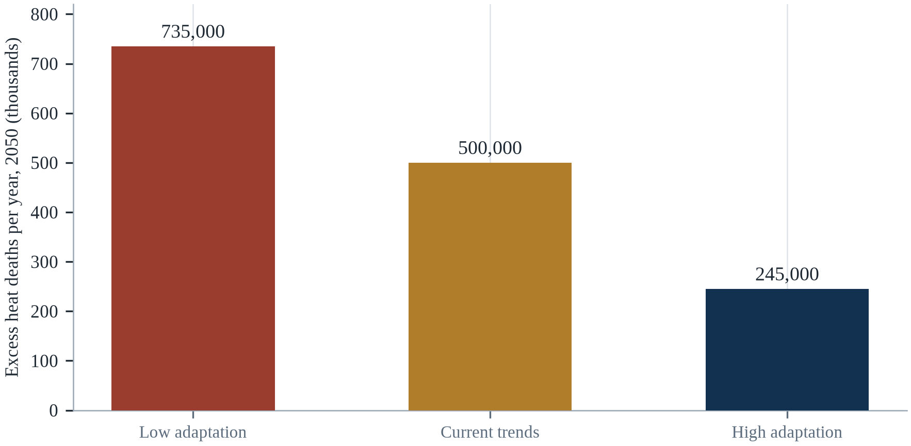||Source: Table 17.1.

The middle column needs a word of explanation. 'Current trends' is not a forecast of the most likely future; it is the trajectory that follows from continuing the policies already legislated, the adaptation spending already committed and the investment in health systems already budgeted, with the emissions pathway held at the mid-case. It is the column a government gets if it changes nothing, and it is the benchmark against which the other two should be read. 

Two points deserve emphasis. First, health is where climate change is most directly experienced, and it is therefore where adaptation has the clearest returns. Second, the distribution of health risk follows existing inequalities, so the countries and communities with the least capacity face the greatest burden.

A rapid expansion of primary care and community health workers would improve resilience even without new infrastructure. Heat action plans that reach isolated elderly people could cut mortality substantially at low cost. And a shift in finance toward health adaptation could close the gap between need and provision. The most important variable remains the pace of emission reduction, because it determines how much adaptation the health system will have to deliver, and how many people will need care that cannot be provided.

---

# Chapter 18: Social Capital, Mutual Aid and Governance

*Theme: social networks, public institutions and the politics of protection*

In the early hours of 15 July 2021, heavy rain fell on the Ahr valley in western Germany. Between 100 and 200 millimetres fell in less than 24 hours on ground that was already wet, and the small river rose within hours from a quiet stream to a torrent. In the district of Ahrweiler, 134 people died; across Germany and Belgium, more than 180 died, and damage reached tens of billions of euros (Kreienkamp et al., 2021).

The warning chain had partially worked. The German meteorological service issued warnings, some local authorities evacuated, and some residents left. But in many places the warnings did not translate into action. People did not believe the river could rise that fast; some local officials did not order evacuation; and Germany had no nationwide system for sending alerts directly to mobile phones, a gap that was closed only later.

The Ahr valley flood is a case about governance rather than meteorology. The rainfall was extreme but not unimaginable; models had warned that such events were becoming more likely. What failed was the chain that connects a forecast to a decision, a decision to a warning, and a warning to a household that acts. Every link in that chain is an institution, and institutions can be designed well or badly.

This chapter examines the social and political infrastructure of survival: the networks that help neighbours, the institutions that issue warnings and organise response, and the governance arrangements that determine whether protection reaches the people who need it. It argues that social capital and public institutions are not alternatives but complements, and that the quality of governance is one of the strongest predictors of how many people die when hazard strikes (Aldrich & Meyer, 2015).

Disaster response is usually imagined as a command structure, and in practice it is a network. The people who pull neighbours from rubble, share generators, open kitchens and circulate warnings are not following an incident command chart; they are acting on relationships that existed before the event. Social capital is the least expensive resilience asset and the hardest to purchase, because it is produced by ordinary association over years and destroyed quickly by displacement, fear and inequality.

## 18.1 Social Capital as a Survival Resource

Social capital refers to the networks, norms and trust that enable people to act together. It is not a metaphor: it can be measured, and it predicts outcomes. Sociologists distinguish bonding capital, which links people who are similar and close, bridging capital, which links people across different groups, and linking capital, which connects citizens to institutions with power. Each plays a different role in a disaster.

Bonding capital provides immediate help: the neighbour who checks on an elderly resident, the family that shares water, the congregation that opens its hall. Bridging capital provides access to resources outside the immediate circle: the community group that knows how to apply for aid, the network that can mobilise volunteers (Cutter et al., 2008). Linking capital determines whether a community can influence the institutions that decide where the levee is built and who receives compensation (Berkes & Ross, 2013).

Daniel Aldrich, in a series of studies of disaster recovery in Japan, India and the United States, found that social capital predicted recovery better than income, damage or government spending. Communities with dense networks recovered faster because they could share information, allocate resources and hold institutions accountable. The finding is important because it suggests that resilience is not only bought with money; it is also built through relationships.

The concept has a long and contested history. Pierre Bourdieu treated social capital as a resource that individuals mobilise to reproduce advantage; Robert Putnam treated it as a property of communities, measured by participation in associations and trust in neighbours. The distinction between bonding capital, which links people who are alike, bridging capital, which links people across difference, and linking capital, which connects communities to institutions, is the most useful part of the framework for disaster work. Bonding capital gets people through the first night; bridging capital gets them access to resources outside their own group; linking capital determines whether aid actually arrives.

Social capital can be a liability as well as an asset, and the literature is honest about it. Dense bonding networks can enforce exclusion, silence complaints and protect powerful members; communities with strong internal ties sometimes resist outside help because accepting it threatens the local hierarchy. Research on post-disaster recovery has found that homogeneous, tightly bonded communities may recover quickly but also reproduce existing inequalities, while communities with bridging ties to outside institutions access resources faster. The policy implication is that the goal is not more social capital in general but the right mix of bonding, bridging and linking ties.

Social capital is the least measurable and most reliable resource in a disaster, and the reason is that it does work that money cannot buy at the moment it is needed. It consists of the ties between people: who knows whom, who trusts whom, who owes whom a favour, and who will answer a phone at three in the morning. In an emergency, these ties perform functions that no agency can perform at speed: they identify the person who is missing, they share the generator, they carry the neighbour down the stairs, and they know which house has an older resident who has not come out. The evidence is consistent across countries and hazards: the density of social networks predicts survival and recovery better than income does, and the effect is largest among the poorest.

Social capital is the resource that a community holds in its relationships, and the distinction that matters for disasters is between the three kinds. Bonding capital is the trust within a group of people who know each other well, and it is what makes a neighbour knock on a door. Bridging capital is the trust between groups that are different, and it is what allows a neighbourhood to work with a mosque, a church and a sports club. Linking capital is the trust between a community and the institutions that hold the resources, and it is what determines whether the help that exists actually arrives. The first saves lives in the first hours; the third determines the recovery.

## 18.2 The Evidence: Neighbourhoods and Survival

The classic study of social capital and heat is Eric Klinenberg's analysis of the 1995 Chicago heatwave, which killed more than 700 people in a week (Klinenberg, 2002). Klinenberg compared two neighbourhoods with similar demographics and found that death rates differed sharply. In the mostly Latino Little Village, dense social networks, active street life and functioning institutions protected residents; in North Lawndale, depopulation, abandoned buildings and fear kept people isolated and indoors.

The mechanism was social, not physiological. Elderly people in Little Village were visited, were known to their neighbours, and went outside; elderly people in North Lawndale were afraid to open their doors and had no one to check on them. Air conditioning and income mattered, but they did not explain the gap. What explained it was whether people were connected to others who would notice their absence.

Similar findings appear in studies of floods, hurricanes and wildfires. Social isolation is consistently associated with higher mortality, and neighbourhood cohesion with lower mortality. The implication for policy is that programmes which build connection — community centres, neighbourhood associations, volunteer networks, outreach to isolated residents — are forms of disaster preparedness, even when they are not framed that way.

The empirical case is strongest where it is most surprising. Daniel Aldrich's study of the 1995 Kobe earthquake found that the strength of neighbourhood social ties predicted recovery as powerfully as the physical damage to housing, and his later work across Japan, India and the United States reproduced the finding: communities with denser networks recover faster, independent of income and government spending. The mechanism is not mysterious. Neighbours share information, lend tools, watch children, and advocate for each other with agencies, and each of those acts substitutes for a formal service that is overwhelmed.

The mechanism behind the neighbourhood effect is collective efficacy rather than friendliness. Sampson and colleagues defined collective efficacy as the combination of social cohesion and the willingness of residents to intervene for the common good, and research on disaster recovery has found that it predicts how quickly a neighbourhood organises, how much informal help is exchanged, and whether residents trust official information. The quality is not evenly distributed, and it is not produced by prosperity alone: some poor neighbourhoods with dense networks outperform richer ones with weak ties. Measuring it requires surveys, which is why it is rarely included in vulnerability assessments.

The study of neighbourhoods and survival began with a comparison that has never been fully explained away. In the Chicago heatwave of 1995, two adjacent communities with similar demographics and similar exposure produced very different death tolls, and the difference tracked the social life of the street: how many people sat on their porches, how many shops were open, how well the residents knew the older people who lived alone (Klinenberg, 2002). The finding has been replicated in floods, earthquakes and wildfires, and it survives controls for income and housing. The mechanism is not mysterious: connection produces information (someone notices you are missing), assistance (someone can drive you) and obligation (someone will check).

The evidence that neighbourhoods determine survival is strongest in the heat waves, and it has been replicated across cities. The Chicago study that compared two adjacent communities with similar demographics found that the one with stronger social networks, more public space and more active civic organisations lost far fewer people, and the difference was not explained by income or by the physical environment. Later work has found similar patterns in Japan after the tsunami and in the United States after hurricanes. The measurement of social capital is imperfect, which is why the finding is sometimes dismissed, and the consistency of the results across methods is why it should not be.

## 18.3 Mutual Aid and Volunteer Response

When formal systems are overwhelmed, people organise. After Hurricane Katrina, the Cajun Navy — a loose network of volunteers with boats — rescued thousands of people from flooded neighbourhoods. After Hurricane Sandy, Occupy Sandy organised volunteers to deliver supplies to areas that official relief had not reached. After the 2017 Mexico City earthquake, civilian brigades known as topos dug survivors out of rubble before professional teams arrived.

Mutual aid is most effective when it is connected to formal systems rather than replacing them. Volunteers know local conditions and can move faster, but they lack equipment, training and coordination capacity. The best outcomes occur when formal agencies create spaces for volunteers, provide information and logistics, and avoid treating them as a threat to command and control.

The Kerala floods of 2018 illustrate the point. The state government mobilised fishing communities, whose boats and knowledge of local waters were essential for rescuing people from flooded areas. The collaboration worked because the government recognised the fishers as partners and provided fuel, coordination and information. It was not spontaneous harmony; it was organised cooperation.

Mutual aid is the practice that turns social capital into material help, and it is usually more effective than it is credited. During the 2018 Kerala floods, fishing communities used their boats to rescue thousands of people before official teams could reach them; during the 2011 Tōhoku disaster, volunteers and local organisations distributed food faster than the municipal system; after Hurricane Sandy, the Occupy movement's relief network outperformed several agencies in the first week. The problems are also real: volunteers converge on the wrong places, duplicate effort, and lack insurance and coordination, which is why the best practice is to fund and integrate existing groups rather than to formalise them into the response.

The literature on volunteer convergence is blunt about the problem and optimistic about the solution. After almost every major disaster, self-deployed volunteers arrive in numbers that exceed the capacity of the affected area to absorb them, and they consume fuel, food and road space that the response needs. The agencies that manage this well do so by establishing convergence points, registering volunteers, and giving them tasks that are useful rather than turning them away. The alternative — a cordon that keeps everyone out — is politically impossible and practically counterproductive, because local people will help regardless.

Mutual aid is what people do for each other when the official response has not arrived, and it is the reason the first hours of a disaster are not usually a scene of panic. Neighbours clear debris, share food, ferry people to hospital in private cars, and set up informal shelters in churches and schools. The phenomenon is old, and the digital version is new: messaging groups and social media have made it possible to organise at a scale that was previously impossible, and to coordinate with strangers. The risk is that informal aid reproduces the inequalities it is trying to address, because the people with the most connections receive the most help, which is why formal agencies need to reach the people who have no one.

Mutual aid is what people do before the agencies arrive, and it is the most effective form of response in the first hours. Neighbours dig through rubble, share water, and carry the elderly down the stairs, and they do it without a mandate, a uniform or a budget. The problem is not the willingness but the coordination: volunteers converge on the site, block the roads that the ambulances need, and duplicate the work. The arrangements that work give the emergent groups a role, a radio frequency and a point of contact, which is the opposite of the instinct to keep the site clear of civilians.

## 18.4 The Warning Chain and the Last Mile

A warning is a chain of translations: from observation to forecast, from forecast to decision, from decision to message, from message to household, and from household to action. Each link can fail, and the failure is usually invisible until the event. The Ahr valley flood failed at several links: forecasts were available but not understood, decisions were delayed, and messages did not reach everyone.

The last mile is the hardest. Even when a warning is issued, it may not reach people who are asleep, who do not speak the language, who have no phone, or who distrust the messenger. Effective systems use multiple channels — sirens, cell broadcast, radio, social media, door-to-door — and repeat the message in plain language with specific instructions. A warning that says a river will flood is less useful than one that says leave this street now and go to this location.

Trust determines whether the message is believed. Communities that have experienced accurate warnings in the past are more likely to respond to the next one; communities that have been ignored or misled are less likely. Building trust requires consistency, transparency about uncertainty, and visible follow-through. It is slow to build and fast to lose, which is why it belongs in the same category as physical infrastructure.

The warning chain is only as strong as its last link, and the last link is a human being deciding to move. The 2004 Indian Ocean tsunami killed roughly 230,000 people because no warning system existed, but the 2018 Sulawesi earthquake and tsunami killed thousands in a country that had one, because the warning did not reach the right people in time and the sirens had been damaged (CRED, 2023). Studies of evacuation behaviour find that people act on a warning when it is confirmed by someone they trust, when they know where to go, and when the route is usable — three conditions that are social and physical, not merely technical.

The last mile of a warning is a social process, and the failures are consistent across countries. After Typhoon Haiyan in 2013, many people did not evacuate because they understood the storm surge risk poorly and because the warning language was unfamiliar; after the 2023 earthquake in Morocco, the warning that mattered was the first tremor, and the deaths were concentrated in villages that had never been mapped. Cell broadcast, which sends a message to every phone in a geographic area, has improved reach where it has been implemented, but reach is not the same as comprehension. The message has to say what to do, where to go and by when.

The warning chain has a weakest link, and it is almost always the last mile. A forecast is produced by a meteorological service, translated into a warning by a disaster agency, transmitted by telecoms and media, and received by a household that must decide what to do. Each step introduces a delay and a translation, and the final decision is made by someone who may not trust the messenger, may not understand the language, may not be able to leave, or may have received the message after the water had already risen. The countries that have reduced deaths most have invested in that last mile: volunteers with megaphones, sirens, mosque loudspeakers, mobile alerts that do not require a smartphone, and drills that rehearse the decision.

The warning chain is a sequence of handoffs, and every handoff is a place where the message can be lost. The forecaster produces a probability, the agency converts it into a warning, the broadcaster transmits it, the local authority decides whether to order an evacuation, the household decides whether to comply. Each step involves a translation and a judgement, and the failure at any one of them nullifies the work of the others. The last mile is the final step, and it is where the least money is spent: a message that arrives on a phone that is switched off, in a language that the recipient does not read, without a clear instruction, is not a warning.

## 18.5 Institutions, Trust and Risk Governance

The quality of government is one of the strongest determinants of disaster outcomes. Countries with effective bureaucracies, well-funded emergency services and honest procurement suffer fewer deaths and recover faster than countries with the same hazard exposure and weaker institutions. The contrast between the 2010 earthquakes in Haiti and Chile is often cited: Haiti's magnitude 7.0 earthquake killed more than 200,000 people, while Chile's magnitude 8.8 earthquake three weeks later killed about 500, largely because of building standards, preparedness and response capacity (CRED, 2023).

Trust matters because compliance depends on it. People who trust official warnings are more likely to evacuate, to accept restrictions and to cooperate with relief. Trust is built through competence, honesty and fairness, and it is damaged by failures, contradictions and perceived favouritism. The pandemic illustrated how quickly trust can erode when messaging is inconsistent, and how costly that erosion is.

Risk governance requires coordination across levels and sectors. A heat plan involves health, meteorology, social services, utilities and civil society; a flood plan involves water management, land use, emergency services and infrastructure. The failure mode is fragmentation, where each agency optimises its own mandate and no one is accountable for the whole. Effective governance assigns clear responsibility, provides resources, and requires coordination.

Trust is the variable that determines whether a warning becomes an action. Survey research on risk governance consistently finds that trust in authorities predicts protective behaviour more strongly than the accuracy of the information, and that a single perceived betrayal can undo years of credible communication. The mechanism cuts both ways: populations that trust their institutions comply even with imperfect advice, and populations that do not comply even when the advice is correct. Rebuilding trust after a failure — a missed warning, a delayed evacuation, a relief fund that did not arrive — is slow work that begins with admitting the failure.

Gotong royong, the Indonesian practice of mutual assistance, is the cultural form that social capital takes in the archipelago, and its modern history shows both its strength and its limits. The practice mobilised communities after the 2004 tsunami and the 2006 Yogyakarta earthquake, and it is formally recognised in disaster law as a principle of response. It also depends on reciprocity and on a shared sense of obligation, which means it weakens where communities are divided by religion, ethnicity or land disputes, and it can be captured by local elites. The policy implication is to support the practice without assuming that it will appear automatically.

Institutions, trust and risk governance determine whether a warning becomes an action and whether a recovery becomes a rebuild. Trust is built slowly through ordinary competence — the rubbish collected, the bus on time, the clinic staffed — and it is spent quickly when a warning is false or a compensation is late. A government that is trusted can ask people to evacuate, to insure, to accept a building code; one that is not will find its instructions ignored. The paradox of risk governance is that the most important decisions are made when nothing is happening, by officials whose incentives favour visible projects over invisible preparedness, which is why the institutions that perform well are usually those with a legal mandate and a protected budget.

Trust is the resource that determines whether a warning is believed and whether an evacuation is complied with, and it is built over years and destroyed in hours. The communities that respond best are the ones that have seen the agency deliver on an ordinary day: a clinic that was open, a road that was repaired, a promise that was kept. The distrust that follows a mismanaged response persists into the next event, and it is rational, because the household that was let down has learned something true. Rebuilding trust is slower than building a levee and it is the only defence against the rumour that competes with the official message.

## 18.6 Decentralisation and Local Capacity

Much of the work of disaster response happens at the local level, where knowledge of terrain, population and relationships is greatest. Decentralisation can improve responsiveness, but only if local governments have the resources, skills and accountability to act. In many countries, decentralisation has transferred responsibilities without transferring revenue, leaving municipalities with mandates they cannot fund.

Indonesia's village law, which gave villages substantial budgets and authority, is one example of an attempt to build local capacity. India's panchayat system and the Philippines' barangay structure serve similar functions. Where local institutions are well functioning, they can organise evacuation, maintain drainage and manage relief; where they are captured by elites or starved of funds, they can exclude the people who most need help.

The design question is how to build local capacity without creating local capture. That requires transparent budgets, participatory planning, external audit and support from higher levels of government. It also requires time, because institutions develop through practice. A decentralisation that begins five years before a disaster is unlikely to produce capable institutions by the time it arrives.

Decentralisation moves decisions closer to the people who bear the consequences, and it also moves the capacity problem closer to them. Indonesia's village fund, which allocates roughly a billion rupiah to each village annually, gave communities a budget for drainage, roads and preparedness that had previously existed only on paper, and it produced wide variation in how well the money was used. The lesson is not that decentralisation fails but that it requires the unglamorous accompaniments: local technical advice, transparent budgeting, and a way to audit spending that does not depend on a distant ministry.

Decentralisation succeeds where local governments have revenue, staff and authority, and it fails where they have only the first. The Philippines' barangay system gives communities a legal role in disaster risk reduction and a share of local government resources, and the results depend heavily on the capacity of the barangay captain. Nepal's federalisation after 2015 created new municipal governments with disaster mandates and limited technical staff, and the gap was filled by NGOs and consultants. The design lesson is that authority without capacity produces paperwork, and capacity without authority produces frustration.

Decentralisation is the reform that every disaster review recommends and few governments complete. Local governments are closest to the hazard, know the streets and the people, and can act before the capital has processed the news; but they often lack the revenue, the technical capacity and the authority to act. The result is a formal system in which the national government owns the mandate and the local government owns the problem. The reforms that work transfer money with the responsibility, build technical capacity rather than assuming it, and give local officials the legal protection to make decisions quickly. Without those three, decentralisation becomes a transfer of blame rather than a transfer of power.

Decentralisation is the structural reform that most countries have adopted and few have funded. The argument for it is that local government knows the hazard, the households and the routes, and that a decision made in the capital is slower and less informed. The argument against it is that the capacity to use the authority is unevenly distributed, so that a city can manage a flood and the district next door cannot. The resolution is not to recentralise but to build the capacity: a transfer of money with a transfer of function, a training programme, and a technical service that the small municipality can call on.

## 18.7 Corruption, Capture and Reconstruction

Disasters create large flows of money, and large flows of money create opportunities for corruption. Reconstruction contracts, relief distribution and land deals are all vulnerable. In some cases, the result is that aid does not reach survivors; in others, it reaches them in inferior form, with buildings that fail in the next event.

Elite capture is a subtler problem. Relief and reconstruction can reinforce existing inequalities if the people who control distribution also control access to information, land and credit. Post-disaster land grabs have been documented in several countries, particularly where tenure was informal before the event. Women, renters and informal residents are often the most exposed to these dynamics.

The antidote is transparency. Publishing beneficiary lists, contract awards and spending data allows communities and journalists to hold institutions accountable. Independent audits, community monitoring and grievance mechanisms can catch problems early. None of these is sufficient alone, but together they make corruption more difficult and more visible, which is often enough to change behaviour.

Disaster reconstruction is one of the most corruption-prone activities a state undertakes, because it combines large budgets, emergency procurement, weak oversight and a population that cannot wait. Studies of post-disaster reconstruction have documented leakage rates of a fifth or more in some programmes, and the losses are not only financial: a school built with substandard concrete is a future casualty. After the 2004 tsunami, the Aceh reconstruction effort, one of the largest ever mounted, exposed both the scale of the risk and the value of independent monitoring, public beneficiary lists and community audits in reducing it.

Reconstruction corruption has a characteristic anatomy that can be anticipated. It concentrates in procurement, in the certification of completed works, and in the selection of beneficiary lists, and it is facilitated by urgency and by the absence of independent oversight. After the 2010 Haiti earthquake, audits found that a large share of the aid money was spent on contractors and overheads rather than on durable reconstruction, and the lesson was not that aid is inherently corrupt but that verification was optional. The measures that reduce leakage are known: published contracts, community monitoring, independent engineering inspection and payment on verified completion.

Corruption and capture are the mechanisms by which reconstruction money fails to become reconstruction. The forms are familiar: contracts awarded to connected firms, materials substituted for cheaper ones, lists of beneficiaries padded with names that do not exist, and land titles issued to the well connected in the weeks after a disaster. The consequence is not only the loss of money but the loss of trust, which reduces compliance with the next evacuation order. The countermeasures that have worked are unglamorous: public beneficiary lists, independent audits, community monitoring, and payment by mobile money that creates a record. Transparency is cheaper than investigation and prevents more than prosecution.

Reconstruction is the phase in which corruption does the most damage, because the money is large, the oversight is weak and the urgency is real. Contracts are awarded without competition, the materials are not inspected, and the houses that are rebuilt are the ones that will fail in the next event. The counter-measures are known: a public register of contracts, a community monitor with access to the site, an independent audit that reports to the legislature rather than to the ministry, and a complaints channel that works. The most effective single measure is the publication of the beneficiary list, because it makes the political allocation visible.

## 18.8 Disaster Risk Finance and Accountability

Money is decisive in the aftermath of a disaster, and the speed with which it arrives determines whether households recover or fall into debt. Traditional financing relies on post-disaster appeals, which are slow and uncertain. Pre-arranged finance — contingent credit, insurance, catastrophe bonds, regional risk pools — can disburse quickly and predictably.

The Caribbean Catastrophe Risk Insurance Facility, established in 2007, is an example of a regional pool that pays out quickly after a qualifying event. African Risk Capacity and the Pacific Catastrophe Risk Assessment and Financing Initiative serve similar functions. These instruments are not a substitute for national investment in resilience, but they reduce the fiscal shock of a disaster and allow governments to respond without diverting budgets from development.

Accountability is the other side of finance. Governments that receive adaptation and relief funds should be required to report how they were spent, and parliaments, audit institutions and civil society should have the capacity to scrutinise. Without accountability, finance can be absorbed without reducing risk, which is one reason why the correlation between aid received and resilience achieved is weaker than it should be.

Disaster risk finance is the attempt to move the cost of catastrophe from the aftermath to a predictable instrument. Sovereign risk pools, such as the Caribbean Catastrophe Risk Insurance Facility and the African Risk Capacity, sell parametric cover that pays out when a measured trigger is met — wind speed, rainfall, earthquake magnitude — rather than after loss assessment. The advantage is speed; the drawback is basis risk, because the trigger may not match the damage, leaving a government with a payout that does not cover its needs or no payout despite severe losses. Insurance complements reserves and social protection; it does not replace them.

Parametric insurance solves a cash-flow problem and creates a new one. Mexico's catastrophe bond, issued in 2006, was among the first sovereign instruments to pay out against a measured trigger, and the Caribbean facility has made payouts within weeks of hurricanes, which is precisely what a government needs to buy water and fuel before donors arrive. The new problem is that the payout is triggered by the hazard, not by the loss, so a country can receive money it does not need or none when it needs it. Governments that use these instruments well hold them alongside reserves and contingency funds rather than instead of them.

Disaster risk finance is the mechanism that determines whether a government can respond before it has to borrow. A country with pre-arranged contingent credit, a sovereign risk pool and a social protection system that can scale up can deliver cash within days; a country without them waits for an appeal, a pledge and a disbursement, and the delay is measured in lives and in assets sold. The instruments have improved: regional risk pools in the Caribbean and Africa, parametric insurance that pays on a trigger, and anticipatory action that releases money when a forecast crosses a threshold. The gap is that the countries most exposed have the least access, because their markets are thin and their credit is weak.

Disaster risk finance is only accountable if the money can be tracked from the pledge to the household. The gap between the two is the space in which funds are diverted, delayed or absorbed by intermediaries, and the audit that would close it is rarely funded. The instruments that improve the record are a single treasury account for the response, a published disbursement schedule, and a post-event audit that is completed within a year rather than a decade. The value is not only the money that is recovered; it is the expectation that the next response will be watched.

## 18.9 Regional and International Cooperation

Climate hazards do not respect borders. Storms cross coastlines, rivers flow across countries, and displacement spills over frontiers. Regional cooperation can improve early warning, share resources and coordinate response. The ASEAN Coordinating Centre for Humanitarian Assistance on Disaster Management (AHA Centre) is an example: it maintains stockpiles, coordinates regional response and supports member states during emergencies.

International cooperation is most effective when it supports local institutions rather than substituting for them. Externally managed responses often arrive late, cost more, and leave little capacity behind. The Grand Bargain, a set of commitments to improve humanitarian financing, emphasises localisation for this reason, though progress has been slow.

Climate finance is also a form of governance. The commitment by wealthy countries to provide US$100 billion a year in climate finance has been met late and unevenly, and the adaptation share remains far below what vulnerable countries need (OECD, 2023). The gap is not only a matter of money; it is a matter of trust, because countries that promised and did not deliver have less credibility when they ask for cooperation on emissions.

Regional cooperation matters because hazards do not respect borders and because small states cannot carry the cost alone. The ASEAN Agreement on Disaster Management and Emergency Response established a framework for joint response and a standby arrangement for relief supplies, though its activation has been limited by the association's principle of non-interference. The Sendai Framework, adopted in 2015, shifted global attention from disaster response to risk reduction and set targets for mortality, affected population and economic loss, but its indicators depend on national reporting that is uneven in quality and coverage (UNDRR, 2015).

International cooperation in disaster response is more developed than in climate adaptation, and the difference is instructive. The International Search and Rescue Advisory Group coordinates urban search and rescue teams across borders within hours, and the United Nations Disaster Assessment and Coordination system deploys experts within a day. Climate adaptation has no equivalent standing capacity, because it is a long-term investment rather than an emergency, and because it touches sovereignty over land, water and finance. The result is that the world can respond to a disaster faster than it can prevent one.

Regional and international cooperation is the layer that handles the hazards that cross borders: a cyclone that hits three countries, a river that flows through five, a drought that covers a region. The mechanisms are treaties, regional bodies, and the humanitarian system, and their performance is uneven. The most effective arrangements are technical and specific: shared river forecasting, joint early warning, pre-positioned stock, and agreements that allow teams and equipment to cross a border quickly. The least effective are the grand declarations that produce no operational change, which is why the practitioners judge cooperation by the speed of a delivery rather than by the ambition of a communiqué.

Regional cooperation is the layer that makes a national response possible when the event exceeds the national capacity. The ASEAN Coordinating Centre for Humanitarian Assistance keeps stockpiles and has moved relief into a member state within days; the European civil protection mechanism pools equipment and teams; the Pacific arrangement allows a neighbour to send a plane before the paperwork is complete. The value of these arrangements is measured in the hours they save, and the obstacle is the sovereignty that states are reluctant to pool. The agreements that work are the ones that are rehearsed, because a mechanism that is invoked for the first time in a crisis is a mechanism that will fail.

## 18.10 Polycentric Governance and Learning

No single institution can manage climate risk. The most effective systems are polycentric: many centres of decision-making, connected by rules and information, each able to act within its domain. Elinor Ostrom's work on governing the commons showed that communities can manage shared resources effectively when they have clear boundaries, rules that fit local conditions, and mechanisms for collective choice.

Polycentric systems are resilient because they do not depend on a single point of failure. If a national agency is slow, a city can act; if a city is captured, a community group can organise. But polycentricity is not anarchy: it requires coordination, shared information and accountability. The challenge is to design systems that allow local initiative while ensuring that the most vulnerable are not left out.

Learning is the final requirement. Institutions that treat each disaster as a lesson, investigate what happened, and change their procedures are more resilient than those that do not. The inquiry into the Ahr valley flood led to the introduction of cell broadcast warnings in Germany; the inquiry into Hurricane Katrina led to reforms in emergency management. Learning requires the political willingness to accept criticism, which is often in short supply when blame is at stake.

The idea that best describes how resilience actually works is polycentric governance, developed by Elinor Ostrom: many centres of decision-making, formally independent, that adjust through mutual learning rather than through a single hierarchy. Polycentric systems are messier than command systems and more adaptable, because failure in one node does not propagate to all. The design implication is not to abolish central authority but to ensure that households, neighbourhoods, municipalities, provinces and national agencies each have real capacity and clear boundaries, and that information flows between them in both directions.

Adaptive governance is the term that describes how polycentric systems learn, and its central finding is that learning happens through bridging organisations (Folke et al., 2010). Folke and colleagues described these as entities that connect local experience to higher levels of decision-making, and in disaster settings they are often NGOs, university centres or professional associations. The bridges matter because local knowledge does not travel upward on its own, and national policy does not travel downward without translation. Where the bridges are missing, the same mistakes are repeated in each municipality, and evaluation never accumulates beyond the local report.

Polycentric governance is the academic name for a system in which many centres of decision-making coexist and coordinate without a single authority. It sounds like a description of chaos and it is often the opposite, because redundancy is a form of resilience: a city with a strong mayor, active neighbourhood associations, a functioning utility and an engaged private sector can respond even if one of them fails. The condition for it to work is that the centres share information and accept a common standard, which is why the most successful examples are built around a technical protocol — a flood warning, a building code, a data standard — rather than around a political hierarchy. Learning is the output that matters: a system that reviews its failures and changes its practice is worth more than one that is perfectly organised and never learns.

Polycentric governance is the idea that a system of many overlapping centres of decision can be more adaptive than a single hierarchy, and the evidence from disaster management supports it with a caveat. Multiple centres can experiment, learn at different rates and respond locally, which is why the cities that manage risk best are usually the ones with active neighbourhoods, firms, utilities and NGOs as well as a competent municipality. The caveat is that polycentric systems need a framework that assigns responsibilities and shares information, because without it the many centres duplicate, conflict and leave gaps. The framework is the state, and the state is also one of the centres.

For a reader who wants to use the idea rather than admire it, the practical step is to draw the map of the centres that actually decide what happens in one neighbourhood. The map usually contains more centres than expected and fewer than the org chart suggests: the municipal drainage department, the utility that owns the substation, the school that will be used as a shelter, the clinic that keeps the register of patients on oxygen, the mosque or church that will open its hall, the trader association that controls the access road, and the volunteer group that has the boat. Each of them has a reason to act and a constraint that stops it, and the exercise is to find the one link that no single centre can supply on its own. In most neighbourhoods that link turns out to be information — who needs help, where the water rises, when the power fails — and the institution that can supply it is almost never the one with the budget.

## 18.11 Case Study: The Ahr Valley Flood, Germany 2021

On 14 and 15 July 2021, a slow-moving low-pressure system produced extreme rainfall over western Germany, Belgium and the Netherlands. In the Ahr valley, up to 200 millimetres fell in less than 24 hours, and the river rose within hours. The flood destroyed houses, roads and bridges, cut power and communications, and killed 134 people in the Ahrweiler district alone; across Germany and Belgium the death toll exceeded 180, and damage was estimated at more than €30 billion (Kreienkamp et al., 2021).

The meteorological service had issued warnings, and some local authorities acted. But many people did not evacuate, partly because they did not believe the river could rise so fast, partly because the warnings were not specific enough, and partly because no mechanism existed to push an alert directly to every phone in the affected area. Germany introduced cell broadcast warnings only in 2023, after the event.

The failure was distributed across the chain. Forecasts were available but not translated into clear local instructions; some officials delayed evacuation because they feared false alarms; and communication systems failed when infrastructure was destroyed. The result was a disaster that was worse than the rainfall alone would explain, which is the definition of a governance failure in disaster risk.

The response after the event was substantial. Investigations were commissioned, responsibilities were clarified, and warning systems were improved. The flood became a reference point for German disaster policy, and it changed public expectations about warning and preparedness. The lesson was not that Germany lacked capacity; it was that capacity must be organised into a chain that reaches the last household.

For other countries, the lessons are specific. Warnings must be specific and actionable, not merely meteorological. Multiple channels must be used, including ones that do not depend on electricity or internet. Local officials need clear authority and training to order evacuation. And the public must be educated about what warnings mean, so that a warning is not dismissed as routine. Each of these is a governance task, not a technological one.

The clearest demonstration of social capital in modern disaster is the comparison between Hurricane Katrina in 2005 and the response to the 2016 flooding in Louisiana. In both events the formal system was overwhelmed, but in Louisiana the 'Cajun Navy' — a loose flotilla of private boat owners coordinated through social media — rescued thousands of people in the first days. The group was not a replacement for public services, and its unregulated presence created coordination problems. It was, however, an expression of the same finding that runs through this chapter: the capacity to respond is distributed through a population long before it is organised into an agency.

The Ahr valley flood is the case that separates a forecast from a warning, and a warning from an action. The meteorological service did its part: the models showed the rainfall a day in advance and the alerts were issued. What failed was the translation of a regional alert into a local decision, in valleys where the water rises within hours and where a general message about heavy rain does not tell a household whether to leave. The inquiries that followed concentrated on three questions that recur in almost every failure of this kind: whether the warning named the places that would flood, whether it reached people who were asleep or at work, and whether any single official had the authority to order an evacuation without waiting for a higher level of government.

The Ahr valley has an American counterpart that makes the governance point sharper. Hurricane Harvey stalled over Houston in August 2017 and dropped more than a thousand millimetres of rain in a week; the forecast was accurate days in advance, the warnings were issued, and the damage still came to about a hundred and twenty-five billion dollars, because the city had permitted development on the floodplain for decades (UNDRR, 2022). Germany and Texas differ in almost every institutional respect and agree on one thing: the information arrived and the land use did not change. Governance in the next two decades will be judged less on forecasting than on what is allowed to be built where.

## 18.12 Future Scenarios and Predictions: Governance in 2050

Disasters do not create governance; they reveal it. Countries with strong institutions have reduced deaths from comparable hazards over the past century, while countries with weak institutions have not. The trend is not automatic: it depends on investment, accountability and learning.

The baseline is a deficit of trust. Trust in government has declined in many democracies, while the demands on government have increased. Local governments, which do most of the operational work, are often underfunded. International climate finance has fallen short of commitments, and adaptation finance reaches a small fraction of what is needed. Meanwhile, the hazards are becoming more severe and more frequent.

Governance outcomes will track institutional quality, finance and international cooperation. A world that invests in local capacity, transparency and regional cooperation can manage rising risk; a world that responds late will see disasters become political crises. The table summarises the range.

The governance of 2050 will be judged by whether it can make a decision quickly in a system that has many centres and no single authority (UNDRR, 2015). The scenarios differ mainly in trust and in capacity: a society in which people believe the warning, the compensation and the building code can adapt at a fraction of the cost of one in which they do not. The figures to monitor are the ones that are hard to fake: the share of local governments with a funded disaster budget, the time between a forecast and a public warning, the proportion of reconstruction contracts that are published, and the level of trust in public institutions measured by ordinary surveys.

[[TABLE:Table 18.1 Governance indicators, 2050]]
| Institution | Core function | Common failure | Reform | Indicator |
|---|---|---|---|---|
| Local government | Evacuation; shelters | Underfunded; unclear authority | Devolved finance; training | Response time |
| Warning systems | Forecast to household | Last-mile gap | Multi-channel; cell broadcast | Reach and compliance |
| Emergency services | Rescue; coordination | Fragmentation | Joint command; exercises | Coverage |
| Social protection | Cash; food; shelter | Exclusion errors | Registries; portable benefits | Coverage of poor |
| Anti-corruption | Procurement integrity | Elite capture | Open contracts; audits | Audit findings |
| Regional bodies | Shared stockpiles | Slow coordination | Pre-agreed protocols | Response time |

The analysis points to two conclusions. First, governance is a determinant of survival, not a background condition; the difference between a well-organised response and a disorganised one is measured in lives. Second, the reforms that matter most are unglamorous: clear authority, adequate local finance, transparent procurement, and practised procedures.

A sustained investment in local government capacity would improve response even without new technology. Universal social protection would reduce the exclusion that leaves the poorest without help. And stronger regional cooperation could compensate for weak national capacity in small states. The most important variable remains the pace of climate change, which determines how often institutions will be tested, and whether they have time to learn between tests.

---

# Chapter 19: Renewable Energy and Appropriate Technologies

*Theme: decentralised power, storage and the economics of clean energy*

In the chars of northern Bangladesh — islands of silt that appear and disappear with the rivers — grid electricity arrived late, if at all. Households relied on kerosene lamps for light, which produced poor illumination, indoor smoke and a recurring expense that consumed a significant share of household income. Children studied under flickering light; shops closed at dusk; and clinics could not refrigerate vaccines.

Beginning in the late 1990s, a programme run by the Infrastructure Development Company Limited and supported by the World Bank and other donors began financing solar home systems through microcredit (World Bank, 2021). Households paid a small down payment and instalments over two to three years. By the early 2020s, more than four million systems had been installed, reaching an estimated twenty million people, and Bangladesh had one of the largest off-grid solar programmes in the world (IRENA, 2023).

The results showed up in household budgets. Kerosene use fell; children gained study hours; shops extended opening; and households reported better air quality and fewer burns. The systems were small — typically 50 to 100 watts — and they did not power industry. But they demonstrated something important: a modular technology, financed appropriately, could deliver a basic service to people whom the grid had not reached and would not reach for years.

This chapter examines renewable energy and appropriate technologies as instruments of resilience. It covers solar and wind, storage and grid flexibility, mini-grids and off-grid systems, clean cooking, efficiency, and the supply chains and politics that determine whether these technologies spread fast enough. The argument is not that technology alone will solve the climate crisis, but that the falling cost of modular clean energy has changed what is possible for households, communities and countries.

Renewables are usually argued about as a climate policy, and their strongest case is actually a resilience case. A photovoltaic array on a roof produces power when the transmission line is down; a wind farm does not need a fuel convoy; a mini-grid can island itself and keep a clinic running. The same technologies that reduce emissions also reduce the length of the dependency chain between a household and the energy it needs, and that shortening is worth as much in a crisis as the carbon saved.

## 19.1 Why Renewables Are a Resilience Technology

Renewable energy is usually discussed as a mitigation strategy — a way to reduce emissions. It is also an adaptation strategy, because it changes the failure modes of energy systems. A coal plant depends on a fuel supply chain, cooling water and a centralised grid; a solar array depends on sunlight. When floods block roads or droughts reduce river flows, the solar array keeps producing, and a system built from many small units fails gradually rather than all at once.

Modularity is the key property. A large central plant is efficient but brittle: one failure can remove a gigawatt from the grid. A distributed system composed of thousands of rooftops, batteries and small generators can lose pieces without losing the whole. That is why hospitals, clinics and community shelters increasingly combine grid connection with rooftop solar and batteries, so that they can operate when the grid fails.

Renewables also reduce exposure to fuel price shocks. Countries that import oil and gas are vulnerable to price spikes caused by conflict, shipping disruption or market manipulation; the 2022 energy crisis, following Russia's invasion of Ukraine, raised electricity and heating costs across Europe and pushed millions of households into fuel poverty. Solar and wind, once built, have no fuel cost, which makes their operating economics predictable even when commodity markets are not.

The International Energy Agency's projections have been revised upward so often that the direction of travel is no longer in doubt: renewables supplied roughly thirty per cent of global electricity in 2023 and are on course for close to half by 2030 under current policies (IEA, 2023). The interesting question has shifted from whether the transition will happen to where the capacity will be manufactured and who will own it. China produces the great majority of solar modules, wafers and cells, which makes the energy transition a supply-chain question as much as a technological one, and gives a small number of countries leverage over the speed at which others can adapt.

The resilience case for renewables is strongest where the alternative is a fuel convoy. Diesel generators are the default power source for hospitals, telecom towers and mini-grids in places without reliable grids, and their fuel must be delivered by road, which fails precisely when roads are flooded or blocked. Solar-plus-storage systems remove that dependency, and the economics have improved to the point where they are often cheaper over ten years than diesel, even without a carbon price. The barrier is capital: a diesel generator is an operating expense and a solar system is a capital expense, and the institutions that buy them are organised around the first.

Renewables are a resilience technology before they are a climate technology, and the distinction matters for the places that need them most. A solar panel on a clinic roof delivers electricity when the grid fails, when the diesel supply is interrupted, and when the price of fuel spikes; it requires no convoy and no contract. That is why the countries with the weakest grids have led the deployment of distributed solar, and why the technology has spread faster than the climate policy that was meant to drive it. The larger argument for renewables is still the climate one, but the resilience argument explains why they are being adopted by governments that have no interest in emissions at all.

Renewables are a resilience technology for a reason that has nothing to do with emissions: they do not need a fuel convoy. A diesel generator is only as reliable as the road that brings the tanker, and after a cyclone the road is usually the first thing to go; a solar array with a battery keeps producing as long as the sun rises and the inverter survives. The value of that independence was demonstrated in Puerto Rico after Hurricane Maria, when rooftop solar and storage kept lights, refrigerators and medical devices running in a territory where the grid was down for months. The engineering point is that a distributed system fails in small pieces, and a centralised one fails all at once.

## 19.2 Solar: The Learning Curve

Solar photovoltaic modules have followed the steepest cost decline of any energy technology in history. The price of a module fell by roughly 90 per cent between 2010 and 2023, from more than a dollar per watt to around twenty cents, and installed system costs fell almost as fast (IRENA, 2023). The decline was driven by manufacturing scale, learning by doing, and competition, and it transformed solar from a niche technology into the cheapest source of new electricity in many markets.

Deployment followed the price. Global solar capacity passed one terawatt in 2022 and continued to grow at record rates, with annual additions exceeding 400 gigawatts by 2023 and continuing to rise (IRENA, 2023). China accounted for the largest share of both manufacturing and installation, but growth spread across India, the United States, Europe, Brazil and the Middle East. In many countries, solar now supplies a significant share of daytime electricity.

The technology has limits. Solar produces only during daylight, so it requires storage or complementary generation to meet evening demand; output varies with weather and season; and it requires land or roof space. In high-latitude winters, output can fall sharply. These limits are manageable with storage, transmission and diversified generation, but they mean that solar alone is not a complete system. The integration challenge, not the generation cost, is now the main constraint.

Solar has followed a learning curve so regular that it is now used as the textbook example. Module prices have fallen by roughly ninety per cent since 2010, and the decline has tracked cumulative installed capacity rather than time, which is why forecasts that assumed linear cost reduction were wrong every year for two decades (IRENA, 2023). The consequence is that solar is now the cheapest source of new electricity in most markets, and that the constraint on deployment has moved from cost to grid connection, land, permitting and storage — the slower, more political parts of the system.

Manufacturing concentration has become the binding constraint on deployment speed. China produces the overwhelming majority of modules, cells and wafers, and in 2023 and 2024 its factories added capacity faster than the world installed it, which collapsed module prices and pushed manufacturers elsewhere into losses. The policy response has been industrial rather than environmental: the United States Inflation Reduction Act subsidised domestic manufacturing, the European Union proposed carbon border adjustment, and India used tariffs and production incentives. The result is a more fragmented supply chain that is more resilient politically and less efficient economically, which is a trade-off rather than a failure.

Solar photovoltaics are the clearest case of a learning curve in the history of energy. The cost of a module has fallen by roughly ninety per cent since 2010, and the fall has been driven by manufacturing scale, by incremental improvements in cell efficiency and by competition among producers (IRENA, 2023). The consequence is that solar is now the cheapest source of new electricity in most of the world, and that the constraint has moved from the panel to the grid, the land, the permitting and the storage. The lesson for policy is that deployment and cost reduction reinforce each other, which is why the countries that deployed early captured the manufacturing and the price declines that followed.

The cost of solar electricity has fallen so far and so fast that the historical forecasts have become a joke at the expense of the forecasters. The module price has dropped by roughly ninety per cent since 2010, and the fall has continued through periods when the industry was losing money, which is the signature of a learning curve rather than a subsidy cycle (IRENA, 2023). The consequence is that solar is now the cheapest new source of electricity in most sunny places, and the constraint has shifted from the cost of the panel to the cost of the land, the grid connection and the storage that makes the output firm. Manufacturing is concentrated in a single country, which is now a resilience question of its own.

## 19.3 Wind Power and the Variability Problem

Wind power is the other mature renewable technology. Global capacity passed 1,000 gigawatts in 2023, with the largest installations in China, the United States, Germany, India and Spain. Offshore wind has grown rapidly because turbines can be larger and winds steadier at sea, and because offshore sites are close to coastal demand centres. The cost of offshore wind fell sharply before rising again in 2022–2023 as supply chains tightened and interest rates rose.

Wind shares solar's variability but not its daily pattern. In some regions, wind output is higher at night and in winter, which complements solar; in others, wind droughts — periods of unusually low wind — can last for days or weeks. The 2021 wind drought in Europe reduced output at a time of high demand, contributing to the energy price spike. Systems that rely heavily on wind need storage, interconnection and dispatchable backup to manage these periods.

Wind also has social constraints. Turbines are visible, can be noisy, and affect landscapes and wildlife; opposition has slowed projects in several countries. The constraints are real but manageable with better siting, community benefit sharing and early consultation. The alternative — continuing to rely on fossil fuels — carries larger environmental and social costs, but that comparison is not always made in local planning debates.

Wind's problem is not cost but shape. A modern turbine converts thirty to forty-five per cent of the wind passing through it into electricity, which is remarkable for a machine, but the wind itself arrives when it arrives (IRENA, 2023). Grid operators therefore plan for capacity credit rather than nameplate capacity, and the difference matters: a system with a terawatt of installed wind may have a firm contribution of a fraction of that on the coldest, stillest evening of the year. The engineering answer is a portfolio of generation, interconnection, storage and demand flexibility; the political answer is usually to argue about the nameplate figure.

Wind power is the other mature renewable and it faces a different problem: the resource is variable and often located far from the demand. Offshore wind has become a large industry in northern Europe and China, with capacity factors that rival thermal plants and turbines that are now taller than most buildings. Onshore wind is cheaper and more contested, because it uses land and because it is visible. The variability is manageable with forecasting, interconnection and storage, and the experience of the grids that have integrated the most wind — Denmark, Spain, South Australia — shows that the technical limit is far beyond what was assumed a decade ago. The binding constraints are transmission lines, permits and local consent.

Wind power is variable in a way that the grid can absorb if the wind farms are spread over a large area, and difficult if they are concentrated. The output of a single turbine rises and falls with the gusts, the output of a farm is smoother, and the output of a set of farms separated by hundreds of kilometres is smoother still, because the weather that stops one is unlikely to stop all. The seasons and the years add another layer: a wind drought across Europe in 2021 cut output for weeks and forced a switch back to gas. Offshore wind has a higher and more consistent capacity factor, and it costs more to build and connect.

## 19.4 Storage, Flexibility and the Grid

The central challenge of a renewable-heavy grid is matching supply to demand. Electricity cannot be stored cheaply in large quantities for long periods, so system operators must balance generation and consumption in real time. Batteries, pumped hydro, demand response and interconnection are the main tools for doing so.

Lithium-ion battery costs fell by about 85 per cent between 2010 and 2023, and grid-scale storage grew rapidly, from a few gigawatts to tens of gigawatts globally (IRENA, 2023). Batteries are well suited to shifting solar output from midday to evening and to providing fast frequency response, but they are less suited to storing energy across seasons. Pumped hydro, which stores energy as water in an upper reservoir, remains the largest form of grid storage and can provide long-duration capacity where geography allows.

Flexibility also comes from how demand is managed. Time-of-use tariffs, smart thermostats, industrial load shifting and electric vehicle charging can move consumption to times when supply is abundant. Interconnection allows regions with different weather to share power, which reduces the total storage needed. The combination of storage, demand flexibility, interconnection and diversified generation is what makes a high-renewable grid reliable, not any single technology.

Storage is the technology that converts intermittent generation into firm capacity, and its cost has fallen faster than most analysts expected. Lithium-ion battery packs are roughly ninety per cent cheaper than in 2010, and grid-scale installations grew from a novelty to a standard asset class within a decade (IRENA, 2023). Four hours of storage is now the default configuration, which suits daily cycling but not the week-long wind drought that a reliable system must survive. Pumped hydro still accounts for the overwhelming majority of stored energy worldwide, and the longer-duration problem remains largely unsolved outside geography that allows reservoirs.

The frontier of storage is duration rather than cost. Most grid batteries installed in 2023 were configured for four hours or less, which is enough to shift solar generation into the evening peak and not enough to cover a week of low wind. Longer-duration technologies — iron-air, sodium-ion, compressed air, thermal storage — are being demonstrated, and none has yet reached the cost and scale of lithium-ion. The implication for planning is that a grid built around short-duration storage will need firm capacity from another source, whether that is hydro, nuclear, hydrogen or fossil plants with carbon capture, and pretending otherwise is a costly form of optimism.

Storage and flexibility are the answer to variability, and the answer has become cheaper faster than expected. Lithium-ion batteries have followed a cost curve similar to solar, driven by electric vehicles and by grid-scale projects, and they now provide frequency response and peak capacity in markets that allow them to compete. Pumped hydro remains the largest form of storage and the cheapest for long durations, where the geography allows. Demand response, interconnection and flexible generation fill the rest of the gap. The grid of the future is less a hierarchy with a large plant at the top and more a market in which many small resources are coordinated second by second.

Storage is the technology that converts a variable supply into a firm one, and its economics are dominated by duration. A battery that can discharge for two hours is well suited to shifting the evening peak and to providing the fast frequency response that a grid needs; it is useless for covering a week of low wind. Longer durations require pumped hydro, compressed air, or hydrogen, and each has a cost and a geography that limits where it can be built. The grid itself is a storage device when it is large and interconnected, which is why the transmission line is often the cheapest form of flexibility available.

## 19.5 Mini-Grids and Off-Grid Solar

About 700 million people still lack access to electricity, most of them in sub-Saharan Africa and South Asia (IEA, 2023). Extending the grid to remote areas is expensive and slow, and in some places it may never be economic. Mini-grids — small, local generation and distribution systems, often solar with battery storage — can provide reliable power to communities that the grid does not reach.

The economics have improved dramatically. A solar mini-grid can now deliver electricity at a cost competitive with diesel in many off-grid areas, and far below the cost of kerosene or candles per unit of light. The main barriers are financing, regulation and maintenance: mini-grids require upfront capital, clear rules on tariffs and grid arrival, and local capacity to operate and repair equipment.

The Bangladesh solar home system programme illustrates both the potential and the limits of off-grid approaches. It reached millions of households with basic lighting and phone charging, but the systems were too small for productive use, and as the grid expanded, some became redundant. The next generation of programmes combines larger systems, appliance financing and productive uses — irrigation pumps, cold storage, milling — so that electricity generates income rather than only light.

Mini-grids are where the energy transition meets the last billion people. The International Energy Agency estimates that around seven hundred and sixty million people still lack electricity, most of them in sub-Saharan Africa and South Asia, and extending the main grid to many of them is neither affordable nor fast (IEA, 2023). Solar mini-grids with battery storage have become the cheapest route to service in many rural areas, and hybrid models that combine a mini-grid with household solar and productive uses — irrigation pumps, milling, cold storage — have improved their economics substantially. The failure modes are commercial rather than technical: tariffs that do not cover replacement, and customers who cannot pay.

Mini-grid economics depend on a customer base that can pay, and that is the constraint that closes most projects. The International Energy Agency estimates that mini-grids will be the cheapest option for roughly half of the new connections needed in rural Africa, and the same analysis notes that most of those connections will need subsidy because the customers are poor. Successful programmes combine a capital grant, a tariff that covers operating costs, and productive uses that raise demand during the day. Programmes that fund only the hardware produce systems that are abandoned when the battery fails.

Mini-grids and off-grid solar are the technologies that reach the people the central grid does not, and they have become a development success story. A solar home system costs less than a year of kerosene and provides better light, and a mini-grid can supply a village with enough power for milling, irrigation and refrigeration. The constraint is not the hardware but the business model: a system that is sold without a maintenance arrangement fails within a few years, and a tariff that is set too low to cover replacement eventually leaves the village dark again. The programmes that have worked combine microcredit, local technicians and a supply chain for spare parts, which is an institutional achievement as much as a technological one.

Mini-grids and off-grid solar are how the last few hundred million people without electricity will be reached, and the technology is no longer the obstacle (IEA, 2023). A solar home system can light a room, charge a phone and run a fan for a price that a household can pay in instalments, and a village mini-grid can power a mill, a clinic and a water pump. The obstacles are commercial and institutional: a tariff that covers the maintenance, a technician who lives nearby, a supply chain for spare parts, and a regulator that allows the system to exist. The projects that fail are usually the ones that were installed as a gift and maintained by nobody.

## 19.6 Clean Cooking and Household Energy

Around 2.3 billion people still cook with solid fuels — wood, charcoal, dung, crop residue — in open fires or inefficient stoves. The resulting household air pollution is estimated to cause 3.7 million premature deaths a year, mostly among women and children, from respiratory disease, heart disease and stroke (Watts et al., 2021). It is one of the largest environmental health burdens in the world, and it is concentrated among the poorest households.

The transition to clean cooking requires more than a stove. Liquefied petroleum gas requires reliable supply and affordable cylinders; electricity requires reliable power and suitable cookers; improved biomass stoves require fuel processing and maintenance. Households often use a combination of fuels — a practice called stove stacking — because no single option meets all needs. Programmes that assume a single switch tend to fail.

The health and climate benefits are substantial. Clean cooking reduces indoor air pollution, saves time spent collecting fuel, reduces deforestation where wood is harvested unsustainably, and cuts black carbon emissions. The barriers are economic and logistical rather than technical, which is why progress has been slow despite decades of effort and why sustained subsidy, supply chain development and behaviour change are all required.

Cooking is the part of the energy transition that is least discussed and most consequential for health. Around 2.3 billion people still cook with solid fuels or kerosene, and household air pollution from those fuels is associated with millions of premature deaths a year, disproportionately among women and children (Watts et al., 2021). Indonesia's conversion from kerosene to liquefied petroleum gas in the 2000s reached tens of millions of households and became a model for rapid fuel switching, but it also created a subsidy that has proved politically difficult to remove. Electric cooking is the cleaner long-run answer and requires a grid that can carry the load at the evening peak.

The fiscal cost of cooking fuel is the reason the transition stalls. Indonesia's conversion from kerosene to liquefied petroleum gas in the 2000s reached tens of millions of households within a few years, and the subsidy that made it affordable became one of the largest items in the energy budget, vulnerable to every rise in international prices (IEA, 2023). Electric cooking would reduce both the import bill and indoor air pollution, and it requires a grid that can carry induction loads at the evening peak, which many distribution networks cannot. The transition is therefore a distribution grid problem disguised as a household appliance problem.

About 2.3 billion people cook with solid fuels, and the smoke from those fires kills several million people a year, mostly women and children, from respiratory and cardiovascular disease (IEA, 2023). The transition to cleaner fuels — LPG, electricity, improved biomass stoves — reduces that burden directly and reduces emissions of black carbon. The obstacle is not the technology but the cost and the habit: a household that has always cooked with wood will not switch to a fuel it must buy unless the supply is reliable and the price is competitive. The programmes that have succeeded have subsidised the fuel as well as the stove.

Clean cooking is the energy transition that saves the most lives per dollar and receives the least attention, because its beneficiaries are the women who cook on open fires in rooms without ventilation. The smoke from solid fuels is associated with millions of premature deaths a year, and the burden falls on the household that cannot afford a cleaner alternative. The transition is not a matter of a better stove alone: the fuel must be available, affordable and reliable, and the household must be able to use it without changing the diet. The programmes that have failed distributed stoves without a fuel supply; the ones that have worked treated the fuel as the product.

## 19.7 Appropriate Technology and Local Capacity

Appropriate technology is technology that fits the context: affordable, repairable, maintainable with local skills, and suited to local conditions. A solar home system that can be repaired by a local technician is more useful than a more efficient system that cannot be fixed. A water pump that can be maintained by the community is more sustainable than a complex system that requires external specialists.

The concept has been criticised as condescending when it implies that poor communities should accept lower technology. The critique is fair when appropriate technology means second-best; it is not fair when it means fit for purpose. The relevant question is not whether a technology is advanced but whether it can be sustained, repaired and afforded over its lifetime, and whether it meets the needs of the people who use it.

Local manufacturing and assembly can improve sustainability by creating jobs, reducing dependence on imports and building repair capacity. Several countries have used industrial policy to develop solar manufacturing, battery assembly and appliance production, with varying success. The most effective programmes combine technology transfer with training and finance, so that local firms can maintain and adapt the equipment rather than merely sell it.

Appropriate technology is an old idea with a mixed record. E. F. Schumacher's argument in Small Is Beautiful — that technologies should suit the resources, skills and scale of the people who use them — anticipated much of the decentralised energy agenda, but the translation into practice has often failed because the technology was appropriate and the maintenance system was not. The successful cases share a pattern: local assembly, local technicians, spare parts available within a day's travel, and a financing model that matches the customer's cash flow. Kenya's pay-as-you-go solar industry, which sells systems on mobile-money instalments, is the clearest example of all four working together.

Vietnam's rooftop solar boom is the fastest deployment in Southeast Asia and the clearest demonstration that policy design determines speed. Feed-in tariffs introduced in 2019 and 2020 produced more than sixteen gigawatts of rooftop capacity in two years, mostly on factories and warehouses, and the surge saturated the distribution grid in several provinces. The government then pivoted to auctions and to Direct Power Purchase Agreements, which slowed deployment and improved grid integration. The lesson is that a tariff can buy capacity quickly and cannot buy a grid, and that the second phase of a transition is harder than the first.

Appropriate technology is the principle that the best technology is the one that can be maintained locally, with local skills and local spare parts. A solar pump that requires an imported controller will be idle for months after a failure; a hand pump that can be repaired by a village mechanic will keep working for decades. The principle is not an argument for low technology but for design that fits the maintenance system. It has implications for procurement, for training and for the way donors structure projects: a system that is installed and handed over without a maintenance plan is a system with a known end date, which is why the most durable programmes build a local service industry alongside the hardware.

Appropriate technology is the principle that a system which cannot be repaired locally is not appropriate however efficient it is. A solar pump with a controller that no technician in the district can diagnose becomes a broken pump within a year; a cookstove that requires a pellet that is not sold locally becomes a decoration. The projects that last are the ones that were designed with the spare parts, the tools and the training built into the budget, and that trained more than one person so that the knowledge survives the departure of the installer. The lesson is unglamorous and it is the difference between a programme and a graveyard of equipment.

## 19.8 Critical Minerals and Supply Chains

Clean energy technologies require minerals: lithium, cobalt, nickel, graphite and manganese for batteries; copper and aluminium for grids; rare earths for magnets; and silver and silicon for solar cells. The International Energy Agency estimates that demand for critical minerals could triple by 2030 under announced pledges, and that supply may not keep pace without new investment.

Supply is concentrated. China refines a large share of the world's lithium, cobalt and graphite, and dominates solar manufacturing; the Democratic Republic of the Congo supplies most of the world's cobalt; and Indonesia is a major source of nickel. Concentration creates resilience risks, because a single disruption — a export restriction, a conflict, a natural disaster — can affect global supply.

Diversification, recycling and substitution can reduce the risk. Recycling recovers lithium, cobalt and nickel from batteries and can supply a growing share of demand as the stock of deployed batteries increases. Substitution — sodium-ion batteries, iron-based chemistries, rare-earth-free motors — can reduce dependence on constrained materials. Mining also carries social and environmental costs, including water use, land conflict and labour abuses, which must be addressed if the transition is to be just.

The transition is material before it is electrical. An electric vehicle uses roughly six times the mineral content of a conventional car, and offshore wind uses several times the copper and zinc per megawatt of a gas plant. The International Energy Agency projects that lithium demand could rise by a factor of forty by 2040 under a net-zero pathway, and the supply chain for processing those minerals is even more concentrated than the supply chain for modules: China refines the majority of the world's lithium, cobalt and rare earths. The geopolitical risk of a renewables transition is not that it will fail for lack of resources but that it will reproduce the dependency it was meant to escape.

Recycling is the part of the minerals story that is discussed least and will matter most in the 2030s. A solar module lasts twenty-five to thirty years, a battery in a vehicle lasts ten to fifteen, and the first large cohorts of both are now reaching the end of their service life. Recycling recovers copper, aluminium and silver efficiently, and lithium and cobalt less so, which is why design standards and collection systems matter as much as processing technology. The countries that build recycling capacity now will depend less on new mining later, and the countries that do not will export scrap and import refined metal.

Critical minerals are the supply chain vulnerability of the energy transition. Solar panels, wind turbines, batteries and grids require lithium, cobalt, nickel, copper, rare earths and graphite, and the production of several of these is concentrated in a small number of countries and a smaller number of companies. The concentration creates a risk of price spikes and political leverage, and the mining itself creates environmental and social problems in the places where it happens. Recycling, substitution and diversified sourcing are the responses, and they take time. The transition is not a way to escape geopolitics; it is a way to change which geopolitics matters.

The energy transition is a materials transition, and the materials are concentrated in a few places. Lithium comes from a handful of salt flats and hard-rock mines, cobalt from the Democratic Republic of the Congo, graphite from China, and the refining of all three is dominated by a single country. The concentration is a resilience problem of the same kind as the concentration of oil, and it is being addressed through diversification, substitution and recycling. Recycling is the long-run answer, because a battery that is recycled is a mine that does not have to be opened, and the recycling industry is still small relative to the volume of batteries that will retire in the 2030s.

## 19.9 Efficiency and Demand

The cheapest unit of energy is the one that is not used. Energy efficiency — better insulation, more efficient appliances, LED lighting, heat pumps, efficient motors — reduces demand, lowers bills and cuts emissions, often at negative cost. The International Energy Agency has repeatedly found that efficiency measures could deliver a large share of the emissions reductions needed by 2030, and that many are cheaper than new supply.

Cooling is a critical case. Demand for air conditioning is growing rapidly in hot countries as incomes rise and temperatures increase, and it could become one of the largest sources of electricity demand. Efficient air conditioners, better building design, shading and passive cooling can reduce that demand substantially. The Kigali Amendment to the Montreal Protocol, which phases down hydrofluorocarbons, is expected to avoid significant warming while improving appliance efficiency.

Efficiency policy faces a paradox: it is invisible, distributed and often requires upfront investment for savings that accrue over years. Households and firms systematically underinvest in efficiency because of split incentives — the landlord pays for insulation while the tenant pays the bills — and because of limited attention and capital. Standards, labelling, financing and technical support can overcome these barriers, and they are among the most cost-effective climate policies available.

Efficiency is the resource that does not need to be mined, and it is chronically underbought. The International Energy Agency has described energy efficiency as the first fuel, and its estimates of the available savings in buildings, industry and transport exceed the output of any single energy source. The obstacle is not technology but the structure of incentives: a landlord who pays for a boiler does not pay the bill, a utility that sells kilowatt-hours has little reason to sell fewer, and a household facing a capital cost discounts a stream of future savings steeply. Appliance standards, building codes and on-bill financing are the instruments that have actually moved the numbers.

The demand-side of the energy transition is where the cheapest emissions reductions remain, and where policy has the least glamour. Heat pumps move three to four units of heat for each unit of electricity, and their adoption is the single largest lever for decarbonising buildings in temperate countries. Industrial efficiency — motors, compressors, furnaces — offers returns that pay back in months, and firms routinely ignore them because the capital budget and the energy budget belong to different departments. Standards, audits and on-bill financing are the instruments that close that gap.

Efficiency is the cheapest energy resource and the most neglected, because it is invisible and does not produce a ribbon-cutting. A building that is insulated, a motor that is properly sized, a data centre that is cooled efficiently, a city that is designed for walking: each reduces demand without adding supply, and each is cheaper than the generation it avoids. The barriers are structural rather than technical: split incentives between landlord and tenant, capital constraints for households, and tariffs that reward consumption. The countries that have decoupled growth from electricity demand have done so through standards, pricing and public investment, and they have shown that the potential is much larger than the models assumed.

Efficiency is the cheapest source of energy because the unit that is not consumed does not have to be generated, transmitted or paid for. A building that is insulated, a motor that is correctly sized, an appliance with a good label and a streetlight with an LED each reduce the demand that the system must meet, and the reductions compound. The rebound effect is real: a cheaper light encourages more lighting, and a more efficient engine encourages more driving. The evidence is that the rebound is partial, and that standards which remove the least efficient products from the market deliver savings that prices alone do not.

Industrial efficiency is the largest and least visible part of the demand story, because a factory that saves energy does not advertise it. A cement kiln, a steel furnace and a data centre each consume more than a city block of homes, and each has a menu of measures that pay back within a few years. The barriers are not technical: the capital is committed to the production line, the payback period is longer than the manager's tenure, and the energy bill is a small share of the total cost. The policies that have worked are the ones that made the efficiency visible, through audit requirements, benchmarking and a price on the energy that the measure saves.

For a household or a firm deciding what to do, the asymmetry between mitigation and adaptation has a practical consequence that is easy to state and hard to accept. Mitigation is a global public good, so any single actor's reduction is negligible and rational to defer; adaptation is largely a private good, so the returns accrue to whoever pays. That asymmetry explains why adaptation spending rises after every disaster while mitigation spending rises after every negotiation, and why the two are governed by entirely different political logics. A city that cannot influence the global concentration of carbon dioxide can still decide whether its drainage is maintained, and the reverse is also true: a country that decarbonises rapidly will still lose the coastal land it has already committed to losing.

## 19.10 The Political Economy of Transition

Energy transitions are political. Fossil fuel subsidies, which totalled more than a trillion dollars in 2022 during the price crisis, distort markets in favour of incumbents. Grid planning, permitting and market rules determine whether renewables can connect. Utility business models designed for centralised generation can resist distributed production. And communities that depend on fossil fuel employment resist changes that threaten their livelihoods.

A just transition requires addressing those interests rather than ignoring them. That means retraining and income support for workers, economic diversification for coal-dependent regions, and consultation with communities affected by new infrastructure. It also means ensuring that the benefits of the transition — cheaper electricity, cleaner air, new jobs — reach the people who bear its costs.

The pace of transition is now the central variable. Renewables are cheaper than new fossil fuel plants in most markets, and the constraints are increasingly grid capacity, permitting, storage and political will rather than technology cost. The countries that build quickly will benefit from lower costs and greater energy security; the countries that delay will face higher costs, stranded assets and greater exposure to fuel price shocks.

The political economy of the transition is a contest between incumbents with assets and newcomers with costs that keep falling. Fossil fuel consumption subsidies reached record levels in 2022 when energy prices spiked, and the governments that spend most on those subsidies are often the ones with the least fiscal room to adapt. Utilities face a different arithmetic: as more customers install solar and batteries, the fixed costs of the network are spread over fewer units sold, which raises tariffs, which makes self-generation more attractive. The death spiral is not inevitable, but it is the predictable result of regulating a distributed system with the tools of a centralised one.

The political economy of the transition is the part that determines the pace. Fossil fuel industries employ people, pay taxes and finance political campaigns, and their assets are concentrated in places where their closure is felt immediately. The transition creates jobs, but not necessarily in the same places or for the same people, and the mismatch is the source of the political resistance that delays policy. The just transition frameworks that have worked combine retraining, relocation support, and a guarantee of employment or income for the affected workers, and they are financed by the same governments that are closing the plants. Where those guarantees were absent, the transition has stalled or been reversed.

The political economy of the transition is a contest between incumbents who own the existing assets and entrants who own the new ones, and the contest is fought with subsidies, tariffs and rules. A coal plant that is already built has a marginal cost that is close to zero and a debt that must be serviced, so it will run as long as it is allowed to; a solar farm has a capital cost that is paid up front and a marginal cost of nothing, so it will bid the price down whenever it is allowed to. The losers are the owners of the stranded assets and the communities that depend on them, which is why the transition is a labour policy as much as an energy one.

## 19.11 Case Study: Bangladesh's Solar Home System Programme

In the 1990s, most rural Bangladeshi households had no electricity (IEA, 2023). Kerosene was the main source of light, and the cost was significant for poor families. The grid reached urban areas and some rural towns, but extending it to remote chars and villages was expensive and slow. The government, with support from the World Bank and other donors, established a programme to finance solar home systems through microcredit institutions.

The model was simple. A household paid a small down payment, typically 10 to 15 per cent of the system cost, and the remainder in instalments over two to three years, financed by microcredit (IRENA, 2023). The systems were small — 50 to 100 watts — sufficient for lights, a phone charger and a small television. Local technicians were trained to install and maintain them, and quality standards were enforced through testing and certification.

The programme grew rapidly. By the early 2020s, more than four million systems had been installed, reaching an estimated twenty million people (IRENA, 2023). Evaluations found that kerosene use fell, study hours increased, shops extended opening hours, and households reported better air quality and fewer burns. The programme also created a network of local technicians and businesses, which built capacity for later renewable energy development.

The limitations were equally instructive. The systems were too small for productive uses such as irrigation, milling or refrigeration, so they did not generate income. As the grid expanded, some households switched to grid electricity and abandoned their systems. And the financing model depended on microcredit, which excluded the poorest households who could not afford the down payment or the instalments.

The lessons for other countries are specific. Off-grid solar can deliver basic services quickly and at scale, but it needs quality standards, local maintenance capacity and financing that reaches the poorest. It works best as a complement to grid expansion rather than a permanent substitute, and it should be designed to support productive use, not only lighting. Bangladesh's programme was not a complete solution, but it demonstrated that modular technology, appropriate finance and local institutions can change millions of lives.

The most instructive energy case is not a country but an island. After Hurricane Maria destroyed most of Puerto Rico's transmission system in 2017, a handful of communities built solar-plus-storage microgrids that kept water pumps and clinics running while the main grid took months to return (Kishore et al., 2018). The projects were small, expensive per kilowatt and heavily dependent on grant funding, and they demonstrated something the economics of scale cannot: a system designed for resilience has to be able to fail in pieces. The island's subsequent energy policy has tried, with limited success, to convert that lesson into a regulatory framework.

Bangladesh's solar home system programme is the largest off-grid electrification effort in the world and a case study in how institutions determine whether a technology spreads. In the 1990s most rural households had no electricity, and kerosene was the main source of light (IEA, 2023). The government, with support from the World Bank and other donors, established a programme to finance solar home systems through microcredit institutions, and the microcredit institutions already had the relationships and the repayment infrastructure that a new market needed. The result was millions of systems installed, a local technician network, and a market that continued after the subsidy changed. The programme worked because it used an existing institution rather than creating a new one.

The Bangladeshi solar home system programme reached more than four million households, and the reason it reached them was a business model rather than a subsidy (IRENA, 2023). The systems were sold on instalments by local companies, the payments were collected by a technician who lived in the village, and the service contract included the replacement of the battery. The programme created a network of solar technicians whose livelihood depended on the systems continuing to work, which is the difference between an installed system and a maintained one. The remaining challenge is the waste: the batteries and panels that are now reaching the end of their life need a recycling chain that the country is only beginning to build.

Bangladesh shows that financing can be solved at small scale; Morocco shows what happens when it is attempted at large scale. The Noor Ouarzazate complex in the Moroccan desert reached about six hundred megawatts of concentrated solar capacity, a scale that made it the largest of its kind when its final phase came online, and it was financed by a combination of concessional loans, climate funds and a sovereign guarantee (IRENA, 2023). The two cases mark the two ends of the same problem: the solar home system works because the unit is small enough for a household to pay for, and the utility-scale plant works because a state can borrow against it. What fails is everything in between, which is where most of the next two decades will be spent.

## 19.12 Future Scenarios and Predictions: Energy in 2050

The energy transition is the one forecast in this book that has been consistently too pessimistic. Renewables supplied about 30 per cent of global electricity in 2023, up from about 20 per cent a decade earlier, and solar and wind accounted for most new capacity additions (IEA, 2023). Costs fell faster than almost any forecast anticipated, and deployment repeatedly exceeded projections. The trend is now driven by economics as much as by policy.

The baseline is energy poverty inside a growing system. About 700 million people lack electricity and 2.3 billion lack clean cooking, while global energy demand continues to rise (WHO, 2023). Fossil fuels still supply about 80 per cent of primary energy, and subsidies continue to favour them (IEA, 2023). Grids, storage and permitting are the binding constraints in many countries, and critical mineral supply chains are concentrated.

The energy transition will turn on cost decline, grid investment and policy strength. A world that invests in grids, storage and manufacturing can reach a predominantly renewable electricity system by 2050; a world that leaves it to the market will continue to depend on fossil fuels and face higher costs and greater volatility (IEA, 2023). The table summarises the range.

The energy system of 2050 will be shaped by three trends that are already visible: the falling cost of solar and batteries, the electrification of heating and transport, and the growing share of electricity in final energy use (IRENA, 2023). The scenarios differ mainly in the pace of grid investment and in the strength of policy, because the technology is no longer the binding constraint in most places. The measures to watch are the share of renewables in electricity, the cost of storage, the rate of grid construction, and the number of people who gain access to clean cooking. Each of these is measurable annually, which makes the energy transition the most trackable of the transitions described in this book.

The energy scenarios for 2050 differ less in the technology than in the pace at which the grid is rebuilt (IEA, 2023). In one, solar and wind supply the majority of the electricity, the storage is sufficient to cover a windless week, and the buildings and vehicles are electrified; in another, the transition is partial, gas fills the gaps, and the emissions fall more slowly than the targets require. The difference between them is not the cost of the panels, which has fallen, but the cost of the network, the permitting, the supply chain and the political resistance of the incumbents. The figures to monitor are the share of electricity from renewables, the capacity of storage, the length of the interconnection queue and the price of a long-duration battery.

[[TABLE:Table 19.1 Clean energy indicators, 2050]]
| Technology | Cost trend | Best use | Constraint | Resilience benefit |
|---|---|---|---|---|
| Solar PV | −90% since 2010 | Daytime power; rooftops | Land; night output | Modular; no fuel |
| Wind | Falling; volatile | Night and winter power | Siting; variability | No fuel; scalable |
| Batteries | −85% since 2010 | Daily shifting; backup | Duration; minerals | Fast response; islanding |
| Mini-grids | Falling | Off-grid communities | Finance; regulation | Local control |
| Clean cooking | Moderate | Household health | Fuel supply; cost | Indoor air; forests |
| Heat pumps | Moderate | Heating and cooling | Retrofit; grid load | Efficiency; fuel-free |
| Solar pumps | Falling | Irrigation | Water tables | Drought resilience |

The evidence supports two conclusions. First, the energy transition is now primarily an integration and infrastructure challenge rather than a cost challenge: the technologies are cheap enough, but grids, storage, permitting and supply chains determine how fast they spread. Second, decentralised technologies have a specific resilience value that centralised systems cannot match, because they allow communities to keep essential services running when the grid fails.

A breakthrough in long-duration storage would reduce the need for backup generation and make high-renewable grids cheaper. A rapid expansion of grid investment in low-income countries would unlock demand that is currently constrained by unreliable supply. And a sustained decline in battery and mineral costs would make electrification of transport and heating faster. What decides the outcome is the pace of policy and investment, because the technology is already available and the cost curve is already falling.

---

# Chapter 20: Climate Psychology and Mental Health

*Theme: trauma, grief, resilience and the psychology of a changing climate*

On the morning of 8 November 2018, a faulty transmission line sparked a fire in the foothills of the Sierra Nevada in northern California. Driven by strong winds, the Camp Fire moved through the town of Paradise in a few hours. Eighty-five people died, most of them elderly or disabled, and nearly 19,000 structures were destroyed (CAL FIRE, 2019). The town of 26,000 people ceased to exist as a functioning community.

The physical recovery began immediately. The psychological one was slower and less visible. Survivors described nightmares, hypervigilance at the smell of smoke, guilt at having escaped while neighbours did not, and a grief for a place that no longer existed. Clinicians in Butte County reported a surge in demand for mental health services that persisted for years after the fire was contained, and surveys of survivors found elevated rates of post-traumatic stress disorder, depression and substance use.

The Camp Fire was followed by the COVID-19 pandemic, which arrived while many survivors were still displaced, and by subsequent wildfire seasons that filled the sky with smoke and retraumatised people who had lost homes. The sequence is characteristic: climate disasters rarely arrive as single events, and the psychological burden accumulates across repeated exposures, disrupted services and uncertain futures.

This chapter examines the psychology of climate change: the trauma of disasters, the stress of slow-onset change, the grief of loss, and the anxiety that many people, especially the young, feel about the future. It also examines what helps: social support, meaning, action and well-designed services. The argument is that mental health is not a soft add-on to climate policy but a core dimension of how societies experience and respond to change.

The mental health consequences of climate change are usually placed at the end of the list, after the physical damage has been counted, and that ordering is wrong in two ways. Psychological distress is often the most widespread health effect of an extreme event, and it is the one that lasts longest; and the way a society talks about the future shapes whether people act, which means that despair is not merely a private feeling but a public policy variable.

## 20.1 The Mental Health Burden of Climate Change

Climate change affects mental health through multiple pathways. Acute events such as floods, fires and storms cause injury, bereavement, displacement and destruction, each of which increases the risk of trauma-related disorders. Slow-onset changes such as drought, sea-level rise and salinisation erode livelihoods and places, producing chronic stress and grief. And the anticipation of future change produces anxiety, anger and despair, particularly among young people.

The burden is large but under-measured. Mental health is rarely included in disaster mortality statistics, and services in most countries are too thin to capture the demand. Where studies exist, they find substantial effects: a meta-analysis by Galea, Nandi and Vlahov (2005) found that a significant minority of people exposed to disasters develop post-traumatic stress disorder, and that rates are higher after events involving injury, bereavement or displacement.

The burden is also unequal. People with pre-existing mental illness are more vulnerable to disruption of care; people living in poverty have fewer resources to cope; and people who are displaced, isolated or discriminated against face higher risks. The result is that climate change compounds existing mental health inequalities rather than creating a new and separate problem.

The evidence base has improved without becoming precise. WHO estimates that around a billion people live with a mental disorder and that the treatment gap in low- and middle-income countries exceeds seventy-five per cent, which means the baseline is already inadequate before any climate effect is added (WHO, 2023). Reviews of the climate literature find consistent associations between extreme weather and elevated anxiety, depression and post-traumatic stress, but they also warn that prevalence estimates vary widely with method, culture and time since exposure. The honest summary is that the direction is clear and the magnitude is context-dependent.

Prevalence estimates after disasters vary so widely that they should be read as a range rather than a number. Studies of the same flood have reported post-traumatic stress in anywhere from five to fifty per cent of the exposed population, depending on the screening instrument, the timing of the survey, the sampling method and the cultural meaning of the symptoms (Norris et al., 2002). Instruments developed in one setting often perform poorly in another, and the result is that a government can commission a survey and receive whatever figure its contractor's method produces. Standardising measurement is therefore not a technicality; it determines whether the problem is visible.

The mental health burden of climate change is usually described as an emerging issue, which understates how much is already known. Psychiatric epidemiology has studied disasters for half a century, and the findings are consistent: a minority of the exposed population develops clinically significant disorder, a larger share develops subclinical symptoms that resolve with time and support, and the burden falls hardest on people with prior vulnerability. What climate change adds is frequency. A community that experiences one flood in a generation has time to recover between events; a community that experiences one every three years accumulates stress faster than it can resolve, and the cumulative burden is what the studies of repeated exposure are only beginning to measure.

The mental health burden of climate change is large, distributed and poorly counted, which is a combination that makes it easy to ignore. The estimates that exist combine the prevalence of common mental disorders after disasters, the prevalence of anxiety about the future in surveys, and the burden of illness that heat and displacement impose on people who were already unwell. The result is a range rather than a number, and the range is wide because the measurement instruments were designed for other purposes. What the evidence does establish is that the burden falls on the same populations that carry the physical burden, which means that the two cannot be treated as separate problems.

## 20.2 Disaster Trauma

Post-traumatic stress disorder is the most studied consequence of disaster. Its symptoms — intrusive memories, avoidance, negative beliefs, hyperarousal — can persist for years and can impair work, relationships and health. Risk factors include the severity of exposure, the loss of a loved one, injury, displacement, lack of social support and prior trauma.

But PTSD is not the only outcome, and often not the most common. Depression, anxiety, substance use and grief are widespread, and they may not meet diagnostic thresholds while still causing substantial distress. Studies after Hurricane Katrina found elevated rates of psychological distress across the affected population, and research after the 2011 Christchurch earthquakes documented persistent anxiety and sleep disturbance.

The trajectory matters. Most people recover with time and support, but a minority develop chronic conditions. The factors that predict recovery are social: strong networks, stable housing, financial security and access to care. That is why mental health recovery is inseparable from housing, employment and social policy, and why clinical services alone cannot address the burden.

Disaster trauma follows exposure with a regularity that is almost mechanical. Norris's meta-analysis of the literature found that roughly fifteen to twenty per cent of people exposed to a severe disaster develop post-traumatic stress, with rates rising with injury, bereavement, loss of home and perceived threat to life (Norris et al., 2002). The same review found that the strongest protective factor was social support, and the strongest risk factor was the number of prior stressors — which means that communities hit repeatedly carry a cumulative burden that a single-event response will miss. Trauma is not evenly distributed across a disaster; it follows the fault lines that already existed.

The longitudinal evidence on disaster trauma shows a pattern that cross-sectional surveys miss. Most people exposed to a severe event recover within a year, a minority develop chronic symptoms, and the trajectory depends on prior mental health, the extent of loss, and the availability of support in the months after. Studies of the 2004 tsunami and of Hurricane Katrina found that symptoms declined over time for the population as a whole while remaining elevated for those who had lost relatives or homes. This is why the mental health response must extend beyond the first year, which is when most programmes end.

Disaster trauma is the best-studied pathway, and its shape is predictable. In the immediate aftermath, most people experience distress, sleep disruption, intrusive images and a heightened startle response, and most of them recover without treatment as routines return. A smaller group — typically between five and fifteen per cent, depending on the event and the population — develops post-traumatic stress disorder, and the risk is higher for people who were directly exposed, who lost someone, who had a prior history of mental illness, and who lacked social support afterwards (Galea et al., 2005). The single most protective factor is the restoration of ordinary life: a job, a school, a functioning home. That is why mental health recovery is inseparable from housing, employment and infrastructure policy.

Disaster trauma follows a pattern that is more hopeful than the popular image of a damaged generation. Most people exposed to a disaster do not develop a psychiatric disorder; they experience distress that resolves over months, supported by family, community and the restoration of normal routines. A minority develop post-traumatic stress, depression or prolonged grief, and the risk is higher for people who were directly exposed to death, who lost a close relative, who were displaced for a long time, or who had a prior history of mental illness. Screening the whole population is inefficient; identifying the minority at risk and following them is what the evidence supports.

## 20.3 Slow Onset, Drought and Solastalgia

Slow-onset change produces a different kind of distress. Drought, salinisation, desertification and coastal erosion erode the landscapes and livelihoods that people depend on, often over years. The philosopher Glenn Albrecht coined the term solastalgia in 2005 to describe the distress produced by environmental change while still living in one's home place — a homesickness experienced without leaving home (Albrecht, 2005).

The evidence from drought is substantial. Studies in Australia have found associations between drought and suicide, particularly among rural men, with Hanigan et al. (2012) estimating that drought was associated with a small but significant increase in suicide rates among men aged 30 to 49. The mechanism is likely economic and social: loss of income, debt, isolation and the erosion of masculine identities tied to farming.

Slow-onset events are harder to respond to because they lack a clear beginning and end. There is no single disaster to recover from, no reconstruction programme, and no obvious point at which services should be scaled up. The result is that chronic stress accumulates without triggering the institutional response that an acute event would provoke, which is one reason why slow-onset mental health needs are so often neglected.

Slow-onset events produce a different kind of injury, one that accumulates without a single moment to mourn. Glenn Albrecht coined the term solastalgia in 2005 to describe the distress caused by environmental change to one's home place, and the concept has proved useful precisely because it does not require displacement: people can be distressed by the degradation of a landscape they still inhabit (Albrecht, 2005). Research on drought and suicide in rural Australia has found elevated rates in drought-affected areas, and the mechanism is not simply economic; it combines financial loss, isolation, the erosion of a farming identity, and the loss of the future that was assumed.

The drought-suicide link is one of the most politically charged findings in the field, and the evidence is stronger for some populations than others. Studies of rural Australia have found elevated suicide rates in drought-affected areas, and research in India has linked crop failures and indebtedness to farmer suicides, though the attribution is complicated by reporting practices and by the stigma that surrounds suicide. The consistent finding is that the mechanism runs through economic loss, isolation and the collapse of a livelihood identity, and that access to mental health care in rural areas is the factor most amenable to policy.

Slow-onset change produces a form of distress that the diagnostic manuals do not capture well. Drought, salinisation, coastal erosion and the gradual loss of a livelihood do not produce a single traumatic event, so the category of post-traumatic stress does not fit; what people describe instead is a persistent low mood, a sense of helplessness, and grief for a place and a way of life that is disappearing. The term solastalgia was coined for the distress caused by environmental change to one's home environment, and it has been documented among farmers in Australia, herders in the Sahel, and indigenous communities in the Arctic. The clinical significance is real even when the diagnosis is absent, and the practical implication is that services designed around acute events will miss these populations entirely.

Slow-onset change produces a grief that has no funeral, and the concept that describes it is solastalgia. A farmer whose rains no longer arrive on time, a coastal community whose cemetery is being eroded, a herder whose migration route has become a road, all lose a place that is still physically present but no longer functions as it did. The loss is difficult to measure because there is no single event to which it can be attributed, and it is difficult to treat because the usual advice to accept and move on is a counsel to abandon an identity. The research on drought and suicide in rural Australia suggests that the mental health effect of slow-onset change is one of the most serious and least visible in this book.

## 20.4 Heat and Mental Illness

Heat affects mental health directly and indirectly. Directly, high temperatures are associated with irritability, aggression, impaired cognition and worsening of symptoms in people with psychotic disorders (Obradovich et al., 2018). Indirectly, heat disrupts sleep, increases substance use and reduces the capacity to work, all of which affect mental well-being.

The pharmacological dimension is often overlooked. Many psychiatric medications — antipsychotics, antidepressants, lithium — impair the body's ability to regulate temperature, increasing the risk of heat exhaustion and heat stroke. People taking these medications need specific advice about hydration, cooling and monitoring during heatwaves, and clinicians need to include heat risk in prescribing decisions.

The association with suicide is well documented, though the mechanisms are complex. Studies have found higher suicide rates during hot periods, and some research suggests that heat increases impulsivity and aggression. Carleton (2016) reviewed the evidence and argued that the relationship is robust enough to warrant inclusion in suicide prevention planning, particularly as heatwaves become more frequent and intense.

Heat affects mental illness through at least three routes, and the clinical one is the least known. Many antipsychotic and antidepressant medications impair thermoregulation and reduce thirst, so patients are more vulnerable to heatstroke; people with severe mental illness also have higher rates of cardiovascular and respiratory disease, worse housing, and less access to cooling. Epidemiological work has found associations between higher temperatures and suicide rates, and the 2021 heat dome in British Columbia killed hundreds of people, a large share of whom had chronic conditions and were living alone in buildings that could not be cooled.

Heat and suicide have been linked in studies across countries, and the mechanism is partly physiological and partly social. Higher temperatures are associated with increased irritability, aggression and impulsive behaviour, and the association with suicide appears in data from the United States, Mexico, Japan and Australia. The effect is small per degree but large at the population level, and it interacts with economic stress in agricultural regions. Clinicians working in heat-affected areas have begun to adjust medication and to schedule contact during heatwaves, which is a practical adaptation that most health systems have not adopted.

Heat affects mental illness through several mechanisms at once, and the effect is larger than most clinical training acknowledges. Physiologically, heat disturbs sleep, raises cortisol and impairs the thermoregulation of people taking antipsychotics or lithium, some of which interfere with sweating or with the body's ability to regulate temperature. Behaviourally, heat increases irritability, aggression and impulsivity, and the association with violent incidents is one of the more robust findings in the literature. Practically, people with severe mental illness are more likely to be homeless, more likely to be isolated, and less likely to have air conditioning, which is why heat mortality in this group is elevated out of proportion to its size.

Heat affects mental illness through at least three mechanisms, and each has a different implication for services. The first is physiological: heat disturbs sleep, raises agitation and impairs the judgement that keeps a person safe. The second is pharmacological: some antipsychotics and antidepressants impair the body's ability to regulate temperature, which makes the people who take them more vulnerable to the heat itself. The third is systemic: a heatwave that closes a day centre or interrupts a home visit removes the support that a person living alone depends on. The association between heat and both suicide and hospital admission is now well documented across many countries.

## 20.5 Children, Young People and Eco-Anxiety

Young people are exposed to climate change differently from adults: their bodies are more vulnerable to heat and disease, their education is disrupted by disasters, and their futures are shaped by decisions they did not make. They are also more aware of the issue, because it is taught in school and because it saturates social media.

A survey by Hickman et al. (2021), published in the Lancet Planetary Health, polled 10,000 young people aged 16 to 25 in ten countries. It found that 59 per cent were very or extremely worried about climate change, 84 per cent were at least moderately worried, and 45 per cent reported that their feelings about climate change negatively affected their daily life and functioning (Hickman et al., 2021). Many reported feeling betrayed by governments and abandoned by adults.

The term eco-anxiety is sometimes used to describe these feelings, but it can be misleading. Anxiety is a normal response to a real threat, not a disorder, and pathologising it can obscure the political and social dimensions. What young people need is not treatment for caring but support, agency, accurate information and adults who take their concerns seriously.

Children and young people carry a burden that is distinctive because it is shaped by anticipation rather than experience. A survey of ten thousand young people across ten countries, published in 2021, found that a large majority described the future as frightening and that a substantial minority reported that worry about climate change affected their daily life and functioning (Hickman et al., 2021). The finding is not evidence of pathology; it is evidence of a rational response to a genuine threat, and treating it as illness risks individualising a political problem. The clinical question is when distress becomes impairment, and the policy question is what adults are doing about the thing the young are worried about.

Eco-anxiety is not a diagnosis, and treating it as one does young people a disservice. Clinical guidance published in the last few years distinguishes between distress that is proportionate to a real threat and anxiety that is impairing functioning, and it recommends the latter be treated while the former be acknowledged. The distinction matters because a generation told that its worry is a symptom learns that its judgement is unreliable, which is the opposite of what a citizen needs. The therapeutic task is to help young people act on what they know, not to persuade them that they are mistaken.

Surveys across many countries find that a large majority of young people report being worried about climate change, a substantial minority report that it affects their daily life and their decisions about the future, and a smaller group report distress severe enough to impair function. The pattern is not uniform: anxiety is higher among those who feel that institutions are not responding, and lower among those who are engaged in some form of collective action, which is one of the more useful findings for anyone designing an intervention. Dismissing the worry as hysteria is both inaccurate and counterproductive, because it confirms the perception that adults are not listening.

The evidence on young people and climate anxiety has changed the way the issue is discussed, because the numbers are difficult to dismiss. Surveys across many countries have found that a majority of young people report being worried about the climate, that a substantial minority report that the worry affects their daily functioning, and that many report a loss of trust in governments to respond. The important finding for practitioners is that distress is lower among young people who are involved in collective action, which suggests that the answer is not reassurance but agency. Telling a young person that the problem is not as bad as they think is less useful than giving them something effective to do.

## 20.6 Displacement, Loss and Place

Displacement disrupts the relationships, routines and identities that sustain mental health. People who lose their homes lose not only shelter but also neighbours, schools, churches, familiar streets and the sense of belonging that comes with them. The loss is compounded when displacement is prolonged, when host communities are hostile, and when the possibility of return is uncertain.

Place attachment is a protective factor in normal times and a source of grief when the place is damaged or lost. Research on communities facing relocation from rising seas and eroding coasts has documented anticipatory grief, conflict over whether to stay or leave, and the erosion of social ties that occurs when some households move and others remain. The process of managed retreat, though sometimes necessary, is psychologically costly and must be designed with care.

Cultural loss is a distinct dimension. Indigenous communities facing the loss of ancestral lands, sacred sites and traditional livelihoods experience a form of grief that is not captured by clinical categories. The loss of language, ceremony and intergenerational knowledge compounds the loss of land, and the resulting distress is collective as well as individual.

Displacement multiplies mental health risk because it removes the two things that most protect people: place and network. People who move after a disaster lose neighbours, routines, schools, and the informal support that makes ordinary life possible, and they often move into temporary accommodation that is crowded, insecure and far from work. Research on planned relocation consistently finds that outcomes are better when people move together, when the destination has livelihood opportunities, and when the decision is made with the community rather than imposed on it. The mental health dimension is therefore inseparable from the design of the relocation.

Place attachment explains why displacement is traumatic even when the new housing is better. Scannell and Gifford described place attachment as a bond that combines personal identity, community and physical setting, and research on relocation finds that losing the setting severs the other two. People who move to a safer site often report that they have lost the neighbours who made the place a home, and the loss is compounded when the move is permanent and the old site is demolished. Relocation policy that treats housing as the only variable will produce physically adequate and socially damaging outcomes.

Displacement and loss of place produce a grief that has no funeral. A family that leaves an island, a valley or a village loses not only a house but a set of relationships, a language of place, a set of skills and a set of ancestors. The loss is compounded by the fact that the departure is usually framed as a choice, which makes it harder to mourn, and by the fact that the destination rarely offers the same density of social connection. Studies of relocated communities consistently find elevated rates of depression and substance use, and the effect is strongest where the relocation was decided without consultation. The practical lesson for relocation policy is that the social fabric is an asset that must be moved with the people, and that is rarely how it is planned.

Displacement damages mental health through the loss of place, and the damage is not proportional to the distance moved. A household that is relocated twenty kilometres away but loses its land, its mosque, its neighbours and the grave of its grandparents has experienced a rupture that is closer to bereavement than to a change of address. The research on planned relocation finds that the outcomes are better when the community moves together, when the new site has the same access to livelihoods and services, and when the decision was made with the people rather than for them. The conditions are rarely met, which is why relocation is the last resort rather than the first.

## 20.7 Grief, Denial and Moral Injury

Climate change produces grief for losses that have already occurred and for losses that are anticipated. This grief is sometimes called ecological grief or climate grief, and it is a rational response to real loss rather than a symptom of pathology. Recognising it as grief, rather than as depression or anxiety, can help people make sense of their experience and find ways to live with it.

Denial is a related but different response. It can be literal — refusing to accept the evidence — or interpretive, in the form of minimisation, fatalism or distraction. Psychologists have described the defence mechanisms that climate change evokes: avoidance of threatening information, distancing from the problem, and the belief that someone else will solve it. These mechanisms are normal, but they impede action.

Moral injury is increasingly recognised among people who work on climate: scientists, health workers, emergency responders and officials who feel complicit in a system that is failing. It arises when people are required to act against their values, or when they witness harm they cannot prevent. Addressing it requires institutional support, not only individual resilience, because the injury is produced by the conditions of work rather than by personal weakness.

Grief, denial and moral injury are three names for responses that are often confused. Grief is the appropriate response to loss, including loss of a place or a future, and it does not require treatment; denial is a defence that protects against overwhelming information and can be adaptive in the short term and dangerous in the long term; moral injury is the damage done when a person is forced to act against their values, and it is increasingly reported among firefighters, health workers and aid staff who cannot help everyone. Naming these states accurately matters because each calls for a different response, and generic resilience training serves none of them well.

Young people in the Philippines and Indonesia carry a burden that is specific to growing up in archipelagos exposed to typhoons, floods and sea-level rise, and surveys find that the worry is compounded by a sense that adults are not acting. Research on Filipino youth after Typhoon Haiyan found elevated post-traumatic symptoms and a strong association with displacement and loss of schooling, and follow-up studies found that participation in community rebuilding reduced distress. The finding is consistent with the wider literature: the protective factor is not reassurance but a role, and young people who are given something to do cope better than those who are told to calm down.

Grief, denial and moral injury are three responses that are easy to confuse and important to distinguish. Grief is the appropriate response to loss and does not require treatment unless it becomes stuck. Denial is a defence that protects a person from a conclusion that would require them to change something they are not ready to change, and it is better addressed by removing the cost of acknowledgement than by argument. Moral injury is the distress that follows from doing something, or failing to do something, that violates one's own values: the official who signed the permit, the engineer who knew the levee was inadequate, the parent who could not afford to move. Each requires a different response, and treating all three as a single problem of belief is one of the reasons climate communication often fails.

Grief, denial and moral injury are the three responses that the clinical literature has had the most difficulty with, and each is a rational response to a real loss. Denial is not ignorance; it is often a defence that protects a person from a fear that would otherwise be paralysing, which is why information alone does not dislodge it. Moral injury, which was described in soldiers and is now recognised in health workers and emergency responders, is the distress that comes from acting against one's own values under constraint: the doctor who must choose who receives the ventilator, the official who must sign a permit for a development on a floodplain. The treatment is not a pill but a recognition and a repair.

## 20.8 What Helps: Support, Meaning and Action

The evidence on what helps is consistent. Social support is the strongest protective factor: people who are connected to family, friends and community recover better than those who are isolated. Practical support — housing, income, childcare, information — is as important as psychological support, because material insecurity drives distress.

Psychological first aid, developed by the Inter-Agency Standing Committee and others, provides a framework for early support: safety, stabilisation, connection, information and referral. It does not require specialist training and can be delivered by community workers, teachers and volunteers. Hobfoll and colleagues identified five essential elements — safety, calming, self-efficacy, connectedness and hope — that should guide early intervention.

Meaning and action also help. People who feel that their actions matter, and who are part of collective efforts, report less despair than those who feel powerless. This is why climate action can be psychologically protective, not only politically useful. The goal is not to deny the severity of the situation but to combine honesty about risk with a sense of agency, which is sometimes called constructive hope.

What helps is less mysterious than the field sometimes suggests. Psychological first aid — safety, stabilisation, connection to support, practical information — is the recommended early intervention, and it outperforms debriefing, which has been shown to be ineffective and potentially harmful. Beyond the immediate, the strongest evidence-based protective factors are social connection, a sense of agency, and meaning-making. Participation in collective action has been found to reduce distress in some studies, particularly among young people, because it converts helplessness into efficacy. The therapeutic task is not to persuade people that things are fine but to restore their sense that what they do matters.

Collective action appears to protect mental health, and the evidence is strongest for young people. Studies of climate activism report higher levels of hope and efficacy and lower levels of distress among participants, though the direction of causation is unclear because distressed people may also be more likely to join. The mechanism proposed in the literature is Bandura's self-efficacy: action restores the belief that one can affect outcomes, and that belief is protective even when the outcome is uncertain. This is why interventions that offer only information, without a route to action, can increase distress rather than reduce it.

What helps is not mysterious, and it is rarely a specialist intervention. The evidence points to three things: the restoration of routine, the presence of social support, and the experience of agency. Routine gives structure to a day that has lost its shape; support gives a person someone to talk to and someone to rely on; agency gives a person the sense that their actions matter, which is why collective action is associated with lower distress rather than higher. Clinical services matter for the minority who need them, and they are most effective when they are integrated into primary care, schools and community organisations rather than delivered from a separate and stigmatised building.

What helps, according to the evidence, is a combination of social support, meaning and action. Social support is the strongest single predictor of recovery, and it is the one that is easiest to mobilise: a neighbour who visits, a group that meets, a family that stays together. Meaning is the frame that allows a person to place the loss in a larger story, and it is often supplied by faith, by community or by a cause. Action is the component that is most neglected and most powerful, because it converts helplessness into agency, and the effect is measurable in the distress of people who join a collective effort.

## 20.9 Services, Treatment Gap and Integration

Mental health services are the weakest part of most health systems. The World Health Organization estimates that the treatment gap for common mental disorders exceeds 75 per cent in many low- and middle-income countries, and that spending on mental health is a small fraction of total health spending (WHO, 2023). In disaster settings, the gap widens because services are disrupted precisely when demand rises.

Closing the gap requires task-shifting: training community health workers, teachers and volunteers to deliver basic psychological support and to recognise when referral is needed. The WHO's mhGAP programme provides protocols for this approach, and evidence from low-income settings shows that it can be effective when supervision and supply are adequate.

Integration is the key principle. Mental health should be part of disaster planning, primary care, school health and social protection, rather than a separate silo activated only after a crisis. That means including psychosocial support in emergency response, screening in primary care, and continuity of care for people with pre-existing conditions. It also means collecting data, because mental health is invisible in most disaster statistics.

The treatment gap is the central service problem. In high-income countries, mental health care is underfunded relative to need; in many low-income countries, there are fewer than one psychiatrist per million people, and most people who need care never see a specialist (WHO, 2023). The WHO's mhGAP programme addresses this by training general health workers to deliver a defined set of interventions, and task-shifting of this kind has the strongest evidence base in global mental health. Integrating mental health into disaster response and primary care is therefore not an aspiration but the only route that reaches the population at the scale the problem requires.

Task-shifting has the strongest evidence base in global mental health, and it is routinely underfunded. The Lancet Commission on global mental health argued in 2018 that the treatment gap could be narrowed substantially by training community health workers to deliver a defined package of psychological interventions, with supervision from specialists who are scarce (Watts et al., 2021). Trials in several countries have found that such programmes outperform usual care for depression and anxiety. The obstacle is not efficacy but financing and supervision, because a programme that depends on unpaid volunteers collapses when the volunteers need incomes.

The treatment gap for mental health is the largest in medicine, and climate change is widening it. In many countries, more than three-quarters of people who need care receive none, and the shortage is worst in the places where the hazards are greatest. The response that has evidence behind it is task-shifting: training community health workers, teachers and primary care staff to deliver brief, structured interventions, and supervising them remotely. The approach does not replace specialists; it multiplies the number of people who can recognise a problem and offer a first response. It requires a supply of trained supervisors, a referral pathway for severe cases, and a budget line that survives the end of a donor project.

The treatment gap for mental health is the widest in global health, and closing it requires a different model from the one that rich countries built. A specialist workforce is not going to appear in a district of a hundred thousand people, so the task must be shifted to primary care workers who are trained, supervised and supported by specialists at a distance (WHO, 2022). The model has been tested in low-income settings and it works for depression and anxiety, and it requires a referral pathway for the severe cases, a supply of medicines that actually reaches the clinic, and a supervisor who is reachable. The integration into primary care is also what makes the service available after a disaster, when the need is highest.

## 20.10 Communicating Without Despair

How climate change is communicated affects how people feel and act. Messages that emphasise only catastrophe can produce paralysis, denial or fatalism; messages that emphasise only solutions can seem naive and can undermine trust when problems persist. What the book aims for is honest hope: the risk stated plainly, and alongside it a plain account of what can still be done.

Framing matters. Research on climate communication suggests that messages which connect to values people already hold, which use local and concrete examples, and which offer specific actions are more effective than abstract global warnings. Messages that emphasise shared identity and collective efficacy are more motivating than those that emphasise individual guilt.

For people experiencing distress, the most helpful response is often acknowledgment rather than argument. Telling someone that their grief is understandable, that they are not alone, and that there are things they can do is more supportive than disputing their feelings or offering false reassurance. The aim is not to eliminate anxiety but to help people live with uncertainty while remaining engaged, which is the psychological equivalent of adaptation.

Communicating without despair is a technical problem with an empirical literature. Fear appeals increase attention and can increase avoidance; messages that combine a threat with a concrete efficacy path — here is what is happening, here is what works, here is what you can do — produce more engagement than either reassurance or alarm alone. Constructive hope, as distinct from optimism, is hope grounded in agency rather than in predictions that things will turn out well. The evidence suggests that audiences can tolerate difficult information, and that what they cannot tolerate is being told that nothing they do matters.

Fear appeals have a measurable but limited effect, and the evidence is more nuanced than campaigners assume. A meta-analysis by Tannenbaum and colleagues found that fear messages change attitudes and intentions more than behaviour, and that they can produce defensive avoidance when the recommended response seems ineffective. The design principle that follows is to pair the threat with a specific, feasible action and to avoid implying that the situation is hopeless. That is not a call for optimism; it is a call for accuracy about what can still be done.

The way a society talks about the future shapes whether people prepare for it, and the evidence comes from risk communication research rather than from psychology alone. Messages that present a threat without a response produce avoidance, and messages that present a response without a threat produce complacency; the combination that works is a specific threat paired with a specific efficacy path. This is why the most effective preparedness campaigns show a neighbour helping a neighbour rather than a wall of water, and why the least effective ones describe the end of the world in loving detail.

Communicating without despair is a design problem, and the evidence is counter-intuitive. Messages that lead with catastrophe produce disengagement in most audiences, because a threat that feels overwhelming produces avoidance rather than action; messages that lead with solutions can produce complacency. What works is a combination: a clear statement of the risk, a specific action that the audience can take, and a realistic acknowledgement of uncertainty. The messenger matters as much as the message, which is why local and trusted voices outperform national campaigns. The most effective communication treats the audience as capable adults who are entitled to the full picture, including the parts that are frightening.

Communicating about the climate without producing despair is a craft, and the evidence on what works is more specific than the general advice to be hopeful. Messages that combine a clear statement of the risk with a specific action that the audience can take produce more engagement than either alone. Messages that emphasise the severity without an action produce disengagement, particularly among the young, and messages that emphasise the action without the severity produce complacency. The framing that works treats the audience as capable adults who are entitled to the bad news and to a role in the response, and it avoids the two failure modes of doom and denial.

## 20.11 Case Study: The Camp Fire and Its Aftermath

On 8 November 2018 a fire began near Pulga, California, and spread rapidly through the town of Paradise (CAL FIRE, 2019). Within hours, much of the town was destroyed. Eighty-five people died, most of them older or disabled residents who could not evacuate quickly, and nearly 19,000 structures were lost. It was the deadliest and most destructive wildfire in California's history.

The immediate response was overwhelmed within hours. Evacuation routes were blocked, communications failed, and survivors were scattered across surrounding counties. Many spent weeks in shelters, motels and the homes of relatives, and many never returned. The town's water system was contaminated by toxic runoff, and rebuilding was slowed by debris removal, insurance disputes and permitting.

Mental health consequences were severe and persistent. Clinicians reported increases in post-traumatic stress, depression, anxiety and substance use, and surveys of survivors found that a substantial minority met criteria for these conditions years after the fire. Children who had been evacuated showed symptoms of trauma, and elderly survivors who had lost their homes and social networks were particularly vulnerable.

COVID-19 arrived while many survivors were still displaced, compounding isolation and disrupting services. Subsequent wildfire seasons brought smoke and renewed evacuations, retraumatising people who had already lost homes. The sequence illustrates how repeated exposures accumulate, and how a single event can become a chronic condition when recovery is slow.

For services, the lesson is specific. Mental health services must be scaled up at the same time as shelter and supplies, not weeks later. Support must reach people where they are, including those who do not seek help. Schools, primary care and community organisations must be equipped to recognise distress and provide basic support. And recovery must address housing, income and social connection, because psychological recovery depends on material stability.

Kerala's 2018 floods produced an instructive natural experiment in community mental health. The state had a relatively strong primary care system and a history of decentralised planning, and it deployed community volunteers to screen for distress alongside the relief effort. Evaluations describe a model in which mental health was not a separate vertical programme but part of how the response was organised, and the main constraint was supervision: volunteers could identify people who needed help, but the referral pathway to trained clinicians was thin. Screening without services produces a list, not a treatment.

The mental health consequences were studied for years afterwards, and the findings describe a trajectory that is common to fire disasters. In the first year, rates of post-traumatic stress and depression were high across the population, not only among those who had lost homes. As time passed, the burden shifted to the people whose recovery stalled: those who could not rebuild, those whose insurance was inadequate, those who had moved away from their support networks. The community that was rebuilt was smaller, older and more anxious than the one that burned, and the psychological recovery followed the housing recovery rather than the reverse. That sequence is the reason the mental-health literature on disasters keeps arriving at the same policy conclusion, which is that the fastest way to treat the trauma of a displaced population is to end its displacement.

The mental health literature has a second case that makes the same point over a longer period. Studies after Hurricane Katrina found rates of post-traumatic stress disorder and depression well above baseline among residents of New Orleans, and the rates were highest among those who had not returned, who had lost their homes, and who had no financial margin to absorb the loss (Galea et al., 2005). The Camp Fire and Katrina differ in scale and in kind of hazard, and they agree on the mechanism: psychological harm follows the loss of place and the failure of institutions more closely than it follows the wind speed. That is why the projections in this chapter treat displacement as a mental health exposure rather than an economic one.

## 20.12 Future Scenarios and Predictions: Mental Health in 2050

The psychological cost of a disaster outlasts the physical damage. Studies after major events consistently find elevated rates of post-traumatic stress, depression and anxiety, and the effects can last for years. As climate hazards become more frequent and severe, the cumulative burden is likely to grow, particularly in regions that experience repeated events.

The baseline is a treatment gap. Mental health services are underfunded and understaffed in most countries, and the treatment gap exceeds 75 per cent in many low-income settings (Clayton, 2020). Demand is already rising: surveys of young people find widespread anxiety, and disaster-affected communities report sustained increases in need. At the same time, stigma is declining in many places, which may increase demand further.

Mental health outcomes will follow the frequency of hazards, the availability of services and the strength of social support. A world that invests in community-based mental health, integrates psychosocial support into disaster response, and addresses the material drivers of distress can limit the burden; a world that delays will see mental health systems overwhelmed. The table summarises the range.

The mental health future described in this chapter depends less on the climate than on the services and the social fabric that receive it. In one scenario, mental health is integrated into primary care and disaster planning, community networks are strong, and the burden is managed even as the hazards increase. In another, services remain vertical and underfunded, repeated events exhaust the population, and the burden accumulates invisibly in rates of substance use, domestic violence and suicide. The signals that matter are the treatment gap, the number of mental health workers per hundred thousand people, and the availability of psychosocial support in disaster response. Each is measurable, and each is determined by decisions taken before the event.

The mental health scenarios for 2050 turn on whether the services are integrated before the demand arrives (Clayton, 2020). In one, primary care includes a mental health worker, the schools have a counsellor, the disaster plans include a psychosocial component and the community organisations are funded to do what they already do; in the other, the services remain specialised, the demand is met with a waiting list and the burden falls on families. The difference in cost is not large and the difference in outcome is, and the choice is made in budgets that rarely mention mental health. The indicators are the number of primary care staff trained, the waiting time for a first appointment and the share of the disaster response budget allocated to psychosocial support.

[[TABLE:Table 20.1 Mental health indicators, 2050]]
| Population | Main stressor | Typical response | Risk factor | Support |
|---|---|---|---|---|
| Children | Disruption; fear | Anxiety; regression | Lost schooling | Routine; school support |
| Adolescents | Uncertainty; anger | Eco-anxiety; withdrawal | Social media | Agency; peer groups |
| Older adults | Heat; loss; isolation | Depression; grief | Living alone | Outreach; cooling; contact |
| Displaced people | Loss of place | PTSD; grief | Prolonged displacement | Housing; community |
| First responders | Repeated exposure | Burnout; moral injury | Long shifts | Rotation; support |
| Farmers | Drought; debt | Depression; suicide risk | Financial loss | Income support; services |
| People with mental illness | Heat; service disruption | Relapse | Medication effects | Continuity of care |

Two lessons emerge from this. First, mental health is a climate impact in its own right, not a secondary consequence of physical damage, and it requires its own investment and measurement. Second, the most effective interventions are social and material as well as clinical: housing, income, connection and agency protect mental health more reliably than treatment alone.

A large expansion of community mental health workers would close part of the treatment gap at modest cost. Integrating psychosocial support into disaster response would reduce chronicity. And addressing the material drivers of distress — housing, debt, displacement — would reduce the incidence of disorder in the first place. How fast the climate changes remains the decisive factor, because it determines how many people will experience loss, and how much support they will need.

---

# Chapter 21: Governance, Justice and Civic Engagement

*Theme: responsibility, loss and damage and the politics of redress*

In the summer of 2022, monsoon rainfall in Pakistan reached roughly three times the national average (WMO, 2023). The Indus rose, glacial lakes burst, and by September about a third of the country was under water. More than 33 million people were affected, at least 1,700 died, 2 million homes were damaged or destroyed, and losses were estimated at more than US$30 billion.

Pakistan's contribution to cumulative global greenhouse gas emissions is less than one per cent (Friedlingstein et al., 2024). Its emissions per person are about a tenth of those in the United States. The country that suffered the disaster was not the country that had caused the warming that made it more likely, and it did not have the fiscal capacity to rebuild without external help. That gap between responsibility and harm is the core of climate justice.

The floods coincided with preparations for the twenty-seventh Conference of the Parties in Sharm el-Sheikh, where the question of loss and damage had been on the agenda for years without resolution. At that conference, parties agreed to establish a fund to address loss and damage, a demand that small island states had first made in 1991 (UNEP, 2023). It was a historic decision, and it was also an incomplete one: the fund was created, but its scale, contributors and rules were left to be decided.

This chapter examines the governance of climate change through the lens of justice: who is responsible for emissions, who bears the harm, and what institutions exist to redistribute costs and remedy injustice. It covers historical responsibility, loss and damage, litigation, just transition, indigenous and gender dimensions, youth participation and the reform of international institutions. The argument is that climate policy without a theory of justice is not only unfair but ineffective, because agreement on burden-sharing is what makes cooperation possible (Schlosberg, 2007).

Climate change is a justice problem before it is a technical one, because the people who have emitted least are exposed most, and because the remedies — ending fossil fuel use, changing land use, paying for loss — redistribute costs and benefits in ways that existing institutions were not designed to manage. Treating justice as a moral afterthought produces policies that are technically efficient and politically fragile; treating it as a design constraint produces policies that can actually be implemented.

## 21.1 Why Climate Change Is a Justice Problem

Climate change is a justice problem for three structural reasons. First, the harms are unequal: the countries and communities that contributed least to emissions are often the most exposed to their consequences, because of geography, dependence on agriculture and limited capacity to adapt. Second, the costs of action are unequal: reducing emissions requires changes in production and consumption that fall differently on different groups. Third, the capacity to act is unequal: rich countries and rich households have resources that poor ones do not.

The distribution of emissions makes the point concrete. Oxfam and the Stockholm Environment Institute estimated that the richest 10 per cent of the world's population accounted for about 48 per cent of cumulative emissions between 1990 and 2015, while the poorest half accounted for about 7 per cent. The pattern holds within countries as well as between them: wealthy households drive more, fly more and heat larger homes.

Justice is also a practical condition for agreement. International climate negotiations require states to accept costs that are not immediately repaid, and they will only do so if they believe the distribution is fair. The failure to resolve questions of equity — who cuts, by how much, and who pays — is one reason why negotiations have moved slowly, and why the language of justice has moved from the margins to the centre of the agenda.

The philosophical literature distinguishes three dimensions of justice that are often collapsed in public argument. Distributive justice concerns who bears the costs and who receives the benefits; procedural justice concerns who gets to decide and whether the process is fair; and recognition concerns whether the people affected are treated as full participants rather than as objects of policy. A project can be distributively fair and procedurally unjust, or procedurally correct and substantively harmful, and most conflicts about adaptation projects involve all three at once. Naming the dimension helps explain why a compensation payment does not resolve a grievance about exclusion.

Climate change is a justice problem for a reason that is arithmetic before it is moral. The countries that emitted the most have the most capacity to adapt, and the countries that emitted the least are the most exposed; the people within every country who are most exposed are usually those with the least political voice. The distribution is not an accident of geography. It was produced by a history in which industrialisation was financed by the atmosphere's capacity to absorb carbon, and in which the benefits of that industrialisation were captured unevenly. Any serious discussion of climate policy therefore has to answer a question that is distributive as well as physical: who pays for the transition, and who receives the protection.

Justice in climate policy has three dimensions, and a policy can satisfy one while violating another. Distribution is about who bears the cost and who receives the benefit; recognition is about whose knowledge and whose harm are counted as legitimate; procedure is about who is in the room when the decision is made. A compensation fund can be generous in distribution and still fail on recognition, if the communities that receive it had no say in its design. A consultation process can be perfect in procedure and still produce an unjust outcome, if the most affected people lack the resources to participate. The framework is useful because it forces the question of which dimension a particular policy is addressing.

## 21.2 Historical Responsibility and Carbon Budgets

Carbon dioxide accumulates in the atmosphere, so the warming we experience today is the result of cumulative emissions over more than a century. That makes historical responsibility central to any account of fairness. The United States has emitted roughly a quarter of cumulative carbon dioxide since 1750; the European Union and the United Kingdom together about a fifth; China about 14 per cent, though its emissions have risen sharply since 2000 (Friedlingstein et al., 2024). Africa accounts for less than 4 per cent (Friedlingstein et al., 2024).

The remaining carbon budget — the amount that can still be emitted while keeping warming within a given limit — turns the history into a current constraint. At the time of the Intergovernmental Panel on Climate Change's Sixth Assessment Report, the budget consistent with a 50 per cent chance of limiting warming to 1.5 °C was roughly 500 gigatonnes of carbon dioxide, or about a decade of current emissions (IPCC, 2021). Dividing that budget fairly is a political question, not a scientific one.

Different principles produce different answers. Grandfathering gives each country a share based on current emissions; convergence equalises emissions per person over time; and historical responsibility weights the budget by past contribution. Each principle has defenders and each would produce a very different distribution of effort. The practical outcome has been a hybrid: nationally determined contributions that are self-selected, combined with pledges of finance that have consistently fallen short.

Historical responsibility is usually argued with cumulative emissions, and the numbers are stark. The United States has produced roughly a quarter of cumulative carbon dioxide since 1751, the European Union around seventeen per cent, and China around fourteen per cent, though China's annual emissions now exceed those of any other country (Friedlingstein et al., 2024). Per capita figures reverse the ranking, and consumption-based accounting shifts it again by attributing emissions to the country where goods are consumed rather than where they are made. The principle of common but differentiated responsibilities was written into the 1992 convention precisely because no single metric settles the question of who should pay.

Consumption-based accounting changes the moral picture and complicates the politics. When emissions are attributed to the country where goods are consumed, the European Union and the United States carry more, and China and India carry less, because a substantial share of their emissions is embodied in exports. The difference is large enough to alter the ranking of responsibility, and it is why exporting countries argue that they are producing for someone else's consumption. No accounting convention is neutral, which is precisely why the choice of convention is a political question rather than a statistical one.

Historical responsibility is measured in cumulative emissions, and the measure changes the picture completely. On an annual basis, China is the largest emitter and the United States is second; on a cumulative basis since 1850, the United States has emitted more than any other country, the European Union as a bloc is comparable, and China's cumulative total is still smaller although its annual rate is now much higher. The choice of measure is not a technicality; it determines who is asked to pay. The carbon budget makes the same point in a different way: the atmosphere does not care when a tonne was emitted, so a tonne emitted in 1900 has produced the same warming as a tonne emitted last year, and the countries that used the budget early are the ones that have left less for everyone else.

The carbon budget is a fixed quantity of carbon dioxide that can be emitted before a temperature threshold is crossed, and dividing it is the hardest distributive question in climate policy. The countries that industrialised early used the budget when it was not yet recognised as a budget, and the countries that are industrialising now are being asked to leave a resource in the ground that the early movers burned. The principle of common but differentiated responsibilities is the diplomatic formula for that asymmetry, and it has never been operationalised in a way that satisfies either side. The result is that the budget is being consumed by whoever can afford to consume it, which is the default when a rule cannot be agreed.

## 21.3 Loss and Damage

Loss and damage refers to the harms caused by climate change that cannot be avoided through mitigation or adaptation. It includes economic losses such as destroyed infrastructure and lost crops, and non-economic losses such as the loss of territory, culture, biodiversity and human life. For small island states, the non-economic dimension is existential: a country that loses its land loses its statehood.

The demand for compensation dates back to 1991, when Vanuatu proposed an insurance mechanism on behalf of the Alliance of Small Island States. It was resisted for decades, largely because wealthy countries feared open-ended liability. At COP27 in 2022, parties agreed to establish a fund, and at COP28 and COP29 the arrangements were elaborated, with initial pledges in the hundreds of millions of dollars. The sums are small relative to need: estimates of annual loss and damage in developing countries range from US$200 billion to more than US$500 billion by 2030 (UNEP, 2023).

The fund is therefore a beginning rather than a solution. Its scale is insufficient, its contributors are a subset of those responsible, and its rules on eligibility are contested. But it establishes a principle that had been denied for thirty years: that climate harm creates obligations beyond voluntary charity. How that principle is implemented will determine whether it becomes a meaningful mechanism or a symbolic gesture.

Loss and damage moved from an academic phrase to a negotiating bloc to a fund in the space of a decade. The 2022 climate conference established a fund for vulnerable countries, and by 2023 pledges had reached several hundred million dollars, a figure that is small relative to the estimated needs: studies of the residual damages that adaptation cannot prevent put the requirement in the hundreds of billions annually by 2030 (UNEP, 2023). The fund's design problems are as difficult as its size — who is eligible, what counts as loss, how to avoid creating incentives for inaction — and they are the reason the negotiations have been slow.

Loss and damage is not only about money; it is about what counts as a loss. A state that disappears beneath the sea loses sovereignty, a community that moves loses a cemetery and a language, and a household that migrates loses a livelihood that cannot be compensated by a payment. The negotiations have therefore struggled with non-economic losses, which are difficult to quantify and impossible to restore. The practical consequence is that the fund's categories will determine which losses are recognised, and that the recognition itself is a form of justice.

Loss and damage is the part of the negotiations that addresses harms that cannot be adapted to. It covers both the sudden losses of a disaster and the slow losses of territory, culture and livelihood, and it has been the most contentious item on the agenda for three decades because it raises the question of liability. The fund agreed at Sharm el-Sheikh in 2022 was a breakthrough and a small one: the pledges are measured in hundreds of millions of dollars against needs measured in hundreds of billions, and the arrangements for disbursement have been slow to settle. The deeper issue is that a fund is a voluntary transfer, while liability is an obligation, and the countries that would pay most have consistently preferred the first framing.

The Loss and Damage Fund was agreed in 2022 and its architecture has been the subject of negotiation ever since, because the architecture determines who controls the money (UNEP, 2023). The questions are technical and political at the same time: whether the fund sits inside or outside the financial mechanism of the convention, whether the board is balanced between contributors and recipients, whether the eligibility is limited to the most vulnerable, and whether the money is grants or loans. The countries that resisted the fund for decades now argue that it should be small and narrow; the countries that demanded it argue that anything less than a scaled fund is a gesture. The gap between those positions is the current state of the issue.

The Loss and Damage Fund sits at the end of a long institutional history, and the history explains why the fund is small. The Warsaw International Mechanism, agreed in 2013, was given a mandate to enhance knowledge and to facilitate finance, and it was explicitly not a channel for compensation; the Paris Agreement, two years later, recognised the issue and excluded liability. The fund agreed in 2022 was therefore a departure, and the countries that accepted it insisted that it be voluntary and that it not create a precedent for compensation. The gap between the need and the pledge is the measure of how much of the original demand survived the negotiation.

## 21.4 Climate Litigation

Courts have become an important arena for climate governance. The Sabin Center for Climate Change Law tracks more than 2,600 climate-related cases worldwide, and the number is growing. The cases fall into several categories: suits against governments for insufficient action, suits against companies for damages, suits challenging permits for fossil fuel projects, and suits by communities against states for failure to adapt.

The Urgenda case in the Netherlands was a landmark. In 2019, the Dutch Supreme Court upheld a ruling that the state had a legal obligation to reduce emissions by at least 25 per cent below 1990 levels by 2020, based on the right to life and the right to family life under the European Convention on Human Rights (Urgenda Foundation, 2019). The decision was unprecedented and it inspired similar cases in other jurisdictions.

Cases against companies have also advanced. In 2021, a Dutch court ordered Shell to reduce its emissions by 45 per cent by 2030, a ruling that was later overturned on appeal in 2024 but that signalled that corporate liability is a live question (Milieudefensie et al (Milieudefensie et al (Milieudefensie et al (Milieudefensie et al (Milieudefensie et al (Milieudefensie et al (Milieudefensie et al. v. Royal Dutch Shell, 2021). v. Royal Dutch Shell, 2021). v. Royal Dutch Shell, 2021). v. Royal Dutch Shell, 2021). v. Royal Dutch Shell, 2021). v. Royal Dutch Shell, 2021). v. Royal Dutch Shell, 2021). In the United States, Held v. Montana in 2023 found that the state's failure to consider climate change when permitting fossil fuel projects violated young people's constitutional right to a clean environment. Litigation is slow and uncertain, but it creates leverage, establishes records and shifts expectations.

Litigation has become a parallel system of climate governance, and its track record is mixed in instructive ways. The Urgenda case in the Netherlands established that a state owes its citizens a duty of care, and the Shell judgment in 2021 ordered a company to reduce emissions, though it was later overturned on appeal. Cases against governments have succeeded most often where domestic law already contains a duty, and cases based purely on international human rights law have struggled. The strategic value of litigation is often less the judgment than the discovery process and the publicity, both of which change behaviour before a verdict.

The number of climate cases has grown to more than two thousand worldwide, and the pattern has shifted from suits against governments to suits against companies (UNEP, 2023b). Early cases sought to force emission reductions; later cases have sought damages for loss and damage, disclosure of climate risk, and liability for misleading advertising. The successful cases have tended to rely on existing law — securities regulation, consumer protection, planning rules — rather than on novel rights, which is why they travel better across jurisdictions. Litigation is slow, expensive and unpredictable, and it has changed corporate behaviour in ways that legislation has not.

Climate litigation has become one of the fastest-growing areas of law, and its importance is that it changes the incentives of the actors who are least responsive to democratic pressure. Cases have been brought by cities against oil majors, by young people against governments, by island states against polluters, and by shareholders against boards that failed to disclose climate risk. The outcomes have been mixed, but the pattern is that the cases which succeed tend to rest on disclosure, planning law or human rights rather than on direct causation. The effect is often less about damages than about the cost of defending a case, which is why litigation has become a form of regulation by other means.

Climate litigation has produced a small number of judgments that changed the terms of the debate, and each of them rested on a different legal theory. The Urgenda case in the Netherlands established that a state has a duty of care to its citizens that is enforceable by a court. The Shell judgment in the Netherlands held a company to a duty that extended to its suppliers and customers. The Montana judgment in the United States found that a state's permitting of fossil fuel projects violated a constitutional right to a clean environment. None of these cases reduced emissions by very much, and each of them changed what a government or a board could argue was legally defensible.

## 21.5 Just Transition and Labour

The transition away from fossil fuels will eliminate some jobs and create others, and the distribution of those changes is a matter of justice. Coal miners, oil workers and communities that depend on fossil fuel extraction face the loss of livelihoods that were often dangerous and poorly paid but that provided identity and stability. A transition that ignores them is both unjust and politically fragile.

The International Labour Organization estimates that about 1.2 billion jobs depend on a healthy environment, including agriculture, forestry, fisheries and tourism, and that the transition to a green economy could create millions of new jobs in renewable energy, efficiency and restoration (ILO, 2019). The question is whether the new jobs are in the same places, require the same skills and offer the same security as the old ones. Often they do not.

Just transition policies include retraining, income support, early retirement, diversification of local economies and guarantees of decent work in new industries. They require consultation with unions and communities, and they require funding. The countries that have made the most progress — Germany's coal commission, Spain's just transition agreements, Scotland's transition training — have done so by treating workers as partners rather than obstacles.

A just transition is the difference between a climate policy that can be sustained and one that is reversed at the next election. Germany's coal phase-out was accompanied by a multi-billion-euro package for affected regions, and South Africa's Just Energy Transition Partnership, announced in 2021 with initial pledges of eight and a half billion dollars, was designed to fund retraining and economic diversification alongside plant closures. Indonesia's own partnership, announced in 2022, followed the same model at a larger scale. The record so far suggests that the money is necessary but not sufficient: workers need a credible path to a comparable job, not a cheque.

A just transition is the principle that the costs of decarbonisation should not fall on the workers and communities that produced the energy being replaced. The coal miner, the refinery worker and the town that depends on both have a legitimate claim to support, and the claim is stronger because those workers did not choose the system they were employed by. The frameworks that have worked combine income support, retraining that leads to a real job, and investment in the local economy, and they are financed over years rather than announced once. The frameworks that have failed offered retraining for jobs that did not exist, or a closure date without a plan, and the political backlash that followed is one of the reasons transitions stall.

The just transition began as a trade union demand and has become a policy framework with its own institutions and its own budget lines. The European Just Transition Fund allocates money to the regions that depend on coal, with the condition that the money is spent on diversification rather than on prolonging the asset. The design questions are difficult: how to identify the workers who are affected, how to compensate a community whose tax base disappears, and how to avoid paying the owners of the asset for the closure that the climate requires. The programmes that have worked have treated the transition as a regional development problem rather than as a compensation problem.

## 21.6 Indigenous Peoples and Land Rights

Indigenous peoples manage or have tenure over a large share of the world's remaining forests and biodiversity, and their knowledge systems contain detailed observations of environmental change. They are also among the most vulnerable to climate impacts, because their livelihoods, cultures and identities are tied to specific lands and waters that are increasingly exposed to fire, drought, flooding and extraction.

Land rights are central. Where indigenous communities have secure tenure, deforestation rates are lower and forest management is more effective; where tenure is insecure, communities are vulnerable to land grabs, mining, logging and infrastructure projects that are justified as climate action. The principle of free, prior and informed consent is meant to protect communities from decisions taken without their agreement, but it is often ignored in practice.

Climate policy can therefore harm indigenous peoples even when it is well intentioned. Large-scale hydropower, bioenergy plantations, carbon offsets and mineral extraction for clean technologies can displace communities and damage ecosystems. A just transition requires that these projects be assessed for their social impacts, that communities have a genuine say, and that benefits are shared rather than extracted.

Indigenous peoples are disproportionately affected and disproportionately effective as stewards. Estimates suggest that Indigenous territories contain a large share of the world's remaining biodiversity, and that deforestation rates are lower inside recognised Indigenous lands than outside them. The legal principle that has emerged from this evidence is free, prior and informed consent, which requires more than consultation after a decision has been made. Implementation is uneven: Indonesia's recognition of customary forests has advanced slowly, and Brazil's demarcation process has oscillated with changes of government, which is itself a lesson about how quickly rights can be reversed.

Free, prior and informed consent is a stronger standard than consultation, and its implementation is where land rights are won or lost. In practice, consent requires that communities have the information to evaluate a project, the time to deliberate, and the ability to say no without retaliation, and few legal systems provide all three. Indonesia's constitutional recognition of customary forests after 2013 was a significant advance, and the area recognised has grown slowly relative to the area claimed. The gap between recognition and enforcement is where most disputes occur.

A large share of the world's remaining intact forest, and much of its biodiversity, lies within territories that indigenous communities manage, and the protection is often better where tenure is secure. The same communities face the loss of the landscapes that carry their languages, their laws and their identities, and they face it while being excluded from the forums where the decisions are made. The principle of free, prior and informed consent is the legal expression of that claim, and it is honoured more in declarations than in practice, which is why land conflicts between conservation projects and indigenous communities have increased even as the rhetoric of inclusion has become universal.

Indigenous land rights are a climate policy instrument as well as a human rights obligation, and the evidence for that claim is now substantial. The territories that indigenous peoples manage hold a large share of the world's remaining intact forest, and the rate of deforestation within titled indigenous land is lower than in comparable land outside it. The recognition of that title is therefore a cheap form of carbon storage and biodiversity protection, and it is opposed by the same interests that want access to the land. The principle of free, prior and informed consent is the legal instrument, and the gap between the principle and the practice is where most of the conflicts occur.

## 21.7 Gender and Intersectionality

Climate change affects women and men differently, and the differences are produced by social roles rather than biology. Women are more likely to be responsible for water collection, food preparation and care work, all of which become harder when resources are scarce. They are more likely to be employed in informal and climate-sensitive sectors, and less likely to have access to land, credit and decision-making.

Disaster mortality shows the pattern. Studies of several events have found higher female mortality where women had lower social and economic status, limited mobility and restricted access to information. The 2003 European heatwave killed more women than men in France, largely because women live longer and were more likely to be widowed and living alone (Robine et al., 2008). The pattern is not universal, but it is common enough to require attention in planning.

Intersectionality matters because disadvantages compound. A poor woman with a disability in a rural area faces a different risk profile from a wealthy man in a city, and generic policies will not reach her. Effective adaptation requires disaggregated data, participation by affected groups, and targeted measures such as cash transfers, childcare, accessible shelters and legal aid.

Gender is not an add-on to vulnerability analysis; it shapes exposure, capacity and voice. In many societies women have less access to land, credit, mobility and decision-making, and those disadvantages determine what they can do before, during and after a disaster. Mortality data from some events show higher female death rates, explained by restricted mobility, clothing, and the expectation that women will care for others rather than evacuate. The response is not to treat women as a vulnerable group but to include them in planning, employment and leadership, which the evidence suggests improves outcomes for the whole community.

Gender and climate meet most concretely in Indonesia's agriculture and fisheries, where women do much of the planting, processing and marketing and own little of the land. When a drought or a flood destroys a harvest, the loss falls on the household and the recovery work falls disproportionately on women, who also carry the water and the care. Programmes that distribute assistance to the registered landholder therefore miss the people who did the work and will do the replanting. The reform that matters is procedural: register women as farmers, include them in water user associations, and pay transfers to households rather than to titled plots.

Gender and intersectionality are not separate from climate policy; they determine who is exposed and who can act. Women are more likely to die in some disasters because of clothing, mobility and the norms that govern who is warned first; they are more likely to be responsible for water and fuel collection, which becomes more burdensome as sources retreat; and they are less likely to hold title to the land that determines compensation. At the same time, they are under-represented in the institutions that allocate the response. The policy response that works is not a separate programme but a routine analysis of who is affected and a deliberate effort to include the people who are not in the room.

Gender shapes the impact of every hazard, and the mechanism is rarely the hazard itself. Women are more likely to be responsible for the water, the fuel and the care of children and the elderly, which means that a drought becomes a longer working day and a flood becomes a heavier load. They are more likely to be excluded from the land title that determines compensation and from the committee that allocates the relief. They are less likely to be able to leave a shelter that is unsafe, and more likely to be exposed to violence in one that is crowded. The interventions that work are not separate programmes but a routine analysis of who is affected, applied to every decision.

## 21.8 Young People and Intergenerational Justice

Climate change raises a distinctive question of intergenerational justice: decisions taken now will determine the conditions in which today's children and their descendants live, and those future people have no vote and no voice in the decisions. The ethical problem is not new, but the scale and irreversibility of climate impacts make it unusually acute.

Young people have responded by organising. School strikes, youth-led litigation and advocacy campaigns have changed the political conversation in many countries, and they have done so with a moral clarity that is difficult to dismiss. The movement has also produced a backlash, with some critics arguing that children are being used and others that the protests are disruptive.

Institutional responses are emerging. Some countries have lowered the voting age for certain elections, appointed youth advisers, or created future-generations commissioners. Courts in several jurisdictions have accepted that young people have standing to challenge climate policies. These innovations are imperfect, but they recognise a structural problem: democratic systems discount the future, and climate policy requires institutions that do not.

Intergenerational justice raises a question that economics has struggled to answer: how much should the present sacrifice for the future? The disagreement between the Stern Review and more conventional cost-benefit analysis turned largely on the discount rate, and the choice of that parameter determines whether aggressive action appears rational or wasteful. In 2023 the United Nations Committee on the Rights of the Child issued a general comment clarifying that states have obligations to protect children from foreseeable environmental harm, which gives the abstract principle a legal footing. Youth climate cases have used it to argue that the future is not a foreign country.

The discount rate is the most consequential number in climate economics, and it is a value judgement dressed as a technical parameter. The Stern Review used a low rate and concluded that aggressive action was justified; more conventional analyses used a higher rate and concluded that gradual action was optimal. A higher rate means that future damages count for less, which is defensible if one assumes that future generations will be richer, and indefensible if the damages are irreversible. The disagreement is not about arithmetic but about how much weight to give to people who do not yet exist.

Young people and intergenerational justice raise a question that no other constituency can raise: the people who will live with the consequences have no vote in the decisions that produce them. The litigation brought by young people against governments rests on that asymmetry, and the political movements that have mobilised around it have changed the terms of the debate even where they have not changed policy. The philosophical argument is that a decision which imposes irreversible costs on people who cannot consent requires a higher standard of justification than an ordinary policy choice. The practical argument is that institutions discount the future heavily, and that the discount is a choice rather than a fact.

Intergenerational justice raises a technical question that turns out to be a moral one: the discount rate. An economist who discounts future benefits at five per cent per year values a dollar of damage in fifty years at about nine cents today, which makes almost any future harm look small; an economist who uses a rate close to zero values it almost at par (Stern, 2007). The choice of the rate is not an empirical finding but an ethical judgement about how much the present generation owes the future one, and it determines the outcome of most cost-benefit analyses of climate policy. The political version of the same question is why a generation that will live with the consequences has no vote on the decisions.

## 21.9 Civic Engagement and Democracy

Climate policy is made and constrained by political institutions, and the quality of those institutions determines whether policy is ambitious, durable and fair. Democracies with strong civic participation tend to produce more ambitious climate policy, but they are also vulnerable to backlash when costs are imposed without consultation. Authoritarian systems can impose policy quickly, but they often lack accountability and responsiveness.

Deliberative experiments offer one route to legitimacy. Ireland's Citizens' Assembly, convened in 2016 and 2017, considered climate change among other issues and produced recommendations that informed subsequent legislation. France's Convention Citoyenne pour le Climat, which brought together 150 randomly selected citizens in 2019 and 2020, produced proposals that were partly adopted. The evidence suggests that deliberation can increase public understanding and support, though it does not guarantee implementation.

Civic engagement also includes protest, litigation, journalism, consumer action and local organising. These forms of participation are not substitutes for formal politics, but they shape the environment in which formal politics operates. A healthy democracy requires space for all of them, and a climate policy that relies only on technocratic decisions will struggle to sustain legitimacy when costs become visible.

Civic engagement is the mechanism through which environmental policy becomes legitimate, and it is under pressure. The Aarhus Convention established rights of access to information, participation and justice in environmental matters, and those rights have been used to challenge projects across Europe. Elsewhere, civic space has narrowed: environmental defenders are among the most frequently killed human rights defenders, and legal standing for public interest litigation is restricted in many jurisdictions. A democracy that cannot hear a complaint about a project is a democracy that will build the wrong things efficiently.

Civic engagement is the mechanism through which justice claims become policy, and its health varies enormously. A democracy with a free press, functioning local government and a tradition of association can channel climate grievance into regulation; a state that restricts those channels produces either apathy or confrontation. The most effective civic strategies have combined inside and outside pressure: litigation and lobbying alongside protest and consumer action, and technical expertise alongside moral clarity. The evidence from the last decade is that movements can change the agenda quickly and that implementation still depends on the boring work of institutions, which is why the two are complements rather than alternatives.

Civic engagement works through institutions that are closer to the citizen than the international summit, and the most effective of them is local government. A city can commit to a building code, a procurement standard, a transport plan and a heat strategy without waiting for a treaty, and the aggregate of those decisions across thousands of cities is a substantial share of the reductions that national pledges promise. Deliberative processes, in which a randomly selected group of citizens is given the evidence and the time to consider it, have produced recommendations that were more ambitious than the ones their governments had adopted. The condition for both is a functioning local democracy.

Professional bodies are an underrated form of civic engagement, because their members hold the technical authority that a policy needs and the licence that a government can withdraw. The engineers who refuse to certify a development on a floodplain, the doctors who publish the excess mortality of a heatwave, the planners who insist on the drainage standard and the accountants who disclose the climate risk are all exercising a form of influence that does not depend on a march. The bodies that have taken a position have shifted the practice of their members faster than a regulation, and the ones that have stayed silent have left their members exposed to the political pressure that a collective voice would have absorbed.

## 21.10 Reforming International Institutions

The institutions that govern climate finance were built for a different era. The World Bank and the International Monetary Fund were established in 1944, when most of today's countries did not exist as independent states, and their governance reflects the post-war distribution of power (World Bank, 2021). Reform proposals have circulated for decades, and they have gained urgency as climate finance needs have grown.

The Bridgetown Initiative, launched by Barbados in 2022, proposes a set of reforms: expanding multilateral development bank lending, linking repayments to climate vulnerability, and creating new mechanisms for loss and damage (UNEP, 2023). The initiative has influenced discussions at the International Monetary Fund and the World Bank, and some elements have been adopted, but the scale of change remains modest relative to the need.

Reform also requires attention to debt. Many climate-vulnerable countries spend more on debt service than on health and education, and a disaster can push them into default. Debt swaps, where creditors forgive debt in exchange for conservation or adaptation investment, have been used in a few cases, and they could be expanded. Without fiscal space, even well-designed adaptation plans cannot be implemented, and the gap between promise and practice will continue to widen.

Reforming international institutions is slow because the institutions were designed for a different distribution of power. The UNFCCC operates by consensus, which gives every party a veto; the Security Council treats climate as a security issue only intermittently; and the Bretton Woods institutions are weighted by financial contribution rather than exposure. The reforms with the most momentum are financial rather than constitutional: debt relief linked to climate investment, reform of multilateral development banks to lend more against risk, and the Bridgetown Initiative's proposal to expand liquidity for vulnerable states. Institutional change follows money more readily than it follows argument.

The reform with the most immediate consequences is not in the climate treaty but in the financial system. Multilateral development banks lend far less than their balance sheets would allow, because they are constrained by credit rating agencies and shareholder caution, and the Bridgetown Initiative proposes to change that by expanding their lending against callable capital. Debt relief linked to climate investment would free fiscal space in countries that spend more on interest than on adaptation. These are technical reforms with political consequences, and they are progressing faster than negotiations over emissions because they do not require unanimity.

Reforming international institutions is the slowest part of the agenda and the one that determines whether the rest is possible. The climate convention operates by consensus, which gives every country a veto and makes ambition the lowest common denominator; the financial institutions were designed in 1944 and lend at rates that assume a stable climate and a solvent borrower; the trade system has no climate mandate. Reform proposals range from a fossil fuel non-proliferation treaty to a global carbon price to a restructuring of the multilateral banks, and each faces the same obstacle: the countries whose agreement is required are the ones whose power the reform would dilute.

The reform of international institutions is slow because the institutions are designed to be slow, and the design reflects the interests of the states that created them. The consensus rule in the climate convention gives every state a veto and makes the most ambitious proposal the least likely to survive. The weighted voting in the financial institutions gives the largest shareholders the decisive voice. The dispute settlement system of the trade regime has no climate mandate. Each of these is defended as a safeguard of sovereignty, and each of them produces a system that cannot act at the speed of the problem it was built to address.

## 21.11 Case Study: The Loss and Damage Fund

At the 1991 negotiations, Vanuatu proposed an insurance mechanism to compensate small island states for the effects of sea-level rise. The proposal was not adopted, and for the next three decades the question of loss and damage remained on the margins of climate negotiations. Developed countries resisted language that could imply liability, and discussions focused on insurance and risk transfer rather than compensation.

Momentum came after a series of disasters. Hurricane Maria in 2017, Cyclone Idai in 2019, the floods in Pakistan in 2022 and the heatwaves in Europe and Asia created a record of harm that was difficult to attribute to bad luck alone (WMO, 2023). At COP27 in Sharm el-Sheikh in November 2022, parties agreed to establish a fund for loss and damage, with the details to be negotiated subsequently (UNEP, 2023).

Historic and limited, the agreement was both. It established a principle — that vulnerable countries should receive financial support for climate harms — but it did not establish a scale, a mandatory contribution formula or a timetable. At COP28 in Dubai, the fund was operationalised with initial pledges of a few hundred million dollars, far below the estimated need of hundreds of billions per year (UNEP, 2023).

Its significance is partly symbolic. It recognises that climate change creates obligations beyond charity, and it provides a mechanism through which those obligations can be claimed. But a fund of hundreds of millions cannot address a problem of hundreds of billions, and the gap between the two is the central test of whether the international system can deliver justice at the scale required.

For negotiations the lesson is specific. Principles matter, because they establish the terms of future negotiations. Institutions matter, because they determine whether principles are implemented. And scale matters, because a mechanism that is adequate in principle but tiny in practice can become a substitute for action rather than a route to it. The next phase of the debate will be about whether the fund becomes a genuine instrument of redistribution or a symbol that allows the underlying inequity to persist.

What best illustrates the justice dimension is the dispute over the atmosphere's remaining carbon budget. The budget is a physical quantity, but every allocation of it involves a moral choice: equal shares per person, shares proportional to historical emissions, or shares sufficient for development. The Indian government has argued that its emissions must rise to meet development needs and that the remaining budget should be allocated on a per capita basis, while small island states argue that any allocation consistent with 1.5 degrees leaves them with no budget at all. There is no technical resolution to this disagreement, which is why it recurs at every conference.

How a justice demand becomes an institution, and how much of the demand survives the process, is what the Loss and Damage Fund documents. Vanuatu proposed an insurance mechanism in 1991, and the proposal was not adopted; for three decades the question remained on the margins while developed countries resisted language that could imply liability. The breakthrough came at Sharm el-Sheikh in 2022, when a fund was agreed, and the years since have been spent on the details that determine whether it matters: who contributes, who is eligible, how quickly money moves, and whether the fund is housed in an institution that the most vulnerable countries trust. The gap between the pledge and the need is one measure of how much of the original demand has been met.

It became operational with a board that is balanced between the contributors and the recipients, a hosting arrangement with the World Bank that was contested by the countries that wanted the fund to be independent, and a set of pledges that are small relative to the need. The eligibility debate has been the most difficult, because the countries that are asked to contribute want the fund to be limited to the most vulnerable, and the countries that are excluded from that definition object. The first disbursements will be the test of whether the fund is a mechanism or a gesture, and the test is being watched by every country that has argued for three decades that the loss is not voluntary.

The fund has an antecedent that explains why it was demanded. Typhoon Haiyan made landfall in the Philippines in November 2013 and killed about six thousand people; the Philippine delegation at the climate talks that followed refused to accept a voluntary pledge system and demanded a mechanism in which the countries that had emitted most would pay for the damage from events they had not caused (UNDRR, 2022). Tuvalu and the Philippines differ in size, in geography and in the hazard they face, and they agree on the legal argument: compensation is not charity, because charity can be withdrawn. The predictions in this chapter therefore turn less on how much the fund holds than on whether its payouts are treated as an obligation.

## 21.12 Future Scenarios and Predictions: Justice in 2050

The distance between who caused the warming and who suffers it is the defining political fact of the century. Cumulative emissions are concentrated in a small number of countries, while the damages from climate change are concentrated in countries with limited capacity to adapt. The record also shows that institutions respond slowly: the loss and damage demand took three decades to produce a fund, and the fund remains small.

The baseline is a finance gap. Climate finance commitments have been met late and unevenly, adaptation finance remains a fraction of need, and many vulnerable countries spend more on debt service than on climate adaptation. Litigation is increasing, and courts in several jurisdictions have recognised climate obligations, but enforcement remains difficult. Public support for climate action is broad but shallow in many countries, and it declines when costs become visible.

Climate justice will depend on the pace of climate change, the strength of international institutions and the level of civic pressure. A world that strengthens redistribution, expands loss and damage finance and protects civic space can reduce injustice even as the climate worsens; a world that fails to act will see the burden fall on those least responsible. The table summarises the range.

The justice scenarios of 2050 differ less in the climate than in the institutions (Schlosberg, 2007). In one, loss and damage finance is scaled to need, debt is restructured, and adaptation money reaches the local level where it is spent on water, housing and warning systems. In another, the funds remain small, the debt burden grows, and the adaptation that happens is private and unequal, which produces a world that is warmer and more divided. The numbers that reveal the direction are the volume and speed of adaptation finance, the share that reaches local actors, the debt service ratio of the most exposed countries, and the number of legal cases that establish a duty of care.

The variable that separates the two versions is not the size of the fund but the speed at which it can be disbursed. A mechanism that requires a project proposal, an appraisal and a procurement cycle delivers money two to three years after the flood, which is the timescale of reconstruction rather than of relief, and by then the households that could not wait have already sold assets and withdrawn children from school. The proposals that have changed the arithmetic are the ones that pre-accredit national and municipal agencies to spend against a trigger, so that the money moves through a channel that already exists. The difference between the scenarios can therefore be measured in weeks, and weeks are what the data on post-disaster impoverishment say matters most.

[[TABLE:Table 21.1 Climate justice indicators, 2050]]
| Actor | Responsibility | Exposure | Instrument | Gap |
|---|---|---|---|---|
| High-income states | High historical | Low to moderate | Finance; mitigation | Delivery |
| Major emerging economies | Rising | Moderate to high | NDCs; adaptation | Finance |
| Fossil fuel firms | High | Low | Litigation; regulation | Liability |
| Multilateral banks | Enabling | Indirect | Concessional finance | Scale |
| Vulnerable states | Low | Very high | Adaptation; loss and damage | Fiscal space |
| Indigenous peoples | Very low | Very high | Land rights; FPIC | Recognition |
| Young people | None | Inherited | Participation; litigation | Voice |

There are two consequences here. First, justice is not a moral add-on to climate policy but a condition of its effectiveness, because cooperation depends on a fair distribution of burdens. Second, the instruments that exist are inadequate in scale, and the gap between principle and practice is the central problem of climate governance.

A substantial expansion of loss and damage finance, funded by levies on fossil fuel extraction or shipping, would close part of the gap. Reform of multilateral banks and debt relief would create fiscal space for adaptation. And stronger civic participation would make governments more accountable for their promises. How fast the climate changes remains the decisive factor, because it determines the scale of harm that must be shared, and whether the institutions of justice can keep pace.

---

# Chapter 22: Case Studies: Heat, Fire, Flood and Urban Extremes

*Theme: comparative disaster cases and the anatomy of urban failure*

On 29 June 2021, the village of Lytton in British Columbia recorded 49.6 °C, the highest temperature ever measured in Canada (Philip et al., 2022). The previous record had been 45 °C, set in 1937. The heat did not arrive gradually: a high-pressure ridge parked over the Pacific Northwest and pushed temperatures 5 °C above anything in the local record, in a region where most homes have no air conditioning (Philip et al., 2022).

The consequences were immediate and severe. Roads buckled, power cables sagged and failed, and hundreds of people died across British Columbia, Washington and Oregon. In British Columbia alone, the coroner attributed about 619 deaths to the heat, most of them older people living alone in homes that became ovens (BC Coroners Service, 2022). Two days after the record, a wildfire swept through Lytton and destroyed most of the village.

The heat dome was a case of statistical extremity becoming physical catastrophe. The temperature was not merely hot; it was far outside the range for which the buildings, infrastructure and behaviour of the region were designed. Air conditioning was rare, night-time temperatures stayed high, and emergency services were overwhelmed by calls from people who had no experience of such conditions.

This chapter examines disasters comparatively. It looks at heat, fire, flood and urban extreme events across regions and decades, and asks what they have in common: why some events kill thousands and others dozens, why similar hazards produce different outcomes, and what the differences reveal about exposure, vulnerability, governance and response. The cases are chosen not for their drama but for what they teach.

A case study is an argument disguised as a story, and the quality of the argument depends on what the case is compared with. The same flood can be told as a story of exceptional rainfall or as a story of drainage that was never maintained, and both tellings can be accurate while pointing to completely different policies. Reading cases well therefore requires asking what the counterfactual is: what would have happened if the hazard had been the same and the institutions had been different.

## 22.1 How to Read a Disaster Case

A disaster is not the same as a hazard. The hazard is the physical event — the storm, the heat, the flood — and the disaster is the harm it causes, which depends on who is exposed, how vulnerable they are, and how well institutions respond. The same hazard can produce a few dozen deaths in one place and hundreds of thousands in another, and the difference is almost always social and political rather than meteorological.

A useful case analysis separates five elements. Exposure describes who and what is in harm's way. Vulnerability describes the conditions that make harm more likely, such as poverty, age, disability, poor housing or lack of information. Capacity describes the resources available to prepare and respond. Governance describes the decisions that shape exposure and capacity. And timing describes how the event unfolded, because sequences matter: a heatwave followed by a wildfire is worse than either alone.

The cases in this chapter are selected to illustrate variation across those elements. Some show what happens when a rich country is unprepared for an unfamiliar hazard; others show what happens when a poor country is overwhelmed by a familiar one. Read together, they suggest that preparedness is not a function of wealth alone, and that the most important determinants of survival are often the least visible.

The founding insight of disaster research is that there is no such thing as a natural disaster. O'Keefe, Westgate and Wisner argued in Nature in 1976 that disasters are produced by the intersection of a natural hazard with human vulnerability, and that describing them as natural obscures the decisions that put people in harm's way. The insight has been refined rather than abandoned: Wisner and colleagues later described disaster risk creation as a process that unfolds over decades through land markets, building practices and political neglect. A case study that begins with the hazard has already chosen its conclusion.

Case selection is where most disaster lessons go wrong, and the error is survivorship. Analysts study the events that were dramatic enough to be documented, which means the cases are disproportionately the ones where something failed visibly, and the quiet successes — the flood that was forecast and evacuated, the heatwave that was met with cooling centres — are understudied because nothing happened. This bias makes the record look more fatal than it is, and it makes it harder to learn from what worked. The remedy is deliberate selection of comparison cases, including the ones that ended without a disaster.

A disaster case is a natural experiment in which the climate provides the treatment and the society provides the outcome. Reading one properly requires separating three things that are usually mixed: the hazard, which is the physical event and its probability; the exposure, which is who and what was in its path; and the vulnerability, which is why the same hazard killed some people and not others. The comparison that produces a lesson is almost always between two cases that share a hazard and differ in exposure or vulnerability, or that share vulnerability and differ in hazard. A single case can illustrate a mechanism; only a comparison can identify what made the difference, which is why the chapters in this part are built around pairs.

Reading a disaster case requires attention to the data sources as well as to the events, because the sources determine what can be said. The international disaster databases count events above a threshold and record the dead, the affected and the cost, and they systematically miss the small events that accumulate into a large loss. The national inquiry reports contain the detail that the databases lack, and they are written by the institutions that are being investigated. The interviews with survivors contain the experience that the reports omit, and they are the hardest to obtain. A case that is built only from the database will describe the event and miss the reason.

## 22.2 Heat: Chicago 1995 and Europe 2003

The Chicago heatwave of July 1995 killed more than 700 people in five days (Klinenberg, 2002). Temperatures reached 41 °C with high humidity, night-time temperatures stayed above 27 °C, and the city's emergency services were overwhelmed. Most of the dead were elderly, poor and socially isolated, and many were found in apartments with windows closed for security.

Eric Klinenberg's study of the event found that death rates varied sharply between neighbourhoods with similar demographics. In areas with dense social networks, active street life and functioning institutions, people checked on each other and mortality was lower; in areas with abandoned buildings, fear and isolation, people remained indoors and died alone. The finding established that heat mortality is a social phenomenon as much as a physical one.

Europe's 2003 heatwave produced a much larger toll across a whole continent: an estimated 70,000 deaths, including about 14,800 in France (Robine et al., 2008). The differences between countries were instructive. France had no heat plan, no register of vulnerable people and a health system on holiday; Italy and Spain, with warmer climates and more familiarity with heat, had lower excess mortality relative to the anomaly. The comparison suggests that experience and preparedness matter more than latitude.

The comparison between Chicago and Europe turns on a methodological question that determines how the death toll is understood. Excess mortality counts everyone who died above the expected baseline during the event, but some of those people would have died within weeks anyway, a phenomenon known as mortality displacement or harvesting. Studies of the 2003 European heatwave found relatively little displacement in the following months, which suggests that most of the excess deaths were genuinely premature rather than brought forward by days (Robine et al., 2008). France's response after 2003 — a national heat plan, a register of vulnerable people, and a warning system tied to action — became the template that other countries adapted.

France's post-2003 reforms are the best evidence that heat deaths are preventable at scale. The national heat plan introduced a warning system linked to specific actions, a register of vulnerable people maintained by municipalities, and a requirement that care homes have cooled rooms. Mortality in subsequent heatwaves fell substantially relative to what models predicted, although the comparison is complicated by changes in population and housing. The lesson is that the intervention which works is not a forecast but a list of names and a person who will knock on the door.

Chicago 1995 and Europe 2003 are the founding studies of heat mortality and they point in the same direction from different angles (Robine et al., 2008). In Chicago, more than seven hundred people died in five days, and the deaths were concentrated among older people living alone in neighbourhoods where the social fabric had thinned; the city's response was slow, and the police and the morgue were overwhelmed. In Europe, seventy thousand people died across twelve countries in two weeks, and the systems that should have warned, transported and treated the victims were not connected to each other. Both events were a failure of connection rather than of forecasting, which is why both produced reforms in warning, outreach and hospital protocol rather than in meteorology.

The reforms that followed Chicago and Europe are a template for heat governance, and they are worth listing because they were cheap. The first is a warning system that triggers a defined set of actions at a defined temperature, rather than a general advisory that nobody knows how to act on. The second is a register of vulnerable residents, compiled from health records and social services, that allows the city to call the people who live alone. The third is a network of cooling centres and the transport to reach them. The fourth is a protocol for hospitals and ambulance services that anticipates the surge. Each of these was adopted in some cities and not others, and the difference shows in the death tolls.

## 22.3 Heat: The Pacific Northwest, 2021

In the instrumental record, the 2021 Pacific Northwest heat dome was unprecedented (Philip et al., 2022). Lytton reached 49.6 °C, Portland 46.7 °C and Seattle 42.2 °C, and the anomaly — the difference from normal — was larger than in almost any other heat event ever recorded (Philip et al., 2022). An attribution study by World Weather Attribution concluded that the event would have been virtually impossible without human-caused climate change, and that it was made at least 150 times more likely.

Those who died had no experience of such heat and no means to escape it. In British Columbia, about 619 deaths were attributed to the event, most of them people over 70 living alone in homes without air conditioning (BC Coroners Service, 2022). In Oregon, officials reported more than 100 deaths; in Washington, dozens. Many died indoors, which is characteristic of heat events in temperate cities where housing is designed to retain heat.

It exposed a planning gap. Emergency plans in the region focused on winter storms, earthquakes and wildfires, not heat; cooling centres existed but were not widely known or accessible; and public messaging assumed that people could simply go to a mall or a friend's house. The lesson is that preparedness must be hazard-specific and must reach the people least able to act on generic advice.

A form of vulnerability that climate planning had largely ignored was exposed by the Pacific Northwest heat dome: buildings designed to retain heat in a cool climate. Few homes in Seattle or Vancouver had air conditioning, and the heat accumulated indoors over successive days, which is why most of the deaths occurred inside apartments rather than outdoors. Attribution studies concluded that the event would have been virtually impossible without human-caused warming, and the coroners' reports described a population that was isolated, elderly and unaware that the temperature inside was dangerous.

What made the Pacific Northwest event lethal was not the peak but the housing. The region's building stock was designed for mild summers, which in practice means large west-facing windows, little insulation and almost no air conditioning, and the heat persisted through the night rather than relenting after dark. The deaths were concentrated indoors, in apartments that had been built to retain warmth in winter and could not shed it in summer, and among people who lived alone. The event is now used in the literature as the clearest case of a hazard that a wealthy country had never needed to plan for, which is the category that most of this book's later decades will fall into: the danger arrives in a place whose infrastructure was optimised for a climate that no longer exists.

Temperate-region infrastructure assumptions were exposed by the Pacific Northwest heat dome, and the exposure was not mainly about hospitals. The power system held, but the roads buckled, the rail lines were slowed by the heat, the buses lacked air conditioning, and the buildings that were designed to retain heat became traps. The population was not acclimatised, which is a physiological disadvantage that no amount of warning can remove, and the emergency services were staffed for a region that had never needed a heat plan. The lesson for temperate cities is that the design assumptions embedded in the built environment are a form of vulnerability that takes decades to change.

## 22.4 Fire: Black Saturday and the Camp Fire

Australia's Black Saturday fires of 7 February 2009 killed 173 people and destroyed more than 2,000 homes in Victoria (Victorian Bushfires Royal Commission, 2010). The fires followed a heatwave in which Melbourne recorded three consecutive days above 43 °C, and they were driven by winds that changed direction without warning (Ebi et al., 2021). Many of the dead had stayed to defend their homes, following a policy that had encouraged residents to prepare to shelter or defend rather than leave early.

The Royal Commission that followed recommended a shift toward a policy of leaving early on days of extreme fire danger, and toward clearer warning systems. It also found that the “stay or go” policy had been misunderstood by many residents, who believed their homes would be defensible when conditions were beyond the capacity of any fire service. The case illustrates how a policy that is reasonable in moderate conditions can become lethal in extreme ones.

The Camp Fire in California in 2018 produced a different pattern. It moved so fast that evacuation was the only option, and the deaths were concentrated among older and disabled residents who could not leave quickly. The fire destroyed the town of Paradise in hours, and the evacuation routes were overwhelmed. Together, the two cases show that fire safety is not a single policy but a set of decisions that depend on the speed and intensity of the event.

The Australian and Californian fire cases both turned on evacuation policy, and they pointed in different directions. After Black Saturday, the Royal Commission found that the 'stay or go' doctrine had been misunderstood by residents who neither left early nor defended their homes effectively, and it recommended a shift toward leaving early and clearer warning categories. In Paradise, the evacuation order came late and the road network could not carry the traffic, which produced the traffic jam that trapped people in their cars. The lesson is not that one policy is right but that evacuation capacity is a physical and social quantity that must be measured before the fire starts.

Paradise illustrates the second disaster that follows the first, which is the loss of the place itself. Rebuilding to current codes is the correct policy and it raises the cost of return, so the households that come back are the ones with insurance, savings and patience, and the ones that do not are the ones who rented, worked in the town's services, or had already spent their savings on temporary housing. The rebuilt community is smaller and older than the one that burned, and the services that made it viable — the school, the clinic, the grocery — close when the population falls below the threshold that sustains them. Recovery policy therefore decides who lives in a place as surely as the hazard decides whether they can, and the decision is usually made by default rather than deliberately.

Black Saturday and the Camp Fire are separated by nine years and half a world, and they share a mechanism: a fire that arrives faster than the warning can travel. In Victoria in 2009, 173 people died on a day when the fire front moved at speeds that made evacuation lethal, and the royal commission that followed rewrote Australia's approach to fire warnings and to the advice to leave early (Victorian Bushfires Royal Commission, 2010). In California in 2018, eighty-five people died in a town that burned in a few hours, most of them older or disabled residents who could not evacuate (CAL FIRE, 2019). Both cases show that the margin between a survivable event and a catastrophe is often a matter of minutes and of whether the people at risk can move.

Fire cases turn on the same variable in both countries: whether the people at risk could move in the time available. Black Saturday produced a policy of leaving early on days of extreme danger, and the policy failed where people waited for a warning that arrived after the road had become impassable. The Camp Fire produced a different failure, in which the evacuation of a town of twenty-seven thousand people met a road network that was not designed for the volume (CAL FIRE, 2019). The common lesson is that the warning time is a physical quantity that depends on the fire behaviour, and the evacuation time is a physical quantity that depends on the roads, the vehicles and the mobility of the residents.

## 22.5 Fire: Canada 2023 and the Smoke Problem

In 2023, Canada experienced its most severe wildfire season on record (CIFFC, 2023). About 18.5 million hectares burned — roughly seven times the ten-year average — and more than 200,000 people were evacuated. The fires burned from coast to coast, and smoke travelled thousands of kilometres, blanketing cities in Canada and the United States, including New York, where the sky turned orange in June.

The smoke was a health event in its own right. Fine particulate matter (PM2.5) from wildfire smoke penetrates deep into the lungs and bloodstream and is associated with respiratory and cardiovascular illness (IPCC, 2022a). Studies estimate that wildfire smoke exposure causes thousands of premature deaths a year in North America, and that the health burden is falling disproportionately on low-income and outdoor workers who cannot avoid exposure.

It also illustrates the limits of suppression. Fire is a natural part of many forest ecosystems, and decades of fire suppression have increased fuel loads, making fires more intense when they occur. Climate change adds heat and drought that make forests more flammable. The result is a feedback in which suppression, land management and warming interact to produce larger and more destructive fires.

In 2023 the Canadian fires produced a health event that extended far beyond the burn zone. Smoke travelled thousands of kilometres and pushed fine particulate concentrations in New York, Toronto and Washington to levels usually seen in heavily polluted cities, and the public health advice — stay indoors, use filtration — was difficult for people who worked outdoors or had no air conditioning. The episode also exposed a fire management problem: a century of suppression has left forests denser and more flammable, and Indigenous burning practices that once reduced fuel loads were banned for generations.

How fire is understood in public health has changed, and the change is recent. Fine particulate matter from wildfires can travel thousands of kilometres and raise concentrations far from the flames, and studies estimate that smoke exposure causes thousands of premature deaths each year in the United States alone. The 2023 Canadian season produced smoke episodes in New York and Chicago that briefly gave those cities the worst air quality in the world. The implication for preparedness is that air quality alerts, filtration and clean-air shelters belong in the same plan as evacuation routes.

What the Canadian wildfires of 2023 produced was a hazard that is new in its reach: smoke that crossed an ocean and degraded air quality in cities thousands of kilometres from any flame. More than eighteen million hectares burned, an area larger than England, and the smoke plumes were tracked across the Atlantic and into Europe (CIFFC, 2023). The health effects were measured in emergency department visits for asthma and in the advice to stay indoors, which is a form of protection that not everyone can follow. The case illustrates a category that is becoming common: a hazard whose local damage is severe and whose distant effects are diffuse, which makes it difficult to finance and easy to ignore.

Smoke from Canada in 2023 turned air quality into a transboundary issue that no single jurisdiction could manage, and the management was improvised. The Air Quality Health Index, which was designed for local pollution, was applied to a plume that travelled thousands of kilometres; schools in New York and Washington cancelled outdoor activities on the basis of a number that was not calibrated for that source; and outdoor workers had no clear guidance on when to stop. The event showed that the health effects of a fire are not confined to the area that burns, and that the institutions which protect people from smoke are weaker than the institutions that fight the fire.

## 22.6 Flood: Pakistan 2022

Pakistan's 2022 floods were driven by monsoon rainfall about three times the national average, combined with glacial melt from the Himalayas and a heatwave earlier in the year that had dried the soil (WMO, 2023). By September, about a third of the country was under water, 33 million people were affected, at least 1,700 died and 2 million homes were damaged or destroyed.

The flood exposed structural vulnerabilities. Pakistan's population is concentrated along the Indus and its tributaries, where fertile land and water access have attracted settlement for millennia. Embankments and irrigation works built to control the river constrain its capacity to spread, and when they fail the water moves fast and deep. Poverty, poor housing and limited insurance meant that households had few buffers.

The response was large but insufficient. National and provincial agencies, the military, UN agencies and local organisations mobilised, and aid reached millions of people. But the scale of the event overwhelmed capacity, and months later many displaced families remained without adequate shelter. The flood became a symbol of the gap between responsibility and harm, because Pakistan's emissions are a small fraction of the global total.

Pakistan's 2022 floods were unusual in the way the damage was distributed (WMO, 2023). The rainfall was extreme, but much of the loss occurred in areas that were already vulnerable: villages on the floodplain, irrigation infrastructure that failed, and households whose savings were held in livestock rather than in banks. The reconstruction needs were assessed at more than sixteen billion dollars, and the pledges at the Geneva conference covered a fraction of that. The case illustrates a pattern that recurs in this chapter: the hazard is global, the vulnerability is national, and the financing is voluntary.

Pakistan's post-flood fiscal position illustrates how a climate disaster becomes a debt problem. The reconstruction bill exceeded the country's annual development budget, and the government was already in an International Monetary Fund programme when the floods arrived. Pledges at the Geneva conference were generous relative to previous appeals and small relative to the assessed needs, and much of the money was loans rather than grants. The case is the clearest recent example of the argument that loss and damage finance must be additional to development assistance, not a reallocation of it.

Pakistan 2022 is the case that best illustrates the compound character of a modern flood (WMO, 2023). A spring heatwave melted glaciers early and baked the soil into a crust, a monsoon system carried moisture from the Arabian Sea for eight weeks, and the water that should have infiltrated ran off instead. One-third of the country was submerged at the peak, thirty-three million people were affected, seventeen hundred died, and the damage exceeded thirty billion dollars. The attribution studies found that climate change made the extreme rainfall more likely, and the recovery exposed a second hazard: the debt crisis that limited the government's ability to rebuild.

The recovery in Pakistan was constrained less by the physical damage than by the fiscal position, and the constraint is now the standard feature of climate disasters in indebted countries. The government had to borrow to rebuild while servicing a debt that consumed a large share of its revenue, and the pledges made at the international conference were slow to arrive and partly in the form of loans. The result is that the reconstruction is financed by the people who were flooded, through a combination of reduced services and higher prices, which is the mechanism by which a disaster becomes a permanent reduction in welfare.

## 22.7 Flood: Germany and Belgium 2021

The July 2021 floods in western Germany and Belgium were caused by a slow-moving low-pressure system that produced extreme rainfall over saturated ground. In the Ahr valley, the river rose within hours, destroying houses, roads and bridges. More than 180 people died, and damage exceeded €30 billion (Kreienkamp et al., 2021).

What makes the case notable is that it occurred in a wealthy region with strong institutions and modern forecasting. Warnings were issued, but they did not translate into action. Many residents did not believe the river could rise so fast; some local authorities delayed evacuation; and Germany lacked a nationwide cell broadcast system. The failure was in the last mile of the warning chain rather than in the forecast.

The comparison with Pakistan is the instructive part. Both events involved extreme rainfall and both produced large losses, but the mechanisms of harm differed: in Germany, the failure was in translation and response; in Pakistan, it was in structural exposure and capacity. The lesson is that investment in forecasting is necessary but not sufficient, and that the weakest link determines the outcome.

What the reconstruction of the night showed was that the response was not absent but localised. In some villages the volunteer fire service began evacuating before any formal order arrived, and those villages lost far fewer people than neighbours a few kilometres away whose officials waited for instructions. The difference was not the quality of the forecast, which was identical for both, and it was not the diligence of the residents, who in both places went about an ordinary evening. It was whether someone with a radio and a local map had decided, on their own authority, that the water would be higher than the last time. That is a decision that can be delegated in advance, and almost nowhere had it been.

The implementation of that reform is the part worth watching, because the failure mode of post-disaster legislation is a text that is never operationalised. Cell broadcast requires every handset to be configured, every network to be integrated and every local authority to know which message it is authorised to send, and each of those is a contract rather than a statute. The 2023 national warning day was the first test at scale, and the reported failures were concentrated in exactly the places the inquiry had identified: municipal officials unsure whether a warning was theirs to issue. Legislation that clarifies the chain on paper has not clarified it in a control room until the control room has practised the decision.

No case separates a warning from an action more clearly than the Ahr valley flood of July 2021 (Kreienkamp et al., 2021). Forecasts gave a day of notice, the meteorological service issued warnings, and yet 134 people died in one district and more than 180 across Germany and Belgium. The inquiry found that the warnings were general, that local authorities did not translate them into an evacuation of the narrow valleys, and that the phone alert system had not been used. The case has become the reference for European reform of civil protection, because it showed that the technical capacity to forecast is not the same as the institutional capacity to act.

The most consequential change is not the technology but the format of the warning. An impact-based forecast states what the water will do to a named place — this street, this bridge, this basement — rather than how many millimetres will fall over a district, and the shift matters because a millimetre total carries no instruction that a household can act on. The European system now issues warnings by river reach with expected inundation, and the services that adopted the format earliest report fewer false evacuations and faster compliance. The reform is therefore a change in translation rather than in detection, which is where the marginal return has been for a decade: the forecast has been good enough for some time, and what was missing was the sentence that tells a person what to do with it.

## 22.8 Urban Extremes: Chennai, Cape Town and Seoul

Urban floods reveal the interaction of infrastructure, planning and inequality. Chennai's 2015 floods, driven by record rainfall, were exacerbated by encroachment on wetlands and drainage channels, and by construction that reduced the city's capacity to absorb water. More than 400 people died, and damage was estimated at several billion dollars (CRED, 2023).

Cape Town's 2018 water crisis was a slow-onset urban emergency. After three years of drought, the city's reservoirs fell to critically low levels, and officials prepared for 'Day Zero', when taps would be turned off and residents would queue for water. The city avoided that outcome through severe restrictions, pressure management and public campaigns, but the crisis exposed the vulnerability of a growing city dependent on a variable water supply.

Seoul's 2022 floods were a reminder that wealthy cities are not immune. Record rainfall in August 2022 flooded basements and semi-basement apartments, killing at least 141 people, many of them poor residents living in the cheapest housing (CRED, 2023). The event highlighted the way housing markets push low-income households into the most dangerous spaces, and how infrastructure designed for a different climate can fail suddenly.

Chennai, Cape Town and Seoul are usually told as separate stories, and read together they describe a single urban problem: infrastructure designed for a stationary climate and managed by institutions with weak incentives to maintain it. Chennai's floods were worsened by the loss of wetlands that had absorbed monsoon water; Cape Town's drought was managed through tariffs and pressure reduction rather than new supply; Seoul's 2022 flood killed people living in semi-basement apartments, and the city subsequently announced a plan to phase them out. In each case the hazard was meteorological and the disaster was municipal.

Chennai's experience shows how a flood and a drought can be the same governance failure. The 2015 floods were worsened by the loss of wetlands and by drainage channels that had been built over, and the city's subsequent water crisis in 2019 was worsened by the same failure to manage surface water and groundwater together. The two events are usually treated as separate disasters, and they are better understood as one system being managed in fragments. Cities that have integrated water management — harvesting rainfall, protecting floodplains, recharging aquifers — are more resilient to both ends of the cycle.

Odisha's transformation in disaster preparedness is the case that most clearly demonstrates that mortality is a policy variable. The 1999 super cyclone killed around ten thousand people on the state's coast; when Cyclone Phailin of similar intensity made landfall in 2013, the death toll was under fifty, because the state had built cyclone shelters, trained volunteers, improved forecasting and evacuated nearly a million people (CRED, 2023). The comparison is not perfect — Phailin weakened slightly before landfall — and the order of magnitude of the difference is attributable to institutions. Odisha is the counter-argument to fatalism, and it cost a fraction of the reconstruction it avoided.

The three cities are usually compared on their hazards, and the more useful comparison is on their maintenance budgets. Chennai's reservoirs failed in a year when the monsoon also failed, but the loss of the lakes that once recharged the aquifer had been accumulating for decades, and each of those decades contained a decision to permit construction on a floodplain. Cape Town's response to its drought was a tariff and a pressure regime that reduced demand by roughly half within two years, which is evidence that a city can change behaviour faster than it can build a dam. Seoul's floods were a housing failure rather than a drainage failure, and the plan to phase out semi-basement flats was the recognition that the cheapest adaptation was to stop housing people below the water line.

The three cities that ran short of water discovered that the arithmetic of supply is less important than the arithmetic of losses. A city that loses a third of its water through leaks has a reservoir that is a third smaller than it appears, and the repair programme is unglamorous and slow. São Paulo's crisis was as much about the distribution network as about the rainfall, and Chennai's was as much about the encroachment on its lakes as about the monsoon. The measure that matters is the water balance: how much enters, how much is lost, how much is billed and how much is used, and few cities publish it.

## 22.9 Compound and Cascading Events

Many of the most damaging disasters are compound: two or more hazards occur together or in sequence, and their effects interact. A heatwave followed by a wildfire, a drought followed by a flood, a storm followed by a disease outbreak — each combination is worse than the sum of its parts because response capacity is already stretched.

Cascading failures occur when the failure of one system triggers the failure of another. The Texas winter storm of 2021 is an example: the failure of the gas supply caused the failure of power generation, which caused the failure of water pumping, which caused a public health emergency. The Camp Fire showed a similar pattern: power infrastructure ignited the fire, the fire destroyed communications, and the loss of communications hampered evacuation.

Compound events are becoming more likely as the climate changes, because hazards that were once independent now co-occur more often. Planning for them requires a shift from single-hazard thinking to systemic risk assessment, and from sectoral responsibility to coordinated response. The cases in this chapter suggest that most failures are systemic, and that the institutions that manage them are usually organised by sector.

Compound and cascading events are two different things and the distinction matters for preparedness. A compound event combines hazards that interact — a heatwave and a drought, a storm and a storm surge — so that the combined effect exceeds the sum of the parts. A cascading event begins with one failure and propagates through interdependent systems: power loss disables pumping, which disables water supply, which disables hospitals. Pescaroli and Alexander argued in 2015 that cascading risk is poorly captured by conventional hazard assessment because it depends on the connectivity between systems rather than on the severity of any single hazard.

The Texas winter storm of 2021 is the cleanest example of a cascading failure in a rich country. The loss of power disabled water treatment and pumping, which produced boil-water notices for millions of people, which closed schools and businesses, which magnified the economic loss beyond the energy sector. The systems were separately regulated and separately planned, and the interdependency between them was no one's responsibility. The lesson is that resilience is a property of the network, not of each node, and that regulators organised by sector will systematically miss it.

Compound and cascading events are the category that the single-hazard framework handles worst. A heatwave that coincides with a drought produces fires that produce smoke that produces health emergencies; a hurricane that knocks out the grid disables the water pump that would have suppressed the fire; a flood that closes the port delays the fuel that the generators need. The probability of any one component is low, and the probability of the combination is lower, but the consequence is much larger than the sum, which is why risk models that treat hazards independently systematically understate the tail. The practical response is to map the dependencies rather than the hazards, and to test the system against combinations rather than against single shocks.

The modelling of compound events is a young field, and the obstacles are both statistical and institutional. The statistical obstacle is that the data are sparse: a combination of a heatwave and a grid failure may occur once in a generation, which is not enough to estimate a probability. The institutional obstacle is that the hazards are managed by different agencies with different maps and different budgets, so the combination is nobody's responsibility. The practical response that has emerged is the stress test, in which a city or a utility simulates a plausible sequence and asks what would fail, and the exercise is more useful than a probability that cannot be estimated.

## 22.10 What the Cases Have in Common

Across very different contexts, the cases share several features. First, deaths are concentrated among people with the least capacity to act: the elderly, the poor, the disabled, the isolated and those in insecure housing. Second, warnings are necessary but not sufficient: the gap between warning and action is where many deaths occur. Third, infrastructure and land-use decisions determine exposure long before an event arrives.

Fourth, governance quality matters more than hazard severity in explaining outcomes. Countries with strong institutions, well-funded services and accountable decision-making consistently suffer fewer deaths from comparable hazards. Fifth, recovery is slower than response, and the long tail of displacement, debt and illness is where much of the human cost accumulates.

The implications are practical. Preparedness must be targeted at the people most at risk, not at the average resident. Warnings must be specific, repeated and delivered through trusted channels. Infrastructure must be designed for the hazards that are coming, not the ones that have passed. And recovery must be planned before the disaster, because the months after an event determine whether a community returns or dissolves.

Read together, the cases support a modest and uncomfortable conclusion: the lessons of one disaster are rarely applied to the next. Birkland's work on focusing events found that attention spikes after a disaster and decays before the reforms are implemented, and that the reforms which survive are the ones that were already on the agenda. The exceptions are instructive. The heat plans that followed 2003 in Europe persisted because they were institutionalised in public health agencies, and the building codes that followed major earthquakes persisted where enforcement was funded. Learning is not a report; it is a budget line.

The comparative lesson that survives scrutiny is about time rather than geography. In every case, the deaths were concentrated in the first hours and days, the recovery inequalities were set in the first months, and the risk was reproduced in the first years. The window for prevention is before the event, the window for equity is during recovery, and the window for risk reduction is during reconstruction. Most policy attention arrives after all three have closed, which is why the same disasters recur with the same mortality profiles.

The cases in this chapter share four features that matter more than their differences. First, in every case the hazard was within the range that the climate science had projected, which means the failures were failures of preparedness rather than of knowledge. Second, in every case the deaths were concentrated among people whose vulnerability was known in advance: the old, the isolated, the disabled, the poor. Third, in every case the response that worked was anticipatory and local rather than central and reactive. Fourth, in almost every case the reform that followed was triggered by a public inquiry, which suggests that the mechanism of learning is political rather than technical.

The cases in this part of the book were followed by public inquiries, and the inquiries are part of the mechanism by which the lessons were learned. A royal commission, a parliamentary committee or an independent review has the power to compel testimony, to access the documents and to publish a finding that a government cannot ignore, and the reforms that followed in Australia, Germany and the United Kingdom were produced by that process. The limitation is that an inquiry takes years, that its recommendations are not binding, and that the memory fades before the next event. The countries that have institutionalised the review, and that fund the implementation of its findings, are the ones that improve.

The comparative method has limits that the cases cannot remove, and the honest version of the chapter's argument states them. The cases were not selected at random; they are the ones that were documented, and the documentation is denser in countries with the institutions that produce inquiries, which is also a reason those countries learn faster. A pair of cases can show that exposure or vulnerability made the difference, and it cannot show how often the same difference fails to appear. The lesson that survives both objections is the weakest and most useful one: in every documented case the margin between a survivable event and a catastrophe was produced by arrangements that a government, a city or a community had chosen to put in place or to leave out.

## 22.11 Case Study: Lytton and the 2021 Heat Dome

In late June 2021, a ridge of high pressure settled over the Pacific Northwest and produced temperatures unprecedented in the instrumental record. Lytton, a village of about 250 people in the Fraser Canyon, recorded 49.6 °C on 29 June, the highest temperature ever measured in Canada (Philip et al., 2022). The previous national record had been 45 °C, set in 1937, and the margin was so large that some scientists initially questioned the measurement.

The heat was not a normal summer event. It was a statistical outlier of a magnitude that made existing design assumptions obsolete: roads buckled, rail lines were restricted, power cables sagged, and hospitals reported a surge in heat-related admissions. In British Columbia, the coroner attributed about 619 deaths to the heat, most of them people over 70 living alone in homes without air conditioning (BC Coroners Service, 2022).

Lytton burned two days later, when a wind-driven fire ran through the village and left most of it in ashes. The fire was driven by wind and by the desiccation of vegetation during the heat, and it moved faster than residents could evacuate. The combination of heat and fire — a compound event — produced harm that neither hazard would have caused alone.

The response revealed gaps. Cooling centres were available but not widely known, and some were inaccessible to people without transport. Public messaging advised people to seek air conditioning, but many had none and could not travel. Emergency services were overwhelmed by calls, and the coroner's report recommended that heat be treated as a public health emergency with proactive outreach to vulnerable people.

For heat planning the lesson is specific. Heat plans must be designed for the people most at risk, not for the average resident. Warnings must include concrete actions and locations. Buildings must be adapted for heat, not only for cold. And the possibility of compound events must be built into planning, because the sequence of heat and fire is becoming more common. Lytton shows that a hazard outside the historical range can overwhelm a wealthy, well-governed region when its systems were designed for a climate that no longer exists.

The best-documented case of a disaster that changed a country's institutions is the 2003 European heatwave (Robine et al., 2008). The death toll was shocking partly because it was invisible: people died at home, alone, and the event was initially reported as a matter of weather rather than of policy. The subsequent reforms were specific and durable — heat health warning systems, vulnerable person registers, cooling centres, changes to hospital protocols — and evaluations suggest they reduced mortality in later events. The case demonstrates that a disaster can produce institutional learning, provided the learning is written into routine practice rather than into a memorial.

Two days after the record, a fire swept through the village and destroyed most of it, and the sequence is the part that matters for preparedness. The heat had dried the vegetation, the same wind that pushed the heat also drove the fire, and the evacuation order came after the fire had already cut the exits. A community of that size has no full-time emergency manager, and the provincial alert system that was supposed to reach every phone had been tested but never used at that scale. The case is usually told as a story about a temperature record; it is more useful as a story about two hazards arriving in the same week and finding a single plan that could only handle one.

The aftermath of the Lytton fire is a case in the economics of a small place that is not rebuilt. The village was destroyed within hours, the residents were dispersed to neighbouring towns, and the decision about whether to rebuild on the same site became a negotiation with the insurers, the province and the band that holds the surrounding land. The fire had followed a heat event that broke the national record by nearly five degrees, and the combination made the site difficult to insure. The case shows that the recovery of a community is not the sum of the recovery of its houses, and that a place can be lost even when the land remains.

Europe supplies the case that shows how fast a first-time record becomes routine. In July 2022 the United Kingdom recorded 40.3 °C at Coningsby, the first temperature above 40 °C ever measured in the country, and the heat caused the first attributed excess mortality of its kind in a country whose housing had been designed to retain warmth (Philip et al., 2022). Lytton and Coningsby are the same event in two climates: a temperature that the local built environment, the local health service and the local population had never experienced. The difference is that Britain had a warning system and a health service, and still lost thousands; that gap between having institutions and being ready is what the 2050 scenarios in this chapter quantify.

## 22.12 Future Scenarios and Predictions: Urban Extremes in 2050

Extremes are becoming the ordinary condition of cities. Heatwaves that were once rare are now common; fire seasons are longer; rainfall is more concentrated; and coastal flooding is more frequent. The record also shows that impacts are concentrated in cities, where population, infrastructure and inequality intersect.

The baseline is an urban century. More than half the world's population lives in urban areas, and the share is rising. Many cities are expanding into floodplains, steep slopes and coastal zones, and a large share of urban residents live in informal settlements with limited services. At the same time, urban governments often lack the finance, authority and data they need to manage risk.

Urban outcomes will turn on the pace of warming, urbanisation and the quality of urban governance. A world that invests in heat plans, drainage, early warning and social protection can reduce urban mortality even as hazards increase; a world that does nothing will see disasters concentrate in the poorest neighbourhoods. The table summarises the range.

Urban extremes in 2050 will be determined by the intersection of three trends: more frequent hazards, growing urban populations, and the quality of urban governance. Cities that invest in heat action plans, drainage, early warning and social protection can reduce deaths even as the hazards intensify; cities that expand into floodplains and rely on emergency response cannot. The scenarios differ mainly in the third variable, because the first two are largely determined and the third is a choice. The data worth tracking are the share of the population covered by a heat plan, the drainage standard of the sewer network, the number of days above 35 °C, and the proportion of residents within reach of a cooling centre or a shelter (Ebi et al., 2021).

The future of disaster cases is that the events will be less classifiable and the preparedness more specific. A compound event, in which a heatwave coincides with a grid failure and a drought, cannot be managed with a plan that was written for one hazard, and the cities that will cope are the ones that have mapped the dependencies rather than the hazards. The scenario that emerges from the cases in this part of the book is not a world of more disasters but a world of the same disasters with different outcomes, and the difference is the quality of the institutions that meet them.

[[TABLE:Table 22.1 Comparative disaster cases, 2050]]
| Event | Hazard | Deaths | What failed | Lesson |
|---|---|---|---|---|
| Chicago 1995 | Heat | 739 | Social isolation | Networks protect |
| Europe 2003 | Heat | ~70,000 | No heat plans | Preparedness cuts deaths |
| Black Saturday 2009 | Fire | 173 | Stay-or-go policy | Leave early |
| Camp Fire 2018 | Fire | 85 | Evacuation capacity | Reach the vulnerable |
| Lytton 2021 | Heat and fire | 619 (BC) | Design assumptions | Plan for extremes |
| Germany 2021 | Flood | >180 | Last-mile warning | Specific instructions |
| Pakistan 2022 | Flood | 1,700+ | Exposure and capacity | Structural vulnerability |
| Seoul 2022 | Flood | 141 | Housing inequality | Protect basement dwellers |

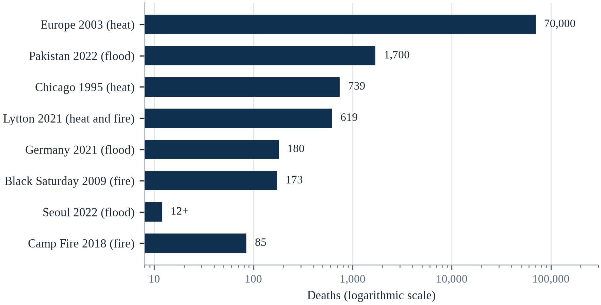||Source: Table 22.1. Lytton shows deaths for British Columbia in 2021.

Two points deserve emphasis. First, the same hazard produces very different outcomes depending on exposure, vulnerability and governance, which means that most disaster deaths are preventable in principle. Second, the cases that are most instructive are not the largest but the most diagnostic: they reveal which systems failed and why.

A rapid expansion of heat action plans and cooling infrastructure would reduce deaths from the hazard that is growing fastest. Investment in drainage and floodplain management would reduce urban flood losses. And better data on informal settlements would make visible the people who are currently absent from official risk maps. How quickly the warming proceeds remains decisive, because it determines how far beyond historical experience future extremes will go.

---

# Chapter 23: Case Studies: Drought, Food, Water and Security

*Theme: slow-onset emergencies, entitlements and the politics of scarcity*

In July 2011, the United Nations declared famine in two regions of southern Somalia (Checchi & Robinson, 2013). The declaration came after months of warnings from the Famine Early Warning Systems Network, which had projected the crisis in advance and published maps showing the areas at risk. By the time the famine was declared, tens of thousands of people had already died, and the eventual toll was estimated at about 258,000, half of them children under five.

The warning had worked; the response had not. Access to southern Somalia was constrained by conflict with al-Shabaab, which restricted humanitarian operations, and by the policies of donors and agencies that were reluctant to operate in areas controlled by the group. Food was available in some markets, but people could not afford it, and the livestock on which pastoral livelihoods depended had died in the drought.

The Somali famine is a case about entitlements rather than food. Amartya Sen's analysis of famines, first published in 1981, argued that famines occur when people lose the ability to command food — through employment, prices, assets or transfers — rather than when food is physically absent. The insight reframed famine as a problem of political economy, and it explains why famines occur amid plenty and why early warning alone does not prevent them.

This chapter examines slow-onset emergencies: drought, food crises, water scarcity and their intersections with conflict. It looks at the Sahel, Ethiopia, Somalia, Syria, Yemen, Cape Town, São Paulo and California, and at the global food price crises of 2007–08 and 2010–11. The cases show that slow emergencies kill more people than fast ones and receive less attention, because they lack a single dramatic moment and because their victims are usually poor and distant.

Slow-onset emergencies are harder to see than floods, and the invisibility is itself a cause of death. A drought that develops over three seasons produces no dramatic images until people are already starving, and by then the cheapest interventions are no longer possible. The central problem in this chapter is therefore not the absence of information — famine early warning systems have predicted most recent famines — but the gap between prediction and action.

## 23.1 Reading Slow-Onset Cases

Slow-onset emergencies develop over months or years, and they are harder to see than floods or storms. A drought is not a single event but a cumulative deficit of rainfall that depletes soil moisture, groundwater, pasture and reservoirs; its effects appear gradually in crop yields, livestock deaths, food prices, migration and malnutrition. By the time a famine is declared, the process has been underway for a year or more.

The mortality is also slow and dispersed. People die not from a single cause but from the interaction of malnutrition, disease and exhaustion; deaths are recorded as malnutrition, measles, diarrhoea or respiratory infection rather than as drought. The result is that slow emergencies are systematically undercounted, and their scale is recognised only in retrospective surveys.

The cases in this chapter are therefore read with three questions. Who was exposed, and why were they unable to cope? What institutions failed, and at what point? And what would have prevented the outcome — early warning, cash transfers, water investment, conflict resolution or all of them? The answers are rarely technological, because the knowledge usually exists before the crisis.

The technical apparatus for measuring food crises has improved considerably. The Integrated Food Security Phase Classification, known as IPC, grades acute food insecurity on a five-point scale and declares famine only when specific thresholds are met: at least twenty per cent of households facing extreme food gaps, acute malnutrition above thirty per cent, and mortality above two deaths per ten thousand people per day (IPC Global Support Unit, 2021). The Famine Early Warning Systems Network has issued projections for decades, and its record is good. The persisting failure is political: governments resist the declaration of famine on their territory, and donors respond to declarations rather than to projections.

Famine early warning works, and that is precisely why its failures are political. The Famine Early Warning Systems Network has predicted most major food crises in the Horn of Africa and the Sahel months in advance, and its projections have been accurate enough that the persistence of famine cannot be attributed to ignorance. The gap between warning and response has been documented in case after case, and the explanation is consistent: governments resist declaring famine on their territory, donors wait for the declaration, and the money arrives after the mortality. Anticipatory action is an attempt to break that sequence by funding the forecast rather than the declaration.

A slow-onset case is harder to read than a flood, because there is no single moment at which the disaster begins. The rainfall fails in one season and the harvest is poor; the next season fails and the herds are sold; the third fails and the children leave. By the time the crisis is visible in mortality statistics, the household has already passed through a sequence of coping strategies that strip its assets one by one: savings, then livestock, then land, then migration. The analytical task is to identify the point at which coping became destitution, and to ask what could have interrupted the sequence. That question is almost always about early warning, cash, and the timing of a decision rather than about the total quantity of food available.

The measurement of a slow-onset crisis relies on instruments that were designed for a different purpose, and the choice of instrument determines who is counted as affected. A food consumption score summarises the diversity and the frequency of what a household eats; a coping strategy index counts the behaviours that a household adopts when it runs short; a household economy approach estimates the gap between what a household needs and what it can obtain. Each produces a different number for the same population, and the numbers are used to allocate the assistance. The disagreement between them is not a technicality; it determines which household receives a transfer.

## 23.2 The Sahel Famines

The Sahel has experienced repeated droughts and food crises since the late 1960s (Gleick, 2023). The drought of 1968–1974 desiccated pasture and crops across the region, and the famine that followed killed an estimated 100,000 people. A second major crisis in 1984–1985 affected millions more, and images of starvation in Ethiopia and Sudan shaped global consciousness of famine.

Rainfall was not the whole cause. Colonial and post-colonial policies had pushed pastoralists onto marginal land, restricted their movement and undermined traditional coping mechanisms. Export crop production displaced food crops in some areas, and conflict in Chad, Ethiopia and Sudan disrupted markets and relief. The droughts were severe, but the famines were produced by the interaction of drought with poverty, displacement and weak institutions.

Adaptation has been possible there too. Since the 1980s, farmer-managed natural regeneration — the protection and pruning of trees on farmland — has restored millions of hectares in Niger, improved soil fertility and increased yields. The practice was developed locally, spread through farmer networks, and supported by policy. It did not prevent all crises, but it reduced vulnerability in the areas where it was adopted.

Famines in the Sahel during the 1970s and 1980s produced one of the most influential and most contested narratives in environmental history (FAO, 2023). The image of the advancing desert, popularised in the 1970s, implied that overgrazing and population growth were turning semi-arid land into desert, and the policy response included restrictions on pastoral movement that made herders more vulnerable. Later research found that the 'desertification' story was overstated and that some areas had actually greened as rainfall recovered, partly through farmer-managed natural regeneration. The episode is a warning about how confidently a narrative can be built on a short record.

The most ambitious attempt to reverse Sahelian land degradation is the Great Green Wall, and its evolution is instructive. It began as a proposal to plant a wall of trees across the continent, and it became a programme of land restoration, water harvesting and livelihood support across a mosaic of projects. Evaluations find that the successful components are the ones that worked with farmers and pastoralists rather than against them, and that the tree-planting target was from the outset a political slogan rather than an ecological plan. Restoration works when it is a practice, not a monument.

An estimated hundred thousand people died in the Sahel drought of 1968 to 1974, and the images from that period shaped the way the world thinks about famine (CRED, 2023). The explanation that dominated for years was environmental: too many people, too many animals, too little rain. Later research complicated that picture. The rainfall did decline, but the vulnerability was produced by colonial and post-colonial policies that pushed pastoralists onto marginal land, by the collapse of the livestock trade, and by the failure of governments and donors to respond to early warnings. The famine was a failure of entitlements as much as a failure of rainfall, and the same conclusion has been reached in almost every famine studied since.

No region has fought the argument about land, rainfall and conflict more intensely than the Sahel, and the argument has moved on. The image of the advancing desert has been replaced by a more accurate picture of a region in which the rainfall has partially recovered since the 1980s and the population has grown faster than the land can support under the current practices. The Great Green Wall, which began as a proposal for a line of trees across the continent and became a programme of land restoration, is the most visible response. The evidence from the restored sites is that the practice works where the land tenure is secure and the community is involved, and that it fails where it is imposed.

## 23.3 Ethiopia 1984–1985 and the Entitlement Debate

The Ethiopian famine of 1984–1985 killed an estimated one million people (de Waal, 1997). It followed two failed rainy seasons, but it was also produced by conflict, resettlement policies and the diversion of resources to war. Food was available in some markets, and the government's response was shaped by its military priorities and by its suspicion of international agencies.

Sen's entitlement approach explained the paradox. People starve when they cannot establish command over food, whether because their assets have collapsed, their employment has disappeared, prices have risen beyond their reach, or transfers have failed. In Ethiopia, pastoralists lost their herds, farmers lost their harvests, and displaced people lost access to both, while markets in other regions continued to function.

The famine also changed humanitarian practice. It led to the creation of the Famine Early Warning Systems Network, the expansion of food aid, and a debate about development rather than relief. The debate continues: agencies now emphasise cash transfers, social protection and resilience, but the underlying problem — that warnings do not automatically produce response — remains.

Amartya Sen's analysis of the 1943 Bengal famine changed how famines are understood, and Ethiopia in 1984–85 tested the theory under different conditions. Sen argued that famines can occur without a decline in food availability, because the people who need food may lack the entitlements — income, land, access to markets — to obtain it. In Ethiopia, food was available in some markets while people starved in others, and the government's resettlement programme and counter-insurgency campaign diverted resources and restricted movement. De Waal's later work described famine as a process that governments and rebels can accelerate or slow, which makes it a political event.

Sen's entitlement approach is often summarised as the claim that famines occur without food shortages, and the summary is both correct and too simple. His argument was that people starve when their entitlement to food collapses, whether because of lost employment, falling livestock prices or failed harvests, and that the collapse can occur while markets remain stocked. The policy implication is that famine prevention requires income support and market access, not only food aid, which is why cash transfers have become central to modern famine response.

Ethiopia in 1984 and 1985 is the case that produced the entitlement theory of famine, and the theory changed how the world responds. Amartya Sen's argument was that famines occur when people lose the ability to command food through their entitlements — through their own production, their labour, their assets or transfers — rather than when food is absent from the market (Sen, 1981). In Ethiopia, food was being exported from the affected regions while people starved, and the government's response was shaped by a war and by a policy of resettlement that did not serve the people it moved. The death toll was estimated at about one million, and the crisis produced the first serious international system of early warning and food aid.

Ethiopia's response to the famine of 1984 changed the country's institutions as well as the international system, and the change is one of the more hopeful in this book. The Productive Safety Net Programme, which began in 2005, provides cash or food to households in return for work on land restoration, and it is designed to be predictable rather than emergency-based, so that a household can plan. The programme has been credited with reducing the need for emergency assistance in bad years, and it has been copied across the region. The lesson is that a social protection system which is in place before the crisis is cheaper and more effective than a humanitarian appeal after it.

## 23.4 Somalia 2011 and 2022

The 2011 Somali famine was declared after months of warning, and it killed about 258,000 people (Checchi & Robinson, 2013). The 2022 crisis was different in important respects: early action by humanitarian agencies and local organisations, including cash transfers and livestock support, is thought to have prevented a declared famine, although the death toll was still high. A study published in 2023 estimated about 43,000 excess deaths in Somalia in 2022, half of them among children under five.

The comparison is instructive because the rainfall deficits were similar. In 2011, access was restricted, response was delayed and the crisis was allowed to develop; in 2022, agencies and local groups acted earlier, cash reached people faster and malnutrition treatment was scaled up. The difference in outcomes was largely a difference in the speed and flexibility of response.

The lesson is that famine is not a weather event. It is a political and economic outcome that can be prevented by timely action, and the knowledge required to act is usually available before the crisis peaks. What is often missing is the willingness to release funds early, the access to deliver them, and the political attention to sustain the response after the cameras leave.

Somalia in 2011 and 2022 offers a comparison in which the difference was largely operational (Checchi & Robinson, 2013). In 2011, warnings were issued months before the famine declaration, but access to territory controlled by al-Shabaab was restricted, donor response was slow, and about a quarter of a million people died, half of them children under five. In 2022, a similar drought produced a much larger humanitarian response before famine was declared, including cash transfers and livestock support delivered by local organisations, and the worst outcomes were avoided in many areas. The contrast is evidence that early action works when it is funded and when local access exists.

The 2022 Somali response demonstrated that anticipatory action can work at scale when local organisations are funded early. Humanitarian agencies released cash before famine was declared, and local committees distributed it alongside livestock support and water trucking. The evaluation literature on these programmes finds that households receiving early cash are less likely to sell productive assets and more likely to keep children in school. The limitation is that the trigger must be agreed in advance and the money must be available before the peak, which requires donors to accept spending against a forecast rather than against a body count.

The difference between the two episodes was operational, and the detail is the lesson. In 2022 the humanitarian system began distributing cash and supporting livestock before any famine was declared, using local organisations that already had access to the affected districts, and the appeals were funded earlier and more fully than in 2011. The sequence matters because the indicators that predict famine — livestock prices, terms of trade for pastoralists, admissions for malnutrition — were visible in both episodes months before the emergency peaked. What changed was not the information but the willingness to act on it while the outcome was still uncertain, which is the same constraint that the finance chapters of this book describe in a different vocabulary.

The threshold problem has a practical remedy that several agencies now use, and it is worth describing because it can be copied. Rather than waiting for the evidence that a famine has begun, the trigger is a forecast: a seasonal rainfall outlook combined with market prices and nutrition surveillance, agreed in advance with a donor, releases money when the probability of a crisis crosses a set level. Because the money is committed before the outcome is known, the donor is buying insurance rather than charity, and the payment does not require a declaration that carries political costs for the government receiving it. The amounts are small relative to the response they pre-empt, and the evaluations of the first programmes found that they reached households two to four months earlier than conventional appeals.

## 23.5 Syria: Drought, Displacement and Conflict

Between 2006 and 2010, Syria experienced its worst multi-year drought in the instrumental record (Kelley et al., 2015). Rainfall fell to a fraction of normal in the northeast, crops failed, and herds were decimated. An estimated 1.5 million people moved from rural areas to cities that were already struggling to absorb Iraqi refugees and to provide jobs and housing.

The drought did not cause the civil war that began in 2011, and analysts caution against simple causal claims. But it contributed to the conditions in which the war unfolded: rural livelihoods collapsed, food prices rose, and the government's failure to respond eroded legitimacy in affected regions. Studies, including work by Kelley et al. (2015) and Selby et al. (2017), debate the weight of the drought relative to political factors, but agree that it interacted with them.

The Syrian case illustrates the concept of a threat multiplier. Climate change does not determine conflict, but it can amplify existing stresses — unemployment, inequality, migration, weak institutions — and reduce the capacity of the state to manage them. The policy implication is not that climate causes war but that climate adaptation and conflict prevention must be designed together.

The Syrian drought has become a test case for the 'climate as threat multiplier' argument, and the debate around it is more instructive than the conclusion. Kelley and colleagues argued in 2015 that the 2006–2010 drought, made more likely by climate change, contributed to agricultural collapse, rural displacement and therefore to the conditions that produced the uprising. Selby and colleagues challenged the causal chain in 2017, noting that the drought affected different regions differently and that political economy, not rainfall, determined who was exposed. The exchange clarified that climate can be a contributing condition without being a sufficient cause.

The Syrian case is often cited as proof that climate change causes conflict, and the scholarship supports a more limited claim. The drought was severe and partly climate-attributable, and it displaced hundreds of thousands of rural people into cities that were already strained. Whether that displacement contributed to the 2011 uprising depends on factors that no climate model can capture: the regime's response, the distribution of patronage, the role of the security services and the regional context. Climate was a stressor in a system that was already fragile, which is the finding that matters for policy.

Syria is the case where a drought, a war and a policy failure are tangled together, and the tangling is the lesson. Between 2006 and 2010, the country experienced its worst multi-year drought in the instrumental record, and hundreds of thousands of farming families moved to the cities. The government's response favoured irrigated agriculture with groundwater, which depleted the aquifer and rewarded the connected, while the smallholders who depended on rain-fed farming received little support. The drought did not cause the war, and it did contribute to the grievances and the displacement that the war exploited. The case is a warning about how a defensible attribution can be turned into a misleading headline in either direction.

The attribution of the Syrian drought became a case study in how a scientific finding is used and misused in a political argument. The research found that the drought was made more likely by human-caused warming, and the finding was quickly translated into a headline that climate change caused the war. The careful version is that the drought contributed to a rural displacement that strained the cities, that the government's response to the drought was a political choice, and that the war had many causes of which the climate was one. The politicisation of the finding damaged the credibility of the science among the people who disagreed with the policy.

## 23.6 Yemen: Water, Conflict and Disease

Yemen is one of the most water-scarce countries in the world, and its aquifers are being depleted faster than they recharge. Sana'a, the capital, has been projected to run out of economically accessible water within decades, and rural areas depend on increasingly deep wells. Agriculture consumes most of the water, including irrigated qat, a cash crop with high water demand.

The conflict that began in 2014 destroyed much of the water infrastructure and disrupted supply chains. By 2017, a cholera outbreak produced more than one million suspected cases, the largest in modern history, driven by contaminated water and overwhelmed sanitation (WHO, 2023). The outbreak was not caused by drought, but it was made possible by the collapse of water and sanitation systems.

Yemen illustrates the interaction of water scarcity, conflict and disease. Each stressor reduces the capacity to manage the others: war damages infrastructure, scarcity raises prices, disease overwhelms health services, and the resulting instability makes reconstruction harder. The case shows that water security is not only a matter of supply but of governance, infrastructure and peace.

Yemen's water crisis predates its war and was made catastrophic by it. The capital's aquifer has been drawn down for decades, and agricultural water use, particularly for qat, accounts for the overwhelming majority of consumption. The war destroyed pumping infrastructure, displaced millions, and created the conditions for the world's largest cholera outbreak. Water trucking became the main supply route for much of the population, at a cost that households could not sustain. The case shows how a slow resource depletion and a fast conflict interact: each makes the other harder to survive.

Yemen's water economy is a case study in how a subsidy can outlive its purpose. Diesel subsidies made groundwater pumping cheap, which encouraged the expansion of irrigated qat and the depletion of aquifers, and when the war disrupted fuel supplies the pumping stopped and the water price rose. The sequence is a reminder that resource depletion is often driven by policy rather than by climate, and that the climate signal arrives in a system that is already stressed by decisions made decades earlier.

Yemen is a case where water scarcity, conflict and disease reinforce each other in a closed loop. The country is among the most water-scarce in the world, and its agriculture has shifted toward qat, a thirsty crop with a reliable market, which has reduced the land available for food. The war destroyed the infrastructure that would have delivered water and health care, and the resulting cholera outbreaks have been among the largest recorded. The loop is characteristic of compound crises: the war prevents the water investment that would reduce the scarcity, the scarcity intensifies the grievance that fuels the war, and the collapse of health services turns a treatable disease into an epidemic.

Yemen's water crisis is a case in which the economy and the hydrology are the same system. The country's agriculture is dominated by qat, which is irrigated and profitable and which consumes a large share of the water, and the shift to qat was a rational response to a market that paid better than food crops. The war then destroyed the pumps, the pipes and the fuel, and the water that was available was too expensive for the poorest households. The desalination plants that would relieve the pressure on the aquifers require energy and capital which the country does not have, which is the definition of a trap.

## 23.7 Cape Town and São Paulo: Urban Water Crises

Cape Town's 2018 crisis brought a major city close to running out of water. After three years of drought, reservoir levels fell to about 20 per cent, and officials prepared for Day Zero, when taps would be shut off and residents would collect water at distribution points (Gleick, 2023). The city avoided that outcome through severe restrictions, pressure management, leak repair and public campaigns, but the crisis exposed the vulnerability of a growing city dependent on a variable supply.

São Paulo faced a comparable crisis in 2014–2015. The Cantareira reservoir system, which supplies about half the metropolitan area's water, fell below 5 per cent of capacity, and officials considered rationing (Gleick, 2023). The crisis was managed through restrictions, inter-basin transfers and rainfall, but it revealed the risks of relying on a single reservoir system for a metropolitan region of more than 20 million people.

The two cases show that urban water crises are usually produced by a combination of drought, demand growth, leakage and poor planning rather than by rainfall alone. Cities that invest in diverse sources, demand management, leak reduction and public communication can survive severe droughts; cities that do not can come close to collapse even in wealthy countries.

Cape Town and São Paulo are the two best-documented cases of a major city approaching the end of its water, and both escaped through demand management rather than new supply. São Paulo's Cantareira system fell below five per cent of its capacity in 2015, and the state responded with pressure reduction, bonuses for conservation and emergency transfers between basins (Gleick, 2023). Cape Town's response combined tariffs, restrictions, leak repair and a public communication campaign that made consumption visible. In both cases the crisis was deferred, not solved: the underlying growth in demand and the exposure to a multi-year drought remain.

Cape Town's avoidance of Day Zero depended on a communication campaign that made water visible. The city published reservoir levels daily, named the threshold at which taps would be shut, and translated consumption into a per-person number that residents could compare with their neighbours. Consumption fell by more than half in three years, and the reduction persisted after the drought ended. The lesson is not that people respond to scarcity but that they respond to a shared, legible measure of it, which is a governance achievement rather than a technological one.

Drought in Indonesia is a slow emergency that rarely reaches the headlines, and the mechanism is the same as elsewhere. El Niño years reduce rainfall across Java, Sumatra and Sulawesi, reservoirs fall, rice planting is delayed or abandoned, and rural households cope by selling livestock, borrowing and migrating to cities for work. The government responds with cloud seeding, water trucks and rice imports, and the interventions arrive after the planting decision has already been made. The lesson is that the value of a seasonal forecast is determined by whether it reaches the farmer before the decision, which is a question of extension services rather than of science.

Cape Town and São Paulo are two urban water crises that arrived by different routes and were resolved in different ways. São Paulo's reservoirs fell to dangerous levels in 2014 and 2015 after a combination of deforestation in the catchment, leakage in the distribution network and a failure to invest in storage, and the state responded with a mix of rationing, pressure reduction and emergency transfers between basins. Cape Town's crisis in 2018 was driven by a three-year drought that the system had not been designed for, and the city's response — a public campaign that reduced demand by nearly half — became a model of what a city can do when the alternative is running dry.

Cape Town's response to the prospect of running dry is the best-documented example of demand management at a municipal scale, and the documentation is candid about what worked and what did not. The city published a daily number for the level of the dams, it named the day on which the taps would be turned off, and it enforced restrictions with tariffs and with inspectors. Consumption fell by nearly half within a year, and the fall was achieved by households and businesses rather than by a new supply. The risk of the approach is that it depends on public trust, and trust is easier to lose than to build.

## 23.8 California: Groundwater and the Long Drought

California's 2012–2016 drought was one of the most severe in the state's recorded history. Reservoir levels fell, snowpack reached record lows, and farmers pumped groundwater to compensate. The result was land subsidence in the Central Valley, where the ground sank by as much as several metres in some areas, damaging canals and roads and permanently reducing aquifer capacity.

The drought exposed a governance failure. Groundwater had been largely unregulated, and pumping was treated as a private right. In 2014, the state passed the Sustainable Groundwater Management Act, which required local agencies to develop plans to bring aquifers into balance by the 2040s. The law was a significant reform, but it was passed after decades of depletion and will take decades to implement.

California also illustrates the interaction of drought and fire. The drought killed millions of trees, and the dead wood fuelled subsequent wildfires. The 2018 Camp Fire and the 2020 fire season were partly products of the drought years. The sequence shows that slow-onset and fast-onset hazards are connected, and that managing one requires attention to the other.

California's drought policy has been shaped by a legal doctrine that predates climate science. Prior appropriation, the principle that the first user to claim water has the senior right, allocates water by historical use rather than by current need, and it made groundwater the buffer that farmers drew down when surface supplies were cut. The result was subsidence in the Central Valley, where the land surface has dropped by metres in some areas, permanently reducing the capacity of aquifers to store water. The Sustainable Groundwater Management Act of 2014 was the first serious attempt to regulate that withdrawal, and its implementation is still contested.

The Colorado River agreement of 2023 is a preview of how water politics will work in a hotter West. After two decades of drought, the basin states agreed to cut consumption substantially in exchange for federal compensation, and the agreement was temporary because the underlying allocation rules date from 1922 and assume a flow that no longer exists. The negotiation was among states, tribes and Mexico, and the tribes were included late despite holding senior rights. The case shows that adaptation in water is less about finding new supply than about renegotiating old entitlements.

California is the case that shows how a long drought can be survived and still leave a legacy of depletion. The state's agriculture is the most productive in the world and it depends heavily on groundwater, which was pumped at unsustainable rates during the droughts of 2012 to 2016 and again in 2020 to 2022. The Sustainable Groundwater Management Act, passed in 2014, created a framework for bringing the basins into balance, and the implementation is now forcing a reckoning: some of the most productive farmland will have to be retired, and the communities that depend on it will have to find another economy. The case is important because it is one of the first in which a wealthy jurisdiction has confronted the arithmetic of aquifer depletion.

California's Sustainable Groundwater Management Act is the first law in the state's history that requires the basins to be brought into balance, and the implementation is now the most interesting experiment in water policy in the world. The law does not say how the balance is to be achieved; it delegates that to local agencies that must produce a plan and submit it to the state, and the plans are being tested against the requirement that the aquifer is not depleted. The consequence is that some of the most productive farmland in the country will be fallowed, and the communities that depend on it are negotiating compensation. The case is a preview of the politics that will arrive wherever the water runs out.

## 23.9 Food Prices, Export Bans and the 2007–2008 Crisis

In 2007 and 2008, world food prices rose sharply (FAO, 2023). Wheat prices more than doubled, rice prices tripled, and maize and soybeans reached record highs. The increases were driven by a combination of factors: biofuel demand, rising oil prices, poor harvests in several exporting countries, low stocks, and speculative investment in commodity futures.

Governments responded with export restrictions. India and Vietnam limited rice exports, Argentina taxed soybean exports, and Russia later banned wheat exports after its 2010 drought. The restrictions were rational for each country individually and catastrophic collectively: they removed supply from world markets, pushed prices higher for importers, and created panic buying. More than 30 countries experienced food riots.

The crisis showed how food security depends on trade as well as production. Countries that relied on imports were exposed to price shocks, and countries that restricted exports exported instability. The lesson for climate policy is that adaptation must include trade rules and regional cooperation, because a drought in one breadbasket can become a food crisis on another continent.

What the 2007–2008 crisis demonstrated is that a climate shock can become a global event through markets rather than through harvests. Prices for wheat and rice more than doubled, and the increases were amplified by export restrictions: when major producers banned exports, importers panicked and bought, which drove prices higher. Riots followed in more than thirty countries. The episode established a pattern that recurred after 2022, when the war in Ukraine disrupted grain shipments and export controls again amplified the shock. Food security is therefore a function of trade policy as much as of rainfall.

In 2022 the pattern repeated with a different trigger. War disrupted exports from Ukraine and Russia, prices spiked, and several countries restricted exports of wheat, rice and cooking oil, which amplified the increase. The Black Sea Grain Initiative, negotiated in 2022, restored a substantial share of shipments and lowered prices before it collapsed in 2023. The episode demonstrates that the international system can act quickly when a disruption is visible and that it has no equivalent mechanism for a slow-onset harvest failure.

It produced a set of reforms that are still the basis of food security policy. The ASEAN Plus Three Emergency Rice Reserve was established to hold physical and financial reserves, the Agricultural Market Information System was created to improve transparency, and the G20 committed to avoiding export restrictions. Each was a partial answer: the reserve is small relative to regional demand, the information system relies on voluntary reporting, and export restrictions returned in 2022. The lesson is that institutions created in a crisis tend to be designed for the last crisis.

In 2007 and 2008 the world discovered that its food system had less slack than it thought. A series of weather shocks in major producing countries, a sharp rise in the price of oil and fertiliser, a wave of export restrictions and a run on stocks produced a price spike that doubled the cost of staples within a year and pushed tens of millions of people into poverty. The riots that followed occurred in more than thirty countries, and the political consequences were felt for years. The episode established the pattern that has repeated since: a climate shock, a policy response, a speculative spiral, and a humanitarian crisis concentrated among the poorest consumers.

That crisis also produced rules that were supposed to prevent a repetition, and the rules were tested in 2022 and partly failed. The World Trade Organization disciplines export restrictions weakly, and the notification requirement is honoured in the breach; the stocks that were supposed to stabilise the market were held by the countries that restricted their own exports. The reforms that are discussed are a regional reserve, a code of conduct for export bans and a transparency mechanism for stocks, and none of them has been agreed. The pattern is that the lesson is learned in the crisis and forgotten before the next one.

## 23.10 What the Cases Teach

Across the cases, three lessons recur. First, famines and water crises are usually failures of entitlement and governance rather than absolute scarcity. The knowledge required to prevent them exists, and the food or water is often available; what fails is access, affordability and political will.

Second, early warning is necessary but not sufficient. Somalia 2011 had warnings and still experienced famine; Ethiopia 1984–85 had warnings and a government that prioritised war (Checchi & Robinson, 2013). What changes outcomes is the translation of warning into early action, which requires pre-arranged finance, flexible programming and access.

Third, slow emergencies are cumulative and interconnected. Drought depletes groundwater, groundwater depletion reduces resilience to the next drought, and drought combined with conflict produces famine. Managing them requires long-term investment in water infrastructure, social protection and conflict resolution, not only emergency relief. The cases suggest that the most effective interventions are often the least dramatic: cash transfers, boreholes, pasture management and peace agreements.

The cases converge on a lesson that is easy to state and hard to institutionalise: famine is usually a failure of access, information and political will rather than a failure of food production. The instruments that work are known — early warning, cash transfers, social protection, market access, and humanitarian negotiation — and they are cheaper than the emergency response that follows a declaration. What is missing is the mandate to act on a projection rather than on a catastrophe, which is a political problem disguised as a technical one.

Anticipatory action is the most promising reform in humanitarian response, and its evidence base is growing. The principle is to release funds when a forecast crosses a threshold, before the crisis peaks, rather than after a declaration, and pilots in the Sahel, the Horn of Africa and South Asia have found that households receiving pre-emptive cash are less likely to sell assets or skip meals. The obstacles are institutional: donors are accountable for spending against evidence of need, and a forecast is not the same as a body count. Changing that requires a different kind of audit.

The slow-onset cases in this chapter teach four lessons that apply well beyond the specific places. First, early warning is only useful if it triggers early action, and early action requires money that is available before a crisis is declared. Second, conflict and climate interact in ways that make both worse, and humanitarian access is often the binding constraint on a response. Third, the state of the aquifer, the reservoir and the pasture is a leading indicator that is measured in months and years, which gives decision-makers more warning time than they usually use. Fourth, the poorest households have the least capacity to absorb a shock and the most to gain from a modest, timely transfer.

The lesson that runs through the slow-onset cases is that the timing of the money is the variable that determines the outcome. A transfer that arrives before a household sells its animals preserves the asset; the same transfer after the sale compensates a household that has already lost the means to recover. The anticipatory action programmes that have been piloted in the last decade release funds on the basis of a forecast rather than a declaration, and the evaluations find that the money is spent better and the households recover faster. The obstacle is the fiscal rule that requires a disaster to be declared before money can be released, and the rule is a choice.

The evidence on what works in a slow-onset crisis has improved because the interventions have been evaluated, and the results are consistent enough to act on. Cash transfers that arrive early protect assets, and the households that receive them are less likely to sell their livestock or to withdraw their children from school. Forecast-based financing, which releases money against a probability rather than a declaration, has been piloted in a dozen countries and the evaluations find that it reaches more households per dollar than a conventional appeal. The obstacle is the fiscal rule, which requires a declaration that arrives after the damage, and the rule is a political choice.

The distinction between a drought and a famine is the most operationally important distinction in this part of the book, and confusing the two produces the classic failure. A drought is a rainfall deficit, and it is measurable months before it hurts anyone; a famine is a collapse of the entitlements that allow households to obtain food, and it is produced by prices, conflict, access and the timing of assistance as much as by the rain. A government that treats the drought as the problem will invest in water and wait for the harvest; the households that lose their animals in the meantime will not be able to use the water when it arrives. The interventions that work act on the entitlement rather than on the rainfall: cash before the herd is sold, food before the price peaks, and access negotiated before the roads close.

## 23.11 Case Study: The 2011 Somali Famine

The 2011 famine in southern Somalia followed two consecutive failed rainy seasons and a drought that affected the wider Horn of Africa (Checchi & Robinson, 2013). Pastoralists lost their herds, farmers lost their harvests, and food prices rose sharply. By July, the United Nations declared famine in two regions, and the eventual death toll was estimated at about 258,000, half of them children under five.

The warning system had in fact worked. The Famine Early Warning Systems Network had projected the crisis months in advance and published maps identifying the areas at risk. Humanitarian agencies had plans and resources. But access to southern Somalia was restricted by conflict with al-Shabaab, and agencies were reluctant to operate in areas controlled by the group. The result was a gap between knowledge and action.

Livelihoods failed before the rains did. Pastoralists depend on livestock for income and food, and when herds died, households lost both. Farmers depended on rainfall, and when crops failed, they had no buffer. People migrated to camps, where overcrowding and poor sanitation increased disease. The mortality was produced by the interaction of malnutrition, disease and displacement rather than by hunger alone.

Relief, when it came, was large but late. Food aid, cash transfers, therapeutic feeding and health services reached millions, and the death rate fell. But the delay cost tens of thousands of lives, and the crisis displaced hundreds of thousands of people into neighbouring countries. The lessons were incorporated into subsequent planning, and the 2022 response was faster and more flexible.

Slow emergencies are political, and this one shows why. The rainfall was a trigger, but the famine was produced by conflict, restricted access, failed livelihoods and delayed response. Preventing the next one requires early action as well as early warning, and it requires addressing the conflict and poverty that make drought lethal.

Famine became visible to the world through Ethiopia in 1984–85, and its legacy is double-edged (de Waal, 1997). The television reports produced an unprecedented public response, including the Live Aid concerts, and they established the model of celebrity humanitarianism that still shapes disaster fundraising. They also simplified a complex political emergency into a story of drought and generosity, obscuring the role of conflict and resettlement policy. The case is a reminder that visibility is not the same as understanding, and that the story a disaster tells can determine whether the next one is prevented.

No disaster in the modern record was more clearly predicted and less clearly prevented than the Somali famine of 2011. Two consecutive failed rainy seasons reduced the harvest and the herds, the price of grain rose sharply, and the Famine Early Warning Systems Network published maps showing the areas at risk months before the declaration. The declaration came in July, and tens of thousands of people had already died. The access restrictions imposed by an armed group and the reluctance of donors to fund a response in a conflict zone delayed the scale-up, and the eventual toll was estimated at about 258,000, half of them children under five. The lesson is that the binding constraint was political rather than informational.

It is often described as a failure of early warning, and the description is only partly right. The warning was issued; the maps were published; the agencies knew. What failed was the translation of the warning into a decision to spend money before the declaration, which required a donor to accept that the evidence was sufficient and a government to accept that the access was possible. The reforms since then have focused on that translation, through pre-arranged finance, anticipatory action plans and a faster declaration process. The test of the reform is whether the money moves before the animals are sold, and the test will be applied in the next drought.

Somalia in 2017 is the case that shows what early warning can buy. The same rains failed, the same drought developed, and this time the warning came early enough for a large-scale response; famine was not declared, although the crisis killed tens of thousands of people and displaced more than a million (Checchi & Robinson, 2013). The comparison with 2011 is the most useful one in the famine literature, because almost nothing changed in the weather and almost everything changed in the timing of the money. That is the basis for the projections in this chapter: famine in the next two decades will be a failure of procurement and logistics far more often than a failure of rainfall.

## 23.12 Future Scenarios and Predictions: Food and Water Security in 2050

Famine is no longer mainly a story about food; it is a story about access, conflict and early warning. The number of people affected by food crises has risen in recent years, driven by conflict, economic shocks and climate extremes. Water scarcity has also increased, with more than two billion people now living in countries under water stress (FAO, 2022).

The baseline is a hunger crisis that is already here. About 735 million people faced hunger in 2022, and nearly 3 billion could not afford a healthy diet (FAO, 2023). Irrigation depends on aquifers that are being depleted in many regions, and food systems are exposed to shocks through trade concentration and export restrictions. At the same time, early warning systems, social protection and cash transfers have improved.

Hunger and water security will follow the pace of warming, investment in water and social protection, and the intensity of conflict. A world that invests in irrigation efficiency, groundwater management, early action and peace can reduce hunger even as the climate changes; a world that continues on the current path will see more frequent food and water crises. The table summarises the range.

Food and water security in 2050 will be determined by the intersection of three curves: demand, which rises with population and income; supply, which falls as aquifers deplete and glaciers retreat; and the frequency of shocks, which rises with warming. The regions where the curves cross earliest are already known — the Horn of Africa, the Sahel, the Middle East, the Indo-Gangetic plain, and the drylands of Central Asia — and the difference between the scenarios is largely a matter of investment and of conflict. The variables that decide the outcome are the aquifer levels in the great basins, the ratio of global stocks to consumption, the price of staple grains, and the number of people in acute food insecurity.

[[TABLE:Table 23.1 Slow-onset cases, 2050]]
| Case | Drivers | Deaths | What failed | Lesson |
|---|---|---|---|---|
| Sahel 1972–74 | Drought; land policy | ~100,000 | Pastoral access | Protect mobility |
| Ethiopia 1984–85 | Drought; conflict | ~1,000,000 | Entitlements | Markets and transfers |
| Somalia 2011 | Drought; conflict | ~258,000 | Access; late response | Early action |
| Somalia 2022 | Drought; prices | ~43,000 | Funding gaps | Cash at scale |
| Syria 2006–10 | Drought; policy | Displacement | Rural neglect | Adapt before conflict |
| Yemen 2017 | Water; conflict | Cholera | Sanitation collapse | Water as security |
| Cape Town 2018 | Drought; demand | None | Supply diversity | Manage demand early |
| São Paulo 2014–15 | Drought; reliance | None | Single source | Diversify supply |

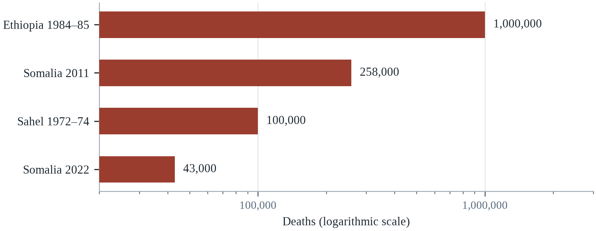||Source: Table 23.1. Syria 2006–10 is omitted because the table records displacement, not deaths.

The analysis points to two conclusions. First, food and water crises are preventable with existing knowledge and resources; what fails is political will, access and timing. Second, slow emergencies require long-term investment in water, social protection and peace, because relief alone cannot reverse the depletion of aquifers or the collapse of livelihoods.

Pre-arranged finance for early action would reduce the gap between warning and response. Investment in groundwater recharge and irrigation efficiency would reduce exposure to drought. And conflict resolution would remove the factor that turns a bad harvest into a famine. How quickly the warming proceeds remains decisive, because it determines how often the systems will be tested, and whether they will have time to recover between shocks.

---

# Chapter 24: Action Plans and Checklists for Survival

*Theme: preparedness cycles, priorities and the practice of readiness*

On 12 November 1970, the Bhola cyclone struck the coast of East Pakistan, now Bangladesh. The storm surge reached several metres and swept over low-lying islands with little warning. The death toll was estimated at 300,000 to 500,000 people, one of the deadliest tropical cyclones in recorded history (CRED, 2023). There was no effective warning system, few shelters, and almost no organised evacuation.

Fifty years later, in May 2020, Cyclone Amphan made landfall in a region that had been transformed by preparedness. Bangladesh had built thousands of cyclone shelters, trained volunteers, established a warning system that reached villages by loudspeaker and mobile phone, and practised evacuation every year. More than 2.4 million people were moved to safety before the storm, and the death toll was in the dozens rather than the hundreds of thousands (CRED, 2023).

The comparison is not an argument that disasters have been solved. Amphan still destroyed homes and livelihoods, and COVID-19 made evacuation harder. But it is an argument that preparedness works, and that the difference between 1970 and 2020 was not the storm but the system: shelters, warnings, volunteers, drills and political commitment sustained over decades.

This final chapter turns the book's analysis into action. It sets out what households, neighbourhoods, cities, businesses and governments can do, in what order, and how to know whether it is working. It is organised by time horizon — the first hour, the first week, the first year — and by level of organisation, from the household to the state. The aim is not a list of everything that could be done but a sequence of what matters most.

Action plans fail for a reason that is well understood and rarely designed for: they assume that the plan will be followed. In practice, response is improvised from whatever is at hand, by people who are frightened and tired, under information that is wrong. A useful plan is therefore not a document that specifies every step but a set of decisions made in advance — who decides, who is called, what is stockpiled, what is abandoned — so that the improvisation starts from a better place.

## 24.1 The Preparedness Cycle

Preparedness is a cycle rather than a project: assess the risk, plan the response, act on the plan, check whether it worked, and adapt. The cycle is familiar from safety management and quality improvement, and it applies to households, firms and governments alike. The most common failure is not the absence of a plan but the absence of the check and adapt steps, which is why plans become obsolete as hazards and populations change.

Assessment begins with hazards and exposure: what can happen here, how often, and to whom. It continues with vulnerability and capacity: who will be affected most, what resources exist, and what gaps remain. Good assessments use local knowledge as well as technical data, because residents know which roads flood, which neighbours need help and where water collects.

Planning turns assessment into decisions: who does what, with what resources, and by when. Good plans are short, specific and exercised. A plan that has never been tested is a hypothesis, and the first test should not be the emergency itself. Exercises reveal gaps in communication, authority and logistics that no document can anticipate.

The preparedness cycle — assess, plan, exercise, evaluate, revise — is borrowed from safety management and has a known weakness. Exercises tend to test the plan rather than the capability, because the scenario is written by the people who wrote the plan, and the evaluation rewards compliance rather than discovery. The American exercise programme known as HSEEP tried to correct this by requiring after-action reviews with specific corrective actions and deadlines. The evidence from organisations that use it well suggests that the value lies less in the exercise than in the follow-up, which is also the part most often skipped.

The most common failure in preparedness planning is the confusion between a plan and a capability. A plan describes what should happen; a capability is what actually happens when the people, equipment and authority are tested together. Organisations that confuse the two produce documents that satisfy auditors and fail in practice, and organisations that test capabilities discover gaps that no document review would reveal. The practical rule is that every plan should be exercised with the people who will execute it, under conditions that include poor information and failed communications.

The preparedness cycle is a simple loop that most institutions describe and few complete: assess the risk, plan for it, resource the plan, exercise it, respond when the event arrives, learn from the response, and revise the assessment. Each step is unglamorous, and the loop breaks most often at the same two points. The first is resourcing: a plan without a budget is a document. The second is learning: an after-action review that produces a report but no change trains everyone involved to treat the exercise as theatre. The organisations that perform well in disasters are almost always the ones that close the loop, and the mechanism they use is a small number of specific commitments with named owners and dates rather than a long list of aspirations.

The exercise is the step in the preparedness cycle that is most often skipped and most likely to reveal the truth. A tabletop exercise, in which the staff talk through a scenario, exposes the assumptions that nobody had examined; a functional exercise, in which the radios and the operations centre are used, exposes the failures in communication; a full-scale exercise tests everything and costs money. The value of the exercise is not in the performance but in the discovery, and the discovery is only useful if it is written down in an after-action report that names the fixes and assigns them to people. An exercise without a report is a morning spent in a car park.

## 24.2 The First Hour, Day and Week

In the first hour, the priorities are life safety and information. Households should move to the safest place in the building, avoid windows and floodwater, and check on neighbours, especially those living alone. If evacuation is ordered, it should be carried out early and by the designated route, with documents, medication and water taken along. The most common errors are waiting too long, driving through water, and using fuel-burning equipment indoors.

In the first day, the priorities are water, food, shelter, medication and communication. Households should confirm that water is safe, ration it, and begin treating water if supplies are uncertain. They should check refrigeration times, discard food that has spoiled, and ensure that generators are outdoors. They should also register with assistance systems if they need help, because early registration often determines access later.

In the first week, the priorities are stabilisation and documentation. Households should photograph damage before repairs, contact insurers, keep receipts, and apply for assistance. They should watch for health risks — contaminated water, mould, heat, carbon monoxide — and for the mental health effects of loss. Communities should organise information sharing, because official channels are often slow and fragmented.

The first hour is dominated by uncertainty, and the most useful preparations are the ones that reduce it. A household that has agreed on a meeting point, a check-in contact outside the affected area, and a decision rule for evacuation does not need to negotiate those questions while the building is shaking. The same logic applies to utilities: knowing where the gas shut-off is and how to turn it off is a five-minute skill that prevents a fire. Most of the deaths in the first hours are preventable through actions that take less time to learn than a first-aid course.

The first hour is a test of preparation that most households fail for lack of a single decision made in advance. Research on evacuation behaviour finds that people delay because they wait for confirmation, because they do not know where to go, and because they do not want to leave without family members. A household that has agreed on a meeting point and a contact outside the area removes two of those three delays. The third — the decision to leave — is easier when the rule is stated in advance: if the water reaches this street, we go.

The first hour, day and week have different priorities, and confusing them is the most common mistake in household and institutional planning. In the first hour, the priority is life safety: get out of the water, away from the fire, off the road, and into a place that will not flood or burn. In the first day, the priority is water, shelter, warmth, medication and information about what is happening and where help is available. In the first week, the priority is continuity: keeping the household together, getting children back into some form of schooling, making an insurance claim before the deadline, and finding out what assistance is available and how to apply. The transition between these phases is where most of the preventable harm occurs.

The household plan for the first three days is a set of decisions that are easier to make before the event than during it. Where the family will meet if the phones do not work, who will collect the children from school, which route leads to higher ground, which neighbour has a key, and what will be carried if there is time to carry only one bag. The plan should be written down, shared with everyone in the household, and walked through at least once, because the value of the rehearsal is that it converts a decision into a habit. The households that manage the first day well are rarely the ones that improvised best; they are the ones that had thought about it.

## 24.3 The First Month: Recovery and Rights

Recovery is where inequality is reproduced or reduced, and it is the phase that receives the least attention. In the first month, households must navigate insurance, government assistance, landlords, employers and lenders, often while displaced and traumatised. Those with documents, savings, legal knowledge and social networks recover faster; those without may never recover fully.

Practical steps matter. Keep a written log of contacts, claims and payments. Photograph and inventory losses. Read insurance policies for exclusions, especially flood, and appeal decisions that seem wrong. Apply to every programme for which the household may be eligible, and seek help from legal aid, community organisations or disaster case managers where available.

Renters are especially exposed. They may lose their homes without losing an asset, and they often have fewer rights and less access to assistance than owners. Local governments can protect them by enforcing habitability standards, extending eviction protections after disasters, and making assistance portable. Without such measures, recovery programmes can accelerate displacement and gentrification.

The first month is a negotiation with institutions, and the outcome depends on documentation and persistence. Insurance claims are routinely underpaid on first offer, and households that do not appeal leave money on the table; public assistance programmes require documents that displaced people may not have. Contractor fraud is common after disasters because demand is urgent and verification is slow. The practical protections are unglamorous: keep copies, photograph everything, do not sign the first contract, and use the free case-management services that most disasters eventually make available.

Insurance recovery is where the economics of disaster are decided, and the process penalises the people who can least afford to litigate. Insurers routinely make an initial offer below the eventual settlement, and policyholders who accept it forgo the difference. Public adjusters and legal aid can help, but they are scarce after a large event, and the households with the strongest claims are often the least able to document them. The result is that recovery payments are regressive, which is one reason why pre-disaster documentation and community legal support matter more than they appear.

The first month is the phase in which recovery is decided, and the decisions are legal and financial as much as physical. A claim that is not filed within the deadline may be lost; a lease that is not secured may leave a family in a shelter for a year; a contractor who demands payment in advance may disappear with the money. The people who navigate this phase well are usually those with a caseworker, a relative with administrative experience, or an organisation that provides legal aid. The ones who fall behind are usually those who were already marginal: the illiterate, the undocumented, the elderly and the isolated. This is the phase in which inequality is converted into a permanent difference in outcomes.

The first month is when the legal and financial machinery of recovery engages, and the people who are least equipped to use it are the ones who need it most. An insurance claim requires documentation that may have been destroyed, a contract with a builder requires a deposit that may not exist, and an application for assistance requires a proof of address that a displaced household may not have. Legal aid clinics, caseworkers and community organisations fill the gap, and the gap is widest in the places where the disaster was largest. The systems that work pre-register the vulnerable households, so that the application does not depend on the documents that the flood has taken.

## 24.4 The First Year: Rebuilding Better

The year after a disaster is the window in which reconstruction decisions are made, and those decisions determine vulnerability for decades. Rebuilding in the same place, to the same standard, reproduces the same risk. Rebuilding with elevation, stronger connections, better drainage and cooler materials reduces it, often at modest additional cost.

Households and communities should insist on building back better, and governments should require it as a condition of assistance. That means codes that reflect current and projected hazards, inspections that are actually carried out, and technical assistance for households that cannot afford engineers. It also means addressing land tenure, because people without secure rights cannot invest in improvement.

The year is also the time to strengthen social infrastructure. Neighbourhood networks, volunteer groups and community organisations that formed during the response can be formalised and supported. Their knowledge of who needs help is an asset that no government database can easily replicate, and their existence reduces the cost of the next response.

The reconstruction window is the period in which a community's risk profile is set for decades, and it closes faster than people expect. Decisions about elevation, setbacks, materials and infrastructure are made under pressure, often by agencies with no long-term stake in the place. The evidence favours owner-driven reconstruction, in which households rebuild with technical assistance and cash, over contractor-driven programmes, because it keeps money in the local economy and produces buildings that match how people actually live. It also requires supervision, which is the part that donors find difficult to fund.

Build-back-better is a slogan that requires a definition to be useful. The Sendai Framework uses the phrase to mean reconstruction that reduces future risk, and the operational content is specific: elevation above the modelled flood level, structural reinforcement to the current code, setbacks from the shoreline, and land tenure that lets households invest. Evaluations of post-disaster housing programmes find that the programmes which achieve these conditions are the ones that combine technical assistance with owner-driven construction and staged payments tied to inspection.

The first year is when reconstruction becomes a test of whether anything was learned. A house rebuilt to the old standard in the old place is a bet that the hazard will not return, and the bet is usually bad. The households that rebuild better are those with adequate insurance, access to technical advice and a grant that is paid in instalments tied to standards rather than in a lump sum. The programmes that work build in a technical supervisor who visits the site, a standard that is enforced at the moment of construction rather than at the moment of inspection, and a dispute mechanism for the cases that go wrong. None of it is dramatic, and all of it determines whether the same street floods again.

Rebuilding better is a slogan that describes a set of practices, and the practices are known. The first is an owner-driven model, in which the household receives a grant and technical advice and manages the construction, rather than a contractor-driven model in which the household receives a finished house of variable quality. The second is a standard that is enforced at the moment of construction, with a supervisor on site, rather than at the moment of inspection, when the concrete has set. The third is a staged payment that is released against milestones. The evidence from South Asia and Central America is that the model produces better houses at a similar cost, and that it is slower and harder to administer.

## 24.5 City and Municipal Checklist

Cities are where most climate risk is concentrated and where most adaptation decisions are made. A city that wants to be prepared needs a heat action plan with cooling centres and outreach to vulnerable residents; a flood plan with drainage maintenance, land-use controls and evacuation routes; a warning system that reaches every neighbourhood; and a register of people who need assistance.

It also needs the boring infrastructure: maintained drains, functioning pumps, trees and shade, reliable water, backup power for clinics and shelters, and building codes that are enforced. These are not glamorous investments, and they rarely attract political credit, which is why they are chronically underfunded. A city that spends on events but not on drainage is unprepared regardless of what its plan says.

Finally, a city needs institutions that can coordinate. Heat involves health, social services, utilities and transport; floods involve water, planning, emergency services and infrastructure. Somebody must be accountable for the whole, and the coordination must be practised before the event. Cities that have appointed chief resilience officers and exercised joint command have performed better than those that have not.

Cities have the most direct control over the determinants of climate risk, and the interventions are known. Heat action plans, pioneered in Ahmedabad after the 2010 heatwave, combine early warning, cooling centres, outreach to vulnerable residents and changes to working hours; evaluations suggest they reduce mortality (Hess et al., 2018). Drainage maintenance, permeable surfaces and restored wetlands reduce flood peaks at a fraction of the cost of concrete channels. The obstacle is not knowledge but the fact that maintenance has no ribbon-cutting, and that the benefits accrue to people who do not vote in the next election.

Heat action plans have spread because they are cheap, visible and effective. The core elements are a forecast trigger, a warning that reaches vulnerable people, cooling centres, and outreach through health workers and volunteers. Cities that have appointed chief heat officers have found that the role's value is coordination rather than expertise: someone whose job is to make the health department, the utility and the housing agency act on the same forecast. The plans that fail are the ones that exist on paper without a budget for cooling centres or staff time.

The city checklist that matters most in Indonesia is not a document but a budget line, and the clearest example is drainage maintenance. Most Indonesian cities have drainage master plans that describe the required channels and retention ponds, and most of them are only partly implemented because the maintenance budget is the first to be cut. The consequence is that a rainfall event well within the design standard produces flooding in neighbourhoods whose drains are blocked. The practical check for any city is therefore not whether it has a plan but whether it can show, in the current fiscal year, how many metres of channel it dredged and what it spent.

The city checklist is where the general principles become specific tasks that a municipal government can actually assign. The items that matter most are unglamorous and can be audited: a hazard map that is public, a warning system that reaches the last mile, a drainage standard that reflects the current climate, a register of vulnerable residents, a shelter plan that includes access for people with disabilities, a stock of equipment that is maintained, and a budget line that is protected by law rather than by goodwill. A city that has these six things will outperform a city with a climate strategy document ten times as long and none of the six.

A city that wants to know whether it is prepared can use a scorecard, and several exist that are designed for the purpose. The questions are the ones that determine outcomes: whether the hazard maps are current and public, whether the warning reaches the last mile, whether the drainage meets a standard that reflects the current climate, whether the shelters are accessible, whether the vulnerable residents are registered and whether the budget is protected. A scorecard is only useful if it is repeated, published and used to allocate the next budget, because a self-assessment that nobody reads is a form of reassurance rather than a form of measurement.

A city that has none of the six items should not try to acquire them all in one budget cycle, because the attempt will produce a strategy document and no change. The sequence that has worked in municipalities of very different sizes starts with the two items that cost least and reveal most: a public hazard map and a register of vulnerable residents. The map can be assembled from existing data in months, and it settles the argument about where the money should go; the register can be built from health records, utility accounts and the list that the local clinic already keeps, and it converts a general obligation into a set of names and addresses. The warning system and the drainage standard come next, because both need a technical specification and a procurement. The shelter plan and the protected budget line come last, and they are the ones that determine whether the rest survives a change of administration.

## 24.6 National Policy Checklist

National governments set the framework within which everyone else acts. The essentials are known: building codes that reflect current and projected hazards; early warning systems that reach the last mile; social protection that can be scaled up quickly; health systems that can absorb surges; and finance that can be disbursed before a disaster rather than after an appeal.

Governments also control the incentives that shape private decisions. Insurance pricing, subsidies, procurement rules and disclosure requirements can either encourage or discourage risk reduction. A government that subsidises construction in floodplains and then pays for reconstruction is privatising the gain and socialising the loss, which is both inefficient and unjust.

The most important national decision is to treat adaptation as core public infrastructure rather than as a series of projects. That means budget lines, maintenance regimes, performance indicators and audit. It also means accepting that some places cannot be defended indefinitely, and planning for managed retreat where it is unavoidable — a decision that is politically painful and administratively complex, but less costly than unmanaged collapse.

National governments set the rules that determine whether local action is possible. The instruments that matter most are unglamorous: building codes with enforcement, early warning systems that reach the last mile, social protection that can be scaled up quickly, and a contingency fund that can be spent before a disaster is declared. Adaptive social protection — cash transfers that automatically increase when a trigger is met — is the most promising recent innovation, because it uses existing delivery systems rather than building new ones during the emergency.

Adaptive social protection is the most scalable adaptation instrument most countries already own. Existing cash transfer programmes can be topped up when a trigger is met, using registries and payment systems that are already in place, which is faster and cheaper than creating a new emergency programme. Sahelian countries have piloted the approach with drought triggers, and the results suggest that households receiving predictable transfers before a crisis are more resilient than those receiving aid after it. The requirement is a registry that covers the poorest and a fiscal rule that releases money automatically.

Building codes are the most cost-effective adaptation instrument most countries already possess, and their weakness is enforcement rather than design. The codes that followed major earthquakes — in Japan, Chile, California and Turkey — have measurably reduced deaths in later events, but only where inspection and liability were funded. Turkey's experience is the cautionary case: successive construction amnesties legalised buildings that did not comply, and the 2023 earthquakes killed people in exactly those buildings. A code is a promise, and its value depends on the institutions that keep it.

The national checklist is about the instruments that only a central government can create: a legal mandate for disaster risk management, a fiscal framework that allows spending before a crisis is declared, a social protection system that can scale up, a building code that is enforced, and a data system that is open. The most important of these is the fiscal one, because the timing of money determines the number of deaths. A country that can release funds within days of a forecast, and that has pre-agreed the rules for doing so, has solved the problem that most countries solve too late and too expensively.

The national checklist is short, and each item is a thing that only a central government can do. A legal mandate that assigns responsibility for disaster risk across the ministries; a fiscal rule that allows money to be released on a forecast; a social protection system that can scale up; a building code that is enforced; a data system that is open; and a national exercise that is taken seriously. The countries that have all six are rare, and the ones that have three of them are the ones that perform well in the comparisons. The list is not a measure of ambition but of the machinery that turns an intention into an action.

## 24.7 Business, Work and Continuity

Businesses are both victims and vectors of climate risk. A factory that floods loses production; a supplier that fails disrupts a global chain; a workplace without heat protection endangers workers. Continuity planning — identifying critical functions, backup sites, supplier alternatives and communication protocols — reduces losses and protects employment.

Workplace heat standards are a growing issue. Outdoor and indoor workers in hot environments need rest breaks, water, shade and adjusted schedules, and the absence of standards is a major cause of preventable illness. Some jurisdictions have adopted heat rules; many have not. Employers that treat heat as a productivity issue rather than a safety issue are both negligent and economically irrational, because heat reduces output as well as harming workers.

Supply chains require particular attention. Firms that depend on a single supplier, a single port or a single region are exposed to disruption, and the 2011 Thailand floods showed how a single event can affect production worldwide. Diversification, inventory buffers and supplier risk assessment are costly, but so is disruption, and the balance has shifted as extreme events have become more frequent.

Business continuity is usually taught as a technical discipline, and its most important lesson is about dependencies. A firm that has backed up its data but depends on a single supplier in a flood zone is not resilient, and a firm that has a generator but no fuel contract is not resilient either. Small and medium enterprises are the most vulnerable and the least prepared, and a large share of those that close after a disaster never reopen. The practical step is to map the chain — suppliers, utilities, transport, staff — and to identify the single points of failure that a modest investment could remove.

Business continuity planning fails when it stops at the factory gate. A firm's ability to operate depends on suppliers, transport, utilities, workers and customers, and the critical dependencies are usually outside the firm's control. Mapping the supply chain and identifying single points of failure is the highest-value exercise, and it is rarely done because it requires asking suppliers uncomfortable questions. The firms that recover fastest after a disaster are typically the ones that knew which of their inputs came from a floodplain and had qualified a second source.

Business continuity is the private sector's equivalent of household preparedness, and it matters for the same reason: most of the economy is private, and a business that fails after a disaster takes the jobs and the tax base with it. The measures that work are the same ones that work for households: a risk assessment, a plan for the loss of power, water and transport, a backup of data, a list of alternative suppliers, and an insurance policy that is actually read. The businesses that recover fastest are usually the small ones with a plan and a line of credit, and the ones that do not recover are usually the ones that assumed the government would help.

Business continuity is the private sector's version of the household plan, and it matters because most of the economy is private. A business that has identified its critical functions, its dependencies on power, water, transport and data, and its alternative suppliers, can resume within days; a business that has not may never reopen. The research on small firms after disasters finds that the ones with a plan and a line of credit recover, and the ones without them fail at a high rate. Insurance is part of the plan, and the policy must be read before the event, because the exclusions are where the disputes are.

## 24.8 Measuring Readiness

What is measured gets managed, and readiness is often measured badly. Plans are counted rather than tested; exercises are conducted for appearance rather than learning; and indicators focus on inputs — workshops held, documents produced — rather than outcomes. A useful readiness measure asks whether people know what to do, whether systems work under stress, and whether the most vulnerable are reached.

Practical indicators include the share of households with two weeks of water and food; the share of vulnerable residents registered for assistance; the time required to issue and deliver a warning; the number of shelter spaces relative to need; the proportion of critical facilities with backup power; and the time taken to restore water and power after an event. Each can be measured before a disaster and compared across places.

Exercises are the most informative test. A drill that reveals a broken communication link, an unclear authority or an inaccessible shelter is valuable, because it exposes problems while they can still be fixed. The organisations that learn fastest are those that treat exercises as experiments rather than performances, and that publish what they find.

Readiness is difficult to measure because the thing being measured is a capability, not a document. Indicators tend to count inputs: plans written, exercises held, workshops delivered. A better approach is to test performance under realistic conditions and to measure the time it takes to restore critical functions — water, power, communications, health care — after a simulated shock. The lesson from sectors that do this well, such as aviation and nuclear power, is that measurement only changes behaviour when it is independent and when the results are published.

Stress testing is the only readiness measure that reliably changes behaviour. A tabletop exercise reveals assumptions; a stress test reveals capacity, because it requires the organisation to operate under a scenario that removes the systems it depends on. Financial regulators have used stress tests for decades and have learned that the value lies in the disclosure of results, not in the exercise itself. The same principle applies to cities and hospitals: publish the time it took to restore water, power and communications, and the next budget conversation changes.

Measuring readiness is the discipline that separates a serious programme from a public relations exercise. The indicators that matter are observable and comparable over time: the proportion of the population covered by a warning system, the time between a warning and an evacuation order, the number of shelters per capita, the stock of essential supplies, the frequency of exercises, and the average time to restore power and water after an event. A measurement that no one publishes is not a measurement; it is an internal comfort. The programmes that improve are the ones that publish the numbers, including the ones that are embarrassing.

The measurement of readiness is a discipline, and the discipline is the point. A city that publishes the share of its population covered by a warning, the time it takes to restore power, the number of shelter places and the results of its last exercise has created a baseline against which the next year can be compared. The numbers are unflattering, which is why they are rarely published, and the publication is what creates the pressure to improve them. The alternative is a strategy document with targets that are not measured, and the difference between the two is the difference between a plan and a wish.

A city or a country that has never measured its readiness should not wait for a perfect baseline, because the absence of a number is itself the finding. The retrospective method is cheap: reconstruct the last three events from the records of the utility, the hospital, the fire service and the school system, and compute the metrics that the chapter has listed for those events. How long was the power out, how many people were in a shelter, how many days of school were lost, how many claims were paid and how long did it take. The reconstruction will be incomplete, and the gaps will show which agency does not keep the record that its own response depends on. That discovery is the first improvement, and it costs a few weeks of a junior officer's time rather than a consultancy contract.

## 24.9 Financing and Sequencing

Resources are limited, so sequence matters. The highest returns usually come from measures that are cheap, fast and protective across many hazards: early warning, heat plans, drainage maintenance, water storage, vaccination and social protection. These are not the most visible investments, which is why they are often skipped in favour of large infrastructure.

The evidence on returns is strong. Studies of early warning systems find benefit-cost ratios of roughly 4:1 to 10:1, and higher in some contexts; investments in resilient infrastructure are estimated to return about 4:1; and heat action plans have been credited with reducing mortality at low cost (Hess et al., 2018). The pattern is consistent: preparedness pays, but the benefits accrue later and to people who are not in the room when budgets are decided.

Financing mechanisms should match the timeline. Pre-arranged contingent finance for response, insurance and catastrophe bonds for large losses, budget lines for maintenance, and concessional finance for adaptation in low-income countries each serve a different purpose. The common failure is to rely on post-disaster appeals, which are slow, uncertain and inadequate relative to need.

Financing adaptation is a problem of sequencing as much as of amount. The measures with the highest return are often the cheapest and fastest: early warning, heat plans, drainage maintenance, vaccination, social protection. They are also the least attractive to donors because they are difficult to attribute and produce no visible monument. The larger investments — sea walls, levees, relocation — are necessary in some places and should follow, rather than precede, the low-regret measures that buy time and credibility.

The sequencing argument has a fiscal dimension that is often missed. Adaptation spending competes with debt service, and in countries where interest payments exceed health or education budgets, the fiscal space for prevention is negligible. Debt instruments that link repayment to verified resilience investment, such as the resilience bonds and debt-for-adaptation swaps now being piloted, are attempts to escape that trap. They are not a substitute for grants to the poorest countries, and they are a way to make investment possible where it is currently impossible.

Financing and sequencing are where good plans fail, because a plan that requires everything at once will be funded for nothing. The sequence that works starts with the cheapest measures that produce the largest effect: warnings, drills, heat plans, water storage, drainage maintenance and social protection. These cost a small fraction of a large infrastructure project and save lives in the near term. The expensive measures — sea walls, levees, grid upgrades — come later, when the cheap measures have built the political capital and the institutional capacity to deliver them. The failure mode is to announce the expensive project first, and to discover that the cheap measures were never funded.

The sequencing of investment is where most preparedness programmes fail, because the political reward is in the visible project rather than in the unglamorous one. The measures that produce the largest reduction in deaths per dollar are the cheap ones: warning systems, drills, heat plans, water storage, drainage maintenance and social protection. The large infrastructure comes later, and it comes more easily when the cheap measures have demonstrated that the institutions can deliver. A programme that begins with a sea wall and never funds the warning system has the order backwards, and the order is a choice that a budget makes every year.

## 24.10 What Survival Requires

The book's argument, condensed, is that survival is a function of preparation, cooperation and equity. Preparation reduces the chance that a hazard becomes a catastrophe; cooperation allows people to act together when institutions are overwhelmed; and equity ensures that protection reaches those who need it most. None of the three is sufficient alone, and all three can be built.

The evidence for that claim is in the cases. Bangladesh reduced cyclone deaths by orders of magnitude through shelters, warnings and volunteers. European countries reduced heat deaths after 2003 through plans and outreach (Robine et al., 2008). Cities that invested in drainage and warning suffered less than those that did not. The improvements were not produced by better weather; they were produced by better institutions.

The future will test those institutions more severely. Warming is committed, extremes are intensifying, and the window for avoiding the worst outcomes is narrowing. But the choice is not between optimism and despair; it is between preparation and neglect. The book ends with a simple claim: the societies that survive the coming decades will be those that treat foresight as a public good, build institutions that learn, and protect the people who cannot protect themselves.

The conclusion the book reaches is not that survival depends on a bunker, a stockpile or a personal escape plan. It depends on the ordinary capacities that societies build when they decide to: functioning infrastructure, trustworthy institutions, social networks, and a fair distribution of risk. Preparedness is a practice rather than a purchase, and it is measured in the years between disasters, when nothing appears to be happening and the work is maintenance.

The final argument of the book is that survival is a collective achievement rather than an individual one. A household with a stockpile and no neighbours is less safe than a street with a plan, and a street with a plan is less safe than a city with functioning infrastructure and a government that can be held accountable. Preparedness is therefore not a private virtue but a public good, and it is produced by the unglamorous work of maintenance, training and trust that happens in the years when nothing seems to be happening.

What survival requires, in the end, is not a stockpile or a wall but a set of arrangements that link a household to a community and a community to an institution. The household needs water, food, light, medicine and a plan. The community needs people who know each other, a place to gather, and a way to reach the people who cannot move. The institution needs a mandate, a budget, a map and a warning system that works. Where all three are present, a hazard produces inconvenience; where any one is missing, the same hazard produces a disaster. The chapters of this book have described those arrangements in detail, and the checklist that follows in this chapter is an attempt to reduce them to something a reader can act on this week.

What survival requires, in the end, is a memory as well as a plan. The communities that have lived with a hazard for generations carry an oral record of the events that their institutions were built to prevent, and the record is a form of preparedness that no agency can supply. The Japanese markers that record the height of past tsunamis, the flood marks on the walls of European towns and the stories that grandparents tell are all part of the same archive. The risk is that the memory fades as the population moves and the event recedes, which is why the drill and the monument are not ceremonies but instruments of institutional memory.

The reader's position determines which part of this book is actionable this week. A household can pack a bag, agree a meeting point, walk the route to higher ground, list the medication that must stay cold and knock on the door of the neighbour who lives alone. A professional in a utility, a hospital, a school or a municipal office can find the one document that its own continuity plan is missing and write the paragraph that supplies it. An official with a budget can protect the maintenance line, publish the hazard map, or require the exercise that nobody has scheduled. None of those actions is sufficient on its own, and each of them is the kind of thing that the case studies in this book show being done or not done before an event that made the difference.

It is worth being honest about the limits of what any of this achieves. Preparedness does not abolish loss, and a well-prepared city will still bury people in a bad enough event; the argument of this book is about the margin, and the margin is where most of the deaths are. Nor is preparedness a substitute for reducing the emissions that set the odds, because a world that adapts perfectly to a climate it keeps worsening is running to stand still. The two are complements with different time constants: mitigation determines the climate that the next century inherits, and adaptation determines who survives the next decade in the one that is already here. A reader who acts on only one of them has done half the work, and half the work is what the record shows most institutions doing.

## 24.11 Case Study: From Bhola to Amphan

In November 1970 the Bhola cyclone killed an estimated 300,000 to 500,000 people in the low-lying delta of East Pakistan (CRED, 2023). There was no warning system capable of reaching coastal villages, almost no cyclone shelters, and no organised evacuation. The storm surge arrived at night, and most victims drowned in their homes.

The institutions that followed were shaped by it. After independence in 1971, Bangladesh invested in cyclone preparedness: a network of volunteers, a warning system linked to radio and loudspeakers, thousands of raised shelters, and annual drills. The Cyclone Preparedness Programme trained tens of thousands of volunteers, many of them women, to warn and evacuate their neighbours.

The comparison that matters is not between the two storms but between the two societies that met them. In 1970 the coast had no system for moving people before a surge, and the deaths were counted in the hundreds of thousands. By 2020 the same coastline had a warning chain that reached villages by megaphone and mobile phone, a volunteer corps that walked people to shelters, and a population that had been evacuated before and therefore believed the warning. More than two million people moved inland during a pandemic, which is the operational detail that most impresses engineers: the system worked at a scale and under conditions that no plan had anticipated, because the institutions had practised the parts of it that mattered (CRED, 2023).

Success was not complete. Shelters are unevenly distributed, evacuation is harder for people with livestock or disabilities, and COVID-19 complicated crowding. But the reduction in mortality is one of the clearest examples of preparedness working at scale, and it was achieved by sustained public investment over five decades.

For any country building a warning system, the lessons are transferable. Warning must reach the last mile, and it must be repeated through trusted local messengers. Shelters must be close enough to reach on foot, and accessible to people with disabilities. Evacuation must be practised, because people do not follow unfamiliar instructions under stress. And the system must be maintained between events, because preparedness decays when attention moves elsewhere.

For a reader who wants to act, the useful case is not a catastrophe but a city that prepared before one arrived. Ahmedabad's heat action plan, developed after a 2010 heatwave killed more than a thousand people, became a model because it was specific: a forecast trigger, a colour-coded warning, cooling centres in public buildings, outreach through community health workers, and changes to school and work hours (Hess et al., 2018). Evaluations estimate that it prevented hundreds of deaths in subsequent years. The plan cost a small fraction of the losses it avoided, which is the argument for preparedness in its most concrete form.

Between the Bhola cyclone of 1970 and Cyclone Amphan of 2020 lie fifty years, the clearest record of what preparedness can achieve. Bhola killed an estimated three hundred to five hundred thousand people in the low-lying delta of East Pakistan, with no warning system capable of reaching coastal villages, almost no cyclone shelters, and no organised evacuation (CRED, 2023). Bangladesh then built a warning system that reaches villages by megaphone and mobile phone, a network of raised shelters, and a volunteer network that moves people before the surge arrives. When Amphan made landfall in 2020, it was a comparably powerful storm, and the death toll was in the dozens rather than the hundreds of thousands. The lesson is not that the country was lucky; it is that five decades of unglamorous investment changed the arithmetic of survival.

What distinguishes the programme is not the shelters but the maintenance and the drills. A raised shelter that has not been repaired is a building, not a refuge, and the programme's shelters are maintained by the communities that use them, which gives those communities an interest in their condition and a claim on their use. The volunteers are trained and retrained rather than appointed once, and the warning chain is tested every season, so that the megaphone announcement arrives from someone the village already knows. The system also learned to evacuate earlier and further inland than the storm-surge maps strictly required, because the experience of repeated cyclones taught the operators that a marginal call is cheaper than a late one. None of that is expensive relative to the losses it prevents, and all of it depends on a budget line that a government has to protect in the years when nothing happens.

Cuba supplies the comparison that keeps the Bangladesh story from looking inevitable. The island is hit by hurricanes more often than almost anywhere in the region, and its civil defence system—mandatory evacuation, pre-assigned shelters, neighbourhood wardens who know who is elderly and who needs transport—has kept death tolls in the tens for storms that killed hundreds elsewhere in the Caribbean (IFRC, 2022). Bhola, Odisha in 1999, Odisha in 2013 and Cuba in the same decades describe one trajectory: the death toll falls when the warning reaches the household and the household has somewhere to go. The remaining gap in every one of these cases is the same, and it is not meteorological.

## 24.12 Future Scenarios and Predictions: A Prepared World in 2050

Preparedness works, and the record shows how much. Bangladesh's cyclone deaths fell by orders of magnitude over five decades; heat deaths in Europe fell after 2003; and cities that invested in warning and drainage suffered less than those that did not (Robine et al., 2008). The record also shows that progress is uneven and reversible.

The baseline is unequal preparedness. Preparedness is uneven within and between countries: wealthier households and cities are better prepared, and the people most at risk are often the least protected. Finance for adaptation remains far below need, and maintenance is chronically underfunded. At the same time, the technologies of warning, communication and distributed energy have become cheaper and more capable.

Preparedness will depend on the pace of warming, investment and governance quality. A world that invests in the measures described in this chapter can reduce deaths even as hazards increase; a world that responds late will see the burden fall on those least able to bear it. The table summarises the range.

A prepared world in 2050 is not a world without disasters; it is a world in which the same hazard produces far fewer deaths. The scenarios in this chapter differ mainly in the level of investment and in the quality of governance, because the technology and the knowledge are already sufficient. A world that invests in warning systems, shelters, water, health systems and social protection will still lose lives, and it will lose far fewer than a world that does not. The indicators are the ones this chapter has listed: the share of the population covered by warnings, the time to restore services, the number of people with insurance or social protection, and the gap between the forecast and the response. Each can be measured now, which means the choice is available now.

The prepared world of 2050 is measured in the things that did not happen, and the measurement is the hardest part of the argument. A country that has invested in warning, shelter, water and social protection will record fewer deaths from the same storm, and the difference will not appear as a headline because it is the absence of one. The scenarios that this chapter has set out are therefore not predictions about the climate, which is largely determined, but about the institutions, which are not. The choice that determines which scenario arrives is made in budgets, codes, drills and appointments, and it is made every year.

A reader who wants to know within a few years whether the prepared scenario is arriving can watch a small number of leading indicators that move before the death tolls do. The first is whether the national or municipal budget contains a line for pre-arranged finance that can be released against a forecast, because that line is the clearest evidence that a government has decided to act before a declaration. The second is whether the last exercise produced a published after-action report with named fixes, because an exercise without one is a morning in a car park. The third is whether the register of vulnerable residents is current, which can be checked by asking a single clinic whether it could produce the list of its patients who depend on oxygen or dialysis within an hour. The fourth is whether the drainage standard and the building code have been updated to the current climate rather than the climate of the decade in which they were written. None of those indicators is dramatic, and together they forecast the direction of the next decade better than any scenario table.

[[TABLE:Table 24.1 Preparedness priorities by horizon, 2050]]
| Horizon | Priority action | Who acts | Cost | Signal of success |
|---|---|---|---|---|
| First hour | Warn and shelter | Households; local government | Low | People reach safety |
| First week | Water; food; medicine | Households; agencies | Low to moderate | No preventable deaths |
| First year | Rebuild better | Owners; government | High | Stronger stock |
| Decade | Codes; drainage; shelters | Government; utilities | High | Lower losses |
| Generation | Land use; managed retreat | All levels | Very high | Reduced exposure |
| Continuous | Maintenance; drills; data | All actors | Moderate | Readiness scores |

The evidence supports two conclusions. First, the most important actions are not the most expensive: warnings, drills, heat plans, water storage and social protection deliver large benefits at modest cost. Second, preparedness must be sustained, because systems decay and because hazards change; a plan written once and never exercised is not preparedness.

A major expansion of adaptation finance would allow low-income countries to invest at the scale required. Better data on vulnerable populations would make outreach more effective. And stronger local institutions would allow communities to act before help arrives. The most important variable remains the pace of emission reduction, because it determines how much adaptation will be needed and whether the systems described in this book will be sufficient.

---

# Checklists and Worksheets

## Master Emergency Checklist

- Water: four litres per person per day for at least three days, plus a filter or purification tablets.
- Food: three days of non-perishable food that needs no cooking, and a manual can opener.
- Medications: a seven-day supply of prescriptions, a first-aid kit and a written list of dosages.
- Documents: identity papers, insurance policies, property deeds and vaccination records in a waterproof folder, with scans in the cloud.
- Power: a charged power bank, spare batteries, a torch and a battery or hand-crank radio.
- Heat: a plan for the hottest room, blackout curtains, and a list of air-conditioned public places within walking distance.
- Flood: a known route to higher ground, a meeting point, and a rule that no one walks or drives through moving water.
- Money: enough cash for three days, because card readers fail when the power does.
- Dependants: supplies for children, elderly relatives, pets and anyone who cannot evacuate alone.
- Neighbours: names and phone numbers of the two nearest households, and an out-of-area contact everyone can call.

## Community and City Checklist

- A published map of cooling centres and shelters, with opening hours and transport routes.
- Flood-risk disclosure for every address, available before a lease or a sale is signed.
- An early-warning channel that reaches people without smartphones, through sirens, radio or SMS.
- Backup power for clinics, dialysis units and pharmacies, tested under load once a year.
- Drainage and embankment maintenance schedules that are published, funded and audited.
- A named official accountable for each warning threshold, so that the decision to evacuate has an owner.

## Worksheet: Your Local Risk Profile

- Hazard: which of heat, flood, fire, drought or storm has hit this place in the last twenty years, and how often?
- Exposure: which streets, jobs and services sit in the affected zone?
- Vulnerability: who cannot move, pay, or wait out a three-day interruption?
- Capacity: which institution already has the trust, the vehicles and the staff to act first?
- Trigger: what measurement, at what threshold, would make you leave or shut down?

## Guide to Academic Debate

This book is written to be argued with. When you contest or extend one of its claims:

- Separate observation, attribution and projection, and say which one a number belongs to.
- Cite the primary source: the peer-reviewed paper or the assessment report, not the news story about it.
- State the uncertainty and the confidence level instead of rounding it away.
- Ask which socioeconomic pathway and which warming level the claim assumes.
- Ask who bears the cost and who is excluded by the policy proposed.
- Check whether new evidence has overtaken the claim, and say so if it has.

# Glossary

- Adaptation: Adjusting to actual or expected climate impacts.
- Mitigation: Reducing greenhouse gas emissions.
- Resilience: Capacity to absorb disturbance and reorganize.
- Vulnerability: Susceptibility to harm.
- Exposure: Presence of people or assets in hazard-prone areas.
- Sensitivity: Degree to which a system is affected by climate.
- Adaptive capacity: Ability to adjust to climate change.
- Tipping point: Threshold beyond which change becomes self-sustaining.
- Greenhouse effect: Trapping of heat by atmospheric gases.
- Carbon footprint: Total greenhouse gas emissions caused by an entity.
- SSP: Shared Socioeconomic Pathway (scenario framework).
- RCP: Representative Concentration Pathway.
- Committed warming: Warming locked in by past emissions.

# Analytical Caveats

**Heat deaths are estimates, not counts.** The 2003 European heatwave is usually given as about 70,000 excess deaths and the summer of 2022 as about 61,700. Both are modelled figures, produced by comparing observed deaths with what would have been expected, and both were revised after first publication. The direction of the comparison in Chapter 4 — a hotter summer with fewer deaths, because the institutions had changed — survives every published revision; the exact numbers do not.

**Attribution states a change in likelihood, not a cause.** The Pacific Northwest heat dome of 2021 was described as virtually impossible without human-caused warming, which is a claim about probability, not about any single household's loss (Chapter 4, Chapter 15).

**Displacement figures count movements, not people.** A person displaced twice is counted twice in the global totals, and a person who moves without crossing a border may not be counted at all. The 2023 totals discussed in Chapter 11 should be read with that double counting in mind.

**The conflict literature is contested by design.** The studies cited in Chapter 12 disagree about effect size and about which forms of violence count. This book reports the disagreement rather than resolving it, and any single coefficient should be treated as one estimate within a distribution (Chapter 12).

**Food balance sheets are national averages.** The per-capita figures in Chapter 7 conceal how food is distributed inside a country, and a country can be a net exporter while part of its population is food insecure (Chapter 23).

**Damage estimates depend on the discount rate.** Two economists using the same data can reach very different costs of inaction because they weight the future differently. That is why the figures in Chapter 10 and Chapter 21 are presented as ranges rather than as single numbers.

# Notes on Event Sources

Figures for the named events used as cases in this book are drawn from the documentation below. Where an event figure appears in the text without a parenthetical citation, this list identifies its source.

- Pakistan floods, 2022 — WMO (2023), State of the Global Climate 2023; government post-disaster needs assessment.
- European heatwave, 2003 — Robine et al. (2008), Comptes Rendus Biologies 331(2).
- Chicago heatwave, 1995 — Klinenberg (2002), Heat Wave: A Social Autopsy of Disaster in Chicago.
- Hurricane Maria, Puerto Rico, 2017 — Kishore et al. (2018), New England Journal of Medicine 379.
- Hurricane Katrina, New Orleans, 2005 — Brunkard et al. (2008), Disaster Medicine and Public Health Preparedness 2(4).
- Pacific Northwest heat dome, 2021 — Philip et al. (2022), Earth System Dynamics 13.
- Ahr valley floods, Germany and Belgium, 2021 — Kreienkamp et al. (2021), World Weather Attribution.
- Black Saturday fires, Victoria, 2009 — Victorian Bushfires Royal Commission (2010), Final Report.
- Camp Fire, Paradise, California, 2018 — CAL FIRE (2019), Camp Fire incident report.
- Canadian wildfires, 2023 — CIFFC (2023), National Wildland Fire Situation Report.
- Texas winter storm Uri, 2021 — FERC & NERC (2021), The February 2021 cold weather outages.
- Somali famine, 2011 — Checchi & Robinson (2013), FAO/FSNAU mortality study.
- Ethiopian famine, 1984–1985 — Sen (1981) entitlement framework; de Waal (1997) famine analysis.
- Sahel droughts, 1968–1974 and 1984–1985 — IPCC (2019), Climate Change and Land; FAO (2023).
- Chennai floods, 2015 — IPCC (2022), Impacts, Adaptation and Vulnerability, urban chapter.
- Cape Town water crisis, 2018 — Gleick (2023), Water, Climate and Governance Crises.
- Syrian drought, 2006–2010 — Kelley et al. (2015), PNAS 112(11); Selby et al. (2017), Political Geography 60.
- Amazon deforestation threshold — IPCC (2019), Climate Change and Land.
- Arctic sea-ice decline — Notz & Stroeve (2016), Science 354(6313).
- Global temperature records — Lenssen et al. (2019); Morice et al. (2021); Rohde & Hausfather (2020); WMO (2023).

# References

## Works Cited

- Addams, L., Boccaletti, G., Kerlin, M. & Stuchtey, M. 2009. *Charting Our Water Future*. 2030 Water Resources Group, McKinsey & Company.
- Adger, W.N. 2006. Vulnerability. *Global Environmental Change* 16(3): 268–281.
- Albrecht, G. 2005. Solastalgia: A new concept in health and identity. *PAN: Philosophy Activism Nature* 3: 44–59.
- Aldrich, D.P. & Meyer, M.A. 2015. Social capital and community resilience. *American Behavioral Scientist* 59(2): 254–269.
- Armstrong McKay, D.I. et al. 2022. Exceeding 1.5°C global warming could trigger multiple climate tipping points. *Science* 377(6611): eabn7950.
- Arrhenius, S. 1896. On the influence of carbonic acid in the air upon the temperature of the ground. *Philosophical Magazine* 41(251): 237–276.
- Ballester, J. et al. 2023. Heat-related mortality in Europe during the summer of 2022. *Nature Medicine* 29: 1857–1866.
- BC Coroners Service. 2022. *Extreme Heat and Human Mortality: A Review of Heat-Related Deaths in B.C. in Summer 2021*. BC Coroners Service, Victoria.
- Berkes, F. & Ross, H. 2013. Community resilience: toward an integrated approach. *Society & Natural Resources* 26(1): 5–20.
- Brunkard, J., Namulanda, G. & Ratard, R. 2008. Hurricane Katrina deaths, Louisiana, 2005. *Disaster Medicine and Public Health Preparedness* 2(4): 215–223.
- Buhaug, H. 2015. Climate-conflict research: some reflections on the way forward. *WIREs Climate Change* 6(3): 269–275.
- Burke, M., Hsiang, S.M. & Miguel, E. 2015. Global non-linear effect of temperature on economic production. *Nature* 527: 235–239.
- Caesar, L. et al. 2021. Current Atlantic meridional overturning circulation weakest in last millennium. *Nature Geoscience* 14: 118–120.
- CAL FIRE. 2019. *Camp Fire incident report*. California Department of Forestry and Fire Protection, Sacramento.
- Carleton, T.A. & Hsiang, S.M. 2016. *Social and economic impacts of climate*. Science 353(6304): aad9837.
- CBD. 2022. *Kunming-Montreal Global Biodiversity Framework*. Convention on Biological Diversity, Montreal.
- Chancel, L. 2022. Global carbon inequality over 1990–2019. *Nature Sustainability* 5: 931–938.
- Checchi, F. & Robinson, W.C. 2013. *Mortality among populations of southern and central Somalia affected by severe food insecurity and famine during 2010–2012*. FAO/FSNAU, Rome.
- Chen, I.-C. et al. 2011. Rapid range shifts of species associated with high levels of climate warming. *Science* 333(6045): 1024–1026.
- Cheng, L. et al. 2024. New record ocean temperatures and related climate indicators in 2023. *Advances in Atmospheric Sciences* 41: 1068–1082.
- CIFFC. 2023. *National wildland fire situation report 2023*. Canadian Interagency Forest Fire Centre, Winnipeg.
- Cissé, Gilbert et al. 2022. *Health, Wellbeing and the Changing Structure of Communities*. IPCC AR6 WG2 Chapter 7. Cambridge University Press.
- Clarke, B. et al. 2022. Extreme weather impacts of climate change: an attribution perspective. *Environmental Research: Climate* 1(1): 012001.
- Clayton, S. 2020. Climate anxiety: Psychological responses to climate change. *Journal of Anxiety Disorders* 74: 102263.
- Cook, John et al. 2013. Quantifying the consensus on anthropogenic global warming. *Environmental Research Letters* 8(2): 024024.
- CRED. 2023. *EM-DAT: The Emergency Events Database*. Centre for Research on the Epidemiology of Disasters, Brussels.
- Cutter, S.L. et al. 2008. A place-based model for understanding community resilience. *Global Environmental Change* 18(4): 598–606.
- de Waal, A. 1997. *Famine Crimes: Politics and the Disaster Relief Industry in Africa*. James Currey, Oxford.
- Dessler, Andrew. 2021. *Introduction to Modern Climate Change*. Cambridge University Press.
- Ditlevsen, P. & Ditlevsen, S. 2023. Warning of a forthcoming collapse of the Atlantic meridional overturning circulation. *Nature Communications* 14: 4254.
- Doran, P.T. & Zimmerman, M.K. 2009. Examining the scientific consensus on climate change. *EOS* 90(3): 22–23.
- Ebi, K.L. et al. 2021. Hot weather and heat extremes: health risks. *The Lancet* 398(10301): 698–708.
- FAO. 2021. *Climate Change: Unpacking the Burden on Food Safety*. FAO, Rome.
- FAO. 2022. *The State of the World's Land and Water Resources (SOLAW 2021)*. FAO, Rome.
- FAO. 2023. *The State of Food Security and Nutrition in the World*. FAO, Rome.
- FERC & NERC. 2021. *The February 2021 cold weather outages in Texas and the South Central United States*. Federal Energy Regulatory Commission, Washington DC.
- Folke, C. et al. 2010. Resilience thinking. *Ecology and Society* 15(4): 20.
- Friedlingstein, P. et al. 2024. Global Carbon Budget 2024. *Earth System Science Data*.
- Friedlingstein, Pierre et al. 2023. *Global Carbon Budget 2023: carbon cycle and sinks*. Earth System Science Data.
- Galea, S., Nandi, A. & Vlahov, D. 2005. The epidemiology of post-traumatic stress disorder after disasters. *Epidemiologic Reviews* 27(1): 78–91.
- Gigerenzer, G. 2015. *Risk Savvy: How to Make Good Decisions*. Penguin, London.
- Gleick, Peter H. 2023. *Water, Climate and Governance Crises*. Pacific Institute, Oakland.
- Haigh, Joanna D. 2020. *Solar Variability and Climate*. Imperial College Press.
- Hanigan, I.C. et al. 2012. Suicide and drought in New South Wales, Australia, 1970–2007. *PNAS* 109(35): 13950–13955.
- Hausfather, Zeke et al. 2023. *Berkeley Earth Global Temperature Report 2023*. Berkeley Earth.
- Hegerl, G.C. et al. 1996. Detecting greenhouse-gas-induced climate change with an optimal fingerprint method. *Journal of Climate* 9(10): 2281–2306.
- Hersbach, H. et al. 2020. The ERA5 global reanalysis. *Quarterly Journal of the Royal Meteorological Society* 146(730): 1999–2049.
- Hess, J.J. et al. 2018. Building resilience to climate change: pilot evaluation of the impact of India's first heat action plan on all-cause mortality. *Journal of Environmental and Public Health* 2018: 7973519.
- Hickman, C. et al. 2021. *Climate anxiety in children and young people*. The Lancet Planetary Health 5(12): e863–e873.
- Howden, S.M. et al. 2007. Adapting agriculture to climate change. *PNAS* 104(50): 19691–19696.
- Hsiang, S.M. & Burke, M. 2014. Climate, conflict, and social stability. *Climatic Change* 123: 39–55.
- Hsiang, S.M., Burke, M. & Miguel, E. 2013. Quantifying the influence of climate on human conflict. *Science* 341(6151): 1235367.
- IEA. 2023. *World Energy Outlook 2023*. International Energy Agency, Paris.
- IFRC. 2022. *World Disasters Report 2022*. IFRC, Geneva.
- ILO. 2019. *Working on a warmer planet: the impact of heat stress on labour productivity and decent work*. ILO, Geneva.
- IMBIE. 2018. Mass balance of the Antarctic Ice Sheet from 1992 to 2017. *Nature* 558: 219–222.
- IMF. 2022. *World Economic Outlook: War Sets Back Global Recovery*. IMF, Washington DC.
- IPBES. 2019. *Global Assessment Report on Biodiversity and Ecosystem Services*. IPBES Secretariat, Bonn.
- IPC Global Support Unit. 2021. *IPC Technical Manual Version 3.1*. Food and Agriculture Organization, Rome.
- IPCC. 2018. *Global Warming of 1.5 C (SR15)*. IPCC, Geneva.
- IPCC. 2019a. *Climate Change and Land (SRCCL)*. IPCC, Geneva.
- IPCC. 2019b. *Special Report on the Ocean and Cryosphere in a Changing Climate (SROCC)*. IPCC, Geneva.
- IPCC. 2021. *Climate Change 2021: The Physical Science Basis (AR6 WG1)*. Cambridge University Press.
- IPCC. 2022a. *Climate Change 2022: Impacts, Adaptation and Vulnerability (AR6 WG2)*. Cambridge University Press.
- IPCC. 2022b. *Climate Change 2022: Mitigation of Climate Change (AR6 WG3)*. Cambridge University Press.
- IPCC. 2023. *Climate Change 2023: Synthesis Report*. IPCC, Geneva.
- IRENA. 2023. *World Energy Transitions Outlook 2023*. IRENA, Abu Dhabi.
- Iungman, T. et al. 2023. Cooling cities through urban green infrastructure: a health impact assessment of European cities. *The Lancet* 401(10376): 577–589.
- Kelley, C.P. et al. 2015. Climate change in the Fertile Crescent and implications of the recent Syrian drought. *PNAS* 112(11): 3241–3246.
- Kishore, N. et al. 2018. Mortality in Puerto Rico after Hurricane Maria. *New England Journal of Medicine* 379: 162–170.
- Klinenberg, E. 2002. *Heat Wave: A Social Autopsy of Disaster in Chicago*. University of Chicago Press.
- Kotz, M., Levermann, A. & Wenz, L. 2024. The economic commitment of climate change. *Nature* 628: 551–557.
- Kreienkamp, F. et al. 2021. *Rapid attribution of heavy rainfall events leading to the severe flooding in Western Europe during July 2021*. World Weather Attribution.
- Kulp, S.A. & Strauss, B.H. 2019. New elevation data triple estimates of global vulnerability to sea-level rise. *Nature Communications* 10: 4844.
- Le Quéré, Corinne et al. 2023. Global Carbon Budget 2023. *Earth System Science Data* 15(12): 5301–5369.
- Lenssen, N.J.L. et al. 2019. Improvements in the GISTEMP uncertainty model. *Journal of Geophysical Research: Atmospheres* 124(12): 6307–6326.
- Lenton, T.M. et al. 2008. Tipping elements in the Earth's climate system. *PNAS* 105(6): 1786–1793.
- Liemberger, R. & Wyatt, A. 2019. Quantifying the global non-revenue water problem. *Water Supply* 19(3): 831-837.
- Lindell, M.K. & Perry, R.W. 2012. The protective action decision model: theoretical modifications and additional evidence. *Risk Analysis* 32(4): 616–632.
- Lobell, D.B., Schlenker, W. & Costa-Roberts, J. 2011. Climate trends and global crop production since 1980. *Science* 333(6042): 616–620.
- Lovejoy, T.E. & Nobre, C. 2018. Amazon tipping point. *Science Advances* 4(2): eaat2340.
- Lynas, M. et al. 2021. Greater than 99% consensus on human caused climate change in the peer-reviewed scientific literature. *Environmental Research Letters* 16(11): 114005.
- Mach, K.J. et al. 2019. Climate as a risk factor for armed conflict. *Nature* 571: 193–197.
- Mann, M.E., Bradley, R.S. & Hughes, M.K. 1999. *Northern Hemisphere temperatures during the past millennium*. Geophys. Res. Lett., 26(6), 759-762 (hockey stick).
- Morice, C.P. et al. 2021. *An updated assessment of near-surface temperature change from 1850: the HadCRUT5 dataset*. Journal of Geophysical Research: Atmospheres 126(3): e2019JD032361.
- NASA. 2024. *Global Climate Change: Vital Signs*. climate.nasa.gov.
- Neumann, B. et al. 2015. *Future coastal population growth and exposure to sea-level rise and coastal flooding*. PLOS ONE 10(3): e0118571.
- Newman, N. et al. 2024. *Reuters Institute Digital News Report 2024*. University of Oxford, Oxford.
- NOAA National Centers for Environmental Information. 2024. *Billion-Dollar Weather and Climate Disasters*. NOAA NCEI, Asheville.
- NOAA. 2024. *State of the Climate*. ncei.noaa.gov.
- NOAA. 2025. *Trends in Atmospheric Carbon Dioxide*. Global Monitoring Laboratory, Boulder.
- Norris, F.H., Friedman, M.J., Watson, P.J., Byrne, C.M., Diaz, E. & Kaniasty, K. 2002. 60,000 disaster victims speak: Part I. *Psychiatry* 65(3): 207–239.
- Notz, D. & Stroeve, J. 2016. Observed Arctic sea-ice loss directly follows anthropogenic CO2 emission. *Science* 354(6313): 747–750.
- Obradovich, N. et al. 2018. Empirical evidence of mental health risks posed by climate change. *PNAS* 115(43): 10953–10958.
- OECD. 2021. *Managing Climate Risks, Facing Essential Challenges*. OECD, Paris.
- OECD. 2023. *Climate Finance Provided and Mobilised by Developed Countries*. OECD, Paris.
- Otto, F.E.L. et al. 2021. *Attribution of the 2021 Pacific Northwest heatwave — virtually impossible without human-caused climate change*. World Weather Attribution.
- Philip, S.Y. et al. 2022. Rapid attribution analysis of the extraordinary heatwave on the Pacific coast of the US and Canada in June 2021. *Earth System Dynamics* 13: 1689–1713.
- Red Cross. 2020. *Heat Waves: A Silent Killer*. IFRC, Geneva.
- Robine, J.-M. et al. 2008. Death toll exceeded 70,000 in Europe during the summer of 2003. *Comptes Rendus Biologies* 331(2): 171–178.
- Rohde, R.A. & Hausfather, Z. 2020. The Berkeley Earth land/ocean temperature record. *Earth System Science Data* 12: 3469–3479.
- Romanello, M. et al. 2023. The 2023 report of the Lancet Countdown. *The Lancet* 402(10419): 2346–2394.
- Romanello, M. et al. 2024. The 2024 report of the Lancet Countdown on health and climate change. *The Lancet* 404(10465): 1847–1896.
- Roser, M. & Ortiz-Ospina, E. 2018. *Literacy*. Our World in Data, Oxford.
- Schlosberg, D. 2007. *Defining Environmental Justice: Theories, Movements, and Nature*. Oxford University Press.
- Selby, J. et al. 2017. Climate change and the Syrian civil war revisited. *Political Geography* 60: 232–244.
- Sen, A. 1981. *Poverty and Famines: An Essay on Entitlement and Deprivation*. Oxford University Press.
- Shepherd, A. et al. 2020. Mass balance of the Greenland Ice Sheet from 1992 to 2018. *Nature* 579: 233–239.
- Sherwood, S.C. & Huber, M. 2010. An adaptability limit to climate change due to heat stress. *PNAS* 107(21): 9552–9555.
- Sphere Association. 2018. *The Sphere Handbook: Humanitarian Charter and Minimum Standards*. 4th edition. Geneva.
- Steffen, W. et al. 2015. Planetary boundaries: guiding human development on a changing planet. *Science* 347(6223): 1259855.
- Steffen, W. et al. 2018. Trajectories of the Earth System in the Anthropocene. *PNAS* 115(33): 8252–8259.
- Stern, N. 2007. *The Economics of Climate Change: The Stern Review*. Cambridge University Press.
- Stott, P.A., Stone, D.A. & Allen, M.R. 2004. Human contribution to the European heatwave of 2003. *Nature* 432: 610–614.
- Trenberth, K.E., Fasullo, J.T. & Kiehl, J. 2009. Earth's global energy budget. *Bulletin of the American Meteorological Society* 90(3): 311–323.
- Tyndall, J. 1861. The Bakerian Lecture: on the absorption and radiation of heat by gases and vapours. *Philosophical Transactions of the Royal Society* 151: 1–36.
- UN-Habitat. 2022. *World Cities Report 2022: Envisaging the Future of Cities*. UN-Habitat, Nairobi.
- UNDRR. 2015. *Sendai Framework for Disaster Risk Reduction 2015-2030*. UNDRR, Geneva.
- UNDRR. 2022. *Global Assessment Report on Disaster Risk Reduction 2022: Our World at Risk*. UNDRR, Geneva.
- UNDRR. 2023. *Global Assessment Report on Disaster Risk Reduction 2023: Mapping Resilience for the Sustainable Development Goals*. UNDRR, Geneva.
- UNEP. 2022. *Emissions Gap Report 2022*. UNEP, Nairobi.
- UNEP. 2023. *Adaptation Gap Report 2023*. UNEP, Nairobi.
- UNEP. 2023b. *Global Climate Litigation Report: 2023 Status Review*. UN Environment Programme, Nairobi.
- UNESCO. 2020. *Education for Sustainable Development: A Roadmap*. UNESCO, Paris.
- UNESCO. 2021. *Getting Every School Climate-Ready*. UNESCO, Paris.
- UNHCR. 2023. *Climate Change and Displacement*. unhcr.org.
- United Nations. 2015a. *2030 Agenda for Sustainable Development*. UN, New York.
- United Nations. 2015b. *Paris Agreement*. unfccc.int.
- Urgenda Foundation. 2019. *The State of the Netherlands v. Urgenda Foundation*, ECLI:NL:HR:2019:2007. Supreme Court of the Netherlands.
- Vecellio, D.J. et al. 2022. Evaluating the 35°C wet-bulb temperature adaptability threshold for young, healthy subjects. *Journal of Applied Physiology* 132(2): 340–345.
- Vicedo-Cabrera, A.M. et al. 2021. Burden of heat-related mortality attributable to recent human-induced climate change. *Nature Climate Change* 11: 492–500.
- Victorian Bushfires Royal Commission. 2010. *Final report*. Parliament of Victoria, Melbourne.
- Warren, R. et al. 2018. The projected effect on insects, vertebrates, and plants of limiting global warming to 1.5°C rather than 2°C. *Science* 360(6390): 791–795.
- Watts, N. et al. 2021. The 2021 report of the Lancet Countdown on health and climate change. *The Lancet* 398(10311): 1619–1662.
- WHO & UNICEF. 2023. *Progress on Household Drinking Water, Sanitation and Hygiene 2000-2022*. JMP.
- WHO Regional Office for Europe. 2023. *Earthquakes in Türkiye and Syria: health situation and response*. WHO Europe, Copenhagen.
- WHO. 2021. *COP26 Special Report on Climate Change and Health*. WHO, Geneva.
- WHO. 2022. *World Mental Health Report: Transforming Mental Health for All*. WHO, Geneva.
- WHO. 2023. *Climate Change and Health Fact Sheet*. who.int.
- WMO. 2022. *Early Warnings for All*. WMO, Geneva.
- WMO. 2023. *State of the Global Climate 2023*. World Meteorological Organization, Geneva.
- WMO. 2025. *State of the Global Climate 2024*. World Meteorological Organization, Geneva.
- World Bank. 2021. *Groundswell: Acting on Internal Climate Migration*. World Bank, Washington DC.
- World Bank. 2022. *What You Need to Know About Food Security and Climate Change*. World Bank, Washington DC.
- World Bank. 2024. *Migration and Development Brief 40*. World Bank, Washington, DC.
- WWF. 2022. *Living Planet Report 2022: building a nature-positive society*. WWF, Gland.
- Yohe, G. & Tol, R.S.J. 2002. Indicators for social and economic coping capacity. *Global Environmental Change* 12(1): 25–40.
- Zemp, M. et al. 2019. Global glacier mass changes and their contributions to sea-level rise from 1961 to 2016. *Nature* 568: 382–386.
- Zhao, C. et al. 2017. Temperature increase reduces global yields of major crops. *PNAS* 114(35): 9326–9331.

## Further Reading

These works informed the book's background but are not cited in the text.

- Filkov, A.I. et al. 2020. Impact of Australia's catastrophic 2019/20 bushfire season on forest ecosystems. *Journal of Safety Science and Resilience* 1(1): 1-15.
- Ghosh, Amitav. 2016. *The Great Derangement: Climate Change and the Unthinkable*. University of Chicago Press.
- Gore, Al. 2006. *An Inconvenient Truth: The Planetary Emergency of Global Warming and What We Can Do About It*. Rodale Press.
- Government of Tuvalu & Government of Australia. 2023. *Falepili Union Treaty*. Funafuti and Canberra.
- Great Barrier Reef Marine Park Authority. 2024. *Reef Snapshot: Summer 2023-24*. GBRMPA, Townsville.
- Hansen, J. et al. 2016. *Ice melt, sea level rise and superstorms: evidence from paleoclimate data, climate modeling, and modern observations that 2°C global warming could be dangerous*. Atmos. Chem. Phys. 16: 3761–3812.
- Hayhoe, K. 2021. *Saving Us: A Climate Scientist’s Case for Hope and Healing in a Divided World*. One Signal Publishers.
- Klein, Naomi. 2014. *This Changes Everything: Capitalism vs. the Climate*. Simon & Schuster.
- Kolbert, Elizabeth. 2014. *The Sixth Extinction: An Unnatural History*. Henry Holt and Co.
- McKibben, Bill. 2019. *Falter: Has the Human Game Begun to Play Itself Out?*. Henry Holt and Co.
- Milieudefensie et al. v. Royal Dutch Shell. 2021. ECLI:NL:RBDHA:2021:5339, Hague District Court.
- OCHA. 2023. *Libya: Floods Situation Report*. United Nations Office for the Coordination of Humanitarian Affairs, Geneva.
- Oppenheimer, M. et al. 2019. *Sea Level Rise and Implications for Low-Lying Islands, Coasts and Communities*. SROCC Chapter 4.
- Oregon State University. 2023. *Transboundary Freshwater Dispute Database*. Corvallis, Oregon.
- Oreskes, Naomi & Conway, Erik M. 2010. *Merchants of Doubt: How a Handful of Scientists Obscured the Truth on Issues from Tobacco Smoke to Global Warming*. Bloomsbury Press.
- Robinson, Kim Stanley. 2020. *The Ministry for the Future*. Orbit Books.
- Rockström, J. et al. 2009. *A safe operating space for humanity*. Nature, 461, 472-475; Richardson et al. (2023). Planetary boundaries update. Sci. Adv., 9.
- Roy, Joyashree et al. 2019. *Sustainable Land Management and Climate*. IPCC SRCCL Chapter 4.
- Texas Department of State Health Services. 2023. *February 2021 Winter Storm Uri: death certificate review*. DSHS, Austin.
- UNDP. 2022. *Human Development Report 2021/22*. UNDP, New York.
- Wallace-Wells, David. 2019. *The Uninhabitable Earth: Life After Warming*. Crown Publishing.
- Wheeler, T. & von Braun, J. 2013. Climate change impacts on global food security. *Science* 341(6145): 508–513.
- Yale Program on Climate Change Communication. 2023. *Yale Climate Opinion Maps 2023*. Yale University, New Haven.

# Index

- Adaptation
- Adaptive capacity
- Air conditioning
- Air pollution
- Albedo
- Aquifer
- Attribution
- Biodiversity
- Carbon budget
- Cholera
- Climate finance
- Climate model
- Coastal protection
- Committed warming
- Conflict
- Cooling centre
- Coral reef
- Deforestation
- Dengue
- Desalination
- Disaster risk reduction
- Displacement
- Drought
- Early warning
- Ecosystem
- El Niño
- Emergence
- Exposure
- Extinction
- Extreme heat
- Feedback loop
- Fisheries
- Flood
- Food security
- Glacier
- Greenhouse effect
- Grid
- Groundwater
- Heat action plan
- Heat dome
- Heat mortality
- Heatwave
- Hurricane
- Hydropower
- Ice sheet
- Infrastructure
- Insurance
- Irrigation
- Justice
- Land use
- Livestock
- Loss and damage
- Malaria
- Managed retreat
- Mangrove
- Mental health
- Microgrid
- Migration
- Mitigation
- Monsoon
- Mutual aid
- Net zero
- Nutrition
- Ocean acidification
- Permafrost
- Public health
- Radiative forcing
- Relocation
- Renewable energy
- Resilience
- SSP
- Sanitation
- Sea ice
- Sea level rise
- Sensitivity
- Settlement
- Social capital
- Storm surge
- Subsidy
- Supply chain
- Tenure
- Tipping point
- Typhoon
- Urban heat island
- Vulnerability
- Water security
- Water stress
- Wet-bulb temperature
- Wildfire
- Zoning

# About the Author

**Setyo Wisodo** holds a bachelor’s degree in history education (S.Pd.) from Universitas Negeri Malang, Indonesia. His degree is a teaching degree in history, and the habit it instils is the one this book depends on: read a primary record closely, weigh one source against another, and separate what the evidence establishes from what the narrator assumes. That discipline is what he brings to the climate record.

The method here is the historian’s method applied to a faster subject. Patterns of the past — the order in which a hazard becomes a famine, a warning becomes a failure, a coastline becomes a city — are read beside data from the present: temperature records, displacement counts, loss estimates, the price of bread. Where the two agree, the repetition is treated as a signal rather than a coincidence. Where they diverge, the book says so rather than smoothing the difference away.

Predicting the future from that comparison is not prophecy. The claim is narrower: human systems tend to fail in recognisable orders, and the order can be learned from the record of the past two decades. A book of predictions is worth reading only if it can be checked, which is why every chapter here closes by naming the observation that would prove it wrong.

He lives in Indonesia, where the hazards described in these pages — heat, flood, drought and displacement — are ordinary experience rather than projection. That proximity shapes the argument: the difference between a hazard and a disaster is usually a decision, and decisions can be made differently. What follows is an attempt to make those decisions legible while there is still time to take them.
