# Prakata: Mengapa Pemanasan Global di Masa Depan adalah Kepastian

Pemanasan global bukan hipotesis; ia adalah realitas yang teramati, terukur, dan dijelaskan secara fisik. Kepastian pemanasan di masa depan bertumpu pada tiga pilar: (1) fisika efek rumah kaca, (2) akumulasi gas rumah kaca yang teramati di atmosfer, dan (3) inersia sistem iklim. Bahkan jika semua emisi berhenti hari ini, pemanasan yang telah terkunci dari emisi masa lalu akan berlanjut selama beberapa dekade. Buku ini ditulis untuk diperdebatkan di ruang akademik: setiap klaim utama terkait dengan literatur peer-reviewed, data, dan pernyataan para ahli.

### Tiga Pilar Kepastian

- **Fisika:** Gas rumah kaca menyerap radiasi inframerah keluar. Ini adalah fisika yang mapan, diuji lebih dari satu abad (Arrhenius, 1896; model transfer radiatif modern).
- **Observasi:** CO2 atmosfer telah naik dari ~280 ppm (pra-industri) menjadi ~420 ppm (2024). Suhu rata-rata global telah naik ~1,1-1,2 C. Ini adalah pengukuran langsung.
- **Inersia:** Lautan menyimpan panas; lapisan es merespons lambat. Bahkan dengan emisi nol, pemanasan berlanjut selama beberapa dekade (pemanasan terkunci).

Data yang mendasari pembahasan diringkas sebagai berikut:

[[TABLE:Tabel P.1 Indikator iklim global utama (2024)]]
| Indikator | Nilai | Sumber |
|---|---|---|
| Kenaikan suhu rata-rata global sejak 1850-1900 | ~1,1-1,2 C | IPCC (2023) |
| Konsentrasi CO2 (2024) | ~420 ppm | NOAA (2024) |
| Kenaikan permukaan laut sejak 1900 | ~20-25 cm | IPCC (2023) |
| Penurunan es laut Arktik | ~13% per dekade | NASA |
| Orang terdampak bencana iklim (tahunan) | ~100 juta+ | IFRC |
| Kerusakan ekonomi akibat bencana iklim (tahunan) | ~$200-300 miliar | World Bank |

Konsensus ahli yang mendasari buku ini diringkas sebagai berikut.

> James Hansen, mantan direktur Goddard Institute for Space Studies NASA, berpendapat pada 2013 bahwa dua derajat pemanasan sudah cukup untuk memperkirakan kenaikan permukaan laut beberapa meter, dan menyebut konsekuensinya sebagai bencana.

> Katharine Hayhoe, ilmuwan iklim Texas Tech (2014, setelah penilaian kelima IPCC): perubahan iklim terjadi di sini dan sekarang, bukan di tempat atau waktu yang jauh, dan pilihan yang dibuat hari ini akan menentukan masa depan.

> Michael Mann, ahli iklim Penn State (2004; 2021): konsensus ilmiah tentang perubahan iklim akibat manusia sebanding dengan konsensus tentang gravitasi, karena banyak jalur bukti independen bertemu.

> Friederike Otto, Imperial College dan salah satu pendiri World Weather Attribution (2021): gelombang panas Pasifik Barat Laut 2021 nyaris mustahil terjadi tanpa perubahan iklim akibat manusia.

> Johan Rockström, Potsdam Institute for Climate Impact Research dan Stockholm Resilience Centre (2009 Nature; pembaruan 2023): batas planet mendefinisikan ruang aman bagi umat manusia, dan enam dari sembilan batas itu kini terlampaui.

Kondisi ini menggambarkan urgensi tema yang dikembangkan sepanjang buku ini. Ini bukan kejadian terisolasi tetapi bagian dari pola peningkatan risiko yang lebih luas.

Buku ini menekankan kesiapsiagaan, pendidikan, dan resiliensi komunitas sebagai strategi yang saling terkait. Tidak ada intervensi tunggal yang cukup; diperlukan portofolio tindakan.

Akhirnya, buku ini ditawarkan sebagai dokumen hidup. Pembaca didorong untuk memperbarui pengetahuan mereka seiring munculnya bukti baru.

## Cara Buku Ini Disusun

Buku ini disusun agar pembaca dapat masuk pada tiga kedalaman berbeda. Yang pertama adalah argumennya, yang berjalan melalui pembuka bab dan bagian bernomor x.1 sampai x.3: mengapa kepastian fisik pemanasan sudah selesai, bagaimana bahaya lokal berubah menjadi kegagalan sistemik, dan apa yang ditunjukkan catatan dua dekade terakhir tentang tempat mana yang menyerap suatu peristiwa dan mana yang tidak. Pembaca yang hanya punya satu malam dapat membaca bagian-bagian itu pada kedua puluh empat bab dan tetap mendapatkan klaim utamanya secara utuh.

Kedalaman kedua adalah catatan kasusnya. Setiap bab memuat studi kasus bernomor yang merekonstruksi satu peristiwa secara terperinci — jumlah curah hujan, peringatan yang dikeluarkan, jam ketika listrik mati, keputusan yang diambil lembaga-lembaga yang disebut namanya — beserta analisis yang menyusul rekonstruksi itu. Kasus-kasusnya dipilih agar tidak ada satu penjelasan pun yang mencakup semuanya: sebagian gagal karena paparan, sebagian karena kerentanan, sebagian karena peringatan tidak sampai kepada orang yang disebutnya, dan beberapa berhasil karena alasan yang tidak ada hubungannya dengan keberuntungan.

Kedalaman ketiga adalah penilaiannya. Setiap bab ditutup dengan bagian Skenario dan Prediksi Masa Depan yang memisahkan apa yang sudah dikomitmenkan sistem fisik dari apa yang bergantung pada keputusan yang belum diambil, dan menyebut dengan terus terang prediksi mana yang akan membuktikannya salah. Bagian itulah alasan buku ini dimaksudkan untuk diperdebatkan, bukan sekadar dibaca: prediksi yang tidak dapat difalsifikasi hanyalah deskripsi preferensi penulisnya, dan skenario di sini ditulis agar dapat diuji terhadap catatan yang terus bertambah.

Tiga konvensi berlaku di seluruh teks. Sitasi ditulis nama belakang dan tahun di dalam prosa, dengan entri lengkap pada daftar pustaka; angka yang dipakai adalah nilai otoritatif terbaru yang tersedia saat penulisan, dan ketika sumber berbeda pendapat, perbedaan itu dinyatakan, bukan dirata-ratakan. Angka tentang kematian, pengungsian, atau kerugian diberikan sebagai rentang yang didukung sumbernya, karena ketepatan semu dari satu angka tunggal akan salah menggambarkan apa yang diketahui. Buku ini juga menghindari kalimat pasif yang menyembunyikan siapa memutuskan apa: ketika suatu lembaga memilih tidak bertindak, teksnya menyebut lembaga mana, karena tanggung jawab yang tidak dapat dialamatkan tidak dapat diperiksa.

Catatan tentang apa yang bukan buku ini. Ia bukan manual sains iklim, meskipun merangkum sains yang menjadi landasan argumennya. Ia bukan program kebijakan, meskipun ditutup dengan langkah-langkah yang didukung bukti. Ia adalah catatan tentang apa yang sudah terjadi, dibaca cukup dekat untuk menunjukkan mengapa bencana berikutnya akan menimpa sebagian tempat dan bukan yang lain, dan ditulis dengan keyakinan bahwa perbedaannya biasanya sebuah keputusan, bukan takdir.

---

# Bab 1: Pendahuluan: Dunia yang Memanas

*Tema: krisis pemanasan global dan mengapa bertahan dimulai dari pemahaman*

Pada musim panas 2022, sistem monsun membawa uap air dari Laut Arab melintasi Pakistan selama delapan pekan berturut-turut (WMO, 2023). Pada akhir Agustus, sepertiga negara itu berada di bawah air, tiga puluh tiga juta orang terdampak, dan jaringan jalan nasional terputus di lebih dari seratus titik. Banjir itu bukan satu peristiwa melainkan rangkaian: panas yang mengeringkan tanah, lalu hujan yang tidak dapat meresap, lalu pelepasan waduk yang tiba setelah sungai-sungai sudah penuh. Enam bulan kemudian, negara yang sama bernegosiasi dengan Dana Moneter Internasional sementara para petaninya melaporkan bahwa dua juta hektar lahan pertanian tidak akan ditanami pada musim itu.

Setahun kemudian, pada 2023, Kanada terbakar. Lebih dari delapan belas juta hektar hutan habis terbakar, sebuah wilayah yang lebih luas daripada Inggris, dan asapnya melintasi Atlantik serta membuat langit New York berwarna oranye. Pada September tahun yang sama, dua bendungan di atas kota Derna, Libya, jebol setelah badai yang telah diperkirakan berhari-hari sebelumnya; airnya menewaskan lebih dari sebelas ribu orang di kota yang sudah diperingatkan tetapi tidak dapat bertindak. Pada Oktober 2024, hujan setara satu tahun turun di Provinsi Valencia, Spanyol, dalam beberapa jam dan menewaskan lebih dari dua ratus orang di kota-kota yang tidak pernah dipetakan sebagai dataran banjir.

Peristiwa-peristiwa ini biasanya disebut bencana alam. Itu tidak tepat. Masing-masing membutuhkan pemicu fisik — hujan, angin, panas — tetapi skala kerugiannya ditentukan oleh kondisi yang diciptakan manusia: di mana rumah dibangun, bagaimana sungai dikelola, apakah peringatan sampai kepada orang yang membutuhkannya, apakah tanah dibiarkan padat dan gersang, apakah penduduknya tua, miskin, atau tinggal di permukiman informal. Pemicunya adalah cuaca. Bencananya adalah kegagalan persiapan, dan persiapan adalah sesuatu yang dapat diubah manusia.

Buku ini berusaha menjelaskan kegagalan itu dan jalan keluarnya, dalam dua arah sekaligus: ke belakang, ke dalam rekaman apa yang sudah terjadi, dan ke depan, ke dalam rentang masa depan yang telah dimungkinkan oleh sistem fisik. Ini bukan buku ramalan. Ini buku tentang kondisi-kondisi di mana komunitas tetap berfungsi, dan kondisi-kondisi di mana mereka tidak.

Lima tahun dari 2020 hingga 2024 adalah lima tahun terpanas yang pernah terukur, dan 2024 menjadi tahun kalender pertama yang rata-ratanya melebihi 1,5 °C di atas garis dasar 1850–1900 (WMO, 2025). Tonggak itu memang diperkirakan akan datang; yang mengejutkan peneliti adalah seberapa cepat catatan instrumental meninggalkan rentang dekade-dekade sebelumnya. Kandungan panas laut mencapai rekor tertinggi, dan laju laut menyerap panas dalam dekade terakhir kira-kira dua kali laju 1990-an (Cheng dkk., 2024). Laut yang lebih hangat menyimpan energi yang akan dilepaskan ke atmosfer selama berabad-abad, itulah sebabnya angka-angka dalam buku ini menggambarkan komitmen sekaligus peristiwa.

## 1.1 Dekade yang Mengubah Garis Dasar

Dekade 2020-an dimulai dengan pandemi global dan mengakhiri paruh pertamanya dengan empat tahun terpanas yang pernah terukur (WMO, 2023). Organisasi Meteorologi Dunia memastikan bahwa 2024 adalah tahun kalender pertama yang rata-ratanya melampaui 1,5 °C di atas garis dasar 1850–1900, yaitu sekitar 1,55 °C, dengan 2023 hampir menyusul pada 1,45 °C. Kedua tahun itu didorong oleh El Niño yang kuat, tetapi tren di bawahnya tidak: sepuluh tahun sebelumnya adalah sepuluh tahun terpanas dalam rekaman instrumental, dan setiap tahunnya melampaui rata-rata dekade sebelumnya.

Pemanasan tidak tersebar merata dalam ruang dan waktu. Arktik menghangat tiga sampai empat kali lebih cepat daripada rata-rata global; Mediterania dan Timur Tengah menghangat sekitar dua kali lebih cepat; Atlantik utara mendingin di beberapa bagian meskipun laut secara keseluruhan bertambah panas, karena lelehan es dan pergeseran angin mengubah sirkulasi. Rata-rata global 1,5 °C karena itu menggambarkan dunia di mana beberapa wilayah sudah mengalami pemanasan lokal 2,5 °C atau 3 °C, dan di mana statistik panas ekstrem telah bergeser jauh lebih jauh daripada rata-ratanya.

Dekade itu juga mengubah sifat buktinya. Studi atribusi yang dulu memakan waktu setahun kini selesai dalam sebulan. Rekaman satelit yang dimulai pada 1970-an kini mencakup setengah abad. Kerugian asuransi, model panen, penerimaan rumah sakit, dan data migrasi telah terakumulasi sampai pada titik di mana pengaruh iklim terhadap masyarakat dapat diukur, bukan hanya disimpulkan. Hasilnya adalah tubuh bukti yang tidak lagi terutama tentang masa depan: ia tentang apa yang sudah terjadi, kepada orang-orang yang dapat diidentifikasi, di tempat-tempat yang dapat diidentifikasi, dengan biaya yang dapat dihitung.

Alasan satu tahun penting bukan tahunnya sendiri melainkan pergeseran distribusi yang diungkapkannya. Rata-rata global dibangun dari miliaran pembacaan per jam, dan kenaikan 0,1 °C dalam rata-rata itu setara dengan pertambahan besar jumlah hari yang melewati ambang di suatu tempat — suhu ketika aspal melunak, kabel listrik melendut, pekerja luar ruangan berhenti mampu mendinginkan tubuh, atau malam berhenti memberi pemulihan dari hari sebelumnya. Perdebatan publik memperlakukan pemanasan sebagai tren lambat; dalam pengalaman, ia dirasakan sebagai perubahan frekuensi ekstrem, itulah sebabnya kenaikan rata-rata yang sama menghasilkan konsekuensi sangat berbeda di tempat berbeda.

Yang membuat satu tahun berarti adalah pergeseran yang dibawanya terhadap dasar pembanding. Suhu rata-rata global pada 2024 hanya sedikit lebih tinggi daripada 2023, tetapi ia berada di luar rentang semua tahun sebelumnya dalam catatan, sehingga istilah “normal baru” kehilangan makna sebagai rujukan perencanaan. Perencana infrastruktur, petani, dan rumah sakit tidak menghadapi rata-rata; mereka menghadapi hari-hari ekstrem yang jumlahnya bertambah, dan justru di situlah kerugian terjadi. Karena itu bab-bab berikutnya memakai garis dasar bergerak, bukan rata-rata historis panjang.

Cara menghitung garis dasar layak diperhatikan. Normal iklim dihitung ulang setiap dekade, sehingga acuan yang dipakai untuk menyebut suatu hari panas ikut bergerak bersama iklimnya. Musim panas yang tampak ekstrem terhadap rata-rata 1961–1990 kini hampir biasa terhadap rata-rata 1991–2020, dan pergeseran itu terjadi tanpa satu peristiwa pun yang mengumumkannya. Petani mencatatnya pada tanggal tanam, perusahaan asuransi pada frekuensi klaim, dan dinas pekerjaan umum pada kedalaman saluran yang harus dibangun. Hasilnya adalah sejenis lupa yang tenang: setiap generasi mewarisi cuaca masa kecilnya sebagai hal normal dan mengukur perubahan terhadap garis dasar yang sudah bergeser, sehingga warga tua dan warga muda bisa berdebat tentang musim panas yang sama dan keduanya benar-benar menggambarkan apa yang mereka alami.

## 1.2 Anatomi Krisis Global

Krisis global bukan sekadar bencana besar. Krisis global adalah sekumpulan tekanan yang datang bersamaan, saling memperkuat, dan melampaui kapasitas lembaga untuk merespons. Perubahan iklim memenuhi definisi itu karena ia bekerja pada semua sektor sekaligus: ia menaikkan harga pangan dengan menurunkan hasil panen, menaikkan biaya asuransi dengan meningkatkan kerugian, menaikkan migrasi dengan membuat sebagian tempat tidak layak huni, dan menaikkan biaya pinjaman dengan meningkatkan ketidakpastian. Setiap efek sederhana jika berdiri sendiri. Bersama-sama, mereka menghabiskan ruang fiskal dan administratif yang dibutuhkan pemerintah untuk menghadapi guncangan berikutnya.

Saling penguatan itulah bagian yang biasanya hilang dari diskusi publik. Kekeringan mengurangi panen; panen yang berkurang menaikkan harga pangan; harga pangan yang tinggi meningkatkan kemiskinan; kemiskinan meningkatkan kerentanan terhadap banjir berikutnya; banjir menghancurkan aset yang seharusnya digunakan rumah tangga untuk pulih. Rangkaian itu dapat mengubah satu musim buruk menjadi satu dekade pembangunan yang hilang, dan ia menjelaskan mengapa bahaya yang sama menghasilkan beberapa lusin kematian di satu negara dan ribuan di negara lain.

Ini juga alasan kedua mengapa istilah 'bencana alam' menyesatkan. Istilah itu menyarankan adanya batas antara bahaya dan masyarakat yang terpapar, padahal batas itulah yang dikendalikan kebijakan. Tanggul, kode bangunan, skema asuransi panen, rencana aksi panas, dan layanan cuaca yang berfungsi adalah cara-cara menggeser batas tersebut. Bab-bab berikutnya membahas masing-masing, tetapi logikanya sama sepanjang buku: bahaya fisik menetapkan tekanan, dan sistem sosial menentukan apakah tekanan itu menjadi malapetaka.

Skala krisis paling baik diukur dengan bahasa risiko, bukan bahasa malapetaka: bahaya dikalikan paparan dikalikan kerentanan. Kantor Perserikatan Bangsa-Bangsa untuk Pengurangan Risiko Bencana memperkirakan jumlah peristiwa bencana tercatat meningkat sekitar empat kali lipat sejak 1970-an, didorong bukan oleh badai yang lebih banyak melainkan oleh lebih banyak orang dan aset di jalur bahaya (UNDRR, 2022). Kerugian tahunan rata-rata akibat bencana kini berada dalam ratusan miliar dolar, dan kerugian itu paling berat menimpa negara dengan pasar asuransi tipis serta ruang fiskal terbatas, sehingga satu peristiwa dapat menghapus belanja pembangunan bertahun-tahun.

Waktu sama pentingnya dengan tumpang tindih. Krisis menjadi tak terkelola ketika jarak antarperistiwa lebih pendek daripada waktu yang dibutuhkan untuk pulih, dan jarak itu menyempit di banyak wilayah. Banjir yang datang sebelum perbaikan banjir sebelumnya selesai menempatkan rumah tangga yang sama di pengungsian dua kali, menghabiskan anggaran kota yang sama, dan mengajarkan bahwa membangun ulang itu sia-sia. Waktu pemulihan pun bukan angka tetap: ia bergantung pada pembayaran asuransi, tenaga kerja, material, dan izin, yang semuanya terganggu oleh peristiwa itu sendiri. Akibat praktisnya, rangkaian bahaya sedang dapat menimbulkan kerusakan kumulatif lebih besar daripada satu bahaya berat, dan statistik bencana yang menghitung peristiwa satu per satu secara sistematis melewatkan hal ini.

Bahaya berubah menjadi krisis global melalui empat saluran, dan masing-masing menyalurkan kerugian lebih jauh daripada peristiwanya. Perdagangan yang pertama: panen yang gagal menaikkan harga bahan pokok di setiap pasar yang mengimpornya, dan pabrik yang kehilangan listrik menunda komponen bagi jalur perakitan di benua lain. Keuangan yang kedua: negara yang berutang untuk membangun ulang menaikkan pembayaran utangnya, dan biayanya dibayar dari anggaran sekolah serta klinik. Perpindahan yang ketiga: orang yang terusir dari pesisir atau delta tiba di kota yang tidak disiapkan untuk mereka. Informasi yang keempat, dan bekerja dua arah, karena desas-desus bergerak lebih cepat daripada peringatan.

## 1.3 Dari Bahaya Lokal ke Kegagalan Sistemik

Sebagian besar dampak iklim dimulai sebagai peristiwa lokal, tetapi konsekuensinya merambat melalui pasar, rantai pasok, dan jalur migrasi. Banjir Thailand 2011 adalah contoh standar: rangkaian hujan monsun membanjiri kawasan industri di utara Bangkok, produksi hard disk global turun sekitar seperempat, dan harga komputer naik di seluruh dunia. Banjirnya nasional; kelangkaannya global. Mekanisme yang sama kini beroperasi melalui produksi semikonduktor di Taiwan, ekspor gandum dari Laut Hitam, dan pelayaran kontainer melalui Laut Merah.

Sistem gagal ketika guncangan melampaui redundansi. Jaringan listrik dengan kapasitas cadangan bertahan menghadapi gelombang panas; jaringan tanpa cadangan runtuh berantai. Pelabuhan dengan jalur alternatif bertahan menghadapi penyumbatan; pelabuhan yang menjadi satu-satunya jalur tidak. Badai musim dingin Texas 2021, krisis gas Eropa 2022, dan kekeringan Terusan Panama 2023 semuanya menunjukkan prinsip yang sama di sektor berbeda: kegagalan tidak disebabkan cuaca semata, tetapi oleh tidak adanya kelonggaran yang seharusnya menyerapnya. Perubahan iklim, antara lain, adalah pengurangan sistematis atas kelonggaran itu.

Bagi rumah tangga, terjemahannya langsung. Keluarga yang bergantung pada satu sumber penghasilan, satu sumber air, satu jalan, dan satu pasar pangan terpapar pada setiap guncangan yang menyentuh salah satunya. Diversifikasi — penghasilan, penyimpanan air, sumber pangan, kontak sosial — adalah padanan rumah tangga dari redundansi dalam jaringan listrik. Itulah sebabnya kesiapsiagaan bukan satu pembelian, melainkan sekumpulan kemampuan yang saling menutupi, masing-masing membeli waktu ketika yang lain gagal.

Dimensi sistemik itulah yang membedakan risiko iklim dari rangkaian kecelakaan buruk. Masyarakat modern bergantung pada jaringan yang terkait erat — listrik, air, transportasi, komunikasi, keuangan, kesehatan — dan guncangan yang dimulai di satu jaringan dapat menjalar ke jaringan lain lebih cepat daripada kemampuan lembaga mana pun merespons. Badai musim dingin Texas 2021 adalah contoh terjelas: kegagalan pasokan bahan bakar menjadi kegagalan listrik, yang menjadi kegagalan air, yang menjadi darurat kesehatan. Analis menyebutnya risiko berantai, dan itu berarti kerentanan suatu sistem ditentukan oleh tautan terlemahnya, bukan komponen terkuatnya.

Transportasi sungai adalah contoh terbaru yang paling jelas. Pada 2018 dan lagi pada 2022, air rendah di Rhine memaksa tongkang berlayar dengan muatan separuh, padahal sungai itu membawa sebagian besar batu bara, bahan kimia, dan minyak mineral Jerman. Pabrik kimia yang bergantung pada pasokan tongkang harian mengurangi produksi, harga angkutan naik, dan dampaknya sampai ke pabrik yang sama sekali tidak bersentuhan dengan sungai. Tidak ada satu pun mata rantai yang luar biasa bila berdiri sendiri, tetapi gabungan bahaya lambat dan sistem produksi berjadwal ketat mengubah fakta hidrologi menjadi fakta industri. Pola yang sama muncul di mana pun sebuah sistem menghapus penyangganya: gudang just-in-time, pemasok tunggal, atau satu jembatan dapat meneruskan guncangan lokal melintasi satu benua.

Mekanisme yang mengubah bahaya lokal menjadi keruntuhan sistemik adalah ketergantungan, bukan keparahan. Badai yang menutup pelabuhan memutus pasokan bahan bakar bagi genset yang menjaga rumah sakit berjalan; banjir yang menenggelamkan gardu induk melumpuhkan pompa yang seharusnya mengeringkan jalan; gelombang panas yang melelehkan jalan menghalangi truk yang membawa air. Setiap mata rantai biasa secara sendiri dan rapuh secara bersama, itulah sebabnya kerugian dari peristiwa sedang dalam sistem yang terikat erat dapat melebihi kerugian dari peristiwa berat dalam sistem yang longgar. Insinyur menyebutnya kaskade, industri asuransi menyebutnya gangguan usaha kontinjen, dan rumah tangga yang kehilangan listrik, air, dan upah sekaligus mengalaminya sebagai satu bencana.

## 1.4 Biaya Manusia: Apa yang Ditunjukkan Rekaman

Biaya manusia perubahan iklim biasanya dilaporkan melalui bencana, dan statistik bencana sudah cukup keras. Pusat Penelitian Epidemiologi Bencana mencatat lebih dari 7.000 bencana besar antara 2000 dan 2019, berdampak pada 4,2 miliar orang dan menewaskan 1,2 juta (UNDRR, 2022). Peristiwa cuaca dan iklim menyumbang sebagian besar di antaranya. Pada 2020-an polanya berlanjut: banjir Pakistan 2022 berdampak pada tiga puluh tiga juta orang; gempa Turki–Suriah 2023 — geologis, bukan iklim, tetapi pengingat kerentanan majemuk — menewaskan lebih dari lima puluh ribu orang; banjir Valencia 2024 menewaskan lebih dari dua ratus orang di negara berpenghasilan tinggi dengan sistem peringatan modern.

Tetapi bencana hanya menangkap bagian biaya yang terlihat. Organisasi Kesehatan Dunia memproyeksikan bahwa perubahan iklim akan menyebabkan sekitar 250.000 kematian tambahan per tahun antara 2030 dan 2050 melalui panas, diare, malaria, dan kurang gizi, dan angka sebenarnya mungkin lebih tinggi. Panas sudah mematikan: musim panas Eropa 2022 diperkirakan menyebabkan sekitar 61.700 kematian, sebagian besar di kalangan orang lanjut usia (Ballester et al., 2023). Polusi udara, yang sebagian besar berasal dari bahan bakar yang sama yang memanaskan iklim, menewaskan sekitar tujuh juta orang per tahun.

Rekaman ekonominya sama tidak meratanya. Bank Dunia memperkirakan bahwa kerugian terkait iklim di negara berkembang sudah melebihi US$200 miliar per tahun, dan angka itu meremehkan biaya sebenarnya karena menghitung aset yang rusak, bukan pembangunan yang hilang. Anak yang menderita gizi buruk selama kekeringan tidak memulihkan perkembangan kognitif yang hilang; petani yang menjual ternaknya untuk bertahan satu musim tidak membangun kembali kawanan itu pada laju yang sama. Efek-efek ini jarang dihitung dalam statistik bencana, tetapi justru itulah mekanisme yang mengubah guncangan sementara menjadi penurunan kesejahteraan yang permanen.

Biaya manusia secara sistematis kurang terhitung, dan kekurangan itu bukan kebetulan. Kematian akibat panas dicatat sebagai gagal jantung atau gagal ginjal; kematian akibat kekeringan dicatat sebagai malnutrisi atau infeksi; kematian akibat pengungsian dicatat di tempat orang berpindah, sering berbulan-bulan kemudian. Perkiraan paling cermat datang dari analisis kematian berlebih, yang membandingkan kematian teramati dengan jumlah yang diperkirakan pada periode normal. Studi semacam itu secara konsisten menemukan jumlah beberapa kali lebih besar daripada hitungan resmi, dan itulah alasan buku ini lebih memilih rentang daripada satu angka tunggal.

Yang tidak tercatat sama pentingnya dengan yang tercatat. Basis data bencana menghitung kematian, cedera, dan bangunan rusak karena itu kategori yang dikumpulkan lembaga. Ia tidak menghitung tahun ajaran yang hilang ketika sekolah dipakai sebagai pengungsian, jadwal imunisasi yang terputus ketika klinik tutup, panen yang lebih kecil karena lapisan tanah hanyut, atau pendapatan setahun yang hilang dari keluarga yang pindah ke kota dan bekerja di sektor informal. Kerugian itu nyata, kumulatif, dan hampir tak terlihat dalam statistik yang dipakai pemerintah untuk menyusun anggaran. Akibatnya muncul bias sistematis dalam penalaran publik: bahaya yang membunuh cepat dan terlihat menarik pendanaan, sementara bahaya yang mengikis kesehatan, pembelajaran, dan pendapatan selama bertahun-tahun dianggap sebagai kondisi latar.

Biaya manusia dari satu dekade ekstrem paling mudah dipahami melalui beberapa angka dan paling sulit dipahami melalui salah satunya. Lebih dari setengah juta orang meninggal dalam peristiwa panas seperempat abad terakhir; banjir memindahkan puluhan juta orang dalam satu musim di satu negara; kekeringan di satu kawasan menewaskan seperempat juta orang sebelum kelaparan dinyatakan. Setiap angka adalah estimasi dengan metode di belakangnya, dan metodenya penting karena menentukan siapa yang dihitung. Kematian yang tercatat adalah yang diperhatikan sistem, dan orang yang paling terpapar sering yang kematiannya paling kecil kemungkinan dicatat sebagai apa pun secara khusus.

## 1.5 Mengapa Hasil Terburuk Belum Pasti

Sistem fisik memiliki inersia, dan inersia itu biasanya disajikan sebagai berita buruk: pemanasan yang sudah terjadi akan berlanjut selama beberapa dekade, permukaan laut akan naik selama berabad-abad, dan sebagian perubahan tidak dapat dibalik. Semua itu benar. Tetapi inersia yang sama berarti masa depan belum ditentukan, karena emisi yang akan menghasilkan hasil terburuk belum terjadi. Perbedaan antara 1,8 °C dan 4,4 °C pada akhir abad bukan perbedaan fisika; itu perbedaan karbon kumulatif, dan karbon kumulatif masih sedang diputuskan.

Anggaran karbon yang tersisa membuat aritmetikanya eksplisit. Untuk memiliki peluang lima puluh persen menahan pemanasan pada 1,5 °C, dunia dapat melepaskan sekitar 250 miliar ton karbon dioksida lagi — sekitar enam tahun pada laju saat ini (IPCC, 2021). Untuk 2 °C, anggarannya sekitar 1.150 miliar ton. Angka-angka ini tidak pasti di bagian pinggir, tetapi orde besarnya tidak, dan itu berarti setiap tahun penundaan menghabiskan sebagian besar anggaran yang tersisa (UNEP, 2022). Itu juga berarti pilihannya bukan antara tindakan dan tanpa tindakan, melainkan antara tindakan sekarang dan tindakan yang jauh lebih besar serta lebih mahal nanti.

Ada alasan kedua untuk optimisme yang hati-hati. Biaya teknologi yang mengurangi emisi turun lebih cepat daripada hampir semua perkiraan. Biaya fotovoltaik surya turun sekitar sembilan puluh persen sejak 2010, angin darat sekitar tujuh puluh persen, dan paket baterai lithium-ion sekitar delapan puluh lima persen (IRENA, 2023). Pada 2023, dunia menambah kapasitas pembangkit terbarukan lebih banyak daripada kapasitas fosil untuk pertama kalinya, dan Badan Energi Internasional kini memperkirakan bahwa energi terbarukan akan mencakup mayoritas kapasitas listrik baru hingga 2030 (IEA, 2023). Hambatannya bukan lagi terutama rekayasa; ia adalah kecepatan perubahan jaringan, perizinan, dan koalisi politik.

Sebagian hasil terburuk sudah terkunci oleh fisika, dan sebagian belum. Perbedaannya penting bagi kebijakan. Pemanasan yang sudah terjadi mengunci kenaikan muka laut dan panas ekstrem yang lebih hebat, karena laut dan lapisan es merespons emisi secara lambat. Hasil lain bergantung pada keputusan yang masih diambil: seberapa cepat sistem listrik dibangun ulang, apakah kota berinvestasi dalam drainase, apakah perlindungan sosial menjangkau rumah tangga yang membutuhkannya. Buku ini disusun di sekitar perbedaan antara yang telah terkunci dan yang masih dapat dipilih.

Ada gunanya memisahkan tiga jenis keterkuncian karena ketiganya menuntut kebijakan berbeda. Keterkuncian fisik adalah pemanasan yang sudah tersimpan di laut dan kenaikan muka laut yang sudah terkunci oleh lapisan es yang mulai bergerak; itu tidak dapat dibalik dalam skala waktu manusia. Keterkuncian infrastruktur adalah pembangkit, gedung, dan jalan yang akan beroperasi puluhan tahun dan emisinya praktis ditentukan saat dibangun. Keterkuncian perilaku adalah pola permukiman dan konsumsi yang membuat emisi tinggi terasa nyaman: pinggiran tanpa angkutan umum, kantor tanpa naungan. Hanya yang kedua dan ketiga masih dapat diubah cepat, dan di situlah tuasnya. Sepersepuluh derajat yang dihindari bukan pembulatan; ia berarti ekor ekstrem yang lebih kecil dan musim kebakaran yang lebih pendek.

Hasil terburuk belum diperbaiki karena perbaikannya kelembagaan alih-alih teknologi, dan institusi bergerak secepat politiknya. Sistem peringatan yang akan menyelamatkan orang yang meninggal dalam banjir biasanya tersedia dan biasanya tidak dibiayai; kode bangunan yang akan menjaga atap tetap terpasang ada di atas kertas dan tidak ditegakkan; rencana evakuasi yang akan mengosongkan lembah telah ditulis dan tidak pernah disimulasikan. Tidak satu pun misterius, dan tidak satu pun mahal dalam ukuran anggaran nasional. Yang dibutuhkan kesabaran membiayai pemeliharaan dan kebiasaan memperlakukan prakiraan sebagai instruksi.

## 1.6 Apa Arti 'Bertahan' Sesungguhnya

Kata bertahan menyarankan satu momen: badai berlalu, banjir surut, keluarga selamat. Dalam praktiknya, bertahan adalah proses yang berlangsung jauh setelah air meninggalkan rumah. Rumah tangga yang selamat dari banjir tetapi kehilangan dokumen, tabungan, dan akses kredit mungkin tidak selamat dari dua tahun berikutnya. Kota yang selamat dari gelombang panas tetapi kehilangan jaringan listrik selama sepekan mungkin kehilangan ribuan orang di rumah sakit yang tidak dapat beroperasi. Pertanyaan yang relevan bukan apakah suatu sistem selamat dari peristiwa itu, melainkan apakah ia kembali ke tingkat fungsi yang memungkinkannya menyerap peristiwa berikutnya.

Karena itu buku ini membahas bertahan pada tiga tingkat. Bertahan personal adalah soal air, pangan, tempat berlindung, kesehatan, dan pengetahuan untuk menggunakannya. Bertahan komunitas adalah soal gotong royong, lembaga lokal, dan infrastruktur fisik yang menghubungkan rumah tangga dengan layanan. Bertahan masyarakat adalah soal kapasitas fiskal, legitimasi, dan kompetensi administratif yang memungkinkan negara terus berfungsi ketika beberapa krisis datang bersamaan. Tingkat-tingkat itu bersarang: rumah tangga tidak dapat aman di negara yang gagal, dan negara tidak dapat stabil ketika rumah tangganya putus asa.

Sarang-menyarang itu juga menjelaskan mengapa persiapan individual saja tidak cukup. Keluarga yang menyimpan air dan pangan lebih baik daripada yang tidak, tetapi ia tetap bergantung pada perusahaan air yang berfungsi, rantai pasok, rumah sakit, dan jalan. Kesiapsiagaan yang mengabaikan kolektif adalah taruhan bahwa semua orang lain akan terus menyediakan layanan yang menjadi sandaran rumah tangga yang siap. Taruhan itu mungkin berhasil dalam darurat singkat; ia gagal dalam krisis berkepanjangan, yang justru merupakan skenario yang lebih mungkin diciptakan perubahan iklim.

Bertahan hidup, dalam pengertian buku ini, memiliki tiga ambang alih-alih satu. Yang pertama keselamatan fisik segera: tidak berada di air banjir, menghindari sengatan panas, memiliki udara yang layak dihirup selama episode asap. Yang kedua pemulihan: mempertahankan tempat tinggal, pendapatan, dokumen, dan layanan kesehatan cukup lama untuk membangun kembali. Yang ketiga sistemik: hidup di tempat yang institusinya mampu menyerap guncangan berikutnya tanpa runtuh menjadi kelangkaan dan konflik. Sebagian besar diskusi publik berfokus pada yang pertama dan mengabaikan dua berikutnya, itulah sebabnya begitu banyak orang selamat dari peristiwa dan hancur oleh akibat sesudahnya.

Dua kata sering tertukar. Ketangguhan adalah kemampuan menyerap guncangan dan kembali ke keadaan sebelumnya; kekokohan adalah kemampuan tetap berfungsi tanpa kembali ke keadaan itu. Kota yang membangun ulang jembatan yang sama di tempat yang sama setelah setiap banjir tangguh dalam arti pertama dan bodoh dalam arti kedua. Bedanya penting karena iklim menggeser garis dasar: kembali ke keadaan sebelumnya berarti kembali ke keadaan yang sudah terlalu terpapar. Sasaran yang lebih berguna adalah melentur tanpa patah dan berubah dengan sengaja, bukan karena terpaksa — memindahkan genset rumah sakit di atas garis banjir baru sebelum banjir, bukan sesudahnya, dan melebarkan jalur evakuasi saat cuaca tenang.

Bertahan hidup, dalam pengertian buku ini, tidak sama dengan diselamatkan. Penyelamatan adalah peristiwa yang terjadi pada seseorang; bertahan hidup adalah kondisi yang dipelihara rumah tangga, komunitas, dan institusi sepanjang waktu, melalui peristiwanya dan bulan-bulan sesudahnya. Rumah tangga yang dievakuasi lalu menghabiskan dua tahun di kontainer tidak bertahan hidup dalam pengertian ini, dan kota yang membangun ulang tepi airnya dengan standar lama juga tidak. Ujiannya apakah pengaturan yang melindungi orang pada satu peristiwa masih ada untuk peristiwa berikutnya, dan apakah ia melindungi orang yang paling tidak mampu melindungi diri.

Definisinya layak diubah menjadi empat uji yang dapat diterapkan rumah tangga, kota, atau negara pada dirinya sendiri tanpa konsultan. Pertama keberlanjutan: apakah air, listrik, klinik, dan sekolah tetap berjalan pada tingkat berkurang selama sepekan. Kedua jangkauan: apakah peringatan dan bantuannya tiba di rumah tangga yang paling sulit dijangkau, yang biasanya dikepalai perempuan lanjut usia di permukiman tanpa alamat jalan. Ketiga pemulihan: apakah rumah tangganya kembali ke rumah layak huni dan penghasilan dalam setahun, atau berada di kontainer selama tiga. Keempat ingatan: apakah lembaga yang gagal dapat menyebut apa yang diubahnya, dan apakah perubahannya tetap dibiayai setelah pemilu berikutnya. Tempat yang menjawab ya pada keempatnya sedang bertahan hidup dalam pengertian buku ini, dan sangat sedikit tempat menjawab ya pada lebih dari dua.

## 1.7 Pengetahuan, Kesiapsiagaan dan Kapasitas Adaptif

Kapasitas adaptif adalah kemampuan suatu sistem untuk menyesuaikan diri terhadap perubahan sambil tetap berfungsi. Ia tidak sama dengan kekayaan, meskipun kekayaan membantu; ia adalah kombinasi informasi, sumber daya, lembaga, dan kepercayaan sosial yang memungkinkan komunitas mengantisipasi, menyerap, dan pulih. Bangladesh jauh lebih miskin daripada Amerika Serikat, tetapi kesiapsiagaan siklonnya dianggap lebih baik, karena negara itu berinvestasi pada tempat berlindung, relawan, peringatan dini, dan latihan yang mencapai tingkat desa. Kapasitas adaptif karena itu adalah pilihan tentang di mana berinvestasi, bukan sekadar produk sampingan dari pendapatan.

Pengetahuan adalah komponen termurah dan yang paling sering diabaikan. Rumah tangga yang tahu jalan mana yang paling dulu banjir, tetangga mana yang memiliki generator, dan klinik mana yang tetap buka dapat membuat keputusan lebih baik dalam enam jam pertama daripada rumah tangga yang harus menemukan fakta itu di tengah darurat. Kota yang tahu lingkungan mana yang penduduknya paling tua dan tutupan pohonnya paling sedikit dapat menargetkan tindakan pendinginan sebelum gelombang panas datang. Informasinya jarang bersifat rahasia; ia hanya tidak dihimpun, tidak dilatihkan, dan tidak dibagikan.

Bab-bab berikutnya memperlakukan pengetahuan sebagai infrastruktur. Itu berarti menuliskan rencana, mengujinya, memperbaruinya, dan memastikan orang yang membutuhkannya dapat menemukannya dalam bahasa dan format yang dapat digunakan. Itu juga berarti membedakan antara pengetahuan yang stabil — fisika panas, geografi dataran banjir — dan pengetahuan yang berubah, seperti lokasi tempat berlindung atau nomor telepon klinik. Rencana yang tidak membedakan keduanya akan menjadi usang atau menjadi terlalu kabur untuk dijalankan.

Kapasitas adaptif adalah hasil interaksi sumber daya, institusi, informasi, dan koneksi sosial, dan penentunya telah diteliti selama puluhan tahun. Yohe dan Tol (2002) menunjukkan bahwa kemampuan beradaptasi bergantung pada kekayaan ekonomi, teknologi, pendidikan, informasi, dan modal sosial, serta bahwa faktor-faktor itu saling melengkapi alih-alih saling menggantikan. Kota kaya tanpa informasi yang dipercaya beradaptasi dengan buruk; komunitas miskin dengan jaringan kuat dan peringatan akurat sering beradaptasi lebih baik daripada yang diperkirakan pendapatannya. Temuan itulah alasan buku ini memberi perhatian sebesar perhatiannya pada teknologi kepada institusi dan hubungan.

Kapasitas adaptif biasanya digambarkan sebagai persediaan empat modal: manusia (keterampilan, kesehatan, pendidikan), sosial (jaringan, kepercayaan, institusi), fisik (infrastruktur, tabungan, peralatan), dan alam (tanah, air, ekosistem). Rumah tangga dan kota berbeda dalam campurannya, dan campuran itu menjelaskan mengapa pendapatan saja lemah meramalkan keselamatan. Lingkungan miskin dengan jaringan kekerabatan rapat dan masjid, gereja, atau organisasi warga yang hidup sering merespons lebih cepat daripada lingkungan kaya yang penghuninya tidak saling kenal. Mil terakhir setiap sistem peringatan berjalan melalui jaringan itu. Prakiraan yang sampai ke ponsel tetapi tidak sampai ke orang yang dapat bertindak, dalam bahasa yang ia pahami, pada jam ia dapat bertindak, bukan peringatan; itu data.

Kapasitas adaptasi memiliki tiga komponen, dan ketiganya tidak maju dengan kecepatan sama. Pertama ekonomi: rumah tangga dengan tabungan, asuransi, dan penghasilan kedua dapat menyerap guncangan yang akan menghancurkan rumah tangga tanpa itu. Kedua teknis: negara dengan layanan meteorologi modern, jaringan listrik yang berfungsi, dan kode bangunan dapat mengubah peringatan menjadi tindakan. Ketiga kelembagaan, dan inilah yang tertinggal, karena bergantung pada pekerjaan tidak menarik berupa mandat, anggaran, dan akuntabilitas. Bukti dari empat dekade riset bencana menunjukkan komponen ketiga menjelaskan sebagian besar perbedaan hasil antara negara dengan pendapatan dan bahaya yang serupa.

## 1.8 Argumen Buku Ini

Argumennya dapat dinyatakan dalam empat proposisi. Pertama, iklim sudah berubah cukup untuk menghasilkan kerugian yang terukur, dan kerugian itu akan meningkat karena pemanasan yang sudah terjadi. Kedua, kerugian tidak tersebar merata: ia paling berat menimpa orang dengan sumber daya paling sedikit, di tempat dengan lembaga paling lemah, dan pada bahaya — panas, kekeringan, banjir — yang paling sedikit diasuransikan. Ketiga, kapasitas untuk mengurangi kerugian ada dan sebagian besar merupakan soal persiapan, tata kelola, dan investasi, bukan soal menemukan teknologi baru. Keempat, perbedaan antara masa depan yang dapat dikelola dan masa depan yang katastrofik masih merupakan pilihan politik, yang dibuat tahun demi tahun, dalam keputusan tentang energi, tata guna lahan, dan keuangan.

Buku ini disusun di sekitar proposisi tersebut. Bagian pertama menetapkan dasar fisik dan observasional: bagaimana pemanasan bekerja, bagaimana ia diukur, dan mengapa rekamannya dapat dipercaya. Bagian kedua memeriksa saluran utama datangnya kerugian — panas, air, pangan, ekosistem, kesehatan, ekonomi, migrasi, dan konflik. Bagian ketiga beralih ke respons: infrastruktur, pendidikan, informasi, kesiapsiagaan rumah tangga, kesehatan darurat, modal sosial, teknologi, dan tata kelola. Bagian keempat menyajikan studi kasus dan ditutup dengan rencana aksi yang dapat digunakan rumah tangga, komunitas, atau kota.

Setiap bab mengikuti disiplin yang sama. Bab dimulai dengan kondisi lapangan — apa yang benar-benar terjadi, di mana, dan kepada siapa. Kemudian literatur penelitian dihadirkan untuk menjelaskan mengapa kondisi itu menghasilkan hasil tersebut, dan dibedakan antara apa yang sudah mapan, apa yang diperdebatkan, dan apa yang belum diketahui. Bab ditutup dengan sekumpulan skenario masa depan yang dibangun dari data historis, pengamatan sekarang, dan asumsi yang dinyatakan secara eksplisit. Tujuannya bukan meyakinkan pembaca pada satu kesimpulan, melainkan memberi pembaca bahan untuk mencapai kesimpulannya sendiri.

Metode buku ini disengaja. Setiap bab dimulai dari kondisi lapangan yang terdokumentasi — badai, kekeringan, pemadaman, rumah sakit, panen — dan menanyakan apa yang sebenarnya terjadi serta mengapa. Bab itu kemudian menghadirkan literatur riset yang menelaah pertanyaan yang sama, termasuk ketika literaturnya tidak sepakat. Bab ditutup dengan menggabungkan keduanya menjadi argumen tentang apa yang disiratkan kasus itu bagi dekade berikutnya. Ketika buktinya tipis, teks mengatakannya. Ketika perkiraannya diperdebatkan, teks memberi rentang alih-alih satu angka.

Empat proposisi itu disusun agar saling membatasi. Bila kerugiannya belum terukur, adaptasi menjadi spekulatif; bila kerugiannya tidak akan bertambah, persiapan bisa menunggu; bila kerugiannya merata, satu kebijakan global cukup; dan bila hasil terburuknya sudah pasti, perencanaan tak berarti. Setiap bab menguji satu mata rantai, bukan mengulang kesimpulan. Buku ini juga menolak kebiasaan yang lazim dalam tulisan iklim: satu angka yang yakin. Bila ilmu memberi rentang, buku memberi rentang; bila buktinya tipis, itu dinyatakan; dan bila proyeksi bergantung pada pilihan kebijakan, pilihan itu disebut, bukan disembunyikan di dalam angka.

Argumen buku ini adalah bahwa perbedaan antara bahaya dan bencana terletak pada seperangkat pengaturan, dan bahwa pengaturan itu diketahui, terjangkau, dan sebagian besar membosankan. Ini bukan argumen bahwa bencana dapat dihindari, karena tidak bisa, juga bukan argumen bahwa teknologi akan menyelamatkan abad ini, karena tidak akan. Ini argumen tentang margin. Dua negara dapat mengalami badai yang sama dan mencatat jumlah kematian yang berbeda dua orde besaran, dan perbedaannya jarang badainya. Membaca bab-bab berikut sebagai satu argumen berarti mengamati variabel yang sama di setiap bab: siapa yang diperingatkan, siapa yang dapat bergerak, siapa yang diasuransikan, siapa yang dihitung, dan siapa yang terlupakan.

## 1.9 Cara Bab-Bab Saling Terhubung

Enam bab pertama bersifat diagnostik. Bab 1 sampai 3 menetapkan sains fisik dan sistem pengamatan; bab 4 sampai 6 memeriksa panas, air, dan banjir sebagai tiga bahaya yang menyumbang sebagian besar kerugian langsung. Bab 7 sampai 12 mengikuti konsekuensinya melalui pangan, ekosistem, kesehatan, ekonomi, migrasi, dan konflik. Bab-bab ini diurutkan berdasarkan urutan perambatan guncangan: panas dan air datang lebih dulu, pangan dan kesehatan menyusul dalam hitungan minggu, ekonomi dan migrasi menyusul dalam hitungan bulan, dan konflik, jika terjadi, muncul dari interaksi semuanya.

Bab 13 sampai 21 membahas respons. Bab-bab itu mencakup infrastruktur, pendidikan, data dan misinformasi, kesiapsiagaan rumah tangga, kesehatan darurat, modal sosial, energi terbarukan, psikologi, dan tata kelola. Urutannya disengaja: infrastruktur fisik adalah respons yang paling terlihat dan paling lambat dibangun; pendidikan dan informasi adalah yang termurah dan paling tahan lama; modal sosial adalah sumber daya yang menentukan apakah respons lain mencapai orang yang membutuhkannya. Tata kelola muncul terakhir karena ia menentukan apakah semua yang lain dapat dipertahankan.

Bab 22 sampai 24 bersifat terapan. Dua bab studi kasus memeriksa apa yang terjadi di tempat-tempat tertentu — gelombang panas, kebakaran, banjir, kekeringan, krisis pangan, dan darurat keamanan — serta apa yang membedakan respons yang berhasil dari yang tidak. Bab terakhir menyediakan rencana aksi pada tiga skala: rumah tangga, komunitas, dan kota. Pembaca yang membutuhkan panduan segera dapat mulai dari sana dan kembali ke bab-bab analitis kemudian; pembaca yang ingin memahami penalarannya dapat membaca secara berurutan.

Bab-bab disusun dalam tiga busur. Busur pertama, bab 2 hingga 6, menetapkan garis dasar fisik dan manusia: bagaimana sistem iklim bekerja, bagaimana panas, air, dan es berubah, serta apa yang dilakukan perubahan itu terhadap kota dan pesisir. Busur kedua, bab 7 hingga 13, mengikuti konsekuensinya melalui pangan, ekosistem, kesehatan, uang, migrasi, konflik, dan infrastruktur. Busur ketiga, bab 14 hingga 24, beralih ke respons: literasi, data, kesiapsiagaan rumah tangga, kesehatan darurat, modal sosial, energi, psikologi, keadilan, dan rencana aksi. Pembaca yang membutuhkan jawaban cepat dapat memakai daftar isi; pembaca yang menginginkan argumennya sebaiknya mengikuti busurnya.

Tiga busur itu juga tiga pertanyaan. Busur diagnostik menjawab apa yang terjadi dan mengapa; busur respons menjawab apa yang dapat dilakukan, oleh siapa, dan dengan biaya apa; busur terapan menjawab bagaimana wujudnya ketika satu tempat tertentu mencoba. Urutannya penting, karena pembaca yang mulai dari daftar periksa di bab 24 tanpa diagnosis di bab 3 sampai 12 akan bersiap untuk bahaya yang salah. Studi kasus di bab 22 dan 23 sengaja diletakkan di akhir: ia bukan ilustrasi argumen melainkan ujiannya, dan setiap kasus dipilih karena satu bagian ceritanya menolak berperilaku seperti model umum.

Bab-babnya disusun dalam empat bagian, dan susunannya sengaja, bukan kronologis. Bagian pertama menetapkan dasar fisik: apa yang memanas, sebesar apa, dan bagaimana diukur. Bagian kedua mengikuti kerugian ke dalam sistem yang diandalkan orang: pangan, air, kota, kesehatan, energi. Bagian ketiga menelaah institusi yang menentukan apakah kerugian menjadi bencana: peringatan, evakuasi, asuransi, rekonstruksi, kesehatan publik. Bagian keempat menatap ke depan, pada skenario, ekonomi, klaim keadilan, dan daftar periksa praktis. Pembaca dengan waktu terbatas dapat mulai dari bagian keempat dan bergerak mundur, karena bagian itu menamai keputusan yang dijelaskan bab-bab sebelumnya.

## 1.10 Membaca dalam Keadaan Darurat

Buku adalah alat yang buruk dalam keadaan darurat, dan buku ini dirancang dengan menyadari keterbatasan itu. Jika bahaya sudah dekat, prioritasnya adalah bertindak berdasarkan arahan otoritas setempat, bukan membuka bab. Jika bahaya sudah berlalu dan rumah tangga aman, bab tentang kesiapsiagaan rumah tangga menyediakan daftar periksa untuk tujuh puluh dua jam dan tiga bulan berikutnya. Jika pembaca adalah perencana atau guru, bab tentang infrastruktur, pendidikan, dan tata kelola adalah titik awal yang relevan.

Buku ini juga dirancang untuk diperbarui. Ilmu iklim, statistik bencana, dan biaya teknologi berubah lebih cepat daripada kemampuan buku untuk dicetak ulang, dan pembaca yang mengandalkan angka tanpa memeriksa tanggalnya pada akhirnya akan disalahinformasikan. Karena itu setiap bab mengidentifikasi jenis bukti yang akan mengubah kesimpulannya, dan bab terakhir mencantumkan sumber data yang paling sering diperbarui. Kebiasaan memeriksa tanggal sebuah klaim itu sendiri adalah keterampilan bertahan, karena misinformasi sering terdiri dari pernyataan yang benar tetapi hanya benar pada suatu waktu.

Akhirnya, buku ini ditulis untuk pembaca yang bukan spesialis. Istilah teknis dijelaskan saat pertama kali muncul; angka diberikan bersama satuannya dan tanggalnya; dan ketidakpastian dinyatakan, bukan disembunyikan. Tujuannya bukan menjadikan pembaca seorang ilmuwan iklim, melainkan menjadikan pembaca mampu mengikuti argumen, mendeteksi berlebihan, dan memutuskan apa yang harus dilakukan. Kemampuan itu — bukan hafalan fakta — yang memungkinkan komunitas beradaptasi ketika faktanya berubah.

Buku bukanlah rencana darurat. Jika peringatan telah dikeluarkan di tempat Anda berada, instruksi otoritas mengalahkan apa pun yang tercetak di sini, karena instruksi itu mencerminkan kondisi lapangan yang tidak dapat diketahui buku mana pun. Yang ditawarkan bab ini adalah persiapan untuk jam-jam ketika instruksi terlambat, bertentangan, atau tidak ada: mengetahui bahaya mana yang memengaruhi wilayah Anda, di mana tempat berlindung terdekat, berapa banyak air yang Anda miliki, siapa yang bergantung pada Anda dan siapa yang akan memeriksa keadaan Anda. Jawaban itu dikumpulkan di bab 16 dan diringkas di bab 24, dan layak dimiliki sebelum dibutuhkan.

Buku ini dapat dipakai pada tiga kecepatan. Dalam dua puluh empat jam sebelum bahaya yang diketahui, bab 24 dan daftar periksa bab 16 adalah satu-satunya halaman yang penting. Dalam pekan-pekan sesudahnya, bab 17 dan 18 mencakup kesehatan, tempat tinggal, keuangan, dan politik rekonstruksi yang menentukan apakah pemulihan berlangsung adil. Dalam bulan-bulan antara peristiwa — kondisi normal di sebagian besar tempat — bab diagnostik dan respons layak dibaca perlahan, karena saat itulah rumah tangga, sekolah, atau dewan kota punya waktu untuk mengubah sesuatu. Satu petunjuk mengalahkan sisanya: percayai peringatan otoritas setempat di atas nasihat umum mana pun di sini, karena buku tidak mengenal jalan, pasang, atau jembatan Anda.

Buku yang dibaca dalam keadaan darurat dibaca berbeda dari buku yang dibaca di perpustakaan. Pembaca yang bersiap menghadapi satu musim akan mencari daftar periksa dan bagian tentang peringatan serta evakuasi; pembaca yang sedang memulihkan diri akan mencari bab tentang asuransi, klaim, dan rekonstruksi; pembaca yang mengajar akan mencari studi kasus dan datanya. Bab-babnya ditulis agar masing-masing dapat dimasuki tanpa yang sebelumnya, dan rujukan silangnya menunjuk ke sub-bab, bukan ke halaman. Satu kebiasaan yang layak diambil adalah membaca satu bab lalu menjelaskannya kepada orang lain, karena tindakan menjelaskan adalah ujian paling andal apakah materinya sudah dipahami.

## 1.11 Studi Kasus: Banjir Pakistan 2022

Banjir dimulai pada Juni 2022 dengan hujan monsun yang lebat tetapi belum pernah terjadi sebelumnya. Yang membuatnya katastrofik adalah urutannya. Gelombang panas musim semi telah mencairkan salju dan gletser lebih awal dan memanggang tanah menjadi kerak; ketika hujan datang, air mengalir di permukaan alih-alih meresap. Sungai Indus dan anak-anak sungainya naik bersamaan, dan bendungan serta bendung yang dibangun untuk mengendalikannya melepaskan air ke hilir untuk melindungi struktur mereka sendiri. Pada akhir Agustus, pemerintah telah menyatakan keadaan darurat nasional, dan citra satelit menunjukkan danau yang membentang melintasi Sindh.

Angka-angkanya adalah studi kasus tentang bagaimana dampak iklim dihitung. Sekitar 33 juta orang terdampak, 1.700 meninggal, dan 2,2 juta rumah rusak atau hancur. Penilaian Kebutuhan Pasca-Bencana memperkirakan kerusakan US$14,9 miliar dan kerugian ekonomi US$15,2 miliar, bersama-sama sekitar 4,8 persen dari PDB (UNDRR, 2023). Pertanian kehilangan sebagian besar satu musim: dua juta hektar tanaman hancur, dan panen kapas turun sekitar sepertiga. Kerusakannya terkonsentrasi di Sindh dan Balochistan, dua provinsi termiskin, sebuah pola yang berulang dalam bencana demi bencana.

Penelitian atribusi menemukan bahwa perubahan iklim membuat curah hujan ekstrem lebih mungkin terjadi, meskipun besarnya efek berbeda antar studi dan bergantung pada definisi peristiwanya (Clarke dkk., 2022). Tetapi atribusi hanya menjelaskan pemicunya. Kerentanan telah dibangun selama beberapa dekade: sistem irigasi yang tertimbun lumpur, tanggul yang tidak dirawat, perumahan di dataran banjir, dan populasi yang penghidupannya bergantung pada satu musim tanam. Banjirnya adalah peristiwa iklim; bencananya adalah peristiwa pembangunan.

Responsnya menunjukkan kekuatan dan batas bantuan internasional. Janji donor akhirnya melebihi US$10 miliar, tetapi janji itu datang selama berbulan-bulan, sementara kebutuhan paling mendesak berada pada pekan-pekan pertama. Militer Pakistan, yang memiliki kapasitas logistik terbesar di negara itu, memimpin upaya bantuan; pemerintah provinsi mengoordinasikan tempat penampungan; dan lembaga amal lokal, terutama yayasan keagamaan, mendistribusikan pangan lebih cepat daripada sistem formal. Pola itu — respons lokal cepat, keuangan internasional lambat — khas, dan itulah sebabnya bab tentang tata kelola dan modal sosial memperlakukan lembaga lokal sebagai bagian dari infrastruktur.

Pemulihannya tidak merata. Pada 2024, banyak rumah tangga telah membangun kembali dengan bahan yang sama di tempat yang sama, karena mereka tidak punya alternatif dan karena bantuan rekonstruksi hanya menutupi sebagian kecil biaya. Pelajarannya bukan bahwa Pakistan seharusnya mencegah hujan. Pelajarannya adalah bahwa pemulihan yang memulihkan kerentanan yang sudah ada bukanlah pemulihan; itu adalah persiapan untuk bencana berikutnya. Pelajaran yang sama muncul dalam studi kasus setiap bab berikutnya.

Bagi pembaca di luar Pakistan, kasus ini memiliki tiga implikasi. Ia menunjukkan bahwa bahaya iklim dapat menghapus bertahun-tahun pembangunan dalam satu musim. Ia menunjukkan bahwa kerentanan dihasilkan oleh keputusan tentang lahan, air, dan perumahan yang dibuat jauh sebelum bahaya datang (Adger, 2006). Dan ia menunjukkan bahwa perbedaan antara bencana dan malapetaka sering kali adalah kecepatan dan jangkauan respons — yang merupakan soal lembaga, bukan meteorologi.

Penilaian Kebutuhan Pascabencana resmi, yang dilakukan bersama pemerintah Pakistan dan lembaga internasional, menempatkan total kerusakan dan kerugian melebihi US$30 miliar dan memperkirakan kebutuhan pemulihan sekitar US$16 miliar, yang sebagian kecilnya telah dijanjikan ketika konferensi pendanaan ditutup (Bank Dunia, 2022). Jurang antara kebutuhan yang dinilai dan pembiayaan yang tersedia adalah bentuk praktis dari ketidakadilan iklim: negara dengan kurang dari satu persen emisi kumulatif membiayai rekonstruksinya sendiri sambil membayar utang luar negeri.

Geografinya menjelaskan urutannya. Cekungan Indus hulu menyimpan ribuan gletser, dan panas musim semi sebelum monsun mempercepat pelelehannya; sungai membawa air itu ke dataran yang kelembapan tanahnya sudah hilang karena panas yang sama, sehingga hujan berikutnya mengalir di permukaan alih-alih meresap. Di selatan, Danau Manchar naik hingga insinyur sengaja menjebol tanggul pelindung pada September demi menjauhkan air dari kota yang lebih besar, membanjiri desa-desa yang sudah diminta mengungsi dan sebagian yang belum. Hasilnya banjir yang di beberapa tempat berlangsung berbulan-bulan, bukan berhari-hari, dan gelombang kerusakan kedua: penyakit bawaan air, gandum musim dingin yang hilang, dan ratusan ribu orang masih di tenda ketika musim dingin tiba.

Operasi bantuan yang menyusul banjir Pakistan 2022 dibatasi faktor yang tidak terlihat dalam foto: jaringan jalan (WMO, 2023). Airnya tidak surut berbulan-bulan di provinsi selatan, tanggul yang seharusnya melindungi kota jebol atau dibangun di tempat yang salah, dan desa yang terputus hanya dapat dijangkau dengan perahu. Sistem kemanusiaan merespons dengan skala yang belum pernah terjadi di negara itu, dan koordinasi antara pemerintah, Perserikatan Bangsa-Bangsa, dan organisasi lokal tidak merata. Pelajaran yang ditarik evaluasinya, responsnya lebih dibatasi aksesibilitas orang yang membutuhkan daripada pasokan bantuannya.

## 1.12 Skenario dan Prediksi Masa Depan: Apa yang Menanti Dua Dekade ke Depan

Semua yang menyusul dalam buku ini bertumpu pada tren yang sudah terukur. Sejak 1970, suhu permukaan global naik sekitar 0,18 °C per dekade, permukaan laut naik sekitar 3,4 milimeter per tahun, dan frekuensi panas ekstrem meningkat sekitar tiga kali lipat di banyak wilayah. Jumlah bencana terkait cuaca yang dilaporkan ke EM-DAT naik dari sekitar 100 per tahun pada 1970-an menjadi lebih dari 300 per tahun pada 2010-an, meskipun sebagian kenaikan itu mencerminkan pelaporan yang lebih baik. Kerugian, setelah disesuaikan dengan inflasi, tumbuh sekitar 5 sampai 7 persen per tahun, lebih cepat daripada yang diperkirakan oleh paparan semata.

Posisi sekarang adalah bahwa dunia berada pada lintasan yang konsisten dengan pemanasan sekitar 2,7 °C pada 2100 jika kebijakan saat ini dipertahankan, menurut penilaian Badan Energi Internasional atas janji yang diumumkan dan langkah yang diterapkan. Itu di bawah 4,4 °C dari skenario tertinggi tetapi jauh di atas target 1,5 °C. Lintasan jangka pendek sebagian besar sudah terkunci oleh emisi yang telah dilepaskan dan infrastruktur yang telah dibangun: bahkan jika setiap negara memenuhi janji nol bersihnya, dua dekade berikutnya tetap akan menghangat sekitar 0,4 °C di atas tingkat saat ini.

Skenario di bawah ini karena itu bukan prediksi tentang apa yang akan terjadi, melainkan proyeksi bersyarat tentang apa yang dapat terjadi di bawah asumsi yang dinyatakan. Perbedaannya terutama terletak pada kecepatan dekarbonisasi dan pada respons variabel lambat seperti lapisan es dan sirkulasi terbalik. Masing-masing berjangkar pada data yang diamati: konsentrasi 424 bagian per juta pada 2024, anomali tahunan 1,55 °C, kenaikan muka laut 4,5 milimeter per tahun, dan laju transisi energi saat ini (IPCC, 2019b).

Dua dekade ke depan dapat dibaca sebagai urutan, bukan kabur. Dekade 2020-an adalah dekade ketika tahun-tahun individual melewati 1,5 °C sementara rata-rata beberapa tahun masih di bawahnya; dekade 2030-an adalah dekade ketika rata-rata itu sendiri mendekati garis tersebut di bawah kebijakan saat ini; dan pada 2040-an perbedaan antara jalur tinggi dan rendah menjadi terlihat pada frekuensi ekstrem, bukan hanya pada rata-rata global. Empat indikator layak dipantau karena bergerak lebih awal dan sulit dipalsukan: kandungan panas laut, neraca massa lapisan es Greenland dan Antartika, luas es laut Arktik pada September, dan fraksi permukaan daratan yang mengalami kekeringan pada suatu saat. Semuanya diukur terus-menerus, diterbitkan terbuka, dan sulit ditafsirkan ulang.

[[TABLE:Tabel 1.1 Tiga masa depan untuk dua dekade ke depan]]
| Skenario | Asumsi | 2035 | 2050 | Dampak khas |
|---|---|---|---|---|
| Transisi dipercepat | Emisi memuncak sebelum 2025, turun setengah pada 2035, nol bersih 2060 | ~1,7 °C | ~1,8 °C | Ekstrem panas stabil; muka laut ~0,3 m pada 2050; terumbu karang tetap menurun |
| Kebijakan saat ini | Hanya langkah yang diterapkan, penguatan lambat setelah 2030 | ~1,9 °C | ~2,1 °C | Gelombang panas parah setiap tahun di Asia Selatan; kehilangan panen 5–10%; 200 juta mengungsi pada 2050 |
| Transisi tertunda | Emisi datar hingga 2040, pengejaran cepat sesudahnya | ~2,1 °C | ~2,4 °C | Arktik bebas es musim panas; keruntuhan terumbu; 400 juta di zona banjir pesisir |

Perbedaan antara baris pertama dan ketiga adalah sekitar setengah derajat pada 2050 dan hampir satu derajat pada 2100, tetapi perbedaan konsekuensinya jauh lebih besar daripada yang disarankan angka suhu. Setengah derajat adalah perbedaan antara gelombang panas yang menewaskan ratusan orang dan yang menewaskan puluhan ribu; antara panen yang gagal sekali satu dekade dan yang gagal setiap dua tahun; antara terumbu yang memutih lalu pulih dan terumbu yang larut (IPCC, 2018). Alasannya adalah dampak bersifat non-linear: ia bergantung pada ambang batas, dan ambang batas dilampaui pada suhu tertentu, bukan tersebar merata di seluruh rentang.

Apa yang dapat mengubah proyeksi ini? Penurunan biaya penyimpanan yang lebih cepat akan membuat baris pertama lebih mungkin; kegagalan kerja sama internasional yang berkelanjutan akan membuat baris ketiga lebih mungkin. Pelepasan metana besar dari permafrost atau kehilangan es Antartika yang lebih cepat akan mendorong ketiga baris ke atas. Satu hal yang tidak akan mengubahnya adalah prakiraan yang lebih baik: proyeksi sudah memasukkan ilmu terbaik yang tersedia, dan ketidakpastian yang tersisa didominasi oleh pilihan, bukan oleh ketidaktahuan.

---

# Bab 2: Sains Fisik Pemanasan Global

*Tema: sains fisik pemanasan global dan sejarahnya*

Pada Maret 1958, seorang geokimiawan berusia tiga puluh tahun bernama Charles David Keeling menurunkan alat pengukur gas ke lereng utara Mauna Loa, gunung berapi di Hawaii, dan mulai mengukur kandungan karbon dioksida di udara Pasifik yang bersih. Bacaan pertama menunjukkan sekitar 315 bagian per juta (NOAA, 2024). Keeling memilih lokasi itu karena alasan yang sama dengan para meteorologi yang memilih puncak gunung: udara di sana telah melintasi ribuan kilometer samudra dan tidak membawa asap lokal, lalu lintas kota, atau gas buang pabrik. Yang dibawanya adalah komposisi latar atmosfer. Dalam dua tahun, pengukuran itu menunjukkan sesuatu yang belum pernah ditunjukkan eksperimen laboratorium: latar itu sendiri meningkat, tahun demi tahun.

Satu instrumen tersebut mengubah argumen fisika abad kesembilan belas menjadi persoalan pembukuan. Fourier, Foote, Tyndall, dan Arrhenius telah membuktikan bahwa karbon dioksida menyerap radiasi inframerah dan bahwa penambahan gas itu akan menghangatkan permukaan (Dessler, 2021; Tyndall, 1861). Keeling menetapkan sisi lain dari pembukuan tersebut: seberapa cepat manusia menambahkannya. Pada 2024, rangkaian yang sama menunjukkan sekitar 424 bagian per juta, sekitar lima puluh persen di atas nilai pra-industri, dan laju kenaikannya masih dipercepat (NOAA Global Monitoring Laboratory, 2025). Tidak ada angka lain dalam buku ini yang diukur secara langsung begitu lama oleh begitu sedikit instrumen.

Fisika ini penting bagi seluruh buku karena ia menetapkan batas bagi segala hal lainnya. Gelombang panas di Karachi, kegagalan panen di Cerrado Brasil, penarikan polis asuransi di Florida, dan banjir di Emilia-Romagna adalah peristiwa yang berbeda dengan penyebab langsung yang berbeda, tetapi semuanya memiliki penyebut yang sama: atmosfer yang menahan lebih banyak energi dan lebih banyak uap air daripada satu abad lalu. Bab ini menjelaskan penyebut itu, mekanisme yang menghangatkan permukaan, gas yang menggerakkannya, bukti bahwa pemanasan itu nyata, pembukuan yang menghubungkannya dengan manusia, dan rangkaian kemungkinan masa depan yang konsisten dengan apa yang sudah ada di atmosfer.

Bab ini juga menunjukkan di mana kepastian berhenti. Arah perubahan tidak diperdebatkan secara serius; besarnya respons terhadap konsentrasi tertentu masih berada dalam batas yang sangat berarti bagi kebijakan. Perbedaan antara iklim yang menghangat 1,8 °C dan yang menghangat 4,4 °C pada 2100 bukanlah perbedaan selera ilmiah. Itu adalah perbedaan antara dunia di mana adaptasi mahal dan dunia di mana sebagian adaptasi menjadi mustahil, dan perbedaan itu bergantung pada asumsi emisi yang tidak dapat ditetapkan oleh model fisika mana pun.

Fisika yang membuat efek rumah kaca bekerja telah diuraikan jauh sebelum siapa pun dapat mengukurnya. Joseph Fourier menjelaskan pada 1820-an bagaimana atmosfer dapat menahan panas; John Tyndall menunjukkan pada 1850-an bahwa gas tertentu menyerap radiasi inframerah; dan Svante Arrhenius menghitung pada 1896 bahwa penggandaan karbon dioksida atmosfer akan menaikkan suhu global beberapa derajat. Perkiraan mereka kasar menurut standar modern, tetapi mekanisme yang mereka identifikasi adalah mekanisme yang kini diukur satelit dari orbit, itulah sebabnya sains ini tidak diperdebatkan secara serius pada tingkat prinsip pertama.

## 2.1 Efek Rumah Kaca

Argumen ini dimulai dari sebuah teka-teki tentang suhu. Pada 1824, Joseph Fourier menghitung bahwa benda pada jarak Bumi dari Matahari seharusnya lebih dingin daripada Bumi yang sebenarnya, lalu mengusulkan bahwa atmosfer memperlambat pelepasan panas — sebuah selimut, dalam bayangannya, meskipun ia belum tahu dari apa selimut itu dibuat. Tiga puluh dua tahun kemudian, Eunice Foote melakukan eksperimen sederhana dengan silinder kaca di bawah sinar matahari dan menemukan bahwa tabung berisi karbon dioksida lebih panas daripada tabung berisi udara biasa. Pada 1859, John Tyndall mengukur penyerapan inframerah oleh berbagai gas dan menunjukkan bahwa uap air dan karbon dioksida adalah penyerap terkuat di antara gas-gas yang ada di atmosfer.

Svante Arrhenius memberikan bentuk kuantitatifnya pada 1896. Dengan perhitungan tangan yang memakan waktu berbulan-bulan, ia memperkirakan bahwa penggandaan karbon dioksida akan menaikkan suhu global sekitar 5 °C, dan bahwa pembakaran batu bara akan menghasilkan pemanasan yang dapat diukur dalam beberapa abad (IPCC, 2021). Angka itu lebih tinggi daripada perkiraan modern — sebagian karena ia mengabaikan beberapa umpan balik yang kemudian diketahui — tetapi arah dan mekanismenya benar. Pada 1938, Guy Callendar mengumpulkan catatan suhu dari sekitar dua ratus stasiun dan menunjukkan bahwa pemanasan yang diamati konsisten dengan kenaikan karbon dioksida yang dihitungnya sendiri.

Yang perlu dipahami dari sejarah ini adalah bahwa mekanismenya sudah diketahui sebelum ada komputer, satelit, atau model iklim. Yang belum ada adalah dua hal: data global yang cukup untuk memisahkan sinyal dari variasi cuaca, dan anggaran karbon yang cukup untuk mengetahui seberapa besar tambahan gas itu dibandingkan dengan kapasitas atmosfer (Le Quéré et al., 2023). Keduanya baru tersedia setelah Perang Dunia Kedua, dan keduanya menjelaskan mengapa bab ini bergerak dari fisikawan abad kesembilan belas ke stasiun pengukuran di Hawaii dan stasiun satelit di orbit.

Efek rumah kaca sering digambarkan sebagai selimut, dan metafora itu berguna tetapi tidak tepat. Yang sebenarnya terjadi adalah sinar matahari melewati atmosfer sebagian besar tanpa diserap dan menghangatkan permukaan; permukaan kemudian memancarkan panas ke atas pada panjang gelombang inframerah; dan gas seperti karbon dioksida, metana, serta uap air menyerap sebagian radiasi keluar itu lalu memancarkannya kembali ke segala arah, termasuk kembali ke permukaan. Hasilnya, planet kehilangan panas ke angkasa lebih lambat daripada tanpa gas-gas itu, dan permukaan harus menghangat sampai neraca energinya seimbang kembali.

Spektrum menjelaskan mengapa gas renik begitu penting. Karbon dioksida menyerap kuat pada pita sempit sekitar lima belas mikrometer, di wilayah inframerah termal tempat Bumi melepaskan panas ke angkasa, sementara uap air menyerap di sebagian besar spektrum lainnya. Di antara sekitar delapan dan tiga belas mikrometer terbentang jendela relatif yang hampir tidak menyerap, dan panas lolos dengan bebas. Menambahkan karbon dioksida melebarkan bahu pitanya, sehingga gas menangkap radiasi pada panjang gelombang yang sebelumnya transparan. Pusat pita sudah buram, itulah sebabnya ton pertama berbeda pengaruhnya dari ton terakhir; yang berubah adalah bahunya. Pendinginan stratosfer adalah proses yang sama dilihat dari sisi lain, dan ia salah satu sidik jari yang membedakan pemanasan rumah kaca dari Matahari yang menguat.

## 2.2 Gas Rumah Kaca dan Sumbernya

Empat kelompok gas bertanggung jawab atas hampir seluruh pemanasan yang disebabkan manusia. Karbon dioksida menyumbang sekitar tiga perempatnya; ia dilepaskan oleh pembakaran batu bara, minyak dan gas, oleh produksi semen, dan oleh perubahan penggunaan lahan, terutama deforestasi. Metana menyumbang sekitar seperenam dan memiliki daya pemanasan sekitar delapan puluh kali lebih kuat daripada karbon dioksida selama dua puluh tahun pertama, meskipun ia bertahan di atmosfer hanya sekitar satu dekade. Dinitrogen oksida berasal dari pupuk, limbah, dan pembakaran biomassa. Gas fluorinasi — hidrofluorokarbon, perfluorokarbon, sulfur heksafluorida — hadir dalam konsentrasi sangat kecil tetapi menangkap panas ribuan kali lebih kuat per molekul.

Konsentrasi karbon dioksida telah meningkat dari sekitar 278 bagian per juta pada 1750 menjadi 424 bagian per juta pada 2024, sebuah kenaikan yang lebih cepat daripada apa pun dalam catatan inti es selama 800.000 tahun (NOAA, 2024). Metana telah naik dari sekitar 722 bagian per miliar menjadi lebih dari 1.900, dan dinitrogen oksida dari 270 menjadi sekitar 336 bagian per miliar. Yang penting bukan hanya angka absolutnya, tetapi lajunya: kenaikan karbon dioksida selama dua abad terakhir setara dengan kenaikan yang biasanya memerlukan ribuan tahun dalam catatan geologis (IPCC, 2021, Bab 5).

Sumbernya dapat dihitung dengan cukup presisi. Global Carbon Budget memperkirakan emisi fosil pada 2023 sekitar 37,4 miliar ton karbon dioksida, ditambah sekitar 4 miliar ton dari perubahan penggunaan lahan, sementara sekitar setengah dari total itu diserap oleh laut dan daratan. Artinya, dari setiap dua molekul yang dilepaskan, satu tetap di atmosfer. Angka ini penting karena menghubungkan tindakan di satu tempat dengan konsentrasi di seluruh dunia: emisi dari satu pembangkit batu bara di Jawa, satu penerbangan dari Eropa, dan satu hektar hutan yang dibuka di Kalimantan semuanya masuk ke kolam atmosfer yang sama.

Gas-gas itu sangat berbeda dalam kekuatan dan umur, dan perbedaannya penting bagi kebijakan. Karbon dioksida adalah penyumbang tunggal terbesar karena dilepaskan dalam jumlah sangat besar dan bertahan berabad-abad; metana jauh lebih kuat per molekul dalam jendela dua puluh tahun tetapi terurai dalam satu dekade; dinitrogen oksida kuat dan berumur panjang; dan gas terfluorinasi, meskipun dilepaskan dalam jumlah kecil, dapat menahan panas ribuan kali lebih banyak daripada karbon dioksida. Satu ton metana yang dihindari karena itu jauh lebih berharga dalam jangka pendek daripada satu ton karbon dioksida, itulah sebabnya pemotongan cepat metana diperlakukan sebagai tuas jangka pendek.

Dua dari empat gas itu jarang dibicarakan publik, dan keduanya penting. Dinitrogen oksida terutama berasal dari pupuk nitrogen dan kotoran ternak, hampir tiga ratus kali lebih kuat daripada karbon dioksida per molekul, dan bertahan sekitar satu abad; ia juga ancaman terbesar yang tersisa bagi lapisan ozon. Gas terfluorinasi — hidrofluorokarbon, perfluorokarbon, dan sulfur heksafluorida — jumlahnya sangat kecil dan dipakai pada pendinginan, penyejuk udara, serta proses industri; sebagian daya pemanasannya ribuan kali. Amendemen Kigali pada Protokol Montreal, disepakati 2016, menjadwalkan pengurangannya dan diperkirakan menghindarkan sebagian kecil derajat pemanasan. Kedua gas itu tidak dapat ditangani kebijakan energi saja, itulah sebabnya kebijakan pertanian dan industri masuk dalam rencana iklim yang layak.

Karbon dioksida adalah penyumbang terbesar perubahan neraca energi, tetapi bukan satu-satunya, dan yang lain berperilaku berbeda. Metana punya masa tinggal atmosfer jauh lebih pendek dan efek pemanasan per molekul jauh lebih kuat dalam satu abad, itulah sebabnya pengurangan metana membeli waktu yang tidak dapat dibeli pengurangan karbon dioksida secepat itu. Dinitrogen oksida sebagian besar berasal dari pupuk dan kotoran ternak, masa tinggalnya terukur dalam abad, dan juga merupakan zat perusak ozon. Gas terfluorinasi dilepaskan dalam jumlah kecil dan memerangkap panas ribuan kali lebih efektif daripada karbon dioksida, itulah sebabnya Amandemen Kigali untuk menguranginya menjadi salah satu kesepakatan iklim termurah yang pernah disepakati.

## 2.3 Bukti Pemanasan

Bukti pemanasan datang dari banyak arah, dan justru karena itu sulit dibantah. Termometer menunjukkan kenaikan suhu permukaan sekitar 1,1 sampai 1,2 °C sejak 1850–1900. Gletser di Pegunungan Alpen, Himalaya, dan Andes telah menyusut selama lebih dari satu abad, dan laju penyusutannya meningkat sejak 1980-an (Zemp dkk., 2019). Lubang bor di batuan menunjukkan suhu masa lalu yang konsisten dengan pemanasan permukaan, bukan dengan perubahan lokal. Satelit mengukur bahwa lapisan bawah atmosfer menghangat sementara stratosfer mendingin — pola yang sesuai dengan penambahan gas rumah kaca, bukan dengan peningkatan radiasi Matahari.

Makhluk hidup juga mencatatnya. Tanggal berbunga dan bertelur bergeser lebih awal di banyak belahan dunia; garis pohon di pegunungan naik; spesies laut bergerak ke arah kutub; dan musim tanam di lintang tinggi memanjang. Catatan fenologi ini berharga karena independen dari termometer dan karena mencerminkan apa yang sebenarnya dialami ekosistem, bukan hanya angka di stasiun cuaca. Ketika ratusan indikator yang berbeda bergerak ke arah yang sama, penjelasan yang paling sederhana adalah bahwa sistemnya memang menghangat.

Yang paling meyakinkan adalah kombinasi antara data permukaan dan data lautan. Sekitar sembilan puluh satu persen dari kelebihan energi yang terperangkap berada di laut, dan kandungan panas laut telah meningkat setiap dekade sejak pengukuran sistematis dimulai. Karena laut memiliki kapasitas panas yang sangat besar, kenaikan itu tidak dapat dijelaskan oleh variasi internal jangka pendek. Ia memerlukan sumber energi tambahan yang masuk ke sistem dan tidak keluar lagi, dan satu-satunya kandidat yang cukup besar adalah peningkatan gaya radiasi akibat gas rumah kaca (Cheng dkk., 2024).

Yang membuat kesepakatan itu kuat bukan jumlah studinya melainkan independensi metodenya. Termometer, satelit, inti es, cincin pohon, dan pengukuran pasang surut tidak berbagi kesalahan yang sama: satelit dapat dikalibrasi silang dengan stasiun darat, inti es merekam komposisi atmosfer pada zaman sebelum ada termometer, dan pola pemanasan yang teramati — troposfer menghangat sementara stratosfer mendingin — adalah pola yang hanya dapat dihasilkan oleh gas rumah kaca, bukan oleh matahari yang lebih terang. Argumen yang mengandalkan satu jenis bukti dapat dibantah dengan satu koreksi instrumen; argumen yang mengandalkan enam jenis bukti yang saling menguatkan menuntut enam kesalahan yang kebetulan searah.

Bukti terkuat bukan termometer permukaan melainkan pola perubahan di seluruh atmosfer. Pemanasan rumah kaca seharusnya menghangatkan troposfer dan mendinginkan stratosfer, karena panas yang seharusnya lolos ditangkap lebih rendah. Matahari yang menguat akan menghangatkan keduanya. Pengukuran menunjukkan pola pertama, dan selisihnya melebar sejak catatan satelit dimulai. Logika yang sama berlaku pada siklus harian: malam menghangat lebih cepat daripada siang di banyak wilayah, karena perubahan awan dan kelembapan menahan radiasi keluar, dan pada siklus musiman: musim dingin menghangat lebih cepat daripada musim panas di lintang menengah. Secara keseluruhan ini uji pola, bukan satu angka, dan jauh lebih sulit dijelaskan dengan cara lain daripada rata-rata yang naik.

Bukti pemanasan tidak bersandar pada satu instrumen, dan itulah yang membuatnya kokoh. Termometer permukaan menunjukkan trennya, tetapi satelit yang mengukur emisi gelombang mikro dari atmosfer juga, begitu pula radiosonde yang diterbangkan dua kali sehari, pelampung laut dan Argo, lubang bor yang mengukur suhu tanah, mundurnya gletser gunung, daun yang muncul lebih awal, dan pergeseran spesies ke arah kutub. Catatan-catatan itu punya struktur galat, sejarah, dan operator berbeda, dan semuanya bertemu pada laju perubahan yang sama. Ketika satu catatan dipermasalahkan, yang lain tetap berdiri, dan pertemuan itulah bagian terkuat dari argumennya.

## 2.4 Rekaman Suhu dan Tren

Rekaman suhu global disusun oleh empat kelompok independen — HadCRUT di Inggris, NOAA di Amerika Serikat, GISS di NASA, dan Berkeley Earth — yang menggunakan metode berbeda untuk mengoreksi perubahan instrumen, lokasi stasiun, dan penutupan wilayah. Keempatnya menghasilkan tren yang hampir identik: sekitar 0,08 °C per dekade sejak 1880, dan sekitar 0,18 sampai 0,20 °C per dekade sejak 1970. Kesamaan itu bukan kebetulan; ia menunjukkan bahwa hasilnya tidak bergantung pada satu pilihan metodologis.

Tahun 2023 mencatat suhu rata-rata sekitar 1,45 °C di atas periode 1850–1900, dan 2024 menjadi tahun pertama yang melampaui 1,5 °C dalam satu tahun kalender, menurut Organisasi Meteorologi Dunia. Angka itu tidak berarti ambang Paris telah dilanggar, karena Perjanjian Paris mengacu pada rata-rata jangka panjang, bukan satu tahun. Tetapi angka itu menunjukkan bahwa dunia sudah berada di wilayah yang dianggap berbahaya oleh negosiasi iklim, dan bahwa El Niño 2023–2024 menambahkan dorongan di atas tren yang sudah ada.

Membaca rekaman ini dengan benar memerlukan perhatian pada tiga hal. Pertama, tahun-tahun individual dipengaruhi El Niño dan La Niña, letusan gunung berapi, dan variasi Matahari, sehingga tren harus dihitung dalam periode beberapa dekade (Haigh, 2020). Kedua, pemanasan tidak seragam: Arktik menghangat tiga sampai empat kali lebih cepat daripada rata-rata global, sementara sebagian Samudra Selatan dan Atlantik utara menghangat lebih lambat. Ketiga, rata-rata global menyembunyikan apa yang dialami manusia: kenaikan 1,2 °C dalam rata-rata tahunan dapat berarti gelombang panas yang jauh lebih sering di satu kota dan kekeringan yang lebih panjang di satu lembah.

Catatan suhu memerlukan penanganan cermat terhadap ketidakhomogenan. Stasiun berpindah, instrumen berganti, kawasan urban meluas di sekitarnya, dan praktik pengamatan berubah — dan masing-masing dapat menciptakan tren palsu jika tidak dikoreksi. Dataset utama menangani masalah itu dengan metode berbeda: NASA GISS menginterpolasi anomali, HadCRUT memakai pendekatan grid dengan batas cakupan, Berkeley Earth menerapkan model statistik pada data stasiun, dan NOAA memakai rutin homogenisasi sendiri (Hausfather et al., 2023). Kesepakatan mereka dalam beberapa perseratus derajat adalah bukti bahwa trennya adalah sifat iklim, bukan sifat salah satu analisis.

Setiap catatan stasiun disesuaikan, dan penyesuaian itulah bagian yang paling sering diserang dan paling jarang dipahami. Termometer berpindah, rumah pelindung berganti, waktu pengamatan bergeser, dan kota tumbuh mengelilingi lokasi yang dahulu pedesaan. Homogenisasi mendeteksi patahan mendadak dengan membandingkan setiap stasiun dengan tetangganya dan mengoreksinya secara terdokumentasi dan dapat diulang. Koreksinya biasanya kecil dan berjalan dua arah; pada rata-rata global koreksi itu sedikit menaikkan tren, karena stasiun pedesaan menghangat sedikit lebih cepat daripada stasiun kota yang berlebih pada catatan awal. Reanalisis independen Berkeley Earth, dimulai oleh fisikawan yang skeptis terhadap catatan yang ada, mencapai hasil hampir identik — salah satu contoh tantangan yang berakhir dengan menguatkan hal yang ditantangnya.

Catatan suhu adalah rangkaian angka yang telah dikoreksi lebih sering daripada yang disadari kebanyakan orang, dan setiap koreksi punya alasan. Stasiun yang pindah dari lapangan ke apron bandara terbaca lebih hangat; yang diotomasi terbaca berbeda dari yang dibaca manusia; yang kini dikelilingi taman parkir mencatat pulau panas, bukan wilayahnya. Penyesuaiannya kecil, terdokumentasi, dan diuji, dan tidak mengubah trennya, yang merupakan temuan yang bertahan melalui setiap reanalisis. Trennya sendiri sekitar satu derajat pemanasan rata-rata global sejak akhir abad kesembilan belas, dengan sebagian besar terjadi lima puluh tahun terakhir.

## 2.5 Revolusi Industri dan Emisi

Sebelum 1750, atmosfer mengandung karbon dioksida yang berubah sangat lambat, berkisar antara 180 dan 280 bagian per juta selama siklus glasial dan interglasial (NOAA, 2024). Revolusi Industri mengubah laju itu. Mesin uap yang membakar batu bara, kemudian kereta api, kapal, pembangkit listrik, dan kendaraan bermotor, memindahkan karbon dari kerak bumi ke atmosfer dalam jumlah yang terus meningkat. Pada 1950, emisi global masih sekitar 6 miliar ton karbon dioksida per tahun; pada 2023, angkanya lebih dari enam kali lipat.

Emisi kumulatif adalah ukuran yang lebih penting daripada emisi tahunan, karena pemanasan bergantung pada total karbon yang telah dilepaskan, bukan pada laju pelepasan pada tahun tertentu. Sejak 1750, manusia telah melepaskan sekitar 2.500 miliar ton karbon dioksida, dan sekitar dua pertiganya berasal dari periode setelah 1950. Negara-negara industri awal menyumbang bagian yang tidak proporsional terhadap total itu, sementara negara-negara berkembang menyumbang bagian yang lebih besar terhadap emisi tahunan saat ini — sebuah ketegangan yang menjadi inti perdebatan keadilan iklim.

Anggaran karbon yang tersisa menghubungkan sains dengan kebijakan secara langsung. Untuk mempertahankan peluang lima puluh persen membatasi pemanasan pada 1,5 °C, dunia hanya dapat melepaskan sekitar 250 miliar ton karbon dioksida lagi — sekitar enam tahun pada laju emisi saat ini (IPCC, 2021). Jika batasnya dilonggarkan menjadi 2 °C, sisa anggarannya kira-kira empat kali lebih besar. Angka-angka ini tidak menentukan kebijakan, tetapi mereka membuat biaya penundaan menjadi eksplisit: setiap tahun tanpa pengurangan berarti anggaran yang tersisa menyusut lebih cepat daripada yang dapat digantikan oleh teknologi baru.

Revolusi industri menjadi titik awal konvensional karena menandai momen ketika emisi manusia mulai melebihi fluks alami kecil yang menyeimbangkan siklus karbon selama ribuan tahun. Emisi kumulatif sejak 1750 sekitar 2.500 gigaton karbon dioksida, dengan sekitar 40 persen di antaranya dilepaskan sejak 1990 (Friedlingstein dkk., 2024). Waktu itu penting bagi debat keadilan di bab 21: sebagian besar total dihasilkan negara yang sudah berindustrialisasi sebelum konsekuensinya dipahami dan sebelum sebagian besar negara saat ini berdiri.

Sejarah denyut karbon berlangsung dalam tiga fase, dan itulah yang menjelaskan bentuk kurvanya. Batu bara membangun fase pertama, dari awal abad kesembilan belas hingga abad kedua puluh, terpusat di Britania, Jerman, dan Amerika Serikat. Minyak dan gas membangun fase kedua setelah 1950, dan menggeser pusat gravitasi ke arah mobil, pinggiran kota, dan industri petrokimia. Fase ketiga dimulai sekitar 2000, ketika industrialisasi Tiongkok menambahkan sumber besar dan cepat yang dalam dua dekade menjadikan negara itu penghasil emisi tahunan terbesar meski kontribusi kumulatifnya masih di bawah para industrialis awal. Emisi tahunan mendatar antara 2015 dan 2023 tanpa menurun, tanda dunia yang telah memperlambat pertumbuhan masalah tanpa membalikkannya.

Pilihan tanggal awal era industri adalah pilihan tentang siapa bertanggung jawab atas apa. Dasar konvensional 1850 bertepatan dengan mulainya pencatatan suhu sistematis dan dengan perluasan awal penggunaan batu bara di Eropa dan Amerika Utara. Dasar 1750 akan menangkap pembakaran batu bara paling awal dan membebankan lebih banyak total kumulatif pada Britania; dasar 1990 akan membebankan hampir semuanya pada generasi sekarang. Perjanjian Paris memakai dasar yang dekat dengan periode praindustri, dan pilihannya penting karena anggaran karbon yang tersisa bergantung pada berapa banyak yang telah dilepaskan sejak tanggal itu.

## 2.6 Penilaian IPCC

Panel Antarpemerintah tentang Perubahan Iklim (IPCC) didirikan pada 1988 oleh Organisasi Meteorologi Dunia dan Program Lingkungan Perserikatan Bangsa-Bangsa (IPCC, 2023). Tugasnya bukan melakukan penelitian baru, melainkan menilai penelitian yang sudah ada melalui proses yang melibatkan ratusan ilmuwan dan perwakilan pemerintah. Laporan Penilaian Pertama pada 1990 menyimpulkan bahwa pemanasan yang diamati kemungkinan besar disebabkan manusia; laporan kelima pada 2013 menyebutnya sangat mungkin; dan laporan keenam pada 2021 menyatakan bahwa pengaruh manusia terhadap atmosfer, laut, dan daratan tidak diragukan lagi.

Laporan keenam juga memberikan rentang sensitivitas iklim yang lebih sempit daripada laporan sebelumnya: pemanasan jangka panjang akibat penggandaan karbon dioksida kemungkinan besar antara 2,5 dan 4 °C, dengan perkiraan terbaik sekitar 3 °C (IPCC, 2021). Penyempitan itu penting karena mengurangi ruang bagi argumen bahwa ketidakpastian dapat dijadikan alasan untuk menunda tindakan. Ketidakpastian yang tersisa lebih besar pada dampak regional dan pada titik kritis daripada pada respons global terhadap gas rumah kaca.

Laporan IPCC juga memiliki batas. Ia tidak membuat proyeksi tentang kebijakan, tidak menilai kelayakan politik, dan tidak memberi rekomendasi. Ia menggambarkan konsekuensi dari berbagai lintasan emisi, lalu menyerahkan pilihan kepada pembuat kebijakan. Bagi pembaca buku ini, nilai laporan tersebut terletak pada fungsinya sebagai ringkasan konsensus: jika sebuah klaim bertentangan dengan laporan IPCC tanpa bukti baru yang kuat, klaim itu memerlukan penjelasan mengapa ribuan peneliti salah dan pengklaim benar.

Panel Antarpemerintah tentang Perubahan Iklim tidak melakukan riset; ia menilai literatur yang diterbitkan, dan otoritasnya berasal dari keluasan penilaian itu serta keterbukaan proses tinjauannya. Setiap laporan ditulis ratusan ilmuwan, ditinjau ratusan lainnya, dan disetujui baris demi baris oleh pemerintah — proses politik yang kadang melunakkan bahasa tetapi juga mengikat negara pada temuannya. Laporan Penilaian Keenam menyimpulkan bahwa pengaruh manusia telah menghangatkan atmosfer, laut, dan daratan secara tak terbantahkan, pernyataan atribusi terkuat yang pernah dibuat badan itu.

Kewenangan panel bersifat prosedural, bukan eksperimental, dan prosedurnya layak diketahui. Setiap bab disusun tim penulis, ditinjau ratusan ahli, lalu disetujui baris per baris oleh perwakilan pemerintah anggota, itulah sebabnya ringkasannya berbobot luar biasa dalam negosiasi dan luar biasa hati-hati dalam pemilihan kata. Tiga kelompok kerja membagi masalah: ilmu fisik, dampak dan adaptasi, serta opsi mitigasi. Satu kalimat dalam ringkasan untuk pembuat kebijakan karena itu bisa merupakan hasil negosiasi antara apa yang dikatakan literatur dan apa yang dapat diterima pemerintah secara tertulis — sebab itu bab-bab di bawahnya, tempat ketidakpastian diuraikan panjang, sering lebih informatif daripada ringkasan yang mengutipnya.

IPCC tidak melakukan riset sendiri; ia menghimpun dan menilai apa yang telah diterbitkan, dan prosesnya membentuk produknya. Tiga kelompok kerja mencakup sains fisik, dampak dan adaptasi, serta mitigasi, dan masing-masing menghasilkan laporan lebih dari seribu halaman yang kemudian dipadatkan menjadi ringkasan bagi pembuat kebijakan. Ringkasan itu disetujui baris demi baris oleh perwakilan pemerintah, itulah sebabnya bahasanya terkalibrasi sampai terasa canggung: 'mungkin' berarti peluang antara 66 dan 100 persen, 'sangat mungkin' antara 90 dan 100, dan kalibrasi itu kesepakatan yang dinegosiasikan tentang seberapa yakin buktinya.

## 2.7 Panas Laut dan Kenaikan Muka Laut

Laut adalah penyerap utama panas dan karbon dioksida, dan konsekuensinya terlihat dalam dua angka. Pertama, kandungan panas laut mencapai rekor tertinggi pada 2023, dengan kenaikan tahunan yang setara dengan sekitar sepuluh kali konsumsi energi manusia (Cheng dkk., 2024). Kedua, permukaan laut telah naik sekitar 20 sampai 25 sentimeter sejak 1880, dan lajunya meningkat dari sekitar 1,4 milimeter per tahun pada awal abad kedua puluh menjadi 3,4 milimeter per tahun pada periode 1993–2022, lalu mendekati 4,5 milimeter per tahun pada dekade terakhir.

Kenaikan itu berasal dari dua sumber yang hampir sama besarnya. Air laut memuai ketika menghangat, dan sekitar sepertiga kenaikan berasal dari ekspansi termal. Sisanya berasal dari lelehan gletser dan lapisan es. Karena laut memuai dengan lambat dan es membutuhkan waktu untuk mengalir, kenaikan muka laut adalah konsekuensi yang tidak dapat dibalik dalam skala waktu manusia: bahkan jika emisi berhenti besok, laut akan terus naik selama berabad-abad.

Bagi kota pesisir, yang penting bukan hanya rata-rata kenaikan, tetapi kombinasi antara kenaikan itu, pasang tertinggi, gelombang badai, dan hujan ekstrem. Banjir rob yang dulu terjadi sekali dalam beberapa dekade kini terjadi beberapa kali setahun di Jakarta, Semarang, dan banyak kota lain. Infrastruktur yang dirancang untuk kondisi 1980-an menjadi tidak memadai bukan karena dibangun dengan buruk, tetapi karena kondisi yang menjadi dasar desainnya telah berubah.

Laut telah menyerap sekitar 90 persen panas berlebih yang terperangkap gas rumah kaca, dan penyerapan itu memiliki konsekuensi melampaui muka laut (Cheng dkk., 2024). Air hangat memuai, yang menyumbang sekitar sepertiga kenaikan muka laut teramati; air hangat juga menahan lebih sedikit oksigen terlarut, yang menekan kehidupan laut, dan ia menyediakan energi yang memperkuat siklon tropis. Gelombang panas laut — periode air yang luar biasa hangat — menjadi lebih sering dan lebih lama, dan telah menyebabkan kematian massal terumbu karang, padang lamun, dan hutan kelp, yang merupakan habitat asuhan sebagian besar ikan komersial.

Muka laut diukur dengan dua cara independen, dan kesepakatan keduanya alasan tren ini dipercaya. Pengukur pasang, sebagian berjalan lebih dari satu abad, mengukur tinggi air relatif terhadap darat di satu titik; satelit mengukur tinggi permukaan laut di seluruh samudra sejak 1993. Kedua catatan harus disambung hati-hati karena jaringan pengukur awal terpusat di belahan utara dan karena daratnya sendiri bergerak. Kenaikannya terdiri dari dua bagian: pemuaian termal, ketika air yang menghangat memakan lebih banyak ruang, dan tambahan air dari es darat yang mencair. Satelit yang menimbang massa laut dan satelit yang memetakan tinggi permukaan dapat memisahkan keduanya — dan keduanya menunjukkan sumbangan es bertambah sementara pemuaian berjalan mantap.

Laut menyerap lebih dari sembilan puluh persen energi berlebih yang diperangkap gas rumah kaca, dan penyerapan itulah yang membuat atmosfer menghangat selambat ini. Panasnya tidak tersebar merata: ia berakumulasi di lapisan atas lebih dulu, menembus pusaran, dan muncul sebagai gelombang panas laut yang dapat menutupi satu cekungan samudra dan bertahan berbulan-bulan. Konsekuensinya bagi pesisir dua lapis, karena air hangat memuai dan panas yang sama menggerakkan pencairan lapisan es yang menambah air ke laut. Catatan muka laut menunjukkan jumlah efek itu, naik sekitar empat setengah milimeter per tahun dan melaju.

## 2.8 Kehilangan Es dan Kriosfer

Kriosfer — es di darat dan di laut — adalah bagian sistem iklim yang paling cepat berubah. Lapisan es Greenland kehilangan sekitar 250 miliar ton massa per tahun pada periode 2006–2018, dan Antartika kehilangan sekitar 150 miliar ton per tahun pada periode yang sama (Shepherd dkk., 2020; IMBIE, 2018). Gletser gunung kehilangan massa di hampir semua wilayah, dengan total sekitar 1.000 miliar ton per dekade. Setiap miliar ton air yang masuk ke laut menaikkan permukaan laut sekitar 0,0028 milimeter, sehingga kehilangan tahunan Greenland dan Antartika bersama-sama menambah sekitar satu milimeter per tahun.

Es laut Arktik menyusut sekitar 13 persen per dekade pada bulan September, akhir musim leleh (Notz & Stroeve, 2016). Ketebalannya berkurang lebih cepat daripada luasnya, karena es tua yang tebal digantikan oleh es muda yang tipis dan mudah meleleh pada musim berikutnya. Hilangnya es laut tidak menaikkan permukaan laut secara langsung, tetapi ia memperkuat pemanasan Arktik melalui umpan balik albedo dan mengubah cuaca di lintang menengah.

Permafrost — tanah beku yang menutupi sekitar seperempat belahan bumi utara — menyimpan karbon dalam jumlah yang jauh lebih besar daripada seluruh karbon yang dilepaskan manusia sejak 1750 (IPCC, 2019b). Ketika tanah itu mencair, mikroba menguraikan bahan organik dan melepaskan karbon dioksida dan metana. Laju pelepasannya masih menjadi subjek penelitian intensif, tetapi arahnya sudah jelas: pemanasan tambahan dari permafrost akan memperkuat, bukan melemahkan, pemanasan yang disebabkan manusia.

Yang membedakan kehilangan es dari dampak iklim lainnya adalah bahwa ia praktis tidak dapat dibalik dalam skala waktu manusia. Karbon dioksida yang sudah dilepaskan akan terserap sebagian dalam beberapa dekade jika emisinya berhenti; lapisan es yang telah melewati ambangnya akan terus kehilangan massa karena ketinggian permukaannya sendiri menurun dan udara yang lebih hangat bertiup di atasnya. Karena itu kebijakan yang menargetkan suhu pada 2100 hampir tidak berpengaruh pada permukaan laut pada 2100, yang sudah ditentukan oleh pemanasan hingga hari ini, dan sepenuhnya menentukan permukaan laut pada 2300 (IPCC, 2021). Perbedaan skala waktu inilah yang membuat adaptasi pesisir menjadi keputusan puluhan tahun, bukan keputusan politik satu siklus pemerintahan.

Perbedaan antara es laut dan es darat adalah yang paling sering hilang dalam perdebatan publik. Es laut Arktik mengapung, dan mencairnya tidak menaikkan muka laut secara terukur; kepentingannya terletak pada umpan balik albedo, ekosistem, dan terbukanya garis pantai serta jalur pelayaran. Es darat — lapisan Greenland dan Antartika serta gletser — menambah air ke laut ketika mencair, dan tambahan itulah komitmen jangka panjang terbesar dalam sistem. Gletser gunung sangat penting bagi manusia: ia menyimpan salju musim dingin dan melepaskannya di musim panas, sehingga mundurnya mengubah musim aliran sungai jauh sebelum mengubah totalnya, itulah sebabnya dampak pertama dirasakan petani dan operator PLTA pada musim kering.

Perubahan kriosfer juga berfungsi sebagai indikator yang jujur, karena es tidak menegosiasikan kebijakan. Suhu udara global berfluktuasi setiap tahun karena El Niño dan letusan gunung berapi, sehingga tren satu dekade mudah dibantah; massa lapisan es yang hilang, sebaliknya, terakumulasi dan sulit dijelaskan oleh faktor lain. Itulah sebabnya para peneliti memakai es sebagai pemeriksaan silang terhadap suhu, dan mengapa selisih antara keduanya menjadi peringatan: jika es kehilangan massa lebih cepat daripada yang diperkirakan model suhu, kemungkinan besar model suhunya yang terlalu konservatif, bukan esnya yang salah.

## 2.9 Siklus Karbon dan Umpan Balik

Dari sekitar 40 miliar ton karbon dioksida yang dilepaskan manusia setiap tahun, sekitar seperempat diserap laut dan seperempat lagi diserap daratan, terutama hutan yang tumbuh (IPCC, 2021). Sisanya tetap di atmosfer. Penyerapan ini adalah jasa yang sangat besar — tanpa itu, konsentrasi atmosfer akan naik dua kali lebih cepat — tetapi jasa itu tidak gratis dan tidak tak terbatas. Laut menjadi lebih asam, dengan pH turun sekitar 0,1 unit sejak era pra-industri, dan kapasitas penyerapannya menurun ketika suhu naik (IPCC, 2021).

Umpan balik karbon adalah proses yang dapat mengubah penyerap menjadi sumber. Pemanasan mempercepat respirasi tanah, meningkatkan kebakaran hutan, dan mencairkan permafrost. Kekeringan melemahkan pertumbuhan hutan dan membuatnya lebih rentan terhadap kebakaran. Di laut, pemanasan mengurangi kelarutan karbon dioksida dan memperlambat sirkulasi yang membawa karbon ke kedalaman. Setiap proses ini kecil secara individual, tetapi bersama-sama mereka dapat menambah puluhan bagian per juta pada konsentrasi akhir abad ini.

Umpan balik fisik dan biologis inilah yang membuat pemanasan tidak sepenuhnya dapat diprediksi dari emisi saja. Sebagian besar model iklim sepakat bahwa umpan balik karbon akan memperkuat pemanasan, tetapi besarnya masih menjadi sumber ketidakpastian. Yang tidak ambigu adalah arahnya: semakin lama karbon berada di atmosfer, semakin besar kemungkinan bahwa sistem alam akan melepaskan karbon tambahan, bukan menyerapnya.

Siklus karbon bukan reservoir pasif, dan umpan baliknya adalah tempat sebagian besar ketidakpastian ilmiah berada. Daratan dan laut saat ini menyerap sekitar separuh emisi manusia, tetapi efisiensi penyerap itu menurun seiring hutan terdegradasi, tanah menghangat, dan kapasitas laut menyerap karbon melemah. Pencairan permafrost melepaskan karbon dioksida dan metana yang tersimpan ribuan tahun; kebakaran hutan mengubah hutan dari penyerap menjadi sumber; dan laut yang lebih hangat menahan lebih sedikit karbon dioksida dalam larutan. Setiap proses memperkuat pemanasan, itulah sebabnya anggaran karbon lebih kecil daripada perhitungan neraca massa sederhana.

Sink darat dan laut adalah jasa yang diterima emisi manusia secara gratis, dan tidak ada jaminan jasa itu berlanjut. Sink laut dibatasi kimia dan stratifikasi yang memperlambat pencampuran air permukaan ke lapisan dalam. Sink darat bergantung pada seberapa banyak karbon dioksida tambahan yang dapat dipakai tanaman, pada ketersediaan nitrogen dan air, dan pada seberapa besar serapannya diimbangi kebakaran, kekeringan, dan pembukaan lahan. Hutan yang menyerap karbon selama puluhan tahun dapat menjadi sumber pada tahun kebakaran buruk, dan lahan gambut yang menyimpannya selama ribuan tahun melepaskannya ketika dikeringkan. Akibatnya fraksi emisi yang tersisa di atmosfer — rata-rata sekitar empat puluh persen — dapat naik, sehingga jalur emisi yang sama menjadi lebih hangat dari perkiraan.

Daratan dan laut saat ini menyerap sekitar separuh karbon dioksida yang dilepaskan aktivitas manusia, dan kestabilan pecahan itu salah satu hal yang tidak dapat diasumsikan. Hutan menyerap karbon selama tumbuh dan melepaskannya saat terbakar, dan musim kebakaran satu dekade terakhir mengubah sebagian penyerap menjadi sumber. Laut menyerap karbon dan menjadi lebih asam, yang memengaruhi organisme bercangkang dan perikanan yang bergantung padanya. Permafrost menyimpan karbon yang telah membeku ribuan tahun, dan pencairannya melepaskan karbon dalam bentuk yang memanaskan atmosfer lebih lanjut, yang merupakan definisi umpan balik.

## 2.10 Atribusi Pemanasan

Atribusi adalah proses memisahkan penyebab perubahan iklim dari variasi alami. Metodenya membandingkan pola yang diamati dengan pola yang dihasilkan model ketika hanya faktor alami dimasukkan, dan ketika faktor manusia ditambahkan. Jika pola yang diamati hanya muncul dalam simulasi yang menyertakan gas rumah kaca, maka faktor manusia diperlukan untuk menjelaskannya. Pola yang dimaksud bukan hanya suhu rata-rata, tetapi juga pola vertikal — pemanasan troposfer dan pendinginan stratosfer — yang tidak dapat dihasilkan oleh perubahan Matahari.

Kesimpulan IPCC adalah bahwa pengaruh manusia telah menaikkan suhu global sekitar 1,1 °C sejak 1850–1900, dan bahwa seluruh pemanasan yang diamati sejak 1950-an dapat dijelaskan oleh faktor manusia (IPCC, 2023). Faktor alami — Matahari, gunung berapi, variasi internal — tidak cukup besar untuk menjelaskan kenaikan yang diamati. Atribusi juga telah diterapkan pada peristiwa individual: gelombang panas Eropa 2003, gelombang panas Rusia 2010, banjir Pakistan 2022, dan kebakaran hutan Kanada 2023 semuanya dianalisis dengan metode yang sama, dan dalam banyak kasus kesimpulannya adalah bahwa perubahan iklim meningkatkan probabilitas atau intensitasnya (WMO, 2023).

Atribusi tidak menjawab pertanyaan tentang tanggung jawab. Ia dapat menunjukkan bahwa suatu peristiwa menjadi lebih mungkin karena emisi, tetapi ia tidak dapat menunjukkan siapa yang harus membayar atau seberapa besar kompensasi yang adil. Pertanyaan-pertanyaan itu bersifat politik dan etis, dan sains hanya dapat memberikan salah satu dari banyak masukan. Memahami batas ini penting agar atribusi tidak digunakan sebagai pengganti argumen keadilan, atau sebaliknya, agar ketidakpastian ilmiah tidak digunakan sebagai alasan untuk menolak keadilan.

Atribusi telah bergerak dari pertanyaan riset menjadi layanan operasional. Metodenya membandingkan ansambel besar simulasi model dengan dan tanpa pengaruh manusia, dan menanyakan bagaimana probabilitas atau intensitas peristiwa tertentu berubah. Untuk banjir Pakistan 2022, studi atribusi menemukan bahwa perubahan iklim meningkatkan intensitas hujan monsun ekstrem; untuk kubah panas Pacific Northwest 2021, mereka menyimpulkan peristiwa itu hampir mustahil tanpa pemanasan; untuk panas Eropa 2018, mereka menemukan kontribusi manusia yang substansial (Clarke dkk., 2022). Temuan itu kini diproduksi dalam hitungan pekan, yang membuatnya dapat dipakai dalam perencanaan pemulihan dan litigasi.

Atribusi punya batas yang perlu dinyatakan terus terang, karena klaim berlebih merusaknya. Sebuah studi dapat memperkirakan seberapa jauh gelombang panas lebih mungkin terjadi karena gas rumah kaca; ia tidak dapat mengatakan bahwa satu kematian tertentu disebabkan perubahan iklim, dan tidak dirancang untuk itu. Sebabnya, bahaya, paparan, dan kerentanan berlipat secara multiplikatif: gelombang panas yang sama membunuh sedikit orang di kota dengan penyejuk udara, jalan berbayang, dan sistem peringatan, dan ribuan orang di kota tanpa itu semua. Atribusi karena itu menjawab pertanyaan tentang peristiwa fisik, bukan tentang kerugian, dan kerugian bergantung pada keputusan yang tidak ada hubungannya dengan atmosfer. Peradilan dan perdebatan kompensasi yang mencampur keduanya cenderung berakhir pada sengketa bukti, bukan tanggung jawab.

Atribusi pemanasan adalah latihan berbeda dari deteksi, dan perbedaannya layak dipahami. Deteksi bertanya apakah perubahan yang teramati lebih besar daripada variabilitas internal sistem iklim; atribusi bertanya apa penyebabnya. Bukti penyebab manusia bersandar pada pola yang tidak dapat dihasilkan pemaksaan alami: atmosfer bawah memanas sementara stratosfer mendingin, malam menghangat lebih cepat daripada siang, laut menghangat dari permukaan ke bawah, dan tanda isotop karbon di atmosfer membawa sidik jari bahan bakar fosil. Aktivitas matahari datar atau menurun pada periode yang sama, dan letusan gunung menghasilkan pendinginan singkat yang terlihat dalam catatan dan tidak menjelaskan trennya.

Satu hal paling berguna yang dapat dibawa pembaca dari bab ini adalah beda antara stok dan aliran. Emisi adalah aliran, diukur dalam ton per tahun, dan dapat dipotong dengan kebijakan dalam satu dekade. Konsentrasi adalah stok, diukur dalam bagian per juta, dan ia merespons total kumulatif alih-alih laju saat ini. Suhu merespons stok, permukaan laut merespons suhu dengan jeda puluhan hingga ratusan tahun, dan lapisan es merespons permukaan laut dengan jeda berabad-abad lagi. Hampir setiap perdebatan politik tentang kebijakan iklim sebenarnya perdebatan tentang jam mana dari keempatnya yang dilihat pembicaranya, dan sebagian besar perselisihannya larut begitu jam-jam itu dinamai. Pemerintah yang memotong emisi tahunannya separuh telah melakukan sesuatu yang nyata dan belum banyak mengubah stok; pemerintah yang menjanjikan nol bersih pada 2050 telah membuat komitmen tentang aliran pada tahun ketika ia tidak lagi menjabat (Friedlingstein dkk., 2023).

## 2.11 Studi Kasus: Kurva Keeling

Kurva Keeling adalah salah satu grafik paling terkenal dalam sains, dan salah satu yang paling sering disalahpahami. Grafik itu menunjukkan karbon dioksida di Mauna Loa sejak 1958, naik dari sekitar 315 menjadi lebih dari 424 bagian per juta, dengan gigi gergaji tahunan yang disebabkan oleh pertumbuhan tanaman di belahan bumi utara pada musim panas dan pembusukan pada musim dingin (NOAA, 2024). Naiknya garis adalah sinyal antropogenik; gigi gergajinya adalah napas biosfer.

Ketelitian pengukuran itu bukan kebetulan. Keeling menetapkan prosedur kalibrasi yang ketat, menolak data yang tercemar angin lokal, dan mempertahankan instrumen yang sama selama bertahun-tahun. Ketika anggaran penelitiannya dipotong pada 1960-an, ia melanjutkan pengukuran dengan dana yang lebih kecil dan tim yang lebih kecil, karena ia memahami bahwa nilai rangkaian terletak pada kesinambungannya. Rangkaian yang terputus selama satu tahun akan kehilangan kemampuannya untuk memisahkan tren dari variasi musiman.

Hasilnya adalah bukti yang sangat kuat karena tiga alasan. Pertama, pengukuran itu dilakukan di lokasi yang jauh dari sumber lokal, sehingga mewakili atmosfer global. Kedua, metode dan instrumennya konsisten, sehingga perubahan yang terdeteksi bukan artefak peralatan. Ketiga, rangkaian itu cukup panjang untuk melewati banyak siklus El Niño dan letusan gunung berapi, sehingga tren jangka panjangnya tidak dapat dijelaskan oleh peristiwa tunggal.

Kurva itu juga menunjukkan bagaimana sains bekerja secara institusional. Pengukuran Keeling awalnya didanai oleh program penelitian geofisika Amerika Serikat, kemudian berpindah ke lembaga lain ketika prioritas politik berubah. Kesinambungannya bergantung pada sekelompok kecil orang yang bersedia mempertahankan pengukuran jangka panjang meskipun tidak ada hasil cepat yang dapat dipublikasikan. Hari ini, data Mauna Loa menjadi rujukan bagi pemerintah, pasar karbon, dan negosiasi iklim, tetapi nilainya berasal dari keputusan untuk terus mengukur ketika belum ada yang peduli.

Bagi Indonesia, kurva ini memiliki implikasi langsung. Sebagai negara kepulauan dengan hutan tropis yang luas, Indonesia adalah bagian dari penyerap daratan yang menyerap seperempat emisi global. Ketika hutan dibuka atau terbakar, penyerap itu melemah dan karbon yang tersimpan dilepaskan. Kebijakan iklim Indonesia karena itu bukan hanya tentang mengurangi emisi dari energi, tetapi juga tentang mempertahankan fungsi penyerapan yang sudah ada — sebuah pelajaran yang sering hilang dalam perdebatan yang hanya berfokus pada batu bara.

Kurva Keeling tidak membuktikan bahwa manusia menyebabkan pemanasan; bukti itu datang dari kombinasi isotop, anggaran karbon, dan pola pemanasan vertikal. Tetapi kurva itu membuktikan bahwa atmosfer berubah, bahwa perubahan itu berlangsung cepat, dan bahwa perubahan itu dapat diukur dengan presisi yang cukup untuk menuntut penjelasan. Dalam sejarah sains, sering kali itu sudah cukup: ketika sebuah fenomena dapat diukur, argumen tentang apakah fenomena itu ada akan segera berubah menjadi argumen tentang apa yang menyebabkannya.

Kurva Keeling juga merupakan catatan ketekunan ilmiah. Charles David Keeling memulai pengukuran di Mauna Loa pada 1958 dengan dana Tahun Geofisika Internasional, dan ketika dana itu berakhir ia melanjutkan dengan dukungan National Science Foundation, bersikeras pada standar kalibrasi yang kemudian memungkinkan catatan dibandingkan lintas dekade. Pola gerigi yang ia dokumentasikan — kenaikan dan penurunan tahunan yang didorong vegetasi Belahan Bumi Utara — menjadi salah satu citra paling dikenal dalam sains, dan deretnya kini menjadi catatan karbon dioksida atmosfer berkelanjutan terpanjang di dunia.

## 2.12 Skenario dan Prediksi Masa Depan: Lintasan Fisik hingga 2100

Masa depan iklim bukan satu angka, melainkan sekumpulan lintasan bersyarat. Syaratnya adalah emisi kumulatif karbon dioksida, karena pemanasan jangka panjang sebanding dengan total karbon yang dilepaskan, bukan dengan laju pelepasan pada tahun tertentu. Skenario yang digunakan IPCC — Shared Socioeconomic Pathways — menggabungkan asumsi tentang populasi, pertumbuhan ekonomi, teknologi, dan kebijakan menjadi lima jalur yang berbeda. Yang paling relevan bagi pembaca adalah tiga: lintasan percepatan dekarbonisasi, lintasan kebijakan saat ini yang diperkuat, dan lintasan yang mempertahankan dominasi fosil.

Satu ciri lintasan yang mudah dilewatkan adalah bahwa konsentrasi berhenti naik hanya setelah emisi mencapai nol bersih, bukan ketika emisinya turun. Selama emisi masih di atas nol, karbon dioksida terus terakumulasi di atmosfer meskipun lajunya melambat, sehingga suhu juga terus naik meskipun lebih pelan. Itulah sebabnya perbedaan antara lintasan yang turun setengah dan lintasan yang mencapai nol bukan perbedaan derajat, melainkan perbedaan apakah pemanasannya berhenti atau berlanjut, dan mengapa tahun nol bersih lebih menentukan daripada tahun puncak emisi. Aerosol sulfat menambah komplikasi: mereka mendinginkan permukaan dan berkurang bersamaan dengan emisi, sehingga pembersihan udara dapat mempercepat pemanasan yang terlihat selama satu atau dua dekade.

Garis dasarnya sudah berubah. Dunia telah menghangat sekitar 1,2 °C, permukaan laut naik 20 sampai 25 sentimeter, dan sekitar 1,2 triliun ton karbon dioksida telah dilepaskan sejak 1750 (IPCC, 2021). Anggaran karbon yang tersisa untuk 1,5 °C sekitar 250 miliar ton, atau sekitar enam tahun pada laju emisi saat ini (Friedlingstein dkk., 2023). Angka ini bukan ramalan; ia adalah konsekuensi aritmetika dari fisika yang sudah dijelaskan di bagian sebelumnya, dan ia menunjukkan bahwa pilihan yang tersedia menyempit setiap tahun penundaan.

Asumsi yang mendasari ketiga lintasan berbeda secara mendasar. Lintasan percepatan mengasumsikan bahwa emisi mencapai puncak sebelum 2030, turun setengahnya pada 2030, dan mencapai nol bersih sekitar 2060 (Friedlingstein dkk., 2023). Lintasan kebijakan saat ini mengasumsikan bahwa komitmen yang ada dilaksanakan tetapi tidak diperluas secara signifikan, sehingga emisi turun lambat dan nol bersih baru tercapai menjelang akhir abad. Lintasan fosil mengasumsikan bahwa batu bara, minyak, dan gas tetap mendominasi hingga 2100. Ketiga lintasan itu bukan prediksi tentang apa yang akan dilakukan pemerintah; mereka adalah alat untuk menguji apa yang terjadi jika dunia memilih salah satunya.

[[TABLE:Tabel 2.1 Tiga lintasan fisik hingga 2100 (relatif terhadap 1850–1900)]]
| Lintasan | Asumsi kebijakan | 2050 | 2100 | Penanda yang dapat diamati |
|---|---|---|---|---|
| Dekarbonisasi cepat (SSP1-2.6) | Emisi turun setengah pada 2030, nol bersih sekitar 2060 | ~1,6 °C | ~1,8 °C (1,3–2,4) | CO2 atmosfer memuncak di bawah 450 ppm; kenaikan muka laut sekitar 0,4 m |
| Kebijakan saat ini diperkuat (SSP2-4.5) | Penguatan lambat, nol bersih akhir abad | ~2,0 °C | ~2,7 °C (2,1–3,5) | CO2 mendekati 500 ppm pada 2060; Arktik bebas es musim panas sebelum 2050 |
| Dekarbonisasi terhenti (SSP5-8.5) | Dominasi fosil berlanjut hingga 2100 | ~2,6 °C | ~4,4 °C (3,3–5,7) | CO2 di atas 700 ppm; kenaikan muka laut di atas 0,8 m dan semakin cepat |

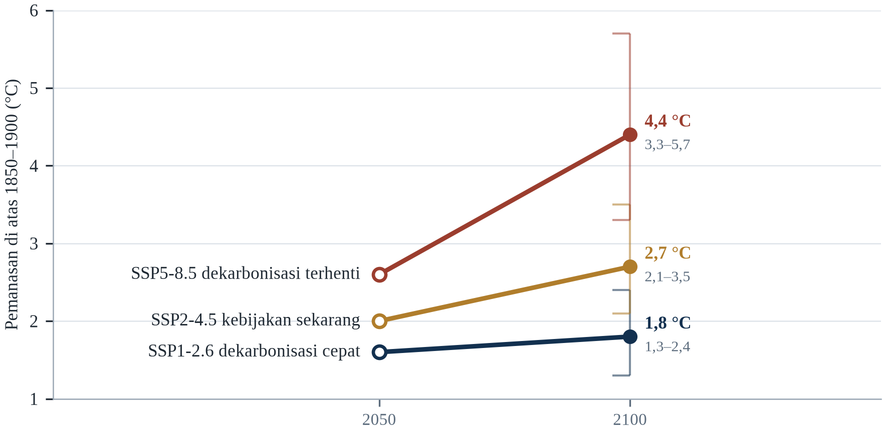||Sumber: Tabel 2.1. Garis tegak menunjukkan rentang 2100; skenario SSP sebagaimana dirangkum IPCC (2021, 2023).

Dari tabel ini muncul dua kesimpulan. Pertama, perbedaan antara lintasan terendah dan tertinggi pada 2100 adalah sekitar 2,6 °C — lebih besar daripada seluruh pemanasan yang telah terjadi sejak Revolusi Industri. Kedua, perbedaan itu tidak muncul secara merata: lintasan tinggi menghasilkan gelombang panas yang jauh lebih sering, kekeringan yang lebih panjang, dan kenaikan muka laut yang lebih cepat, sementara lintasan rendah masih menghasilkan konsekuensi yang serius tetapi lebih dapat dikelola.

Perubahan besar dalam teknologi penyimpanan energi atau dalam biaya energi surya dapat mempercepat dekarbonisasi lebih cepat daripada yang diasumsikan dalam lintasan menengah. Sebaliknya, umpan balik karbon yang lebih kuat daripada perkiraan, atau pelepasan metana dari permafrost, dapat membuat lintasan tinggi lebih buruk daripada angka di atas. Yang tidak dapat diubah oleh teknologi adalah karbon yang sudah berada di atmosfer: ia akan tetap di sana selama berabad-abad, dan pemanasan yang telah terjadi tidak dapat dibatalkan dalam skala waktu satu generasi.

---

# Bab 3: Sistem Iklim, Umpan Balik dan Pemantauan

*Tema: sistem iklim, mekanisme umpan balik dan pemantauan*

Iklim bukanlah suhu. Iklim adalah mesin dengan beberapa bagian yang bergerak — atmosfer, laut, kriosfer, biosfer, dan permukaan daratan — yang terhubung begitu erat sehingga perubahan pada satu bagian terasa di semua bagian lain, biasanya setelah jeda. Atmosfer merespons dalam hitungan hari, laut dalam hitungan dekade, lapisan es dalam hitungan abad. Perbedaan waktu respons inilah fakta terpenting bagi siapa pun yang mencoba memahami mengapa konsekuensi emisi datang jauh setelah emisinya, dan mengapa sebagian konsekuensi itu tidak dapat dibalik dalam jadwal yang berarti bagi orang-orang yang mengalaminya.

Keterhubungan itu juga menjelaskan mengapa iklim tidak menghangat secara mulus. Panas yang tersimpan di laut dapat dilepaskan bertahun-tahun kemudian; pergeseran pola angin dapat mendinginkan satu benua selama satu dekade sementara planet secara keseluruhan menghangat; letusan gunung berapi dapat menekan suhu global selama dua atau tiga tahun. Variasi internal ini bukanlah derau dalam arti tidak bermakna — ia adalah cuaca dari sistem iklim, dan ia menentukan apakah panen tertentu gagal atau bertahan, apakah kota tertentu banjir tahun ini atau tahun depan.

Umpan balik adalah mekanisme yang mengubah dorongan kecil menjadi respons besar, atau dorongan besar menjadi respons kecil. Pemanasan meningkatkan uap air atmosfer, yang sendiri merupakan gas rumah kaca, yang menghasilkan pemanasan lebih lanjut; itu umpan balik positif, dan ia kira-kira menggandakan efek karbon dioksida saja. Pemanasan melelehkan es yang memantulkan cahaya, sehingga menyingkap laut gelap yang menyerap lebih banyak sinar matahari; umpan balik positif lainnya. Tetapi pemanasan juga meningkatkan radiasi yang dipancarkan planet ke angkasa, dan itu umpan balik negatif serta alasan sistem ini tidak meledak. Keseimbangan antara efek-efek ini, bukan kekuatan salah satunya, yang menentukan seberapa sensitif iklim.

Bab ini membahas keseimbangan itu, ambang batas di mana keseimbangan dapat berubah secara mendadak, dan instrumen yang memungkinkan kita menyaksikannya. Bab ini ditutup dengan topik yang paling tidak menarik dan paling penting dalam ilmu iklim: kualitas data, dan pertanyaan tentang apa yang dapat dan tidak dapat dikatakan oleh sebuah pengukuran.

Iklim bukan cuaca yang dirata-ratakan dalam waktu lama; ia sistem dengan komponen yang mempertukarkan energi, air, dan karbon pada skala waktu dari jam hingga milenium. Atmosfer merespons dalam hitungan hari, laut dalam hitungan tahun hingga abad, lapisan es dalam hitungan abad hingga milenium, dan biosfer dalam hitungan musim hingga dekade. Perbedaan waktu respons itulah yang membuat sistem iklim menyimpan memori: laut menahan panas yang akan dilepaskan kemudian, lapisan es menahan air yang akan menaikkan laut selama generasi, dan siklus karbon menahan gas yang akan menghangatkan planet lama setelah emisi berhenti.

## 3.1 Sistem Iklim

Bumi menerima sekitar 340 watt energi matahari untuk setiap meter persegi permukaannya, dirata-ratakan sepanjang siang dan malam serta sepanjang musim. Sekitar tiga puluh persen dipantulkan kembali ke angkasa oleh awan, es, dan permukaan terang — albedo — dan sisanya diserap oleh atmosfer, laut, dan daratan. Karena planet ini tidak memanas atau mendingin secara katastrofik dalam skala waktu manusia, energi yang keluar harus kira-kira sama dengan energi yang masuk. Efek rumah kaca bekerja dengan memperlambat kepergian energi itu, bukan dengan menambah energi; sistem menyesuaikan diri dengan menghangat sampai radiasi keluar kembali seimbang dengan sinar matahari yang masuk (Trenberth, Fasullo dan Kiehl, 2009).

Yang membuat sistem ini rumit adalah bahwa komponen-komponennya memiliki memori yang berbeda. Atmosfer melupakan anomali suhu dalam hitungan minggu; permukaan laut mengingatnya selama berbulan-bulan hingga bertahun-tahun; laut dalam selama berabad-abad; lapisan es selama ribuan tahun. Denyut panas yang disuntikkan ke atmosfer karena itu terbagi: sebagian lolos ke angkasa segera, sebagian diserap laut dan dikembalikan puluhan tahun kemudian, dan sebagian dikonsumsi untuk melelehkan es. Hal yang sama berlaku untuk karbon dioksida, yang terus dipertukarkan antara atmosfer, biosfer, dan laut, dengan sebagian kecil tetap berada di udara selama ribuan tahun.

Konsekuensi praktisnya adalah bahwa iklim merespons perubahan gaya radiasi dengan jeda yang bergantung pada komponen yang diamati. Suhu permukaan merespons dalam beberapa tahun, permukaan laut dalam berabad-abad, dan lapisan es dalam ribuan tahun. Pembuat kebijakan yang mengharapkan respons cepat yang terlihat setelah pemotongan emisi karena itu melihat variabel yang salah; responsnya nyata, tetapi ia muncul lebih dulu di laut dan baru kemudian di pesisir.

Komponen-komponennya terkait dengan cara yang membuat prediksi sulit. Atmosfer menggerakkan sirkulasi laut melalui tegangan angin; laut menyimpan dan mengangkut panas; es laut mengubah reflektivitas permukaan; biosfer mempertukarkan karbon dan air dengan atmosfer; dan kriosfer merespons lambat tetapi dengan konsekuensi besar. Perubahan pada satu komponen merambat melalui yang lain dengan jeda dari hari hingga abad, itulah sebabnya sistem dapat tampak stabil untuk periode panjang lalu menata ulang dengan cepat setelah ambang terlampaui.

Komponen-komponennya terhubung melalui aliran energi, air, dan karbon, dan setiap aliran punya jamnya sendiri. Energi matahari tiba dalam hitungan menit dan diserap atau dipantulkan dalam hitungan jam; atmosfer membagikannya dalam hitungan hari; laut menyimpannya berabad-abad; lapisan es merespons dalam milenium. Hierarki skala waktu inilah alasan iklim dapat disebut keadaan, bukan peristiwa cuaca, dan alasan perubahan pada pemaksaan menghasilkan akibat yang datang dalam urutan tetap. Komponen cepat menentukan kondisi yang dialami komponen lambat, sementara komponen lambat menentukan garis dasar tempat komponen cepat bervariasi. Gelombang panas adalah peristiwa cepat di dalam keadaan lambat, dan keadaan lambat itulah yang menentukan apakah gelombang itu luar biasa atau biasa.

Sistem iklim adalah kumpulan komponen yang terkopel, dan koplingnya yang membuat perilakunya sulit diprediksi. Atmosfer merespons dalam hitungan hari, laut dalam hitungan tahun, lapisan es dalam hitungan abad, dan siklus karbon dalam hitungan milenium, dan interaksi di antaranya menghasilkan variabilitas yang tidak dapat diungkap satu musim. Energi datang dari matahari, didistribusikan angin dan arus, dan keluar sebagai radiasi inframerah, dan keseimbangan antara yang masuk dan yang keluar adalah yang diubah gas rumah kaca. Perubahan kecil pada keseimbangan itu, berlangsung puluhan tahun, menghasilkan perubahan suhu besar karena ketidakseimbangannya berakumulasi di laut.

## 3.2 Sirkulasi Atmosfer dan Laut

Atmosfer memindahkan panas dari tropis ke kutub melalui tiga sel besar di setiap belahan: sel Hadley, yang mengangkat udara lembap di khatulistiwa dan menurunkannya di subtropis; sel Ferrel, yang menggerakkan angin baratan lintang menengah; dan sel kutub. Batas antara sel-sel ini adalah tempat jet stream berjalan, dan posisi jet menentukan apakah badai musim dingin mencapai Lisbon atau tertahan di atas Laut Utara. Ketika tropis menghangat lebih cepat daripada kutub, gradien suhu melemah dan jet cenderung bergeser ke arah kutub, meskipun efeknya tidak merata dan masih menjadi pertanyaan penelitian yang aktif (IPCC, 2021, Bab 4).

Laut memindahkan panas secara paralel, dan lebih lambat. Sirkulasi Terbalik Meridional Atlantik membawa air permukaan hangat ke utara, mendinginkannya di laut Nordik, dan mengembalikannya ke selatan sebagai air dalam yang dingin dan padat; Gulf Stream adalah ekspresi permukaannya yang paling terlihat. Sirkulasi ini mengangkut sekitar delapan belas juta meter kubik air per detik — sekitar seratus kali aliran Sungai Amazon — dan mengirim panas ke Eropa yang membantu menjaga musim dinginnya lebih ringan daripada musim dingin di lintang serupa di Kanada. Sirkulasi ini digerakkan oleh perbedaan suhu dan salinitas, itulah sebabnya tambahan air tawar dari lelehan es Greenland diawasi dengan sangat ketat.

Di atas sirkulasi tetap ini terdapat osilasi: El Niño–Southern Oscillation, yang menggeser panas melintasi Pasifik tropis setiap dua hingga tujuh tahun dan mengubah curah hujan dari Peru hingga Indonesia; North Atlantic Oscillation, yang mengatur cuaca musim dingin Eropa; Indian Ocean Dipole; Southern Annular Mode. Pola-pola ini tidak menciptakan tren jangka panjang, tetapi mereka menentukan tahun mana yang panas, tahun mana yang basah, dan di mana kerusakannya jatuh.

Pola sirkulasi skala besar yang membentuk iklim regional itu sendiri merespons pemanasan, dan responsnya tidak seragam. Sirkulasi terbalik Meridional Atlantik, yang membawa air hangat ke utara dan air dingin ke selatan, diproyeksikan melemah, meskipun besaran dan waktunya diperdebatkan; sirkulasi Hadley meluas, yang menggeser zona kering subtropis ke arah kutub; dan jet stream menjadi lebih bervariasi, yang memungkinkan udara dingin tumpah ke selatan pada sebagian musim dingin bahkan ketika rata-rata menghangat. Pergeseran regional itu lebih penting bagi adaptasi daripada rata-rata global.

Sirkulasi skala besar paling mudah dibayangkan sebagai mesin yang memindahkan panas dari ekuator ke kutub, dan polanya dibentuk benua sama besarnya dengan fisika. Angin pasat dan sel Hadley mengangkat udara lembap di tropis dan menjatuhkannya sebagai hujan, itulah sebabnya tempat terbasah di daratan berada di cabang naik dan tempat terkering di cabang turun. Jet stream lintang menengah mengarahkan badai dan diganggu oleh selisih suhu antara tropis dan Arktik, selisih yang menyempit. El Niño dan La Niña menggeser seluruh pola di Pasifik selama satu atau dua tahun. Dunia yang memanas tidak mematikan mesin ini; ia mengubah setelannya, dan perubahan setelan membagi ulang hujan dengan cara yang lebih penting bagi petani daripada rata-rata global.

## 3.3 Umpan Balik Positif dan Negatif

Umpan balik terbesar juga yang paling tidak terlihat. Udara yang lebih hangat menahan lebih banyak uap air — sekitar tujuh persen lebih banyak untuk setiap derajat pemanasan, mengikuti hubungan Clausius–Clapeyron — dan uap air adalah gas rumah kaca yang kuat. Kenaikan uap air kira-kira menggandakan pemanasan yang akan dihasilkan karbon dioksida sendiri, itulah sebabnya sensitivitas iklim terhadap penggandaan CO2 sekitar tiga derajat, bukan satu setengah. Ini bukan mekanisme spekulatif; ia terukur, dan ia adalah alasan mengapa fisika yang sama yang memberikan efek langsung sederhana memberikan efek total yang besar (IPCC, 2021, Bab 7).

Es dan salju memberikan umpan balik positif kedua. Permukaan putih memantulkan sinar matahari; laut gelap dan daratan gelap menyerapnya. Ketika es menyusut, permukaan yang baru tersingkap menyerap lebih banyak energi, yang menghangatkan wilayah itu, yang melelehkan lebih banyak es. Umpan balik ini paling kuat di Arktik, di mana ia berkontribusi pada amplifikasi pemanasan tiga hingga empat kali lipat dibandingkan rata-rata global. Umpan balik ketiga berasal dari siklus karbon: pemanasan meningkatkan respirasi mikroba tanah dan frekuensi kebakaran, melepaskan karbon yang tersimpan, yang menghasilkan pemanasan lebih lanjut.

Menghadapi semua ini ada umpan balik negatif yang menjaga stabilitas sistem. Planet memancarkan lebih banyak energi ketika menghangat, mengikuti hukum Stefan–Boltzmann; laju penurunan suhu terhadap ketinggian menyesuaikan diri dengan cara yang meredam respons di tropis; dan pelapukan batuan silikat yang meningkat menghilangkan karbon dioksida dari atmosfer dalam skala waktu geologis. Awan adalah ketidakpastian terbesar: awan rendah memantulkan sinar matahari dan mendinginkan, awan tinggi menjebak panas dan menghangatkan, dan bagaimana keseimbangannya berubah seiring pemanasan tetap menjadi sumber penyebaran terbesar di antara model iklim.

Umpan balik adalah proses yang memperkuat atau meredam perubahan awal, dan tandanya menentukan apakah sistem stabil. Umpan balik albedo es bersifat positif: pemanasan melelehkan es, menyingkap laut atau daratan yang lebih gelap, yang menyerap lebih banyak sinar matahari dan menghangatkan lebih jauh. Umpan balik uap air juga positif, karena udara hangat menahan lebih banyak uap air, dan uap air sendiri gas rumah kaca. Umpan balik awan tetap menjadi sumber ketidakpastian terbesar dalam sensitivitas iklim, karena awan dapat memantulkan sinar matahari atau menahan panas tergantung ketinggian, ketebalan, dan ukuran butirannya.

Umpan balik adalah pembeda antara perhitungan sederhana dan penilaian risiko yang serius. Uap air adalah yang terkuat dan tercepat: udara yang lebih hangat menampung lebih banyak uap, uap itu sendiri gas rumah kaca, dan pemanasan tambahannya kurang lebih menggandakan respons terhadap karbon dioksida saja. Hilangnya es dan salju menggelapkan permukaan, sehingga menyerap lebih banyak sinar matahari. Respons awan adalah ketidakpastian terbesar yang tersisa, karena awan memantulkan sinar matahari sekaligus menahan panas keluar, dan keseimbangannya bergantung pada ketinggian, ketebalan, dan ukuran tetesnya. Respons Planck — kenaikan radiasi keluar saat permukaan menghangat — adalah suku penstabil yang tanpanya sistem bisa lepas kendali. Sensitivitas iklim adalah hasil bersih suku-suku itu.

Uap air penguat terkuat, karena udara hangat menahan lebih banyak uap dan uap air sendiri gas rumah kaca. Umpan balik albedo es yang paling terlihat, karena es putih memantulkan sinar matahari yang diserap air gelap, sehingga pencairan mempercepat pencairan. Awan ketidakpastian terbesar, karena ia dapat mendinginkan dengan memantulkan sinar dan menghangatkan dengan memerangkap panas, dan keseimbangannya berbeda menurut ketinggian serta jenisnya. Umpan balik lambat menentukan suhu akhirnya.

## 3.4 Titik Kritis dan Perubahan Mendadak

Sebagian bagian sistem iklim tidak merespons secara bertahap. Ia berperilaku seperti jungkat-jungkit yang ditahan tepat melewati titik seimbangnya: dorongan tambahan yang kecil menghasilkan perubahan besar, cepat, dan sering tidak dapat dibalik. Para peneliti menyebutnya elemen titik kritis, dan penilaian pada 2022 mengidentifikasi enam belas elemen, termasuk lapisan es Greenland dan Antartika Barat, sirkulasi terbalik Atlantik, hutan hujan Amazon, permafrost boreal, dan terumbu karang air hangat (Armstrong McKay dkk., 2022; Steffen et al., 2018). Penilaian itu menemukan bahwa beberapa di antaranya berisiko pada tingkat pemanasan antara 1,5 dan 2 °C, yang berarti berada dalam kisaran yang kemungkinan dihasilkan oleh kebijakan saat ini.

Konsep ini mudah disalahpahami. Titik kritis bukanlah tebing pada suhu yang tepat; ia adalah wilayah dalam ruang parameter di mana sistem kehilangan stabilitas, dan lokasi tepatnya tidak pasti karena sistemnya kompleks dan pengamatannya terbatas. Melewati ambang juga tidak selalu menghasilkan perubahan seketika: lapisan es Greenland dapat membutuhkan berabad-abad untuk hilang setelah komitmennya terjadi, dan Amazon dapat terdegradasi selama beberapa dekade melalui kebakaran dan kekeringan. Yang berubah pada ambang itu bukan kecepatan perubahan, melainkan sifat dapat-dibaliknya.

Implikasi kebijakannya asimetris. Jika sistem bersifat linear, melewati target dan kembali lagi nanti adalah strategi yang dapat diterima. Jika sistem mengandung ambang batas, overshoot menjadi perjudian dengan kerugian permanen di sisi lain. Asimetri itu, bukan angka suhu tunggal mana pun, adalah argumen terkuat untuk memperlakukan 1,5 °C sebagai batas yang harus didekati dengan hati-hati, bukan target yang dapat ditukar dengan prioritas lain.

Tipping point adalah ambang yang di luarnya komponen sistem menata ulang ke keadaan lain, sering tak terbalikkan pada skala waktu manusia. Kandidatnya mencakup runtuhnya lapisan es Antarktika Barat, matinya hutan Amazon, pencairan permafrost boreal, terhentinya sirkulasi Atlantik, dan pemutihan terumbu karang air hangat. Lenton dkk. (2008) berargumen bahwa beberapa di antaranya dapat terpicu pada pemanasan 1,5–2 °C, dan karya berikutnya memperhalus rentangnya sambil memastikan bahwa risikonya naik tajam pada setiap pecahan derajat.

Titik kritis bukan tebing dalam arti biasa; ia ambang ketika sebuah umpan balik mengambil alih dari pemaksaan luar dan melanjutkan perubahan dengan sendirinya. Tanda khasnya histeresis: sistem tidak kembali ke keadaan sebelumnya ketika pemaksaan kembali ke tingkat sebelumnya, karena ia sudah menetap di cekungan lain. Sirkulasi terbalik Atlantik, lapisan es Greenland, hutan Amazon, permafrost, dan terumbu karang tropis adalah elemen yang paling sering dibahas, dan semuanya berbeda jauh dalam seberapa dekat ambangnya dan seberapa cepat peralihannya. Ringkasan jujurnya: sebagian lebih rapuh daripada satu dekade lalu, tidak satu pun dapat dipertanggalkan tanggalnya, dan risiko melewati beberapa sekaligus adalah bagian yang paling buruk ditangani model.

Titik kritis adalah elemen sistem yang dapat berubah mendadak setelah ambang terlampaui, dan kesulitannya ambang itu tidak dapat diamati sebelumnya. Sirkulasi terbalik Atlantik, lapisan es Antartika Barat, hutan Amazon, dan permafrost paling banyak dibahas, dan estimasi ambangnya punya ketidakpastian besar. Yang penting bagi kebijakan bukan suhu tepat ketika masing-masing akan terpicu melainkan kenyataan bahwa risikonya naik dengan setiap kenaikan pemanasan, dan sebagian perubahannya tidak dapat dibalik dalam skala waktu manusia. Kerangka risiko yang memperlakukan titik kritis sebagai tebing meremehkannya; bahayanya adalah lereng yang kecuramannya bertambah.

## 3.5 Pemantauan Suhu dan Satelit

Rekaman suhu global dirakit dari sekitar tiga puluh ribu stasiun darat, beberapa ribu kapal dan pelampung, serta sejumlah instrumen satelit, semuanya diproses oleh empat kelompok independen dengan metode yang berbeda. Satelit telah mengukur suhu troposfer bawah sejak 1979, pertama dengan sounder gelombang mikro dan kemudian dengan interferometer inframerah; mereka memberikan cakupan global tetapi menderita akibat pergeseran orbit, perubahan kalibrasi, dan kesulitan memisahkan sinyal atmosfer bawah dari sinyal permukaan. Produk reanalisis, yang menggabungkan observasi dengan model cuaca, mengisi celah dan menyediakan medan suhu, angin, dan kelembapan yang konsisten di seluruh planet (Hersbach dkk., 2020).

Setiap sistem memiliki kesalahan khasnya. Stasiun permukaan presisi tetapi tidak merata, dengan cakupan padat di Eropa dan Amerika Utara serta cakupan jarang di sebagian Afrika dan Amerika Selatan. Satelit seragam tetapi tidak langsung, mengukur radian, bukan suhu dan memerlukan model transfer radiatif untuk mengubahnya. Reanalisis lengkap tetapi mewarisi bias modelnya. Keterampilan sistem ini berasal dari ketidaksepakatan: ketika metode independen bertemu, hasilnya kuat; ketika mereka menyimpang, penyimpangan itu menunjuk pada masalah yang layak diselidiki.

Arsitektur sistem itu sendiri merupakan pencapaian kebijakan. Global Climate Observing System, yang didirikan pada 1992, menetapkan standar untuk instrumen, pertukaran data, dan kesinambungan, dan kerangka transparansi Perjanjian Paris bergantung padanya (United Nations, 2015b). Ketika sebuah negara melaporkan emisi atau kemajuannya, ia mengandalkan pengukuran yang hanya dapat dipercaya karena dapat dibandingkan lintas batas. Pemantauan, dengan kata lain, bukan lampiran teknis kebijakan iklim; ia adalah infrastruktur yang membuat kebijakan dapat diverifikasi.

Pemantauan adalah barang publik global yang pendanaannya tidak merata. Sistem Pengamatan Iklim Global menetapkan variabel esensial yang harus diukur, tetapi banyak negara kekurangan stasiun, instrumen, dan staf terlatih untuk mengukurnya, dan celahnya terkonsentrasi di Afrika, Amerika Selatan, dan sebagian Asia — justru di tempat kerentanan tertinggi. Satelit mengisi sebagian celah, tetapi satelit memerlukan kalibrasi terhadap kebenaran di permukaan, dan program satelit yang berhenti memerlukan bertahun-tahun untuk digantikan.

Catatan suhu yang sampai ke berita adalah indeks yang dirakit dari empat jenis pengukuran: stasiun darat, pelampung dan kapal di laut, balon cuaca, dan satelit. Masing-masing punya struktur galat dan cakupan berbeda. Kapal mengukur suhu air yang diambil untuk pendinginan mesin, yang menghangat seiring desain mesin dan harus dikoreksi; pelampung mengukur pada kedalaman tetap; satelit mengukur radiasi lapisan luas, bukan satu titik. Reanalisis menggabungkan semuanya dengan model cuaca untuk menghasilkan grid yang konsisten secara fisik. Kesepakatan antarkelompok independen itulah yang membuat trennya kredibel, dan perbedaan pada desimal terakhir itulah gunanya batang galat yang jujur, bukan bahan sanggahan.

Pemantauan suhu adalah tambal sulam yang berhasil karena bagian-bagiannya dikalibrasi satu terhadap yang lain. Stasiun cuaca mengukur pada dua meter di atas tanah dan telah dipindahkan, diotomasi, serta dikelilingi bangunan selama beberapa dekade, sehingga catatannya harus disesuaikan; penyesuaiannya didokumentasikan dan diuji, dan kelompok independen dengan metode berbeda mencapai jawaban yang mirip. Satelit mengukur suhu atmosfer bawah dengan penyuaraan gelombang mikro dan punya masalah drif serta antarkalibrasi sendiri, itulah sebabnya mereka ditambatkan pada catatan permukaan dan radiosonde. Reanalisis seperti ERA5 menggabungkan observasi dengan model cuaca untuk menghasilkan grid yang konsisten.

## 3.6 Pemantauan Laut dan Es

Laut, sampai baru-baru ini, adalah bagian sistem iklim yang paling sedikit diamati — sebuah celah yang penting karena laut menyimpan lebih dari sembilan puluh persen kelebihan panas. Itu berubah dengan Argo, program internasional yang mulai mengerahkan pelampung profil otonom pada 2000 dan kini memelihara sekitar empat ribu pelampung (IPCC, 2019b). Setiap pelampung tenggelam hingga dua ribu meter, mengukur suhu dan salinitas saat naik, mengirimkan datanya melalui satelit, dan mengulangi siklus setiap sepuluh hari. Hasilnya adalah gambaran tiga dimensi kandungan panas laut, diperbarui terus-menerus, dan tersedia bagi siapa pun yang memiliki koneksi internet.

Es diamati dengan kombinasi instrumen yang berbeda. Altimetri satelit, yang mengukur tinggi permukaan laut sejak 1992, juga mengukur ketinggian lapisan es; misi GRACE, yang diluncurkan pada 2002, menimbang lapisan es dengan mendeteksi perubahan kecil dalam medan gravitasi Bumi. Altimeter radar dan laser mengukur penipisan, dan sensor gelombang mikro memetakan luas es laut setiap hari. Setiap metode memiliki titik buta — altimetri kesulitan di tepi lapisan es yang curam, misi gravitasi memiliki resolusi spasial kasar — tetapi bersama-sama mereka telah menghasilkan gambaran kehilangan yang semakin cepat (Shepherd dkk., 2020).

Data dari sistem ini terbuka, yang tidak biasa untuk infrastruktur mahal dan penting bagi kredibilitas. Pemerintah yang mempersoalkan proyeksi kenaikan muka laut dapat mengunduh data altimetri, catatan pasang surut, dan data gravitasi lalu memeriksa aritmetikanya sendiri. Keterbukaan itu tidak menyelesaikan perselisihan politik, tetapi ia mempersempit ruang bagi perselisihan yang dilakukan dengan pernyataan alih-alih bukti.

Array Argo mengubah pengamatan laut. Sebelumnya, suhu dan salinitas bawah permukaan diukur terutama oleh kapal riset pada jalur jarang, meninggalkan wilayah luas tanpa pengamatan; sesudahnya, sekitar 4.000 pelampung otonom melayang di kedalaman dan muncul setiap sepuluh hari untuk memancarkan profil. Array itu menghasilkan catatan kandungan panas laut yang berkelanjutan sejak awal 2000-an, dan menjadi dasar perkiraan bahwa laut menghangat dengan laju yang mempercepat. Keberadaannya juga pelajaran kerja sama internasional: pelampungnya disumbangkan lebih dari tiga puluh negara dan datanya tersedia bebas.

Pengukuran laut mengubah pokok persoalan. Sebelum 2000-an, bagian dalam laut disampel di beberapa ribu titik per tahun dari kapal riset, terutama di jalur pelayaran, dan perkiraan kandungan panas yang dihasilkan punya batang galat cukup lebar untuk menyembunyikan perubahan satu dekade. Armada Argo, sekumpulan pelampung otonom yang menyelam, hanyut, dan muncul kembali untuk mengirim profil, mengubah peta jarang itu menjadi sensus rutin. Satelit menambahkan massa laut dan tinggi permukaannya. Hasilnya, kandungan panas laut kini dianggap banyak ilmuwan sebagai indikator paling andal dari ketidakseimbangan energi planet, karena ia mengintegrasikan semua yang dilakukan permukaan dan karena lebih tenang daripada suhu udara di atasnya.

Laut dan es diukur dengan instrumen yang tidak dilihat sebagian besar orang. Sekitar empat ribu pelampung Argo mengikuti arus, menyelam sampai dua ribu meter dan muncul ke permukaan untuk memancarkan profilnya, dan bersama-sama mereka memberi laut padanan jaringan cuaca. Altimeter satelit mengukur muka laut terus-menerus sejak 1993, dan catatannya menunjukkan kenaikan yang melaju dari sekitar dua milimeter per tahun menjadi lebih dari empat (IPCC, 2019b). Satelit pengukur gravitasi menimbang lapisan es dan akuifer, dan datanya menunjukkan Greenland serta Antartika kehilangan massa dengan laju yang meningkat. Pemantauan gletser bergantung pada beberapa ratus patok dan banyak kerja lapangan.

## 3.7 Atribusi Peristiwa Ekstrem

Atribusi dimulai dengan pertanyaan tentang satu gelombang panas. Setelah musim panas Eropa 2003 menewaskan puluhan ribu orang, tim yang dipimpin Peter Stott bertanya apakah probabilitas peristiwa semacam itu telah berubah karena pengaruh manusia, dan menjawabnya dengan membandingkan simulasi model dengan dan tanpa gas rumah kaca (Stott, Stone dan Allen, 2004). Jawabannya — bahwa risikonya kira-kira berlipat dua — menetapkan metode yang sejak itu diterapkan pada ratusan peristiwa, dari gelombang panas Rusia 2010 hingga banjir Pakistan 2022 (WMO, 2023).

Metodenya menjadi lebih cepat dan lebih terstandardisasi. Kelompok World Weather Attribution, yang didirikan pada 2014, kini menghasilkan analisis cepat dalam hitungan minggu setelah suatu peristiwa, menggunakan protokol yang ditinjau sejawat dan ansambel model yang besar. Temuannya dinyatakan sebagai perubahan probabilitas atau intensitas, bukan sebagai kepastian: kubah panas Pasifik Barat Laut 2021 dinilai hampir mustahil tanpa perubahan iklim; banjir Pakistan 2022 menjadi lebih mungkin karena pemanasan, meskipun kerentanan dan pengelolaan lahan menentukan skala bencananya; banjir Derna di Libya 2023 dikaitkan dengan air Laut Tengah yang lebih hangat dari biasanya (WMO, 2023; Otto et al., 2021).

Atribusi memiliki batas yang mudah dilupakan. Ia lebih andal untuk panas daripada hujan, lebih andal pada skala benua daripada lokal, dan paling lemah di tempat observasinya jarang — yang biasanya justru tempat populasi paling rentan bermukim. Ia juga tidak mengatakan apa pun tentang siapa yang bertanggung jawab atau siapa yang harus membayar; itu pertanyaan politik yang dapat diinformasikan oleh atribusi tetapi tidak dapat dijawab olehnya. Digunakan dengan hati-hati, atribusi mengubah rasa ketidakadilan yang samar menjadi klaim yang dapat dipertahankan; digunakan secara sembarangan, ia menciptakan harapan bahwa setiap bencana memiliki satu penyebab yang dapat diatribusikan.

Studi atribusi membedakan pengaruh terhadap besaran peristiwa dan pengaruh terhadap probabilitasnya, dan perbedaan itu sering hilang dalam diskusi publik. Gelombang panas bisa menjadi 2 °C lebih panas karena perubahan iklim sekaligus beberapa kali lebih mungkin; peristiwa hujan bisa 10 persen lebih intens tanpa perubahan frekuensi yang terdeteksi. Melaporkan hanya salah satu angka dapat menyesatkan, itulah sebabnya studi atribusi yang cermat melaporkan keduanya dan menjelaskan arti masing-masing bagi keputusan tentang infrastruktur, asuransi, dan kompensasi.

Atribusi peristiwa bekerja dengan membangun dunia kontrafaktual. Ribuan jalur model dijalankan dengan konsentrasi gas rumah kaca yang teramati dan ribuan dengan konsentrasi pra-industri, lalu frekuensi peristiwa dalam masing-masing ansambel dibandingkan. Rasionya dinyatakan sebagai rasio risiko atau perubahan peluang, dan jawabannya sering merupakan pernyataan tentang kemungkinan, bukan besaran. Metodenya kini cukup cepat sehingga studi muncul dalam beberapa pekan setelah bencana, dan itu mengubah perdebatan publik: gelombang panas dapat diberi sumbangan terhadap peluangnya sebelum kerugiannya dihitung. Batasnya nyata, terutama untuk curah hujan dan peristiwa yang digerakkan kombinasi langka, tetapi arah bidang ini menuju penilaian rutin, cepat, dan hati-hati.

Atribusi peristiwa ekstrem menjawab pertanyaan yang lebih sempit daripada kedengarannya: bukan apakah perubahan iklim menyebabkan suatu peristiwa, melainkan seberapa besar ia mengubah peluang atau intensitasnya. Tekniknya membandingkan dua dunia model, satu dengan konsentrasi gas rumah kaca yang ada dan satu tanpa, lalu menghitung seberapa sering masing-masing menghasilkan peristiwa sebesar yang teramati. Hasilnya pernyataan tentang peluang, dan kekuatannya bergantung pada mutu model serta panjang catatan observasi. Pendekatan pelengkap menyusun narasi fisik peristiwa dan bertanya bagaimana pemanasan memengaruhi setiap bahannya, yang lebih informatif untuk satu kasus dan lebih sulit dikuantifikasi.

## 3.8 Sistem Peringatan Dini

Peringatan dini adalah tindakan adaptasi paling hemat biaya yang tersedia, dan ia masih hilang di tempat yang paling membutuhkannya. Inisiatif Early Warnings for All Perserikatan Bangsa-Bangsa, yang diluncurkan pada 2022, memperkirakan bahwa sekitar setengah negara di dunia tidak memiliki sistem peringatan dini multi-bahaya, dan bahwa di tempat sistem itu ada, sistem tersebut sering gagal pada mil terakhir — peringatan mencapai ibu kota tetapi tidak mencapai desa, atau datang dalam bahasa dan format yang tidak dapat digunakan oleh orang-orang yang berisiko (UNDRR dan WMO, 2023; WMO, 2022). Laporan yang sama memperkirakan bahwa peringatan dua puluh empat jam sebelum badai datang dapat mengurangi kerusakan sekitar tiga puluh persen.

Bangladesh adalah contoh standar tentang apa yang mungkin. Setelah siklon Bhola 1970 menewaskan sekitar tiga ratus ribu orang, negara itu membangun sistem tempat berlindung, jaringan relawan, dan peringatan ponsel yang telah menurunkan korban secara drastis: Siklon Amphan pada 2020, badai dengan kekuatan sebanding, menewaskan sekitar seratus orang. Perbaikan itu bukan terutama teknologi. Ia datang dari tempat berlindung yang ditempatkan di mana orang tinggal, peringatan yang disampaikan dalam bahasa lokal, dan latihan yang membuat evakuasi menjadi rutin.

Panas adalah kasus yang lebih sulit, karena panas membunuh secara diam-diam dan tanpa pendaratan yang terlihat. Rencana aksi panas Ahmedabad, yang diadopsi setelah gelombang panas 2010 menewaskan lebih dari seribu orang, menggabungkan prakiraan berkode warna, pusat pendinginan, perubahan jam kerja, dan penjangkauan kelompok rentan; evaluasi menunjukkan bahwa rencana itu telah mengurangi kematian secara substansial (Hess dkk., 2018). Pelajarannya dapat digeneralisasi: peringatan hanya merupakan peringatan dini jika ia datang bersama kapasitas untuk bertindak.

Sistem peringatan dini adalah rantai alih-alih perangkat: pengamatan, prakiraan, interpretasi, keputusan, pesan, penerimaan, dan tindakan. Mata rantai terlemah menentukan hasilnya, dan pada sebagian besar sistem mata rantai terlemah adalah transisi dari pesan ke tindakan. Organisasi Meteorologi Dunia memperkirakan bahwa sekitar sepertiga populasi dunia masih belum tercakup sistem peringatan dini yang memadai, dan bahwa celahnya terbesar di Afrika, tempat imbal hasil manusia dan ekonomi atas investasi akan paling tinggi (WMO, 2023).

Peringatan yang efektif adalah rantai, bukan pesan. Prakiraan menghasilkan peluang; otoritas mengubahnya menjadi ambang; ambang memicu keputusan; keputusan mencapai orang yang dapat bertindak. Setiap mata rantai dapat gagal, dan yang terlemah biasanya yang terakhir. Sistem peringatan siklon Bangladesh bekerja karena ambang, tempat penampungan, dan relawan yang mengetuk pintu dirancang bersama. Sistem peringatan panas lebih sering gagal di tingkat rumah tangga, karena nasihat untuk tetap sejuk mengandaikan ada tempat sejuk. Trade-off desainnya tak terhindarkan: ambang lebih rendah menangkap lebih banyak peristiwa tetapi menghasilkan lebih banyak alarm palsu, dan alarm palsu menggerus kepercayaan yang menopang peringatan berikutnya.

Sistem peringatan dini punya empat bagian, dan sistem yang hanya punya bagian pertama adalah siaran, bukan peringatan. Bagian pertama prakiraan, yaitu sainsnya. Bagian kedua penerjemahan prakiraan menjadi pesan yang dapat ditindaklanjuti rumah tangga: seberapa tinggi airnya, jalan mana yang ditutup, di mana tempat pengungsiannya. Bagian ketiga penyampaian, yang harus menjangkau orang yang paling tidak terhubung alih-alih yang paling mudah dijangkau. Bagian keempat kapasitas respons, yaitu tempat pengungsian, transportasi, dan rencananya. Mil terakhir adalah bagian yang menjadi tempat kegagalan, dan biasanya bagian termurah untuk diperbaiki.

## 3.9 Kualitas Data dan Ketidakpastian

Ketidakpastian tidak sama dengan ketidaktahuan, dan perbedaan itu penting bagi cara pernyataan ilmiah harus dibaca. Sebuah pengukuran dapat tidak pasti dengan cara yang terkuantifikasi secara tepat — plus atau minus sepersepuluh derajat, dengan interval kepercayaan yang dinyatakan — dan sebuah proyeksi dapat tidak pasti dengan cara yang mencerminkan ketidaksepakatan yang tulus di antara model-model yang masuk akal. Jenis pertama menyusut dengan instrumen yang lebih baik; jenis kedua menyusut dengan pemahaman yang lebih baik, dan kadang tidak menyusut sama sekali. Mencampuradukkan keduanya menghasilkan keyakinan palsu atau kelumpuhan yang tidak beralasan.

Ilmu iklim membedakan antara variabilitas internal, yaitu komponen tak terduga yang dihasilkan sistem itu sendiri; ketidakpastian model, yaitu penyebaran yang dihasilkan oleh representasi fisika yang berbeda; dan ketidakpastian skenario, yang mencerminkan fakta bahwa emisi masa depan bergantung pada pilihan yang belum dibuat. Hanya yang pertama berkurang dengan data tambahan, dan hanya yang ketiga berkurang dengan kebijakan. Ketika sebuah proyeksi disajikan sebagai rentang, lebar rentang itu biasanya didominasi ketidakpastian skenario pada akhir abad dan ketidakpastian model dalam jangka pendek.

Ada juga masalah disiplin yang baru mulai ditangani bidang ini. Kumpulan data yang digunakan untuk argumen politik akan diperiksa dengan cara yang berbeda daripada kumpulan data yang hanya digunakan untuk penelitian, dan pemeriksaan itu sering menyasar pemrosesan, bukan fisikanya. Pertahanannya adalah transparansi: kode terbuka, penyesuaian yang didokumentasikan, rentang ketidakpastian yang dipublikasikan, dan penjelasan eksplisit tentang apa yang akan mengubah kesimpulan. Praktik-praktik itu kini menjadi standar dalam produk suhu dan permukaan laut utama, dan itulah sebabnya rekaman tersebut bertahan menghadapi puluhan tahun serangan politik.

Ketidakpastian dalam data iklim memiliki tiga sumber berbeda, dan mencampuradukkannya menghasilkan argumen yang buruk. Ketidakpastian observasi berasal dari kesalahan instrumen dan cakupan tidak lengkap; ketidakpastian struktural berasal dari model yang tidak sempurna; dan ketidakpastian skenario berasal dari ketidaktahuan tentang emisi masa depan. Untuk dua dekade ke depan, ketidakpastian struktural dan observasi mendominasi, yang berarti proyeksi pemanasan jangka pendek relatif kukuh; untuk akhir abad, ketidakpastian skenario mendominasi, yang berarti pilihan jalur emisi lebih penting daripada perbaikan model mana pun.

Ketidakpastian informasi iklim terdiri dari tiga jenis, dan mencampurnya adalah sumber sebagian besar perdebatan buruk. Variabilitas internal adalah derau sistem kacau: pemaksaan yang sama dapat menghasilkan urutan tahun berbeda, itulah sebabnya musim dingin yang dingin tidak mengatakan apa pun tentang tren. Ketidakpastian parameter adalah ketidaktahuan tentang nilai tepat suatu besaran, misalnya respons awan. Ketidakpastian struktural adalah kemungkinan arsitektur modelnya salah dengan cara yang tidak dapat diperbaiki parameter. Ansambel menangani dua yang pertama dengan menyampelnya; hanya evaluasi model dan penalaran fisik yang menangani yang ketiga. Satu jalur model adalah skenario, bukan prediksi, dan mengutip satu angkanya sebagai ramalan adalah kesalahan kategori.

Ketidakpastian dalam data iklim mengambil beberapa bentuk, dan mencampurkannya menghasilkan keputusan buruk. Ketidakpastian observasi adalah batang galat pada suatu pengukuran, dan biasanya kecil. Ketidakpastian struktural adalah ketidaksepakatan antarmodel, dan paling besar untuk curah hujan serta proyeksi regional. Ketidakpastian skenario adalah sebaran yang muncul karena tidak tahu berapa emisinya nanti, dan mendominasi masa depan jauh. Variabilitas internal adalah goyangan alami sistem, dan mendominasi satu dekade tunggal. Keputusan yang membutuhkan curah hujan 2050 di satu lembah harus menggabungkan keempatnya, itulah sebabnya jawaban jujurnya biasanya rentang, bukan angka.

## 3.10 Menggunakan Data untuk Keputusan

Langkah terakhir adalah langkah yang paling sering dilewati: mengubah proyeksi probabilistik menjadi keputusan. Pendekatan standar dalam rekayasa adalah merancang untuk periode ulang — pertahanan banjir yang dibangun untuk peristiwa sekali dalam seratus tahun — tetapi pendekatan itu mengasumsikan iklim yang stasioner, yang justru tidak lagi berlaku. Pertahanan yang dirancang untuk statistik abad kedua puluh akan dilampaui lebih sering daripada yang dimaksudkan perancangnya, bukan karena dibangun dengan buruk, tetapi karena statistik yang menjadi dasarnya telah bergeser.

Alternatifnya adalah pengambilan keputusan yang tangguh: alih-alih mengoptimalkan untuk satu perkiraan terbaik, identifikasi opsi yang berkinerja cukup baik di berbagai masa depan, dan utamakan opsi yang dapat disesuaikan saat informasi baru datang. Program Delta Belanda, yang merencanakan kenaikan muka laut hingga beberapa meter sambil membangun secara bertahap yang dapat dipercepat atau dijeda, adalah contoh paling jelas. Thames Barrier, yang dirancang pada 1970-an untuk skenario yang kini tampak optimistis, adalah contoh lain: frekuensi penutupannya naik dari beberapa kali setahun menjadi beberapa kali dalam setahun, dan keputusan untuk menaikkannya diambil berdasarkan pemantauan, bukan prediksi.

Yang dimiliki bersama oleh contoh-contoh ini adalah kesediaan memperlakukan ketidakpastian sebagai parameter desain, bukan hambatan. Itu memerlukan lembaga yang mampu meninjau kembali keputusan, anggaran yang dapat dialihkan, dan publik yang memahami mengapa sebuah rencana mungkin berubah. Alat teknisnya tersedia; kendalanya hampir selalu institusional, itulah sebabnya bab-bab berikutnya memberikan perhatian yang sama besar pada tata kelola seperti pada fisika.

Pengambilan keputusan dalam ketidakpastian tidak memerlukan satu perkiraan terbaik. Ia memerlukan rentang, probabilitas yang dilekatkan pada setiap bagian rentang, dan penilaian tentang seberapa besar risiko yang dapat diterima — pertanyaan politik dan etis, bukan ilmiah. Insinyur sudah bekerja seperti ini ketika merancang untuk banjir seratus tahun; kesulitan dengan perubahan iklim adalah peristiwa seratus tahun itu sendiri bergerak, yang berarti standar desain berbasis statistik historis secara sistematis meremehkan risiko masa depan.

Pembuat keputusan jarang membutuhkan satu taksiran terbaik; mereka membutuhkan rentang masa depan dan pilihan yang berperilaku memadai di seluruh rentang itu. Itulah logika pengambilan keputusan yang kokoh, yang bertanya bukan apa yang akan terjadi melainkan pilihan mana yang paling sedikit gagal dalam kumpulan kondisi masuk akal terluas. Pendekatan ini menyukai tindakan yang memberi hasil baik apakah yang terburuk datang atau tidak: naungan yang menurunkan kematian panas dan menambah kenyamanan, drainase yang menangani hujan biasa maupun ekstrem, tampungan air yang berguna pada tahun kering maupun tahun biasa. Pendekatan ini juga mengenali ambang ketika sebuah keputusan harus berubah, sehingga perdebatan politik tentang keyakinan menjadi perdebatan rekayasa tentang pemicu.

Data menjadi berguna untuk keputusan ketika diubah menjadi standar, dan standarnya biasanya periode ulang. Sistem drainase yang dirancang untuk badai sekali lima puluh tahun adalah pernyataan tentang peluang banjir pada tahun tertentu dan tentang biaya yang diputuskan kota untuk ditanggung. Ketika iklim berubah, periode ulang dari curah hujan tertentu memendek, dan sistem yang memenuhi standar saat dibangun mungkin tidak lagi memenuhinya. Respons praktisnya adalah memperbarui standar desain, menambah kelonggaran pada struktur yang tidak dapat dibangun ulang, dan mempublikasikan asumsinya agar orang yang tinggal di belakang sistem itu tahu apa yang melindungi mereka.

## 3.11 Studi Kasus: Argo dan Laut yang Tersembunyi

Sebelum 2000, bagian dalam laut disampel seperti benua yang dipetakan oleh beberapa lusin pelancong: kapal menurunkan instrumen di titik-titik terpilih, mengambil bacaan, lalu bergerak. Cakupannya jarang, bias ke jalur pelayaran, dan terkonsentrasi di belahan bumi utara. Perkiraan kandungan panas laut karena itu membawa ketidakpastian yang cukup besar untuk menyembunyikan tren selama satu dekade, yang berarti reservoir terbesar sistem iklim juga merupakan yang paling sedikit diukur.

Argo mengubahnya dengan desain yang sangat sederhana. Pelampung dijatuhkan dari kapal; ia tenggelam ke kedalaman yang diprogram, hanyut bersama arus, lalu naik sambil mengukur suhu dan salinitas. Di permukaan ia mengirimkan data dan posisinya melalui satelit, lalu tenggelam lagi. Setiap siklus memakan waktu sekitar sepuluh hari, setiap pelampung bertahan sekitar empat tahun, dan program internasional ini memelihara sekitar empat ribu pelampung yang tersebar di setiap cekungan samudra. Datanya dirilis dalam satu hari dan gratis digunakan.

Konsekuensi ilmiahnya langsung. Kandungan panas laut menjadi terukur dengan ketidakpastian yang cukup kecil untuk mendeteksi kenaikan tahunan; siklus musiman laut atas menjadi terlihat; dan peran laut dalam dalam menyerap panas dapat dikuantifikasi, bukan disimpulkan. Ketika rekaman itu diperpanjang ke belakang dengan data kapal yang lebih tua dan ke depan dengan Argo, ia menunjukkan akumulasi panas yang terus berlanjut setiap tahun sejak itu, dengan dekade terakhir sebagai yang terpanas dalam rekaman (Cheng dkk., 2024).

Argo juga menunjukkan pelajaran tata kelola. Program ini berhasil karena negara-negara menyumbang pelampung, berbagi data, dan menerima standar bersama tanpa otoritas pusat yang dapat memaksa mereka. Program ini dikoordinasikan oleh sekretariat internasional kecil dan dipertahankan oleh kepentingan diri para peserta, yang masing-masing mendapatkan akses ke seluruh kumpulan data sebagai imbalan atas kontribusi sebagian. Model itu — sukarela, terstandardisasi, terbuka — telah terbukti lebih tahan lama daripada banyak perjanjian formal.

Celah yang tersisa juga instruktif. Laut yang tertutup es, laut marginal, dan laut dalam di bawah dua ribu meter masih jarang disampel, dan pelampungnya sendiri bias ke wilayah yang mudah dijangkau. Generasi instrumen berikutnya, termasuk Argo dalam dan pelampung bawah es, sedang dikerahkan untuk menutup celah itu. Pelajaran bagi domain lain adalah bahwa sistem pemantauan tidak pernah selesai; ia adalah komitmen untuk terus mengamati, yang diperbarui setiap kali teknologinya berubah.

Argo juga mengoreksi bias yang mendistorsi perkiraan sebelumnya. Probe bathythermograph yang dapat dibuang, dijatuhkan dari kapal selama puluhan tahun, merekam suhu dengan kesalahan sistematis kecil yang bervariasi menurut produsen dan kedalaman, dan kesalahan itu merambat ke perhitungan kandungan panas laut. Memproses ulang catatan historis terhadap profil Argo yang lebih akurat mengungkap bahwa perkiraan sebelumnya meremehkan laju pemanasan laut, yang pada gilirannya menaikkan perkiraan ketidakseimbangan energi Bumi — energi berlebih yang diakumulasi planet karena gas rumah kaca memperlambat pelepasannya ke angkasa.

Pelampung itu mesin sederhana dengan tugas sulit. Setiap unit hanyut pada kedalaman sekitar satu kilometer, mengubah daya apungnya untuk menyelam ke dua ribu meter dan naik lagi, mengukur suhu dan salinitas, lalu muncul sehari untuk mengirim profil dan memastikan posisinya lewat satelit. Sebuah pelampung bertahan empat atau lima tahun jika beruntung; es, penumpukan organisme, dan baterai yang habis mengakhiri sebagian besar kariernya lebih awal. Datanya dirilis dalam hitungan jam dalam mode nyaris langsung, lalu diproses ulang berbulan kemudian ketika penyimpangan sensor dapat dikoreksi terhadap pengukuran acuan. Produk mode tertunda itu lebih lambat dan jauh lebih akurat, dan kebiasaan menerbitkan keduanya menjadi model bagaimana sains observasi dapat cepat sekaligus jujur.

## 3.12 Skenario dan Prediksi Masa Depan: Sistem, Umpan Balik dan Ambang Batas

Masa depan sistem iklim bukan satu angka melainkan sekumpulan lintasan bersyarat, dan syaratnya sama dengan bab sebelumnya: karbon kumulatif yang dilepaskan. Yang ditambahkan bab ini adalah kemungkinan perubahan mendadak. Rekaman sejarah menunjukkan bahwa sistem berubah secara bertahap selama sebagian besar sepuluh ribu tahun terakhir, dan bahwa ia juga berubah mendadak di masa lalu yang lebih jauh — pendinginan Younger Dryas, runtuhnya lapisan es pada akhir glasiasi terakhir — ketika sebuah ambang dilampaui. Pertanyaan untuk abad berikutnya adalah apakah ambang yang kini didekati akan dilampaui secara perlahan atau cepat.

Posisi saat ini adalah bahwa beberapa variabel lambat telah mulai bergerak. Sirkulasi terbalik Atlantik lebih lemah daripada kapan pun dalam milenium terakhir menurut rekonstruksi proksi, meskipun ukuran dan signifikansi penurunannya masih diperdebatkan (Caesar dkk., 2021). Es laut Arktik berada pada lintasan untuk hampir tidak ada pada bulan September sebelum pertengahan abad di bawah semua skenario kecuali yang terendah. Terumbu karang air hangat telah mengalami empat peristiwa pemutihan global, dan interval di antaranya memendek.

Variabel-variabel lambat itu sama pentingnya dengan emisi. Jika sirkulasi terbalik melemah secara moderat, musim dingin Eropa sedikit mendingin sementara tropis menghangat lebih cepat; jika runtuh, konsekuensi regionalnya parah dan konsekuensi globalnya masih diperdebatkan. Jika lapisan es Greenland telah berkomitmen pada kehilangan jangka panjang, permukaan laut naik selama berabad-abad terlepas dari apa yang terjadi pada emisi setelah pertengahan abad. Ini bukan teori alternatif; ini adalah posisi berbeda pada kontinum probabilitas, dan sistem pemantauan yang dijelaskan di atas adalah yang memungkinkan probabilitas itu diperbarui.

Kemungkinan yang paling penting dalam bab ini bukan tren bertahap melainkan ambang yang dilewati tanpa peringatan. Beberapa elemen kritis yang mungkin akan mengumumkan dirinya melalui perubahan variabilitas sebelum berubah keadaan: sirkulasi terbalik menjadi lebih eratik, hutan butuh lebih lama pulih dari kekeringan, lapisan es lebih sering melepaskan gunung es. Sinyal itu halus dan menuntut catatan panjang yang tidak terputus. Kesimpulan praktisnya bukan bahwa malapetaka sudah dekat, melainkan bahwa pemantauan adalah bentuk asuransi: sistem yang berhenti mengukur karena pengukurannya merepotkan telah menghapus kemampuannya sendiri untuk melihat peralihan itu datang.

[[TABLE:Tabel 3.1 Ambang batas sistem dan apa yang harus dipantau]]
| Elemen | Ambang yang mengkhawatirkan | Waktu untuk mengamati perubahan | Sinyal yang dipantau |
|---|---|---|---|
| Sirkulasi terbalik Atlantik | Melemah melebihi ~15% dari garis dasar | Dekade | Transport Selat Florida; kepadatan Laut Labrador |
| Es laut musim panas Arktik | Di bawah 1 juta km² pada September | Tahun | Luas NSIDC; ketebalan es dari CryoSat |
| Lapisan es Greenland | Komitmen kehilangan di atas ~1,5 °C | Abad | Gravitasi GRACE; hari pencairan permukaan |
| Hutan hujan Amazon | Dieback melebihi ~20–25% kehilangan hutan | Dekade | Jumlah kebakaran; panjang musim kering; fluks karbon |
| Terumbu karang | Pemutihan sering pada 1,5 °C; keruntuhan pada 2 °C | Tahun | Derajat-pemanasan-minggu; survei terumbu |

Dua implikasi penting untuk pengambilan keputusan. Pertama, pemantauan bukan kemewahan ilmiah melainkan sistem peringatan dini bagi planet: semakin cepat ambang terdeteksi, semakin banyak opsi yang tersisa. Kedua, alat standar analisis biaya-manfaat tidak cocok untuk sistem dengan ambang batas, karena alat itu merata-ratakan hasil yang tidak dapat dipertukarkan. Probabilitas kecil perubahan yang tidak dapat dibalik tidak setara dengan probabilitas lebih besar perubahan yang dapat dipulihkan, dan penilaian apa pun yang memperlakukan keduanya sebagai setara akan secara sistematis kurang berinvestasi dalam pencegahan.

Pelemahan sirkulasi terbalik yang jelas dan berkelanjutan akan meningkatkan urgensi setiap keputusan adaptasi di Eropa dan Afrika Barat. Satu dekade tanpa penurunan es laut Arktik lebih lanjut akan menunjukkan bahwa sistem lebih tangguh daripada asumsi model. Tidak ada yang mungkin menentukan sendiri, dan itulah sifat sistem yang diamati pada laju dekade: buktinya datang lambat, dan keputusannya tidak dapat menunggu.

---

# Bab 4: Panas Ekstrem dan Kesehatan Perkotaan

*Tema: panas ekstrem, pulau panas perkotaan dan fisiologi kematian akibat panas*

Panas adalah bahaya iklim paling mematikan pada sebagian besar tahun, dan yang paling tidak terlihat. Banjir meninggalkan puing, kebakaran meninggalkan abu, angin topan meninggalkan garis pantai yang dapat difoto dari angkasa. Gelombang panas meninggalkan jenazah di apartemen, kamar mayat yang terisi tanpa suara, dan surat kematian yang mencantumkan gagal jantung alih-alih paparan panas (Red Cross, 2020). Jumlah orang yang tewas karena panas karena itu hampir selalu ditemukan belakangan, oleh epidemiolog yang membandingkan kematian yang terjadi dengan kematian yang seharusnya terjadi, bukan oleh pejabat yang menghitung di lokasi.

Dasar fisiknya sederhana. Tubuh manusia menghasilkan panas terus-menerus dan harus melepaskannya ke lingkungan. Tubuh melakukannya melalui radiasi, konveksi, penguapan keringat, dan sedikit melalui pernapasan. Ketika suhu udara mendekati suhu kulit, radiasi dan konveksi berhenti bekerja dan penguapan menjadi satu-satunya jalur. Ketika kelembapan juga tinggi, penguapan melambat, dan suhu inti tubuh mulai naik. Pada suhu bola basah mendekati 35 °C — batas teoretis di mana keringat tidak lagi mendinginkan tubuh — bahkan orang dewasa sehat yang beristirahat akan kepanasan dalam beberapa jam (Vecellio dkk., 2022).

Kota memperburuknya dengan cara yang terukur. Beton dan aspal menyerap radiasi matahari pada siang hari dan melepaskannya pada malam hari, sehingga pulau panas perkotaan paling kuat setelah matahari terbenam, ketika tubuh paling membutuhkan pendinginan. Bangunan menghalangi angin, lalu lintas menambah panas buangan, dan hilangnya pohon menghilangkan naungan serta transpirasi. Hasilnya adalah gelombang panas dengan magnitudo meteorologis yang sama dapat bertahan hidup di desa dan mematikan di kota, dan perbedaannya terkonsentrasi di lingkungan dengan tutupan hijau paling sedikit dan perumahan paling tua.

Bab ini membahas panas sebagai bahaya fisik, sebagai tekanan fisiologis, sebagai masalah desain kota, dan sebagai darurat kesehatan masyarakat. Yang menentukan apakah gelombang panas menjadi bencana adalah siapa yang terpapar, siapa yang diperingatkan, dan siapa yang memiliki tempat yang lebih dingin untuk dituju.

Banjir menghancurkan bangunan yang dapat difoto; gelombang panas meninggalkan bangunan utuh dan membunuh orang di dalamnya. Di Eropa saja, Organisasi Kesehatan Dunia mengaitkan lebih dari 175.000 kematian per tahun dengan panas (WHO, 2023; Vicedo-Cabrera et al., 2021). Lancet Countdown memperkirakan kematian terkait panas di antara orang berusia di atas 65 tahun naik 167 persen dibandingkan 1990-an (Romanello dkk., 2024). Angka itu perkiraan yang dibangun dari studi kematian berlebih, karena panas jarang dicatat sebagai penyebab kematian di sertifikat.

## 4.1 Mengukur Panas: Suhu, Kelembapan dan Bola Basah

Termometer di tempat teduh mengukur suhu udara, tetapi tubuh merespons kombinasi suhu, kelembapan, angin, dan radiasi. Indeks panas, yang akrab dari prakiraan cuaca, memperkirakan suhu yang dirasakan dengan menggabungkan suhu dan kelembapan relatif. Suhu bola basah melangkah lebih jauh: ia adalah suhu terendah yang dapat dicapai suatu permukaan melalui penguapan, dan merupakan variabel yang paling erat terkait dengan kemampuan tubuh melepaskan panas. Suhu 45 °C yang kering berbahaya; suhu 35 °C bola basah yang lembap hampir tidak dapat diatasi lebih dari beberapa jam (Vecellio dkk., 2022).

Batas teoretis 35 °C bola basah diusulkan oleh Sherwood dan Huber (2010) berdasarkan laju metabolisme saat istirahat. Penelitian laboratorium sejak itu menemukan bahwa suhu bola basah kritis bagi orang dewasa muda yang sehat saat istirahat lebih dekat ke 31 °C, dan lebih rendah lagi selama aktivitas ringan (Vecellio, Wolf, Cottle dan Kenney, 2022). Orang tua, penderita penyakit kardiovaskular, perempuan hamil, dan anak-anak mencapai batasnya lebih awal. Implikasi praktisnya adalah bahwa kondisi yang dulu dianggap langka kini sudah terjadi di Asia Selatan dan Teluk Persia, dan bahwa jarak antara ketidaknyamanan dan kematian lebih sempit daripada angka 35 °C.

Panas juga bersifat kumulatif. Satu hari panas dapat diatasi; sepekan malam yang panas tidak, karena tidur adalah saat tubuh memulihkan diri. Lembaga kesehatan masyarakat karena itu semakin sering melaporkan panas dalam bentuk jumlah hari berturut-turut di atas ambang tertentu, atau derajat-hari, bukan suhu maksimum harian. Perbedaan itu penting bagi peringatan: prakiraan 40 °C untuk satu sore adalah darurat yang berbeda dari prakiraan 35 °C selama tujuh hari berturut-turut dengan malam di atas 28 °C.

Dua termometer dapat menunjukkan suhu yang sama dan menggambarkan dua hari yang sama sekali berbeda. Yang penting secara fisiologis adalah gabungan panas dan kelembapan, karena tubuh membuang panas terutama dengan menguapkan keringat, dan penguapan melambat ketika udara penuh uap air. Suhu bola basah menangkap gabungan itu: ia adalah suhu terendah yang dapat dicapai suatu permukaan dengan menguapkan air ke udara, diukur dengan membungkus termometer dalam kain basah dan menganginkannya. Karena ia menggambarkan kemampuan tubuh mendingin, ia menjadi ukuran yang lebih baik bagi batas kelangsungan hidup daripada suhu udara, dan itulah sebabnya ambang bahaya dalam rencana panas kota-kota tropis mulai dinyatakan dalam besaran ini.

Ukuran ini menjadi berguna bagi pemerintah kota karena alasan praktis: ia dapat dihitung dari suhu dan kelembapan yang sudah dicatat stasiun cuaca, sehingga rencana aksi panas dapat menetapkan pemicunya dalam besaran bola basah tanpa peralatan baru. Itu penting karena pemicunya adalah tempat sebagian besar rencana gagal. Ambang yang ditetapkan pada suhu udara kering akan menyala pada sore panas yang tidak membahayakan siapa pun dan diam pada hari lembap yang mematikan, dan kesalahannya mengarah ke arah yang tidak menghasilkan keluhan maupun pembelajaran. Menetapkan ambang dalam besaran bola basah memaksa rencana dikalibrasi pada fisiologi orang yang dilindunginya, dan menjadikan pemicunya dapat ditinjau, yaitu sifat yang memungkinkan kota memperbaikinya setelah musim yang buruk alih-alih menemukan cacatnya di statistik kematian.

Panas diukur dengan beberapa cara dan pilihan ukurannya menentukan siapa yang diperingatkan. Suhu udara adalah yang dilaporkan termometer dan biasanya dikutip prakiraan; ia tidak memberi tahu bagaimana tubuh akan merespons. Suhu bola basah memperhitungkan kelembapan, karena penguapan keringat adalah mekanisme pendinginannya, dan ia ukuran bahaya fisiologis yang lebih baik. Indeks panas menggabungkan keduanya menjadi angka yang ditujukan bagi publik, dan suhu bola basah global menambahkan radiasi matahari serta angin untuk keperluan kerja dan olahraga. Peringatan yang mengutip suhu udara saja akan meremehkan bahaya di kota lembap.

## 4.2 Fisiologi Penyakit Akibat Panas

Penyakit akibat panas berkembang sepanjang kontinum. Kram panas adalah kejang otot yang menyakitkan akibat kehilangan garam; kelelahan panas menghasilkan lemas, pusing, sakit kepala, dan mual ketika darah terkumpul di kulit dan jantung berjuang mempertahankan tekanan darah; sengatan panas terjadi ketika suhu inti melampaui sekitar 40 °C dan termoregulasi tubuh gagal (Ebi dkk., 2021). Sengatan panas adalah darurat medis dengan tingkat kematian yang dapat melebihi 50 persen jika pendinginan tertunda, dan dapat meninggalkan penyintas dengan kerusakan neurologis permanen.

Jalur menuju kematian sering kali kardiovaskular, bukan termal. Selama gelombang panas, jantung bekerja lebih keras untuk memompa darah ke kulit untuk pendinginan, sementara berkeringat mengurangi volume darah. Orang dengan arteri koroner menyempit, gagal jantung, atau penyakit ginjal dapat meninggal karena serangan jantung atau gagal ginjal tanpa pernah mencapai suhu yang mendefinisikan sengatan panas. Inilah sebabnya kematian berlebih selama gelombang panas didominasi oleh penyebab kardiovaskular dan pernapasan, dan mengapa surat kematian jarang menyebut panas.

Obat-obatan tertentu meningkatkan risiko. Diuretik mengurangi volume darah; beta-blocker membatasi kemampuan jantung meningkatkan curah; antikolinergik mengurangi berkeringat; sebagian antidepresan mengganggu persepsi haus. Orang yang tinggal sendiri mungkin tidak menyadari timbulnya gejala, dan penderita demensia mungkin tidak mampu mencari bantuan. Fisiologis dan sosial karena itu bergabung: suhu yang sama yang menyebabkan ketidaknyamanan pada orang dewasa sehat dapat mematikan bagi lansia yang terisolasi di lantai atas bangunan tanpa naungan.

Kesulitan klinisnya bukan mengenali sengatan panas melainkan mengenali siapa yang akan mengalaminya. Kematian akibat panas di kota-kota beriklim sedang sebagian besar terjadi pada orang yang tidak pernah mencapai diagnosis, di rumah, pada malam hari, dan dicatat sebagai serangan jantung atau gagal napas pada pasien yang sudah punya penyakit penyerta. Itulah sebabnya hitungan kematian berlebih lebih tinggi daripada hitungan kematian akibat panas yang tercatat resmi, dan selisihnya bukan kesalahan statistik melainkan ciri penyakitnya. Bagi perencana, konsekuensinya jelas: intervensi harus menyasar kondisi perumahan dan isolasi sosial, karena tanda klinisnya datang terlalu lambat untuk dijadikan dasar tindakan.

Rangkaian gangguannya dimulai dari darah. Untuk memindahkan panas dari inti tubuh ke kulit, jantung menaikkan curah dan mengalihkan darah dari usus serta ginjal, itulah sebabnya penyakit panas sering muncul sebagai pingsan, mual, atau cedera ginjal, bukan sebagai sengatan panas. Berkeringat kehilangan air dan garam, mengentalkan darah dan menaikkan risiko pembekuan; dehidrasi mengurangi volume darah, sehingga jantung harus bekerja lebih keras pada saat pasokannya berkurang. Orang tua mulai dengan cadangan lebih kecil, dan banyak mengonsumsi obat — diuretik, penyekat beta, antidepresan — yang mengganggu keringat atau respons kardiovaskular. Aklimatisasi nyata tetapi lambat: satu sampai dua pekan paparan bertahap menaikkan laju keringat dan menurunkan kehilangan garam.

Penyakit panas adalah rangkaian, bukan satu kondisi, dan rangkaiannya yang membuatnya mudah terlewat. Kram panas datang lebih dulu, lalu kelelahan panas dengan pusing, mual, dan denyut cepat, lalu sengatan panas ketika suhu inti melewati empat puluh derajat dan mekanisme pendinginan tubuh gagal. Antara kelelahan dan sengatan ada jendela ketika seseorang dapat didinginkan dan diselamatkan, dan jendelanya cepat menutup bagi yang tua dan sakit. Fisiologinya menjelaskan epidemiologinya: yang meninggal bukan yang mengabaikan peringatan, melainkan yang tubuhnya tidak dapat melakukan respons yang diasumsikan peringatan itu.

## 4.3 Pulau Panas Perkotaan

Pulau panas perkotaan adalah salah satu efek permukiman manusia yang paling terdokumentasi. Kota biasanya 3 sampai 7 °C lebih hangat daripada lingkungan pedesaannya pada siang hari dan dapat lebih dari 10 °C lebih hangat pada malam hari (Iungman dkk., 2023). Penyebabnya dipahami dengan baik: permukaan gelap menyerap lebih banyak radiasi matahari, bangunan memiliki massa termal tinggi dan melepaskan panas secara perlahan, geometri jalan menjebak radiasi, kendaraan dan unit penyejuk udara melepaskan panas buangan, dan vegetasi yang seharusnya mendinginkan udara melalui transpirasi sangat sedikit.

Intensitasnya sangat bervariasi di dalam satu kota. Pengukuran satelit suhu permukaan tanah di Jakarta, Delhi, Manila, dan São Paulo menunjukkan perbedaan 5 sampai 10 °C antara lingkungan yang berjarak beberapa kilometer, dengan wilayah terpanas berkorelasi dengan permukiman informal padat, kawasan industri, dan tanah gersang, serta wilayah terdingin dengan taman, jalan berpohon, dan badan air (Ebi dkk., 2021). Karena perbedaan itu mengikuti pendapatan, pulau panas perkotaan juga merupakan peta ketidaksetaraan: orang dengan kapasitas paling kecil untuk membeli pendinginan tinggal di tempat paling panas.

Bentuk kota menentukan bagaimana pulau panas akan berubah. Kota yang tumbuh melalui perluasan dengan atap gelap dan jalan aspal lebar akan memperkuatnya; kota yang melindungi ruang hijau, menanam pohon jalan, menggunakan material reflektif, dan mempertahankan koridor ventilasi dapat menahannya meskipun iklim menghangat. Keputusan dibuat dalam kode bangunan, aturan zonasi, dan rencana investasi, itulah sebabnya kebijakan panas tidak dapat dipisahkan dari perencanaan kota.

Pulau panas perkotaan dihasilkan bahan dan geometri alih-alih iklim semata. Aspal dan beton menyerap radiasi matahari dan melepaskannya perlahan; bangunan menjebak panas di antaranya dan menghalangi angin; kendaraan dan pendingin udara menambah panas buangan; dan hilangnya pohon menghilangkan naungan serta evapotranspirasi. Hasilnya, kota dapat beberapa derajat lebih hangat daripada pedesaan di sekitarnya, dan perbedaannya paling besar pada malam hari, justru ketika tubuh membutuhkan kelegaan.

Kota tidak panas secara merata. Pada sore yang sama, jalan berteduh dengan pohon dewasa bisa beberapa derajat lebih sejuk daripada lapangan aspal gundul satu kilometer jauhnya, dan selisihnya dijelaskan empat faktor: bagian langit yang terlihat dari permukaan, massa termal dan reflektivitas bahan, panas yang dilepas kendaraan dan penyejuk udara, serta keberadaan vegetasi yang mendinginkan melalui transpirasi. Geometri kota sama pentingnya dengan material: jalan sempit dengan gedung tinggi memerangkap panas dan menghalangi radiasi malam yang seharusnya mendinginkan. Pengukuran karena itu butuh lebih dari satu stasiun resmi, yang biasanya ditempatkan di taman atau bandara, dan perbedaan antarkawasan cukup besar untuk menentukan siapa yang mati saat gelombang panas.

Pulau panas perkotaan adalah selisih antara suhu kota dan suhu pedesaan di sekitarnya, dan ia dihasilkan bahan bangunan, bukan iklimnya. Aspal dan beton menyerap radiasi matahari dan melepaskannya lambat, geometri jalan memerangkap panas yang seharusnya lepas, kendaraan dan penyejuk menambah panas buangan, dan vegetasi yang seharusnya mendinginkan udara melalui penguapan digantikan permukaan yang tidak dapat. Selisihnya biasanya beberapa derajat, dan paling besar pada malam hari serta cuaca tenang dan cerah, justru ketika bahayanya bagi kesehatan paling tinggi. Di dalam kota, selisihnya tidak merata: lingkungan terpanas biasanya yang paling sedikit peneduhnya dan paling sedikit uangnya.

## 4.4 Siapa yang Tewas dalam Gelombang Panas

Epidemiologi kematian akibat panas sangat konsisten di berbagai negara. Lansia menyumbang mayoritas kematian, terutama mereka yang berusia di atas 75 tahun dan tinggal sendiri. Orang dengan penyakit kardiovaskular, pernapasan, ginjal, atau psikiatri yang sudah ada sebelumnya memiliki risiko lebih tinggi. Pekerja luar ruang, buruh bangunan, pekerja pertanian, dan pengantar barang terpapar suhu tertinggi untuk waktu paling lama. Orang tanpa tempat tinggal, tahanan, pengungsi, dan penduduk permukiman informal terpapar panas sekaligus ketiadaan pendinginan.

Gelombang panas Chicago pada Juli 1995 adalah studi kanonis (Klinenberg, 2002). Lebih dari 700 orang meninggal dalam lima hari, sebagian besar di rumah mereka, dan distribusinya tidak dapat dijelaskan hanya oleh suhu. Autopsi sosial Eric Klinenberg menemukan bahwa lingkungan dengan demografi dan suhu serupa memiliki tingkat kematian yang sangat berbeda, dan perbedaannya terkait dengan isolasi sosial, rasa takut akan kejahatan, dan kualitas infrastruktur sosial setempat — apakah orang mengenal tetangganya, apakah mereka memercayai kota, apakah mereka bersedia meninggalkan apartemen mereka (Klinenberg, 2002).

Gelombang panas Eropa Agustus 2003 menewaskan sekitar 70.000 orang, dengan Prancis sendiri menyumbang hampir 15.000. Kematian terkonsentrasi pada lansia, banyak di antaranya ditinggal di apartemen tanpa penyejuk udara sementara keluarga mereka berlibur, dan krisis itu memperlihatkan ketiadaan rencana kesehatan masyarakat untuk panas. Musim panas Eropa 2022, sebaliknya, menewaskan sekitar 61.700 orang meskipun sistem peringatannya jauh lebih baik, yang menunjukkan bahwa peringatan saja tidak cukup ketika kerentanan yang mendasarinya tetap ada (Ballester dkk., 2023).

Pola siapa yang meninggal dalam gelombang panas sangat konsisten lintas negara dan dekade. Risiko naik seiring usia, seiring penyakit kardiovaskular dan ginjal, seiring tinggal sendiri, seiring perumahan buruk dan flat lantai atas, seiring ketiadaan pendingin udara, dan seiring kemiskinan lingkungan. Studi Klinenberg atas Chicago 1995 menemukan bahwa isolasi sosial lebih kuat memprediksi kematian daripada pendapatan, dan riset berikutnya menegaskan bahwa ada tidaknya orang yang menyadari ketidakhadiran Anda lebih menentukan kelangsungan hidup daripada suhu ruangan (Klinenberg, 2002).

Pola kematiannya sangat konsisten antarnegeri. Kelebihan terbesar ada pada orang di atas tujuh puluh lima tahun, terutama perempuan yang tinggal sendiri, disusul penderita penyakit jantung atau pernapasan, gangguan jiwa berat, demensia, dan mereka yang terisolasi secara sosial. Pekerja luar ruang, tunawisma, dan narapidana terpapar karena keadaan, bukan karena kerapuhan. Kontak sosial bersifat melindungi dengan cara yang mudah diremehkan: tetangga yang mengetuk pintu sore hari menemukan orang yang sudah kolaps, dan telepon dari klinik melakukan hal yang sama dari jauh. Gelombang panas Chicago 1995 memperlihatkan hal ini ketika sebaran kematian mengikuti peta isolasi, bukan peta suhu (Klinenberg, 2002).

Orang yang meninggal dalam gelombang panas bukan sampel acak penduduk. Usia adalah prediktor terkuat, karena fisiologi pengaturan suhu melemah seiring waktu, dan risikonya naik tajam bagi orang di atas tujuh puluh lima tahun. Isolasi yang kedua, dan inilah yang menjelaskan mengapa begitu banyak kematian terjadi di dalam ruangan, di flat yang tidak ada orang datang memeriksa. Kemiskinan menentukan perumahannya, kemampuan menjalankan penyejuk, dan kemampuan pergi. Penyakit yang sudah ada, dan obat yang mengobatinya, dapat mengganggu kemampuan tubuh berkeringat atau mengatur tekanan darah. Polanya konsisten lintas negara dan dekade, itulah sebabnya intervensi yang berhasil bersifat tersasar.

## 4.5 Menghitung Korban: Kematian Berlebih

Kematian akibat panas dihitung dengan membandingkan jumlah kematian yang diamati selama gelombang panas dengan jumlah yang diharapkan dari rata-rata historis pada periode yang sama. Selisihnya adalah kematian berlebih. Metode ini tahan terhadap kesalahan klasifikasi surat kematian individual, karena tidak mengharuskan pencatat mengenali panas sebagai penyebab; ia hanya mengharuskan jumlah total kematian dihitung secara akurat. Inilah sebabnya perkiraan epidemiologis kematian akibat panas biasanya jauh lebih tinggi daripada hitungan resmi.

Metode ini memiliki keterbatasan. Panas dapat memindahkan kematian yang seharusnya terjadi dalam beberapa pekan — fenomena yang dikenal sebagai pergeseran mortalitas — yang berarti gelombang panas mungkin mempercepat kematian alih-alih menyebabkannya. Studi umumnya menemukan bahwa pergeseran itu menyumbang sebagian kecil kematian berlebih, terutama untuk gelombang panas parah, tetapi besarnya masih diperdebatkan. Kematian berlebih juga menangkap kematian akibat penyebab lain yang meningkat selama gelombang panas, seperti serangan jantung dan gagal ginjal, yang mungkin tidak tercatat sebagai terkait panas.

Beban globalnya besar. Organisasi Kesehatan Dunia memperkirakan sekitar 489.000 kematian terkait panas per tahun antara 2000 dan 2019 (WHO, 2023). Angka itu adalah perkiraan, bukan hitungan, dan bergantung pada asumsi tentang hubungan suhu-kematian yang berbeda menurut lokasi. Tetapi arahnya tidak ambigu, dan trennya merupakan salah satu sinyal paling jelas bahwa perubahan iklim sudah memengaruhi kesehatan manusia.

Analisis kematian berlebih membandingkan jumlah kematian yang teramati selama dan sesaat setelah peristiwa panas dengan jumlah yang diperkirakan dari garis dasar musiman, dan ia biasanya menemukan jumlah beberapa kali lebih tinggi daripada jumlah sertifikat kematian yang menyebut panas. Metode itu memiliki keterbatasan — garis dasar adalah perkiraan, dan penggeseran kematian dapat membiaskan hasil — tetapi ia cara terbaik yang tersedia untuk mengukur beban sebenarnya. Negara yang memelihara registri kematian mingguan dapat menghasilkan perkiraan dalam hitungan pekan; negara tanpa registri bergantung pada studi retrospektif yang mungkin tidak pernah dilakukan.

Kematian berlebih membandingkan kematian yang teramati selama periode panas dengan kematian yang seharusnya terjadi pada pekan yang sama di tahun biasa, dan pilihan garis dasar mengubah jawabannya. Garis dasar dari lima tahun sebelumnya sederhana tetapi rentan terhadap musim flu yang buruk; garis dasar yang memodelkan suhu dan kematian bersama dapat memisahkan pengaruh panas dari pengaruh epidemi. Metode itu lalu menghadapi masalah pergeseran: sebagian orang yang mati saat gelombang panas akan mati dalam beberapa pekan lagi, sehingga kerugian bersihnya bisa lebih kecil. Studi umumnya menemukan pergeseran menyumbang sebagian kecil, tetapi ketidaksepakatan cukup besar sehingga peristiwa yang sama dapat dilaporkan dengan angka berbeda setengahnya.

Menghitung kematian dalam gelombang panas menuntut metode, bukan daftar, karena panas jarang ditulis pada surat kematian. Pendekatan standarnya menghitung semua kematian selama periode panas dan membandingkannya dengan jumlah yang seharusnya terjadi pada hari-hari yang sama di tahun lain, dan selisihnya adalah kelebihan. Pilihan periode pembanding, panjang jendela, dan perlakuan efek panen — terkurasnya orang yang sudah rentan dalam jangka pendek — semuanya mengubah jawabannya. Di negara dengan pencatatan tidak lengkap, hitungannya estimasi dari survei, dan estimasinya biasanya lebih rendah daripada korban sebenarnya, salah satu alasan angka resmi meremehkan masalahnya.

## 4.6 Rencana Aksi Panas dan Peringatan Dini

Ahmedabad, India, mengadopsi salah satu rencana aksi panas pertama di Asia Selatan setelah gelombang panas 2010 menewaskan lebih dari 1.300 orang (Hess dkk., 2018). Rencana itu menggabungkan sistem prakiraan berkode warna, pusat pendinginan di gedung publik, penyesuaian jam kerja bagi buruh luar ruang, distribusi air, dan penjangkauan komunitas kumuh melalui kader kesehatan. Evaluasi yang diterbitkan pada 2018 memperkirakan bahwa rencana itu mencegah sekitar 1.190 kematian per tahun, meskipun para penulis memperingatkan bahwa perkiraan itu bergantung pada asumsi tentang kondisi pembanding (Hess dkk., 2018).

Komponen rencana yang efektif kini cukup standar. Sistem peringatan yang memicu tindakan tertentu pada ambang tertentu; strategi komunikasi yang menjangkau orang dalam bahasa mereka sendiri melalui saluran yang mereka percayai; daftar orang rentan, terutama lansia yang tinggal sendiri; ruang pendingin yang terbuka, mudah diakses, dan gratis; serta protokol bagi rumah sakit dan layanan darurat untuk bersiap menghadapi lonjakan. Mata rantai terlemah biasanya adalah mil terakhir: peringatan ada, tetapi orang yang berisiko tidak mendengarnya, tidak dapat bertindak, atau tidak punya tempat untuk pergi.

Rencana juga gagal ketika dirancang untuk bahaya yang salah. Rencana yang dibangun di sekitar suhu maksimum harian akan melewatkan gelombang panas dengan suhu siang yang moderat dan malam yang sangat panas, yang justru merupakan pola yang mematikan di kota lembap. Rencana yang dibangun di sekitar satu kota akan melewatkan pekerja pedesaan dan permukiman informal di luar batas administratif. Dan rencana yang tidak pernah dilatih tidak akan dilaksanakan ketika darurat datang, karena lembaga yang terlibat akan mempelajari peran mereka secara langsung.

Bukti bahwa rencana panas bekerja lebih kuat daripada bukti untuk hampir semua tindakan adaptasi lain, dan kekuatannya datang dari perbandingan di dalam kota yang sama. Ahmedabad mencatat kematian berlebih sebelum dan sesudah rencananya diberlakukan, dan penurunannya muncul pada tahun-tahun ketika gelombang panasnya sebanding, yang merupakan desain yang jarang tersedia. Evakuasi terhadap keberatan yang biasa — bahwa penurunannya disebabkan musim yang lebih sejuk — bergantung pada pemisahan hari menurut suhu, dan pada kenyataan bahwa penurunannya paling besar pada kelompok yang paling banyak dijangkau rencana itu. Inilah bentuk bukti yang seharusnya dituntut dari setiap program adaptasi sebelum diperluas, dan yang biasanya tidak tersedia karena tidak ada yang mengukur garis dasarnya.

Panas perkotaan tersebar tidak merata di dalam satu kota, dan ketidakmerataannya dapat diukur dari antariksa. Peta suhu permukaan dari data satelit menunjukkan perbedaan lima sampai sepuluh derajat Celsius antara lingkungan yang berjarak beberapa kilometer, dan kawasan terpanas secara konsisten adalah yang tutupan pohonnya paling sedikit, aspalnya paling banyak dan penduduknya paling miskin. Riset di kota-kota Amerika Serikat menemukan bahwa lingkungan yang dahulu di-redline beberapa derajat lebih panas daripada kawasan yang tidak, karena penolakan historis atas kredit perumahan membentuk puluhan tahun investasi pada pohon, taman dan keteduhan. Panas karena itu bukan hanya fenomena iklim; ia pola investasi publik yang diwarisi.

Kendala pengikat rencana panas biasanya bukan rencananya melainkan daftar yang menjadi landasannya. Mengetahui bahwa sebuah kota punya empat ratus ribu warga di atas tujuh puluh tahun tidak berguna; mengetahui siapa di antaranya tinggal sendiri, tanpa penyejuk, dan punya penyakit jantung adalah yang memungkinkan relawan mengetuk pintu yang tepat. Kota dengan daftar yang berfungsi membangunnya dari daftar praktik dokter umum, akun utilitas, dan catatan apotek, dengan prosedur persetujuan yang memenuhi hukum perlindungan data, dan yang gagal mencoba membangunnya pada gelombang panas pertama. Daftar karena itu pekerjaan administrasi biasa yang harus dipesan pada bulan yang sejuk oleh seseorang yang tidak akan diberi penghargaan karenanya.

## 4.7 Panas di Tempat Kerja: Produktivitas dan Tenaga Kerja

Panas memengaruhi ekonomi melalui tenaga kerja sekaligus melalui kematian. Organisasi Buruh Internasional memperkirakan bahwa stres panas sudah mengurangi jam kerja global sekitar 2,2 persen, setara dengan 80 juta pekerjaan penuh waktu, dan bahwa kerugian itu dapat naik menjadi 2,4 persen pada 2030 di bawah skenario emisi tinggi (ILO, 2019). Pertanian menyumbang sekitar 60 persen jam kerja yang hilang, disusul konstruksi dan industri. Kerugiannya terkonsentrasi di Asia Selatan, Afrika Sub-Sahara, dan Asia Tenggara, tempat pekerjaan luar ruang umum dan pendinginan langka.

Mekanismenya bersifat fisiologis. Di atas sekitar 26 °C bola basah, tubuh harus mengalihkan darah ke kulit untuk membuang panas, yang mengurangi darah yang tersedia bagi otot dan otak (Vecellio dkk., 2022). Kapasitas fisik menurun, tingkat kesalahan naik, dan risiko kecelakaan meningkat. Pekerja beradaptasi dengan beristirahat, menggeser jam kerja ke pagi atau malam, dan minum lebih banyak air, tetapi adaptasi itu memiliki batas, dan sering tidak tersedia bagi pekerja yang dibayar berdasarkan hasil, bukan waktu.

Konsekuensi ekonominya bukan hanya output yang hilang tetapi juga pendapatan yang hilang. Buruh bangunan yang tidak dapat bekerja selama jam terpanas kehilangan sebagian upah harian; petani yang panennya gagal kehilangan satu musim. Karena pekerja informal jarang memiliki asuransi panas atau cuti sakit, biayanya dialihkan ke rumah tangga. Kebijakan panas karena itu juga kebijakan tenaga kerja, dan intervensi yang paling efektif sering melibatkan perundingan kolektif, istirahat yang dapat ditegakkan, serta akses ke naungan dan air di lokasi kerja.

Panas mengurangi produktivitas kerja melalui dua jalur: ia memperlambat kerja, dan ia memaksa istirahat yang mengurangi keluaran. Organisasi Buruh Internasional memperkirakan bahwa stres panas sudah menelan biaya setara lebih dari 2 persen total jam kerja global, dan bahwa kerugiannya terkonsentrasi di pertanian dan konstruksi di wilayah tropis (ILO, 2019). Kerugian ekonomi itu jatuh pada pekerja yang dibayar berdasarkan keluaran, yang berarti orang yang paling terpapar panas juga orang yang paling kuat insentifnya untuk terus bekerja melewatinya.

Intervensi panas yang paling banyak direplikasi di Global Selatan adalah rencana aksi panas kota, dan penyebarannya dimulai di India. Rencana Ahmedabad, yang dikembangkan setelah gelombang panas 2010, menggabungkan pemicu prakiraan, peringatan berkode warna, pusat pendinginan dan jangkauan melalui kader kesehatan komunitas, dan evaluasi memperkirakan rencana itu mencegah lebih dari seribu kematian setiap tahun (Hess dkk., 2018). Pemerintah India kemudian meminta negara bagian menyiapkan rencana serupa, dan pada 2023 lebih dari dua puluh telah melakukannya, dengan variasi mutu yang lebar. Pelajaran dari pengalaman India adalah rencananya murah dan implementasinya politis: kota yang bertindak memiliki petugas kesehatan kotamadya yang merasa memiliki masalahnya.

Panas mengurangi kemampuan bekerja sebelum membuat seseorang jatuh sakit. Di atas sekitar 25 °C bola basah, kemampuan tubuh membuang panas lewat keringat mulai membatasi kerja fisik berkelanjutan, dan efeknya terbesar pada pekerjaan yang tidak dapat dipindahkan ke dalam ruangan atau dijadwalkan malam: pertanian, konstruksi, batu bata, garmen, pengantaran (Vecellio dkk., 2022). Upah borongan mengubah batas fisiologis menjadi batas ekonomi, karena pekerja yang melambat berpenghasilan lebih sedikit dan terdorong mengabaikan tanda bahaya. Hasilnya kehilangan produktivitas yang terkonsentrasi di negara paling kurang mampu menyerapnya, dan kesenjangan keselamatan kerja: standar yang melindungi pekerja di negara kaya sering tidak ada di tempat panasnya paling parah. Naungan, air, istirahat, dan jadwal itu murah; penegakannya tidak.

Panas di tempat kerja diukur dalam produktivitas, bukan kematian, dan kerugiannya terbesar di sektor yang tidak dapat dipindahkan ke dalam ruangan. Pekerja konstruksi, buruh tani, pekerja garmen di pabrik tanpa ventilasi, dan pengantar barang masing-masing melambat saat suhunya naik, dan perlambatannya kebutuhan fisiologis, bukan pilihan. Estimasi kerugian ekonomi global mencapai beberapa poin persentase jam kerja pada pertengahan abad, dan kerugiannya jatuh pada negara yang pekerjaannya di luar ruangan dan upahnya rendah. Upah borongan mekanisme yang memperburuknya: pekerja yang dibayar per satuan mengambil istirahat lebih sedikit, dan istirahat itulah yang melindungi ginjalnya.

## 4.8 Pendinginan, Energi dan Keadilan

Penyejuk udara menyelamatkan nyawa, dan penyebarannya adalah salah satu alasan kematian akibat panas menurun di negara berpenghasilan tinggi meskipun gelombang panas semakin parah. Badan Energi Internasional menghitung sekitar 1,6 miliar unit penyejuk udara pada 2016 dan memperkirakan jumlahnya dapat mencapai 5,6 miliar pada 2050, dengan sebagian besar pertumbuhan di negara berkembang. Pendinginan sudah menyumbang sekitar sepersepuluh konsumsi listrik global, dan permintaannya memuncak tepat pada jam-jam ketika jaringan paling terbebani.

Masalah keadilannya adalah orang yang paling membutuhkan pendinginan paling tidak mampu membelinya. Di banyak kota, listrik tidak andal, biaya awal penyejuk udara terlalu besar, dan pemilik properti tidak membayar perbaikan efisiensi. Pendinginan pasif — naungan, insulasi, atap reflektif, ventilasi silang, halaman dalam, pohon — lebih murah dan tidak menambah emisi, tetapi memerlukan keputusan desain yang terkunci selama beberapa dekade dan sulit diterapkan pada perumahan informal.

Ada juga lingkaran umpan balik. Penyejuk udara melepaskan panas buangan ke jalan, menaikkan suhu luar dan meningkatkan permintaan pendinginan di bangunan tetangga. Efeknya kecil dibandingkan pulau panas tetapi terukur di distrik padat. Solusinya bukan menghambat pendinginan, melainkan menggabungkannya dengan standar efisiensi, kode bangunan, penghijauan kota, dan perlindungan bagi orang yang tidak mampu membayar — sebuah paket yang memperlakukan pendinginan sebagai infrastruktur, bukan barang konsumen.

Pendingin udara menyelamatkan nyawa dan menciptakan rangkaian masalah baru. Ia menurunkan kematian akibat panas secara substansial di tempat ia tersedia dan terjangkau, tetapi ia menaikkan permintaan listrik justru ketika jaringan paling tertekan, melepaskan panas buangan ke jalan, dan memakai refrigeran yang merupakan gas rumah kaca kuat jika bocor. Respons kebijakannya bukan menghambat pendinginan melainkan menjadikannya efisien, memadukannya dengan desain bangunan yang mengurangi kebutuhan, dan memastikan rumah tangga yang paling tidak mampu membayar bukan yang ditinggalkan tanpa akses.

Penyejuk udara menyelamatkan nyawa dan menimbulkan masalah sekaligus, dan kedua bagian itu benar. Ia menurunkan kematian akibat panas dengan tajam di tempat yang tersedia dan terjangkau, itulah sebabnya penyebaran pendingin di negara kaya telah memisahkan kematian panas dari suhu sampai batas tertentu. Tetapi ia menaikkan permintaan listrik tepat ketika jaringan paling tertekan, melepaskan panas ke jalan, dan menambah emisi kecuali listriknya bersih. Kepemilikannya tidak merata di dalam kota dan antarkota: rumah tangga paling berisiko sering yang paling tidak mampu membeli dan menjalankan unitnya. Kebijakan yang menyusul bukan melarang pendinginan, melainkan menggabungkan standar efisiensi, desain pasif, perlindungan bagi yang tidak mampu membayar, dan jaringan yang sanggup menanggung puncak musim panas.

Pendinginan menjadi sumber permintaan listrik baru terbesar di dunia, dan sebaran permintaan itu adalah masalah keadilan. Rumah tangga yang paling butuh pendinginan sering yang tidak mampu membeli alatnya atau membayar tagihannya, dan utilitas yang harus memenuhi puncak musim panas membangun kapasitas yang menganggur sebagian besar tahun. Hasilnya lingkaran: panas menaikkan permintaan, permintaan menaikkan emisi, emisi menaikkan panas. Memutusnya menuntut standar efisiensi yang membuat alat lebih murah dijalankan, kode bangunan yang mengurangi kebutuhan, dan struktur tarif yang melindungi orang yang tidak mampu membayar.

## 4.9 Merancang Kota yang Lebih Dingin

Panas perkotaan dapat dikurangi melalui desain, dan intervensinya dipahami dengan baik. Pohon jalan adalah tindakan tunggal paling efektif: kanopi dewasa dapat menurunkan suhu permukaan 10 sampai 15 °C dan suhu udara 2 sampai 4 °C di bawah naungannya. Atap dan trotoar reflektif menaikkan albedo dan mengurangi penyerapan panas. Atap dan dinding hijau menginsulasi bangunan dan mendinginkan udara melalui transpirasi. Elemen air, taman, dan koridor ventilasi memungkinkan udara sejuk bergerak melalui kota.

Basis buktinya telah membaik. Sebuah studi atas 601 kota Eropa memperkirakan bahwa meningkatkan tutupan pohon menjadi 30 persen dapat mencegah sekitar 2.600 kematian akibat panas per tahun, sekitar sepertiga dari total, dan manfaatnya paling besar di Eropa selatan dan timur (Iungman dkk., 2023). Pemodelan kota-kota Amerika Serikat menemukan bahwa atap reflektif dan pohon jalan dapat menurunkan suhu sore 1,5 sampai 3 °C di lingkungan padat. Intervensi itu membayar dirinya melalui pengurangan permintaan pendinginan, perbaikan kualitas udara, dan penurunan kematian.

Hambatannya bukan pengetahuan melainkan pelaksanaan. Pohon membutuhkan puluhan tahun untuk dewasa, bersaing ruang dengan utilitas dan parkir, dan memerlukan perawatan yang sering tidak dimiliki anggaran kota. Atap reflektif membutuhkan kode bangunan yang ditegakkan. Koridor ventilasi membutuhkan aturan tata ruang yang menahan tekanan untuk membangun di setiap ruang terbuka. Kota yang berhasil cenderung memiliki kantor panas khusus, anggaran jangka panjang, dan konstituensi politik yang memperlakukan panas sebagai isu kesehatan masyarakat, bukan ketidaknyamanan.

Desain perkotaan dapat menurunkan suhu beberapa derajat tanpa pendinginan mekanis. Pohon jalan memberi naungan dan melepaskan uap air; atap dan trotoar reflektif mengurangi penyerapan panas; atap dan dinding hijau mengisolasi bangunan; taman dan badan air menciptakan pulau sejuk; dan orientasi serta ventilasi bangunan memungkinkan pembilasan panas pada malam hari. Langkah itu dipahami baik, dan hambatan utamanya adalah biaya, pemeliharaan, dan distribusi manfaat, karena pohon yang ditanam di lingkungan kaya memperbaiki iklim mikro bagi orang yang sudah memiliki pendingin udara.

Pendinginan termurah adalah bentuk kota. Pohon mendinginkan lewat naungan dan transpirasi, dan tajuk dewasa dapat menurunkan suhu permukaan beberapa derajat; batasnya air dan ruang, dan spesies yang bertahan pada masa depan yang lebih panas dan kering tidak selalu sama dengan yang ditanam hari ini. Atap sejuk memantulkan sinar matahari dan menurunkan suhu dalam ruangan dengan biaya rendah, tetapi paling bekerja di bangunan yang selubungnya memang buruk. Orientasi jalan, ketinggian gedung, dan lebar celah antarbalok menentukan berapa banyak panas terperangkap pada malam hari. Tidak satu pun tindakan ini menuntut teknologi baru; semuanya menuntut koordinasi antardinas yang jarang merencanakan bersama, dan pemeliharaan yang bertahan lebih lama daripada satu daur politik.

Merancang kota yang lebih dingin sebagian besar soal geometri dan permukaan, dan intervensinya sudah dipahami. Jalan yang berorientasi mengalirkan angin yang bertiup, bangunan yang cukup tinggi untuk menaungi jalan tetapi tidak terlalu tinggi sehingga memerangkap udara, pohon yang menaungi trotoar dan menguapkan air, atap yang memantulkan alih-alih menyerap sinar matahari, dan permukaan yang membiarkan air meresap alih-alih mengalir. Setiap ukuran punya efek terukur, dan efeknya bergabung. Hambatannya bukan fisika melainkan kepemilikan: jalan itu publik, bangunan itu swasta, pohon butuh dua puluh tahun, dan anggarannya tahunan.

## 4.10 Batas Adaptasi

Adaptasi terhadap panas memiliki batas nyata. Begitu suhu bola basah mendekati ambang fisiologis, tidak ada jumlah naungan, pendinginan, atau perubahan perilaku yang dapat membuat pekerjaan luar ruang aman, dan bahkan ruang dalam tanpa pendinginan mekanis menjadi mematikan. Wilayah yang paling terpapar — Lembah Indus, Teluk Persia, Dataran Tiongkok Utara, sebagian Afrika Barat — juga merupakan wilayah dengan populasi besar, penyejuk udara terbatas, dan jaringan listrik rapuh. Di tempat-tempat itu, adaptasi membeli waktu tetapi tidak menghilangkan bahaya.

Batas kedua bersifat ekonomi. Pendinginan bagi semua orang akan membutuhkan ekspansi besar kapasitas pembangkit listrik, yang sebagian besar harus rendah karbon agar tidak memperburuk masalah yang hendak diatasinya. Badan Energi Internasional memperkirakan bahwa pendinginan yang efisien dapat memangkas setengah pertumbuhan permintaan dibandingkan jalur biasa, tetapi efisiensi memerlukan standar, pembiayaan, dan penegakan yang tidak dimiliki banyak negara. Batas ketiga bersifat perilaku: orang meremehkan kerentanan mereka sendiri, terutama jika mereka pernah selamat dari gelombang panas sebelumnya, dan peringatan yang diulang tanpa konsekuensi yang terlihat akan kehilangan kredibilitas.

Batas-batas ini tidak membuat adaptasi sia-sia. Mereka mendefinisikan batas antara apa yang dapat dikelola dan apa yang harus dicegah. Kota yang menanam pohon, menginsulasi rumah, melindungi pekerja luar ruang, dan membuka pusat pendinginan dapat mencegah sebagian besar kematian akibat panas pada pemanasan 1,5 °C atau 2 °C (Ebi dkk., 2021). Pada 3 °C atau 4 °C, kota yang sama akan menghadapi kondisi yang tidak dapat sepenuhnya diimbangi oleh perencanaan apa pun (Iungman dkk., 2023). Itulah sebabnya kebijakan panas harus dipasangkan dengan pengurangan emisi: adaptasi dan mitigasi bukan alternatif, melainkan dua bagian dari keputusan yang sama.

Adaptasi terhadap panas memiliki batas yang bersifat fisik, ekonomi, dan sosial. Batas fisiologis paling jelas: di atas suhu bola basah tertentu, tidak ada naungan, air, atau istirahat yang memungkinkan orang dewasa beristirahat menghindari kenaikan suhu inti. Batas ekonomi muncul ketika pendinginan menjadi tidak terjangkau bagi rumah tangga atau ketika jaringan tidak mampu memenuhi permintaan puncak. Batas sosial muncul ketika orang yang paling berisiko juga paling tidak mampu mengubah perilakunya — pekerja luar ruangan, orang tanpa tempat tinggal, narapidana, dan warga lanjut usia yang tidak dapat meninggalkan rumah.

Adaptasi punya langit-langit, dan langit-langitnya lebih rendah daripada langit-langit pengurangan emisi. Bagi orang dewasa sehat yang beristirahat di tempat teduh dengan air tak terbatas, bertahan hidup mungkin jauh di atas suhu yang dialami sebagian besar kota; bagi pekerja luar ruang di bawah matahari, batasnya datang jauh lebih cepat; bagi orang tua di flat tanpa pendingin, lebih cepat lagi. Ketika panas dan kelembapan bergabung melewati titik di mana keringat tidak lagi menguap, tidak ada perilaku yang menyelamatkan tubuh, dan pilihan yang tersisa hanya pendinginan mekanis dan mundur. Implikasinya, adaptasi membeli waktu dan menurunkan kematian pada pemanasan sedang, tetapi tidak dapat membuat dunia 4 °C layak huni di tropis.

Adaptasi terhadap panas punya langit-langit, dan langit-langitnya fisiologis, bukan ekonomi. Tubuh manusia mendinginkan diri dengan menguapkan keringat, dan lajunya bergantung pada kelembapan udara. Di atas suhu bola basah sekitar tiga puluh lima derajat, penguapan tidak dapat menjaga suhu inti dalam rentang yang dapat bertahan hidup, bahkan bagi orang dewasa sehat yang beristirahat di tempat teduh. Riset sesudahnya menunjukkan ambangnya lebih rendah bagi orang tua dan penderita penyakit kardiovaskular, dan bahwa ambang itu lebih sering didekati daripada yang disarankan peta global. Artinya, pendinginan, peneduh, dan perubahan perilaku mengurangi kerugian, dan ada kondisi ketika tidak satu pun cukup.

## 4.11 Studi Kasus: Musim Panas Eropa 2022

Musim panas 2022 adalah yang terpanas di Eropa sejak pencatatan dimulai, dan didahului oleh kekeringan musim semi yang telah menurunkan permukaan sungai dan mengeringkan tanah. Suhu melampaui 40 °C di Inggris untuk pertama kalinya, mencapai 47 °C di Portugal, dan bertahan di seluruh Mediterania selama berpekan-pekan. Kebakaran hutan menghanguskan lebih dari 800.000 hektar di seluruh benua, wilayah terluas dalam rekaman Eropa, dan gabungan panas serta kekeringan menurunkan panen jagung dan bunga matahari dengan persentase dua digit (Ebi dkk., 2021).

Perkiraan kematian yang diterbitkan di Nature Medicine mengaitkan sekitar 61.700 kematian dengan musim panas itu, dengan angka tertinggi di Italia, Spanyol, Jerman, dan Prancis (Ballester dkk., 2023). Angka itu lebih rendah daripada 70.000 pada 2003 secara absolut, tetapi musim panasnya lebih panas, yang menunjukkan bahwa adaptasi telah menurunkan tingkat kematian per derajat meskipun beban absolutnya tetap sangat besar. Para penulis mencatat bahwa perkiraan itu bergantung pada pilihan model suhu-kematian dan bahwa angka sebenarnya bisa lebih tinggi.

Pola kematian mengungkap batas adaptasi. Sebagian besar kematian terjadi pada orang berusia di atas 75 tahun, banyak dengan penyakit kardiovaskular atau pernapasan, dan banyak di rumah tangga tanpa penyejuk udara. Negara Eropa selatan dengan stok perumahan lebih tua dan penyejuk udara lebih sedikit memiliki tingkat kematian lebih tinggi daripada negara utara dengan iklim lebih dingin tetapi standar bangunan lebih baik. Pelajarannya adalah bahwa kerentanan bukan sekadar fungsi lintang: ia fungsi dari perumahan, pendapatan, struktur usia, dan keberadaan rencana.

Respons kebijakannya beragam. Prancis, yang telah membangun rencana panas nasional setelah 2003, mengaktifkan sistem peringatan berkode warna, membuka pusat pendinginan, dan mengirim pesan teks kepada rumah tangga rentan. Spanyol dan Italia memberlakukan pembatasan pekerjaan luar ruang selama jam terpanas. Inggris, yang tidak memiliki rencana sebanding, menyatakan darurat nasional untuk pertama kalinya dan membatalkan janji temu di rumah sakit yang sudah tertekan. Perbedaan hasil sulit diisolasi karena banyak faktor berubah bersamaan, tetapi perbandingannya menunjukkan bahwa rencana mengurangi kematian ketika rencana itu spesifik, dibiayai, dan dilatih.

Musim panas itu juga memperlihatkan interaksi antara panas dan sistem lain. Rel kereta melengkung di Inggris, pembangkit nuklir di Prancis mengurangi output karena air sungai terlalu hangat untuk pendinginan, dan rumah sakit membatalkan operasi karena kamar operasi tidak dapat didinginkan. Kegagalan itu tidak disebabkan suhu itu sendiri, melainkan oleh infrastruktur yang dirancang untuk iklim yang lebih dingin. Itu menggambarkan poin utama bab ini: panas menjadi bencana ketika ia bertemu sistem yang tidak dibangun untuk menoleransinya.

Bagi perencana, kasus ini menyarankan tiga prioritas. Pertama, memperlakukan panas sebagai darurat kesehatan dengan anggaran khusus, bukan sebagai ketidaknyamanan cuaca. Kedua, mengidentifikasi orang yang berisiko sebelum gelombang panas, melalui daftar lansia dan penduduk terisolasi, bukan mencoba menemukan mereka selama gelombang panas. Ketiga, melindungi infrastruktur yang dilumpuhkan panas — listrik, air, transportasi, rumah sakit — karena gelombang panas yang mematikan jaringan listrik menjadi darurat yang berbeda dan jauh lebih besar.

Musim panas 2022 adalah uji besar pertama bagi sistem yang dibangun setelah 2003, dan pembacaan jujur atas hasilnya adalah bahwa sistem itu bekerja sebagian. Prancis mengaktifkan rencananya, membuka ruang sejuk, dan memakai daftar warga rentan untuk melakukan ribuan panggilan pemeriksaan; Spanyol dan Italia mencatat kematian tinggi dan menerapkan langkah lokal lebih lambat. Perkiraan yang diterbitkan, yang dibahas di atas, lebih rendah per derajat panas daripada 2003, dan itulah tanda khas adaptasi: suhu yang sama menghasilkan kematian lebih sedikit karena lembaganya berubah. Sisanya yang penting bagi buku ini, karena musim panas yang menewaskan ribuan orang di negara dengan layanan kesehatan menyeluruh dan sistem peringatan yang berfungsi adalah perkiraan wajar apa yang akan dilakukan musim yang lebih panas di negara yang tidak memiliki keduanya.

Perbandingan itu juga memuat peringatan tentang cara adaptasi diukur. Laju kematian per derajat yang menurun adalah bukti standar bahwa sistem kesehatan telah beradaptasi, dan ukuran itu masuk akal, tetapi ia dapat membaik sementara beban absolutnya naik karena paparannya tumbuh lebih cepat daripada perlindungannya. Populasi Eropa menua, kotanya lebih panas daripada sekitarnya, dan musim panasnya memanjang; rencana yang memangkas separuh risiko per derajat sementara jumlah hari panas berlipat belum mengurangi korban. Metrik yang jujur karena itu kematian per musim alih-alih kematian per derajat, dan dengan metrik itu catatan Eropa sejak 2003 adalah penurunan yang diikuti dataran, bukan keberhasilan yang berlanjut.

Musim panas Eropa 2022 menghasilkan kelebihan kematian tertinggi yang pernah tercatat untuk satu musim panas Eropa, dan estimasi sekitar enam puluh satu ribu tujuh ratus kematian diterbitkan berbulan-bulan setelah peristiwanya. Keterlambatannya khas, karena surat kematian dikodekan lambat dan perbandingan dengan garis dasarnya memakan waktu. Sebaran geografis kematiannya juga mengungkap: korbannya tertinggi di negara Eropa selatan dan barat yang suhunya tertinggi, serta di kota yang stok perumahannya paling tidak teradaptasi. Musim itu menegaskan bahwa panas kini bahaya alam paling mematikan di Eropa, dan adaptasinya belum mengikuti paparannya.

## 4.12 Skenario dan Prediksi Masa Depan: Panas di Dunia yang Lebih Hangat

Panas adalah bahaya yang kaitannya dengan kematian paling jelas. Jumlah hari dengan panas ekstrem telah meningkat di setiap benua, frekuensi gelombang panas naik sekitar tiga kali lipat sejak 1950-an, dan tahun terpanas dalam rekaman telah dilampaui berulang kali pada dekade terakhir (WMO, 2023). Kematian akibat panas meningkat bersamanya: Lancet Countdown memperkirakan bahwa kematian akibat panas di antara orang berusia di atas 65 tahun telah meningkat 167 persen sejak 1990-an, dan bahwa trennya semakin cepat di Eropa dan Asia Selatan (Watts dkk., 2021).

Paparan itu tidak merata. Di Delhi, musim panas 2024 menghasilkan pekan-pekan suhu di atas 45 °C dan permintaan listrik rekor; di Jakarta, gabungan kelembapan tinggi dan pulau panas perkotaan yang kuat menghasilkan kondisi bola basah yang sudah berbahaya bagi pekerja luar ruang; di Karachi, gelombang panas 2015 menewaskan lebih dari 1.200 orang di kota yang banyak lingkungannya kekurangan air dan listrik yang andal (Vecellio dkk., 2022). Ini bukan skenario masa depan. Ini adalah garis dasar tempat proyeksi dimulai.

Adaptasi sama pentingnya dengan emisi. Jika kota berinvestasi pada naungan, pendinginan, sistem peringatan, dan perumahan, kematian dapat turun meskipun suhu naik. Jika tidak, kematian akan naik lebih cepat daripada suhu karena paparan tumbuh bersama urbanisasi dan penuaan. Skenario di bawah ini menggabungkan keduanya: ia menunjukkan apa yang terjadi pada risiko panas di bawah jalur emisi berbeda dan tingkat investasi adaptasi berbeda.

Cara berguna memikirkan panas masa depan bukan rata-rata global melainkan jumlah hari di atas ambang berbahaya. Dunia 1,5 °C dan dunia 3 °C berbeda sedikit pada suhu rata-rata dan sangat besar pada frekuensi ekstrem: peristiwa yang dahulu sekali dalam lima puluh tahun menjadi sekali dalam lima tahun, dan di sebagian wilayah tropis hampir tahunan. Perubahan itulah yang menggerakkan kematian, kehilangan kerja, dan permintaan pendinginan, dan itulah yang harus dirancang infrastruktur. Jumlah hari di atas 35 °C adalah variabel perencanaan yang lebih jujur daripada rata-rata global, karena itulah yang dialami rumah tangga, rumah sakit, atau lokasi konstruksi, dan karena ia dapat diproyeksikan untuk satu kota, bukan untuk planet (Iungman dkk., 2023).

[[TABLE:Tabel 4.1 Paparan panas di kota-kota terpilih, sekarang dan 2050]]
| Kota | Hari di atas 35 °C sekarang | Hari di atas 35 °C pada 2050 (SSP2-4.5) | Risiko bola basah | Adaptasi kritis |
|---|---|---|---|---|
| Delhi | ~100 | ~140 | Tinggi saat monsun | Pusat pendinginan; larangan kerja luar ruang |
| Karachi | ~60 | ~100 | Sangat tinggi | Pasokan air; keandalan listrik |
| Jakarta | ~30 | ~70 | Sangat tinggi | Naungan; drainase; perumahan sosial |
| Lagos | ~20 | ~60 | Tinggi | Jaringan listrik; perbaikan permukiman informal |
| Athena | ~30 | ~55 | Sedang | Kode bangunan; kanopi pohon |
| Phoenix | ~110 | ~150 | Rendah tetapi ekstrem | Pendinginan bagi tunawisma; kapasitas jaringan |

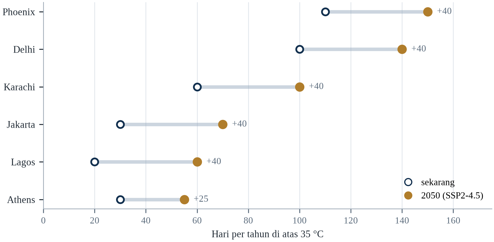||Sumber: Tabel 4.1; SSP2-4.5 untuk kolom 2050.

Buktinya mendukung dua kesimpulan. Pertama, risiko panas tidak ditentukan oleh suhu saja: jumlah hari panas yang sama menghasilkan kematian yang sangat berbeda tergantung pada perumahan, air, listrik, dan perlindungan sosial. Kedua, keuntungan terbesar datang dari intervensi yang membosankan dan murah — naungan, air, peringatan, kunjungan ke tetangga lansia — bukan dari teknologi yang mahal dan belum terbukti. Kota yang melakukan hal-hal membosankan dengan baik dapat menyelamatkan ribuan nyawa pada 1,5 °C dan masih menyelamatkan banyak pada 2,5 °C, meskipun marginnya menyempit (Iungman dkk., 2023).

Terobosan dalam pendinginan murah dan efisien akan menurunkan kematian di negara panas tetapi akan meningkatkan permintaan listrik dan emisi kecuali dipasangkan dengan pembangkit bersih. Keruntuhan jaringan listrik selama gelombang panas akan mengubah peristiwa yang dapat dikelola menjadi malapetaka, seperti yang terjadi di Texas pada 2021 dan di India pada 2012. Dan peristiwa bola basah di atas ambang fisiologis akan menciptakan situasi di mana adaptasi mustahil dan hanya evakuasi yang tersisa.

---

# Bab 5: Kelangkaan Air dan Kekeringan

*Tema: kelangkaan air, kekeringan dan politik sumber daya yang terbatas*

Pada Juni 2019, waduk-waduk yang memasok Chennai, kota berpenduduk sekitar sembilan juta orang, turun menjadi satu persen dari kapasitasnya. Pemerintah kota menyatakan darurat air, truk mengirim air ke lingkungan yang tidak memilikinya, dan kereta membawa air dari Sungai Cauvery lebih dari tiga ratus kilometer ke kota. Kantor meminta karyawan bekerja dari rumah. Restoran tutup. Monsun tiba pada Oktober, dan dalam beberapa pekan waduk kembali penuh — tetapi krisis itu berlangsung empat bulan, dan telah diperkirakan selama lebih dari satu dekade.

Chennai bukan kota kering. Ia menerima sekitar 1.400 milimeter hujan per tahun, lebih banyak daripada London atau Paris. Krisisnya bukan disebabkan kekurangan curah hujan dalam jangka panjang, melainkan oleh rangkaian monsun lemah, hilangnya danau dan lahan basah akibat pembangunan, penipisan air tanah, dan sistem pasokan yang tidak mengikuti pertumbuhan. Kota itu membangun kemakmurannya di atas asumsi bahwa air akan selalu tersedia di suatu tempat di dekatnya, dan asumsi itu gagal.

Asumsi yang sama gagal di sebagian besar dunia. Air tawar adalah sebagian kecil dari air planet ini — sekitar 2,5 persen — dan sebagian besarnya terkunci di gletser atau terkubur jauh di bawah tanah (Gleick, 2023). Air yang dapat diakses, di sungai, danau, dan akuifer dangkal, diperbarui oleh hujan dan lelehan salju pada laju yang pada dasarnya tetap. Umat manusia menggunakan sekitar setengah dari pasokan terbarukan itu, dan di banyak wilayah menggunakan lebih banyak, menambang air tanah yang membutuhkan ribuan tahun untuk terakumulasi.

Bab ini membahas kelangkaan air sebagai masalah fisik, ekonomi, dan politik. Bab ini membedakan kekeringan, yaitu kekurangan hujan sementara, dari kelangkaan, yaitu ketidakseimbangan yang bertahan antara permintaan dan pasokan. Bab ini memeriksa permintaan pertanian, perkotaan, dan industri yang mendorong ketidakseimbangan itu, serta adaptasi — penyimpanan, efisiensi, penggunaan ulang, desalinasi, penetapan harga, dan kelembagaan — yang dapat memulihkannya. Bab ini ditutup dengan pertanyaan yang akan membentuk abad berikutnya: apa yang terjadi ketika sungai yang dibagi bersama tidak lagi membawa cukup air bagi orang-orang yang bergantung padanya.

Geografi air sangat tidak merata. Sekitar 97 persen air planet ini asin, dan dari tiga persen yang tersisa, sebagian besar terkurung di gletser dan lapisan es (Gleick, 2023). Air tawar yang siap tersedia — di sungai, danau, tanah, dan akuifer dangkal — adalah fraksi kecil yang sebarannya tidak rata, dan ia diisi ulang oleh siklus hidrologi yang sudah diubah pemanasan. Wilayah basah umumnya menjadi lebih basah dan wilayah kering lebih kering, sementara hujan yang turun datang dalam semburan lebih pendek dan lebih intens yang tidak dapat diserap tanah.

## 5.1 Fisika dan Geografi Air Tawar

Siklus air global memindahkan sekitar 500.000 kilometer kubik air melalui penguapan dan presipitasi setiap tahun, tetapi hanya sekitar 40.000 kilometer kubik yang jatuh di daratan, dan hanya sebagian kecil dari itu yang dapat diakses manusia dengan biaya wajar (Gleick, 2023). Sungai dan danau menampung sekitar 90.000 kilometer kubik; air tanah menampung sekitar 10 juta kilometer kubik, tetapi sebagian besarnya dalam, asin, atau tidak terbarukan (Gleick, 2023). Pasokan air tawar terbarukan yang dapat digunakan manusia karena itu merupakan lapisan tipis dan tidak merata dari air planet ini.

Distribusi sama pentingnya dengan jumlah. Sembilan negara menyimpan sekitar setengah air tawar terbarukan dunia, sementara empat puluh negara memiliki kurang dari 1.000 meter kubik per orang per tahun — ambang yang biasa digunakan untuk mendefinisikan kelangkaan air (Gleick, 2023). Timur Tengah dan Afrika Utara adalah wilayah paling langka air, tetapi kelangkaan juga parah di sebagian India, Pakistan, Meksiko, dan Afrika Selatan, tempat populasi dan ekonomi yang tumbuh telah melampaui pasokan yang disediakan curah hujan.

Perubahan iklim mengubah siklus itu dalam tiga cara. Ia meningkatkan penguapan seiring naiknya suhu, yang mengurangi air yang tersedia di tanah dan waduk. Ia mengubah pola presipitasi, membuat hujan lebih terkonsentrasi pada peristiwa intens dan kurang andal sebagai pasokan tetap. Dan ia mengurangi simpanan salju serta gletser, yang berfungsi sebagai waduk alami yang melepaskan air perlahan sepanjang musim kering. Efek ketiga sangat penting di Himalaya, Andes, dan Alpen, tempat jutaan orang bergantung pada air lelehan.

Fakta fisik ini tidak dengan sendirinya menghasilkan kelangkaan. Kelangkaan dihasilkan oleh interaksi antara pasokan dan lembaga yang mengalokasikannya. Sebuah negara dapat memiliki air melimpah dan tetap mengalami kekurangan jika infrastrukturnya bocor, pertaniannya tidak efisien, kotanya tumbuh tanpa perencanaan, atau hak airnya dialokasikan untuk penggunaan yang tidak lagi masuk akal. Memahami perbedaan itu adalah langkah pertama untuk memperlakukan kelangkaan sebagai masalah yang dapat dikelola, bukan takdir yang harus ditanggung.

Siklus hidrologi digerakkan penguapan, yang meningkat seiring suhu, dan sirkulasi atmosfer, yang menentukan di mana kelembapan turun. Pemanasan menambah pasokan uap air dan kapasitas udara menahannya, sekitar 7 persen per derajat Celsius, yang berarti sistem cuaca yang sama dapat menurunkan lebih banyak hujan dalam waktu lebih singkat (Gleick, 2023). Konsekuensinya asimetris: hujan lebih intens menaikkan risiko banjir, sementara periode kering yang lebih panjang di antara peristiwa menaikkan risiko kekeringan, dan keduanya dapat terjadi di wilayah yang sama pada tahun yang sama.

Air di planet ini hampir seluruhnya tidak dapat dipakai untuk keperluan manusia. Lebih dari sembilan puluh tujuh persen ada di laut, dan sebagian besar sisanya terkunci dalam es; bagian yang bergerak melalui sungai, danau, dan akuifer dangkal — air yang mengisi cangkir, mengairi sawah, dan memutar turbin — hanyalah sebagian kecil dari satu persen. Bagian itu diperbarui oleh presipitasi, dan pembaruannya tidak merata dalam waktu maupun ruang. Sebagian wilayah menerima hujan setahun dalam beberapa pekan monsun, sehingga persoalan rekayasanya bukan hanya berapa banyak air yang datang tetapi berapa lama dapat ditahan. Air juga bergerak melalui atmosfer sebagai uap dan kembali sebagai hujan di tempat lain, itulah sebabnya deforestasi di satu cekungan dapat mengurangi hujan di cekungan lain.

## 5.2 Kekeringan: Empat Definisi

Kekeringan biasanya didefinisikan dalam empat cara. Kekeringan meteorologis adalah periode panjang curah hujan di bawah rata-rata. Kekeringan pertanian adalah kekurangan kelembapan tanah selama musim tanam, yang dapat terjadi bahkan ketika curah hujan normal jika hujan turun pada waktu yang salah atau mengalir di permukaan tanah yang padat. Kekeringan hidrologis adalah penipisan sungai, waduk, dan air tanah, yang biasanya berkembang lebih lambat daripada dua jenis lainnya. Kekeringan sosioekonomis terjadi ketika kekurangan mulai memengaruhi pasokan barang dan jasa, termasuk pangan, energi, dan air.

Keempat definisi itu menjelaskan mengapa kekeringan sering dinyatakan terlambat. Pemerintah dapat melihat curah hujan normal dan menyimpulkan tidak ada kekeringan, sementara petani sudah kehilangan satu musim karena hujan turun dalam satu pekan alih-alih delapan. Kekeringan hidrologis dapat bertahan bertahun-tahun setelah hujan kembali, karena akuifer dan waduk pulih perlahan. Kekeringan Tanduk Afrika 2022 dinyatakan setelah lima musim hujan berturut-turut gagal, ketika lebih dari dua puluh juta orang sudah mengalami kerawanan pangan akut.

Kekeringan juga memiliki ekor panjang. Kerugian ekonominya melampaui panen: ternak mati, pendapatan pedesaan runtuh, migrasi dipercepat, dan anak-anak putus sekolah. Studi tentang kekeringan 2011–2017 di Tanduk Afrika menemukan bahwa efeknya terhadap gizi dan pendidikan bertahan bertahun-tahun setelah hujan kembali. Kekeringan karena itu bukan peristiwa yang berakhir ketika hujan mulai turun; ia adalah guncangan yang konsekuensinya ditransmisikan melalui rumah tangga dan lembaga.

Empat definisi kekeringan — meteorologis, hidrologis, pertanian, dan sosial-ekonomi — menggambarkan tahap berbeda dari proses yang sama, dan bergerak dengan kecepatan berbeda. Kekeringan meteorologis muncul dalam hitungan pekan setelah curah hujan di bawah rata-rata; kekeringan pertanian muncul ketika kelembapan tanah turun di bawah kebutuhan tanaman; kekeringan hidrologis muncul ketika sungai, waduk, dan akuifer turun di bawah normal, sering berbulan-bulan kemudian; dan kekeringan sosial-ekonomi muncul ketika kelangkaan mulai memengaruhi orang, harga, dan produksi. Mencampuradukkan tahapnya menghasilkan kebijakan buruk, karena respons untuk tahap pertama tidak dapat menangani tahap keempat.

Empat definisi kekeringan bukan penyempurnaan akademis; ia menggambarkan kegagalan berbeda yang datang pada waktu berbeda. Kekeringan meteorologis adalah kekurangan hujan terhadap rata-rata jangka panjang, dan yang pertama muncul. Kekeringan hidrologis adalah kekurangan pada sungai, waduk, dan air tanah, dan datang berminggu hingga bertahun kemudian karena daerah tangkapan menyimpan air dan melepaskannya perlahan. Kekeringan pertanian adalah kekurangan kelembapan tanah pada musim tanam, dan dapat terjadi meski total hujan normal bila hujan turun pada waktu yang salah. Kekeringan sosioekonomis adalah titik ketika kekurangan mulai memengaruhi penghidupan dan harga pangan. Urutannya penting karena pemerintah yang hanya mengukur hujan akan menyatakan kekeringan berakhir saat hujan kembali, sementara sumurnya masih kosong setahun lagi.

Kekeringan meteorologis adalah defisit curah hujan terhadap rata-rata jangka panjang. Kekeringan pertanian adalah defisit lengas tanah pada musim tanam, yang dapat datang sebelum defisit hujan terlihat. Kekeringan hidrologis adalah defisit di sungai, waduk, dan air tanah, dan datang paling akhir karena daerah tangkapan menyangga hujan selama berbulan-bulan atau bertahun-tahun. Kekeringan sosio-ekonomis adalah titik ketika kelangkaan mulai membatasi air yang benar-benar dapat dipakai orang. Jeda antardefinisi itulah yang membuat kekeringan sulit ditata kelola.

## 5.3 Air Tanah: Cadangan yang Tidak Terlihat

Air tanah adalah simpanan air tawar terbesar yang dapat diakses di Bumi dan sumber air minum bagi sekitar setengah populasi dunia. Ia juga yang paling rentan terhadap penggunaan berlebihan, karena tidak terlihat: petani yang memompa sumur tidak dapat melihat akuifer menurun, dan kota yang mengizinkan sumur baru tidak dapat dengan mudah mengukur efek kumulatifnya. Hasilnya adalah pola penipisan global yang disebut krisis bergerak lambat.

Akuifer Ogallala di Dataran Besar Amerika Serikat adalah contoh kanonis. Ia memasok air ke sekitar 30 persen lahan irigasi Amerika Serikat, dan sebagian wilayahnya telah kehilangan lebih dari setengah ketebalan jenuhnya. Di beberapa daerah Kansas dan Texas, muka air tanah turun lebih dari 50 meter, dan petani meninggalkan irigasi. Akuifer itu terisi ulang pada laju beberapa milimeter per tahun, sementara pengambilan diukur dalam meter, yang berarti sumber daya itu ditambang, bukan digunakan.

Pola serupa muncul di Dataran Indo-Gangga, Dataran Tiongkok Utara, dataran tinggi Meksiko, dan Semenanjung Arab. Di Jakarta, pengambilan air tanah telah menyebabkan penurunan tanah hingga 25 sentimeter per tahun di beberapa kecamatan, yang meningkatkan risiko banjir dan ikut mendorong keputusan memindahkan ibu kota negara (Gleick, 2023). Ciri bersamanya adalah air digunakan lebih cepat daripada pengisian ulangnya, dan penggunanya tidak memiliki insentif langsung untuk berhenti karena biaya penipisan ditanggung orang lain, sering generasi mendatang.

Ada kisah keberhasilan. Undang-Undang Pengelolaan Air Tanah Arizona 1980 mewajibkan pembangunan baru menunjukkan pasokan air seratus tahun, dan undang-undang itu memperlambat penipisan di wilayah terpadat, meskipun tidak menghilangkannya (Gleick, 2023). Ekonomi air Israel menggabungkan irigasi tetes, air limbah daur ulang, dan desalinasi untuk mendukung pertanian dan populasi yang tumbuh dengan air per kapita lebih sedikit daripada negara maju lainnya. Pelajarannya adalah air tanah dapat dikelola, tetapi hanya dengan pengukuran, penegakan, dan kerangka hukum yang memperlakukan akuifer sebagai sumber daya bersama.

Air tanah adalah reservoir air tawar terbesar yang dapat diakses di Bumi dan yang paling tidak terlihat. Ia memasok sekitar separuh air minum global dan sekitar 40 persen irigasi, dan di sebagian India, Timur Tengah, serta Afrika Utara ia memasok mayoritas. Karena tersembunyi, ia mudah digunakan berlebihan: pemompaan dapat berlanjut bertahun-tahun setelah pengisian ulang menurun, dan konsekuensinya muncul sebagai muka air tanah yang turun, penurunan permukaan tanah, sumur mengering, dan di wilayah pesisir intrusi air laut yang dapat mencemari akuifer secara permanen.

Air tanah adalah cadangan terbesar yang tidak pernah dilihat orang, dan ketaklihatan itulah yang menjelaskan kepentingan sekaligus salah urusnya. Akuifer menyimpan air selama puluhan atau ratusan tahun, menahan petani dari musim monsun yang gagal, dan memasok sebagian besar air minum di Asia dan Amerika Latin. Namun imbuhannya lambat dan lokal: ia bergantung pada hujan yang meresap melalui tanah dan batuan, dan di banyak wilayah diukur dalam milimeter per tahun sementara pengambilannya diukur dalam meter. Ketika pengambilan melebihi imbuhan, muka air turun, sumur harus diperdalam, dan tanahnya sendiri dapat turun karena pori-porinya runtuh. Di pesisir, muka air yang turun menarik air laut masuk dan mengasinkan sumur.

Air tanah adalah cadangan yang tidak dilihat siapa pun dan diminum separuh dunia, dan tata kelolanya bagian terlemah kebijakan air. Petani yang memompa sumur mengambil air yang menjadi milik akuifer bersama, dan hukum di sebagian besar negara memberi klaim terkuat kepada orang pertama yang memompa. Hasilnya perlombaan yang rasional diikuti setiap pesertanya dan berakhir pada cekungan yang menipis, kota yang turun, dan sumur yang harus dibor lebih dalam. Satelit kini mengukur perubahan massa total air di suatu cekungan, yang membuat penipisannya terlihat dari angkasa dan, secara prinsip, dapat diaudit.

## 5.4 Sungai di Bawah Tekanan

Sungai-sungai besar dunia adalah ukuran paling terlihat dari tekanan air. Sungai Colorado tidak lagi mencapai laut pada sebagian besar tahun; alirannya menurun sekitar 20 persen sejak awal abad kedua puluh, dan dua waduk terbesarnya, Danau Mead dan Danau Powell, turun di bawah 30 persen kapasitas pada 2022. Sungai itu memasok air bagi sekitar 40 juta orang dan 1,2 juta hektar lahan pertanian di tujuh negara bagian Amerika Serikat dan Meksiko utara, di bawah sistem alokasi yang dirancang pada 1922 dengan asumsi aliran lebih besar daripada yang telah diberikan sungai itu.

Sungai Kuning di Tiongkok telah dialokasikan sepenuhnya sejak 1990-an dan kadang gagal mencapai laut; Indus memasok cekungan yang dihuni lebih dari 250 juta orang dan bergantung pada salju serta lelehan gletser yang diperkirakan menurun; Murray–Darling di Australia telah mengalami kekeringan parah dan keruntuhan ekosistem di hilirnya. Dalam setiap kasus, sungai adalah pasokan air sekaligus ekosistem, dan kedua penggunaan itu bersaing untuk aliran yang sama.

Politik sungai adalah politik hulu-hilir. Bendungan yang dibangun di hulu mengurangi aliran yang tersedia di hilir; kota yang mengambil air untuk penduduknya mengurangi air yang tersedia bagi petani; negara yang mengklaim bagian berdasarkan penggunaan historis mungkin mengklaim air yang dianggap negara lain sebagai miliknya. Cekungan sungai internasional mencakup sekitar setengah permukaan daratan planet ini dan dihuni sekitar 40 persen populasinya, itulah sebabnya air sering digambarkan sebagai sumber kerja sama sekaligus konflik (Gleick, 2023).

Sungai tertekan dari tiga arah sekaligus: debit berkurang akibat pengambilan di hulu, waktu aliran berubah akibat lelehan salju dan perubahan hujan, serta polusi meningkat dari pertanian dan kota. Sungai Colorado tidak lagi mencapai laut secara andal sejak 1960-an; Indus disadap begitu berat sehingga deltanya menyusut selama puluhan tahun; dan Sungai Kuning mengering selama sebagian besar 1990-an. Itu bukan kegagalan alami melainkan keputusan alokasi, yang berarti dapat dibalik oleh keputusan yang berbeda.

Sungai tertekan dari tiga arah sekaligus, dan hanya satu yang iklim. Bendungan dan pengalihan mengubah kapan dan di mana air tiba; sedimen yang terperangkap di belakang bendungan membuat delta di hilir kelaparan, lalu tenggelam dan tererosi; beban polusi mengisi air dengan nutrien dan bahan kimia yang lebih mahal diolah. Iklim menambah tekanan keempat dengan mengubah waktu leleh salju, intensitas hujan, dan frekuensi kekeringan. Gabungan itulah yang membuat sungai seperti Indus atau Colorado sulit dikelola: volume yang dahulu menopang pertanian, kota, dan ekosistem kini diminta menopang lebih banyak dari masing-masingnya dengan keteraturan yang lebih kecil. Aliran lingkungan biasanya alokasi pertama yang dipotong dan terakhir dipulihkan.

Sungai yang tertekan gagal dalam dua cara yang sering dicampur: penurunan volume total air dan perubahan waktu kedatangannya. Di cekungan yang disuapi salju dan es, pemanasan memindahkan lelehan musim semi ke awal, yang mengurangi aliran pada musim panas ketika tanaman paling membutuhkannya, meski total tahunannya tidak berubah. Di cekungan yang disuapi hujan monsun, bagian yang lebih besar dari presipitasi datang dalam lebih sedikit peristiwa yang lebih intens, yang menaikkan limpasan dan mengurangi peresapan. Aturan alokasi yang ditulis untuk pola lama kemudian membagikan air yang tidak lagi ada pada musim yang dijanjikan.

## 5.5 Kualitas Air dan Kelangkaan Tersembunyi

Air dapat hadir secara fisik dan tetap tidak dapat digunakan. Kontaminasi oleh patogen, nitrogen dan fosfor dari pertanian, logam berat, arsenik, dan bahan kimia industri mengurangi pasokan air aman seefektif kekeringan. Organisasi Kesehatan Dunia memperkirakan bahwa sekitar 2,2 miliar orang kekurangan akses ke air minum yang dikelola dengan aman, dan bahwa air yang terkontaminasi terkait dengan ratusan ribu kematian akibat diare per tahun, sebagian besar di antara anak-anak di bawah lima tahun.

Arsenik adalah contoh yang sangat berbahaya. Sumur yang dibor di Bangladesh dan Benggala Barat pada 1970-an untuk menyediakan air yang aman secara mikrobiologis tanpa sengaja menembus akuifer yang terkontaminasi arsenik alami. Puluhan juta orang terpapar, dan konsekuensi kesehatannya — lesi kulit, kanker, penyakit kardiovaskular — muncul puluhan tahun kemudian. Episodenya adalah pengingat bahwa solusi teknologi dapat menciptakan masalah baru sambil menyelesaikan masalah lama, dan bahwa kualitas air harus dipantau sama cermatnya dengan kuantitasnya.

Salinitas adalah bentuk kelangkaan tersembunyi lainnya. Di akuifer pesisir, pengambilan berlebihan menarik air laut ke darat; di wilayah irigasi, muka air tanah yang naik membawa garam ke permukaan, tempat penguapan memekatkannya. Salinisasi telah mendegradasi ratusan juta hektar lahan pertanian dan terus menyebar di cekungan Indus, dataran Tigris–Efrat, dan sebagian Australia. Berbeda dari kekeringan, salinitas tidak berakhir ketika hujan kembali; ia dapat membuat lahan tidak dapat digunakan selama puluhan tahun.

Kelangkaan air sama banyak soal kualitas dan kuantitas, dan kualitas sering menjadi kendala penentu. Sungai yang membawa cukup air tetapi terlalu tercemar untuk diminum, diirigasi, atau menopang ikan bukan sumber daya yang dapat dipakai. Sekitar 80 persen air limbah dunia dilepaskan tanpa pengolahan memadai, dan beban nutrien serta patogen yang dihasilkan mendegradasi ekosistem yang seharusnya membantu menjernihkan air, menciptakan lingkaran di mana polusi menaikkan biaya pengolahan dan mengurangi pasokan air bersih (Gleick, 2023).

Air bisa melimpah tetapi tidak aman, itulah sebabnya kelangkaan sebagian merupakan masalah mutu. Arsenik dan fluorida muncul alami pada geologi sebagian Asia Selatan, Afrika, dan Amerika Latin, dan sumur yang dibor untuk menyediakan air bersih dapat mengalirkan racun. Nitrat dari pupuk dan kotoran ternak meresap ke akuifer dangkal; patogen dari sanitasi buruk mencemari pasokan saat banjir; bahan kimia industri masuk ke sungai dan baru terdeteksi ketika ada yang memeriksa. Pengolahan mahal, dan pemantauannya tidak merata, sehingga bebannya jatuh pada rumah tangga yang harus memilih antara sumber aman yang jauh dan sumber tercemar yang dekat. Biaya waktu dan gender dari pilihan itu jarang dihitung, padahal ia membentuk kehadiran sekolah dan lapangan kerja.

Mutu air adalah separuh kelangkaan yang tersembunyi, karena satu liter yang tercemar bukan satu liter yang dapat dipakai. Intrusi salinitas ke akuifer pesisir membuat airnya tidak layak diminum selama puluhan tahun, dan digerakkan kenaikan muka laut serta pemompaan berlebihan yang menarik air asin ke darat. Air limbah yang tidak diolah mencemari sungai yang diambil kota hilir, dan instalasi pengolahan yang seharusnya memperbaikinya mahal serta tidak terlihat. Limpasan pertanian membawa nutrien yang menghasilkan ledakan alga. Hasilnya, negara dapat dihitung kaya air berdasarkan curah hujannya dan tetap tidak mampu memasok air aman.

## 5.6 Pertanian: Pengguna Terbesar

Pertanian menyumbang sekitar 70 persen pengambilan air tawar global, dan di sebagian negara berkembang porsinya mendekati 90 persen (Gleick, 2023). Irigasi menopang sekitar 20 persen lahan budidaya tetapi menghasilkan sekitar 40 persen pangan global, yang berarti bahwa setiap pembatasan irigasi berdampak besar pada ketahanan pangan. Efisiensi penggunaannya sering rendah: irigasi banjir kehilangan banyak air melalui penguapan dan limpasan, dan saluran yang tidak dirawat bocor sebelum air mencapai sawah.

Keuntungan dari peningkatan efisiensi besar tetapi tidak otomatis. Irigasi tetes dapat mengurangi penggunaan air 30 sampai 50 persen dibandingkan irigasi banjir sambil mempertahankan atau meningkatkan hasil, tetapi memerlukan modal, perawatan, dan pasokan air bersih yang andal (Gleick, 2023). Di India, pengguna air tanah terbesar di dunia, listrik bersubsidi untuk pompa mendorong pengambilan berlebihan, dan responsnya adalah campuran subsidi sistem tetes, pembatasan sumur baru, dan di beberapa negara bagian, pembayaran langsung kepada petani yang beralih ke tanaman yang tidak terlalu banyak membutuhkan air.

Masalah yang lebih mendalam adalah air biasanya dihargai di bawah biayanya. Petani yang tidak membayar air tidak memiliki insentif untuk berhemat, dan kota yang mengenakan tarif di bawah biaya pasokan tidak dapat merawat pipanya. Reformasi harga sulit secara politik karena air adalah kebutuhan dasar dan karena petani terorganisasi. Alternatifnya — kuota, hak yang dapat diperdagangkan, tarif bertingkat yang melindungi konsumsi dasar sambil menagih lebih untuk penggunaan mewah — semuanya merupakan upaya menerapkan sinyal harga tanpa menolak orang mendapatkan air yang mereka butuhkan untuk bertahan hidup.

Pertanian mengonsumsi sekitar 70 persen pengambilan air tawar global, dan porsinya lebih tinggi di wilayah kering (Gleick, 2023). Irigasi penting untuk memberi makan populasi yang tumbuh, tetapi ia juga tidak efisien: irigasi banjir kehilangan banyak volume karena penguapan dan rembesan, dan banyak sistem mengalirkan lebih banyak air daripada yang dapat dipakai tanaman. Meningkatkan efisiensi tidak selalu cukup, karena air yang dihemat sering dialokasikan untuk memperluas area irigasi alih-alih dikembalikan ke lingkungan — fenomena yang disebut efek rebound.

Air tanah adalah penyangga yang membuat kekeringan dapat dilalui, dan ia disedot lebih cepat daripada terisi ulang di sebagian besar akuifer utama dunia. Gravimetri satelit membuat penipisan itu terlihat: studi atas Central Valley di California, Dataran Tiongkok Utara dan cekungan Indus mendokumentasikan kehilangan simpanan air tanah yang berkelanjutan dan tidak diimbangi imbuhan. Konsekuensinya penurunan lambat kapasitas menyerap kekeringan berikutnya, yaitu justru cadangan yang menjadi tujuan sistem irigasi dibangun. Kekeringan yang dapat dikelola pada 1990 kini menjadi krisis karena penyangganya sudah habis.

Pertanian memakai mayoritas air tawar dunia, dan debat efisiensinya lebih halus daripada kelihatannya. Irigasi tetes dapat memangkas pemakaian air per hektar, tetapi air yang dihemat sering dipakai mengairi lahan lebih luas alih-alih dikembalikan ke sungai, sehingga penghematan tingkat cekungan lebih kecil daripada tingkat lahan; inilah paradoks efisiensi irigasi. Irigasi banjir mengimbuh akuifer di sebagian sistem, dan menghapusnya dapat mengurangi simpanan air tanah di hilir. Apa yang ditanam petani sama pentingnya dengan caranya: padi di sawah tergenang memakai air beberapa kali lipat dibanding gandum atau milet, dan pilihannya sering didorong subsidi, pengadaan, serta kebiasaan. Subsidi energi yang membuat pemompaan murah adalah pendorong terpenting penipisan air tanah di banyak negara.

Pertanian mengonsumsi sekitar tujuh puluh persen air tawar yang diambil manusia, dan porsinya lebih tinggi di kawasan yang airnya paling langka. Tanaman yang paling banyak memakai air sering yang paling sedikit bergizi per liter, karena pasar membayar kalorinya dan bukan airnya, dan airnya biasanya gratis bagi petani yang memompanya. Hasilnya sistem ketika alokasi air ditentukan harga tanaman alih-alih nilai airnya, dan ketika pergeseran ke tanaman lebih efisien menjadi kehilangan pendapatan bagi rumah tangga yang melakukannya. Memberi harga pada air jawaban ekonom dan masalah politikus.

## 5.7 Sistem Air Perkotaan

Kota memusatkan permintaan dan kehilangan air sebelum mencapai keran. Air non-pendapatan — selisih antara yang diproduksi perusahaan air dan yang ditagih — rata-rata sekitar 30 persen secara global dan melebihi 50 persen di beberapa kota (Gleick, 2023). Kehilangan itu berasal dari pipa bocor, sambungan ilegal, kesalahan meteran, dan penggunaan publik yang tidak ditagih. Di kota yang kekurangan air, memperbaiki jaringan distribusi bisa lebih murah daripada membangun waduk baru.

Pertumbuhan kota juga menghabiskan lanskap yang dahulu menyimpan air. Danau dan lahan basah Chennai tertutup bangunan seiring perluasan kota; air tanah Jakarta dipompa karena jaringan perpipaan tidak menjangkau sebagian besar lingkungan; akuifer Kota Meksiko dikuras lebih cepat daripada pengisian ulangnya. Hasilnya adalah kota menjadi bergantung pada sumber yang jauh, yang meningkatkan biaya, kerentanan, dan ketegangan politik dengan wilayah yang memasoknya.

Respons yang berhasil menggabungkan pasokan, permintaan, dan penyimpanan. Strategi air Singapura — tangkapan lokal, air impor, desalinasi, dan air daur ulang, yang dikenal sebagai empat keran nasional — adalah contoh yang paling banyak dikutip, dan telah memungkinkan negara kota tanpa akuifer alami mencapai keamanan air. Windhoek, Namibia, telah mendaur ulang air limbah langsung ke pasokan minum sejak 1968. Kasus-kasus ini menunjukkan bahwa kelangkaan bukan sekadar fungsi curah hujan; ia fungsi dari seberapa sengaja sebuah kota mengelola siklusnya.

Hambatan kelembagaannya jarang bersifat teknis. Utilitas yang menjual air per volume kehilangan pendapatan ketika memperbaiki kebocorannya, sehingga program efisiensi yang berhasil dapat meninggalkannya dengan biaya lebih tinggi dan pemasukan lebih kecil — insentif terbalik yang harus dikoreksi regulator secara eksplisit. Kota yang paling jauh menekan kehilangan biasanya mengubah struktur tarifnya pada saat yang sama, melepaskan pendapatan dari volume terjual atau membiarkan utilitas menyimpan sebagian penghematannya, dan pelajarannya berlaku untuk hampir setiap tindakan adaptasi yang menghemat uang dengan mengurangi permintaan. Tindakan itu membayar dirinya secara fisik dan tidak membayar lembaga yang harus menjalankannya, kecuali ada yang merancang insentifnya.

Jakarta adalah kasus paling jelas krisis air yang dihasilkan penyedotan alih-alih kekeringan. Pemompaan air tanah telah menurunkan muka tanah hingga dua puluh lima sentimeter per tahun di sebagian kota, sehingga tanahnya turun lebih cepat daripada laut naik, dan keduanya bersama menentukan risiko banjir. Respons kota menggabungkan perluasan air perpipaan, tanggul laut dan, yang paling diperdebatkan, rencana memindahkan ibu kota. Studi atas penurunan muka tanah menemukan bahwa penyebab utamanya adalah pemompaan industri dan rumah tangga oleh pengguna yang tidak terhubung jaringan, yang menjadikan masalahnya kegagalan layanan sama besarnya dengan masalah hidrologi.

Kota kehilangan bagian yang mengejutkan dari air yang telah diolahnya sebelum sampai ke pelanggan. Kebocoran tiga puluh sampai lima puluh persen lazim pada sistem yang dirawat dengan prinsip bahwa perbaikan bisa menunggu, dan kehilangannya tak terlihat karena terjadi di bawah tanah dan karena perusahaan air dibayar atas air yang dijual, bukan yang diproduksi. Pasokan terputus-putus memperburuknya: pipa yang berganti antara penuh dan kosong menyedot kontaminan, dan rumah tangga menutupinya dengan tandon atap dan pompa yang menarik lebih banyak air melewati kebocoran. Manajemen tekanan, pengukuran per distrik, dan tim perbaikan dengan anggaran menyelesaikan lebih banyak masalah daripada waduk baru, tetapi pekerjaannya tidak menarik dan pemotongan pita lebih mudah dibiayai.

Sistem air perkotaan adalah jaringan rekayasa yang berukuran untuk kota yang tidak lagi ada, dan kinerjanya diukur angka yang sedikit kota mempublikasikannya. Air tak-berpendapatan adalah selisih antara yang masuk jaringan dan yang ditagih, dan di banyak kota selisihnya antara seperempat dan separuh dari total, yang berarti waduknya dikuras untuk air yang tidak dipakai siapa pun. Kehilangannya berasal dari kebocoran, sambungan ilegal, dan kesalahan meter, dan program perbaikannya mahal, mengganggu, serta tidak terlihat. Kota yang berhasil menguranginya memakai pemeteran distrik, manajemen tekanan, dan regu yang dibayar mencari kebocoran.

## 5.8 Kekeringan, Pangan dan Harga

Kekeringan menular ke ekonomi melalui harga pangan. Ketika wilayah produsen besar kehilangan panen, harga global naik, dan efeknya paling besar bagi rumah tangga miskin yang menghabiskan sebagian besar pendapatannya untuk pangan. Kekeringan 2010–2011 di Rusia dan larangan ekspor berikutnya berkontribusi pada lonjakan harga pangan global tahun itu; kekeringan 2022 di Eropa mengurangi output jagung dan bunga matahari serta menambah tekanan harga yang sudah disebabkan perang di Ukraina (FAO, 2023).

Penularannya tidak otomatis, karena perdagangan, penyimpanan, dan substitusi dapat menyerap sebagian guncangan. Tetapi penyangga itu lebih tipis daripada yang terlihat. Stok gandum global dipegang oleh sedikit negara, dan eksportir kadang membatasi pengiriman dalam krisis, yang memperbesar kenaikan harga. Negara pengimpor merespons dengan membeli lebih banyak, yang memperbesarnya lagi. Hasilnya adalah kekeringan regional dapat menjadi peristiwa harga global melalui interaksi respons kebijakan, bukan melalui kekurangan fisik semata.

Bagi rumah tangga, konsekuensinya adalah perubahan pola makan. Ketika harga naik, keluarga mengganti dengan bahan pokok yang lebih murah, mengurangi protein dan produk segar, dan kadang melewatkan makan. Efek gizinya bertahan lama setelah harga turun, terutama bagi anak-anak, yang pertumbuhan dan perkembangan kognitifnya dapat terpengaruh secara permanen. Kekeringan karena itu adalah masalah ketahanan pangan sama besarnya dengan masalah air, dan keduanya tidak dapat ditangani secara terpisah.

Kaitan antara kekeringan dan harga pangan berjalan melalui produksi dan ekspektasi. Panen gagal mengurangi pasokan, tetapi efek harganya diperkuat pembatasan ekspor, pembelian panik, dan perdagangan spekulatif, itulah sebabnya harga dapat naik jauh melampaui kerugian produksi. Krisis 2007–2008 menunjukkan polanya: harga gandum lebih dari dua kali lipat, beras tiga kali lipat, dan lebih dari tiga puluh negara mengalami kerusuhan pangan, meskipun produksi global hanya turun sedikit.

Panen buruk di negara pengekspor besar mengurangi pasokan, tetapi efek harganya diperbesar ketika pemerintah membatasi ekspor, pedagang mengantisipasi kelangkaan, dan importir berebut menumpuk stok. Episode 2007–2008 dan 2010–2012 mengikuti pola ini: rangkaian guncangan cuaca di beberapa lumbung pangan, gelombang larangan ekspor, dan lonjakan harga yang lebih ditentukan kebijakan daripada panen agregat. Akibatnya konsumen termiskin, yang menghabiskan sebagian besar pendapatan untuk pangan, paling terpukul oleh kelangkaan yang tidak mereka sebabkan. Stok dan transparansi meredam spiralnya; larangan ekspor menajamkannya.

Kaitan antara kekeringan dan harga pangan pendek, dan kaitan antara harga dan kelaparan lebih pendek. Panen yang gagal di negara pengekspor besar mengurangi pasokan yang tersedia untuk perdagangan, dan karena permintaan biji-bijian pokok tidak elastis, harganya naik jauh lebih tinggi daripada kekurangannya. Negara pengekspor kemudian membatasi penjualannya untuk melindungi konsumen domestik, yang menarik lebih banyak pasokan dari pasar dunia dan memperkuat lonjakan. Episode 2007 dan 2008 mengikuti urutan itu persis, dan kerusuhan yang menyusul terkonsentrasi di negara ketika biaya roti adalah bagian besar dari anggaran rumah tangga.

## 5.9 Konflik dan Kerja Sama Air

Air pernah disebut sebagai sumber perang, tetapi catatan sejarah lebih rumit. Kronologi Konflik Air Pacific Institute mencatat ribuan ketegangan terkait air, sebagian besarnya lokal, dan jauh lebih banyak contoh kerja sama daripada konflik bersenjata memperebutkan air. Nil, Indus, Mekong, dan Rhine semuanya memiliki sejarah panjang negosiasi, dan beberapa perjanjian air paling tahan lama di dunia adalah perjanjian air.

Itu tidak berarti air bukan sumber konflik. Itu berarti konfliknya biasanya berbentuk penggusuran, perampasan, dan kekerasan di dalam negara, bukan perang antarnegara. Pembangunan bendungan menggusur komunitas; pengambilan irigasi menghilangkan air dari petani hilir; polusi menghancurkan perikanan; tarif air memicu protes. Risiko perang antarnegara memperebutkan air nyata tetapi jarang, dan paling tinggi ketika kelangkaan air berinteraksi dengan permusuhan politik yang sudah ada dan lembaga yang lemah.

Catatan kerja sama menawarkan pelajaran. Perjanjian Air Indus 1960 bertahan melewati tiga perang antara India dan Pakistan dan telah sangat tangguh, karena perjanjian itu menciptakan komisi bersama dengan kewenangan teknis dan mekanisme penyelesaian sengketa. Inisiatif Cekungan Nil, Komisi Sungai Mekong, dan Organisasi Sungai Senegal menunjukkan bahwa cekungan bersama dapat dikelola ketika para pihak memiliki kepentingan pada informasi dan aturan yang disediakan lembaga itu. Air lebih sering menjadi alasan untuk berbicara daripada alasan untuk berperang.

Konflik air sering digambarkan sebagai keniscayaan, dan buktinya menunjukkan sebaliknya. Studi tentang sengketa air historis menemukan bahwa kerja sama jauh lebih umum daripada kekerasan: basis data konflik air Oregon State University mencatat ribuan peristiwa kerja sama dibandingkan jumlah peristiwa kekerasan yang jauh lebih kecil. Kekerasan cenderung terjadi ketika sengketa air bertumpang tindih dengan konflik etnis atau teritorial, dan ketika institusi alokasi lemah atau telah runtuh.

Sengketa air lebih sering dikelola daripada diselesaikan, dan catatan sejarahnya lebih menggembirakan daripada beritanya. Ribuan perjanjian dan kesepakatan cekungan mengatur sungai bersama, dan konflik kekerasan karena air jarang dibandingkan frekuensi negosiasi, bahkan di cekungan dengan tetangga yang bermusuhan. Yang berulang adalah pola ketika pembangunan di hulu dianggap ancaman di hilir, dan sengketanya menjadi pengganti ketegangan politik yang lebih luas. Nil, Indus, dan Colorado masing-masing memperlihatkan versi berbeda dari masalah yang sama: alokasi hukum yang ditetapkan pada masa yang lebih basah atau lebih kosong, permintaan yang tumbuh, dan iklim yang tidak lagi cocok dengan asumsi perjanjian. Kerja sama cenderung teknis sebelum politik.

Catatan tentang konflik air lebih kooperatif daripada yang disarankan berita utama, dan alasannya bahwa alternatif kerja sama lebih buruk bagi semua pihak. Lebih dari tiga ribu perjanjian mengatur perairan bersama, dan sengketa yang berujung kekerasan adalah minoritas kecil. Kerja samanya berbentuk hal yang jarang menjadi berita: pemantauan debit bersama, prakiraan bersama, pelepasan terkoordinasi dari bendungan, dan pengaturan berbagi data yang memungkinkan negara hilir merencanakan. Cekungan dengan risiko tertinggi adalah yang perjanjiannya tidak ada atau usang, datanya ditahan, dan sungainya menjadi salah satu keluhan dalam konflik yang lebih luas.

Bab air berakhir di tempat sebagian besar kebijakan air dimulai, yaitu pada pertanyaan siapa yang memutuskan. Daerah aliran sungai yang melintasi tiga provinsi dan dua negara tidak punya otoritas tunggal kecuali dibentuk, dan otoritas yang ada biasanya diorganisasi di sekitar pasokan alih-alih alokasi: utilitas yang menyalurkan air, dinas irigasi yang menjualnya, regulator yang menetapkan tarif, dan kementerian yang menandatangani perjanjian. Alasan perjanjian bertahan bukan karena adil melainkan karena ia menyebut apa yang terjadi pada tahun kering, ketika aritmetikanya tidak lagi berjalan bagi semua pihak. Perjanjian yang hanya mengalokasikan aliran rata-rata gagal pada kekeringan yang memotivasinya, dan daerah aliran yang melewati kekeringannya adalah yang perjanjiannya memuat klausul kekurangan, siklus peninjauan, dan mekanisme sengketa yang bersidang sebelum waduknya kosong.

Ada uji praktis yang dapat diterapkan pembaca pada rencana air mana pun, dan ia hanya butuh satu pertanyaan: apa yang terjadi pada tahun kering ketiga berturut-turut. Rencana yang menjawab dengan pembatasan punya ukuran permintaan; rencana yang menjawab dengan sumber baru punya ukuran pasokan; rencana yang menjawab dengan realokasi punya keputusan politik. Sebagian besar rencana hanya memuat dua yang pertama, karena yang ketiga menuntut menyebut pengguna mana yang akan menerima lebih sedikit, dan menyebut mereka adalah bagian yang tidak dapat dikerjakan insinyur mana pun. Kota yang melewati kekeringannya adalah kota yang dewan kotanya bersedia mengambil keputusan itu di depan publik sebelum terpaksa, dan yang tidak adalah kota yang keputusannya diambil oleh ketinggian waduk.

## 5.10 Adaptasi: Penyimpanan, Efisiensi dan Daur Ulang

Portofolio adaptasi air sudah dikenal. Penyimpanan — bendungan, waduk, pengisian ulang akuifer, pemanenan air hujan — menjembatani celah antara musim basah dan kering. Efisiensi — irigasi tetes, perbaikan kebocoran, daur ulang industri — menghasilkan lebih banyak output per meter kubik. Daur ulang — mengolah air limbah untuk irigasi atau industri — mengubah aliran limbah menjadi sumber daya. Desalinasi — menghilangkan garam dari air laut atau air tanah payau — menciptakan pasokan baru dengan biaya energi dan uang.

Setiap opsi memiliki batas. Bendungan menggusur orang dan tertimbun lumpur; dunia telah membangun sebagian besar lokasi yang baik. Efisiensi dapat diimbangi efek pantul, di mana petani menggunakan air yang dihemat untuk memperluas lahan irigasi. Desalinasi mahal, intensif energi, dan menghasilkan air garam yang harus dibuang dengan hati-hati; ia terjangkau bagi kota pesisir kaya tetapi tidak bagi pertanian pedalaman. Daur ulang memerlukan pengolahan, pemantauan, dan penerimaan publik, yang sering menjadi bagian tersulit.

Adaptasi terpenting bersifat kelembagaan. Air dikelola melalui hak, harga, kuota, dan kesepakatan cekungan, dan perbedaan antara cekungan yang dikelola baik dan yang dikelola buruk sering lebih besar daripada perbedaan antara tahun basah dan tahun kering. Rencana Cekungan Murray–Darling di Australia, yang membatasi total pengambilan dan memungkinkan air diperdagangkan, adalah contoh upaya mengelola cekungan sebagai sistem, bukan kumpulan klaim individual. Rencana itu dikritik karena hasil lingkungan yang tidak tercapai, tetapi ia menunjukkan bahwa desain kelembagaan setidaknya sama pentingnya dengan rekayasa.

Adaptasi terhadap kelangkaan air memiliki hierarki yang mapan. Pengelolaan permintaan datang lebih dulu karena paling murah dan cepat: penetapan harga, meteran, pembatasan, perbaikan kebocoran, dan peralatan efisien. Penyimpanan kedua, baik di waduk, akuifer, maupun tangki, karena ia menjembatani jarak antara hujan dan permintaan. Sumber alternatif ketiga: daur ulang, desalinasi, dan pemanenan air hujan, semuanya terbukti secara teknis tetapi padat energi dan mahal. Urutannya penting, karena membangun pasokan sebelum mengelola permintaan mengunci kota pada biaya lebih tinggi.

Menu adaptasi air sudah dikenal dan sebagian besar soal waktu, bukan volume. Penyimpanan — waduk, tandon, kelembapan tanah, akuifer — memindahkan air dari musim melimpah ke musim kebutuhan. Imbuhan akuifer terkelola dengan sengaja memasukkan air banjir ke bawah tanah, tempat ia tidak menguap dan tidak memindahkan orang. Pemanenan air hujan pada skala rumah tangga dan lingkungan mengurangi beban jaringan dan memberi penyangga saat gangguan. Daur ulang air limbah terolah untuk irigasi dan industri membebaskan air tawar untuk minum, asalkan pengolahan dan pemantauannya nyata. Desalinasi andal tetapi boros energi, dan air garamnya harus dikelola. Manajemen permintaan adalah opsi termurah dan paling sulit secara politik.

Menu adaptasi air pendek, dan setiap butirnya punya biaya yang mudah diremehkan. Tampungan di bendungan dan waduk menangkap air saat turun dan melepaskannya saat dibutuhkan, dan mahal, memindahkan orang, serta mengendap. Imbuhan air tanah, yang menyebarkan air banjir di tanah permeabel agar meresap, jauh lebih murah dan kini dihidupkan kembali di India, California, dan Belanda. Efisiensi irigasi mengurangi penggunaan terbesar, dan penghematannya sering diambil perluasan alih-alih dibiarkan di sungai. Daur ulang air limbah tumbuh di Singapura dan Windhoek, dan desalinasi andal tetapi haus energi. Urutan pengejarnya lebih penting daripada teknologinya.

## 5.11 Studi Kasus: Hari Nol Chennai

Krisis air Chennai tidak datang tanpa peringatan. Kota itu bergantung pada empat waduk dan air tanah, dan waduk-waduknya telah menurun selama bertahun-tahun seiring perluasan kota menutupi danau yang dahulu menangkap hujan monsun. Pada 2018 monsun timur laut gagal, dan pada Juni 2019 waduk hanya menyimpan sekitar satu persen kapasitasnya. Pemerintah kota menyatakan darurat air dan mulai mengirim air dengan truk ke lingkungan, sementara negara bagian mengatur kereta untuk membawa air dari Cauvery.

Krisis itu memengaruhi penduduk secara berbeda. Rumah tangga dengan sumur pribadi dan tangki penyimpanan dapat bertahan; rumah tangga di permukiman informal, yang bergantung pada keran umum dan pengiriman tangki, mengantre berjam-jam. Sekolah tutup, restoran mengurangi layanan, dan perusahaan teknologi informasi meminta staf bekerja dari rumah. Biaya ekonominya diperkirakan mencapai ratusan juta dolar, dan biaya politiknya lebih tinggi: krisis itu menjadi simbol kegagalan pengelolaan air perkotaan di kota yang tumbuh cepat.

Responsnya mencakup langkah jangka pendek — truk, kereta, pembatasan penggunaan non-esensial — dan investasi jangka panjang dalam desalinasi, pengolahan limbah, dan pemanenan air hujan. Kota juga mulai memulihkan sebagian danau dan lahan basah yang telah tertutup bangunan, mengakui bahwa penyimpanan termurah adalah lanskap itu sendiri. Pada 2024, waduk telah pulih, tetapi ketidakseimbangan yang mendasarinya belum terselesaikan: kota masih bergantung pada monsun yang semakin tidak andal dan pada air tanah yang terus menipis.

Kasus ini menggambarkan pola yang muncul di kota-kota di seluruh dunia. Krisis air jarang disebabkan satu tahun curah hujan rendah; ia disebabkan akumulasi keputusan yang mengurangi penyimpanan, meningkatkan permintaan, dan menunda perawatan. Krisis adalah momen ketika defisit yang terakumulasi menjadi terlihat. Karena defisitnya kelembagaan, solusinya harus kelembagaan: rencana yang menggabungkan pasokan, permintaan, penyimpanan, dan tata kelola, dan yang dilaksanakan sebelum waduk kosong.

Bagi kota lain, pelajarannya spesifik. Pertama, ukur dan laporkan secara publik neraca air, termasuk kehilangan dalam jaringan distribusi dan laju penipisan air tanah. Kedua, lindungi lanskap yang menyimpan air — danau, lahan basah, dataran banjir, dan area resapan — sebelum tertutup bangunan. Ketiga, diversifikasi pasokan, termasuk daur ulang dan desalinasi jika terjangkau, dan tetapkan harga air dengan cara yang membiayai perawatan. Keempat, identifikasi rumah tangga yang akan terdampak lebih dulu dan bangun sistem pengiriman yang menjangkau mereka, karena krisis akan memperlihatkan perbedaan antara kota yang memiliki air dan kota yang memiliki akses terhadapnya.

Krisis Chennai juga menggambarkan seberapa cepat kota modern dapat direduksi menjadi truk tangki dan antrean. Ketika waduk kota mengering, pengiriman tangki menjadi sumber utama, dan harga satu muatan tangki naik beberapa kali lipat dalam hitungan pekan, membuat rumah tangga miskin tidak mampu membeli pasokan yang memadai. Hotel dan usaha membeli air secara kontrak; warga permukiman kumuh bergantung pada keran kota yang mengalir terputus-putus, atau pada sumur bor bersama yang juga menurun. Kegagalan infrastruktur terlihat, tetapi kegagalan distribusi adalah bagian yang menentukan siapa yang kehausan.

Krisis Chennai adalah kisah kegagalan infrastruktur sama besarnya dengan kegagalan hujan. Kota bergantung pada empat waduk yang dahulu menangkap monsun, tetapi perluasan kota memenuhi banyak danau dan embung yang secara historis menyerap hujan dan mengimbuh akuifer, sehingga hujan yang sama menghasilkan simpanan lebih kecil. Air tanah disedot lebih cepat daripada imbuhannya, dan pabrik desalinasi yang dimaksudkan sebagai penyangga beroperasi di bawah kapasitas. Ketika monsun 2018 gagal, defisitnya datang cepat. Truk tangki menjadi pasokan terakhir, harganya naik, dan rumah tangga yang tidak mampu mengantre di keran umum. Respons yang bertahan adalah kewajiban pemanenan air hujan atap.

## 5.12 Skenario dan Prediksi Masa Depan: Air pada 2050

Air tawar adalah sumber daya yang jarak antara permintaan dan pasokannya menutup paling cepat. Pengambilan air global meningkat sekitar tiga kali lipat sejak 1950, didorong pertumbuhan penduduk, irigasi, dan permintaan industri. Penipisan air tanah telah dipercepat dalam dua dekade terakhir, dan luas lahan yang terkena kekeringan meningkat. Bank Dunia memperkirakan bahwa kelangkaan air dapat mengurangi pertumbuhan PDB di beberapa wilayah hingga 6 persen pada 2050, dan Konvensi Perserikatan Bangsa-Bangsa untuk Memerangi Desertifikasi memperkirakan bahwa kekeringan dapat mengungsi 700 juta orang pada 2030.

Permintaan sudah melebihi pasokan yang andal di banyak cekungan. Sekitar 4 miliar orang mengalami kelangkaan air parah setidaknya satu bulan setiap tahun, dan 2,2 miliar orang kekurangan air minum yang dikelola dengan aman (Gleick, 2023). Pertanian menggunakan sekitar 70 persen pengambilan, dan di banyak cekungan alokasi air melebihi pasokan terbarukan (Gleick, 2023). Celahnya diisi oleh penambangan air tanah, yang tidak dapat berlangsung selamanya. Pertanyaannya bukan apakah defisit akan ditutup, tetapi bagaimana: melalui efisiensi, realokasi, pasokan baru, atau krisis.

Populasi, pola makan, teknologi, dan tata kelola akan menentukan neraca air. Dunia yang bergerak menuju irigasi efisien, mendaur ulang lebih banyak air, dan membatasi pengambilan air tanah dapat memenuhi permintaan dengan lebih sedikit air daripada yang digunakan hari ini. Dunia yang melanjutkan tren saat ini akan menghadapi kekurangan sekitar 40 persen antara pasokan yang tersedia dan permintaan yang diproyeksikan pada 2030, menurut 2030 Water Resources Group. Skenario di bawah ini menunjukkan bagaimana cekungan utama mungkin terlihat di bawah asumsi yang berbeda.

Jurang air 2050 lebih ditentukan perpotongan tiga kurva daripada total hujan: permintaan, yang naik bersama penduduk dan pendapatan; pasokan, yang turun ketika gletser menyusut dan akuifer menipis; dan mutu, yang memburuk bersama polusi dan salinisasi (Zemp dkk., 2019). Wilayah tempat ketiga kurva paling cepat berpotongan adalah yang sudah tertekan — dataran Indo-Gangetika, dataran Tiongkok Utara, Timur Tengah, Sahel, Central Valley California, dan dataran tinggi Etiopia. Skenarionya berbeda terutama pada seberapa cepat permintaan dikendalikan lewat efisiensi, pilihan tanaman, dan daur ulang. Indikator yang layak dipantau adalah muka air tanah di akuifer besar dan porsi air limbah yang diolah.

[[TABLE:Tabel 5.1 Tekanan air di cekungan utama, sekarang dan 2050]]
| Cekungan | Populasi (juta) | Tekanan sekarang | Celah 2050 (SSP2-4.5) | Adaptasi utama |
|---|---|---|---|---|
| Indus | ~300 | Ekstrem | 30–40% | Irigasi tetes; regulasi air tanah |
| Colorado | ~40 | Ekstrem | 20–30% | Batas permintaan; daur ulang; lahan bera |
| Nil | ~280 | Tinggi | 25–35% | Penyimpanan; efisiensi; kesepakatan cekungan |
| Citarum (Jawa) | ~25 | Sangat tinggi | 20–30% | Pengolahan limbah; reboisasi |
| Murray–Darling | ~2,4 | Tinggi | 10–20% | Perdagangan air; aliran lingkungan |
| Tigris–Efrat | ~60 | Sangat tinggi | 30–40% | Koordinasi bendungan; reformasi irigasi |

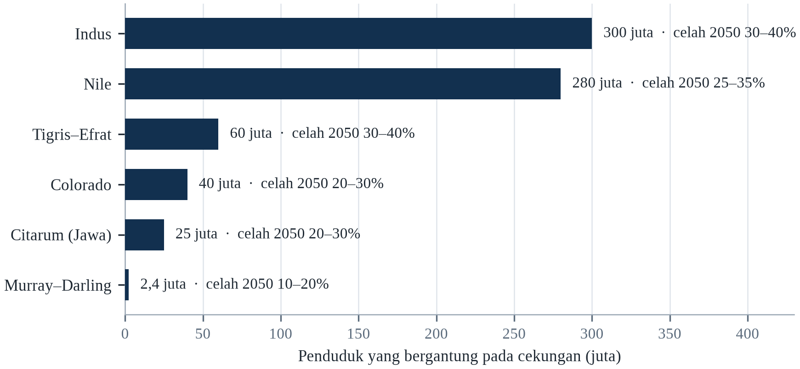||Sumber: Tabel 5.1; kesenjangan adalah kekurangan terhadap permintaan terproyeksi pada SSP2-4.5.

Dua pelajaran muncul dari sini. Pertama, celah terbesar berada di cekungan tempat pertanian mendominasi dan air tanah tidak diatur, yang berarti intervensi terpenting bersifat pertanian, bukan perkotaan. Kedua, celah itu dapat ditutup dengan teknologi yang ada; hambatannya adalah biaya politik untuk merealokasi air dari satu pengguna ke pengguna lain. Cekungan yang membatasi pengambilan akan menghasilkan lebih sedikit dalam jangka pendek, dan petani yang kehilangan air akan menolak.

Terobosan desalinasi murah akan memperluas pasokan bagi kota pesisir tetapi tidak bagi pertanian pedalaman. Perubahan pola makan ke arah pangan yang tidak terlalu banyak membutuhkan air akan mengurangi permintaan secara substansial, karena daging dan susu membutuhkan jauh lebih banyak air per kalori daripada biji-bijian. Dan kenaikan presipitasi yang berkelanjutan di sebagian cekungan, yang disarankan sebagian proyeksi iklim, akan mengurangi tekanan di tempat-tempat itu — tetapi proyeksi yang sama menunjukkan penurunan di tempat lain, dan ketidakpastiannya paling besar di tempat yang taruhannya paling tinggi.

---

# Bab 6: Banjir dan Kenaikan Muka Laut

*Tema: banjir, risiko pesisir dan darurat lambat kenaikan muka laut*

Pada 29 Oktober 2024, garis badai petir tertahan di atas Provinsi Valencia di Spanyol timur dan melepaskan hujan dalam delapan jam lebih banyak daripada yang biasanya diterima wilayah itu dalam setahun. Sistem Sungai Turia dan Magro terisi dalam hitungan menit. Mobil tersapu dari jalan bawah tanah, jembatan runtuh, dan lebih dari dua ratus orang meninggal, sebagian besar di kota-kota yang dibangun di dataran banjir tetapi belum pernah mengalami banjir sebesar itu dalam ingatan hidup. Peringatan pemerintah daerah mencapai ponsel setelah air sudah naik.

Banjir adalah bencana iklim yang paling sering dan paling mahal. Antara 1995 dan 2015, banjir menyumbang sekitar 47 persen dari seluruh bencana terkait cuaca dan berdampak pada 2,3 miliar orang, menurut Kantor Perserikatan Bangsa-Bangsa untuk Pengurangan Risiko Bencana. Banjir membunuh dalam dua cara: melalui tenggelam dan trauma selama peristiwa, serta melalui penyakit, pengungsian, dan kehilangan penghidupan pada bulan-bulan berikutnya. Organisasi Kesehatan Dunia memperkirakan bahwa banjir memengaruhi lebih banyak orang daripada bahaya alam lainnya.

Mekanisme fisiknya sederhana dan semakin kuat. Udara yang lebih hangat menahan lebih banyak uap air, sekitar tujuh persen lebih banyak untuk setiap derajat pemanasan, mengikuti hubungan Clausius–Clapeyron. Ketika uap itu mengembun, ia jatuh dalam semburan yang lebih deras. Pada saat yang sama, permukaan tanah dibuat kurang menyerap oleh pemadatan, pengaspalan, dan hilangnya lahan basah, sehingga lebih banyak bagian hujan menjadi limpasan. Kombinasinya berarti badai dengan magnitudo meteorologis yang sama mengirim lebih banyak air ke sungai dan jalan daripada satu abad lalu.

Kenaikan muka laut menambahkan dimensi kedua yang lebih lambat. Laut telah naik sekitar 20 sampai 25 sentimeter sejak 1880, dan lajunya meningkat menjadi sekitar 4,5 milimeter per tahun. Itu terdengar kecil sampai digabungkan dengan gelombang badai, pasang tinggi, dan penurunan tanah: kota yang telah turun 20 sentimeter dan menghadapi laut 20 sentimeter lebih tinggi mengalami perubahan 40 sentimeter pada tinggi efektif pertahanannya. Bab ini memeriksa kedua dimensi, karena di sebagian besar kota pesisir keduanya datang bersamaan.

Banjir adalah bahaya iklim paling sering dan paling mahal, dan jumlah orang yang terpapar bertambah lebih cepat daripada populasinya. Penyebabnya bukan hanya hujan yang lebih lebat tetapi tempat orang tinggal: sekitar satu dari lima orang di dunia hidup di dataran banjir sungai, dan sekitar 10 persen hidup di zona pesisir di bawah level banjir seratus tahun (IPCC, 2022a). Pertumbuhan ekonomi memusatkan aset di tempat-tempat yang sama, sehingga badai yang dahulu menyebabkan kerusakan kecil kini menyebabkan miliaran dolar.

## 6.1 Fisika Banjir

Banjir terjadi ketika volume air yang tiba di suatu tempat melebihi kapasitas saluran, tanah, atau sistem drainase untuk mengalirkannya. Volume itu ditentukan oleh intensitas hujan, luas daerah yang mengalir ke saluran, kelembapan yang sudah ada di tanah, dan kecepatan air bergerak di permukaan. Daerah tangkapan yang kering dan bervegetasi dapat menyerap badai yang akan melampaui daerah tangkapan yang sama setelah sebulan basah atau setelah vegetasinya dihilangkan.

Intensifikasi hujan adalah salah satu temuan paling kokoh dalam ilmu iklim. Observasi menunjukkan bahwa presipitasi ekstrem telah meningkat di sebagian besar wilayah, dan bahwa kenaikannya konsisten dengan hubungan Clausius–Clapeyron. Atmosfer yang lebih hangat dapat menahan lebih banyak air, dan ketika kondisi pengembunan terpenuhi, lebih banyak air jatuh sekaligus. Efeknya tidak seragam: sebagian wilayah menjadi lebih kering, dan di wilayah itu mekanisme yang sama dapat menghasilkan badai yang lebih pendek dan lebih ganas yang dipisahkan oleh kekeringan yang lebih panjang.

Tata guna lahan menentukan berapa banyak hujan itu menjadi banjir. Urbanisasi biasanya meningkatkan limpasan puncak dua sampai lima kali, karena aspal dan atap menggantikan tanah dan vegetasi. Deforestasi di daerah tangkapan hulu meningkatkan erosi dan mengurangi infiltrasi. Sistem drainase yang dirancang untuk curah hujan 1970 tidak dapat mengalirkan curah hujan 2024. Hasilnya adalah banjir dihasilkan oleh interaksi atmosfer dan lanskap, dan merekayasa saluran tanpa mengelola lanskap di hulu sering memindahkan masalah ke hilir.

Banjir dihasilkan interaksi tiga faktor: jumlah dan intensitas hujan, kapasitas lanskap menyerap dan menyimpan air, serta kapasitas saluran dan drainase mengalirkannya. Urbanisasi mengubah ketiganya. Pengerasan dan pemadatan mengurangi infiltrasi, saluran drainase diluruskan dan dipersempit, dan limpasan mencapai sungai lebih cepat, sehingga badai dengan kedalaman sama menghasilkan puncak aliran lebih tinggi daripada di atas lahan pertanian.

Atmosfer yang lebih hangat menampung lebih banyak uap air, dan hubungannya mendekati eksponensial: setiap derajat pemanasan membuat udara menampung sekitar tujuh persen lebih banyak uap sebelum mengembun. Itu tidak berarti hujan bertambah sebanyak itu di semua tempat, karena sirkulasi yang mengantarkannya juga berubah, tetapi berarti ketika syarat badai terpenuhi, ada lebih banyak air yang bisa jatuh. Akibatnya muncul pergeseran ke hujan lebat berdurasi pendek yang dipisahkan masa kering lebih panjang, persis pola yang membanjiri drainase dan merusak tanah. Daerah tangkapan lalu menentukan apa yang terjadi: cekungan curam bertanah tipis mengirim air ke sungai dalam hitungan jam, cekungan datar berawa mengirimnya dalam hitungan pekan.

Badai rancangan adalah tempat masa lalu diam-diam dipaksakan pada masa depan. Saluran, gorong-gorong, atau pelimpah berukuran untuk intensitas hujan yang diharapkan sekali dalam sekian tahun, dan angka itu dihitung dari catatan sejarah alat ukur terdekat. Ketika catatannya pendek, atau ketika iklim yang menghasilkannya sudah berubah, bangunan itu berukuran untuk badai yang tidak lagi mewakili risiko. Sebagian kota mulai memperbarui kurvanya dan merancang untuk iklim yang tidak stasioner; sebagian besar belum, karena pembaruannya mahal dan saluran yang gagal tidak terlihat sampai hujan turun.

## 6.2 Banjir Sungai dan Delta Besar

Konsentrasi risiko banjir terbesar berada di delta-delta Asia. Gangga–Brahmaputra, Mekong, Irrawaddy, Indus, dan Yangtze membawa volume air dan sedimen yang sangat besar ke dataran rendah yang dihuni ratusan juta orang. Delta menjadi subur karena sungai mengendapkan sedimen di sana; delta menjadi rentan karena sedimen yang sama mengalami penurunan, dan karena saluran yang membawa air dibatasi tanggul yang mencegah dataran banjir menyerap banjir.

Delta Mekong adalah contoh paling jelas. Ia menopang sekitar 17 juta orang dan menghasilkan lebih dari setengah beras Vietnam, tetapi ia tenggelam seiring air tanah dipompa dan sedimen tertahan di bendungan hulu. Intrusi air laut telah maju puluhan kilometer ke pedalaman selama musim kering, merusak sawah dan memaksa petani beralih ke udang atau pergi. Kombinasi penurunan tanah, berkurangnya sedimen, dan kenaikan muka laut berarti delta kehilangan ketinggian relatif terhadap laut bahkan ketika laut itu sendiri naik.

Delta Indus menggambarkan mekanisme yang berbeda. Bendungan dan bendung di hulu telah mengurangi aliran yang mencapai delta, yang menyebabkan air laut masuk dan mangrove menyusut. Banjir 2022 menunjukkan bahwa sungai masih membawa volume besar pada tahun-tahun ekstrem, tetapi infrastruktur yang dibangun untuk mengendalikan volume itu — tanggul, kanal, bendung — dirancang untuk pola aliran yang berbeda dan gagal dengan cara yang memusatkan kerusakan di distrik tertentu. Pelajarannya adalah infrastruktur pengendalian banjir hanya sebaik asumsi tentang aliran yang menjadi dasar desainnya.

Delta-delta besar adalah tempat paling terpapar banjir di Bumi, dan juga tempat ratusan juta orang tinggal. Gangga-Brahmaputra, Mekong, Nil, Indus, dan Niger semuanya menggabungkan curah hujan tinggi, elevasi rendah, dan penurunan permukaan tanah cepat akibat pengambilan air tanah serta tertahannya sedimen di balik bendungan hulu. Delta yang tenggelam beberapa sentimeter per tahun menghadapi laut yang naik dan tanah yang turun sekaligus, yang berarti kenaikan muka laut global yang moderat berubah menjadi kenaikan relatif besar secara lokal.

Delta adalah tempat masalahnya paling terkonsentrasi, karena ia menggabungkan dataran rendah, tanah subur, penduduk padat, dan permukaan tanah yang turun. Delta dibangun oleh sedimen: setiap banjir mengendapkan lapisan yang menaikkan tanah terhadap laut, dan sungai berpindah melintasi dataran selama puluhan tahun. Tanggul memutus proses itu. Ia melindungi tanah dari banjir biasa, tetapi juga mencegah sedimen datang, sehingga delta berhenti tumbuh sementara pemadatan dan penyedotan air tanah terus menurunkannya. Hasilnya paradoks perlindungan: tanggul yang membuat tanah aman dalam jangka pendek membuatnya lebih rentan dalam jangka panjang.

Banjir sungai paling buruk di delta, dan alasannya delta sedang turun sementara sungainya kehabisan sedimen yang membangunnya. Bendungan di hulu memerangkap lumpur yang seharusnya mengimbuh delta, pemadatan gambut yang dikeringkan menambah penurunan, dan air tanah yang dipompa dari bawah kota menghilangkan penopang yang menjaga permukaannya. Hasilnya paparan rangkap tiga: laut naik, tanah turun, dan sungai mengirim lebih banyak air dalam musim yang lebih pendek. Gangga-Brahmaputra, Mekong, Nil, dan Mississippi membawa kombinasi itu, dan penduduk yang tinggal di atasnya berjumlah ratusan juta.

## 6.3 Banjir Pesisir dan Kenaikan Muka Laut

Banjir pesisir memiliki tiga komponen: muka laut rata-rata, pasang surut, dan gelombang badai. Muka laut rata-rata naik karena air laut memuai saat menghangat dan karena es daratan mencair. Pasang dapat diprediksi, itulah sebabnya waktu badai penting: gelombang badai yang tiba saat pasang tinggi dapat melampaui pertahanan yang akan bertahan saat surut. Gelombang badai adalah kenaikan muka laut sementara yang disebabkan angin dan tekanan rendah, dan komponen itulah yang menyebabkan sebagian besar kerusakan dalam siklon tropis.

Penurunan tanah adalah komponen keempat dan sering yang terbesar. Banyak kota pesisir dibangun di delta atau di lahan reklamasi, dan kota itu tenggelam saat air tanah diambil dan sedimen di bawahnya memadat. Jakarta telah turun hingga empat meter di beberapa kecamatan selama tiga dekade terakhir; Bangkok, Manila, Ho Chi Minh City, dan Shanghai semuanya turun puluhan sentimeter. Di kota-kota ini, laju efektif kenaikan muka laut adalah laju global ditambah laju penurunan lokal, yang dapat sepuluh kali lebih besar.

Konsekuensinya sudah terlihat pada frekuensi banjir gangguan. Miami Beach kini mengalami banjir pasang pada hari cerah beberapa kali setahun, fenomena yang hampir tidak terjadi satu generasi lalu. Jakarta mengalami banjir rutin selama monsun dan saat pasang tinggi, bahkan tanpa hujan. Peristiwa itu tidak katastrofik secara individual, tetapi membebani transportasi, sanitasi, dan nilai properti, serta menjadi sinyal bahwa pertahanan sedang dilampaui air.

Banjir pesisir memiliki tiga pemicu, dan kepentingan relatifnya berbeda menurut lokasi. Pemuaian termal dan lelehan es menaikkan muka laut rata-rata; gelombang badai menaikkan level air sementara; dan gelombang menambah rambatan di atas surge. Kombinasi itulah yang menentukan kerusakan, itulah sebabnya kenaikan moderat muka laut rata-rata dapat menghasilkan kenaikan frekuensi banjir merusak yang tidak proporsional, karena ia menaikkan garis dasar tempat surge dan pasang bekerja.

Banjir pesisir adalah gabungan, bukan satu angka. Muka laut menetapkan garis dasar; pasang menambah dan mengurangi; gelombang badai menumpuk air di pantai; ombak mendorongnya ke atas; dan hujan yang turun pada saat yang sama mencegah air mengalir pergi. Kenaikan muka laut beberapa puluh sentimeter karena itu tidak sekadar menambah beberapa sentimeter pada puncak banjir, karena badai yang sama kini mulai dari dasar yang lebih tinggi dan mencapai lebih jauh ke darat melewati tanggul yang dirancang untuk dasar yang lebih rendah. Ukuran praktisnya periode ulang: banjir yang dahulu sekali seabad menjadi sekali sedekade, lalu gangguan yang terjadi beberapa kali setahun.

Tanggul pesisir gagal dalam tiga cara, dan masing-masing punya akibat berbeda. Limpasan terjadi ketika air melewati puncak dan surut sesudahnya; jebolan terjadi ketika bangunannya sendiri runtuh dan air tidak surut; rembesan terjadi ketika air melewati atau di bawah tanggul dan merongrongnya dari dalam. Tanggul yang hanya dirancang terhadap limpasan tetap dapat gagal dengan dua cara lain, dan cara kegagalannya menentukan apakah banjirnya gangguan atau malapetaka. Itulah sebabnya rekayasa pesisir modern merancang terhadap peluang kegagalan, bukan hanya tinggi air, dan menyatakan risiko sisa secara terbuka.

Banjir pesisir adalah bahaya yang paparannya tumbuh paling cepat, dan pertumbuhannya demografis sama besarnya dengan iklim. Jumlah orang yang tinggal di zona pesisir berelevasi rendah naik terus, nilai properti yang mereka tempati naik lebih cepat, dan peluang air yang mencapai mereka naik bersama muka laut. Banjir pesisir yang merupakan peristiwa sekali seratus tahun pada 1980 kini peristiwa sekali beberapa dekade di banyak tempat, dan respons rekayasanya, tembok atau tanggul, adalah keputusan mempertahankan satu garis untuk satu waktu. Alternatifnya, mundur terkelola dari tanah terendah, lebih murah dalam jangka panjang dan nyaris mustahil secara politik.

## 6.4 Jakarta: Ibu Kota yang Tenggelam

Jakarta adalah contoh kota yang paling banyak dipelajari dalam perlombaan melawan laut yang sedang kalah. Sekitar 40 persen kota berada di bawah permukaan laut, dan beberapa kecamatan di utara telah turun lebih dari empat meter sejak 1970-an. Penurunan tanah terutama disebabkan pengambilan air tanah: hanya sekitar setengah populasi terhubung ke jaringan perpipaan, dan sisanya memompa dari akuifer. Kota memiliki 13 sungai dan jaringan kanal, dan menerima sekitar 1.700 milimeter hujan per tahun, terkonsentrasi pada musim hujan yang secara rutin menghasilkan banjir (IPCC, 2022a).

Banjir Tahun Baru 2020 mengungsi sekitar 400.000 orang dan menewaskan lebih dari 60 orang. Banjir 2013 dan 2007 sebanding atau lebih buruk. Kota telah merespons dengan tanggul laut, stasiun pompa, pengerukan, dan proyek tanggul lepas pantai raksasa, tetapi proyek itu tertunda oleh pembebasan lahan, pendanaan, dan perselisihan tentang desainnya. Pada 2022, pemerintah mengesahkan undang-undang untuk memindahkan ibu kota negara ke Nusantara di Kalimantan Timur, dengan alasan kemacetan, ketidaksetaraan, dan kerentanan lingkungan, termasuk banjir.

Pemindahan ibu kota tidak menyelesaikan masalah Jakarta; ia memindahkan fungsi administratif negara sambil meninggalkan sekitar 30 juta orang di wilayah metropolitan. Pelajarannya bukan bahwa relokasi salah, melainkan bahwa relokasi bukan pengganti pengelolaan penurunan tanah. Menghentikan pengambilan air tanah, menyediakan air perpipaan bagi seluruh kota, memulihkan drainase alami, dan membangun pertahanan semuanya diperlukan, dan semuanya lambat, mahal, serta sulit secara politik. Jakarta karena itu adalah kasus uji apakah kota besar dapat beradaptasi lebih cepat daripada tanah di bawahnya tenggelam.

Penurunan permukaan tanah Jakarta bukan proses alami. Ia disebabkan pengambilan air tanah tanpa aturan selama puluhan tahun oleh rumah tangga dan industri yang tidak dapat mengandalkan jaringan pipa, serta oleh beban konstruksi di atas tanah aluvial lunak. Pengukuran peneliti Indonesia dan internasional menemukan laju penurunan hingga 25 sentimeter per tahun di sebagian distrik utara pada 2010-an, beberapa kali laju kenaikan muka laut global, itulah sebabnya tanggul kota harus ditinggikan berulang kali hanya untuk mempertahankan standar perlindungan yang sama (IPCC, 2019b).

Jakarta adalah kasus paling jelas dari kota yang diturunkan sekaligus dibanjiri. Sebagian distrik utara berada beberapa meter di bawah muka laut, dilindungi tanggul dan dipompa terus-menerus, dan pemompaan itu perlu karena tanahnya terus turun ketika air tanah disedot rumah tangga dan industri yang tidak terjangkau jaringan pipa. Sungai yang melintasi kota dikanalisasi dan dihuni permukiman padat, dan kanal itulah satu-satunya drainase bagi cekungan yang menerima hujan tropis lebat. Setiap unsur sistem adalah jawaban masuk akal atas masalah nyata, dan bersama-sama menciptakan ketergantungan pada pompa dan dinding yang tidak berujung.

Jakarta adalah kasus paling jelas tentang ibu kota yang hilang karena gabungan hidrologi dan rekayasanya sendiri. Jakarta Utara telah turun beberapa meter dalam tiga dekade, dan sebagiannya kini berada di bawah muka laut, dilindungi tembok dan dipompa instalasi yang gagal ketika listrik mati. Penurunannya digerakkan ekstraksi air tanah oleh industri dan rumah tangga yang tidak dijangkau jaringan pipa, dan ekstraksinya berlanjut karena alternatifnya tidak punya air. Tembok laut, pengerukan, dan pemompaan adalah operasi bertahan. Keputusan memindahkan ibu kota ke Borneo adalah pengakuan bahwa operasi bertahan itu mungkin tidak berhasil.

## 6.5 Banjir Bandang dan Drainase Perkotaan

Banjir bandang adalah jenis banjir paling mematikan karena datang dengan sedikit peringatan. Banjir bandang terjadi ketika hujan lebat jatuh di medan curam atau di permukaan kota yang tidak dapat menyerapnya, dan air dapat naik dalam hitungan menit. Banjir Valencia 2024, banjir bandang Kuala Lumpur 2021, dan banjir Seoul 2022 semuanya mengikuti pola ini: badai konvektif, sistem drainase yang dirancang untuk iklim lebih ringan, dan populasi yang tidak tahu jalan mana yang telah berubah menjadi sungai.

Desain drainase perkotaan menggunakan periode ulang: pipa atau kanal berukuran untuk badai yang diharapkan sekali setiap 5, 10, atau 50 tahun. Asumsinya adalah iklim stasioner dan periode ulangnya stabil. Kedua asumsi itu gagal. Sistem yang dirancang untuk badai 10 tahun pada 1990 mungkin kini mengalami badai itu setiap tiga atau empat tahun, dan badai desainnya sendiri menjadi lebih intens. Hasilnya adalah kota dibanjiri oleh badai yang secara wajar diharapkan dapat dilaluinya.

Responsnya diketahui tetapi lambat. Memisahkan air hujan dari limbah mengurangi kontaminasi dan meningkatkan kapasitas. Infrastruktur hijau — trotoar permeabel, taman hujan, kolam retensi, lahan basah buatan — menyerap dan memperlambat limpasan. Zonasi yang menjaga dataran banjir bebas bangunan mengurangi paparan. Sistem peringatan dini yang menyasar pengemudi dan pejalan kaki, bukan hanya tinggi muka air sungai, menyelamatkan nyawa dalam banjir bandang. Hambatan umumnya adalah tindakan itu memerlukan koordinasi lintas lembaga dan anggaran yang biasanya diatur per sektor.

Banjir bandang terjadi ketika hujan intens turun di medan curam atau tanah jenuh, menghasilkan kenaikan cepat di saluran kecil yang beberapa menit sebelumnya mungkin kering. Banjir bandang perkotaan sangat berbahaya karena jalan berubah menjadi saluran, jalan bawah tanah menjadi perangkap, dan ruang bawah tanah terisi dalam hitungan menit. Sebagian besar kematian terjadi di kendaraan atau di bangunan rendah, itulah sebabnya peringatan yang mengatakan “jangan mengemudi” menyelamatkan lebih banyak nyawa daripada peringatan yang menjelaskan total curah hujan.

Banjir bandang adalah banjir paling mematikan di negara kaya, dan sebabnya ketidaksesuaian antara kecepatan air dan kecepatan peringatan. Urbanisasi melipatgandakan masalah: perkerasan dan atap mencegah infiltrasi, saluran berukuran untuk badai rancangan yang dihitung puluhan tahun lalu, dan air tiba di titik terendah jaringan jalan dalam hitungan menit. Kendaraan adalah tempat paling berbahaya, karena tiga puluh sentimeter air bergerak dapat mengapungkan mobil dan pengemudi biasanya tidak dapat menilai kedalaman jalan di depannya. Jawaban rekayasanya adalah merancang jalan untuk mengalirkan air, bukan menyembunyikannya.

Banjir bandang adalah bahaya yang seharusnya dicegah drainase kota, dan asumsi desainnya tidak lagi berlaku. Saluran air hujan berukuran untuk intensitas hujan yang diestimasi dari catatan historis, dan catatannya telah bergeser. Permukaan kedap yang mengalir ke saluran bertambah seiring pertumbuhan kota, sehingga hujan yang dulu meresap kini melimpas dalam hitungan menit. Hasilnya, badai sebesar yang dulu hanya mengganggu kini memenuhi underpass dan ruang bawah tanah. Penanggulangannya diketahui, dari perkerasan permeabel sampai kolam retensi sampai pemulihan sungai yang dahulu ditutup beton.

## 6.6 Siapa yang Tewas dalam Banjir

Kematian akibat banjir terkonsentrasi pada beberapa kelompok yang dipahami dengan baik. Orang miskin, lansia, penyandang disabilitas, dan penduduk permukiman informal memiliki risiko tertinggi; demikian pula orang yang mencoba melintasi jalan yang banjir, yang merupakan penyebab utama kematian dalam banjir bandang di negara berpenghasilan tinggi. Di negara berpenghasilan rendah, tenggelam di rumah dan lahan pertanian lebih umum, dan perempuan sering berisiko lebih tinggi karena pembatasan mobilitas dan karena lebih jarang diajari berenang.

Siklon Bhola 1970 di Bangladesh menewaskan sekitar 300.000 hingga 500.000 orang, menjadikannya salah satu bencana paling mematikan dalam sejarah. Siklon 1991 menewaskan sekitar 138.000 orang. Dalam kedua kasus, kematian terkonsentrasi pada orang miskin yang tinggal di pulau-pulau rendah dan tidak memiliki tempat berlindung. Investasi berikutnya dalam tempat berlindung siklon, peringatan dini, dan jaringan relawan menurunkan kematian pada badai-badai berikutnya hingga beberapa orde besaran, yang menunjukkan bahwa kematian akibat banjir adalah fungsi kesiapsiagaan, bukan fungsi bahaya semata.

Kematian tidak langsung lebih besar dan kurang terlihat. Banjir mengontaminasi pasokan air, menghancurkan panen, mengganggu layanan kesehatan, dan mengungsi populasi, dan efek itu menghasilkan kematian akibat penyakit diare, malnutrisi, dan penyakit kronis yang tidak diobati pada pekan dan bulan setelah air surut. Banjir Pakistan 2010, yang berdampak pada sekitar 20 juta orang, diikuti lonjakan penyakit bawaan air dan gizi buruk anak. Menghitung hanya jenazah yang ditemukan selama banjir karena itu meremehkan biaya manusianya.

Kematian akibat banjir terkonsentrasi di antara orang yang tidak dapat pergi. Studi tentang kematian banjir secara konsisten menemukan tingkat lebih tinggi di antara orang lanjut usia, anak kecil, penyandang disabilitas, orang di dalam kendaraan, dan orang di perumahan berpenghasilan rendah di daerah rendah. Polanya begitu konsisten lintas negara sehingga menunjukkan penentu utamanya bukan kedalaman air melainkan kemampuan mencapai tanah lebih tinggi tepat waktu — yang merupakan fungsi mobilitas, informasi, dan koneksi sosial.

Kota delta di Asia adalah tempat aritmetika penurunan muka tanah dan kenaikan muka laut paling akut, dan responsnya sedang diuji secara langsung. Semarang dan Demak di pantai utara Jawa telah kehilangan desa ke laut dan membangun tanggul yang ikut turun bersama tanah; Dhaka dan Kolkata bergantung pada tanggul yang dirawat tidak merata; dan Ho Chi Minh City berinvestasi pada gerbang pasang sambil terus menyedot air tanah. Pelajaran umumnya adalah tanggul tanpa pengendalian air tanah adalah bangunan sementara, dan intervensi termurah sering menghentikan penurunan tanah alih-alih membangun lebih tinggi.

Pola kematian banjir berbeda dari pola kematian panas, dan perbedaannya membentuk kesiapsiagaan. Panas membunuh orang tua dan yang terisolasi selama berhari-hari; banjir membunuh orang yang bergerak dan berada di tempat salah selama beberapa menit, sering di kendaraan, sering pada malam hari, sering ketika berusaha mencapai rumah atau ladang. Anak-anak dan orang tua berlebih di negara berpendapatan rendah tempat peringatan singkat dan rumah rapuh, dan lelaki dewasa berlebih di antara korban yang mati saat mencoba menyeberangi air. Sebabnya bukan kecerobohan melainkan urusan biasa melindungi harta.

Orang yang meninggal dalam banjir bukan sampel acak, dan pola siapa yang meninggal bergantung pada jenis banjirnya. Dalam banjir bandang, korbannya sering orang di kendaraan, yang meremehkan kedalaman air lalu tersapu; dalam banjir sungai, mereka sering orang tua dan yang tak dapat bergerak, yang tidak sempat pergi; dalam genangan pesisir, mereka penduduk perumahan paling rendah, yang biasanya termurah dan dihuni yang termiskin. Faktor bersamanya ketidakcocokan antara kecepatan air dan kecepatan orang bergerak, dan ketidakcocokannya paling besar bagi penyandang disabilitas, yang sakit, dan yang merawat mereka.

## 6.7 Tanggul, Bendungan dan Polder

Rekayasa telah melindungi banyak kota dari banjir, dan juga menciptakan risiko baru. Tanggul dan benteng menahan air keluar dari wilayah yang dilindungi, tetapi mereka menaikkan muka air di saluran dan meningkatkan konsekuensi jika gagal. Belanda telah membangun sistem pertahanan banjir paling canggih di dunia — Delta Works, jaringan bendungan, penghalang gelombang badai, tanggul, dan pompa yang melindungi sekitar seperempat negara di bawah permukaan laut — dan memelihara sistem itu melalui program nasional dengan anggaran yang ditetapkan undang-undang.

New Orleans adalah kontracontoh. Tanggul kota gagal selama Badai Katrina pada 2005, menewaskan sekitar 1.800 orang dan menyebabkan kerusakan lebih dari US$125 miliar (Brunkard et al., 2008). Investigasi menemukan bahwa kegagalan itu bukan disebabkan badai melampaui tinggi desain, melainkan oleh konstruksi cacat, perawatan tidak memadai, dan desain yang tidak memperhitungkan penurunan tanah serta hilangnya lahan basah pesisir yang dahulu menyerap gelombang badai. Pelajarannya adalah pertahanan adalah sebuah sistem, dan keandalannya bergantung pada perawatan serta kondisi lanskap di sekitarnya.

Polder — wilayah yang dilingkungi tanggul dan dikeringkan dengan pompa — adalah model bagi kota pesisir dengan sumber daya untuk memeliharanya. Polder memerlukan pemompaan terus-menerus, inspeksi rutin, dan komitmen politik yang melampaui siklus pemilu. Waduk bawah tanah Tokyo, lapangan air Rotterdam, dan saluran air ABC Singapura menunjukkan pendekatan berbeda: alih-alih menahan air di luar, mereka menciptakan ruang bagi air untuk pergi selama peristiwa ekstrem. Pilihan antara resistensi dan akomodasi bergantung pada geografi setempat dan pada seberapa besar risiko yang bersedia diterima masyarakat.

Tanggul dan bendungan mengurangi frekuensi banjir kecil dan sedang tetapi dapat menaikkan keparahan banjir ekstrem, karena keduanya mendorong permukiman di area terlindungi dan gagal secara katastrofik ketika terlampaui. Insinyur menyebutnya efek tanggul: keberadaan perlindungan menaikkan nilai lahan di belakangnya, yang menaikkan konsekuensi kegagalan. Belanda telah mengelola pertukaran itu selama berabad-abad dengan menggabungkan pertahanan keras dan perencanaan tata ruang yang ketat, yang sama pentingnya dengan rekayasanya.

Tanggul, bendungan, dan polder adalah bentuk perlindungan banjir paling terlihat dan paling mudah dipercaya berlebihan. Tanggul menurunkan peluang banjir di belakangnya, tetapi memusatkan akibatnya ketika gagal, dan menarik pembangunan ke kawasan yang dilindungi, sehingga kerugian akibat jebolan tumbuh lebih cepat daripada turunnya peluang. Bendungan memberi jasa yang sama dalam skala lebih besar dan menambah risiko kedua: bendungan yang jebol melepaskan dinding air yang tidak dapat disusul peringatan di hilir. Belanda menghabiskan satu generasi membalik logika keberhasilannya sendiri, memberi sungai lebih banyak ruang.

Bendungan membawa risiko yang mudah dilupakan karena peluangnya kecil dan akibatnya ekstrem. Pelimpah dirancang untuk banjir maksimum mungkin, perkiraan yang bergantung pada meteorologi daerah tangkapan dan direvisi ketika perkiraannya berubah; bendungan yang dibangun 1960 bisa kekurangan ukuran menurut standar 2026. Sedimen yang mengisi waduk mengurangi tampungan dan dapat menyumbat outlet; beton dan pintu yang menua adalah masalah pemeliharaan yang kalah bersaing dengan proyek yang terlihat. Runtuhnya Bendungan Derna di Libya pada 2023 adalah pengingat terbaru bahwa banjir terburuk sering yang diciptakan kegagalan bangunan yang seharusnya mencegahnya.

Tanggul, bendungan, dan polder adalah instrumen strategi yang mengasumsikan air dapat dikecualikan, dan asumsinya punya biaya yang dibayar kemudian. Tanggul melindungi lahan di belakangnya dan mendorong pembangunan di lahan itu, sehingga kerusakan ketika tanggul terlampaui lebih besar daripada kerusakan yang dicegahnya. Belanda mengelola risiko itu dengan standar yang ditinjau terhadap iklim yang berubah dan kebijakan memberi ruang pada sungai, pengakuan bahwa tembok adalah penundaan, bukan penyelesaian. Rekayasanya dipahami baik; politik menaikkan standar setelah lahannya terbangun itulah yang gagal.

## 6.8 Asuransi, Retret dan Realignment Terkelola

Asuransi adalah teknologi keuangan yang memungkinkan masyarakat menyerap kerugian banjir, dan ia sedang mundur dari tempat-tempat paling terpapar. Di Amerika Serikat, Program Asuransi Banjir Nasional telah bangkrut selama bertahun-tahun dan terpaksa menaikkan premi, yang membuat sebagian properti tidak terjangkau. Asuransi swasta telah menarik diri dari sebagian California dan Florida, tempat risiko kebakaran dan angin topan meningkat lebih cepat daripada kemampuan premi menyesuaikan.

Ketika asuransi menjadi tidak tersedia, pasar mulai memberi harga pada risiko, dan nilai properti turun. Proses itu sudah terlihat di beberapa komunitas pesisir, tempat rumah dijual dengan diskon atau ditinggalkan. Alternatif dari retret yang tidak teratur adalah retret terkelola: pembelian properti paling terpapar, pemulihan dataran banjir, dan bantuan relokasi bagi rumah tangga yang tidak mampu pindah sendiri. Belanda telah menggunakan realignment terkelola selama beberapa dekade, mengembalikan sebagian polder ke sungai untuk mengurangi muka banjir di tempat lain.

Retret sulit secara politik karena dianggap menyerah. Tetapi di banyak tempat ia adalah satu-satunya opsi yang rasional secara ekonomi, dan menundanya meningkatkan biaya akhir. Komunitas yang mengelola retret paling baik adalah yang memulainya lebih awal, memberi kompensasi yang adil, dan menggabungkan relokasi dengan investasi di tempat orang pindah. Yang mengelolanya paling buruk menunggu sampai bencana memaksa, yang merupakan cara beradaptasi paling mahal dan paling tidak adil.

Relokasi terkelola adalah pilihan adaptasi paling sulit secara politik dan paling jujur secara ekonomi. Ia berarti memindahkan orang dan aset dari wilayah yang tidak dapat dipertahankan dengan biaya wajar, dan memerlukan kompensasi, perencanaan pemukiman ulang, serta persetujuan. Contohnya mencakup relokasi desa di Fiji, program pembelian rumah di Amerika Serikat setelah banjir berulang, dan kebijakan Belanda mengembalikan sebagian polder ke sungai. Di tempat yang dilakukan dengan baik, ia bertahap dan sukarela; di tempat yang buruk, ia memperberat kerugian yang seharusnya dikurangi.

Asuransi banjir adalah instrumen yang dipilih masyarakat untuk berbagi risiko banjir, dan ia sedang dirancang ulang di bawah tekanan. Program Asuransi Banjir Nasional Amerika Serikat lama dikritik karena premi tidak mencerminkan risiko, dan reformasi Risk Rating 2.0 bergerak ke penetapan harga per properti, yang menaikkan premi tajam di tempat paling terpapar. Kesulitan politiknya adalah penetapan harga yang akurat menghasilkan pihak yang kalah secara kasat mata, dan alternatifnya — premi bersubsidi — mendorong pembangunan di tempat yang akan kembali banjir. Setiap negara kaya dengan masalah banjir kini menavigasi pertukaran yang sama antara kejujuran aktuarial dan perlindungan sosial.

Asuransi adalah tempat ekonomi banjir menjadi terlihat, karena pasar yang tidak dapat memberi harga pada risiko akan menarik diri. Perusahaan asuransi telah meninggalkan sebagian wilayah pesisir dan rawan kebakaran, menaikkan premi, atau membatasi cakupan, dan akibatnya risiko berpindah ke rumah tangga dan negara. Mundur terkelola adalah jawaban yang tidak ingin disebut politisi dan mulai diterapkan banyak pihak: membeli properti paling terpapar, mengembalikan tanah menjadi dataran banjir atau lahan basah, dan membantu warga pindah ke tempat lebih tinggi. Dilakukan lebih awal dan sukarela, ia lebih murah dan lebih manusiawi daripada daur penyelamatan dan pembangunan ulang.

Asuransi adalah instrumen yang seharusnya memindahkan risiko, dan ia sedang mundur di tempat yang risikonya paling cepat naik. Premi di bagian paling terpapar Florida dan California naik tajam, beberapa perusahaan menarik diri, dan perusahaan asuransi pilihan terakhir yang didukung negara menjadi yang terbesar di sejumlah pasar. Ketika asuransi menghilang, pasar perumahan tidak langsung runtuh; ia membeku, karena pembeli tidak dapat memperoleh kredit atas rumah yang tidak dapat diasuransikan. Relokasi terencana bagi yang paling terpapar adalah alternatifnya, dan secara politik sulit, secara administratif lambat, dan jauh lebih murah daripada rekonstruksi berulang.

## 6.9 Perlindungan Berbasis Ekosistem

Sistem alami melindungi pantai dengan biaya sebagian kecil dari rekayasa. Hutan mangrove mengurangi tinggi gelombang dan meredam gelombang badai; terumbu karang memecah gelombang sebelum mencapai pantai; gumuk pasir dan pantai menyerap energi; lahan basah menyimpan air banjir dan melepaskannya perlahan. Studi atas 59 proyek pertahanan pesisir menemukan bahwa sabuk mangrove dapat mengurangi tinggi gelombang 60 sampai 70 persen dalam beberapa ratus meter, dan manfaatnya paling besar untuk badai kecil, yang paling sering terjadi.

Perlindungannya tidak mutlak. Mangrove tidak dapat menghentikan tsunami atau gelombang badai kategori 5, dan mereka memerlukan ruang serta kondisi yang sesuai untuk bertahan. Terumbu karang sendiri sedang mati akibat pemanasan dan pengasaman, sehingga perlindungan yang diberikannya menurun pada saat paling dibutuhkan. Gumuk berpindah dan memerlukan ruang untuk berpindah; tanggul laut mencegah perpindahan itu dan menyebabkan pantai tererosi. Perlindungan berbasis ekosistem bekerja paling baik sebagai bagian dari strategi berlapis, bukan sebagai pengganti seluruh rekayasa.

Ekonominya menguntungkan. Memulihkan mangrove lebih murah daripada membangun tanggul laut, dan memberikan manfaat tambahan: habitat pembesaran ikan, penyimpanan karbon, kayu, dan pariwisata. Indonesia memiliki luas mangrove terbesar di dunia dan telah berkomitmen memulihkan ratusan ribu hektar, meskipun catatan proyek restorasinya beragam karena penanaman kadang dilakukan di tempat yang tidak dapat ditumbuhi mangrove. Pelajarannya adalah adaptasi berbasis ekosistem memerlukan ketelitian yang sama dengan rekayasa: pemilihan lokasi, pemantauan, dan perawatan.

Perlindungan berbasis ekosistem sering lebih murah daripada rekayasa dan memberikan manfaat tambahan. Bakau meredam energi gelombang dan menstabilkan garis pantai; rawa asin menyerap surge dan naik bersama muka laut; terumbu memecah gelombang sebelum mencapai pantai; dan dataran banjir yang dibiarkan tergenang menyimpan air yang jika tidak akan mencapai kota. Bukti dari tsunami Samudra Hindia 2004 dan peristiwa badai berikutnya menemukan bahwa wilayah dengan bakau dan terumbu yang utuh mengalami kerusakan lebih kecil.

Alam menyediakan pertahanan banjir yang murah dirawat dan mahal digantikan. Sabuk mangrove mengurangi tinggi gelombang dan menangkap sedimen; terumbu karang memecah gelombang sebelum mencapai pantai; gumuk dan rawa asin menyerap gelombang badai dan bermigrasi ke darat bila ada ruang; hutan dataran banjir memperlambat aliran air dan menyimpannya. Tidak satu pun menggantikan tanggul di kota di bawah muka laut, tetapi semuanya menurunkan tinggi tanggul yang harus disediakan rekayasa. Kelemahannya, ia butuh ruang dan waktu: mangrove perlu bertahun-tahun, gumuk butuh pasokan pasir, dan rawa asin tenggelam bila laut naik lebih cepat daripada pertambahannya.

Perlindungan berbasis ekosistem bekerja dengan memakai fisika penghalang alami melawan energi banjir. Mangrove meredam gelombang, menyerap genangan, dan menstabilkan sedimen, dan pengukuran saat siklon menunjukkan bahwa sabuk hutan dapat mengurangi tinggi gelombang secara berarti dalam jarak pendek. Terumbu karang memecah alun sebelum mencapai pantai, gumuk pasir menyerap rambatan, dan dataran banjir menyimpan air yang seharusnya tiba di hilir sekaligus. Ukurannya lebih murah daripada beton dan memelihara diri, dan ada batasnya: mangrove tidak akan menahan genangan yang lebih dalam daripada tinggi pohonnya, dan terumbu yang dipulihkan butuh puluhan tahun untuk tumbuh.

## 6.10 Peringatan, Evakuasi dan Pemulihan

Sebagian besar kematian akibat banjir dapat dicegah dengan peringatan dan evakuasi, dan negara yang berinvestasi pada keduanya telah menurunkan kematian secara dramatis. Program kesiapsiagaan siklon Bangladesh, yang dibangun setelah bencana 1970 dan 1991, menggabungkan prakiraan, tempat berlindung, relawan, dan latihan, dan telah menurunkan kematian pada badai sebanding dari ratusan ribu menjadi puluhan. Program itu berhasil karena tertanam di komunitas, bukan karena mengandalkan teknologi semata.

Peringatan yang efektif memerlukan empat elemen: prakiraan yang cukup akurat untuk membenarkan tindakan; pesan yang mencapai orang berisiko dalam bahasa dan format yang mereka pahami; populasi yang tahu apa yang harus dilakukan dan memiliki tempat untuk pergi; dan sistem pengambilan keputusan yang bersedia bertindak sebelum peristiwa itu pasti. Kegagalan salah satu elemen dapat mengubah peringatan menjadi alarm palsu atau evakuasi yang terlewat. Banjir Valencia 2024 gagal pada elemen kedua dan ketiga: peringatan datang terlambat dan populasi tidak tahu seberapa cepat air akan naik.

Pemulihan menentukan apakah banjir menjadi bencana jangka panjang. Rumah tangga yang menerima kompensasi tepat waktu, perumahan sementara, dan dukungan untuk membangun kembali pulih lebih cepat; yang tidak menerimanya dapat tetap mengungsi bertahun-tahun. Tsunami Samudra Hindia 2004 dan gempa Jepang 2011 keduanya menunjukkan bahwa pemulihan paling cepat ketika rekonstruksi digabungkan dengan dukungan penghidupan dan ketika lembaga lokal diperkuat, bukan dilewati. Banjir adalah peristiwa; pemulihan adalah proses, dan proses itulah yang menentukan biaya akhir.

Peringatan dan evakuasi menurunkan kematian akibat banjir lebih andal daripada tindakan struktural mana pun, karena keduanya memindahkan orang dari jalur bahaya sebelum air tiba. Elemennya diketahui: prakiraan yang spesifik tentang lokasi dan waktu, pesan yang memberi tahu apa yang harus dilakukan alih-alih apa yang sedang terjadi, banyak saluran termasuk yang berfungsi tanpa listrik, jalur dan tempat berlindung yang telah ditentukan, serta latihan yang menjadikan respons rutin. Celahnya hampir selalu di mil terakhir, ketika peringatan yang benar secara teknis gagal menjangkau atau meyakinkan orang yang membutuhkannya.

Peringatan banjir meningkat pesat dan responsnya tidak secepat itu. Prakiraan kini memberi hitungan hari untuk banjir sungai dan hitungan jam untuk banjir bandang, dan modelnya cukup akurat sehingga ketidakpastian yang tersisa sering tentang apa yang dilakukan orang, bukan tentang ke mana air akan pergi. Tingkat evakuasi bergantung pada kepercayaan, pada keamanan tujuan, pada apakah hewan peliharaan dan ternak dapat dibawa, dan pada apakah peringatannya datang dari orang yang dikenal rumah tangga. Pemulihan bergantung pada asuransi, kecepatan kompensasi, dan apakah rumah yang dibangun ulang dibangun dengan standar lebih baik.

Rekonstruksi adalah tempat bencana berikutnya diputuskan. Rumah yang dibangun ulang dengan standar lama di tempat lama adalah klaim bahwa banjir tidak akan kembali, dan klaim itu biasanya salah. Membangun kembali lebih baik mudah diucapkan dan sulit dilakukan, karena menuntut uang yang datang terlambat, keterampilan yang langka setelah bencana, dan kesediaan menerapkan standar pada orang yang sangat membutuhkan atap. Di tempat yang berhasil, biasanya ada satu lembaga dengan mandat jelas, pembiayaan yang disepakati lebih awal, dan warga yang dilibatkan sebelum gambar rancangan dibuat.

Ukuran yang paling cepat mengubah aritmetikanya bukan bendungan baru melainkan aturan berbeda tentang di mana bangunan boleh berdiri. Kerugian banjir pada setiap kasus dalam bab ini terkonsentrasi pada bangunan yang diizinkan berdiri di tanah yang dipakai sungai, dan izinnya biasanya diberikan ketika sungai belum memakai tanah itu selama satu generasi. Memperbarui peta dataran banjir ke iklim sekarang, menerbitkannya, lalu menegakkannya terhadap tekanan politik yang menyusul adalah intervensi paling tidak populer dan paling efektif yang tersedia bagi kotamadya. Kota yang melakukannya menceritakan urutan yang sama: peta, pertarungan, kompromi yang mengecualikan bangunan lama, lalu satu dekade ketika kerugiannya turun karena tidak ada bangunan baru yang didirikan dengan cara yang sama.

## 6.11 Studi Kasus: Jakarta dan Laut

Masalah banjir Jakarta adalah produk dari tiga sejarah. Yang pertama geologis: kota ini terletak di delta tiga belas sungai, dibangun di atas sedimen lunak yang memadat di bawah beban konstruksi. Yang kedua hidraulis: insinyur kolonial dan pascakolonial membangun kanal untuk mengeringkan kota, tetapi kanal itu dirancang untuk populasi yang lebih kecil dan iklim yang lebih dingin. Yang ketiga politik: kota tumbuh pesat pada paruh kedua abad kedua puluh, dan sebagian besar pertumbuhan itu terjadi di wilayah yang sudah merupakan dataran banjir atau yang direklamasi dari rawa.

Hasilnya adalah kota yang tenggelam. Pengambilan air tanah, yang didorong oleh ketiadaan pasokan perpipaan yang andal, telah menurunkan muka air tanah dan memadatkan akuifer. Di Jakarta utara, tanah telah turun hingga empat meter sejak 1970-an, dan penurunan berlanjut pada laju 1 sampai 15 sentimeter per tahun. Karena laut juga naik, laju relatif kenaikan muka laut di kota itu beberapa kali rata-rata global. Banjir Tahun Baru 2020, banjir 2013, dan banjir 2007 masing-masing mengungsi ratusan ribu orang.

Responsnya adalah kombinasi rekayasa dan retret. Kota telah membangun stasiun pompa, mengeruk kanal, meninggikan tanggul, dan memulai tanggul laut. Tanggul lepas pantai raksasa, proyek National Capital Integrated Coastal Development, dirancang untuk menutup teluk dan menciptakan waduk pasokan air, tetapi tertunda oleh pembebasan lahan, pembiayaan, dan kekhawatiran tentang dampak lingkungannya bagi komunitas nelayan. Pada 2022, pemerintah mulai memindahkan ibu kota ke Nusantara, dengan alasan kemacetan, ketidaksetaraan, dan kerentanan lingkungan Jakarta.

Pemindahan ibu kota adalah relokasi terencana terbesar dalam sejarah Indonesia, dan bukan solusi bagi banjir Jakarta. Ia memindahkan aparatur administrasi, bukan 30 juta orang di wilayah metropolitan, dan dapat mengurangi perhatian politik yang dibutuhkan kota. Pemerintah telah memasangkan pemindahan itu dengan investasi dalam pasokan air dan pertahanan banjir Jakarta, tetapi skala investasinya tidak pasti dan penurunan tanah berlanjut.

Kasus ini menggambarkan masalah umum: kota dapat beradaptasi terhadap kenaikan muka laut jika memiliki sumber daya, lembaga, dan waktu, tetapi ketiganya jarang tersedia bersamaan. Jakarta memiliki sumber daya, tetapi lembaganya terpecah antara pemerintah nasional, pemerintah provinsi, dan kota-kota sekitar. Ia memiliki waktu, tetapi lebih sedikit daripada yang diperkirakan, karena penurunan tanah lebih cepat daripada laju global. Dan ia memiliki rencana, tetapi rencana itu memerlukan tingkat koordinasi yang belum tercapai.

Bagi kota pesisir lain, pelajarannya jelas. Hentikan pengambilan air tanah sebelum tanah tenggelam; sediakan air perpipaan bagi semua orang, karena jika tidak, orang akan memompa. Lindungi dan pulihkan mangrove serta lahan basah, yang lebih murah daripada tanggul laut dan memberikan manfaat tambahan. Bangun pertahanan secara bertahap yang dapat ditinggikan seiring naiknya laut. Dan rencanakan retret dari wilayah paling terpapar, karena sebagian di antaranya tidak dapat dipertahankan dengan biaya yang wajar.

DANA Valencia juga menyingkap kegagalan perencanaan yang telah didokumentasikan bertahun-tahun. Saluran Paiporta dan Turia telah dimodifikasi untuk membawa air banjir mengelilingi kota, tetapi kota-kota di sekitarnya berkembang ke dataran banjir, dan sistem drainase lokal dirancang untuk intensitas hujan jauh di bawah yang tercatat. Ahli hidrologi telah memperingatkan bahwa pertumbuhan wilayah metropolitan meningkatkan limpasan, dan bahwa sistem peringatan bergantung pada siaga nasional yang tiba setelah banyak orang memulai perjalanan pulang.

Banjir Jakarta datang dari empat arah, dan masing-masing menuntut obat berbeda. Hujan di kota membanjiri kanal; air dari perbukitan selatan tiba lewat sungai yang dahulu berhutan; laut masuk melalui teluk dan pesisir yang telah mundur; dan tanahnya sendiri terus turun. Banjir 2007 menutupi sebagian besar kota dan memindahkan ratusan ribu orang; banjir 2013 dan 2020 mengulang pola yang sama dalam skala lebih kecil. Responsnya menggabungkan tanggul laut, stasiun pompa, pengerukan, dan pembangunan ibu kota baru — pengakuan tidak biasa bahwa pilihan termurah mungkin memindahkan sebagian negara alih-alih mempertahankan seluruh kota.

## 6.12 Skenario dan Prediksi Masa Depan: Pesisir pada 2100

Kenaikan muka laut adalah angka paling lambat di buku ini dan yang paling sulit dibalik. Muka laut rata-rata global telah naik sekitar 20 sampai 25 sentimeter sejak 1880, dan lajunya meningkat dari sekitar 1,4 milimeter per tahun pada awal abad kedua puluh menjadi sekitar 4,5 milimeter per tahun saat ini (IPCC, 2019b). Frekuensi banjir pesisir telah meningkat bahkan di tempat kenaikan muka lautnya moderat, karena banjir bergantung pada kombinasi muka laut, pasang, gelombang badai, dan ombak, serta karena penurunan tanah dan pembangunan pesisir telah meningkatkan paparan.

Paparan terkonsentrasi di pesisir. Sekitar 600 juta orang tinggal di zona pesisir berelevasi rendah kurang dari 10 meter di atas permukaan laut, dan sekitar 1 miliar orang tinggal dalam jarak 100 kilometer dari pantai (Kulp & Strauss, 2019). Nilai aset di zona ini sangat besar: di Amerika Serikat saja, properti pesisir bernilai triliunan dolar terpapar gelombang badai. Di negara berkembang, paparannya terkonsentrasi di permukiman informal yang tidak memiliki asuransi dan sedikit perlindungan publik.

Rentang muka laut bergantung pada jalur emisi, respons lapisan es, dan laju penurunan tanah. Di bawah skenario emisi rendah, muka laut diperkirakan naik sekitar 0,3 sampai 0,4 meter pada 2100; di bawah skenario emisi tinggi, 0,6 sampai 0,8 meter; dan jika lapisan es Antartika Barat menjadi tidak stabil, lebih dari satu meter (IPCC, 2019b). Perbedaannya kurang penting bagi rata-rata global daripada bagi frekuensi peristiwa ekstrem: kenaikan 0,5 meter dapat mengubah banjir sekali seabad menjadi banjir sekali satu dekade, dan di beberapa tempat menjadi tahunan (IPCC, 2022a).

Pesisir 2100 akan ditentukan emisi abad ini dan lapisan es abad berikutnya, gabungan skala waktu yang tidak nyaman. Rentang kenaikan muka laut pada 2100 lebar, dan ujung atasnya tidak dapat dikesampingkan; komitmen setelah 2100 lebih besar lagi, karena laut dan lapisan es merespons lambat dan pemanasan yang sudah terjadi belum selesai bekerja. Yang dapat dikendalikan kota adalah muka laut relatif: penurunan tanah akibat penyedotan air tanah, hilangnya pasokan sedimen, dan rusaknya ekosistem pelindung semuanya menambah kenaikan global, dan semuanya dapat diatur kebijakan. Ukuran yang penting bagi perencanaan bukan rata-rata, melainkan tinggi air pada pekan terburuk tahun itu.

[[TABLE:Tabel 6.1 Paparan pesisir di kota-kota terpilih]]
| Kota | Penurunan tanah (cm/tahun) | Penduduk terpapar banjir 1-dalam-100 | Muka laut 2050 (SSP2-4.5) | Adaptasi |
|---|---|---|---|---|
| Jakarta | 1–15 | ~2,5 juta | +0,15 m | Tanggul laut; pasokan air; relokasi |
| Manila | 1–5 | ~1,5 juta | +0,17 m | Drainase; restorasi mangrove |
| Bangkok | 1–3 | ~1 juta | +0,16 m | Polder; pengendalian air tanah |
| Ho Chi Minh City | 1–3 | ~1 juta | +0,16 m | Tanggul; pengelolaan delta |
| Miami | 0,2–0,5 | ~0,4 juta | +0,18 m | Pompa; elevasi; retret terkelola |
| Aleksandria | 0,3–0,6 | ~0,5 juta | +0,17 m | Tanggul laut; penambahan pasir pantai |

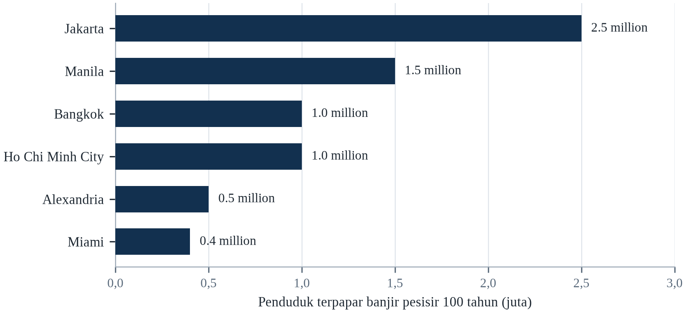||Sumber: Tabel 6.1; jumlah terpapar mencakup penurunan tanah bila dilaporkan.

Ada dua konsekuensi di sini. Pertama, variabel dominan di banyak kota bukan kenaikan muka laut global melainkan penurunan tanah lokal, yang disebabkan keputusan manusia dan dapat diperlambat atau dihentikan. Kedua, biaya adaptasi naik lebih cepat daripada laut, karena setiap tambahan kenaikan memerlukan pertahanan yang lebih besar dan lebih mahal, dan karena probabilitas kegagalan meningkat saat ambang desain didekati.

Keruntuhan lapisan es Antartika Barat akan membuat proyeksi ujung atas jauh lebih mungkin dan menggeser fokus kebijakan dari perlindungan ke retret. Terobosan dalam teknologi pompa berskala besar yang murah atau konstruksi terapung dapat memungkinkan sebagian kota bertahan lebih lama. Dan pengurangan emisi akan memperlambat kenaikan, tetapi tidak menghentikannya, karena laut dan lapisan es merespons selama berabad-abad. Bagi pesisir, mitigasi menentukan kecepatan darurat; adaptasi menentukan apakah kota itu bertahan.

---

# Bab 7: Ketahanan Pangan dan Pertanian

*Tema: ketahanan pangan, fisiologi tanaman dan kerapuhan panen global*

Pada Mei 2022, pemerintah India melarang ekspor gandum melalui satu pemberitahuan. Pemicunya adalah gelombang panas pada Maret yang datang lebih awal dan berlangsung lebih lama daripada panas musim semi mana pun yang tercatat di sabuk gandum, dan memangkas panen sekitar lima persen. Larangan itu kecil dalam skala global — India hanya menyumbang sebagian kecil perdagangan gandum dunia — tetapi datang ketika perang di Ukraina telah menghilangkan sebagian besar pasokan Laut Hitam, dan harga yang sudah naik selama setahun naik lebih jauh.

Pada Juli 2023, India membatasi ekspor beras, dan efeknya lebih besar. India menyumbang sekitar empat puluh persen perdagangan beras global, dan pembatasan itu, digabungkan dengan El Niño yang mengurangi produksi di negara Asia lain, mendorong harga beras ke tingkat tertinggi sejak 2008. Pembelian panik di Filipina, Indonesia, dan Afrika Barat memperbesar kenaikannya. Beras tidak langka secara fisik di sebagian besar negara pengimpor; ekspektasi kelangkaan sudah cukup untuk mengosongkan rak.

Episode ini menunjukkan bagaimana ketahanan pangan gagal. Ini bukan hanya soal berapa banyak yang ditanam dunia; ini soal bagaimana panen didistribusikan, disimpan, diperdagangkan, dan dihargai. Gelombang panas di satu wilayah menjadi guncangan harga di wilayah lain melalui pembatasan ekspor, pembelian spekulatif, dan tipisnya stok global. Rumah tangga termiskin, yang menghabiskan setengah pendapatannya untuk pangan, menyerap guncangan lebih dulu, dan mereka menyerapnya dengan makan lebih sedikit dan lebih buruk.

Bab ini membahas efek fisik iklim pada tanaman, ternak, dan perikanan, serta mekanisme ekonomi dan politik yang mengubah efek itu menjadi kelaparan. Yang menjadi perhatian di sini adalah tanaman yang memberi makan sebagian besar umat manusia — gandum, jagung, dan beras — dan petani kecil yang menanam sebagian besar pangan di negara berpenghasilan rendah. Bab ini ditutup dengan adaptasi yang diketahui berhasil dan alasan mengapa adaptasi itu tidak menyebar cukup cepat (Howden et al., 2007).

Pangan adalah sektor tempat perubahan iklim paling langsung dialami, karena setiap panen adalah eksperimen iklim. Tanaman peka terhadap suhu pada tahap pertumbuhan tertentu, terhadap waktu dan jumlah air, serta terhadap peristiwa ekstrem pada momen kritis. Gelombang panas beberapa hari selama pembungaan dapat menurunkan hasil secara tajam bahkan jika sisa musimnya menguntungkan, itulah sebabnya statistik iklim rata-rata meremehkan kerusakan yang ditimbulkan ekstrem.

## 7.1 Bagaimana Panas Memengaruhi Tanaman

Tanaman tumbuh dalam kisaran suhu yang sempit, dan kisaran itu berbeda menurut jenis tanaman dan tahap perkembangan. Gandum dan padi tumbuh optimal sekitar 20 sampai 25 °C; jagung sekitar 25 sampai 30 °C. Di atas optimum, fotosintesis melambat, respirasi meningkat, dan tanaman mengalokasikan lebih sedikit energi ke biji. Efeknya tidak linear: beberapa hari di atas 35 °C selama pembungaan dapat mengurangi pembentukan biji secara besar-besaran, bahkan jika sisa musimnya menguntungkan.

Suhu malam sama pentingnya dengan panas siang. Malam yang sejuk memungkinkan tanaman pulih dari kehilangan air pada siang hari dan menyelesaikan proses metabolik yang mengisi biji. Ketika malam tetap di atas 25 °C, respirasi berlanjut sepanjang malam dan menghabiskan karbohidrat yang seharusnya menjadi hasil. Studi di Dataran Indo-Gangga menemukan bahwa suhu malam adalah prediktor hasil padi yang lebih kuat daripada suhu maksimum siang, yang merupakan salah satu alasan proyeksi iklim yang hanya melaporkan rata-rata siang meremehkan risikonya.

Efek gabungan pemanasan dan CO2 rumit. CO2 yang lebih tinggi meningkatkan fotosintesis pada tanaman C3 seperti gandum, padi, dan kedelai — efek yang dikenal sebagai pemupukan CO2 — yang dapat mengimbangi sebagian penalti panas (Zhao dkk., 2017). Tetapi efeknya lebih kecil di lapangan daripada di rumah kaca, karena hara dan air menjadi pembatas, dan efek itu menurunkan konsentrasi protein, seng, serta besi dalam biji. Tanaman yang hasilnya sedikit lebih tinggi tetapi kurang bergizi belum tentu merupakan perbaikan bagi orang yang memakannya.

Efek panas pada tanaman bersifat non-linear dan berbasis ambang. Fotosintesis mulai menurun di atas suhu optimum yang berbeda menurut tanaman — sekitar 30 °C untuk gandum dan padi, lebih tinggi untuk jagung dan sorgum — dan di atas ambang kritis, serbuk sari menjadi steril dan pengisian bulir berhenti (Zhao dkk., 2017). Zhao dkk. (2017) menganalisis ratusan studi dan memperkirakan bahwa setiap derajat pemanasan menurunkan hasil gandum global sekitar 6 persen, padi 3,2 persen, jagung 7,4 persen, dan kedelai 3,1 persen, sebelum memperhitungkan adaptasi atau pemupukan karbon.

Mekanisme pada tingkat tanaman lebih spesifik daripada judul berita bahwa panas menurunkan hasil. Fotosintesis memiliki suhu optimum, dan di atas sekitar tiga puluh derajat Celsius enzim yang memfiksasi karbon mulai kehilangan efisiensi, sementara respirasi terus mengonsumsi gula. Kerusakannya paling parah ketika suhu siang tinggi disertai malam yang hangat, karena tanaman tidak dapat memulihkan karbon yang dibakarnya pada siang hari. Ortiz-Bobea dan rekan-rekannya memperkirakan pada 2021 bahwa pemanasan akibat manusia telah menurunkan pertumbuhan produktivitas pertanian global sekitar dua puluh satu persen sejak 1961, dan kerugiannya terkonsentrasi di daerah tropis, tempat margin di atas titik optimum selalu lebih sempit (Lobell et al., 2011).

Kerusakan yang ditimbulkan panas pada tanaman bergantung pada kapan ia datang sama besarnya dengan seberapa panas. Pada fase berbunga, beberapa hari di atas ambang dapat mensterilkan serbuk sari dan mengurangi jumlah bulir yang terbentuk; pada fase pengisian bulir, panas memperpendek masa tanaman menimbun pati, sehingga bulirnya lebih kecil; pada fase pemasakan, ia dapat menurunkan mutu tanpa mengurangi bobot. Suhu malam lebih penting daripada siang untuk sebagian tanaman, karena tanaman bernapas sepanjang malam dan kehilangan karbon yang seharusnya disimpan. Akibatnya gelombang panas yang tampak wajar pada rata-rata harian dapat menghancurkan panen, dan gelombang yang sama pada pekan berbeda hampir tidak berpengaruh.

Panas memengaruhi tanaman melalui tiga mekanisme yang bekerja pada waktu berbeda dalam sehari dan semusim. Pertama kerusakan langsung pada mesin fotosintesis, yang menjadi tidak efisien di atas ambang yang berbeda antarspecies. Kedua kegagalan penyerbukan, yang terjadi ketika serbuk sari steril atau bunganya gugur pada jendela singkat. Ketiga permintaan air, yang naik bersama suhu dan mungkin tidak dapat dipenuhi tanaman, sehingga gelombang panas menjadi kekeringan bahkan ketika tanahnya basah. Ketiga mekanismenya berinteraksi, itulah sebabnya kenaikan sedang pada suhu rata-rata dapat menghasilkan penurunan besar pada hasil panen di tahun buruk.

## 7.2 Air, Tanah dan Batas Irigasi

Pertanian mengonsumsi sekitar 70 persen pengambilan air tawar global, dan irigasi adalah penggunaan tunggal terbesar. Di wilayah yang curah hujannya tidak andal, irigasi adalah yang membedakan antara satu panen dan dua panen, atau antara bertahan dan gagal. Tetapi irigasi bergantung pada air yang semakin diperebutkan: akuifer menipis, sungai sudah teralokasi penuh, dan lelehan salju yang memberi makan banyak sistem menurun.

Tanah adalah input tak terlihat lainnya. Tanah yang sehat menahan air, mendaur ulang hara, dan mendukung komunitas mikroba yang membuatnya tersedia bagi tanaman. Erosi, pemadatan, dan hilangnya bahan organik mengurangi kapasitas itu, yang membuat tanaman lebih rentan terhadap kekeringan bahkan ketika curah hujan tidak berubah. Kehilangan lapisan atas tanah global diperkirakan 24 miliar ton per tahun, dan degradasi lahan subur adalah salah satu alasan hasil panen stagnan di sebagian wilayah meskipun varietasnya membaik.

Kendala-kendala ini saling berinteraksi. Ladang dengan tanah yang menipis dan tanpa irigasi tidak dapat memanfaatkan varietas tahan panas; petani yang tidak mampu membeli pupuk tidak dapat mengimbangi pengenceran hara dengan menambah pupuk. Hasilnya adalah guncangan iklim yang sama menghasilkan kerugian yang sangat berbeda di peternakan yang berbeda, dan adaptasi harus menangani tanah, air, dan benih secara bersamaan, bukan satu per satu.

Irigasi menjadi sumber utama pertumbuhan hasil selama setengah abad, dan ia mencapai batas di banyak wilayah. Akuifer terkuras lebih cepat daripada pengisian ulangnya di Dataran China Utara, Punjab India, High Plains Amerika Serikat, dan sebagian Timur Tengah; sungai telah teralokasikan sepenuhnya; dan biaya energi pemompaan naik seiring turunnya muka air tanah. Memperluas irigasi lebih jauh akan memerlukan penyimpanan baru atau sumber baru, keduanya semakin mahal dan diperebutkan.

Irigasi adalah adaptasi terbesar di pertanian, dan batasnya bersifat fisik, bukan finansial. Sawah hanya dapat diairi dari sumber yang terisi kembali, dan di banyak wilayah sumbernya adalah akuifer yang sedang ditambang. Tanah sama pentingnya: salinisasi akibat irigasi yang drainasenya buruk menumpuk garam di zona akar, dan lahan yang produktif lima puluh tahun dapat ditinggalkan dalam lima tahun ketika garamnya naik. Air yang tersedia juga harus tiba pada waktu yang tepat, itulah sebabnya waktu leleh salju dan monsun lebih penting daripada total tahunan. Ketika ketiga kendala itu mengikat sekaligus, menu adaptasi menyusut menjadi mengganti tanaman, mengganti praktik, atau pergi.

Irigasi adalah penggunaan air tawar terbesar di dunia, dan sekaligus praktik tempat air paling banyak terbuang. Irigasi genang di lahan datar dapat kehilangan separuh air yang dialirkan melalui penguapan dan limpasan, dan kehilangannya tidak terlihat karena airnya lenyap ke udara atau kembali ke sungai. Irigasi tetes mengantar air ke zona akar dan dapat memotong konsumsi sepertiga, dan biayanya uang yang mungkin tidak dimiliki petani kecil. Persoalan lebih dalamnya sumbernya: di dataran Indo-Gangga dan Dataran Cina Utara, air dipompa dari akuifer yang terisi jauh lebih lambat daripada pengambilannya, yang berarti irigasinya menambang cadangan.

## 7.3 Hama, Patogen dan Penyerbuk

Suhu yang lebih hangat memperluas jangkauan banyak hama pertanian dan mengubah siklus hidupnya. Ulat grayak tentara, ngengat asli Amerika, menyebar ke Afrika lalu Asia pada 2010-an dan menjadi hama utama jagung; penyebarannya dibantu perdagangan dan musim dingin yang lebih hangat yang memungkinkannya bertahan di wilayah baru. Kutu daun, kutu kebul, dan belalang merespons suhu serta curah hujan dengan cara yang sulit diprediksi tetapi semakin menguntungkan ledakan populasi.

Penyakit tanaman mengikuti pola yang sama. Patogen jamur yang dulu terbatas di wilayah hangat bergerak ke kutub dan ke tempat yang lebih tinggi; karat daun kopi, yang menghancurkan perkebunan Amerika Tengah pada 2012–2013, terkait dengan suhu lebih tinggi dan curah hujan yang lebih bervariasi. Responsnya sering berupa lebih banyak pestisida, yang menaikkan biaya dan menciptakan resistensi, atau meninggalkan tanaman yang rentan, yang mengurangi keragaman.

Penyerbuk adalah kerentanan tersendiri. Sekitar tiga perempat tanaman pangan utama dunia bergantung setidaknya sebagian pada penyerbukan hewan, dan penyerbuk sendiri peka terhadap panas, kekeringan, dan hilangnya habitat. Studi di wilayah tropis menemukan bahwa keragaman lebah menurun seiring pemanasan, dan penurunan itu mengurangi hasil tanaman seperti kopi, kakao, dan banyak buah serta sayuran. Efeknya mudah diabaikan karena bertahap, tetapi ia terakumulasi dengan cara yang sama seperti kehilangan tanah.

Hama dan patogen merespons pemanasan dengan cara yang sulit dimodelkan. Musim dingin yang lebih hangat mengurangi kematian saat musim dingin, yang memungkinkan populasi tumbuh lebih awal; musim tanam yang lebih panjang menyediakan lebih banyak generasi; dan pergeseran jangkauan vektor memaparkan wilayah baru pada penyakit seperti karat gandum dan nekrosis letal jagung. Petani merespons dengan pestisida, yang menaikkan biaya dan menyeleksi resistensi, dan treadmill yang dihasilkan adalah salah satu alasan penggunaan input pertanian naik lebih cepat daripada keluarannya.

Risiko hama dan penyakit berubah lebih cepat daripada kemampuan tanaman beradaptasi, dan mekanismenya sebagian besar termal. Serangga memiliki waktu generasi lebih cepat pada suhu lebih tinggi, sehingga populasi dapat terbangun dalam satu musim alih-alih dalam hitungan tahun; patogen jamur menyebar lebih mudah di panas lembap; dan wilayah geografis banyak hama meluas ke arah kutub. FAO memperkirakan hama dan penyakit tanaman sudah menghancurkan sebagian besar produksi tanaman global setiap tahun, dan studi pemodelan memproyeksikan pemanasan akan menaikkan jangkauan serta laju reproduksi hama utama seperti fall armyworm, yang menyebar di Afrika dan Asia sejak 2016 (FAO, 2023).

Hama dan patogen merespons iklim lebih cepat daripada tanaman, karena waktu regenerasinya lebih pendek. Musim dingin yang lebih hangat membiarkan lebih banyak individu bertahan; musim semi yang lebih awal memungkinkan satu generasi tambahan; dan pergeseran hujan mengubah tempat penyakit jamur dapat menetap. Hasilnya peta tekanan hama yang bergerak, tempat pengetahuan warisan petani tentang apa yang disemprotkan dan kapan menjadi kurang andal. Penyerbuk terpengaruh panas, kekeringan, dan hilangnya habitat, dan sumbangan mereka terhadap hasil terbesar pada tanaman buah dan sayur yang membawa mikronutrien terbanyak. Gabungannya penting bagi gizi, bukan hanya tonase.

Musim tanam yang lebih hangat dan kering juga mengubah kimia panen dengan cara yang tak terlihat di pasar. Cekaman kekeringan menaikkan konsentrasi mikotoksin yang dihasilkan jamur, terutama aflatoksin pada jagung dan kacang tanah, yang merusak hati dan dikaitkan dengan tengkes pada anak. Kontaminasinya tidak terlihat, tidak hilang dengan memasak biasa, dan paling berbahaya pada sistem subsisten tempat keluarga memakan jagung yang mereka tanam sendiri. Pengawasannya mahal dan jarang dibiayai pada skala yang diperlukan, sehingga paparannya terukur terutama ketika wabah penyakit hati menarik perhatian.

Hama, patogen, dan penyerbuk adalah bagian biologis dari sistem pangan, dan iklim menata ulang ketiganya. Serangga berdarah dingin, sehingga musim dingin lebih hangat memungkinkan lebih banyak yang bertahan hidup dan musim panas lebih hangat memungkinkan lebih banyak generasi dalam setahun, itulah sebabnya sebaran beberapa hama tanaman bergeser ke kutub. Mikotoksin, seperti yang dihasilkan jamur yang menyerang jagung dan kacang tanah, peka terhadap panas serta kekeringan dan menjadi penyebab penyakit hati di daerah tropis. Penyerbuk terpengaruh ketidakcocokan antara waktu tanaman berbunga dan waktu serangga muncul.

## 7.4 Peristiwa Ekstrem dan Kegagalan Panen

Sebagian besar variabilitas produksi global dari tahun ke tahun berasal dari peristiwa ekstrem, bukan dari pemanasan bertahap. Kekeringan selama periode pengisian biji, banjir saat tanam, gelombang panas saat pembungaan, atau embun beku pada waktu yang salah dapat menghilangkan sebagian besar panen nasional. Karena stok global tipis relatif terhadap konsumsi, rangkaian peristiwa semacam itu di wilayah berbeda dapat menghasilkan krisis global.

Krisis harga pangan 2007–2008 adalah contoh klasik (FAO, 2023). Kekeringan di Australia, panen buruk di Eropa dan Amerika Serikat, serta pengalihan jagung untuk biofuel menggabungkan diri untuk menipiskan stok, dan ketika eksportir besar membatasi pengiriman, harga berlipat dua. Hasilnya adalah kerusuhan di lebih dari tiga puluh negara dan pembalikan pengurangan kemiskinan di banyak negara lain. Kekurangan fisiknya modest; respons kebijakan mengubahnya menjadi malapetaka.

Periode 2022–2023 mengulangi pola dengan pemicu berbeda. Panas di India, kekeringan di Tanduk Afrika, perang di Ukraina, dan El Niño yang diperkirakan mengurangi output padi di Asia bergabung untuk menaikkan harga dan mengurangi ketersediaan di negara pengimpor. Setiap peristiwa berada dalam kisaran variabilitas alami; bersama-sama mereka melampaui kapasitas sistem perdagangan untuk menyerap, yang justru merupakan hal yang diperkirakan akan semakin sering disebabkan perubahan iklim.

Peristiwa ekstrem menyebabkan kerusakan yang tidak proporsional terhadap porsinya dalam musim. Banjir saat panen dapat menghancurkan tanaman yang sudah matang; hujan es dapat menggugurkan buah dari pohon; embun beku akhir dapat membunuh bunga setelah cuaca hangat memajukan pembungaan. Karena peristiwa itu menjadi lebih sering, varians hasil panen naik bahkan ketika rata-ratanya stabil, yang menaikkan volatilitas harga dan frekuensi kelangkaan lokal.

Peristiwa ekstrem merusak panen dengan cara yang disembunyikan rata-rata musiman. Banjir saat tanam dapat menunda tanam melewati jendela agar tanaman selesai berbuah; banjir saat panen dapat menghancurkan panen yang sudah aman; siklon merobohkan batang yang menopang bulir; hujan es menanggalkan buah dari pohon dalam sepuluh menit. Kerugiannya lokal dan karena itu mudah diabaikan dalam statistik nasional, tetapi malapetaka bagi rumah tangga yang mengalaminya, dan berulang di tempat yang sama karena tanah yang sama terpapar. Asuransi terhadap satu peristiwa mahal dan sering tidak tersedia; alternatifnya diversifikasi pendapatan.

Waktu datang peristiwa ekstrem lebih penting daripada besarnya, karena tanaman rentan hanya pada pekan ketika berbunga atau mengisi bulir. Gelombang panas yang datang sebulan sebelum berbunga merusak sedikit; gelombang panas yang sama saat antesis dapat mensterilkan serbuk sari dan memotong hasil sepertiga. Inilah sebabnya hubungan agregat antara suhu dan hasil panen menyembunyikan begitu banyak variasi, dan mengapa musim yang tampak normal pada rata-rata tahunan dapat menghasilkan bencana lokal. Gelombang panas Rusia 2010 dan gelombang panas India 2022 keduanya jatuh pada jendela sensitif, dan keduanya diikuti pembatasan ekspor yang mengubah masalah panen nasional menjadi masalah harga global.

## 7.5 Peternakan dan Pastoralisme

Peternakan memberi pekerjaan bagi sekitar 1,3 miliar orang dan menyediakan protein, tenaga, dan tabungan bagi komunitas pastoral. Panas memengaruhi hewan secara langsung: sapi perah mengurangi produksi susu ketika indeks suhu-kelembapan melebihi sekitar 72, unggas mengalami kematian pada cuaca panas, dan hewan gembala kehilangan kondisi tubuh ketika padang rumput mengering. Kekeringan 2022 di Tanduk Afrika menewaskan jutaan hewan, menghancurkan tabungan rumah tangga pastoral.

Pastoralisme adalah sistem yang beradaptasi dengan variabilitas. Penggembala bergerak bersama hujan, memelihara kawanan campuran dari spesies berbeda, dan menggunakan jaringan sosial untuk berbagi hewan dan informasi. Perubahan iklim menekan sistem itu dengan membuat curah hujan kurang dapat diprediksi, mengurangi jumlah musim yang baik, dan meningkatkan frekuensi kekeringan yang terjadi sebelum kawanan pulih dari kekeringan sebelumnya. Hasilnya bukan bencana tunggal melainkan erosi lambat atas basis aset.

Sektor peternakan juga sumber emisi besar, menyumbang sekitar 12 persen gas rumah kaca global melalui fermentasi enterik, produksi pakan, dan perubahan penggunaan lahan. Itu menciptakan ketegangan dalam kebijakan: mengurangi jumlah ternak akan mengurangi emisi dan membebaskan lahan, tetapi juga memengaruhi penghidupan dan gizi rumah tangga termiskin. Solusinya bukan satu target global, melainkan serangkaian perubahan sesuai konteks: pakan lebih baik, bibit lebih baik, pengelolaan penggembalaan lebih baik, dan pergeseran pola makan di negara berpenghasilan tinggi ke arah konsumsi daging yang lebih rendah.

Pastoralisme adalah penghidupan yang dibangun untuk variabilitas, dan ia sedang diuji di luar batasnya. Penggembala memindahkan ternak mengikuti hujan, memakai jalur tradisional dan kesepakatan timbal balik dengan komunitas petani. Pemanasan, kekeringan, perluasan pertanian ke padang rumput, dan konflik semuanya mengurangi ruang serta keluwesan tempat sistem itu bergantung, itulah sebabnya kerugian ternak dalam kekeringan terakhir bersifat katastrofik di Tanduk Afrika dan Sahel.

Pastoralisme adalah sistem pangan yang paling sering disalahpahami kebijakan iklim. Penggembala mengelola variabilitas alih-alih memaksimalkan hasil, memindahkan ternak mengikuti hujan, dan mobilitas mereka adalah adaptasi yang berulang kali dibatasi kebijakan pemukiman. Studi di Tanduk Afrika menemukan bahwa ternak pulih dari kekeringan jika dapat bergerak dan jika stok induk bertahan; ketika pergerakan dihalangi pagar, kebun atau konflik, ternak kehilangan kemampuan pulih dan rumah tangga terdorong keluar dari pastoralisme secara permanen. Pelajaran kebijakannya adalah melindungi koridor dan pasar, bukan memukimkan penggembala.

Ternak menanggung beban panas dua kali: hewannya mengalaminya langsung, dan hijauan yang mereka makan tumbuh lebih sedikit saat panas dan kering. Sapi dan unggas mengurangi asupan pakan serta kesuburan di atas ambang yang berbeda menurut bangsa, dan produksi susu turun sebelum hewan menunjukkan gangguan nyata. Pastoralis mengelola variabilitas dengan bergerak, dan sistem mereka beradaptasi baik pada iklim yang bervariasi tetapi tidak pada iklim yang sekaligus lebih panas dan lebih bervariasi, karena padang yang seharusnya pulih pada tahun basah tidak pulih ketika tahun basahnya gagal datang. Kehilangan ternak bukan hanya peristiwa ekonomi; ia kehilangan tabungan, mahar, status, dan pengetahuan.

Ternak adalah simpanan kekayaan di lahan kering, itulah sebabnya kekeringan yang membunuhnya menghancurkan tabungan, bukan pendapatan. Rumah tangga penggembala yang menjual ternak saat kekeringan menerima harga rendah, karena semua orang menjual, dan membelinya kembali setelahnya dengan harga tinggi, karena semua orang membeli. Hasilnya ratchet yang memindahkan kekayaan keluar dari rumah tangga pada setiap siklus, dan rumah tangga yang tidak pulih adalah yang melewati ambang ketika mereka tidak lagi punya ternak untuk membangun kembali. Cekaman panas menambah tekanan kedua, karena sapi dan unggas makan lebih sedikit dan mengonversi pakan lebih tidak efisien saat suhu naik.

## 7.6 Perikanan dan Akuakultur

Perikanan menyediakan sekitar 17 persen protein hewani yang dikonsumsi global, dan lebih dari tiga miliar orang bergantung pada ikan sebagai sumber protein dan mikronutrien yang signifikan. Perubahan iklim memengaruhi ikan melalui pemanasan, pengasaman, kehilangan oksigen, dan perpindahan spesies ke air yang lebih dingin. Hasilnya adalah stok bergeser menjauh dari wilayah tropis tempat ketergantungan tertinggi, dan menuju kutub tempat armada penangkapan kurang mampu mengikuti.

Terumbu karang adalah habitat perikanan paling rentan. Ikan karang bergantung pada struktur dan produktivitas karang hidup, dan ketika karang memutih lalu mati, komunitas ikan berubah: spesies herbivora mengambil alih, ikan predator besar menurun, dan tingkat tangkapan jatuh. Di Asia Tenggara dan Pasifik, tempat perikanan karang menopang jutaan rumah tangga pesisir, kerugiannya bersifat nutrisi sekaligus ekonomi. Pemanasan 2 °C diperkirakan menghilangkan sebagian besar terumbu karang dunia.

Akuakultur adalah sektor pangan yang tumbuh paling cepat dan dapat mengimbangi sebagian penurunan perikanan tangkap, tetapi ia memiliki kerentanan sendiri. Tambak pesisir terpapar kenaikan muka laut, gelombang badai, dan intrusi air asin; pasokan pakan bergantung pada ikan liar dan tanaman yang juga terdampak iklim; dan wabah penyakit menyebar lebih mudah di air hangat. Akuakultur dapat menjadi bagian dari adaptasi, tetapi bukan pengganti perlindungan ekosistem yang menopang stok liar.

Perikanan terpengaruh pemanasan melalui beberapa mekanisme: stok ikan bergeser ke air lebih dingin dan kedalaman lebih besar, yang memindahkannya melintasi batas negara; pemutihan karang menghancurkan habitat asuhan; pengasaman memengaruhi kerang dan plankton; dan deoksigenasi menciptakan zona mati. Hasilnya, tangkapan menurun di wilayah tropis bahkan ketika tangkapan global tampak stabil, karena kerugiannya terkonsentrasi di negara dengan lebih sedikit alternatif protein dan lapangan kerja.

Delta Mekong adalah sistem pangan yang paling langsung terpapar intrusi air laut, dan paparannya diukur dalam kegagalan panen. Kenaikan muka laut dan berkurangnya debit musim kemarau telah mendorong batas salinitas puluhan kilometer ke pedalaman, dan petani padi di Ben Tre serta Soc Trang beralih ke tambak udang karena airnya tidak lagi cukup tawar untuk padi. Konversi itu menaikkan pendapatan sebagian rumah tangga dan menambah utang serta risiko bagi yang lain, dan ia menggambarkan pola umum: adaptasi di tingkat usaha tani sering menguntungkan secara individual dan mengacaukan secara kolektif, karena ia mengubah neraca air kawasan yang menjadi sandaran semua orang.

Perikanan terpengaruh pemanasan melalui perpindahan spesies, dan perpindahannya umumnya menuju kutub dan ke air yang lebih dalam. Stok yang bergerak melewati batas maritim menjadi masalah diplomatik; stok yang bergerak keluar dari jangkauan perahu kecil menjadi masalah pangan. Terumbu karang, yang mengasuh sebagian besar ikan tropis, termasuk ekosistem paling sensitif panas di Bumi. Akuakultur dapat menggantikan sebagian kehilangan dan membawa masalahnya sendiri: penyakit menyebar cepat pada kepadatan tinggi, pakannya bergantung pada ikan liar, dan lokasi paling cocok untuk budidaya sering justru perairan pesisir yang paling terdampak pemanasan serta pengasaman.

Ikan berpindah, dan institusi yang mengelolanya tidak. Ketika laut menghangat, stok bergeser ke arah kutub dan ke air yang lebih dalam, dan spesies yang dulu berada di zona ekonomi eksklusif satu negara menjadi stok lintas batas yang dapat dipanen negara lain secara sah. Sengketa makerel di Atlantik Utara adalah contoh paling jelas: ketika stoknya bergerak ke barat laut, Islandia dan Faroe mulai menangkapnya, dan kesepakatan yang membaginya antara Uni Eropa, Norwegia, dan Rusia runtuh. Akuakultur sering diusulkan sebagai pengganti, dan ia punya kerentanan sendiri karena bergantung pada ikan liar untuk pakan dan pada suhu air yang juga naik.

## 7.7 Harga, Perdagangan dan Stok

Perdagangan pangan global menyangga guncangan produksi lokal, tetapi juga menularkannya. Negara yang mengalami kekeringan mengimpor lebih banyak, yang menaikkan harga bagi semua orang; negara eksportir yang membatasi pengiriman untuk melindungi konsumennya sendiri memperbesar kelangkaan. Hasilnya adalah efek harga dari guncangan iklim dapat lebih besar daripada efek fisiknya, dan negara termiskin yang paling bergantung pada impor membayar harga tertinggi.

Stok adalah garis pertahanan pertama, dan stok lebih tipis daripada yang terlihat. Stok biji-bijian global dipegang oleh sedikit negara dan oleh pedagang swasta yang tidak memiliki kewajiban melepaskannya dalam krisis. Stok resmi kadang rendah karena menyimpannya mahal dan karena pemerintah lebih suka campur tangan di pasar ketika harga naik. Krisis 2007–2008 mengungkapkan bahwa stok yang dimaksudkan untuk menstabilkan pasar tidak memadai begitu eksportir mulai menimbun.

Kebijakan perdagangan karena itu adalah kebijakan iklim. Dunia yang mempertahankan pasar terbuka, membatasi pembatasan ekspor, dan berinvestasi dalam penyimpanan dapat menyerap rangkaian guncangan regional tanpa krisis global. Dunia yang merespons setiap kekurangan dengan larangan ekspor dan pembelian panik mengubah kegagalan panen regional menjadi lonjakan harga global, dan lonjakan itu paling keras menimpa rumah tangga dengan kapasitas penyerapan paling kecil.

Perdagangan pangan global telah meredam guncangan iklim, tetapi ia juga memusatkan risiko. Sejumlah kecil negara pengekspor mendominasi perdagangan gandum, jagung, beras, dan kedelai, sehingga kekeringan di salah satunya memengaruhi harga di mana-mana. Pembatasan ekspor selama krisis 2007–2008 dan 2022 memperkuat lonjakan harga, dan negara yang menerapkannya sering yang memiliki stok terbesar. Pelajarannya adalah aturan perdagangan dan pengelolaan stok merupakan instrumen adaptasi, bukan sekadar kebijakan ekonomi.

Perdagangan adalah mekanisme yang memindahkan pangan dari tempat ditanam ke tempat dimakan, dan ia bekerja paling baik ketika dapat diprediksi. Kekeringan yang mengurangi panen di satu wilayah dapat ditutup impor dari wilayah lain, asalkan negara pengekspor tidak membatasi penjualan dan sistem pelayaran berfungsi. Episode dua dekade terakhir menunjukkan seberapa cepat logika itu patah: panen buruk, larangan ekspor, lonjakan harga, dan gelombang pembelian panik yang mengubah kelangkaan lokal menjadi kelangkaan global. Stok adalah penyangga yang meredam daur itu, dan rasio stok terhadap konsumsi adalah salah satu indikator awal krisis pangan terbaik. Rasionya menurun bertahun-tahun, yang berarti sistem punya lebih sedikit kelonggaran justru ketika guncangannya makin sering.

Stok biji-bijian global lebih tipis daripada yang dibayangkan sebagian besar konsumen, dan ketipisan itulah yang mengubah gagal panen lokal menjadi lonjakan harga. Rasio stok terhadap konsumsi untuk gandum dan jagung menurun dalam dua dekade terakhir, dan stok yang ada dipegang sejumlah kecil negara yang dapat memutuskan menyimpannya. Ketika eksportir besar membatasi penjualan, importir yang bergantung padanya tidak punya pengganti dalam waktu singkat, dan harganya naik sampai permintaan hancur di kalangan konsumen termiskin. Pasar berjangka dapat menghaluskan penyesuaian bagi yang dapat mengaksesnya, dan tidak dapat menghaluskannya bagi rumah tangga yang membeli tepungnya harian.

## 7.8 Petani Kecil dan Konsumen Termiskin

Pertanian petani kecil menghasilkan sekitar sepertiga pangan dunia dan jauh lebih besar di negara berpenghasilan rendah, tetapi mereka mengelola hanya sebagian kecil investasi dan irigasi. Mereka paling terpapar guncangan iklim dan paling tidak mampu menyerapnya, karena mereka kekurangan asuransi, kredit, penyimpanan, dan akses pasar. Satu musim gagal dapat memaksa rumah tangga menjual aset, menarik anak dari sekolah, dan berutang dengan bunga tinggi, yang mengurangi kapasitasnya menghadapi musim berikutnya.

Perempuan terkena dampak secara tidak proporsional. Di banyak negara mereka bertanggung jawab atas air, bahan bakar, dan pengolahan pangan, dan mereka sering memiliki hak atas tanah yang lebih lemah serta akses lebih kecil ke layanan penyuluhan. Ketika kekeringan meningkatkan waktu yang dibutuhkan untuk mengambil air atau bahan bakar, anak perempuan sering menjadi yang pertama ditarik dari sekolah. Hasilnya adalah guncangan iklim tidak sekadar mengurangi pendapatan; ia mengubah lintasan sebuah rumah tangga, kadang secara permanen.

Perlindungan sosial adalah instrumen paling efektif untuk mencegah lintasan itu. Transfer tunai, pemberian makan di sekolah, skema jaminan kerja, dan asuransi panen dapat menahan rumah tangga dari menjual aset produktif selama guncangan. Program Jaring Pengaman Produktif Ethiopia, Undang-Undang Jaminan Kerja Pedesaan India, dan Progresa-Oportunidades di Meksiko semuanya terbukti mengurangi dampak kekeringan terhadap konsumsi, dan sering lebih hemat biaya daripada bantuan darurat setelah krisis.

Petani kecil dan konsumen miskin terpapar melalui jalur berbeda. Petani kecil bergantung pada panen sendiri untuk pangan dan pendapatan, sehingga musim gagal sekaligus guncangan pangan dan guncangan pendapatan, dan mereka sering tidak memiliki asuransi, penyimpanan, atau kredit. Konsumen miskin membelanjakan porsi besar pendapatannya untuk pangan, sehingga kenaikan harga 20 persen dapat memaksa mereka mengurangi makan atau beralih ke pangan lebih murah dan kurang bergizi (FAO, 2023). Kedua kelompok karena itu rentan terhadap peristiwa yang sama karena alasan berbeda.

Fakta distribusi yang mengorganisasi bab ini adalah bahwa sebagian besar orang yang kelaparan adalah pembeli pangan neto. Petani kecil yang menghasilkan surplus diuntungkan harga tinggi, sementara petani kecil yang membeli sebagian pangannya dan buruh tanpa tanah dirugikan, dan yang dirugikan lebih banyak daripada yang diuntungkan di sebagian besar negara berpendapatan rendah. Itulah sebab lonjakan harga pangan menghasilkan kemakmuran pedesaan dan kemiskinan pedesaan pada musim yang sama, dan sebab kebijakan pertanian yang berfokus pada produksi dapat melewatkan rumah tangga yang paling butuh bantuan. Transfer tunai, makan sekolah dan stabilisasi harga menjangkau pembeli neto; subsidi benih sering tidak.

Konsumen termiskin paling terpapar dan paling tidak bertanggung jawab. Rumah tangga yang membelanjakan separuh pendapatannya untuk pangan mengalami kenaikan harga sebagai pengurangan segala hal lain: obat, uang sekolah, bahan bakar, protein. Petani yang bersih menjual dapat diuntungkan harga tinggi, tetapi sebagian besar petani kecil di negara tempat kelaparan terkonsentrasi adalah pembeli bersih, sehingga lonjakan harga melukai mereka dua kali — sebagai konsumen dan lewat biaya sarana produksi. Akibatnya kekeringan yang sama menghasilkan kebangkrutan bagi sebagian dan keuntungan bagi yang lain, dan sebarannya bergantung pada tanah, penyimpanan, kredit, dan akses pasar.

Masyarakat miskin pedesaan biasanya pembeli pangan bersih, yang berarti kenaikan harga biji-bijian merugikan mereka bahkan ketika mereka petani. Rumah tangga yang menanam sebagian kecil dari yang dimakannya dan membeli sisanya terpapar di dua sisi: panennya sendiri dapat gagal, dan harga yang harus dibelinya naik pada saat yang sama. Strategi bertahannya mengikuti urutan yang terdokumentasi lintas benua: pangan lebih murah dan kurang bergizi, lalu penjualan ternak, lalu penjualan alat, lalu penarikan anak dari sekolah, lalu migrasi. Setiap langkah rasional bagi rumah tangga dan setiap langkah mengurangi kapasitasnya untuk pulih.

## 7.9 Adaptasi: Benih, Tanah, Air dan Asuransi

Portofolio adaptasi pertanian sudah mapan. Varietas tahan panas dan kekeringan, penanaman lebih awal, diversifikasi tanaman, irigasi yang lebih baik, konservasi tanah, dan agroforestri dapat mengurangi kerugian pada pemanasan moderat. Pertanian cerdas iklim, istilah yang mencakup banyak praktik ini, telah diadopsi luas dalam kebijakan pembangunan, meskipun bukti efektivitasnya berbeda menurut konteks dan cara mengukurnya.

Perbaikan genetik adalah alat paling ampuh dan paling lambat diterapkan. Merakit varietas baru membutuhkan delapan sampai dua belas tahun, dan iklim yang akan dihadapi varietas itu saat dilepas bukan iklim yang menjadi dasar seleksinya. Bank gen menyimpan keragaman yang dibutuhkan pemulia, tetapi mereka kekurangan dana, dan sifat yang penting — toleransi panas saat pembungaan, akar dalam, ketahanan terhadap hama baru — sering ditemukan pada varietas lokal yang hilang saat petani beralih ke varietas modern.

Asuransi dan keuangan adalah kondisi pendukungnya. Petani yang tidak dapat meminjam tidak dapat berinvestasi dalam irigasi atau benih unggul; petani tanpa asuransi mungkin menghindari risiko dengan menanam tanaman berproduksi rendah tetapi andal. Asuransi berbasis indeks, yang membayar ketika curah hujan atau suhu melewati ambang tertentu, dipromosikan sebagai solusi, tetapi adopsinya terbatas oleh basis risiko, biaya, dan kepercayaan. Program yang paling berhasil menggabungkan asuransi dengan kredit, penyuluhan, dan akses pasar, karena asuransi saja tidak menyelesaikan masalah produktivitas yang mendasarinya.

Adaptasi di bidang pertanian memiliki menu yang telah teruji: varietas tahan panas dan kekeringan, penyesuaian waktu tanam, pertanian konservasi yang mempertahankan kelembapan tanah, agroforestri yang memberi naungan dan mendiversifikasi pendapatan, irigasi yang diperbaiki, asuransi berbasis indeks, dan perlindungan sosial yang menjangkau petani sebelum mereka menjual aset. Kendalanya jarang ketersediaan satu langkah tertentu; ia sistem penyuluhan, kredit, dan akses pasar yang menentukan apakah petani dapat mengadopsinya.

Adaptasi pertanian adalah portofolio, bukan peluru perak. Benih yang lebih baik, termasuk varietas yang tahan panas, kekeringan, dan garam, adalah unsur paling terlihat, tetapi hanya bekerja ketika petani dapat mengaksesnya, mampu membelinya, dan mendapat pendampingan untuk mengelolanya. Tindakan tanah — mulsa, tanaman penutup, olah tanah minimum, bahan organik — memperbaiki retensi air dan murah bila ada tenaga kerja. Tindakan air mencakup tetes, pengairan berselang, dan imbuhan akuifer terkelola. Asuransi indeks dapat membayar cepat setelah kekeringan tanpa biaya menilai setiap petak, tetapi membawa risiko dasar: indeks bisa gagal terpicu di petak yang benar-benar kehilangan panen.

Sistem benih perlu perhatian tersendiri karena ia menentukan seberapa cepat unsur lain menyebar. Varietas baru mencapai lahan melalui rantai pemulia publik, perusahaan swasta, pengganda benih, pengecer, dan tetangga, dan rantai itu paling lemah di negara tempat adaptasi paling mendesak. Pemuliaan publik kurang didanai puluhan tahun, dan sektor swasta memusatkan perhatian pada tanaman dan pasar yang mampu membayar risetnya. Benih simpanan petani, yang memasok sebagian besar petani kecil dunia, beragam dan teradaptasi lokal tetapi jarang diperbaiki secepat yang dituntut iklim. Hasilnya jurang antara varietas di petak percobaan dan varietas yang benar-benar ditanam.

Menu adaptasi pertanian lebih panjang daripada anggaran adaptasinya, dan butirnya berbeda biaya serta kecepatan. Benih unggul paling banyak dibicarakan dan paling lambat, karena varietas baru butuh satu dekade untuk dikembangkan dan sampai ke petani. Praktik tanah dan air lebih murah dan lebih cepat, dan mencakup penahanan sisa tanaman, pembangunan struktur pemanenan air kecil, serta pergeseran ke tanaman yang cocok dengan musimnya. Asuransi instrumen yang memindahkan risiko yang tidak dapat dihapus praktiknya, dan ia yang paling tidak tersedia bagi petani yang paling membutuhkannya. Urutannya penting: benih yang tidak disertai praktik akan gagal pada musim yang sama.

## 7.10 Sistem Pangan secara Keseluruhan

Ketahanan pangan bukan hanya soal produksi. Ia bergantung pada penyimpanan, transportasi, pengolahan, ritel, dan limbah. Sekitar sepertiga pangan yang diproduksi hilang atau terbuang, dan mengurangi limbah itu setara dengan meningkatkan produksi tanpa menggunakan lebih banyak lahan atau air. Ia bergantung pada pola makan: sekitar sepertiga kalori tanaman digunakan untuk pakan ternak, dan pergeseran ke pola makan yang lebih sedikit daging di negara berpenghasilan tinggi akan membebaskan lahan dan air untuk pangan manusia (FAO, 2022).

Ia bergantung pada ekonomi politik pangan. Subsidi yang mendorong tanaman intensif air di wilayah kering, tarif yang melindungi produsen tidak efisien, dan sistem kepemilikan tanah yang mengecualikan petani kecil semuanya mengurangi kapasitas sistem untuk beradaptasi. Hambatannya jarang teknis; hambatannya kelembagaan dan distribusional, itulah sebabnya bab tentang tata kelola dan keadilan sama relevannya bagi pangan dengan bab tentang agronomi.

Poin terakhir adalah sistem pangan dan sistem iklim saling terkait. Pertanian, kehutanan, dan penggunaan lahan menyumbang sekitar seperlima emisi gas rumah kaca global, dan kehilangan serta pemborosan pangan menambahnya. Transformasi yang mengurangi emisi dari pertanian — melalui pengelolaan pupuk yang lebih baik, berkurangnya deforestasi, pola makan lebih sehat, dan limbah yang lebih sedikit — juga akan membuat sistem pangan lebih tangguh, karena ia mengurangi tekanan pada lahan dan air yang membuatnya rapuh.

Sistem pangan secara keseluruhan adalah korban perubahan iklim sekaligus penyumbangnya, bertanggung jawab atas sekitar seperempat hingga sepertiga emisi gas rumah kaca global bila penggunaan lahan, pupuk, ternak, transportasi, dan limbah dimasukkan. Peran ganda itu berarti reformasi sistem pangan sekaligus mitigasi dan adaptasi: mengurangi kehilangan dan limbah pangan menurunkan emisi serta menambah pasokan tersedia; bergeser ke pola makan lebih banyak tanaman mengurangi tekanan lahan; dan memperbaiki kesehatan tanah meningkatkan penyimpanan karbon sekaligus ketangguhan terhadap kekeringan.

Pandangan sistemik bukan preferensi retoris; ia yang didukung bukti. Ketahanan pangan bergantung pada produksi, tetapi juga pada penyimpanan, transportasi, perdagangan, rantai dingin, kredit, kepemilikan tanah dan perlindungan sosial, dan kendala pengikat dalam sebagian besar krisis adalah salah satu yang terakhir alih-alih panennya sendiri (Wheeler & von Braun, 2013). Krisis 2007–2008 menunjukkan bahwa gabah tersedia sementara orang kelaparan, dan krisis 2022 menunjukkan bahwa kebijakan dagang dapat menggantikan panen yang gagal. Sistem pangan yang tangguh karena itu adalah yang memiliki redundansi di setiap mata rantai, bukan yang memaksimalkan keluaran di satu titik.

Sistem pangan adalah rantai ketergantungan, dan mata rantai terlemahnya biasanya yang tidak dipertanggungjawabkan siapa pun. Pupuk bergantung pada gas alam; traktor dan angkutan bergantung pada solar; rantai dingin bergantung pada listrik; pengolahan bergantung pada air; dan semuanya bergantung pada jaringan jalan yang berfungsi. Guncangan pada salah satu masukan itu dapat mengurangi produksi seefektif kekeringan. Konsentrasi sistem menambah kerentanan kedua: sejumlah kecil negara pengekspor memasok sebagian besar gandum yang diperdagangkan, sejumlah kecil pelabuhan menanganinya, dan sejumlah kecil perusahaan mengendalikan perdagangannya. Efisiensi dibeli dengan menghapus redundansi, dan redundansi itulah yang dimakan guncangan.

## 7.11 Studi Kasus: Guncangan Beras 2023

Beras adalah tanaman pangan terpenting di dunia menurut jumlah orang yang bergantung padanya. Sekitar 3,5 miliar orang memperoleh seperlima atau lebih kalori mereka dari beras, dan sebagian besar dari mereka tinggal di Asia, tempat tanaman itu sering ditanam oleh petani kecil dan dikonsumsi dekat dengan tempat tumbuhnya (Zhao dkk., 2017). Perdagangan beras global tipis relatif terhadap produksi — hanya sekitar sepuluh persen output yang melintasi perbatasan — yang berarti gangguan kecil pada eksportir besar dapat menggerakkan harga bagi semua orang.

Pada 2023, itulah yang terjadi. India, yang menyumbang sekitar empat puluh persen ekspor beras global, membatasi pengiriman setelah monsun buruk dan harga domestik naik. Pembatasan itu bertepatan dengan El Niño yang mengurangi produksi di Thailand, Vietnam, dan Filipina, serta dengan pasar global yang sudah gugup setelah perang di Ukraina. Harga beras naik sekitar 30 persen dalam beberapa bulan, dan negara pengimpor merespons dengan membeli lebih banyak, yang mendorong harga lebih tinggi.

Efeknya terasa jauh dari panen. Di Afrika Barat, tempat beras adalah makanan pokok dan impor menyumbang sebagian besar konsumsi, pemerintah mensubsidi pembelian dan melepaskan stok. Di Filipina, pemerintah membatasi harga beras, yang mengurangi pasokan dan menciptakan antrean. Di Indonesia, badan logistik negara meningkatkan impor dan menyalurkan beras melalui bantuan sosial. Tidak ada negara-negara ini yang mengalami kegagalan panen; mereka mengalami penularan keputusan kebijakan melalui pasar yang tipis.

Ketahanan pangan adalah masalah sistem, dan guncangan beras menunjukkan mengapa. Guncangan fisiknya adalah monsun lemah, yang berada dalam kisaran variabilitas alami. Krisisnya dihasilkan oleh interaksi guncangan itu dengan pembatasan ekspor, stok tipis, pembelian panik, dan konsentrasi perdagangan pada beberapa eksportir. Perubahan iklim meningkatkan probabilitas guncangan fisik, tetapi keparahan krisis bergantung pada bagaimana sistem perdagangan merespons.

Bagi negara pengimpor pelajarannya spesifik. Pertama, mereka harus menyimpan cadangan strategis dan mendiversifikasi pemasok, bukan mengandalkan sumber termurah. Kedua, negara eksportir harus mengoordinasikan pembatasan alih-alih menerapkannya secara sepihak, karena pembatasan sepihak mengundang pembalasan dan panik. Ketiga, lembaga internasional harus memantau stok dan harga secara real time, sehingga pemerintah dapat membedakan kekurangan fisik dari kekurangan spekulatif. Keempat, perlindungan sosial harus ada sebelum krisis, karena rumah tangga yang terdorong ke kelaparan oleh lonjakan harga tidak dapat menunggu program baru dirancang.

Reaksi importir adalah bagian yang menentukan hasil akhirnya. Ketika eksportir besar membatasi pengiriman, negara pengimpor menghadapi pilihan antara menunggu harga turun dan membeli sekarang untuk mengisi cadangan, dan pilihan kedua secara rasional dilakukan setiap negara secara terpisah sehingga menaikkan harga bagi semua. Negara yang memiliki stok dan valuta asing keluar dengan aman; negara yang tidak memilikinya membayar lebih mahal atau mengurangi jatah. Karena itu larangan ekspor satu negara dapat menaikkan harga di negara yang tidak pernah berdagang langsung dengannya, dan efeknya paling keras pada rumah tangga miskin di negara pengimpor yang tidak punya anggaran untuk menstabilkan harga.

Guncangan beras 2023 memperlihatkan bagaimana peristiwa iklim menjadi peristiwa pasar. India, pengekspor beras terbesar, membatasi pengiriman setelah monsun yang terlambat dan tidak merata serta kekhawatiran harga domestik, dan pembatasan itu menyentuh kategori beras yang diperdagangkan luas di Afrika dan Asia. Importir yang bergantung pada pasokan India berebut alternatif; harga naik di negara yang tidak melakukan apa pun untuk menyebabkan kelangkaan; dan konsumen termiskin mengurangi jumlah serta mutu. Panennya sendiri bukan malapetaka, dan itulah intinya: di pasar yang tipis, kekurangan produksi sedang ditambah respons kebijakan dapat menghasilkan lonjakan harga besar.

Guncangan beras 2023 dihasilkan kombinasi peristiwa cuaca dan keputusan kebijakan, dan keputusan kebijakannya yang menyebabkan sebagian besar kerusakan. India, yang memasok sebagian besar beras yang diperdagangkan global, membatasi ekspor varietas non-basmati pada Juli 2023 setelah monsun terlambat dan kekhawatiran harga domestik. Pembatasannya menarik volume besar dari pasar yang tipis dan sedikit diperdagangkan, dan harga beras di negara pengimpor Afrika Barat serta Asia Tenggara naik tajam. Episode itu mengulang pola 2007 dan 2008, dan kembali menunjukkan bahwa instrumen yang diambil pemerintah dalam krisis pangan sering yang memperburuk krisis bagi tetangganya.

## 7.12 Skenario dan Prediksi Masa Depan: Memberi Makan Dunia pada 2050

Dampak pemanasan terhadap pangan bukan lagi hipotesis. Meta-analisis eksperimen lapangan menemukan bahwa setiap derajat pemanasan mengurangi hasil gandum global sekitar 6 persen, jagung 7,4 persen, padi 3,2 persen, dan kedelai 3,1 persen, sebelum adaptasi (Zhao dkk., 2017). Kerugiannya lebih besar di wilayah tropis, tempat tanaman sudah mendekati batas panasnya, dan lebih kecil di wilayah beriklim sedang, tempat musim tanam yang lebih panjang dapat mengimbangi sebagian panas.

Sistem pangan bertumpu pada margin yang menyempit. Produksi pangan global telah mengikuti pertumbuhan penduduk selama sebagian besar setengah abad terakhir, tetapi laju peningkatan hasil melambat, dan sekitar 735 juta orang mengalami kekurangan gizi pada 2022 (FAO, 2023). Sistem pangan juga bertanggung jawab atas sekitar sepertiga emisi gas rumah kaca global, yang berarti ia harus mengurangi emisi sekaligus meningkatkan produksi — kombinasi yang sulit tetapi tidak mustahil.

Pertumbuhan penduduk, pola makan, teknologi, dan perdagangan akan menentukan hasil panen. Dunia yang menstabilkan populasi, mengurangi limbah pangan, beralih ke pola makan lebih sehat, dan berinvestasi dalam adaptasi dapat memberi makan populasi yang lebih besar dengan lebih sedikit lahan dan air. Dunia yang melanjutkan tren saat ini akan menghadapi harga naik, ketergantungan impor yang meningkat, dan jumlah darurat pangan akibat iklim yang bertambah. Skenario di bawah ini menunjukkan rentangnya.

Memberi makan dunia pada 2050 lebih merupakan pertanyaan distribusi, ketangguhan, dan pola makan daripada total kalori. Produksi global telah mengikuti pertumbuhan penduduk selama setengah abad, dan laju perbaikannya melambat karena perbaikan termudah sudah diambil. Skenarionya berbeda terutama pada tiga variabel: berapa besar pemanasan, seberapa cepat hasil panen beradaptasi, dan berapa banyak lahan serta air yang dialihkan ke penggunaan lain. Dunia yang berinvestasi pada riset, irigasi, dan perdagangan dapat memberi makan penduduk yang lebih besar pada taraf lebih tinggi; dunia yang menunda akan melihat keuntungannya terkonsentrasi dan kegagalannya terlokalisasi.

[[TABLE:Tabel 7.1 Sensitivitas hasil tanaman dan proyeksi 2050]]
| Tanaman | Perubahan hasil per °C | Perubahan 2050 (SSP2-4.5) | Adaptasi utama | Wilayah kunci |
|---|---|---|---|---|
| Gandum | −6% | −10 hingga −15% | Varietas tahan panas; tanam lebih awal | Asia Selatan; Eropa |
| Jagung | −7,4% | −15 hingga −20% | Toleransi kekeringan; diversifikasi | Afrika Sub-Sahara; AS |
| Padi | −3,2% | −5 hingga −10% | Varietas tahan banjir; irigasi | Asia Selatan dan Tenggara |
| Kedelai | −3,1% | −5 hingga −8% | Rotasi tanaman; toleransi panas | Brasil; AS; Argentina |
| Kopi | −10 hingga −20% | −25 hingga −50% | Naungan; pergeseran ketinggian; varietas baru | Etiopia; Kolombia; Vietnam |
| Peternakan | −5 hingga −10% (susu) | −10 hingga −20% | Naungan; bibit; kualitas pakan | Asia Selatan; Sahel |

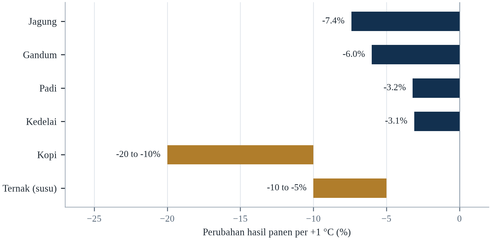||Sumber: Tabel 7.1. Batang untuk kopi dan ternak menunjukkan rentang yang dilaporkan.

Dua hal perlu ditekankan. Pertama, tanaman yang memberi makan orang termiskin adalah yang paling sensitif terhadap panas, dan wilayah tempat tanaman itu ditanam adalah wilayah yang paling sedikit dibiayai adaptasinya. Kedua, kerugian yang diproyeksikan tidak katastrofik secara agregat global, tetapi parah di tempat-tempat tertentu, dan berinteraksi dengan kemiskinan, konflik, dan lembaga lemah untuk menghasilkan kelaparan alih-alih sekadar kekurangan.

Terobosan varietas tahan panas, atau efisiensi fotosintesis, akan mengurangi kerugian, tetapi butuh satu dekade atau lebih untuk mencapai petani. Pergeseran ke pola makan berbasis tanaman di negara berpenghasilan tinggi akan mengurangi permintaan pakan dan membebaskan lahan untuk pangan manusia. Dan peningkatan investasi yang berkelanjutan dalam irigasi, penyimpanan, dan jalan pedesaan akan mengurangi kehilangan pascapanen yang saat ini menyumbang sebagian besar celah. Variabel terpenting, bagaimanapun, adalah emisi: perbedaan antara 1,5 °C dan 3 °C adalah perbedaan antara sistem pangan yang dapat beradaptasi dan yang tidak (FAO, 2023).

---

# Bab 8: Ekosistem dan Kehilangan Keanekaragaman Hayati

*Tema: keruntuhan ekosistem, risiko kepunahan dan jasa yang disediakan alam*

Pada paruh pertama 2024, Great Barrier Reef mengalami peristiwa pemutihan massal kelima dalam delapan tahun. Survei Institut Ilmu Kelautan Australia menemukan bahwa sekitar 73 persen terumbu yang disurvei memutih, dengan tingkat tertinggi di bagian selatan yang sebelumnya terhindar dari panas terburuk. Pemutihan bukan kematian: karang yang memutih telah mengeluarkan alga yang memberinya makan dan dapat pulih jika air mendingin dengan cepat. Tetapi interval antarperistiwa kini lebih pendek daripada waktu yang dibutuhkan terumbu untuk pulih, dan itulah yang mengubah gangguan berulang menjadi penurunan permanen.

Terumbu adalah contoh paling terlihat dari pola umum. Pemanasan sedang menata ulang dunia hidupan: spesies bergerak menuju kutub dan naik ke pegunungan, waktu musim bergeser, dan gangguan yang dahulu menjadi bagian dari evolusi ekosistem — kebakaran, kekeringan, badai — menjadi lebih sering dan lebih parah. Hasilnya bukan penurunan seragam melainkan penyusunan ulang, di mana sebagian spesies berkembang, banyak menurun, dan hubungan di antara mereka berubah dengan cara yang sulit diprediksi.

Konsekuensinya bagi manusia bukan sentimental. Ekosistem menyediakan pangan, serat, air bersih, penyerbukan, perlindungan banjir, penyimpanan karbon, dan obat-obatan. Mereka mengatur iklim dan siklus air, dan menopang penghidupan miliaran orang. Ketika terumbu mati, ikan yang bergantung padanya menurun, dan komunitas pesisir yang bergantung pada ikan kehilangan protein serta pendapatan. Ketika hutan mengering, ia berhenti menyerap karbon dan mulai melepaskannya, yang mempercepat pemanasan yang menyebabkan pengeringan.

Bab ini membahas mekanisme utama perubahan iklim terhadap ekosistem, ambang batas di mana perubahan menjadi tidak dapat dibalik, dan jasa yang dipertaruhkan. Tiga sistem yang sangat rentan sekaligus sangat penting adalah terumbu karang, hutan tropis, dan permafrost. Bab ini ditutup dengan strategi konservasi dan restorasi yang dapat membeli waktu, serta penilaian jujur tentang apa yang tidak dapat diselamatkan.

Kehilangan keanekaragaman hayati dan perubahan iklim biasanya diperlakukan sebagai dua krisis terpisah, padahal keduanya krisis yang sama bila dilihat dari sudut berbeda. Pemanasan mengubah di mana spesies dapat hidup, kapan mereka bereproduksi, dan bagaimana mereka berinteraksi; hilangnya habitat mengurangi populasi yang seharusnya dapat bergeser atau beradaptasi; dan penurunan fungsi ekosistem yang dihasilkan mengurangi kapasitas daratan serta laut menyerap karbon, yang mempercepat pemanasan. Kedua masalah saling memperkuat, itulah sebabnya menangani satu sambil mengabaikan yang lain cenderung gagal.

## 8.1 Garis Dasar Keanekaragaman Hayati

Dunia kehidupan sudah berada di bawah tekanan konversi lahan, eksploitasi berlebihan, polusi, dan spesies invasif, dan perubahan iklim datang di atas tekanan-tekanan itu. Platform Ilmu-Policy Antarpemerintah tentang Keanekaragaman Hayati dan Jasa Ekosistem memperkirakan pada 2019 bahwa sekitar satu juta spesies terancam punah, dan bahwa kelimpahan rata-rata spesies asli di sebagian besar bioma darat telah turun setidaknya 20 persen sejak 1900. Living Planet Index, yang melacak populasi vertebrata yang dipantau, mencatat penurunan rata-rata 69 persen antara 1970 dan 2018 (WWF, 2022).

Angka-angka ini menggambarkan sistem yang sudah defisit. Perubahan iklim menambahkan serangkaian tekanan baru: stres panas, perubahan curah hujan, pengasaman laut, kenaikan muka laut, dan peristiwa ekstrem yang lebih sering. Interaksinya yang membuat situasinya berbahaya. Fragmen hutan yang sudah terdegradasi oleh penebangan memiliki kapasitas lebih kecil untuk bertahan dari kekeringan; terumbu yang sudah tercemar memiliki kapasitas lebih kecil untuk pulih dari pemutihan; spesies yang jangkauannya telah menyusut akibat pembukaan lahan memiliki lebih sedikit tempat untuk pindah ketika habitat tersisanya menjadi terlalu hangat.

Garis dasar juga penting bagi apa yang dapat diselamatkan. Ekosistem yang mempertahankan struktur dan keragamannya lebih tangguh daripada yang telah disederhanakan, dan perbedaannya bisa besar. Hutan mangrove yang utuh meredam gelombang badai; yang sudah dibuka tidak. Padang rumput yang beragam pulih dari kekeringan; monokultur mungkin tidak. Melindungi apa yang tersisa karena itu sama pentingnya dengan memulihkan apa yang hilang, dan biasanya lebih murah.

Konsekuensinya bagi argumen bab ini bukan angkanya melainkan apa yang dilakukannya pada titik acuan. Target konservasi biasanya ditetapkan terhadap garis dasar terkini, yang berarti setiap generasi mewarisi dunia yang sedikit lebih kosong dan mengukur kerugiannya terhadap itu. Mekanismenya paling mudah dilihat pada perikanan, ketika definisi stok sehat direvisi ke bawah seiring hilangnya ikan besar, dan ia bekerja pada hutan, padang rumput, serta tanah. Garis dasar yang bergerak tidak dapat berfungsi sebagai target, itulah sebabnya indeks semacam ini lebih berguna sebagai laju daripada sebagai tingkat: pertanyaannya bukan berapa yang tersisa melainkan seberapa cepat ia pergi.

Garis dasar keanekaragaman hayati lebih sulit ditetapkan daripada garis dasar iklim, karena tidak ada yang tahu berapa banyak spesies yang ada. Perkiraannya berkisar dari sekitar dua juta spesies yang telah dideskripsikan sampai mungkin delapan atau sepuluh juta secara total, dan ketidakpastiannya terbesar di tropis, tempat keanekaragamannya tertinggi dan kapasitas taksonominya tertipis. Bahkan populasi yang dipantau pun dipantau tidak merata: burung dan mamalia besar dihitung karena orang peduli, serangga dan jamur sebagian besar tidak dihitung, dan organisme tanah — fondasi sebagian besar produktivitas terestrial — dikenal terutama sebagai kategori. Indeks Living Planet karena itu adalah sinyal, bukan sensus, dan penulisnya menyatakan itu terus terang.

Garis dasar keanekaragaman hayati lebih sulit ditetapkan daripada garis dasar iklim, karena tidak ada satu angka pun yang menangkap keadaan kehidupan di Bumi. Penilaian paling dikenal menggabungkan luas habitat, kelimpahan populasi yang dipantau, risiko kepunahan, dan keutuhan ekosistem, dan semuanya menunjuk arah yang sama. Indeks Planet Hidup, yang melacak ribuan populasi vertebrata, mencatat penurunan rata-rata sekitar tujuh puluh persen sejak 1970, dan angka itu rata-rata tren, bukan hitungan hewan yang hilang. Angka yang penting bagi kebijakan adalah satu dari sejuta: sekitar satu juta spesies diperkirakan terancam punah.

## 8.2 Pergeseran Jangkauan dan Fenologi

Spesies merespons pemanasan dengan bergerak. Di darat, mereka bergerak ke atas gunung dan menuju kutub; di laut, mereka bergerak ke air yang lebih dingin dan kedalaman yang lebih besar. Meta-analisis atas pergeseran yang teramati menemukan bahwa spesies darat telah bergerak ke elevasi lebih tinggi rata-rata sekitar 11 meter per dekade dan menuju kutub sekitar 17 kilometer per dekade, sementara spesies laut bergeser sekitar 72 kilometer per dekade (Chen dkk., 2011). Lajunya cepat dalam ukuran ekologis dan lambat dibandingkan laju perubahan iklim.

Masalahnya adalah banyak spesies tidak dapat bergerak cukup cepat, dan sebagian tidak punya tempat untuk pergi. Spesies yang hidup di puncak gunung tidak memiliki tanah yang lebih tinggi; spesies yang hidup di satu danau tidak memiliki danau lain; spesies yang hidup di pulau rendah tidak memiliki tempat berlindung ke arah darat jika pesisirnya dibangun. Hasilnya adalah pergeseran jangkauan menguntungkan generalis yang mobile dan menghukum spesialis, yang mengubah komposisi komunitas bahkan ketika keanekaragaman total dipertahankan.

Fenologi — waktu peristiwa musiman — bergeser bahkan lebih cepat. Musim semi yang lebih awal memajukan kemunculan serangga, pembungaan tanaman, dan kedatangan burung migran, tetapi pergeserannya tidak tersinkronisasi antarspecies. Burung yang tiba di tempat berkembang biaknya pada tanggal tradisional mungkin mendapati serangga yang menjadi makanannya sudah mencapai puncak. Ketidakcocokan ini sulit diamati dan dapat mengurangi keberhasilan berkembang biak tanpa perubahan lanskap yang jelas.

Spesies bergerak, dan mereka bergerak ke atas serta ke arah kutub pada laju yang terukur tetapi sering terlalu lambat mengikuti iklim yang bergeser. Meta-analisis menemukan pergeseran jangkauan rata-rata beberapa kilometer per dekade ke arah kutub dan beberapa meter per dekade ke atas, sementara zona iklimnya sendiri bergerak lebih cepat. Jarak antara keduanya — kecepatan iklim dikurangi kapasitas dispersal — menentukan spesies mana yang akan terdampar di kondisi tidak sesuai, dan jarak itu paling besar bagi tanaman, amfibi, dan spesies dengan reproduksi lambat.

Pergeseran wilayah dapat diukur, dan pengukurannya termasuk bukti terbersih bahwa pemanasan sedang menata ulang dunia hidup. Meta-analisis Chen dan rekan-rekannya pada 2011 menemukan bahwa spesies bergerak ke kutub sekitar tujuh belas kilometer per dekade dan ke atas lereng sebelas meter per dekade, dengan pergerakan tercepat pada serangga dan spesies laut. Parmesan dan Yohe mendokumentasikan pergeseran serupa pada waktu peristiwa musiman, dengan musim semi tiba lebih awal. Rata-ratanya menyembunyikan pemenang dan pecundang: spesies yang menyebar baik dan toleransinya luas berhasil bergerak, dan spesies khusus di puncak gunung atau pegunungan terisolasi tidak punya tempat tujuan.

Spesies merespons pemanasan dengan tiga cara, dan masing-masing membawa akibat berbeda bagi manusia. Mereka bergerak, mengikuti iklim yang mereka adaptasi, dengan kecepatan yang bergantung pada seberapa jauh mereka harus menempuh untuk menemukan kondisi cocok; mereka menggeser waktu hidupnya, berkembang biak atau berbunga lebih awal; atau mereka tetap tinggal dan menurun. Strategi pertama gagal ketika garis pantai, puncak gunung, atau kota menghalangi jalur, itulah sebabnya spesies di pulau dan puncak gunung paling rentan. Strategi kedua dapat memutus rantai makanan: burung yang datang pada tanggal tradisionalnya menemukan ulatnya sudah menetas, dan tumbuhan yang berbunga awal menemukan penyerbuknya belum muncul.

Pergeseran sebaran dan fenologi adalah dua cara spesies merespons pemanasan, dan ketidakcocokan di antaranya tempat kerugiannya terjadi. Burung yang menentukan waktu migrasinya dari panjang hari tiba pada tanggal yang sama setiap tahun, sementara serangga yang menjadi makanannya muncul lebih awal, sehingga anaknya menetas setelah makanannya habis. Tumbuhan yang berbunga lebih awal mungkin melewatkan penyerbuk yang belum muncul. Bukti pergeserannya kuat: spesies rata-rata bergerak ke arah kutub dan ke lereng atas, dan peristiwa musim semi rata-rata maju beberapa hari per dekade.

## 8.3 Terumbu Karang

Terumbu karang menempati kurang dari satu persen dasar laut tetapi menopang sekitar seperempat spesies laut serta menyediakan pangan, pendapatan, dan perlindungan pesisir bagi ratusan juta orang. Terumbu juga termasuk ekosistem paling sensitif terhadap pemanasan, karena alga simbiotik yang hidup di jaringan karang dikeluarkan ketika air melebihi toleransi termalnya. Hasilnya adalah pemutihan, dan jika panas berlanjut, karang mati.

Frekuensi pemutihan telah meningkat tajam. Sebelum 1980-an, pemutihan massal jarang; sejak 1998 telah terjadi empat peristiwa pemutihan global, dan interval di antaranya memendek dari sekitar dua belas tahun menjadi sekitar enam tahun. Great Barrier Reef telah memutih lima kali sejak 2016, dan peristiwa 2024 memengaruhi terumbu yang sebelumnya dianggap tempat berlindung karena hidup di air yang lebih dingin. Tutupan karang global telah menurun sekitar setengah sejak 1950-an, dan penurunannya semakin cepat.

Proyeksinya suram. Pada pemanasan 1,5 °C, sekitar 70 sampai 90 persen terumbu air hangat diperkirakan menurun; pada 2 °C, lebih dari 99 persen. Ini bukan penurunan bertahap; ini kehilangan struktur fisik yang menopang ekosistem, diikuti keruntuhan komunitas ikan. Sebagian karang mungkin bertahan di tempat berlindung yang lebih dingin, dan sebagian mungkin beradaptasi, tetapi terumbu sebagai sistem yang berfungsi tidak mungkin bertahan dalam bentuk yang telah ada selama ribuan tahun.

Terumbu karang menempati kurang dari 1 persen dasar laut dan menopang sekitar seperempat spesies laut pada suatu tahap hidupnya (IPBES, 2019). Mereka juga termasuk ekosistem paling sensitif suhu di Bumi: anomali yang bertahan 1–2 °C di atas maksimum musim panas lokal dapat memicu pemutihan, ketika karang mengeluarkan alga simbiotik yang memberi mereka makanan (IPCC, 2019b). Great Barrier Reef mengalami lima peristiwa pemutihan massal sejak 2016, dan porsi terumbu yang pernah memutih setidaknya sekali kini cukup besar untuk mengubah komposisi ekosistemnya.

Yang membuat terumbu berbeda dari ekosistem lain adalah bahwa kerugiannya langsung terasa pada manusia yang tidak pernah melihatnya. Terumbu menahan energi gelombang sebelum mencapai pantai, sehingga kehilangan struktur fisiknya menaikkan tinggi gelombang yang tiba di desa pesisir, dan perikanan yang bergantung padanya adalah sumber protein dan pendapatan bagi puluhan juta rumah tangga. Biaya penggantiannya dihitung dalam bentuk pemecah gelombang buatan dan program restorasi yang jauh lebih mahal daripada perlindungan terhadap tekanan yang membunuhnya. Inilah alasan ekonomi untuk membatasi pemanasan pada tingkat yang masih memungkinkan terumbu bertahan, dan alasan mengapa target suhu bukan sekadar angka lingkungan.

Terumbu karang adalah contoh paling jelas dari sistem yang toleransinya sempit dan nilainya sangat besar. Karang pembentuk terumbu hidup dalam satu atau dua derajat dari batas termalnya, dalam kemitraan dengan alga yang memasok sebagian besar energinya dan memberinya warna. Ketika air bertahan terlalu hangat terlalu lama, kemitraan itu putus, karang mengusir alganya dan memutih. Karang yang memutih belum mati dan dapat pulih bila air mendingin tepat waktu, itulah sebabnya jarak antarperistiwa lebih penting daripada keparahan satu peristiwa. Ketika peristiwa datang sebelum pemulihan selesai, terumbu bergeser dari karang menjadi rumput laut dan puing.

Terumbu karang adalah ekosistem yang paling jelas menunjukkan apa yang dapat dilakukan perubahan suhu kecil, karena kaitannya terlihat dalam hitungan pekan. Karang yang tertekan panas mengeluarkan alga yang hidup di jaringannya dan menyediakan sebagian besar makanannya, dan hasilnya kerangka putih yang memberi nama pemutihan. Karang yang memutih dapat pulih bila suhu kembali normal dengan cepat, dan mati bila panasnya berlanjut. Catatan global menunjukkan frekuensi peristiwa pemutihan meningkat sampai sebagian terumbu memutih bertahun-tahun berturut-turut tanpa waktu pulih, dan proyeksi dunia dua derajat adalah hilangnya sebagian besar terumbu yang ada.

## 8.4 Hutan Tropis dan Amazon

Hutan tropis menyimpan sekitar setengah karbon dalam vegetasi darat dan menopang sebagian besar keanekaragaman hayati dunia. Mereka juga memengaruhi curah hujan di wilayah yang sangat luas: Amazon mendaur ulang kelembapan yang turun sebagai hujan di seluruh Amerika Selatan, dan cekungan Kongo melakukan hal yang sama bagi Afrika tengah. Ketika hutan dibuka atau terdegradasi, karbon dan curah hujan sama-sama hilang, dan kedua kehilangan itu saling memperkuat.

Yang membuat Amazon berbeda dari hutan lain bukan luasnya melainkan peran sungainya. Hutan itu mengangkut kelembapan dari Samudra Atlantik ke pedalaman, dan sebagian besar hujan di bagian barat serta selatan berasal dari penguapan yang dilepaskan hutan itu sendiri, sehingga kehilangan tutupan di timur mengurangi hujan jauh di barat. Sistemnya juga bergantung pada banjir musiman: sungai yang naik mengisi dataran banjir dan memberi makan perikanan yang menjadi protein utama penduduk, dan rezim banjir yang berubah merusak keduanya sekaligus. Kebijakan yang hanya menghitung hektar yang ditebang karena itu melewatkan bagian yang paling menentukan, yaitu koneksi antara hutan, sungai, dan hujan yang mengikat keduanya.

Hutan juga bom karbon. Jika ia mati suri, karbon yang disimpannya akan dilepaskan, mempercepat pemanasan dan membuat dieback lebih mungkin. Amazon karena itu mengandung umpan balik positif yang tidak sepenuhnya direpresentasikan dalam sebagian besar model iklim, dan ketidakpastiannya asimetris: risiko transisi cepat kecil dalam dekade tertentu tetapi konsekuensinya tidak dapat dibalik dalam skala waktu manusia. Melindungi hutan karena itu merupakan tindakan mitigasi sekaligus adaptasi, dan merupakan salah satu yang termurah.

Konsekuensi sosial dari kemungkinan itu lebih mudah diabaikan daripada konsekuensi ekologisnya. Sekitar tiga puluh juta orang tinggal di Amazon, dan sebagian besar bergantung pada sungai yang tinggi-rendahnya menentukan hasil panen, akses ke pasar, dan kualitas air. Iklim yang lebih kering mengubah kalender itu lebih cepat daripada perubahan ekonomi mana pun, dan rumah tangga yang sama juga menanggung biaya kebijakan yang membatasi pembukaan lahan. Karena itu setiap program yang berhasil di kawasan ini memiliki dua komponen: penghentian deforestasi dan penyediaan penghidupan bagi penduduk yang telah tinggal di sana, dan program yang hanya memuat komponen pertama memindahkan tekanannya ke tempat lain.

Amazon adalah ekosistem tempat ambang fisik dapat mengubah perubahan bertahap menjadi perubahan mendadak, dan mekanismenya cukup dipahami. Hutan mendaur ulang curah hujan melalui transpirasi, dan ketika cukup banyak hutan ditebang atau terdegradasi, daur ulang itu melemah dan bagian dalamnya menjadi lebih kering. Lovejoy dan Nobre berargumen pada 2018 bahwa titik kritis dapat tercapai pada sekitar dua puluh sampai dua puluh lima persen deforestasi, di mana sebagian besar hutan akan berubah menjadi sabana. Deforestasi di Amazon Brasil berayun mengikuti siklus politik, yang menunjukkan ambang itu dapat dikelola sekaligus bersifat fisik.

Hutan tropis menampung bagian luar biasa dari keanekaragaman hayati darat dan bagian luar biasa dari karbon darat dunia, dan keduanya hilang melalui mekanisme yang sama. Deforestasi menghapus pohon dan memecah sisanya, dan fragmen punya lebih banyak tepi dan lebih sedikit interior, yang menguntungkan spesies toleran gangguan dan mengusir yang membutuhkan naungan dalam. Pemanasan dan pengeringan menambah tekanan kedua: hutan yang tersisa bertranspirasi lebih sedikit, sehingga mengurangi hujan yang menopangnya. Gabungan itulah yang membuat Amazon kandidat titik kritis, karena hutan yang lebih kering dan terpecah lebih mudah terbakar.

## 8.5 Permafrost dan Tundra

Permafrost — tanah yang tetap beku setidaknya dua tahun berturut-turut — menutupi sekitar seperempat belahan bumi utara dan menyimpan sekitar 1.400 sampai 1.600 miliar ton karbon, kira-kira dua kali karbon di atmosfer (IPCC, 2019b). Ketika Arktik menghangat tiga sampai empat kali lebih cepat daripada rata-rata global, tanah mencair, dan mikroba menguraikan bahan organik yang telah beku selama ribuan tahun, melepaskan karbon dioksida dan metana.

Pelepasannya sudah terukur. Sungai-sungai Arktik membawa jumlah karbon organik terlarut yang meningkat; longsoran thaw dan danau thermokarst muncul di wilayah yang sebelumnya stabil; dan emisi karbon dioksida musim dingin dari tanah utara telah meningkat. Prosesnya lambat dibandingkan emisi bahan bakar fosil, tetapi besar dan sulit dibalik, dan tidak termasuk dalam anggaran karbon yang digunakan pemerintah untuk merencanakan pengurangan emisi.

Pencairan permafrost juga merusak infrastruktur. Jalan, pipa, bangunan, dan bandara yang dibangun di atas tanah beku berubah bentuk ketika tanah turun, dan biaya perbaikannya sudah signifikan di Alaska, Kanada, dan Rusia. Bagi komunitas yang bergantung pada jalan es dan tanah beku untuk transportasi, hilangnya permafrost adalah ancaman langsung terhadap akses pangan, bahan bakar, dan layanan medis.

Permafrost menutupi sekitar seperempat permukaan daratan Belahan Bumi Utara dan menyimpan sekitar dua kali karbon yang kini ada di atmosfer. Saat mencair, aktivitas mikroba melepaskan karbon dioksida dan metana, dan prosesnya memperkuat dirinya sendiri karena pencairan memaparkan lebih banyak bahan organik pada dekomposisi. Emisinya belum cukup besar untuk mendominasi anggaran global, tetapi ia di luar kendali manusia setelah terpicu, itulah sebabnya permafrost diperlakukan sebagai elemen tipping alih-alih sumber yang dapat dikelola.

Permafrost adalah tanah yang membeku setidaknya dua tahun, dan ia menyimpan lebih banyak karbon daripada atmosfer. Ketika mencair, bahan organik di dalamnya tersedia bagi mikroba, yang melepaskan karbon dioksida bila ada oksigen dan metana bila tidak. Prosesnya lambat dan tidak dapat dibalik dalam skala waktu manusia, dan ia salah satu umpan balik yang paling tidak pasti dalam model, karena lajunya bergantung pada kedalaman pencairan dan kebasahan tanah. Di Arktik akibatnya sudah terlihat: jalan melengkung, bangunan tenggelam, dan komunitas yang dibangun di atas tanah beku menghadapi pilihan antara rekayasa mahal dan relokasi.

Permafrost adalah tanah yang bertahan di bawah titik beku setidaknya dua tahun berturut-turut, dan menutupi sekitar seperempat permukaan daratan belahan bumi utara. Ia menyimpan karbon dalam bentuk bahan tumbuhan beku yang tidak pernah sepenuhnya terurai, dan jumlahnya berada pada orde dua kali karbon yang kini ada di atmosfer. Saat mencair, bahannya menjadi tersedia bagi mikroba, yang melepaskan karbon dioksida dan, di tanah yang tergenang, metana. Pencairannya juga mengubah fisika tanahnya: permukaan turun, pohon miring, dan fondasi bangunan, pipa, serta jalan retak. Di sebagian Siberia, seluruh kota dibangun di atas tanah yang tidak lagi stabil.

## 8.6 Ekosistem Air Tawar

Ekosistem air tawar — sungai, danau, lahan basah, dan akuifer — termasuk yang paling terdegradasi dan paling penting bagi manusia. Mereka menyediakan air minum, irigasi, perikanan, transportasi, dan perlindungan banjir, serta menopang keanekaragaman hayati yang tidak proporsional. Perubahan iklim memengaruhinya melalui pemanasan, perubahan aliran, berkurangnya lelehan salju, penguapan yang meningkat, dan kekeringan serta banjir yang lebih sering.

Danau yang menghangat berstratifikasi lebih awal dan lebih kuat, yang mengurangi pencampuran yang membawa hara dari dasar dan oksigen dari permukaan. Hasilnya adalah zona rendah oksigen yang membunuh ikan dan melepaskan fosfor serta metana dari sedimen. Sungai yang diberi makan gletser berubah dari aliran yang didominasi lelehan salju menjadi aliran yang didominasi hujan, yang mengurangi aliran musim panas tepat ketika permintaan tertinggi. Lahan basah mengering, melepaskan karbon yang disimpannya dan kehilangan kapasitasnya menyangga banjir.

Spesies air tawar menurun lebih cepat daripada spesies darat atau laut. Living Planet Index untuk populasi air tawar menunjukkan penurunan rata-rata sekitar 83 persen sejak 1970, didorong oleh bendungan, polusi, pengambilan air, dan spesies invasif, dengan perubahan iklim kini menambah tekanan itu (WWF, 2022). Kehilangannya berdampak langsung pada manusia: perikanan darat menyediakan protein bagi ratusan juta orang, dan hilangnya konektivitas sungai menghalangi migrasi ikan yang diandalkan komunitas.

Yang membuat penurunan air tawar berbeda dari yang lain adalah bahwa ia direkayasa. Habitat darat sebagian besar hilang karena konversi, yang setidaknya terlihat di peta, sedangkan habitat sungai hilang karena bangunan yang sengaja dibuat dan dapat sengaja dibongkar. Bendungan memecah sungai menjadi rangkaian kolam, memblokir migrasi yang dibutuhkan banyak ikan untuk menyelesaikan daur hidupnya, dan menjebak sedimen yang seharusnya membangun kembali delta di hilir. Pembongkaran bendungan di Eropa dan Amerika Utara dalam dua dekade terakhir adalah bukti paling jelas bahwa kerugian itu dapat dipulihkan bila ada kemauan politik, dan ikannya kembali lebih cepat daripada yang diperkirakan model.

Kebakaran lahan gambut di Indonesia adalah kasus paling jelas umpan balik ekosistem yang menjadi darurat kesehatan publik. Gambut yang dikeringkan terbakar di bawah permukaan selama berminggu-minggu, melepaskan karbon yang terakumulasi ribuan tahun, dan musim kebakaran 2015 serta 2019 menghasilkan kabut yang menutup sekolah di Sumatra, Kalimantan dan negara tetangga serta dikaitkan dengan puluhan ribu kematian dini. Badan restorasi yang dibentuk setelah 2015 telah membasahi kembali sebagian lanskap, dan hasilnya campuran: pembasahan bekerja di tempat muka air dapat dipertahankan, dan gagal di tempat saluran drainase tetap di tangan swasta. Catatan restorasi menunjukkan tata kelola sebagai kendala pengikat, bukan penanaman.

Ekosistem air tawar paling terdegradasi dan paling kurang dilindungi. Sungai terfragmentasi oleh bendungan yang menghalangi migrasi ikan dan menahan sedimen; lahan basah dikeringkan karena nilainya sulit dilihat sampai banjir datang; danau makin kuat berstratifikasi saat menghangat, memisahkan permukaan beroksigen dari dasar kaya nutrien; dan nutrien yang tercuci dari lahan pertanian menghasilkan ledakan alga yang menghabiskan oksigen ketika mati. Akibatnya spesies yang paling perlu dilindungi sering berada di air yang paling telah diubah manusia, dan pemulihannya menuntut penanganan daerah tangkapan, bukan hanya airnya.

Ekosistem air tawar menutupi sekitar satu persen permukaan Bumi dan menampung sekitar sepersepuluh spesiesnya, yang menjadikannya habitat paling terkonsentrasi dan paling terpapar di planet ini. Sungai terfragmentasi oleh bendungan yang menghalangi pergerakan ikan dan pengangkutan sedimen, danau menipis karena pengambilan dan diperkaya nutrien, dan lahan basah dikeringkan untuk pertanian karena nilainya baru terlihat ketika hilang. Laut Aral adalah kasus ekstremnya: laut yang dulu danau terbesar keempat di dunia menjadi dataran garam dalam satu generasi, dan kota nelayan yang bergantung padanya kini berjarak seratus kilometer dari air.

## 8.7 Pengasaman dan Deoksigenasi Laut

Laut menyerap sekitar seperempat karbon dioksida yang dilepaskan manusia, dan ketika karbon dioksida larut dalam air laut ia membentuk asam karbonat. Hasilnya adalah pH permukaan laut turun dari sekitar 8,2 menjadi 8,1 sejak periode pra-industri, kenaikan 30 persen konsentrasi ion hidrogen. Perubahan itu besar menurut standar geologis, dan terjadi jauh lebih cepat daripada kapan pun dalam 65 juta tahun terakhir.

Pengasaman memengaruhi organisme yang membangun cangkang dan kerangka dari kalsium karbonat. Karang, tiram, kerang, pteropoda, dan sebagian plankton sangat sensitif, terutama di perairan dingin tempat karbonat paling sedikit tersedia. Eksperimen menunjukkan kalsifikasi berkurang, cangkang lebih tipis, dan pertumbuhan lebih lambat, dan observasi lapangan di Samudra Selatan serta Arktik sudah menunjukkan efeknya. Konsekuensinya merambat melalui jaring makanan, karena organisme yang terdampak sering berada di dasar rantai.

Deoksigenasi adalah masalah terkait. Air yang lebih hangat menahan lebih sedikit oksigen terlarut, dan limpasan hara dari pertanian meningkatkan pertumbuhan alga yang mengonsumsi oksigen saat terurai. Hasilnya adalah perluasan zona rendah oksigen di perairan pesisir dan laut lepas, yang memaksa ikan ke air yang lebih dangkal dan mengurangi habitat yang tersedia bagi spesies yang membutuhkan air dingin dan kaya oksigen. Kombinasi pemanasan, pengasaman, dan deoksigenasi kadang disebut ancaman tiga lapis bagi kehidupan laut.

Pengasaman laut kadang disebut masalah karbon dioksida yang lain, karena ia mengikuti kimia secara langsung alih-alih pemanasan. Karbon dioksida yang larut dalam air laut membentuk asam karbonat, yang menurunkan pH dan mengurangi ketersediaan ion karbonat yang dibutuhkan karang, moluska, dan sebagian plankton untuk membangun cangkang dan kerangka. pH permukaan laut telah turun sekitar 0,1 unit sejak masa praindustri, kenaikan keasaman 30 persen, dan lajunya mempercepat.

Pengasaman laut adalah masalah karbon yang lain, dan ia kurang dikenal dibanding pemanasan. Laut telah menyerap sekitar seperempat karbon dioksida antropogenik, dan perubahan kimia yang dihasilkan menurunkan pH permukaan sekitar 0,1 unit sejak masa pra-industri, kenaikan tiga puluh persen konsentrasi ion hidrogen (Cheng dkk., 2024). Konsekuensi biologisnya paling berat bagi organisme yang membangun cangkang dan kerangka dari kalsium karbonat: karang, pteropoda, tiram dan sebagian plankton. Percobaan di perairan yang terasidifikasi alami di sekitar lubang vulkanik menunjukkan ekosistem menata ulang alih-alih runtuh, yang merupakan temuan lebih rumit dan kurang menenangkan daripada yang disiratkan judul berita.

Pengasaman laut adalah masalah terpisah dari pemanasan, dan kimianya lebih sederhana serta lebih pasti. Karbon dioksida larut dalam air laut membentuk asam karbonat, yang melepaskan ion hidrogen dan menurunkan pH; kimia yang sama mengonsumsi ion karbonat yang dibutuhkan karang, tiram, dan sebagian plankton untuk membangun cangkang dan kerangka. Sejak revolusi industri, pH permukaan turun sekitar sepersepuluh satuan, yang terdengar kecil sampai dipahami sebagai kenaikan sekitar tiga puluh persen konsentrasi ion hidrogen. Deoksigenasi menyertainya: air yang lebih hangat menampung lebih sedikit oksigen, dan limpasan nutrien mendorong terbentuknya zona rendah oksigen.

Pengasaman laut adalah konsekuensi lain dari karbon yang diserap laut, dan ia tak terlihat dengan cara pemutihan tidak. Karbon dioksida larut dalam air laut membentuk asam karbonat, yang menurunkan pH dan mengurangi ketersediaan karbonat yang dibutuhkan kerang, karang, dan plankton untuk membangun cangkangnya. Perubahannya terukur dan sudah memengaruhi penetasan tiram di Pasifik barat laut, ketika larvanya gagal dan industrinya harus menyesuaikan kimia airnya. Deoksigenasi menambah tekanan kedua, karena air hangat menahan lebih sedikit oksigen dan zona oksigen rendah di laut lepas meluas.

## 8.8 Risiko Kepunahan dan Kecepatan Iklim

Kepunahan adalah titik akhir dari proses yang dimulai dengan penyusutan jangkauan, penurunan populasi, dan hilangnya keragaman genetik. Perubahan iklim berkontribusi pada proses itu dengan mengurangi habitat, mengubah waktu siklus hidup, dan meningkatkan frekuensi peristiwa ekstrem. Spesies yang paling berisiko adalah yang memiliki jangkauan kecil, mobilitas rendah, kebutuhan habitat khusus, dan waktu generasi panjang — termasuk banyak amfibi, spesies gunung, endemik pulau, dan mamalia besar.

Konsep kecepatan iklim mengukur seberapa cepat suatu spesies harus bergerak agar tetap berada dalam kisaran suhu yang disukainya. Di medan datar, kecepatannya tinggi karena perubahan suhu kecil berarti perubahan lintang yang besar; di medan bergunung, kecepatannya lebih rendah karena spesies dapat bergerak naik dalam jarak pendek. Konsep itu membantu menjelaskan mengapa spesies di dataran dan pulau rendah lebih rentan daripada spesies di pegunungan, dan mengapa konektivitas antarahabitat sangat penting.

Proyeksi risiko kepunahan bergantung pada asumsi tentang penyebaran dan adaptasi, dan rentangnya lebar. Analisis yang banyak dikutip menemukan bahwa pada pemanasan 2 °C, sekitar 18 persen serangga, 16 persen tanaman, dan 8 persen vertebrata akan kehilangan lebih dari setengah jangkauan geografisnya, dan pada 3,2 °C angkanya naik menjadi 49 persen, 44 persen, dan 26 persen (Warren dkk., 2018). Kehilangan jangkauan bukan kepunahan, tetapi ia adalah pendahulunya, dan jauh lebih mudah diukur.

Risiko kepunahan akibat perubahan iklim biasanya diperkirakan dengan model distribusi spesies, yang memproyeksikan di mana iklim yang sesuai akan ada dan menanyakan apakah spesies dapat mencapainya. Perkiraannya sangat beragam — dari beberapa persen hingga sepertiga spesies yang terikat kepunahan pada pemanasan tinggi — dan keragamannya mencerminkan perbedaan asumsi tentang dispersal, adaptasi, dan ketersediaan habitat. Yang konsisten lintas studi adalah risikonya naik tajam seiring pemanasan dan tertinggi bagi spesies dengan jangkauan kecil, mobilitas rendah, dan kebutuhan khusus.

Risiko kepunahan adalah fungsi paparan, sensitivitas, dan kapasitas adaptif, dan pertanyaan yang lebih berguna bukan berapa spesies akan punah melainkan seberapa cepat tekanannya datang. Kecepatan iklim — laju yang harus ditempuh spesies untuk mengikuti iklimnya — adalah cara mengukur itu, dan ia tercepat di daratan datar, di air dangkal, dan di gunung dengan ketinggian terbatas. Spesies dengan wilayah sempit, waktu regenerasi panjang, dan daya sebar buruk paling terpapar. Konservasi dapat membeli waktu dengan melindungi kawasan luas yang terhubung, memulihkan habitat, dan memindahkan spesies dengan sengaja, tetapi tidak dapat membuat evolusi berjalan lebih cepat daripada perubahan iklim.

Kecepatan iklim adalah laju yang harus ditempuh suatu spesies untuk tetap berada dalam iklim yang cocok baginya, dan bagi banyak spesies laju itu lebih cepat daripada kemampuan mereka bergerak. Di medan datar kecepatannya dapat beberapa kilometer per dekade, yang hanya dapat diatasi tumbuhan bila bijinya terbawa; di gunung kecepatannya diukur dalam meter ketinggian, yang lebih mudah, sampai spesies itu mencapai puncak dan tidak punya tempat pergi. Spesies yang paling berisiko adalah yang wilayahnya sempit, penyebarannya lemah, generasinya panjang, dan bergantung pada inang atau suhu tertentu.

## 8.9 Jasa Ekosistem dan Ketergantungan Manusia

Nilai ekosistem bagi manusia biasanya digambarkan sebagai jasa: jasa penyediaan seperti pangan, serat, dan air tawar; jasa pengaturan seperti iklim, banjir, dan penyakit; jasa pendukung seperti pembentukan tanah dan siklus hara; dan jasa budaya seperti rekreasi dan makna spiritual. Kategori itu adalah alat akuntansi yang berguna, tetapi ia meremehkan sejauh mana jasa-jasa tersebut saling bergantung dan tidak dapat digantikan.

Penyerbukan adalah contoh jelas. Sekitar tiga perempat tanaman pangan utama bergantung setidaknya sebagian pada penyerbuk hewan, dan nilai jasa itu diperkirakan ratusan miliar dolar. Jika penyerbuk menurun, efeknya bukan pengurangan seragam pasokan pangan melainkan pergeseran ke tanaman yang tidak membutuhkannya — biji-bijian yang diserbuki angin — yang mengurangi keragaman pangan dan menaikkan biaya buah, sayur, dan kacang-kacangan.

Perlindungan pesisir adalah contoh lain. Mangrove, terumbu, dan gumuk mengurangi energi gelombang dan gelombang badai, dan hilangnya sistem itu meningkatkan biaya pertahanan pesisir. Studi tentang tsunami Samudra Hindia 2004 menemukan bahwa desa di belakang mangrove yang utuh mengalami lebih sedikit korban dan kerusakan daripada desa di pantai terbuka, meskipun efeknya bergantung pada ketebalan sabuk dan sudut gelombang. Jasa ekosistem bukan kemewahan; ia adalah bagian dari infrastruktur.

Jasa ekosistem adalah manfaat yang diperoleh orang dari ekosistem yang berfungsi, dan ia bukan tambahan opsional. Penyerbukan menopang sebagian besar tanaman pangan; hutan mengatur curah hujan dan menyimpan karbon; lahan basah menyaring air dan meredam banjir; terumbu karang dan bakau melindungi garis pantai; dan pembentukan tanah mendasari seluruh pertanian. Nilai ekonomi jasa itu sulit dihargai, tetapi perkiraan biaya kehilangannya secara konsisten melebihi biaya melindunginya.

Jasa ekosistem biasanya digambarkan abstrak, dan nilainya menjadi konkret ketika jasanya gagal. Mangrove mengurangi gelombang badai dan energi gelombang, dan studi setelah tsunami Samudra Hindia 2004 menemukan bahwa desa di belakang sabuk mangrove utuh mengalami kematian dan kerusakan lebih sedikit daripada desa di pantai terbuka. Penyerbukan bernilai ratusan miliar dolar per tahun dalam keluaran tanaman, dan hilangnya akan menurunkan hasil buah, sayur dan biji minyak secara tidak proporsional. Jasa itu kurang dihargai karena tidak diperdagangkan, dan itulah sebab argumen ekonomi untuk melindunginya rutin diajukan dan rutin diabaikan.

Jasa ekosistem adalah manfaat yang diberikan alam tanpa faktur, dan paling mudah dihargai di tempat ia sudah hilang. Penyerbukan memungkinkan sebagian besar tanaman dunia; lahan basah pesisir menyerap gelombang badai; hutan menyaring air dan menahan tanah; mangrove dan terumbu menopang perikanan; dan laut menyerap panas serta karbon yang seharusnya tetap di atmosfer. Ekonomi jasa ini canggung karena tidak diperdagangkan, itulah sebabnya ia kurang dihitung dalam neraca nasional dan berlebihan dipakai dalam praktik. Pembayaran jasa ekosistem dan akuntansi modal alam adalah upaya memberi harga pada manfaat sebelum sumbernya lenyap.

Jasa yang disediakan ekosistem biasanya tidak terlihat sampai gagal, dan nilainya paling mudah dilihat ketika digantikan sesuatu yang mahal. Penyerbuk menyumbang pada produksi sebagian besar tanaman yang menyediakan mikronutrien, dan hilangnya tidak akan tampak sebagai kelaparan melainkan penyempitan pola makan dan kenaikan biaya buah serta sayur. Hutan menyaring air, meredam banjir, dan menahan tanah, dan kota yang kehilangan daerah tangkapannya membayar penyaringan di instalasi pengolahan. Lahan basah pesisir menahan gelombang badai, dan nilai asuransi sabuk mangrove diukur dari kerusakan yang tidak terjadi.

## 8.10 Konservasi, Restorasi dan Batasnya

Konservasi dapat membeli waktu. Melindungi kawasan yang luas dan terhubung memungkinkan spesies bergerak; mengurangi tekanan non-iklim seperti polusi, penangkapan berlebihan, dan spesies invasif meningkatkan ketangguhan; memulihkan habitat terdegradasi dapat mengembalikan sebagian jasa yang hilang. Kerangka Keanekaragaman Hayati Global Kunming–Montreal, yang diadopsi pada 2022, menetapkan target melindungi 30 persen daratan dan lautan pada 2030, dan banyak negara telah berkomitmen padanya.

Restorasi lebih sulit daripada perlindungan. Menanam pohon mudah; menumbuhkan hutan yang menyimpan karbon, menopang keanekaragaman hayati, dan menyediakan penghidupan tidak mudah. Mangrove yang dipulihkan sering gagal karena ditanam di tempat yang salah atau karena hidrologi yang menopangnya telah berubah. Terumbu karang yang dipulihkan dibatasi oleh pemanasan yang sama yang membunuhnya. Restorasi dapat memulihkan struktur dalam satu atau dua dekade, tetapi pemulihan keanekaragaman dan fungsi membutuhkan waktu jauh lebih lama, dan sebagian sistem tidak dapat dipulihkan sama sekali.

Batasnya pada akhirnya ditentukan suhu. Konservasi dapat melindungi spesies dari konversi lahan, perburuan, dan polusi, tetapi tidak dapat melindunginya dari iklim yang melampaui toleransinya. Itulah sebabnya krisis keanekaragaman hayati dan krisis iklim adalah krisis yang sama, dan mengapa target untuk yang satu tidak dapat dicapai tanpa target untuk yang lain. Melindungi 30 persen planet ini perlu tetapi tidak cukup; 70 persen lainnya, dan atmosfer di atasnya, menentukan apakah kawasan yang dilindungi tetap layak huni.

Konservasi memiliki rekam jejak keberhasilan yang sering diabaikan. Kawasan lindung telah meluas mencakup sekitar 17 persen daratan dan 8 persen lautan; spesies seperti panda raksasa, lynx Iberia, dan paus bungkuk telah pulih; dan proyek restorasi telah mengembalikan hutan, lahan basah, dan padang rumput (IPBES, 2019). Batasnya adalah kawasan lindung saja tidak dapat melindungi spesies yang perlu bergerak, itulah sebabnya konektivitas, koridor, dan pengelolaan skala lanskap kini menjadi pusat perencanaan konservasi.

Restorasi berhasil, tetapi lebih lambat dan lebih mahal daripada konservasi, dan jarang menghasilkan apa yang digantikannya. Hutan yang ditanam ulang mungkin butuh berabad-abad untuk memperoleh struktur dan tanah hutan tua; terumbu yang dipulihkan dapat bertahan bila air mendingin dan puingnya distabilkan, tetapi sulit memulihkan keanekaragamannya dalam satu generasi. Program paling berhasil berbagi tiga ciri: bekerja pada skala tempat ekosistem berfungsi, melibatkan orang yang tinggal di dalamnya, dan dibiayai puluhan tahun. Kawasan lindung tetap instrumen paling efektif, dan efektivitasnya bergantung pada penegakan.

Restorasi tidak sama dengan perlindungan, dan memperlakukannya sebagai pengganti adalah salah satu cara kebijakan konservasi gagal. Mangrove atau lahan gambut yang direstorasi butuh puluhan tahun untuk memulihkan karbon dan habitat yang dimiliki yang matang, dan sebagian yang hilang tidak dapat dipulihkan sama sekali. Aritmetika kerugian yang dihindari karena itu lebih menguntungkan daripada aritmetika perbaikan: hutan utuh yang dilindungi menyimpan karbon segera, sementara hutan yang ditebang lalu ditanami ulang mungkin butuh setengah abad untuk menyamainya. Target melindungi tiga puluh persen daratan dan laut pada 2030 disepakati karena alasan itu.

## 8.11 Studi Kasus: Great Barrier Reef

Great Barrier Reef adalah struktur hidup terbesar di Bumi, membentang lebih dari 2.300 kilometer di sepanjang pantai Queensland dan terdiri atas sekitar 3.000 terumbu individual. Ia adalah situs Warisan Dunia UNESCO, sumber pendapatan pariwisata bernilai miliaran dolar, dan lanskap budaya bagi Pemilik Tradisional yang telah mengelola perairannya selama ribuan tahun. Ia juga contoh paling terdokumentasi dari ekosistem yang didorong melampaui batas termalnya.

Terumbu telah memutih lima kali sejak 2016: pada 2016, 2017, 2020, 2022, dan 2024. Peristiwa 2016 membunuh sekitar setengah karang di bagian utara; peristiwa 2017 memengaruhi bagian tengah; peristiwa 2020 adalah yang paling luas dalam catatan; dan peristiwa 2024 memengaruhi terumbu yang sebelumnya terhindar karena hidup di air yang lebih dingin. Di antara peristiwa, tutupan karang pulih di beberapa tempat, terutama di bagian selatan, tetapi pemulihannya berulang kali terputus.

Tekanan lain memperberat panasnya. Limpasan dari pertanian membawa sedimen, nitrogen, dan pestisida ke perairan pesisir, yang mengurangi kualitas air dan mendorong pertumbuhan alga. Ledakan bintang laut mahkota berduri memakan karang; siklon memecahnya; dan penangkapan ikan menghilangkan ikan herbivora yang seharusnya mengendalikan alga. Pengelolaan telah menangani sebagian tekanan itu — target limpasan, penutupan area penangkapan, pengendalian bintang laut — tetapi tidak dapat menangani panas.

Pemerintah Australia telah berinvestasi dalam adaptasi: program pemuliaan karang, migrasi terbantu karang tahan panas, eksperimen penaungan dan pendinginan, serta penelitian pemutihan awan. Semua itu berskala kecil dan tidak pasti, dan tidak dapat melindungi 2.300 kilometer terumbu. Adaptasi paling efektif adalah pengurangan emisi, yang berada di luar yurisdiksi pengelola terumbu, dan itulah dilema utama konservasi karang: orang yang memiliki kewenangan melindungi terumbu tidak mengendalikan variabel yang menentukan masa depannya.

Kasus ini memiliki pelajaran lebih luas. Pertama, gangguan berulang lebih merusak daripada gangguan tunggal, karena waktu pemulihan sangat penting. Kedua, tekanan lokal memperparah stres iklim, sehingga menguranginya membeli waktu bahkan jika tidak dapat menghentikan penurunan. Ketiga, teknologi adaptasi bukan pengganti mitigasi, dan menyajikannya sebagai pengganti menunda tindakan yang penting. Keempat, hilangnya terumbu bukan hanya peristiwa ekologis; ia peristiwa ekonomi dan budaya bagi komunitas yang bergantung padanya.

Penurunan terumbu tidak merata, dan ketidakmerataan itu instruktif. Sebagian terumbu di bagian utara dan tengah pulih di antara peristiwa pemutihan, sementara yang lain bergeser ke keadaan didominasi alga yang sulit atau tidak mungkin dipulihkan. Perbedaannya terkait kondisi lokal — kualitas air, tekanan penangkapan ikan, keberadaan ikan herbivora — yang menunjukkan bahwa mengurangi stresor lokal membeli waktu bagi terumbu yang menghadapi tekanan panas global, dan bahwa pengelolaan skala lokal tidak sia-sia bahkan ketika pendorong utamanya global.

Great Barrier Reef adalah sistem terumbu paling banyak diteliti di dunia dan ilustrasi paling jelas dari masalah jarak antarperistiwa. Ia memutih berulang sejak 1998, dan lima peristiwa dalam delapan tahun meninggalkannya dengan karang lebih sedikit daripada dua dekade lalu dan campuran spesies berbeda. Terumbu itu dilindungi di sebagian besar panjangnya, kualitas airnya diperbaiki, dan bintang laut mahkota berduri dikendalikan, namun ia tetap menurun, karena tidak satu pun tindakan itu menyentuh suhu laut. Nilainya bagi ekonomi pariwisata Australia, dan bagi pemilik tradisional yang mengelola perairannya ribuan tahun, sangat besar.

## 8.12 Skenario dan Prediksi Masa Depan: Dunia Kehidupan pada 2100

Dunia alami adalah tempat pertama biaya pemanasan menjadi terlihat. Living Planet Index mencatat penurunan rata-rata 69 persen populasi vertebrata yang dipantau antara 1970 dan 2018; tutupan karang global telah berkurang setengah sejak 1950-an; dan luas hutan primer yang hilang setiap tahun tetap di atas 10 juta hektar (WWF, 2022). Penurunan ini mendahului pemanasan terburuk, yang berarti tekanan iklim datang pada sistem yang sudah lemah.

Gambaran ini bukan kemunduran yang merata. Sebagian ekosistem mempertahankan kapasitas untuk pulih: Great Barrier Reef bagian selatan memulihkan sebagian besar tutupan karangnya setelah peristiwa 2016–2017, dan sebagian hutan tumbuh kembali setelah penebangan. Yang lain telah melewati ambang: Amazon melepaskan lebih banyak karbon daripada yang diserapnya di beberapa wilayah, dan sebagian Arktik kini menjadi sumber karbon bersih, bukan penyerap. Perbedaan antara kedua kelompok itulah kunci untuk memahami apa yang dapat diselamatkan.

Nasib ekosistem akan bergantung pada jalur emisi, perubahan penggunaan lahan, dan efektivitas konservasi. Di bawah jalur emisi rendah, banyak spesies dan ekosistem dapat bertahan, meskipun dalam bentuk yang berubah. Di bawah jalur emisi tinggi, proyeksi konvergen pada kehilangan luas: terumbu karang seperti yang kita kenal hilang, hutan tropis menurun, dan sebagian besar spesies menghadapi kehilangan jangkauan. Skenario di bawah ini merangkum rentangnya.

Dunia hidup 2100 bukan versi menipis dari yang kita kenal; ia kumpulan yang berbeda. Spesies akan bergerak, sebagian melewati batas kawasan lindung, dan ekosistem yang tampak familier dari jauh akan berisi kombinasi organisme berbeda yang melakukan hal serupa. Itulah sebabnya tindakan konservasi paling berguna adalah yang memberi alam ruang untuk menata ulang: kawasan luas yang terhubung, koridor dan jaringan sungai, serta perlindungan refugia yang tetap sejuk dan basah ketika sekelilingnya berubah. Skenario yang mempertahankan terumbu dan hutan hujan adalah skenario yang menurunkan emisi cepat sekaligus mengurangi tekanan lokal.

[[TABLE:Tabel 8.1 Ambang ekosistem dan proyeksi perubahan]]
| Ekosistem | Ambang yang mengkhawatirkan | Perubahan pada 2 °C | Perubahan pada 3 °C | Jasa yang berisiko |
|---|---|---|---|---|
| Terumbu karang | 1,5 °C; pemutihan sering | Penurunan 70–90% | Penurunan >99% | Perikanan; perlindungan pesisir |
| Hutan Amazon | 20–25% deforestasi + pemanasan | Dieback di timur/selatan | Konversi skala besar | Penyimpanan karbon; curah hujan |
| Hutan boreal | Kebakaran dan wabah hama | Pembakaran meningkat | Pergeseran ke semak/rumput | Karbon; kayu |
| Permafrost | Awal pencairan | Pencairan 10–20% | Pencairan 30–50% | Karbon; infrastruktur |
| Mangrove | Muka laut > laju migrasi | Kehilangan 10–30% | Kehilangan 30–50% | Pertahanan pesisir; tempat pembesaran |
| Air tawar | Perubahan aliran dan suhu | Kehilangan spesies 20–30% | Kehilangan spesies 40–60% | Air; perikanan darat |

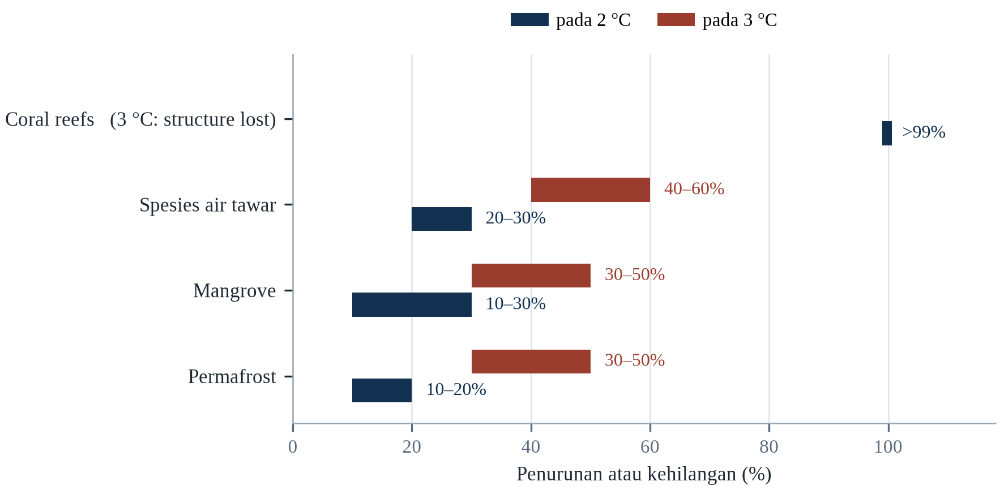||Sumber: Tabel 8.1. Nilai terumbu pada 3 °C adalah “lebih dari 99 persen” yang dilaporkan.

Analisisnya menunjuk pada dua kesimpulan. Pertama, perbedaan antara 2 °C dan 3 °C adalah perbedaan antara dunia di mana terumbu karang bertahan dalam bentuk yang berkurang dan dunia di mana mereka sebagian besar hilang, serta antara hutan yang menyimpan karbon dan hutan yang melepaskannya. Kedua, kerugiannya tidak tersebar merata: ekosistem tropis, yang menyimpan keanekaragaman hayati terbanyak dan menopang orang paling rentan, adalah yang paling terpapar.

Pengurangan deforestasi yang cepat akan membeli waktu bagi Amazon dan mengurangi emisi. Terobosan dalam restorasi karang, atau penemuan simbion tahan panas, dapat mempertahankan sebagian terumbu, tetapi tidak akan memulihkan struktur fisiknya dalam skala besar. Dan perubahan rezim kebakaran — melalui pengelolaan yang lebih baik dan lebih sedikit pemicu — akan mengurangi konversi hutan menjadi sabana. Tidak ada yang menggantikan pengurangan emisi, tetapi bersama-sama mereka dapat mengurangi laju kehilangan sementara kebijakan iklim dinegosiasikan.

---

# Bab 9: Dampak Perubahan Iklim terhadap Kesehatan

*Tema: penyakit sensitif iklim, sistem kesehatan dan epidemiologi dunia yang memanas*

Pada 2024, Organisasi Kesehatan Pan Amerika mencatat lebih dari 12 juta kasus demam berdarah di Amerika, jumlah tertinggi yang pernah dilaporkan dan sekitar tiga kali rekor sebelumnya. Brasil sendiri melaporkan lebih dari enam juta kasus suspek. Epidemi itu didorong kombinasi faktor: suhu yang lebih hangat yang memperpendek masa inkubasi virus di dalam nyamuk, curah hujan yang lebih lebat yang menciptakan tempat berkembang biak, urbanisasi yang mendekatkan manusia dan nyamuk, serta pergerakan orang dan barang yang membawa virus melintasi perbatasan (Cissé dkk., 2022).

Demam berdarah adalah salah satu contoh paling jelas penyakit yang sensitif iklim. Nyamuk Aedes aegypti yang menularkannya berkembang baik di kota yang hangat dan lembap, dan jangkauannya meluas seiring naiknya suhu. Virus bereplikasi lebih cepat di nyamuk yang lebih hangat, yang berarti nyamuk yang dahulu menjadi infektif setelah dua belas hari mungkin menjadi infektif setelah tujuh hari. Hasilnya adalah kota yang satu generasi lalu terlalu dingin untuk penularan berkelanjutan kini dapat mengalami wabah rutin.

Dampak kesehatan perubahan iklim lebih luas daripada penyakit menular. Panas membunuh secara langsung dan tidak langsung; polusi udara dari asap kebakaran dan pembakaran bahan bakar fosil merusak paru dan jantung; kekeringan dan banjir mengurangi produksi pangan dan mengontaminasi air; dan peristiwa ekstrem mengganggu sistem kesehatan yang seharusnya merawat orang sakit (WHO, 2021). Organisasi Kesehatan Dunia memperkirakan bahwa perubahan iklim akan menyebabkan sekitar 250.000 kematian tambahan per tahun antara 2030 dan 2050 hanya dari panas, malnutrisi, malaria, dan diare, angka yang tidak memasukkan banyak jalur yang dibahas dalam bab ini.

Bab ini membahas jalur-jalur itu, populasi yang paling terdampak, dan kapasitas sistem kesehatan untuk merespons. Bab ini membedakan efek langsung, yang relatif mudah dikaitkan dengan gelombang panas atau banjir, dari efek tidak langsung, yang bekerja melalui ekosistem, sistem pangan, dan infrastruktur sehingga lebih sulit diukur tetapi sering lebih besar.

Perkiraan Organisasi Kesehatan Dunia bahwa perubahan iklim akan menyebabkan sekitar 250.000 kematian tambahan per tahun antara 2030 dan 2050 — dari panas, diare, malaria, malnutrisi, dan banjir pesisir — banyak dikutip dan hampir pasti terlalu rendah, karena ia hanya menghitung sebagian jalur dan mengasumsikan adaptasi berlanjut. Karya yang lebih baru yang memasukkan panas saja menemukan jumlah dengan besaran serupa, dan Lancet Countdown berargumen bahwa beban kesehatan sudah terukur di setiap wilayah (Romanello dkk., 2024). Ketidakpastiannya berjalan satu arah: perkiraan telah direvisi naik seiring membaiknya bukti.

## 9.1 Efek Langsung: Panas, Cedera dan Pengungsian

Efek langsung iklim terhadap kesehatan paling mudah dilihat. Panas menyebabkan sengatan panas, kolaps kardiovaskular, dan cedera ginjal, serta memperparah kondisi yang sudah ada; musim panas Eropa 2022 terkait dengan sekitar 61.700 kematian (Ballester et al., 2023). Banjir menyebabkan tenggelam, trauma, dan sengatan listrik, serta mengungsi ke tempat penampungan sementara tempat penyakit menyebar mudah. Badai menyebabkan cedera selama peristiwa dan infeksi setelahnya, ketika luka terpapar air yang terkontaminasi.

Efek langsung terkonsentrasi pada momen tertentu, yang membuatnya terlihat dan karenanya penting secara politik. Gelombang panas menghasilkan lonjakan kematian yang dapat diukur dalam beberapa pekan; banjir menghasilkan gambar yang beredar global. Tetapi konsentrasi itu juga menciptakan bias dalam cara beban kesehatan dipahami: kematian yang terjadi selama peristiwa dihitung, sementara kematian yang terjadi berbulan-bulan kemudian, akibat gangguan layanan kesehatan, kehilangan pendapatan, atau memburuknya penyakit kronis, tidak dihitung.

Pengungsian adalah jembatan antara efek langsung dan tidak langsung. Orang yang kehilangan rumah karena banjir atau kebakaran mungkin tinggal di tempat penampungan yang padat, kehilangan akses obat dan pengobatan, dan menghadapi ketidakpastian berbulan-bulan. Konsekuensi kesehatan dari pengungsian — penyakit menular, tekanan mental, terputusnya perawatan kronis — sering melebihi konsekuensi langsung dari peristiwa yang menyebabkannya.

Efek langsung paling mudah diatribusikan dan paling mudah kurang terhitung. Panas menyebabkan kematian kardiovaskular dan ginjal yang dicatat dengan penyebab lain; banjir menyebabkan tenggelam, cedera, dan tersengat listrik, tetapi juga infeksi pada pekan-pekan berikutnya; badai menyebabkan trauma dan, melalui pengungsian, hilangnya kesinambungan perawatan penyakit kronis. Pengungsian adalah paparan kesehatan tersendiri, karena ia mengganggu pengobatan, vaksinasi, perawatan kehamilan, dan perawatan kesehatan mental, dan gangguannya sering lebih lama daripada peristiwanya.

Cedera kerja adalah bagian dari beban efek langsung yang jarang ditangkap statistik kesehatan resmi. Panas menaikkan risiko kecelakaan kerja karena ia mengganggu konsentrasi, memperlambat waktu reaksi dan menambah kelelahan, dan industri yang paling terpapar — konstruksi, pertanian, pertambangan, pengantaran — juga yang penegakan keselamatannya paling lemah. Studi atas klaim kompensasi pekerja di beberapa negara menemukan bahwa angka cedera naik seiring suhu di atas ambang tertentu, dengan kenaikan terbesar pada sore hari dan di antara pekerja baru. Gambaran klinisnya adalah fraktur, bukan heatstroke; penyebabnya adalah panas.

Dampak langsung iklim pada kesehatan adalah yang paling mudah dilihat dan paling sulit dihitung. Sengatan panas jarang dan terlihat; ribuan serangan jantung yang dipercepat gelombang panas tidak terlihat. Cedera saat banjir dan kebakaran, terutama di antara orang yang berusaha menyelamatkan harta; tenggelam di jalan yang tampak dangkal; dan penduduk yang mengungsi lalu kehilangan akses obat penyakit kronis semuanya bagian dari gambaran. Pengungsian sendiri adalah paparan kesehatan: tempat penampungan padat memudahkan wabah, rantai pasok yang terputus menaikkan harga insulin dan dialisis, dan hilangnya klinik selama sepekan terukur sebagai komplikasi sebulan kemudian.

Efek langsung iklim terhadap kesehatan adalah yang dihitung di ruang gawat darurat, dan ia bagian terkecil dari bebannya. Sengatan panas, tenggelam, cedera akibat bangunan runtuh, dan luka bakar adalah sebab yang muncul di surat kematian, dan masing-masing puncak yang terlihat dari kumpulan kondisi jauh lebih besar yang diperburuk peristiwanya. Gelombang panas yang menewaskan seratus orang secara langsung mungkin menyumbang seribu kematian kardiovaskular dan pernapasan pada pekan berikutnya, dan banjir yang menenggelamkan dua puluh orang mungkin meninggalkan ribuan dengan infeksi, rumah hilang, dan penyakit kronis yang tidak diantisipasi sistem kesehatan.

## 9.2 Penyakit Bawaan Vektor

Malaria, demam berdarah, chikungunya, Zika, dan demam kuning semuanya sensitif terhadap suhu dan curah hujan. Nyamuk yang menularkannya memiliki suhu optimal untuk bertahan hidup, bereproduksi, dan perkembangan virus, dan jangkauannya dibatasi dingin serta kekeringan. Pemanasan memperluas jangkauan yang sesuai, memanjangkan musim penularan, dan mempercepat perkembangan patogen di dalam vektor.

Malaria adalah yang paling berdampak. Sekitar 249 juta kasus dan 608.000 kematian dilaporkan pada 2022, sebagian besar di Afrika Sub-Sahara dan sebagian besar di antara anak-anak di bawah lima tahun. Hubungan malaria dan iklim rumit: terlalu banyak hujan dapat menghanyutkan tempat berkembang biak, dan terlalu sedikit dapat menghilangkannya; efeknya bergantung pada spesies nyamuk dan ekologi setempat. Tetapi tren keseluruhannya menuju zona penularan yang lebih luas, terutama di dataran tinggi Afrika Timur dan Andes, tempat suhu yang lebih hangat memungkinkan parasit menyelesaikan siklusnya.

Demam berdarah telah meluas lebih cepat. Nyamuk Aedes aegypti telah menyebar ke lebih dari 150 negara, dan virus kini beredar di wilayah kota yang sebelumnya tidak ada. Epidemi 2024 di Amerika adalah yang terbesar dalam catatan, dan lonjakan serupa terjadi di Asia Tenggara dan Pasifik Barat. Penyebarannya didorong urbanisasi dan perjalanan selain iklim, itulah sebabnya responsnya harus menggabungkan pengendalian vektor, surveilans, dan kesiapan sistem kesehatan, bukan kebijakan iklim semata.

Penyakit tular vektor memperluas jangkauannya dengan cara yang terukur. Potensi penularan demam berdarah, yang dibawa Aedes aegypti dan Aedes albopictus, telah naik substansial di sebagian besar wilayah tropis dan subtropis, dan penularan lokal tercatat di sebagian Eropa selatan. Malaria muncul di wilayah dataran tinggi Afrika Timur dan Andes yang sebelumnya terlalu dingin untuk penularan berkelanjutan. Perluasannya tidak seragam, karena tata guna lahan, pengendalian vektor, dan sistem kesehatan memediasinya, tetapi arahnya jelas.

Risiko penyakit tular vektor bergeser secara geografis dengan cara yang lebih mudah diramalkan daripada diamati. Nyamuk penular demam berdarah dan malaria sensitif terhadap suhu, kelembapan dan genangan air, dan pemanasan memperluas ketinggian serta lintang tempat mereka dapat menyelesaikan siklus hidupnya. Nepal, yang secara historis sedikit mengalami demam berdarah, mencatat wabah besar pertamanya pada 2022, dan kasus muncul di distrik dataran tinggi yang sebelumnya terlalu dingin (Cissé dkk., 2022). Polanya tidak seragam: di beberapa tempat kondisi lebih kering mengurangi tempat berkembang biak, dan di tempat lain irigasi serta penampungan air perkotaan menciptakannya. Ramalan yang andal adalah petanya akan berubah, bukan bahwa ia akan meluas ke mana-mana.

Penyakit tular vektor sensitif terhadap iklim dengan cara yang mudah diringkas dan sulit diramalkan. Nyamuk membutuhkan air hangat untuk larvanya, malam yang hangat untuk metabolismenya, dan patogennya butuh rentang suhu untuk berkembang di dalam tubuhnya; semuanya memiliki ambang dan optimum, bukan tren sederhana. Demam berdarah telah meluas, musim penularannya memanjang di banyak wilayah, dan batas ketinggiannya naik di dataran tinggi tropis. Malaria menurun secara keseluruhan karena pengobatan dan kelambu yang lebih baik, dan geografinya bergeser di tepian. Pemanasan yang sama yang memperluas jangkauan juga dapat membuatnya terlalu panas untuk penularan.

Penyakit tular vektor adalah kelas infeksi yang geografinya paling peka terhadap suhu, dan pergeserannya sudah terlihat. Nyamuk pembawa demam berdarah telah menyebar ke kawasan yang sebelumnya terlalu dingin baginya, dan ketinggian ketika penularan malaria mungkin telah naik di dataran tinggi Afrika Timur dan Andes. Kaitannya tidak sederhana: suhu lebih hangat dapat memendekkan masa inkubasi parasit dan menaikkan laju gigitan, dan juga dapat mengeringkan tempat berkembang biak serta mengurangi populasinya. Efek bersihnya berbeda antarlokasi, itulah sebabnya proyeksi yang yakin adalah untuk tempat yang sudah hangat dan basah.

## 9.3 Penyakit Bawaan Air dan Pangan

Banjir dan kekeringan sama-sama meningkatkan risiko penyakit bawaan air, melalui mekanisme berbeda. Banjir membanjiri sistem sanitasi, mengontaminasi sumur, dan membawa patogen ke rumah; kekeringan memekatkan patogen di air yang langka dan mengurangi air yang tersedia untuk kebersihan. Kolera, tifus, hepatitis A, dan penyakit diare semuanya mengikuti pola ini, dan anak-anak di bawah lima tahun paling rentan.

Banjir Pakistan 2022 menghasilkan lonjakan penyakit diare dan malaria, dan gempa Haiti 2010 serta wabah kolera berikutnya menunjukkan seberapa cepat pasokan air yang terkontaminasi dapat menjadi darurat nasional. Di wilayah yang terkena kekeringan, masalahnya sering bukan ketiadaan air melainkan kualitasnya: ketika sumber mengering, orang menggunakan air apa pun yang tersedia, termasuk air yang terkontaminasi limbah atau limpasan pertanian.

Penyakit bawaan pangan juga sensitif iklim. Suhu yang lebih hangat meningkatkan laju pertumbuhan bakteri seperti Salmonella dan Campylobacter dalam makanan, dan banjir dapat mengontaminasi tanaman dengan patogen (FAO, 2021). Pusat Pencegahan dan Pengendalian Penyakit Eropa telah mendokumentasikan peningkatan infeksi bawaan pangan selama gelombang panas, dan risikonya tertinggi di negara dengan infrastruktur rantai dingin terbatas. Hasilnya adalah beban kesehatan yang jarang dikaitkan dengan iklim tetapi tetap merupakan bagian darinya.

Penyakit bawaan air dan pangan meningkat seiring suhu melalui beberapa mekanisme. Air yang lebih hangat mendukung pertumbuhan bakteri lebih cepat; hujan lebat menyapu patogen ke sumber air minum dan membebani sistem limbah; dan kekeringan memekatkan kontaminan di air yang tersisa. Kolera, tifus, dan penyakit diare pada anak menunjukkan pola ini, itulah sebabnya respons kesehatan terhadap banjir harus dimulai sebelum air surut, dengan klorinasi, rehidrasi oral, dan pengawasan wabah.

Penyakit bawaan air setelah banjir mengikuti urutan yang terdokumentasi baik dan dapat dicegah. Risiko segera adalah pencemaran air minum oleh limbah dan limpasan pertanian; risiko sekunder adalah kepadatan di tempat pengungsian, tempat infeksi pernapasan dan diare menyebar cepat. Banjir Pakistan 2022 diikuti lonjakan malaria dan penyakit diare yang menjangkau jutaan orang, dan responsnya bergantung pada klorinasi, jamban dan oralit yang dikirim dalam skala besar (WMO, 2023). Pelajaran dari respons yang berhasil adalah bahwa sistem kesehatan tidak memerlukan alat baru; ia memerlukan logistik untuk mengirim alat lama ke tempat yang tepat dalam hitungan hari.

Penyakit bawaan air dan pangan adalah akibat kesehatan dari banjir dan kekeringan yang datang berpekan-pekan setelah airnya surut. Banjir mencemari sumur dan membanjiri saluran limbah; kekeringan memekatkan patogen dan mendorong rumah tangga memakai sumber yang tidak dimaksudkan untuk minum; keduanya memutus rantai dingin yang menjaga keamanan pangan. Kolera dan penyakit diare paling dikenal, dan bebannya terkonsentrasi pada anak di bawah lima tahun. Pencegahannya tidak menarik dan sudah dipahami baik: sumber air terlindungi, sanitasi, cuci tangan, dan pengawasan cepat. Yang dilakukan iklim adalah menggeser garis dasar.

Penyakit tular air dan pangan adalah infeksi sensitif iklim tertua, dan merespons suhu dengan cara yang terdokumentasi baik. Kolera dan patogen diare lain berkembang biak lebih cepat di air hangat, dan risikonya naik ketika banjir mencemari sumur dan ketika kekeringan memekatkan pencemar yang tersisa. Salmonella dan Campylobacter pada pangan mengikuti pola yang sama, itulah sebabnya laporan keracunan pangan naik bersama suhu. Epidemi kolera Yaman yang dimulai 2016 adalah yang terbesar dalam sejarah modern, dan dihasilkan runtuhnya air serta sanitasi dalam perang, bukan iklim semata: pemanasan menaikkan garis dasar, konflik menghapus pelindungnya.

## 9.4 Polusi Udara dan Asap Kebakaran

Polusi udara adalah risiko kesehatan lingkungan terbesar di dunia, menyebabkan sekitar tujuh juta kematian per tahun menurut Organisasi Kesehatan Dunia. Sebagian besar polusi itu berasal dari bahan bakar fosil yang sama yang mendorong perubahan iklim, yang berarti mengurangi emisi menghasilkan manfaat kesehatan langsung — manfaat sampingan yang sering menjadi argumen terkuat untuk aksi iklim dalam jangka pendek.

Asap kebakaran hutan adalah komponen yang tumbuh. Kebakaran Kanada 2023 menghanguskan lebih dari delapan belas juta hektar dan mengirim asap melintasi Amerika Utara serta Atlantik, memaparkan puluhan juta orang pada konsentrasi partikulat yang melebihi pedoman kesehatan. Kebakaran Australia 2019–2020 memaparkan jutaan orang pada asap selama berpekan-pekan dan terkait dengan ribuan rawat inap serta ratusan kematian. Asap sangat berbahaya karena mengandung partikel halus yang menembus jauh ke paru-paru dan masuk ke aliran darah.

Efek kesehatan polusi udara tidak terbatas pada sistem pernapasan. Partikel halus terkait dengan penyakit kardiovaskular, stroke, diabetes, dan hasil kelahiran yang buruk. Ozon, yang terbentuk lebih mudah pada suhu tinggi, merusak jaringan paru dan mengurangi hasil panen. Kombinasinya berarti perubahan iklim meningkatkan polusi udara pada saat yang sama polusi udara meningkatkan perubahan iklim, melalui pengendapan karbon hitam di salju dan es.

Polusi udara dan perubahan iklim berbagi sebagian besar sumbernya, yang menjadikannya masalah gabungan alih-alih dua masalah. Membakar bahan bakar fosil melepaskan gas rumah kaca dan partikulat halus sekaligus; asap kebakaran hutan menambah beban yang tumbuh seiring musim api memanjang; dan pembentukan ozon mempercepat pada suhu lebih tinggi. Beban kesehatannya besar: polusi udara luar ruangan terkait dengan sekitar 4 juta kematian dini per tahun, dan polusi udara dalam ruangan dari bahan bakar padat dengan 3,7 juta (Watts dkk., 2021).

Polusi udara dan perubahan iklim berbagi sumber, dan aritmetika kesehatan dari tumpang tindih itu besar. Partikulat halus dari pembakaran bahan bakar fosil menyebabkan diperkirakan beberapa juta kematian dini setiap tahun, dan pembakaran yang sama mendorong pemanasan. Studi tentang manfaat bersama dekarbonisasi menemukan keuntungan kesehatan pada dekade pertama sering melampaui keuntungan iklim dalam nilai uang, karena ia lokal dan segera sementara manfaat iklimnya global dan tertunda. Asimetri itu menjelaskan mengapa kualitas udara menjadi pintu masuk politik yang lebih efektif bagi kebijakan iklim daripada iklim itu sendiri di beberapa negara, termasuk Tiongkok dan India.

Polusi udara dan perubahan iklim berbagi sumbernya, sehingga keduanya satu masalah dengan dua sistem pembukuan. Membakar bahan bakar fosil melepaskan gas rumah kaca dan partikel halus sekaligus; asap kebakaran hutan menambah beban episodik yang tumbuh bersama musim kebakaran; ozon terbentuk lebih cepat pada suhu lebih tinggi. Efek kesehatannya terukur: penyakit jantung dan pernapasan, penurunan fungsi paru, kelahiran prematur, dan efek kognitif pada anak. Implikasi kebijakannya luar biasa menguntungkan, karena tindakan yang mengurangi satu biasanya mengurangi yang lain.

## 9.5 Gizi dan Perkembangan Anak

Efek kesehatan perubahan iklim terhadap gizi bersifat tidak langsung dan mendalam. Suhu yang lebih tinggi mengurangi hasil panen, menurunkan kandungan hara biji-bijian, dan menaikkan harga pangan, yang mengurangi kuantitas dan kualitas pangan yang mampu dibeli rumah tangga miskin. Hasilnya adalah peningkatan gizi buruk, yang melemahkan sistem imun dan meningkatkan kerentanan terhadap penyakit menular.

Anak-anak paling terdampak. Gizi buruk selama seribu hari pertama kehidupan — dari konsepsi hingga usia dua tahun — menyebabkan stunting, yang tidak dapat dibalik dan mengurangi perkembangan kognitif, prestasi sekolah, dan pendapatan seumur hidup. Organisasi Kesehatan Dunia memperkirakan bahwa perubahan iklim akan menyebabkan tambahan 95.000 kematian anak per tahun akibat gizi buruk pada 2050, dan bahwa bebannya akan jatuh secara tidak proporsional di Asia Selatan dan Afrika Sub-Sahara.

Efek pemupukan CO2 menambahkan dimensi halus. Konsentrasi karbon dioksida yang lebih tinggi meningkatkan hasil tanaman C3 tetapi menurunkan konsentrasi protein, seng, dan besi dalam biji (Zhao dkk., 2017). Eksperimen pada padi, gandum, dan kedelai menunjukkan penurunan 5 sampai 10 persen protein dan mikronutrien pada CO2 tinggi, yang berarti panen dengan berat sama mungkin kurang bergizi. Bagi populasi yang bergantung pada satu tanaman pokok, 'kelaparan tersembunyi' ini dapat sama pentingnya dengan penurunan kalori.

Nutrisi adalah jalur dengan konsekuensi jangka panjang terbesar dan kerusakan paling tidak terlihat. Panas dan kekeringan menurunkan hasil dan menaikkan harga, yang mengurangi keragaman pangan rumah tangga miskin; konsentrasi karbon dioksida yang lebih tinggi menurunkan kandungan protein, seng, dan besi pada tanaman pokok seperti gandum dan padi; dan malnutrisi ibu saat hamil memengaruhi perkembangan kognitif anak dengan cara yang bertahan seumur hidup. Hasilnya krisis kesehatan lambat yang diukur dalam tengkes alih-alih kematian.

Nutrisi adalah tempat perubahan iklim masuk ke dalam tubuh paling sunyi. Panas dan kekeringan menurunkan hasil tanaman pokok, karbon dioksida yang meningkat menurunkan kandungan protein dan mikronutrien gandum, beras dan kedelai, dan perpindahan mengganggu pemberian makan bayi. Hasilnya tidak selalu kelaparan melainkan kenaikan tengkes dan wasting, yang tidak dapat dipulihkan setelah seribu hari pertama kehidupan. Studi pemodelan memperkirakan perubahan iklim dapat menambah jutaan anak ke populasi tengkes pada pertengahan abad dalam jalur emisi tinggi, dan bebannya jatuh pada kawasan yang sudah menanggung kematian anak tertinggi. Program gizi yang mengabaikan iklim sedang merencanakan garis dasar yang tidak lagi ada.

Gizi adalah jalur dengan akibat jangka panjang terbesar dan paling sedikit terlihat. Anak yang mengalami tengkes pada seribu hari pertama tidak pulih sepenuhnya; kerugiannya muncul sebagai sekolah lebih pendek, pendapatan lebih rendah, dan kesehatan lebih buruk sepanjang hidup. Iklim memengaruhi gizi melalui jumlah dan mutu pangan, melalui penyakit diare yang menghalangi penyerapan, dan melalui harga yang menentukan apa yang dapat dibeli keluarga. Karbon dioksida yang meningkat sendiri menurunkan kandungan protein, besi, dan zink pada biji-bijian pokok, sehingga roti yang sama kurang bergizi daripada satu generasi lalu.

Gizi adalah saluran yang mengubah guncangan iklim menjadi defisit perkembangan yang bertahan seumur hidup. Anak yang kurang gizi pada seribu hari pertama lebih mungkin mengalami stunting, belajar lebih sedikit di sekolah, dan berpenghasilan lebih rendah sebagai orang dewasa, dan efeknya tidak dibalik perbaikan pola makan kemudian. Iklim memengaruhi jendela itu melalui tiga cara: hasil dan harga pangan yang dibeli rumah tangga, air dan sanitasi yang menentukan apakah nutriennya diserap, serta panas yang mengurangi selera makan dan kemampuan bekerja. Gagal panen karena itu peristiwa di satu desa dan hasil perkembangan pada satu generasi.

## 9.6 Kesehatan Mental

Efek perubahan iklim terhadap kesehatan mental semakin diakui. Peristiwa akut menghasilkan stres pascatrauma, kecemasan, dan depresi, terutama di antara orang yang kehilangan rumah, penghidupan, atau anggota keluarga. Perubahan lambat — kekeringan, kenaikan muka laut, hilangnya lanskap yang dikenal — menghasilkan distres yang lebih menyebar yang oleh peneliti disebut solastalgia, rasa sakit karena melihat lingkungan rumah berubah di luar pengenalan.

Kebakaran Australia 2019–2020 diikuti peningkatan distres psikologis yang terdokumentasi, dan banjir Jerman serta Belgia 2021 menghasilkan efek serupa. Petani di wilayah yang terkena kekeringan menunjukkan tingkat depresi dan bunuh diri yang lebih tinggi, dan efeknya tidak terbatas pada orang yang terdampak langsung: seluruh komunitas mengalami kehilangan jaringan sosial dan keamanan ekonomi yang menyertai perubahan lingkungan.

Beban kesehatan mental kurang dihitung karena tidak tertangkap statistik bencana dan karena stigma mencegah orang mencari bantuan. Ia juga kurang ditangani: layanan kesehatan mental langka di sebagian besar negara berpenghasilan rendah dan menengah, dan jarang dimasukkan dalam rencana kesiapsiagaan bencana. Konsekuensinya adalah efek psikologis perubahan iklim bertahan lama setelah kerusakan fisik diperbaiki.

Konsekuensi kesehatan mental semakin dikenali sebagai bagian inti beban alih-alih kekhawatiran sekunder. Bencana menghasilkan stres pascatrauma, depresi, dan kecemasan; perubahan lambat menghasilkan duka dan solastalgia; dan antisipasi kerugian masa depan menghasilkan kecemasan, terutama di kalangan orang muda. Sistem kesehatan jarang menghitung hasil itu dan jarang mendanai layanan untuk menanganinya, itulah sebabnya celah pengobatan setelah bencana begitu besar.

Demam berdarah di Indonesia adalah dampak kesehatan yang paling langsung mengikuti iklim, dan data surveilansnya menunjukkan itu. Jumlah kasus naik pada musim hujan, dan nyamuk penularnya berkembang biak di penampungan air rumah tangga yang disimpan ketika pasokan perpipaan tidak menentu — yang berarti kerawanan air dan risiko penyakit adalah masalah yang sama. Indonesia melaporkan salah satu beban demam berdarah terbesar di dunia, dengan ratusan ribu kasus pada tahun buruk, dan intervensi yang bekerja adalah pengelolaan lingkungan serta kerja bakti warga alih-alih perawatan klinis. Sistem kesehatan yang menunggu kasus sudah kalah.

Kesehatan jiwa telah bergerak dari sampingan menjadi akibat yang diakui, dan kategorinya kini cukup jelas. Stres akut setelah bencana, gangguan stres pascatrauma pada minoritas yang berarti, depresi dan kecemasan dalam jangka lebih panjang, serta sejenis duka atas tempat yang hilang yang belum punya diagnosis tetap. Panas sendiri dikaitkan dengan mudah tersinggung, agresi, dan gejala yang lebih buruk pada orang dengan gangguan jiwa yang sudah ada, yang juga lebih mungkin tunawisma atau miskin. Layanan untuk menanggung beban ini tipis di mana-mana dan paling tipis di tempat bahayanya paling besar.

Konsekuensi kesehatan jiwa akibat perubahan iklim paling sedikit terukur dan termasuk yang paling bertahan lama, karena ia hidup lebih lama daripada peristiwa penyebabnya. Populasi yang terpapar bencana menunjukkan tingkat stres pascatrauma, depresi, dan kecemasan yang tinggi, dan tingkatnya tetap tinggi bertahun-tahun setelah pemulihan fisik selesai. Perubahan lambat menghasilkan kerugian berbeda, yang disebut solastalgia: kesedihan karena kehilangan tempat yang masih ada tetapi tidak lagi sama. Survei anak muda di banyak negara menemukan mayoritas besar cemas tentang masa depan, dan hampir enam dari sepuluh sangat atau amat sangat cemas.

## 9.7 Sistem Kesehatan di Bawah Tekanan

Sistem kesehatan sendiri rentan terhadap perubahan iklim. Rumah sakit rusak oleh banjir dan badai; pemadaman listrik melumpuhkan ventilator dan pendingin; jalan terputus sehingga pasien tidak dapat mencapai perawatan; dan staf terdampak oleh peristiwa yang sama dengan pasiennya. Hasilnya adalah permintaan layanan kesehatan naik pada saat kapasitas untuk memberikannya turun.

Gelombang panas Eropa 2022 menggambarkan masalah itu. Rumah sakit membatalkan operasi karena kamar operasi tidak dapat didinginkan; instalasi gawat darurat dibanjiri pasien terkait panas; dan waktu respons ambulans meningkat. Di Puerto Rico, Badai Maria 2017 menyebabkan kegagalan sistem listrik berkepanjangan yang terkait dengan perkiraan 2.975 kematian berlebih, banyak di antaranya akibat kondisi kronis yang tidak dapat diobati (Kishore dkk., 2018).

Kesiapsiagaan memerlukan investasi dalam infrastruktur, pasokan, dan perencanaan. Rumah sakit membutuhkan listrik cadangan, pendinginan, penyimpanan air, dan perlindungan banjir. Sistem kesehatan membutuhkan kapasitas lonjakan, stok obat dan vaksin, serta rencana kesinambungan layanan selama gangguan. Mereka juga membutuhkan sistem surveilans yang dapat mendeteksi wabah lebih awal, dan tenaga kerja yang terlatih mengenali penyakit sensitif iklim. Sebagian besar tindakan ini murah relatif terhadap biaya kegagalan, tetapi jarang diprioritaskan sampai darurat terjadi.

Sistem kesehatan tertekan dari dua sisi: permintaan naik sementara kapasitas turun. Panas menaikkan penerimaan darurat; banjir merusak fasilitas dan memblokir akses; pemadaman listrik melumpuhkan peralatan; dan stafnya sendiri terdampak peristiwa yang sama. Pandemi COVID-19 menunjukkan seberapa cepat sistem dapat terentang dan bagaimana tarikan itu memusatkan kerugian pada orang yang aksesnya sudah terbatas, itulah sebabnya ketangguhan kesehatan kini menjadi perhatian utama perencanaan adaptasi (Watts dkk., 2021).

Sistem kesehatan tertekan oleh perubahan iklim dengan cara yang kumulatif alih-alih dramatis. Permintaan naik selama gelombang panas dan epidemi, rantai pasok terganggu oleh peristiwa yang sama, dan staf terdampak sebagai warga sebelum terdampak sebagai penanggap. Pandemi 2020 menunjukkan seberapa cepat lonjakan dapat menghabiskan cadangan tempat tidur, oksigen dan alat pelindung, dan guncangan iklim menguji cadangan yang sama dengan peringatan lebih pendek. Kerangka operasional WHO untuk sistem kesehatan tangguh iklim mengidentifikasi enam blok bangunan, tetapi kendala pengikat di sebagian besar negara adalah pembiayaan: adaptasi dibiayai sebagai proyek alih-alih sebagai biaya berulang menjalankan sistem.

Sistem kesehatan adalah infrastruktur iklim, apakah direncanakan begitu atau tidak. Ia bergantung pada listrik untuk pendinginan dan alat penopang hidup, pada air untuk sanitasi dan dialisis, pada jalan untuk pasokan, pada telekomunikasi untuk rujukan, dan pada tenaga kerja yang juga punya keluarga untuk dilindungi. Rumah sakit dengan genset dan bahan bakar sepekan adalah institusi yang berbeda dari yang tidak punya keduanya, dan sistem dengan kapasitas cadangan berbeda dari yang beroperasi pada okupansi penuh. Investasi yang membuat perbedaan tidak menarik: listrik cadangan, tampungan air, atap kokoh, pelatihan staf.

Sistem kesehatan gagal di bawah tekanan iklim dengan cara yang dapat diprediksi dan jarang direncanakan. Lonjakan permintaan saat gelombang panas atau epidemi datang ke fasilitas yang stafnya juga terdampak, rantai pasoknya terganggu, dan rantai dinginnya bergantung pada listrik yang mungkin mati. Mengevakuasi rumah sakit adalah operasi lambat dan berbahaya yang menuntut fasilitas lain menerima pasiennya, dan banjir New Orleans 2005 menunjukkan apa yang terjadi ketika rencana itu tidak ada. Ukuran ketahanan yang berhasil tidak menarik: listrik cadangan yang diuji, tampungan air, stok obat, staf yang telah mensimulasikan rencana, dan kesepakatan regional tentang tujuan pasien.

## 9.8 Populasi Rentan

Beban kesehatan perubahan iklim tidak tersebar merata. Anak-anak, perempuan hamil, lansia, penyandang disabilitas, pekerja luar ruang, dan orang yang hidup dalam kemiskinan berisiko lebih tinggi, dan kelompok yang sama lebih kecil kemungkinannya mendapat akses perawatan. Organisasi Kesehatan Dunia memperkirakan bahwa anak di bawah lima tahun menanggung sekitar 88 persen beban penyakit akibat perubahan iklim, karena sistem imunnya belum matang, tubuhnya kecil, dan mereka bergantung pada orang dewasa untuk perlindungan.

Kehamilan adalah periode yang sangat rentan. Paparan panas terkait dengan kelahiran prematur, berat lahir rendah, dan lahir mati, dan efeknya paling kuat di antara perempuan yang bekerja di luar ruang atau tinggal di rumah tanpa pendinginan. Polusi udara memiliki efek serupa. Lancet Countdown 2023 melaporkan bahwa gelombang panas memengaruhi perempuan hamil di semua wilayah, dan bahwa sistem kesehatan di sebagian besar negara tidak siap melindungi mereka (Watts dkk., 2021).

Disabilitas dan usia berinteraksi dengan kemiskinan. Pengguna kursi roda mungkin tidak dapat mengevakuasi bangunan tanpa lift; penderita demensia mungkin tidak memahami peringatan panas; lansia yang tinggal sendiri mungkin tidak dapat membuka jendela atau mencapai pusat pendinginan. Kerentanan ini tidak tak terelakkan; ia hasil dari pilihan desain dan pengaturan sosial yang dapat diubah.

Kerentanan di dalam populasi mengikuti garis yang sudah dikenal. Orang lanjut usia, bayi, ibu hamil, penderita penyakit kronis atau disabilitas, pekerja luar ruangan, orang tanpa tempat tinggal, narapidana, dan komunitas adat menghadapi risiko lebih tinggi karena alasan fisiologis, pekerjaan, dan sosial. Karena kelompok itu sering absen dari pengumpulan data rutin, risikonya diremehkan, dan karena suara politiknya lebih kecil, layanan yang mereka butuhkan kurang didanai.

Kerentanan tidak tersebar merata di dalam satu bahaya. Perempuan hamil, anak di bawah lima tahun, orang tua, penyandang disabilitas, pekerja luar ruang, narapidana, dan penghuni permukiman informal menanggung risiko lebih besar daripada rata-rata. Sebabnya biologis dalam sebagian kasus dan sosial dalam kasus lain: pengguna kursi roda tidak dapat menaiki tangga ke pusat pendinginan, pekerja migran tidak punya hak atas layanan setempat, perempuan di penampungan sementara mungkin tidak punya tempat tidur yang aman. Jawaban kebijakan yang berhasil bukan satu program bertarget, melainkan penyaringan keadilan yang rutin.

Kerentanan terhadap penyakit sensitif iklim terkonsentrasi pada kelompok yang paparan dan aksesnya sama-sama lebih buruk dari rata-rata. Perempuan hamil lebih rentan terhadap panas dan sejumlah infeksi tular vektor, dan efeknya dapat berlanjut ke perkembangan anaknya. Anak di bawah lima tahun menanggung sebagian besar beban penyakit diare dan malaria, dan fisiologi mereka membuat dehidrasi lebih berbahaya. Pekerja luar ruang tidak dapat menghindari panas yang menjadi dasar penghasilannya. Penyandang disabilitas menghadapi hambatan dalam evakuasi, di pengungsian, dan dalam akses pendinginan. Migran dan orang tanpa dokumen sering dikecualikan dari sistem yang seharusnya melindungi.

Kerentanan suatu kelompok biasanya gabungan alih-alih satu atribut, dan gabungannya yang membuatnya tidak terlihat oleh program yang dirancang untuk satu ciri. Rumah tangga di permukiman informal yang terpapar panas, polusi udara, dan banjir, yang anggotanya bekerja di luar ruangan, yang tidak punya asuransi dan tidak punya sertifikat tanah, tidak tertangkap kebijakan untuk lansia atau kebijakan untuk pekerja. Penumpukannya aturan, bukan pengecualian, di tempat beban tertinggi, dan program yang menjangkau rumah tangga itu adalah yang menanyakan gabungannya alih-alih menyaring satu kategori sekali waktu.

## 9.9 Surveilans dan Peringatan Dini

Peringatan dini adalah adaptasi kesehatan paling efektif. Sistem peringatan panas yang memicu pusat pendinginan, penjangkauan orang rentan, dan perubahan penjadwalan rumah sakit dapat mengurangi kematian secara substansial, seperti ditunjukkan pengalaman Ahmedabad. Sistem surveilans penyakit yang mendeteksi wabah lebih awal dapat menggerakkan pengendalian vektor dan pengobatan sebelum epidemi memuncak, dan prakiraan iklim dapat digunakan untuk memprediksi di mana kondisi mendukung penularan.

Integrasi data iklim dan kesehatan membaik. Lancet Countdown menerbitkan indikator tahunan yang melacak paparan, kerentanan, dan adaptasi di seluruh negara, dan Organisasi Kesehatan Dunia telah mengembangkan kerangka pemantauan iklim dan kesehatan (Romanello et al., 2023). Beberapa negara kini mengoperasikan sistem peringatan kesehatan-panas, dan sebagian mengembangkan sistem peringatan dini malaria yang menggunakan prakiraan curah hujan dan suhu untuk memprediksi wabah.

Celahnya ada pada pelaksanaan. Sistem peringatan hanya berguna jika mencapai orang yang berisiko dan jika mereka memiliki kapasitas untuk bertindak. Di banyak negara, peringatan dikeluarkan di tingkat nasional tetapi tidak diterjemahkan menjadi tindakan lokal; di negara lain, datanya ada tetapi tidak dibagikan antara lembaga kesehatan dan meteorologi. Menutup celah itu lebih merupakan soal koordinasi kelembagaan dan kepercayaan daripada teknologi.

Pengawasan adalah bagian adaptasi kesehatan yang paling cepat membayar dirinya sendiri. Pengawasan sindromik, yang melacak kunjungan darurat, penjualan apotek, dan panggilan ambulans hampir secara real-time, dapat mendeteksi wabah atau dampak panas beberapa hari sebelum pelaporan formal. Analisis kematian berlebih memberi ukuran retrospektif tentang apa yang sebenarnya terjadi. Negara yang membangun sistem ini selama COVID-19 lebih siap menghadapi guncangan kesehatan terkait iklim, karena infrastrukturnya sama (Watts dkk., 2021).

Pengawasan adalah bagian kesehatan publik yang membayar dirinya secara tak terlihat. Sistem yang mendeteksi wabah lebih awal tidak dapat dibedakan dari tidak adanya wabah, itulah sebabnya ia kekurangan dana secara kronis. Perubahan iklim membuat pengawasan lebih bernilai karena membuat hal tak terduga lebih mungkin: penyakit muncul di wilayah yang bukan daerah endemisnya, sindrom datang di luar musim, sekumpulan kematian yang tidak cocok dengan pola biasa. Sistem paling efektif menggabungkan pelaporan berbasis indikator dari klinik dengan pelaporan berbasis kejadian dari warga, termasuk media dan media sosial.

Surveilans adalah bagian kesehatan publik yang tidak diperhatikan ketika berhasil, dan kelemahannya adalah alasan wabah terlambat terdeteksi. Sistem yang menghitung kasus saat pasien datang ke klinik bergantung pada klinik yang ada, pada klinisi yang mengenali penyakitnya, dan pada hasil yang sampai ke laboratorium yang dapat mengonfirmasi, dan di banyak tempat salah satu mata rantainya hilang. Surveilans sindromik, yang melacak gejalanya alih-alih diagnosisnya, dapat mendeteksi wabah sebelum laboratorium, dan hanya menuntut data dikumpulkan serta dibagikan. Sekuensing genomik memendekkan waktu identifikasi patogen dari pekan menjadi hari.

Surveilans telah diubah dua teknologi yang tidak dirancang untuk kesehatan iklim, dan keduanya kurang dimanfaatkan. Pemantauan air limbah mendeteksi patogen dalam populasi sebelum klinik melihat kasusnya, dan ia murah setelah jaringan pengambilannya ada. Sekuensing genomik mengenali varian dalam hitungan hari, dan jaringan yang membagikan sekuensnya yang mengubah temuan lokal menjadi peringatan global. Celah yang tersisa ada di antara sistem manusia dan hewan, karena penyakit yang menyeberangi batas spesies adalah yang cenderung terlambat dideteksi surveilans yang hanya menangani kesehatan manusia.

## 9.10 Manfaat Sampingan dan Argumen Kesehatan untuk Aksi Iklim

Argumen kesehatan untuk aksi iklim lebih kuat daripada argumen lingkungan, karena ia langsung dan personal. Mengurangi pembakaran bahan bakar fosil mengurangi polusi udara, yang mencegah jutaan kematian per tahun. Meningkatkan berjalan dan bersepeda mengurangi obesitas dan penyakit kardiovaskular sekaligus mengurangi emisi. Memperbaiki insulasi bangunan mengurangi permintaan energi dan melindungi orang dari panas serta dingin. Beralih ke pola makan kaya tanaman mengurangi emisi dan meningkatkan kesehatan.

Manfaat sampingan ini sering lebih besar daripada biaya kebijakan yang menghasilkannya, terutama di negara dengan polusi udara tinggi. Studi tentang manfaat kesehatan dari memenuhi target Paris di Tiongkok memperkirakan bahwa pengurangan polusi udara akan mencegah ratusan ribu kematian dini per tahun, manfaat yang tidak dihitung dalam biaya konvensional dekarbonisasi.

Kerangka kesehatan juga mengubah politiknya. Kebijakan iklim sering disajikan sebagai biaya yang harus ditanggung demi generasi mendatang; kebijakan kesehatan disajikan sebagai manfaat yang diberikan sekarang. Tindakan yang sama — energi bersih, bangunan efisien, transportasi aktif, pola makan sehat — dapat dibenarkan dalam kedua bahasa, dan bahasa kesehatan sering menjangkau lebih jauh karena ia berbicara tentang apa yang dialami orang dalam tubuh mereka sendiri.

Argumen manfaat bersama adalah kasus terkuat untuk aksi iklim cepat atas dasar kesehatan. Menghentikan batu bara mengurangi emisi partikulat dan menyelamatkan nyawa dalam hitungan tahun, jauh sebelum manfaat iklimnya terukur; beralih ke transportasi aktif menaikkan aktivitas fisik dan menurunkan obesitas serta penyakit kardiovaskular; dan pola makan lebih banyak tanaman menurunkan emisi serta menurunkan angka penyakit jantung, diabetes, dan sebagian kanker. Manfaat itu lokal, segera, dan terukur, yang membuatnya persuasif secara politik dengan cara yang tidak dimiliki target suhu global.

Argumen kesehatan untuk mitigasi lebih kuat daripada argumen kesehatan untuk adaptasi, dan biasanya diperdebatkan sebaliknya. Mengurangi pembakaran bahan bakar fosil menurunkan partikulat dan ozon permukaan segera, dan keuntungan kesehatan dari udara lebih bersih besar, lokal dan cepat: studi atas perbaikan kualitas udara di Tiongkok dan Amerika Serikat menemukan kenaikan harapan hidup yang terukur dalam beberapa tahun. Keuntungan itu dinikmati komunitas yang sama yang menanggung beban dampak iklim, yang menjadikan kualitas udara pintu masuk politik yang luar biasa efektif. Argumen manfaat bersama tidak menggantikan argumen iklim; ia memberinya lingkar umpan balik yang lebih pendek.

Menghentikan batu bara mengurangi serangan jantung dan asma di distrik yang sama dalam beberapa tahun; merancang kota yang dapat dijalani mengurangi obesitas, diabetes, dan kematian jalan raya bersamaan dengan emisi; menanam pohon mendinginkan jalan dan memperbaiki kesehatan jiwa. Manfaat bersama ini cukup besar sehingga sebagian ekonom kesehatan berargumen bahwa keuntungan kesehatan saja sudah cukup membenarkan transisi. Argumennya berguna secara politik karena memindahkan debat dari rata-rata global ke hal yang dapat diukur seorang wali kota dalam satu masa jabatan.

Argumen terkuat untuk dekarbonisasi cepat bukan tentang iklim sama sekali; ia tentang tujuh juta kematian dini per tahun yang dikaitkan dengan polusi udara. Ukuran yang menurunkan gas rumah kaca juga menurunkan partikulat yang merusak paru dan jantung, dan manfaat kesehatannya datang segera di kota tempat ukuran itu diambil. Mengisolasi rumah memotong emisi dan kematian akibat dingin; beralih ke transportasi publik memotong emisi dan cedera lalu lintas; mengurangi konsumsi daging merah memotong emisi dan risiko penyakit jantung. Argumen manfaat bersama kuat secara politik karena tidak menuntut orang menerima biaya demi manfaat jauh.

## 9.11 Studi Kasus: Epidemi Demam Berdarah 2024

Demam berdarah adalah infeksi virus yang ditularkan nyamuk Aedes, dan telah meluas selama beberapa dekade. Virus ini menyebabkan demam, sakit kepala parah, nyeri sendi, dan pada sebagian kecil kasus, demam berdarah dengue yang dapat mematikan. Tidak ada pengobatan spesifik, dan vaksin yang ada hanya sebagian efektif serta tidak direkomendasikan untuk semua orang. Pengendalian bergantung pada pengurangan tempat berkembang biak nyamuk serta diagnosis tepat waktu dan perawatan suportif.

Epidemi 2024 di Amerika adalah yang terbesar dalam catatan. Lebih dari 12 juta kasus dilaporkan, dengan Brasil menyumbang sekitar setengahnya. Epidemi itu mengikuti tahun dengan panas rekor dan curah hujan lebat, yang memperluas habitat nyamuk dan mempercepat replikasi virus. Ia juga mengikuti pelonggaran program pengendalian vektor selama pandemi COVID-19, yang meninggalkan lebih sedikit sumber daya untuk surveilans dan penyemprotan.

Respons sistem kesehatan beragam. Brasil mengerahkan tim pengujian keliling dan memperluas kapasitas rumah sakit; Argentina dan Paraguay menyatakan siaga epidemiologi; dan Organisasi Kesehatan Pan Amerika mengoordinasikan surveilans serta dukungan laboratorium. Tetapi epidemi itu memperlihatkan batas respons reaktif: pada saat kasus terdeteksi, populasi nyamuk sudah meluas, dan tindakan yang mengurangi penularan — menghilangkan genangan air, menutup tangki, menggunakan losion antinyamuk — bergantung pada perilaku rumah tangga yang sulit dipertahankan.

Kasus ini menggambarkan hubungan antara iklim dan sistem kesehatan. Cuaca menciptakan kondisi penularan, tetapi skala epidemi bergantung pada kapasitas sistem kesehatan untuk mendeteksi, mengobati, dan mengendalikannya. Negara dengan surveilans dan pengendalian vektor yang kuat melaporkan lebih sedikit kasus berat dan kematian daripada negara dengan sistem lemah, bahkan ketika kondisi iklimnya serupa.

Bagi sistem kesehatan pelajarannya praktis. Pertama, pengendalian vektor harus berkelanjutan, bukan episodik; nyamuk tidak menunggu wabah dinyatakan. Kedua, surveilans harus mengintegrasikan data iklim, sehingga otoritas kesehatan dapat mengantisipasi di mana kondisi mendukung dan bertindak sebelum kasus muncul. Ketiga, sistem kesehatan membutuhkan kapasitas lonjakan untuk penyakit yang meluas akibat perubahan iklim, termasuk staf, tempat tidur, tes, dan obat. Keempat, komunitas harus dilibatkan, karena intervensi paling efektif — menghilangkan genangan air, menggunakan kelambu dan losion — terjadi di rumah, bukan di rumah sakit.

Epidemi 2024 juga menyingkap masalah data yang membentuk responsnya. Kasus terlaporkan bergantung pada konfirmasi laboratorium, dan sebagian besar negara memiliki kapasitas pengujian terbatas, sehingga rasio infeksi terlaporkan terhadap infeksi sebenarnya sangat bervariasi. Brasil, yang sistem pengawasannya relatif kuat, melaporkan lebih banyak kasus daripada tetangganya sebagian karena ia mencari lebih keras. Artefak itu menyulitkan perbandingan dan dapat menyesatkan pemerintah agar percaya bahwa negara dengan kasus terlaporkan lebih sedikit memiliki penularan lebih rendah, padahal sebaliknya mungkin benar.

Epidemi demam berdarah 2024 di Amerika adalah yang terbesar dalam catatan, dengan lebih dari dua belas juta kasus dilaporkan dan terkonsentrasi di negara yang sistem kesehatannya sudah tertekan (Cissé dkk., 2022). Epidemi itu didorong gabungan kondisi hangat dan basah yang memperpendek masa inkubasi virus di dalam nyamuk, urbanisasi yang menciptakan tempat berkembang biak, dan spesies nyamuk yang beradaptasi hidup dekat manusia. Responsnya menggabungkan pengendalian vektor, protokol klinis, dan komunikasi publik tentang air tergenang. Pelajarannya tentang ambang: penularan tidak naik mulus bersama suhu.

Epidemi demam berdarah 2024 memecahkan rekor di Amerika dan sebagian besar Asia Tenggara, dan responsnya mengekspos kelangkaan yang belum diselesaikan pasar. Vaksin yang tersedia menuntut dua dosis dan tes penyaring, pasokannya terbatas, dan biayanya di luar jangkauan program publik di negara yang bebannya tertinggi. Pengendalian vektor yang tetap menjadi instrumen utama bergantung pada tenaga kerja yang harus mengunjungi rumah tangga, dan tenaga kerja itu mahal dipertahankan antara epidemi. Program yang menunjukkan efek adalah yang menggabungkan surveilans, pengendalian larva, dan keterlibatan komunitas menjadi rutinitas alih-alih kampanye.

## 9.12 Skenario dan Prediksi Masa Depan: Kesehatan pada 2050

Dampak kesehatan akibat pemanasan sudah dihitung, bukan diramalkan. Kematian terkait panas di antara orang berusia di atas 65 tahun telah meningkat 167 persen sejak 1990-an; musim penularan demam berdarah telah memanjang di banyak wilayah; dan luas lahan yang terbakar meningkat, memaparkan lebih banyak orang pada asap. Tren ini bukan proyeksi; ini observasi, dan konsisten dengan perubahan fisik yang dijelaskan pada bab-bab sebelumnya.

Beban penyakit sudah berskala global. Sekitar 3,5 miliar orang tinggal di wilayah yang sesuai untuk penularan demam berdarah; penularan malaria meluas di wilayah dataran tinggi; dan polusi udara tetap menjadi risiko kesehatan lingkungan terbesar, menyebabkan sekitar tujuh juta kematian per tahun (Watts dkk., 2021). Sistem kesehatan di negara berpenghasilan rendah paling tidak siap, dengan lebih sedikit tempat tidur, lebih sedikit tenaga kesehatan, dan kapasitas deteksi wabah yang lebih kecil.

Beban penyakit akan mengikuti jalur emisi, pertumbuhan penduduk, penuaan, urbanisasi, dan kekuatan sistem kesehatan. Dunia yang mengurangi emisi dan berinvestasi dalam sistem kesehatan dapat mencegah sebagian besar beban yang diproyeksikan; dunia yang tidak melakukan keduanya akan menghadapi beban yang tumbuh lebih cepat daripada iklim karena populasi menua dan berurbanisasi pada saat yang sama. Skenario di bawah ini merangkum rentangnya.

Beban kesehatan dua dekade ke depan lebih ditentukan sistem kesehatan yang menerimanya daripada iklimnya. Pemanasan yang sama menghasilkan hasil sangat berbeda di negara dengan cakupan universal, rantai dingin yang andal, dan pengawasan yang bekerja, dan di negara tempat demam diobati di konter apotek serta rumah sakit berjarak sehari perjalanan. Skenario dalam bab ini karena itu berbeda terutama pada asumsi tentang investasi dan kapasitas. Indikatornya tidak menarik: porsi penduduk dengan akses air aman, cakupan imunisasi rutin, kapasitas tempat tidur dan ventilator, serta jumlah tenaga kesehatan per seribu penduduk.

[[TABLE:Tabel 9.1 Risiko kesehatan sensitif iklim, 2050]]
| Risiko | Pemicu iklim | Perubahan pada 2 °C | Perubahan pada 3 °C | Adaptasi utama |
|---|---|---|---|---|
| Kematian akibat panas | Gelombang panas | +50–100% | +150–300% | Peringatan; pendinginan; perumahan |
| Malaria | Pemanasan; curah hujan | Dataran tinggi meluas | Jangkauan lebih luas | Kelambu; pengobatan; surveilans |
| Demam berdarah | Pemanasan; air perkotaan | +100–200% | +200–400% | Pengendalian vektor; surveilans |
| Gizi buruk | Hasil panen; harga | +50–100 ribu kematian/tahun | +100–200 ribu kematian/tahun | Perlindungan sosial; gizi |
| Polusi udara | Fosil; kebakaran | Turun dengan kebijakan | Naik tanpa kebijakan | Energi bersih; peringatan asap |
| Kesehatan pengungsi | Banjir; kekeringan | +50–100 juta terpapar | +100–200 juta terpapar | Tempat berlindung; layanan kesehatan |

Buktinya mendukung dua kesimpulan. Pertama, beban kesehatan didominasi jalur tidak langsung — gizi, penyakit menular, polusi udara — bukan efek langsung yang menjadi berita utama. Kedua, beban itu dapat dicegah dengan intervensi yang diketahui: energi bersih, pengendalian vektor, air dan sanitasi, peringatan panas, dan sistem kesehatan yang kuat. Celah antara apa yang diketahui dan apa yang dilakukan adalah masalah utama iklim dan kesehatan.

Terobosan vaksin demam berdarah atau pengendalian nyamuk dengan gene drive dapat mengurangi penularan secara substansial. Ekspansi cepat energi bersih akan mengurangi polusi udara dan panas sekaligus. Dan penguatan layanan kesehatan primer di negara berpenghasilan rendah akan memperbaiki respons terhadap setiap penyakit sensitif iklim. Tidak ada yang menggantikan pengurangan emisi, tetapi masing-masing akan mengurangi biaya manusia dari pemanasan yang sudah terjadi.

---

# Bab 10: Dampak Ekonomi dan Ketangguhan Finansial

*Tema: ekonomi kerusakan iklim, asuransi dan biaya penundaan*

Pada Agustus 2017, Badai Harvey tertahan di atas Houston dan menjatuhkan lebih dari 1.500 milimeter hujan dalam lima hari. Kerusakannya diperkirakan US$125 miliar, sebagian besar akibat banjir, bukan angin. Beberapa pekan kemudian, Badai Irma menghantam Karibia dan Florida, dan Badai Maria menghantam Puerto Rico, dengan kerusakan diperkirakan US$77 miliar dan US$90 miliar (Kishore dkk., 2018). Ketiga badai itu bersama-sama menghasilkan kerugian sekitar US$300 miliar, yang hanya sekitar sepertiganya diasuransikan (UNDRR, 2023).

Musim 2017 menggambarkan pola yang semakin umum. Kerusakan fisik hanyalah lapisan pertama kerugian ekonomi. Bisnis yang tutup tidak membayar upah; pekerja yang kehilangan upah mengurangi belanja; pemerintah daerah yang kehilangan pendapatan pajak memangkas layanan; perusahaan asuransi yang membayar klaim menaikkan premi; dan rumah tangga yang kehilangan tabungan mengurangi konsumsi selama bertahun-tahun. Kerugian tidak langsung dapat melebihi kerusakan langsung, dan paling keras menimpa orang dengan penyangga paling sedikit.

Ekonomi iklim telah berpindah dari pinggiran disiplin ke pusatnya karena kerusakannya tidak lagi hipotetis. Perkiraannya sangat beragam, tetapi konvergen pada satu kesimpulan: biaya kelambanan lebih besar daripada biaya tindakan, dan selisihnya tumbuh setiap tahun penundaan. Debatnya bukan lagi apakah harus bertindak, melainkan bagaimana mengalokasikan biaya, siapa yang menanggung risiko, dan bagaimana membiayai transisi.

Bab ini membahas saluran ekonomi yang melaluinya perubahan iklim memengaruhi rumah tangga, perusahaan, dan negara. Bab ini membedakan kerusakan langsung dan kerugian tidak langsung, antara stok dan aliran, dan antara risiko yang dapat diasuransikan dan yang tidak. Bab ini ditutup dengan instrumen keuangan yang dapat membangun ketangguhan — dana cadangan, asuransi parametrik, obligasi bencana, dan neraca publik yang pada akhirnya menopang semuanya (OECD, 2021).

Ekonomi perubahan iklim telah bergerak dari bidang khusus menjadi pertanyaan sentral kebijakan makroekonomi, dan alasannya adalah kerugiannya tidak lagi hipotetis. Kerugian ekonomi global akibat bencana cuaca rata-rata beberapa ratus miliar dolar per tahun selama dekade terakhir, dan trennya naik lebih cepat daripada keluaran. Yang lebih penting, kerugiannya tidak terdistribusi merata: sebagian besar jatuh pada rumah tangga tanpa asuransi dan pada pemerintah yang harus mengalihkan anggaran dari pembangunan ke rekonstruksi.

## 10.1 Kerusakan Langsung dan Kerugian Tidak Langsung

Ekonomi bencana membedakan kerusakan, yaitu biaya memperbaiki atau mengganti aset fisik, dari kerugian, yaitu biaya aktivitas ekonomi yang hilang. Pabrik yang hancur merupakan kerusakan; produksi yang seharusnya dihasilkan pabrik itu selama berbulan-bulan pembangunan kembali merupakan kerugian. Keduanya sering dilaporkan bersama, tetapi perilakunya berbeda: kerusakan adalah biaya sekali waktu, sementara kerugian dapat bertahan sampai pabrik dibangun kembali dan pasar pulih.

Perbedaan itu penting bagi kebijakan. Kompensasi yang menutupi kerusakan tetapi tidak menutupi kerugian membuat bisnis tidak mampu membayar upah dan rumah tangga tidak mampu mengganti pendapatan, yang memperpanjang gangguan. Banjir Thailand 2011 merusak kawasan industri yang memproduksi sebagian besar hard disk dunia; kerusakannya diperbaiki dalam hitungan bulan, tetapi kekurangan produksi global bertahan lebih lama dan menaikkan harga komputer selama setahun. Kerugiannya menular melalui rantai pasok ke perusahaan dan konsumen yang tidak pernah melihat banjir itu.

Kerugian tidak langsung sulit diukur karena bersifat kontrafaktual: ia menggambarkan apa yang akan terjadi tanpa bencana. Ekonom memperkirakannya menggunakan model input-output, model keseimbangan umum komputasi, atau perbandingan ekonometrik antara wilayah terdampak dan tidak terdampak. Perkiraannya beragam, tetapi secara konsisten menemukan bahwa kerugian tidak langsung lebih besar di ekonomi dengan keterkaitan lebih erat, perlindungan sosial lebih lemah, dan ruang fiskal lebih sempit untuk merespons.

Kerusakan langsung adalah apa yang diukur penilai asuransi: bangunan, infrastruktur, kendaraan, dan tanaman. Kerugian tidak langsung adalah apa yang terjadi sesudahnya: usaha yang tidak dapat beroperasi, pekerja yang kehilangan pendapatan, rantai pasok yang terganggu, dan layanan publik yang terputus. Kerugian tidak langsung sering melebihi kerusakan langsung pada bulan-bulan setelah peristiwa, dan ia secara sistematis kurang tercatat karena tersebar di seluruh ekonomi alih-alih terkonsentrasi di tempat yang dapat difoto.

Perbedaan antara kerusakan dan kerugian adalah hal pertama yang dipisahkan penilaian ekonomi yang serius. Kerusakan adalah apa yang terjadi pada aset — rumah, jalan, pabrik, rumah sakit — dan ia terlihat, dapat difoto, dan relatif mudah dinilai. Kerugian adalah apa yang terjadi pada aliran pendapatan yang dihasilkan aset itu: toko yang tidak berjualan tiga bulan, panen yang tidak ditanam, upah yang tidak dibayar, wisatawan yang tidak datang. Kerusakan langsung adalah stok; kerugian tidak langsung adalah arus, dan keduanya diukur dalam satuan dan periode berbeda. Belanja pemulihan adalah kategori ketiga, karena memperbaiki jembatan memakai uang yang seharusnya membangun sekolah.

Ekonomi bencana bukan nilai kerusakannya; ia nilai kerusakan ditambah semua yang tidak terjadi sesudahnya. Pabrik yang hancur muncul dalam statistik sebagai kehilangan modal, dan pekerja yang kehilangan pekerjaan, pemasok yang kehilangan pesanan, serta anak yang kehilangan satu tahun sekolah tidak muncul. Ekonom membedakan kerusakan langsung, yaitu stok fisik yang hancur, dari kerugian tidak langsung, yaitu arus aktivitas ekonomi yang terputus, dan yang kedua biasanya lebih besar dan lebih sulit diukur. Pengukurannya penting karena anggaran pemulihan biasanya dialokasikan berdasarkan angka pertama, yang lebih kecil.

## 10.2 Produktivitas, Tenaga Kerja dan Panas

Panas mengurangi output ekonomi melalui produktivitas tenaga kerja. Organisasi Buruh Internasional memperkirakan bahwa stres panas sudah mengurangi jam kerja global sekitar 2,2 persen, setara 80 juta pekerjaan penuh waktu, dan bahwa kerugiannya dapat mencapai 2,4 persen pada 2030 (ILO, 2019). Pertanian menyumbang sekitar 60 persen jam kerja yang hilang, disusul konstruksi, manufaktur, dan transportasi.

Mekanismenya fisiologis dan perilaku. Di atas suhu bola basah tertentu, pekerja harus memperlambat, beristirahat, dan minum air; tanpa adaptasi itu, kelelahan panas dan sengatan panas terjadi. Perusahaan merespons dengan menggeser jam kerja, memasang pendingin, atau mengotomatiskan tugas, tetapi setiap respons memiliki biaya. Bagi pekerja yang dibayar berdasarkan output, biayanya ditanggung langsung sebagai pendapatan yang hilang; bagi perusahaan, biayanya muncul sebagai produktivitas lebih rendah dan belanja modal lebih tinggi.

Efek distribusionalnya penting. Pekerja luar ruang, buruh tani, dan buruh bangunan paling terpapar, dan mereka sering paling tidak mampu mengasuransikan pendapatan yang hilang. Di negara dengan sebagian besar pekerjaan informal, panas tidak muncul dalam statistik produktivitas resmi, karena pekerjaannya tidak diukur sejak awal. Hasilnya adalah biaya ekonomi panas secara sistematis diremehkan di tempat-tempat yang biayanya paling tinggi.

Efeknya juga terlihat dalam neraca nasional. Studi dengan data tingkat industri menemukan bahwa keluaran menurun pada hari panas di sektor yang memerlukan kerja luar ruangan atau dalam ruangan tanpa pendinginan, dan bahwa efeknya terbesar di negara beriklim panas dengan pendingin udara terbatas. Analisis lintas negara tentang suhu dan produksi ekonomi menemukan bahwa keluaran naik seiring suhu hanya sampai optimum sekitar 13 °C suhu tahunan rata-rata dan turun tajam di atasnya, sehingga pemanasan tidak sekadar memperlambat pertumbuhan di mana-mana tetapi memindahkannya dari negara panas ke negara dingin (Burke dkk., 2015). Perkiraan untuk kawasan terpanas menunjukkan panas sudah menelan biaya beberapa poin persen PDB di sebagian Asia Selatan dan Afrika sub-Sahara, dan kerugiannya akan tumbuh seiring suhu naik.

Bukti lapangan menunjukkan bagaimana kerugian itu sampai ke rumah tangga, bukan hanya ke total nasional. Studi di Asia Selatan dan Tenggara menemukan pekerja melambat, beristirahat lebih lama, dan menggeser jam, dan bahwa upah borongan memindahkan biaya perlambatan itu kepada pekerja, sehingga kerugiannya menjadi guncangan ekonomi regresif yang muncul di statistik sebagai masalah nasional. Perkiraan resmi konservatif karena alasan kedua: yang dihitung hanya kapasitas bekerja, bukan keputusan perusahaan ketika panas membuat kerja luar ruangan tidak ekonomis, dan bukan pekerjaan informal yang tidak pernah masuk ke data jam kerja sama sekali.

Sebagian besar model makroekonomi meremehkan saluran ini karena memperlakukan panas sebagai guncangan sementara, bukan sebagai perubahan permanen dalam kondisi kerja. Panen yang hilang karena kekeringan bisa ditanam ulang; dua jam waktu kerja aman yang hilang setiap sore selama tiga puluh tahun tidak bisa dipulihkan. Kerugiannya karena itu terakumulasi dalam stok modal sebagai investasi yang lebih rendah dan dalam angkatan kerja sebagai pembentukan keterampilan yang lebih lambat, dan muncul di neraca sebagai laju pertumbuhan yang sedikit lebih rendah daripada seharusnya. Itulah sebabnya kerusakan ini mudah diremehkan dan sulit dibalik: tidak ada satu tahun pun yang tampak seperti bencana, dan tidak ada satu kementerian pun yang bertanggung jawab atas trennya.

## 10.3 Harga Pangan dan Inflasi

Guncangan iklim terhadap produksi pangan menular ke ekonomi yang lebih luas melalui harga. Ketika produsen besar kehilangan panen, harga global naik, dan efeknya mencapai konsumen melalui harga ritel dan, di negara miskin, melalui biaya keranjang pangan yang mendominasi anggaran rumah tangga. Bank sentral mulai memasukkan guncangan iklim ke dalam model inflasi mereka, karena lonjakan harga pangan dan energi dapat mengguncang ekspektasi bahkan ketika inflasi inti stabil.

Krisis harga pangan 2022 adalah contohnya (FAO, 2023). Perang di Ukraina adalah pemicu langsung, tetapi ia datang di atas rangkaian kegagalan panen terkait iklim di Eropa, Asia Selatan, dan Tanduk Afrika. Harga pangan naik lebih dari 20 persen secara global, dan kenaikannya paling besar di negara yang mengimpor sebagian besar kalorinya (FAO, 2023). Hasilnya adalah kenaikan kemiskinan dan penurunan kualitas pola makan yang bertahan setelah harga turun.

Efek inflasinya bukan hanya masalah rumah tangga; ia masalah pemerintah. Subsidi pangan dan energi sulit dihapus secara politik dan mahal secara fiskal, dan cenderung membesar justru ketika pendapatan turun karena ekonomi menyusut. Hasilnya adalah beban fiskal prosiklikal yang dapat mengubah guncangan iklim menjadi krisis utang, terutama di negara dengan akses terbatas ke pasar modal internasional (IMF, 2022).

Harga pangan menyalurkan guncangan iklim ke ekonomi dengan cara yang sulit diprediksi dan mudah meledak secara politik. Kekeringan menaikkan harga bahan pokok, yang menaikkan biaya hidup rumah tangga yang membelanjakan porsi besar pendapatannya untuk pangan, yang mengurangi permintaan barang lain dan dapat memicu tuntutan upah serta protes. Lonjakan harga 2007–2008 dan 2010–2011 menunjukkan seberapa cepat guncangan pangan dapat menjadi peristiwa makroekonomi dan politik, dan seberapa jauh efeknya menjalar dari wilayah tempat panen gagal.

Harga pangan adalah saluran yang membawa iklim ke anggaran setiap rumah tangga. Kekeringan yang mengurangi panen menaikkan harga bahan pokok, dan kenaikannya sampai ke konsumen melalui penggilingan, angkutan, dan ritel. Karena pangan adalah porsi besar keranjang belanja di negara miskin dan porsi kecil di negara kaya, guncangan harga yang sama bersifat inflatoir di satu tempat dan pembulatan di tempat lain. Bank sentral mulai memperlakukan inflasi pangan akibat iklim sebagai risiko persisten, bukan sekali lewat, karena frekuensi guncangannya meningkat dan karena ekspektasi beradaptasi.

Inflasi pangan adalah variabel iklim dengan cara yang tidak dimiliki inflasi umum, karena pasokan pangan bergantung pada cuaca dan permintaannya tidak. Gagal panen menaikkan harga komoditas terdampak, dan melalui biaya pakan ternak menaikkan harga daging, telur, serta susu, dan melalui biaya bahan bakar dan pupuk menaikkan harga panen berikutnya. Bank sentral merespons angka umumnya, dan kenaikan suku bunga tidak dapat menurunkan hujan, itulah sebabnya guncangan harga pangan adalah jenis inflasi yang paling sulit dikelola. Episode 2008, 2011, dan 2022 mengikuti urutan yang sama, dan masing-masing mendorong jutaan rumah tangga ke kemiskinan.

## 10.4 Risiko Negara dan Biaya Modal

Perubahan iklim memengaruhi biaya pinjaman pemerintah dan perusahaan. Lembaga pemeringkat kredit telah mulai memasukkan kerentanan iklim ke dalam peringkat negara, dan efeknya sudah terlihat pada spread yang dibayar beberapa negara atas utangnya. Negara yang terpapar bencana berulang, bergantung pada ekspor sensitif iklim, dan kekurangan penyangga fiskal lebih berisiko sebagai peminjam daripada negara yang tidak, bahkan jika tingkat utangnya saat ini sama.

Mekanismenya beroperasi melalui beberapa saluran. Bencana mengurangi pendapatan pajak dan meningkatkan belanja pada saat yang sama, yang memperburuk neraca fiskal. Bencana berulang dapat mengurangi pertumbuhan potensial dengan menghancurkan modal dan mengurangi investasi. Dan ekspektasi kerugian masa depan dapat menaikkan premi risiko yang diminta investor, yang meningkatkan biaya pelunasan utang dan mengurangi sumber daya untuk adaptasi.

Hasilnya adalah lingkaran setan bagi negara paling rentan. Mereka menghadapi biaya adaptasi tertinggi, biaya modal tertinggi, dan ruang fiskal paling sempit, dan kombinasi itu dapat membuat adaptasi tidak terjangkau bahkan ketika imbal hasilnya tinggi. Lembaga keuangan internasional mulai menangani masalah itu melalui pembiayaan konsesional, pertukaran utang, dan pinjaman darurat yang telah diatur sebelumnya, tetapi skalanya masih kecil relatif terhadap kebutuhan.

Risiko sovereign adalah pintu masuk perubahan iklim ke sistem keuangan. Negara yang berulang kali dihantam bencana harus berutang untuk membangun kembali, yang menaikkan beban utangnya; investor menuntut premi untuk risiko itu, yang menaikkan biaya modalnya; dan biaya modal yang lebih tinggi menghambat investasi yang dibutuhkan untuk beradaptasi. Beberapa studi menemukan bahwa kerentanan iklim sudah tercermin dalam peringkat kredit sovereign, dan efeknya terkuat bagi negara pulau kecil serta negara berpenghasilan rendah dengan penyangga fiskal terbatas.

Risiko berdaulat adalah tempat perubahan iklim menjadi pertanyaan harga uang. Lembaga pemeringkatan kredit mulai memasukkan paparan iklim dalam penilaiannya, dan riset atas spread berdaulat menemukan bahwa negara dengan kerentanan lebih tinggi membayar lebih mahal untuk meminjam, bahkan setelah mengendalikan pendapatan dan mutu institusi. Mekanismenya bukan hanya kerusakan fisik; ia adalah ekspektasi tekanan fiskal di masa depan, yang menaikkan premi risiko sebelum kerusakan terjadi. Bagi negara pulau kecil dan negara berpendapatan rendah dengan beban utang tinggi, premi itu dapat melampaui biaya investasi adaptasi yang akan mengurangi risikonya, yang merupakan jebakan alih-alih sinyal pasar.

Risiko sovereign adalah pintu masuk perubahan iklim ke biaya modal, dan masuknya diam-diam. Negara yang peringkat kreditnya turun karena paparan topan, kekeringan, atau kenaikan muka laut membayar lebih mahal untuk meminjam, bukan hanya untuk rekonstruksi tetapi juga untuk sekolah dan rumah sakit. Negara pulau kecil dan ekonomi Afrika yang rentan iklim menghadapi premi yang merupakan transfer sumber daya langsung kepada pemberi pinjaman, dan premi itu sering lebih besar daripada pembiayaan adaptasi yang mereka terima sebagai hibah. Hasilnya insentif yang terbalik: negara paling tidak bertanggung jawab dan paling butuh investasi membayar paling mahal.

Risiko berdaulat adalah saluran yang mengubah bahaya lokal menjadi masalah fiskal nasional, dan salurannya melalui pasar obligasi. Negara yang terpukul bencana berutang untuk membangun ulang, dan pemberi pinjaman menetapkan premi yang mencerminkan peluang peristiwa berikutnya sama seperti utang sekarang. Preminya naik bagi negara yang paling terpapar, yang menaikkan biaya pinjaman yang dibutuhkan rekonstruksinya, yang mengurangi sumber daya untuk pertahanan berikutnya. Hasilnya hukuman yang berlipat, dan itulah salah satu alasan kesenjangan pembiayaan adaptasi paling lebar di negara dengan ruang fiskal tersempit.

## 10.5 Asuransi dan Batas Transfer Risiko

Asuransi adalah mekanisme yang memungkinkan kerugian disebar ke banyak pemegang polis dan sepanjang waktu. Ia bekerja ketika risikonya terukur, peristiwanya independen, dan premisnya menutupi kerugian yang diharapkan ditambah margin. Perubahan iklim melanggar ketiga syarat itu: risikonya berubah, peristiwanya menjadi berkorelasi antarbenua, dan kerugiannya naik lebih cepat daripada kemampuan premi menyesuaikan.

Hasilnya adalah retret. Perusahaan asuransi telah menarik diri dari sebagian California dan Florida, tempat risiko kebakaran dan angin topan meningkat; mereka menaikkan premi di wilayah pesisir; dan mengurangi cakupan banjir serta gelombang badai. Di Amerika Serikat, Program Asuransi Banjir Nasional telah bangkrut selama bertahun-tahun dan terpaksa menaikkan premi, yang membuat asuransi tidak terjangkau bagi sebagian pemilik rumah dan menurunkan nilai properti.

Ketika asuransi gagal, biayanya berpindah ke pemerintah dan rumah tangga. Pemerintah memberikan bantuan bencana, yang sering tidak tersasar dan lambat; rumah tangga menguras tabungan, meminjam dengan bunga tinggi, atau meninggalkan properti. Pergeseran itu regresif, karena rumah tangga kaya dapat mengasuransikan diri sendiri dan rumah tangga miskin tidak. Hasilnya adalah risiko iklim menjadi mekanisme transfer kekayaan dari mereka yang tidak mampu menanggungnya ke mereka yang mampu.

Asuransi adalah mekanisme utama untuk mengalihkan risiko iklim, dan ia menarik diri dari tempat yang risikonya tertinggi. Perusahaan asuransi mengurangi eksposur di sebagian California, Florida, dan Australia, dan preminya naik tajam di wilayah yang terpapar kebakaran hutan, banjir, dan badai. Ketika asuransi menjadi tidak tersedia atau tidak terjangkau, biaya bencana bergeser ke rumah tangga dan pemerintah, itulah sebabnya penarikan diri perusahaan asuransi diperlakukan sebagai sinyal risiko yang tidak dapat diasuransikan alih-alih keputusan komersial biasa.

Penarikan asuransi adalah sinyal awal paling jelas bahwa pasar telah berhenti memberi harga pada risiko dan mulai menghindarinya. Pada 2023 State Farm, perusahaan asuransi rumah terbesar di Amerika Serikat, berhenti menerima permohonan baru untuk polis pemilik rumah di California, dengan alasan risiko kebakaran hutan dan biaya konstruksi, dan beberapa perusahaan kecil telah lebih dulu mundur. Ketika asuransi swasta menarik diri, negara menjadi penanggung terakhir, yang menyosialisasikan kerugian dan menghapus sinyal harga yang mungkin mencegah pembangunan di tempat paling terpapar. Urutan — penetapan harga ulang, penarikan, penopang publik — kini terlihat di beberapa pasar dan merupakan pratinjau adaptasi iklim di negara kaya.

Asuransi bekerja dengan mengumpulkan risiko yang independen, dan perubahan iklim membuat risiko kurang independen. Ketika satu musim topan menghasilkan beberapa pendaratan di wilayah yang sama, atau satu musim kebakaran membakar satu benua, kerugiannya datang bersamaan dan kumpulannya habis oleh satu peristiwa. Itulah sebabnya reasuransi menaikkan harga dan memendekkan horizonnya, dan sebagian pasar menarik diri dari zona pesisir serta rawan kebakaran. Skema asuransi publik dapat mengisi celah, tetapi ia mengalihkan risiko ke wajib pajak alih-alih menghapusnya. Alternatif dari asuransi bukan keselamatan, melainkan kerugian tak terasuransikan.

Asuransi memindahkan risiko hanya ketika risiko dapat diberi harga, dan iklim membuatnya lebih sulit. Premi dihitung dari riwayat kerugian, dan riwayat itu pemandu buruk ketika sebarannya bergeser; penanggung merespons dengan menaikkan harga, membatasi tanggungan, atau menarik diri, dan setiap respons punya konsekuensi berbeda bagi rumah tangga. Kesenjangan perlindungan, yaitu selisih antara kerugian yang terjadi dan kerugian yang diasuransikan, melebar di kawasan terpapar baik di negara kaya maupun miskin. Negara kemudian menjadi penanggung pilihan terakhir, yang berarti risikonya disosialisasikan setelah peristiwa alih-alih diberi harga sebelumnya.

## 10.6 Aset Terdampar dan Risiko Transisi

Transisi menjauh dari bahan bakar fosil menciptakan jenis risiko keuangan yang berbeda: aset yang diharapkan menghasilkan pendapatan mungkin menjadi tidak ekonomis sebelum sepenuhnya disusutkan. Pembangkit batu bara, ladang minyak, pipa gas, dan infrastruktur pendukungnya dapat terdampar jika permintaan turun lebih cepat dari perkiraan atau jika kebijakan membatasi penggunaannya. Nilai aset itu tercermin dalam neraca perusahaan, bank, dan dana pensiun, yang berarti transisi cepat dapat menciptakan kerugian di seluruh sistem keuangan.

Risikonya tidak hipotetis. Perusahaan batu bara di Amerika Serikat dan Eropa telah menghapus nilai aset setelah gas dan energi terbarukan menggantikan batu bara; perusahaan minyak besar menghadapi tekanan investor untuk mengungkapkan asumsi iklimnya; dan bank sentral mulai melakukan uji stres terhadap bank menggunakan skenario transisi. Besarnya risiko bergantung pada kecepatan transisi dan apakah transisinya tertib atau tidak.

Implikasi kebijakannya adalah risiko transisi dan risiko fisik harus dikelola bersama. Transisi tidak tertib, di mana kebijakan berubah mendadak dan aset dihapus nilainya secara tiba-tiba, dapat mengguncang lembaga keuangan; transisi yang tertunda, di mana risiko fisik terus terakumulasi, dapat mengguncangnya lebih parah. Tujuannya adalah transisi tertib yang memberi sinyal arah kebijakan lebih awal, menghentikan secara bertahap aset paling terpapar, dan melindungi pekerja serta komunitas yang bergantung padanya.

Aset terbengkalai adalah investasi yang kehilangan nilai sebelum akhir umur yang diperkirakan, dan kebijakan iklim menciptakannya melalui dua cara. Aset bahan bakar fosil dapat terbengkalai karena regulasi, karena turunnya permintaan atas keluarannya, atau karena biaya karbon; dan aset fisik dapat terbengkalai karena panas kronis, banjir berulang, atau genangan permanen. Investor yang mengabaikan risiko itu salah menghargai aset hari ini, dan kerugiannya muncul kemudian sebagai penghapusan nilai mendadak, itulah sebabnya bank sentral kini memasukkan risiko iklim ke dalam penilaian stabilitas keuangan.

Aset terdampar adalah ungkapan akuntansi atas kendala fisik. Jika dunia membatasi pemanasan jauh di bawah dua derajat, sebagian besar cadangan bahan bakar fosil terbukti tidak dapat dibakar, yang berarti valuasi perusahaan pemilik cadangan bergantung pada skenario kebijakan alih-alih pada geologi. Carbon Tracker Initiative mempopulerkan istilah itu pada 2011, dan gagasannya sejak itu dimasukkan ke uji tekanan bank sentral dan aturan pengungkapan. Risikonya bukan hanya bagi pemegang saham: dana pensiun, dana kekayaan negara dan bank memegang aset yang sama, dan itulah sebab risiko iklim menjadi pertanyaan stabilitas keuangan alih-alih pertanyaan lingkungan.

Risiko transisi adalah separuh lain kisah finansial, dan inilah yang memengaruhi investor kaya. Tambang batu bara, lapangan minyak, atau terminal gas dinilai atas asumsi cadangannya akan diekstraksi dan dijual; kebijakan yang membatasi emisi mengurangi nilai cadangan itu, dan pengurangannya bisa mendadak. Masalah aset terdampar bukan ramalan bahwa bahan bakar fosil menjadi tak bernilai; ia pengamatan bahwa nilainya bergantung pada kebijakan, dan kebijakan bisa berubah lebih cepat daripada aset dapat disusutkan. Logika yang sama berlaku pada properti pesisir dan hak air di cekungan yang kelebihan alokasi.

Aset terbengkalai adalah cadangan bahan bakar fosil yang tidak dapat dibakar bila target suhu dipenuhi, dan sistem keuangan lambat memberinya harga. Tambang batu bara, ladang minyak, atau terminal gas dinilai dengan asumsi keluarannya akan dijual puluhan tahun, dan asumsinya bertentangan dengan anggaran karbon yang sebagian besar sudah terpakai. Risiko transisi adalah kerugian yang akan diderita pemiliknya bila asumsinya dikoreksi, dan koreksinya dapat terjadi mendadak, seperti ketika pasar menilai ulang batu bara pada 2010-an. Paparannya terkonsentrasi di dana pensiun dan anggaran publik negara produsen.

## 10.7 Biaya Kelambanan

Memperkirakan biaya kelambanan memerlukan perbandingan antara masa depan dengan perubahan iklim dan masa depan tanpa perubahan iklim, dan perbandingan itu bergantung pada asumsi tentang pertumbuhan, adaptasi, dan diskonto. Model penilaian terintegrasi awal, seperti model DICE yang dikembangkan William Nordhaus, menghasilkan perkiraan beberapa persen PDB global pada akhir abad, dan perkiraan itu dikritik karena meremehkan risiko dampak katastrofik dan tidak dapat dibalik.

Perkiraan yang lebih baru lebih besar. Studi 2024 di Nature menemukan bahwa jalur emisi tinggi akan mengurangi pendapatan global sekitar 19 persen pada 2050 relatif terhadap garis dasar tanpa iklim, dengan kerugian sekitar US$38 triliun per tahun, dan bahwa kerugiannya akan jatuh secara tidak proporsional pada negara dengan emisi historis rendah (Kotz, Levermann dan Wenz, 2024). Swiss Re Institute memperkirakan bahwa perubahan iklim dapat mengurangi PDB global 10 persen pada 2050 dalam skenario parah, dan Bank Dunia memperkirakan negara miskin dapat kehilangan 1,2 sampai 3,3 persen PDB pada 2030.

Perkiraannya berbeda karena menggunakan asumsi berbeda, tetapi berbagi satu kesimpulan: biaya kelambanan lebih besar daripada biaya tindakan, dan selisihnya tumbuh. Ekonomi perubahan iklim karena itu bukan terutama soal apakah harus bertindak, melainkan seberapa cepat, seberapa adil, dan seberapa efektif. Semakin lama penundaan, semakin besar risiko fisik dan semakin mendadak transisi yang dibutuhkan untuk menghindarinya.

Biaya tanpa tindakan biasanya dinyatakan sebagai perbandingan antara biaya mengurangi emisi dan biaya kerugian yang dihindari, dan perbandingannya telah bergeser secara meyakinkan. Stern Review memperkirakan pada 2006 bahwa bertindak lebih awal akan menelan biaya sekitar 1 persen PDB per tahun sementara tanpa tindakan akan menelan 5–20 persen; sejak itu, biaya energi terbarukan turun satu orde besaran dan perkiraan kerugian naik (Stern, 2007). Berdasarkan bukti saat ini, pertanyaannya bukan lagi apakah tindakan lebih murah daripada tanpa tindakan, tetapi seberapa jauh lebih murah.

Perkiraan biaya telah berkembang karena metode ekonominya berubah, bukan karena iklimnya berubah lebih cepat daripada yang diperkirakan. Generasi pertama menghitung kerusakan pada sektor yang mudah dihargai — pertanian, energi, infrastruktur — dan mengabaikan produktivitas tenaga kerja, kesehatan, migrasi, dan hilangnya jasa ekosistem, yang justru merupakan bagian terbesar. Generasi berikutnya memasukkan dampak pada pertumbuhan, bukan hanya pada tingkat keluaran, dan itulah yang membuat angkanya membesar: kerugian yang menekan investasi selama beberapa dekade lebih besar daripada kerugian yang mengurangi keluaran satu tahun. Perdebatan yang jujur karena itu bukan tentang angka mana yang benar melainkan tentang apa yang dihitung, dan perkiraan yang tidak menyebut cakupannya tidak dapat dibandingkan dengan perkiraan lain.

Biaya kelambatan ditaksir dengan membandingkan dunia yang beradaptasi dan bermitigasi dengan dunia yang tidak, dan taksirannya sangat bergantung pada tingkat diskonto. Tingkat diskonto tinggi membuat kerusakan jauh bernilai kecil sekarang sehingga aksi tampak mahal; tingkat rendah membuatnya besar dan aksi tampak murah. Pilihannya etis, bukan teknis, karena ia menentukan seberapa besar bobot diberikan kepada orang yang belum lahir. Model penilaian terpadu memuat tingkat yang jarang dibahas publik dan dapat mengubah kesimpulan satu orde besaran. Itulah sebabnya cara jujur menyajikan ekonominya adalah rentang skenario, bukan satu angka.

Biaya ketiadaan tindakan adalah angka yang menjadi dasar setiap debat kebijakan iklim dan tidak dapat diukur tepat oleh siapa pun, karena ia selisih antara dua masa depan yang tidak akan pernah keduanya teramati. Estimasinya dihasilkan fungsi kerusakan yang menghubungkan suhu dengan kehilangan keluaran, dan ia peka terhadap asumsi adaptasi, nilai statistik kehidupan, dan tingkat diskonto. Rentang yang dihasilkan cukup lebar untuk mendukung argumen bahwa biayanya terkelola dan argumen bahwa biayanya katastrofik. Yang tidak didukung rentang itu adalah kesimpulan bahwa ketiadaan tindakan murah.

## 10.8 Siapa yang Menanggung Kerugian

Beban ekonomi perubahan iklim tersebar tidak merata antarnegara, antarsektor, dan antar rumah tangga. Negara berpenghasilan rendah lebih terpapar karena ekonominya bergantung pada pertanian, infrastrukturnya kurang tangguh, dan kapasitas fiskalnya untuk merespons lebih kecil. Di dalam negara, rumah tangga miskin lebih terpapar karena mereka tinggal di tempat yang lebih berbahaya, bekerja di luar ruang, dan memiliki lebih sedikit tabungan serta asuransi.

Efek distribusionalnya diperparah oleh fakta bahwa negara dan rumah tangga yang paling sedikit menyumbang emisi sering paling terpapar. Itulah dasar debat kerugian dan kerusakan dalam negosiasi iklim internasional, yang mengarah pada pembentukan dana di COP27 pada 2022 (UNEP, 2023). Dananya kecil relatif terhadap kebutuhan, dan tata kelola serta penyalurannya masih diperdebatkan, tetapi ia menetapkan prinsip bahwa kerugian iklim adalah masalah keadilan, bukan hanya kedermawanan.

Distribusi di tingkat rumah tangga sama pentingnya. Bencana yang menghancurkan rumah rumah tangga miskin dapat mendorongnya ke kemiskinan permanen, karena ia tidak memiliki tabungan, asuransi, dan akses kredit. Rumah tangga yang lebih kaya dapat menyerap kerugian yang sama dan membangun kembali. Hasilnya adalah satu peristiwa dapat memperlebar ketidaksetaraan selama satu generasi, dan perlindungan sosial sama pentingnya dengan infrastruktur fisik dalam menentukan siapa yang pulih.

Distribusi kerugian ditentukan asuransi, bantuan pemerintah, dan perlindungan sosial, dan di sebagian besar negara ketiganya bersama-sama meninggalkan celah besar. Kerugian tanpa asuransi jatuh pada rumah tangga, dan paling berat pada mereka yang tabungannya paling sedikit, yang berarti bencana dapat mengubah guncangan pendapatan moderat menjadi kemiskinan permanen. Karena rumah tangga termiskin juga tinggal di tempat paling terpapar, kerugiannya terkonsentrasi di tempat kapasitas menyerapnya paling lemah.

Siapa yang menanggung kerugian adalah pertanyaan distribusi yang tidak dapat dijawab ekonomi saja. Di dalam satu negara, kerugian jatuh pada orang dengan asuransi paling sedikit, tabungan paling tipis, dan mobilitas paling rendah: penyewa bukan pemilik, pekerja informal bukan pegawai, petani kecil bukan agribisnis. Antarnegara, kerugian jatuh pada yang sumbangan historisnya paling kecil. Instrumen yang menanganinya adalah transfer — pembiayaan kerugian dan kerusakan, pinjaman lunak, keringanan utang, dan perlindungan sosial yang membayar setelah guncangan. Masing-masing punya masalah desain.

Sebaran kerugian adalah bagian ekonomi iklim yang disamarkan agregat, dan ia bergerak dua arah sekaligus. Antarnagara, kerugiannya jatuh tidak proporsional pada negara dengan kapasitas menyerap paling kecil, karena ekonominya bergantung pada pertanian dan ruang fiskalnya sempit. Di dalam negara, kerugiannya jatuh pada rumah tangga tanpa asuransi, tanpa tabungan, dan tanpa bobot politik untuk dikompensasi lebih dulu. Kesenjangan yang tidak diasuransikan adalah ukuran ketidaksetaraan itu, dan paling besar di tempat bahayanya paling tinggi. Instrumen untuk menutupnya ada, dari kumpulan risiko berdaulat sampai asuransi parametrik.

## 10.9 Instrumen Keuangan untuk Ketangguhan

Beberapa instrumen dapat mentransfer atau membiayai risiko iklim. Obligasi bencana negara membayar ketika peristiwa yang telah ditentukan terjadi, menyediakan likuiditas cepat setelah bencana. Asuransi parametrik melakukan hal yang sama pada skala lebih kecil, menggunakan curah hujan atau kecepatan angin sebagai proksi kerugian. Jalur kredit kontinjensi memungkinkan pemerintah meminjam dengan cepat ketika bencana dinyatakan. Dana cadangan mengumpulkan tabungan pada tahun baik untuk digunakan pada tahun buruk.

Setiap instrumen memiliki kekuatan dan kelemahan. Obligasi bencana mahal dan memerlukan infrastruktur hukum serta keuangan yang canggih; asuransi parametrik menderita basis risiko, karena indeksnya mungkin tidak sesuai dengan kerugian sebenarnya; kredit kontinjensi bergantung pada kelayakan kredit pemerintah; dan dana cadangan memerlukan disiplin fiskal yang sulit dipertahankan. Pendekatan paling efektif menggabungkan beberapa instrumen dan melapisinya sehingga peristiwa kecil ditutupi cadangan, peristiwa menengah oleh asuransi, dan peristiwa besar oleh dukungan negara atau internasional.

Masalah yang lebih mendalam adalah transfer risiko tidak mengurangi risiko; ia hanya menyebarkannya. Negara yang mengasuransikan banjir tetap mengalami banjir, dan premi yang dibayarnya mengurangi sumber daya untuk pencegahan. Strategi keuangan paling hemat biaya karena itu adalah berinvestasi dalam mengurangi risiko lebih dulu, dan menggunakan asuransi untuk risiko sisa yang tidak dapat dihilangkan. Urutan itu — pencegahan sebelum transfer — adalah prinsip inti ketangguhan finansial.

Instrumen keuangan untuk ketangguhan telah berkembang: obligasi bencana, asuransi parametrik yang membayar ketika pemicu yang telah ditentukan terpenuhi, kumpulan risiko regional, jalur kredit kontinjen, dan obligasi ketangguhan. Keunggulannya adalah kecepatan dan kepastian, karena pembayaran tidak bergantung pada penilaian kerusakan. Keterbatasannya adalah risiko basis, kemungkinan pemicu tidak terpenuhi bahkan ketika kerusakan terjadi, itulah sebabnya instrumen itu paling baik dipakai bersama instrumen tradisional alih-alih menggantikannya.

Instrumen keuangan untuk ketahanan telah berlipat tanpa menyelesaikan masalah intinya. Obligasi bencana, asuransi parametrik, obligasi ketahanan dan pertukaran utang-dengan-alam semuanya memindahkan atau menunda risiko, dan pasar obligasi bencana mencatat penerbitan rekor pada 2023 ketika perusahaan asuransi mencari modal. Setiap instrumen bekerja dengan membuat kerugian masa depan terbaca bagi investor, yang juga menjadi batasnya: risiko yang sulit dimodelkan, seperti kekeringan lambat atau kegagalan infrastruktur berantai, justru yang tetap tidak diasuransikan. Instrumen itu melengkapi keuangan publik; ia tidak menggantikan pemerintah yang dapat memungut pajak dan membelanjakan.

Instrumen keuangan yang membangun ketangguhan sebagian besar membosankan dan harus datang sebelum bencana. Fasilitas kredit kontinjen yang disiapkan lebih awal mencairkan dana dalam hitungan hari, bukan bulan; asuransi parametrik membayar atas pemicu terukur, bukan penilaian; obligasi bencana mengalihkan risiko ke pasar modal; dan obligasi ketangguhan membiayai infrastruktur yang mengurangi kerugian masa depan. Skema perlindungan sosial dapat dirancang menaikkan skala secara otomatis ketika kekeringan dinyatakan, sehingga uang sampai ke rumah tangga sebelum mereka menjual aset. Setiap instrumen punya biaya dan risiko dasar.

Instrumen keuangan yang dapat membiayai ketahanan dirancang baik dan kurang dimanfaatkan. Obligasi bencana memindahkan risiko tertentu ke pasar modal dan membayar ketika pemicu terpenuhi, dan polis parametrik membayar ketika ambang curah hujan terlampaui alih-alih setelah penilai kerugian datang, yang lebih cepat dan murah. Kumpulan risiko berdaulat memungkinkan negara kecil membeli perlindungan bersama dengan premi lebih rendah daripada yang dapat mereka peroleh sendiri, dan kumpulan Karibia telah membayar dalam hitungan pekan setelah badai. Hambatannya bukan instrumennya melainkan ruang fiskal untuk membayar premi.

Alasan instrumen ex-ante tetap tidak terpakai bukan kurangnya rancangan melainkan tidak adanya imbalan politik, dan mekanismenya layak dinamai. Uang yang dibelanjakan sebelum peristiwa tidak terlihat: tidak ada pengguntingan pita, tidak ada foto, dan tidak ada konstituensi yang melihat apa yang dicegahnya. Uang yang dibelanjakan setelah peristiwa terlihat, dan pejabat yang mencairkannya diberi kredit atas responsnya. Insentifnya karena itu mengalir menuju bantuan dan menjauh dari kesiapan, bahkan ketika setiap evaluasi menemukan bahwa uang yang disiapkan lebih dahulu menghemat beberapa kali biayanya. Reformasi yang menggeser keseimbangannya bukan produk baru melainkan aturan yang mewajibkan sebagian anggaran bencana diikat sebelum musimnya dimulai.

## 10.10 Makroekonomi Dunia yang Memanas

Pada tingkat makroekonomi, perubahan iklim memengaruhi pertumbuhan melalui beberapa saluran: ia menghancurkan modal, mengurangi produktivitas, mengalihkan investasi dari penggunaan produktif ke rekonstruksi, dan meningkatkan ketidakpastian yang mengurangi investasi jangka panjang. Efek gabungannya adalah penurunan output potensial yang bertahan lama setelah peristiwa yang menyebabkannya.

Efeknya tidak seragam antarnegara. Ekonomi yang bergantung pada pertanian, pariwisata, atau pekerjaan luar ruang lebih terpapar; ekonomi dengan produksi terdiversifikasi dan lembaga kuat lebih tangguh. Hasilnya adalah perubahan iklim cenderung memperlebar jurang antara negara kaya dan miskin, membalik sebagian konvergensi yang dihasilkan globalisasi pada akhir abad kedua puluh.

Respons kebijakannya memiliki tiga pilar. Pertama mitigasi, yang mengurangi besarnya kerusakan masa depan. Kedua adaptasi, yang mengurangi kerentanan terhadap kerusakan yang sudah terjadi. Ketiga ketangguhan finansial, yang memastikan rumah tangga, perusahaan, dan pemerintah dapat menyerap guncangan yang tidak dapat dicegah. Ketiganya saling melengkapi: mitigasi tanpa adaptasi membiarkan orang terpapar dampak yang tak terhindarkan; adaptasi tanpa mitigasi pada akhirnya melampaui batasnya; dan keduanya tanpa ketangguhan finansial membiarkan orang termiskin menanggung biayanya.

Makroekonomi dunia yang memanas dibentuk tiga kekuatan yang menarik ke arah berbeda. Kerugian mengurangi keluaran dan menaikkan inflasi melalui guncangan pasokan; investasi adaptasi menaikkan permintaan dan dapat menaikkan produktivitas; dan transisi menjauh dari bahan bakar fosil mengalokasikan ulang modal serta tenaga kerja. Bank sentral mulai memodelkan efek ini, dan konsensus yang muncul adalah bahwa perubahan iklim adalah pendorong struktural volatilitas alih-alih guncangan sekali terjadi, yang mengubah cara kebijakan moneter seharusnya meresponsnya.

Paparan fiskal negara kecil dan berpendapatan rendah adalah bagian kisah ekonomi yang paling buruk ditangani model makro. Kelompok dua puluh menteri keuangan negara rentan telah sepuluh tahun berargumen bahwa anggotanya menghadapi premi pinjaman yang mencerminkan risiko iklim, dan Inisiatif Bridgetown mengusulkan reformasi sistem keuangan internasional atas dasar argumen itu. Paparan Indonesia sendiri berjalan melalui anggaran negara: rekonstruksi bencana dibiayai dari cadangan kontingensi yang kecil relatif terhadap peristiwa besar, dan kekurangannya ditutup dengan mengalihkan belanja infrastruktur serta kesehatan. Biaya bencana karena itu dibayar dua kali, sekali dalam kerusakan dan sekali dalam pembangunan yang tidak terjadi.

Makroekonomi dunia yang memanas terutama soal produktivitas, modal, dan ketidakpastian. Produktivitas turun di tempat kerusakan panas dan bencana menumpuk; modal dialihkan dari investasi ke perbaikan; dan ketidakpastian menaikkan biaya pembiayaan untuk segala hal yang mungkin terdampak. Hasilnya jalur pertumbuhan yang lebih lambat yang sulit dikaitkan pada satu tahun tertentu dan mudah dilihat dalam satu dekade. Sebagian efeknya diimbangi investasi adaptasi dan transisi energi, yang menciptakan permintaan dan lapangan kerja, dan sebagian lagi oleh turunnya biaya teknologi terbarukan.

Makroekonomi dunia yang memanas lebih soal beban pertumbuhan daripada biaya bencana, dan beban itulah angka yang berlipat. Estimasi efek pemanasan masa depan terhadap pendapatan global pada pertengahan abad berkisar dari beberapa persen sampai hampir seperlima, dan rentangnya mencerminkan perbedaan cara model memperlakukan adaptasi, perdagangan, dan daya tahan kerusakan. Penurunan beberapa persen pendapatan global bukan resesi; ia perubahan permanen pada tingkat keluaran, yang berakumulasi selama puluhan tahun menjadi kehilangan konsumsi jauh lebih besar. Model dengan estimasi rendah cenderung mengasumsikan modal berpindah ke tempat yang lebih produktif.

## 10.11 Studi Kasus: Musim Badai Atlantik 2017

Musim badai Atlantik 2017 adalah salah satu yang paling merusak dalam catatan. Badai Harvey mendarat di Texas pada Agustus dan tertahan, menjatuhkan lebih dari 1.500 milimeter hujan di Houston dan menyebabkan kerusakan diperkirakan US$125 miliar. Badai Irma menyusul pada September, menghancurkan beberapa pulau Karibia dan menyebabkan kerusakan diperkirakan US$77 miliar. Badai Maria menghantam Puerto Rico dua pekan kemudian, menghancurkan jaringan listrik dan menyebabkan kerusakan diperkirakan US$90 miliar (Kishore dkk., 2018).

Total kerusakannya sekitar US$300 miliar, yang hanya sekitar sepertiganya diasuransikan. Celahnya terkonsentrasi di Puerto Rico dan pulau-pulau Karibia yang lebih kecil, tempat penetrasi asuransi rendah dan kerugiannya paling besar relatif terhadap ukuran ekonomi. Di Puerto Rico, badai itu menyebabkan perkiraan 2.975 kematian berlebih pada bulan-bulan setelah pendaratan, sebagian besar akibat kegagalan sistem listrik dan kesehatan, bukan akibat badainya sendiri (Kishore dkk., 2018).

Efek ekonominya bertahan bertahun-tahun. Di Puerto Rico, populasi menurun beberapa persen saat penduduk pindah ke daratan utama; bisnis tutup; dan rekonstruksi jaringan listrik memakan waktu lebih dari setahun serta menelan biaya miliaran dolar. Di Texas, pemulihannya lebih cepat karena negara bagian memiliki sumber daya, asuransi, dan akses bantuan federal, tetapi kerusakan perumahan terkonsentrasi di lingkungan berpenghasilan rendah yang tidak memiliki asuransi banjir.

Musim itu menggambarkan perbedaan antara kerugian yang diasuransikan dan tidak, serta antara kapasitas yurisdiksi kaya dan miskin untuk pulih. Ia juga menggambarkan pentingnya infrastruktur: kegagalan jaringan Puerto Rico mengubah badai menjadi darurat kesehatan publik, dan kegagalan sistem listrik Texas selama badai musim dingin empat tahun kemudian menunjukkan pola yang sama pada musim berbeda. Dalam kedua kasus, bahaya fisiknya berada dalam kisaran yang seharusnya dapat ditahan infrastruktur; kegagalannya ada pada desain, perawatan, dan tata kelola sistem.

Yang menyusul finansial sekaligus fisik. Pertama, penetrasi asuransi adalah penentu pemulihan, dan ia paling rendah di tempat yang kebutuhannya paling besar. Kedua, ketangguhan infrastruktur adalah bentuk perlindungan finansial, karena ia mengurangi liabilitas yang harus ditanggung pemerintah dan rumah tangga setelah peristiwa. Ketiga, rumah tangga termiskin membutuhkan hibah dan perlindungan sosial, bukan pinjaman, karena pinjaman terhadap pendapatan masa depan bukan strategi pemulihan bagi orang yang kehilangan penghidupannya. Keempat, biaya rekonstruksi meningkat, dan kemauan donor serta perusahaan asuransi untuk membayar tidak meningkat.

Celahnya penting karena apa yang menggantikan asuransi ketika ia tidak ada. Rumah tangga tanpa pertanggungan menarik tabungan, menunda perbaikan, dan berutang pada tingkat informal; pemerintah menyerap sisanya lewat anggaran darurat yang tiba berbulan-bulan kemudian; dan lembaga kemanusiaan mengisi ruang di antaranya. Setiap saluran itu lebih lambat dan kurang lengkap daripada klaim, dan penundaan itu sendiri adalah biaya, karena atap yang diperbaiki dalam tiga bulan menjaga sekolah dan kesehatan sebuah rumah tangga dengan cara yang tidak dilakukan atap yang sama yang diperbaiki dalam tiga tahun. Inilah argumen untuk kumpulan risiko dan pertanggungan parametrik, yang membayar berdasarkan pemicu terukur alih-alih klaim yang dinilai: pembayarannya dapat tiba dalam hitungan pekan, dan ia tidak menuntut penilai mencapai jalan yang sudah tidak ada.

Yang membuat musim itu mahal bukan kekuatan badainya melainkan urutannya. Harvey, Irma, Maria, dan Jose datang dalam rentang beberapa pekan, sehingga tim tanggap darurat yang sama harus menangani tiga operasi sekaligus dan pasokan yang disiapkan untuk satu peristiwa habis sebelum peristiwa ketiga. Kelelahan lembaga semacam itu jarang dihitung dalam perencanaan, karena perencanaan biasanya mengasumsikan satu bencana besar per tahun anggaran. Kota dan negara bagian yang bertahan lebih baik adalah yang lebih dahulu menerima bantuan dari yurisdiksi lain dan yang lebih awal menyerahkan kendali kepada pemerintah federal, dua keputusan yang secara politik tidak nyaman diambil ketika badai berikutnya masih di laut.

## 10.12 Skenario dan Prediksi Masa Depan: Biaya Ekonomi hingga 2050

Tagihan perubahan iklim sudah dibayar, dan tidak merata. Total kerusakan akibat bencana terkait cuaca, disesuaikan dengan inflasi, tumbuh sekitar 5 sampai 7 persen per tahun sejak 1970-an, lebih cepat daripada yang diperkirakan oleh paparan semata. Kerugian yang diasuransikan tumbuh bahkan lebih cepat, karena lebih banyak aset terkonsentrasi di wilayah terpapar dan karena asuransi telah meluas ke pasar baru.

Kerugiannya besar dan terus tumbuh. Kerugian global akibat bencana terkait cuaca diperkirakan US$200 sampai US$300 miliar per tahun, yang sekitar setengahnya diasuransikan (UNDRR, 2023). Setengah yang tidak diasuransikan jatuh pada rumah tangga, perusahaan, dan pemerintah, dan terkonsentrasi di negara berpenghasilan rendah dan menengah. Biaya adaptasi diperkirakan US$100 sampai US$300 miliar per tahun pada 2030 bagi negara berkembang, dan pembiayaan yang tersedia hanya sebagian kecil dari itu.

Biaya ekonomi akan bergantung pada jalur emisi, laju adaptasi, dan tingkat diskonto yang dipakai membandingkan biaya sekarang dan masa depan. Tingkat diskonto rendah membuat kerusakan masa depan tampak lebih besar dan membenarkan lebih banyak belanja sekarang; tingkat diskonto tinggi membuatnya tampak lebih kecil dan membenarkan penundaan. Pilihan tingkat diskonto karena itu merupakan pilihan etis sekaligus ekonomi, karena ia menentukan berapa banyak bobot diberikan kepada orang yang belum lahir.

Masa depan ekonomi tiga dekade ke depan kemungkinan lebih ditentukan distribusi dan waktunya daripada total biaya perubahan iklim. Biaya yang datang bertahap dapat dibiayai; biaya yang datang menggerombol tidak, karena kerugiannya bertepatan dengan saat basis pajak rusak dan kebutuhan pinjaman paling tinggi. Itulah sebabnya agenda pembiayaan bergeser dari menaksir total ke menyiapkan likuiditas lebih awal. Indikatornya: penetrasi asuransi, porsi utang sovereign yang terpapar pendapatan sensitif iklim, tingkat pembiayaan kontinjen yang disiapkan, dan selisih biaya modal antara ekonomi rentan dan tangguh.

[[TABLE:Tabel 10.1 Kerugian ekonomi pada tiga jalur, 2050]]
| Indikator | Emisi rendah | Kebijakan saat ini | Emisi tinggi | Pemicu utama |
|---|---|---|---|---|
| Kehilangan PDB global vs garis dasar tanpa iklim | −3 hingga −5% | −8 hingga −12% | −15 hingga −20% | Tenaga kerja; pertanian; modal |
| Kerusakan tahunan (US$ triliun) | 1,5–2,5 | 4–6 | 7–10 | Peristiwa ekstrem; perubahan lambat |
| Kerugian tidak diasuransikan (porsi) | 40% | 50% | 60% | Retret asuransi |
| Orang terdorong ke kemiskinan (juta) | 50–100 | 100–200 | 200–400 | Harga pangan; pengungsian |
| Kebutuhan pembiayaan adaptasi (US$ miliar/tahun) | 100 | 200 | 300+ | Infrastruktur; perlindungan sosial |

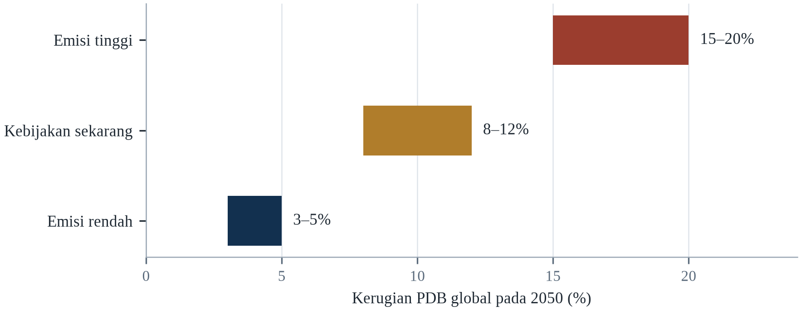||Sumber: Tabel 10.1; kerugian diukur terhadap garis dasar tanpa perubahan iklim.

Dua pelajaran muncul dari sini. Pertama, perbedaan antara jalur rendah dan tinggi diukur dalam poin persentase PDB global, yang berarti triliunan dolar dan ratusan juta orang terdorong ke kemiskinan. Kedua, kerugiannya bukan masa depan yang tiba pada 2050; ia terakumulasi tahun demi tahun, dan negara yang paling tidak mampu beradaptasi sudah membayar porsi tertinggi (UNDRR, 2023).

Difusi cepat energi bersih murah akan mengurangi kerusakan fisik dan risiko transisi sekaligus, dan itu sudah terjadi lebih cepat daripada asumsi sebagian besar model. Terobosan dalam pembiayaan adaptasi — melalui reformasi lembaga multilateral, keringanan utang, atau pungutan baru — akan mengurangi beban negara termiskin. Dan perubahan tingkat diskonto yang digunakan pemerintah akan membuat kerusakan jangka panjang tampak lebih besar dan membenarkan lebih banyak investasi sekarang. Tidak ada yang pasti, tetapi arah ekonominya jelas: penundaan lebih mahal daripada tindakan.

---

# Bab 11: Migrasi dan Pengungsian

*Tema: migrasi iklim, pengungsian dan politik perpindahan penduduk*

Tuvalu adalah negara sembilan atol karang dengan populasi sekitar sebelas ribu orang dan titik tertinggi kurang dari lima meter di atas permukaan laut. Saat pasang tinggi, ibu kota Funafuti tergenang di beberapa tempat; saat pasang purnama, air laut merembes melalui tanah. Pemerintah telah menegosiasikan syarat-syarat hilangnya negara itu selama lebih dari satu dekade, dan pada November 2023 menandatangani perjanjian dengan Australia, Falepili Union, yang menyediakan perpindahan orang Tuvalu ke Australia melalui pengaturan visa khusus sambil mempertahankan kedaulatan dan batas laut Tuvalu.

Tuvalu adalah kasus paling jelas, tetapi bukan yang terbesar. Sebagian besar migrasi iklim bersifat internal, dari desa ke kota, dan sementara. Orang pindah dari desa ke kota setelah kekeringan, dari dataran banjir ke tanah yang lebih tinggi setelah banjir, atau dari pesisir ke kota pedalaman setelah air asin mengontaminasi sumur. Mereka pindah di dalam negaranya sendiri, sering kembali ketika kondisi membaik, dan jarang melintasi perbatasan internasional. Citra gelombang pengungsi iklim yang melintasi perbatasan menyesatkan; kenyataannya adalah jutaan perpindahan kecil, sebagian besar di dalam batas negara.

Skalanya sulit diukur karena iklim jarang menjadi satu-satunya alasan berpindah. Petani yang meninggalkan desa yang terkena kekeringan mungkin pindah karena utang, karena anaknya tidak punya sekolah, atau karena kerabat di kota menawarkan pekerjaan. Perubahan iklim adalah satu tekanan di antara banyak, dan sering merupakan tekanan yang memicu keputusan yang sebenarnya sudah dipertimbangkan. Itu membuat atribusi sulit dan prediksi tidak pasti, tetapi tidak membuat fenomenanya kurang nyata.

Bab ini membahas pemicu migrasi iklim, perbedaan antara perpindahan sukarela dan terpaksa, serta tujuan yang menerima orang. Bab ini menyoroti tempat-tempat yang tidak dapat beradaptasi di tempat — pulau kecil, delta rendah, dan padang penggembalaan yang rawan kekeringan — serta kerangka hukum dan politik yang menentukan apakah perpindahan dikelola atau kacau. Bab ini ditutup dengan pertanyaan yang dihadapi komunitas penerima: bagaimana menyerap orang tanpa menciptakan kerentanan baru.

Migrasi adalah strategi adaptasi tertua manusia, dan ia biasanya digambarkan dengan bahasa krisis alih-alih agensi. Sebagian besar orang yang bergerak merespons tekanan lingkungan berpindah jarak pendek, tetap di dalam negaranya, dan kembali ketika kondisi memungkinkan; hanya sebagian kecil yang melintasi perbatasan. Citra eksodus massal dari Selatan global ke Utara global tidak didukung bukti, dan kebijakan yang dibangun di atas citra itu cenderung bersifat menghukum alih-alih melindungi.

## 11.1 Definisi: Migrasi, Pengungsian dan Relokasi

Migrasi adalah istilah luas yang mencakup perpindahan sukarela untuk mencari peluang dan perpindahan terpaksa sebagai respons terhadap ancaman. Pengungsian biasanya merujuk pada perpindahan akibat peristiwa tertentu, seperti banjir atau konflik, dan menyiratkan bahwa orang berniat kembali. Relokasi terencana merujuk pada perpindahan komunitas yang terorganisasi ke lokasi baru, biasanya dengan dukungan pemerintah. Perbedaan itu penting karena menentukan perlindungan hukum yang berlaku dan bentuk bantuan yang tersedia.

Perubahan iklim dapat menghasilkan ketiganya. Banjir mengungsi orang sementara; kekeringan dapat mendorong migrasi permanen; desa yang berulang kali banjir dapat direlokasi oleh negara. Rumah tangga yang sama dapat mengalami beberapa di antaranya secara berurutan: mengungsi ke tempat penampungan, kembali ke rumah yang rusak, bermigrasi ke kota, dan akhirnya direlokasi ke permukiman baru. Kategori itu berguna bagi kebijakan tetapi tidak menggambarkan proses yang linear.

Kerangka hukumnya tidak lengkap. Konvensi Pengungsi 1951 mendefinisikan pengungsi sebagai orang yang melarikan diri dari penganiayaan berdasarkan ras, agama, kebangsaan, kelompok sosial, atau pendapat politik; konvensi itu tidak mencakup orang yang melarikan diri dari perubahan lingkungan. Tidak ada instrumen internasional yang mengikat yang memberikan migran iklim hak untuk masuk ke negara lain atau menerima perlindungan. Beberapa negara telah menciptakan visa kemanusiaan, dan perjanjian regional mulai menangani celah itu, tetapi perlindungan yang tersedia bagi orang yang pulau kecilnya sedang menghilang bergantung pada di mana ia dilahirkan.

Perbedaannya penting karena menentukan status hukum dan hak. Migrasi adalah perpindahan sukarela, bahkan ketika tekanan di belakangnya berat; pengungsian bersifat tidak sukarela dan biasanya sementara; dan relokasi adalah perpindahan terencana yang diorganisasi pemerintah atau lembaga. Orang yang meninggalkan desa yang dilanda kekeringan untuk mencari kerja adalah migran menurut hukum internasional dan memiliki sedikit perlindungan; orang yang melarikan diri dari banjir adalah pengungsi di dalam negaranya dan bergantung pada hukum nasional; dan orang yang dipindahkan dari garis pantai oleh program pemukiman ulang memiliki rangkaian hak lain lagi.

Kosakata mobilitas manusia itu tepat dan sering dipakai sembarangan. Migrasi adalah perpindahan yang bisa sukarela atau terpaksa, internal atau internasional, dan bisa terencana; pengungsian adalah perpindahan yang terpaksa dan biasanya sementara; relokasi adalah perpindahan terencana yang diorganisasi otoritas; dan populasi terjebak adalah orang yang tidak dapat bergerak meski terpapar. Perbedaannya penting karena respons kebijakannya berbeda. Pengungsian menuntut tempat tinggal, perlindungan, dan jalan pulang; migrasi menuntut pasar kerja dan saluran hukum; relokasi menuntut lahan, kompensasi, dan persetujuan.

Kosakata migrasi diperdebatkan karena kategorinya menentukan hak. Pengungsi didefinisikan Konvensi 1951 sebagai orang dengan ketakutan beralasan akan penganiayaan, dan definisinya tidak mencakup orang yang pergi karena hujan gagal. Orang terlantar didefinisikan sebagai orang di dalam negaranya sendiri, yang memberinya perlindungan berbeda dan lebih lemah. Migran adalah kategori lebih luas tanpa hak otomatis sama sekali. Inisiatif Nansen dan platform sesudahnya adalah upaya mengisi celah bagi perpindahan bencana lintas batas, dan menghasilkan panduan, bukan kewajiban, yang merupakan batas maksimal yang diterima negara-negara terlibat.

## 11.2 Pemicu Cepat dan Lambat

Peristiwa cepat — banjir, badai, kebakaran — mengungsi orang segera, sering dalam jumlah besar. Pusat Pemantauan Pengungsian Internal mencatat sekitar 26,4 juta pengungsian akibat bencana pada 2023, sebagian besar akibat banjir dan badai. Sebagian besar pengungsian ini berumur pendek: orang kembali ke rumah dalam hitungan pekan atau bulan, setelah air surut dan kerusakan diperbaiki. Tetapi pengungsian berulang mengikis aset dan jaringan sosial yang memungkinkan pemulihan.

Perubahan lambat — kenaikan muka laut, desertifikasi, salinisasi, penyusutan gletser — mengungsi orang secara bertahap, dan perpindahannya lebih sulit dilihat. Rumah tangga yang sumurnya menjadi asin mungkin pertama membeli air, lalu mengurangi ternaknya, lalu mengirim seorang anak ke kota, dan akhirnya meninggalkan lahan. Pada saat desa itu diakui tidak layak huni, sebagian besar penduduknya mungkin sudah pergi. Proses lambat itu kurang terlihat daripada banjir tetapi sering lebih permanen.

Keduanya berinteraksi. Komunitas yang dilemahkan kekeringan berulang mungkin tidak mampu pulih dari banjir; kota pesisir yang tenggelam mungkin dilanda gelombang badai yang seharusnya dapat ditahan satu generasi lalu. Urutan guncangan sama pentingnya dengan besarnya satu peristiwa, itulah sebabnya kerentanan paling baik dipahami sebagai lintasan, bukan keadaan.

Peristiwa cepat mengungsikan jauh lebih banyak orang daripada peristiwa lambat, tetapi peristiwa lambat menghasilkan perpindahan yang lebih permanen. Banjir dan badai mengungsikan jutaan orang setiap tahun, dan sebagian besar kembali dalam hitungan pekan; kekeringan, salinisasi, dan kenaikan muka laut mengungsikan lebih sedikit orang sekaligus tetapi membuat kembali mustahil, sehingga perpindahannya menjadi permanen. Internal Displacement Monitoring Centre mencatat sekitar 26 juta pengungsian baru akibat bencana per tahun, dan angka itu meremehkan perpindahan lambat karena ia menghitung peristiwa alih-alih pengikisan bertahap.

Bencana cepat memindahkan orang secara mendadak dan terlihat, dan sebagian besar kembali dalam beberapa pekan. Proses lambat — kekeringan, salinisasi, kenaikan muka laut, degradasi lahan — memindahkan orang secara bertahap dan tak terlihat, dan mereka jarang kembali. Keduanya menuntut respons berbeda: pengungsian cepat adalah masalah kemanusiaan dengan garis waktu jelas, sementara pengungsian lambat adalah masalah pembangunan tanpa awal yang jelas. Versi lambat juga lebih sulit diatribusikan, karena rumah tangga yang pindah dari desa yang mengering ke kota bisa disebut migran ekonomi, dan iklim hanya satu faktor.

Perbedaan hukum antara perpindahan cepat dan lambat adalah yang pertama terlihat dan yang kedua tidak, dan ketidakterlihatannya punya konsekuensi. Banjir menghasilkan gambar, deklarasi, dan seruan bantuan; kekeringan menghasilkan keluarga yang pergi diam-diam, satu anggota demi satu, dan tiba di kota yang tidak mencatat alasan kedatangannya. Data perpindahan lambat karena itu jauh lebih lemah daripada data perpindahan bencana, dan kelemahannya tidak netral, karena menentukan siapa yang berhak atas bantuan. Orang yang tidak dapat bergerak sama sekali adalah kategori ketiga, dan mereka yang paling terpapar.

Kategori yang dipakai sistem data menentukan siapa yang terlihat, dan tiga yang penting adalah perpindahan, migrasi, dan ketidakmampuan bergerak. Perpindahan adalah gerakan yang menyusul bencana dan dilacak lembaga yang merespons; migrasi adalah gerakan lebih lambat yang dilacak sensus, bila dilacak; ketidakmampuan bergerak adalah kondisi orang yang tinggal karena tidak dapat pergi, dan tidak dilacak siapa pun. Kelompok terakhir terbesar di antara yang termiskin, dan kebutuhannya yang akan dilewatkan kebijakan yang dirancang seputar pergerakan. Celah datanya karena itu tidak netral: ia menentukan siapa yang dibantu.

## 11.3 Berapa Banyak Migrasi Terkait Iklim?

Memperkirakan jumlah orang yang pindah karena perubahan iklim sulit karena iklim jarang menjadi satu-satunya penyebab. Peneliti menggunakan survei rumah tangga, data satelit tentang vegetasi dan curah hujan, serta model ekonometrik untuk mengidentifikasi pengaruh variabel iklim terhadap keputusan migrasi, dengan mengendalikan pendapatan, konflik, kepemilikan lahan, dan jaringan sosial. Perkiraannya sangat beragam, tetapi secara konsisten menemukan bahwa guncangan iklim meningkatkan migrasi, terutama dari daerah pedesaan dan terutama di antara rumah tangga yang bergantung pada pertanian.

Laporan Groundswell Bank Dunia memperkirakan bahwa 216 juta orang dapat berpindah di dalam negaranya sendiri pada 2050 di enam wilayah di bawah skenario emisi tinggi, dengan sebagian besar perpindahan di Afrika Sub-Sahara, Asia Selatan, dan Amerika Latin (World Bank, 2021). Laporan yang sama menemukan bahwa sebagian besar perpindahan dapat dihindari melalui adaptasi — irigasi, diversifikasi tanaman, perlindungan sosial, dan perencanaan kota — itulah sebabnya laporan itu dirumuskan sebagai seruan bertindak, bukan ramalan.

Jumlah orang yang melintasi perbatasan internasional karena alasan iklim jauh lebih kecil, dan kemungkinan tetap demikian. Migrasi internasional mahal, membutuhkan dokumen dan jaringan, dan sering dihalangi kontrol perbatasan. Orang yang paling terpapar risiko iklim biasanya paling tidak mampu bermigrasi secara internasional, itulah sebabnya yang paling rentan sering tetap di tempat. Fenomena itu — imobilitas orang yang paling terpapar — adalah salah satu ciri migrasi iklim yang paling penting dan paling sedikit dibahas.

Memperkirakan berapa banyak migrasi yang terkait iklim sulit secara metodologis, karena iklim jarang menjadi satu-satunya pendorong dan orang jarang menjelaskan motifnya dengan istilah itu. Survei biasanya menemukan faktor ekonomi mendominasi, dengan tekanan lingkungan berperan sebagai penguat alih-alih penyebab tunggal. Proyeksi 200 juta migran iklim pada 2050 yang banyak dikutip berasal dari karya 1995 dan telah dikritik metodenya; perkiraan berikutnya berkisar dari 44 juta hingga lebih dari 200 juta tergantung asumsi tentang adaptasi dan pembangunan.

Angka 216 juta itu adalah hasil pemodelan, bukan hitungan, dan bergantung pada asumsi pertumbuhan penduduk, adaptasi dan definisi perpindahan. Nilainya komparatif: ia menunjukkan bahwa mayoritas besar perpindahan akan bersifat internal dan bahwa kawasan termiskin akan memasok sebagian besarnya. Bahayanya adalah ia sering dikutip sebagai ramalan migrasi internasional, padahal bukan.

Menaksir berapa banyak migrasi yang terkait iklim memang sulit, dan kesulitannya bukan alasan untuk diam. Rumah tangga pindah karena gabungan pendapatan, keamanan, jaringan keluarga, tanah, dan cuaca, dan tidak ada survei yang dapat memisahkan komponennya secara bersih. Yang dapat dikatakan adalah variabel iklim berkaitan secara statistik dengan perpindahan dalam arah yang diharapkan: kekeringan menaikkan migrasi desa-kota dalam sebagian konteks, banjir memindahkan orang sementara, dan panas mengurangi pendapatan pertanian. Taksiran yang berguna karena itu bersyarat, bukan satu angka global yang disajikan sebagai ramalan.

Estimasi berapa banyak orang akan berpindah karena iklim berkisar dari puluhan juta sampai satu miliar pada pertengahan abad, dan rentangnya mencerminkan kesulitan pertanyaannya alih-alih ketidaksepakatan tentang datanya. Orang yang pindah dari desa terdampak kekeringan ke kota pindah karena kombinasi alasan, dan iklim salah satunya, yang berarti atribusinya soal derajat, bukan jenis. Orang yang tidak dapat berpindah adalah yang dilewatkan angka agregat, dan mereka sering yang termiskin, karena mobilitas menuntut uang, jaringan, dan status hukum. Populasi yang terjebak adalah kategori yang baru dihitung debat kebijakan.

## 11.4 Pastoralis, Petani dan Sahel

Pastoralis termasuk kelompok yang paling terpapar iklim karena penghidupan mereka bergantung pada penggembalaan yang bervariasi menurut curah hujan. Di Sahel, penggembala telah lama bergerak musiman antara padang rumput musim kering dan basah, dan perpindahan itu diatur oleh kesepakatan adat dengan komunitas petani. Ketika curah hujan menjadi lebih bervariasi dan padang rumput terdegradasi, perpindahannya menjadi lebih panjang, lebih sering, dan lebih diperebutkan.

Hasilnya adalah konflik atas tanah dan air, terutama di tempat negara lemah dan di mana petani telah memperluas lahan ke koridor yang dahulu digunakan penggembala. Konflik itu sering digambarkan sebagai etnis atau agama, dan identitas itu penting, tetapi pemicu yang mendasarinya sering merupakan sengketa akses atas sumber daya yang menyusut. Perubahan iklim tidak menciptakan konflik, tetapi ia memperkuat persaingan yang membuat konflik lebih mungkin terjadi.

Petani merespons kekeringan dengan cara berbeda. Mereka mungkin bermigrasi sementara ke kota, mengirim anggota keluarga untuk bekerja, mendiversifikasi ke aktivitas non-pertanian, atau menjual ternak untuk membeli makanan. Strategi itu kumulatif, dan masing-masing mengurangi kapasitas rumah tangga untuk kembali bertani. Rumah tangga yang menjual hewan dan alatnya mungkin tidak dapat memulai lagi bahkan jika hujan kembali, itulah sebabnya kekeringan dapat menghasilkan de-agrarianisasi permanen di wilayah yang mengalaminya berulang kali.

Pastoralis di Sahel menggambarkan bagaimana mobilitas berfungsi sebagai adaptasi. Penggembala memindahkan ternak mengikuti jalur yang telah dinegosiasikan lintas generasi, memakai sumur dan padang rumput yang dibagi menurut aturan adat. Ketika kekeringan mengurangi padang rumput, mobilitas memungkinkan ternak mencapai wilayah yang masih berumput; ketika perbatasan, lahan pertanian, atau konflik menghalangi jalurnya, kekeringan yang sama menjadi keruntuhan penghidupan. Krisisnya karena itu dihasilkan sama banyak oleh hilangnya mobilitas seperti oleh kurangnya hujan.

Pastoralis dan petani kecil adalah kelompok yang migrasinya merupakan strategi tradisional, bukan kegagalan. Penggembala bergerak bersama musim dan mengikuti hujan, dan sistem mereka beradaptasi baik pada variabilitas; ia menjadi maladaptif ketika variabilitas melampaui rentang yang dirancang untuknya, atau ketika jalurnya terhalang pagar, lahan pertanian, dan perbatasan. Petani mendiversifikasi dengan mengirim anggota keluarga muda ke kota, yang menyebar risiko ke seluruh rumah tangga alih-alih ke seluruh bentang. Sahel menunjukkan kedua pola: mobilitas yang menopang penghidupan berabad-abad, dan pengungsian ketika padang gagal dan jalur tertutup.

Penggembala berpindah sebagai hal rutin, dan pembeda antara mobilitas itu dan migrasi karena tekanan adalah kondisi ternaknya. Rumah tangga yang bergerak bersama ternak sehat melalui jalur yang dikenal menjalankan adaptasi; rumah tangga yang bergerak karena padangnya gagal dan ternaknya mati sedang melarikan diri. Jalurnya sering melintasi wilayah petani, dan ketegangan di perlintasan itu setua praktiknya, dan menjadi lebih sering ketika padangnya menyempit. Intervensi yang mengurangi konflik adalah yang paling tidak dramatis: jaminan akses ke titik air, koridor yang disepakati, dan peringatan dini yang memungkinkan kedua pihak merencanakan.

Asuransi ternak berbasis indeks adalah instrumen yang paling mendekati menyelesaikan masalah penggembala, dan ia bekerja karena membayar berdasarkan hujan alih-alih kematian ternak. Satelit atau penakar hujan mengukur kondisi padang, dan ketika ukurannya turun di bawah ambang polisnya membayar, tanpa penilai kerugian dan tanpa penundaan klaim. Penggembalanya menerima uang sebelum ternaknya mati, titik ketika uang itu menyelamatkan kawanannya. Skemanya diuji di Kenya dan Etiopia dan evaluasinya menemukan bahwa ia melindungi aset rumah tangga pemegangnya, dan penetrasinya dibatasi premi serta kepercayaan pada penanggungnya.

## 11.5 Negara Pulau Kecil dan Komunitas Pesisir

Negara pulau kecil berkembang paling terpapar kenaikan muka laut karena luas daratannya kecil, elevasinya rendah, dan populasinya terkonsentrasi di pesisir. Tuvalu, Kiribati, Kepulauan Marshall, dan Maladewa memiliki elevasi rata-rata beberapa meter, dan pasokan air tawarnya bergantung pada lensa air tanah tipis yang rentan terhadap intrusi air asin. Bagi negara-negara ini, adaptasi di tempat memiliki batas fisik.

Responsnya memiliki tiga jalur. Pertama, pertahanan pesisir: tanggul laut, reklamasi, dan infrastruktur yang ditinggikan. Kedua, adaptasi di dalam pulau: pemanenan air hujan, desalinasi, tanaman toleran garam, dan relokasi permukiman ke tanah yang lebih tinggi. Ketiga, migrasi: perjanjian dengan negara lain yang memungkinkan warga pindah, bekerja, dan akhirnya menetap. Falepili Union antara Tuvalu dan Australia adalah contoh terbaru, dan ia menggabungkan jalur visa dengan pengakuan Australia atas batas laut Tuvalu serta komitmen membantu jika terjadi bencana besar.

Politik perjanjian itu rumit. Negara pulau tidak ingin dilihat sebagai menyerah, dan tidak ingin kehilangan kedaulatan atau zona maritimnya, yang sangat luas relatif terhadap luas daratannya. Australia dan Selandia Baru bersedia menerima migran dalam jumlah terbatas, tetapi tidak bersedia mengakui kategori hukum pengungsi iklim. Hasilnya adalah tambal sulam pengaturan bilateral yang menyediakan jalur bagi sebagian orang tetapi bukan hak bagi semua.

Negara pulau kecil menghadapi bentuk pengungsian yang tidak memiliki preseden dalam hukum internasional: hilangnya wilayah itu sendiri. Negara yang tanahnya tenggelam tidak memiliki populasi yang dapat kembali, dan pertanyaan hukum apakah kenegaraan bertahan setelah hilangnya wilayah belum terselesaikan. Sebagian pemerintah mulai membeli tanah di luar negeri sebagai bentuk asuransi, dan sebagian menegosiasikan jalur migrasi dengan tetangga yang lebih besar, tetapi tidak satu pun menyelesaikan pertanyaan kedaulatan atau kesinambungan budaya.

Negara pulau kecil telah menghasilkan respons hukum paling inovatif atas perpindahan, karena mereka menghadapi kemungkinan wilayahnya menjadi tidak layak huni sementara kenegaraannya tetap ada. Kesepakatan Falepili antara Tuvalu dan Australia, ditandatangani pada 2023, membuka jalur bagi warga Tuvalu untuk bermigrasi dengan akses layanan sambil mempertahankan kedaulatan Tuvalu, dan dibingkai secara eksplisit sebagai respons terhadap perubahan iklim. Kesepakatan itu kecil skalanya — beberapa ratus orang per tahun — dan besar dalam prinsip, karena ia memperlakukan mobilitas sebagai hak yang harus difasilitasi alih-alih kegagalan yang harus dicegah.

Negara pulau kecil adalah kasus paling jelas dari penduduk yang wilayahnya berisiko, dan situasinya salah digambarkan dengan kata migrasi. Orang yang pindah dari atol yang tenggelam tidak sekadar berubah alamat; ia kehilangan negara, budaya, bahasa, dan seperangkat hak maritim. Uni Falepili antara Tuvalu dan Australia penting karena menciptakan jalur hukum sekaligus mempertahankan kedaulatan dan batas maritim, suatu upaya memisahkan perpindahan orang dari lenyapnya negara. Apakah model itu dapat direplikasi bergantung pada kesediaan negara besar menerima kewajiban yang belum berpreseden.

Negara pulau kecil adalah kasus uji seluruh agenda, karena opsi adaptasi yang ada bagi negara benua tidak ada bagi atol. Tembok laut dapat melindungi kota; ia tidak dapat melindungi negara yang seluruh daratannya beberapa meter di atas laut dan lensa air tawarnya sedang terasinkan. Penduduk Tuvalu sekitar sebelas ribu orang di dua puluh enam kilometer persegi, dan negara itu merundingkan perjanjian dengan Australia untuk perpindahan penduduknya sambil mempertahankan zona maritim serta kepribadian hukumnya. Kasus itu menetapkan preseden yang belum dibutuhkan kategori negara lain: negara dapat terus ada sebagai entitas hukum setelah wilayahnya tidak layak huni.

## 11.6 Banjir, Pengungsian dan Kembali

Banjir mengungsi lebih banyak orang daripada bahaya iklim lainnya. Banjir Pakistan 2022 mengungsi sekitar delapan juta orang, banyak di antaranya tinggal di kamp sementara selama berbulan-bulan; banjir 2010 di negara yang sama mengungsi sekitar 14 juta orang (WMO, 2023). Di Bangladesh, siklon dan banjir secara rutin mengungsi ratusan ribu orang, dan orang yang mengungsi secara tidak proporsional adalah orang miskin, tunakisma, dan tinggal di permukiman informal.

Sebagian besar pengungsian akibat banjir bersifat sementara, tetapi kembali tidak selalu mungkin. Rumah tangga yang rumahnya hancur mungkin tidak punya tempat untuk kembali, terutama jika ia menyewa atau menempati lahan secara informal. Rumah tangga yang lahannya tergerus sungai mungkin kehilangan penghidupannya secara permanen. Dan rumah tangga yang telah beberapa kali mengungsi mungkin memutuskan untuk tidak kembali, bahkan jika rumahnya diperbaiki, karena risiko banjir berikutnya terlalu tinggi.

Kualitas pengungsian sama pentingnya dengan durasinya. Orang di kamp menghadapi kepadatan, sanitasi buruk, dan akses terbatas ke layanan kesehatan serta pendidikan; orang yang tinggal bersama kerabat mungkin kurang terlihat tetapi sama rentannya. Keputusan untuk kembali sering didorong oleh ketersediaan pekerjaan dan perumahan, bukan oleh tingkat risiko, yang berarti orang termiskin paling mungkin kembali ke tempat berbahaya.

Kembali setelah banjir adalah bagian pengungsian yang paling sedikit mendapat perhatian dan menentukan hasil jangka panjang. Rumah tangga kembali ketika rumahnya layak huni, penghidupannya pulih, dan anaknya dapat bersekolah; mereka tetap jauh ketika perumahan hancur, tanah tercemar, atau layanan tidak ada. Faktor yang memprediksi kembalinya karena itu sama dengan faktor yang memprediksi pemulihan, itulah sebabnya kebijakan pengungsian dan kebijakan perumahan tidak dapat dipisahkan.

Pengungsian akibat banjir biasanya singkat dan lokal, dan kerugiannya terkonsentrasi pada kepulangan. Rumah tangga yang menghabiskan tiga pekan di penampungan dapat kembali ke rumah yang secara struktur kokoh tetapi tanpa air bersih, tanpa listrik, dan tanpa sekolah untuk anak-anak. Kepulangan adalah tempat efek kesehatan menumpuk dan tempat keputusan membangun ulang di lokasi yang sama diambil, sering karena tidak ada alternatif dan karena tanah adalah satu-satunya aset keluarga. Pengungsian berulang menggerus aset yang seharusnya memungkinkan pindah permanen.

Perpindahan akibat banjir diukur pada pekan setelah air datang, dan kepulangan diukur pada tahun setelahnya surut. Rumah tangga yang paling cepat kembali adalah yang punya hak atas tanah yang pasti, rumah yang layak, dan alasan untuk berada di sana, dan yang tidak kembali adalah penyewa, orang tanpa dokumen, dan yang tanahnya diambil saat mereka pergi. Di Pakistan pada 2022, lebih dari delapan juta orang terpindahkan pada puncaknya, dan rekonstruksinya diperlambat krisis utang yang mendahului banjirnya (WMO, 2023). Polanya berulang: pemulihan mereproduksi ketidaksetaraan sebelum peristiwa, kecuali ada upaya sengaja memutusnya.

## 11.7 Kota sebagai Tujuan

Sebagian besar migran iklim pindah ke kota, dan sebagian besar kota tidak siap menerima mereka. Pendatang baru sering menetap di kawasan informal yang juga terpapar banjir, panas, dan longsor, dan mereka kekurangan akses ke air, sanitasi, layanan kesehatan, dan pekerjaan formal. Hasilnya adalah migrasi memindahkan kerentanan dari pedesaan ke kota alih-alih menyelesaikannya.

Kota yang merencanakan migrasi berkinerja lebih baik. Menyediakan lahan untuk perumahan terjangkau, memperluas air dan sanitasi ke permukiman informal, dan menciptakan peluang kerja mengurangi risiko pendatang terdorong ke kawasan berbahaya. Beberapa kota telah mengadopsi kebijakan yang secara eksplisit mengakui migran iklim, termasuk akses ke layanan dan tempat berlindung sementara. Tetapi sebagian besar belum, dan kedatangan banyak orang dalam waktu singkat dapat membebani layanan dan menciptakan ketegangan politik.

Komunitas penerima sama pentingnya dengan migran. Kota yang berhasil menyerap orang adalah kota yang pasar tenaganya tumbuh, infrastrukturnya memadai, dan jaringan sosialnya inklusif. Kota yang sudah tertekan oleh pengangguran, kekurangan perumahan, dan layanan lemah mungkin mengalami konflik. Perbedaannya sebagian besar merupakan soal tata kelola dan investasi, yang berarti kebijakan migrasi juga kebijakan perkotaan.

Kota menyerap sebagian besar migrasi iklim, dan mereka melakukannya secara informal. Pendatang baru biasanya menetap di lingkungan pinggiran dengan perumahan murah dan layanan terbatas, sering di wilayah yang terpapar banjir atau longsor. Hasilnya, migrasi memindahkan kerentanan dari pedesaan ke perkotaan tanpa menguranginya, kecuali kota penerima berinvestasi dalam perumahan, infrastruktur, dan layanan secepat pertumbuhan populasinya.

Kota adalah tujuan sebagian besar migrasi iklim, dan ujung penerima adalah tempat kebijakan biasanya gagal. Migran yang tiba di permukiman informal sering menempati lahan paling terpapar — dataran banjir, lereng curam, koridor drainase — karena itulah yang terjangkau dan tersedia. Riset tentang perpindahan perkotaan di Dhaka, Lagos dan Jakarta menemukan bahwa pendatang bergantung pada jaringan sosial untuk perumahan dan pekerjaan, dan bahwa jaringan itulah yang menentukan apakah mereka berakhir di lokasi lebih aman atau lebih berbahaya. Kebijakan integrasi karena itu bukan urusan terpisah dari adaptasi; ia menentukan apakah migrasi mengurangi atau memusatkan risiko.

Kota adalah tujuan sebagian besar migrasi iklim, dan cara kota menerima orang menentukan hasilnya. Kota yang mengizinkan permukiman informal, menoleransi kerja informal, dan menyediakan layanan dasar menyerap kedatangan dengan biaya rendah dan mengubahnya menjadi pembayar pajak dalam satu generasi. Kota yang membongkar perumahan informal dan membatasi kerja mendorong kedatangan ke kerentanan dan memperlambat integrasi. Kawasan penerima biasanya lingkungan paling kurang terlayani, itulah sebabnya migrasi iklim sering disebut masalah urbanisasi, bukan masalah perbatasan. Infrastruktur yang penting adalah air, sanitasi, angkutan, dan sekolah.

Kota adalah tempat sebagian besar migrasi iklim berakhir, dan cara kota menerimanya menentukan apakah perpindahannya krisis atau adaptasi. Rumah tangga yang tiba di kota dengan kontak, keterampilan, dan status hukum dapat menjadi kontributor dalam setahun; rumah tangga yang tiba tanpa itu bergabung dengan permukiman informal di dataran banjir. Kota yang mengelola kedatangan dengan baik punya registrasi, kebijakan permukiman, dan layanan yang menjangkau pendatang alih-alih berhenti di batas kota formal. Yang tidak punya menghasilkan penduduk yang terpapar bahaya berikutnya dan dikecualikan dari responsnya.

## 11.8 Remitansi dan Adaptasi Transnasional

Migrasi bukan hanya kegagalan adaptasi; ia juga strategi adaptasi. Rumah tangga yang mengirim anggota untuk bekerja di tempat lain menerima remitansi yang dapat digunakan untuk berinvestasi dalam irigasi, perumahan, pendidikan, dan kesehatan. Pada 2023, remitansi ke negara berpenghasilan rendah dan menengah mencapai sekitar US$669 miliar, lebih banyak daripada investasi asing langsung dan lebih banyak daripada bantuan pembangunan resmi. Bagi banyak negara, remitansi adalah sumber pembiayaan eksternal terbesar.

Remitansi dapat meningkatkan ketangguhan. Rumah tangga yang menerima transfer rutin dapat membeli makanan selama kekeringan, membangun kembali setelah banjir, dan menjaga anak tetap bersekolah. Remitansi juga dapat membiayai adaptasi: atap baru, tangki air, sistem surya, atau usaha kecil yang tidak terlalu bergantung pada curah hujan. Efeknya bergantung pada keandalan transfer dan cara penggunaannya, tetapi bukti umumnya menunjukkan bahwa remitansi mengurangi kerentanan.

Ada sisi gelapnya. Migrasi dapat memisahkan keluarga, meningkatkan beban perempuan yang tinggal, dan memaparkan migran pada eksploitasi serta pekerjaan berbahaya. Remitansi juga dapat menciptakan ketergantungan pada satu sumber pendapatan yang sendiri rentan terhadap guncangan ekonomi di negara tujuan. Tantangan kebijakannya adalah memaksimalkan manfaat migrasi sambil mengurangi biayanya, yang memerlukan jalur migrasi yang aman, perlindungan sosial yang dapat dibawa, dan sistem keuangan yang menurunkan biaya transfer.

Remitansi adalah salah satu bentuk pembiayaan adaptasi paling efektif, dan ia jarang dihitung sebagai demikian. Uang yang dikirim pulang oleh anggota keluarga yang bekerja di luar negeri melebihi bantuan pembangunan resmi di banyak negara, dan ia datang langsung, cepat, dan tanpa syarat. Riset di Bangladesh, Nepal, dan Amerika Tengah menemukan bahwa rumah tangga penerima remitansi lebih banyak berinvestasi dalam perumahan, pendidikan, dan kesiapsiagaan, serta pulih lebih cepat setelah bencana, yang menjadikan migrasi strategi bagi mereka yang tinggal maupun yang pergi.

Remitansi adalah sumber keuangan eksternal terbesar bagi banyak negara berpendapatan rendah, dan ia juga bentuk pembiayaan adaptasi yang tidak dikelola lembaga mana pun. Rumah tangga yang menerima uang dari kerabat di luar negeri memakainya untuk membangun ulang setelah banjir, mendiversifikasi penghidupan dan membiayai sekolah, dan studi arus remitansi setelah bencana menemukan uangnya tiba lebih cepat daripada bantuan resmi dan lebih tepat sasaran. Batasnya adalah remitansi bergantung pada migran yang punya pekerjaan di luar negeri, sehingga kebijakan yang membatasi migrasi mengurangi arus uang yang memungkinkan adaptasi di kampung halaman.

Remitansi adalah arus keuangan internasional terbesar ke banyak negara rentan, dan ia juga bentuk adaptasi. Rumah tangga yang punya kerabat di luar negeri memiliki pendapatan yang tidak bergantung pada panen setempat, sehingga dapat melewati kekeringan tanpa menjual aset dan membangun ulang setelah banjir tanpa menunggu bantuan. Uangnya juga membiayai adaptasi langsung: atap beton, tandon air, panel surya. Ketergantungannya sendiri merupakan kerentanan, karena remitansi turun saat resesi global dan karena pengirimnya sering terpapar bahaya di negara tujuan.

Rumah tangga yang punya kerabat di luar negeri menerima uang setelah bencana tanpa aplikasi, agunan, atau suku bunga, dan uangnya tiba lebih cepat daripada sebagian besar bantuan resmi. Nilai yang dikirim ke negara berpendapatan rendah dan menengah jauh di atas enam ratus miliar dolar setahun, beberapa kali anggaran bantuan global. Instrumen ini punya batas: bergantung pada migran yang punya pekerjaan, turun ketika ekonomi tujuan juga terpukul, dan biaya transaksinya masih mengambil porsi lebih besar dari pengirim termiskin.

## 11.9 Kerangka Hukum dan Politik

Kerangka hukum migrasi iklim terfragmentasi. Konvensi Pengungsi tidak mencakup pengungsian lingkungan; Organisasi Internasional untuk Migrasi bukan lembaga perlindungan; dan Konvensi Kerangka Kerja PBB tentang Perubahan Iklim membentuk gugus tugas tentang pengungsian tetapi bukan hak untuk diterima. Hasilnya adalah sebagian besar migran iklim bergantung pada aturan imigrasi biasa, yang dirancang untuk tujuan lain dan sering restriktif.

Sejumlah kemajuan telah dicapai. Global Compact for Safe, Orderly and Regular Migration, yang diadopsi pada 2018, mengakui faktor iklim dan lingkungan sebagai pemicu migrasi dan berkomitmen negara untuk bekerja sama dalam penerimaan dan perlindungan. Inisiatif Nansen dan penerusnya, Platform on Disaster Displacement, telah mengembangkan panduan tentang relokasi terencana dan pengungsian lintas batas. Beberapa negara telah menciptakan visa kemanusiaan atau rezim perlindungan sementara bagi orang yang terdampak bencana.

Hambatan politiknya adalah penerimaan merupakan keputusan berdaulat, dan publik di negara penerima sering menolak migrasi. Hasilnya adalah pemerintah lebih suka membiayai adaptasi di negara asal, yang lebih murah dan lebih mudah secara politik, daripada membuka jalur hukum. Adaptasi memang diperlukan, tetapi ia tidak dapat melindungi semua orang, dan orang yang tidak dapat dilindunginya membutuhkan tempat untuk pergi. Tidak adanya jalur hukum tidak mencegah perpindahan; ia hanya membuat perpindahan menjadi tidak teratur, berbahaya, dan mahal.

Konvensi Pengungsi 1951 tidak mengakui pendorong lingkungan, dan orang yang melarikan diri dari banjir umumnya bukan pengungsi; Konvensi Kampala mencakup pengungsi internal di Afrika tetapi hanya di dalam benua itu; dan Global Compact for Migration tidak mengikat. Beberapa perjanjian regional telah menciptakan visa kemanusiaan dan jalur tenaga kerja, tetapi cakupannya tetap sebagian dan bergantung pada kemauan politik.

Pemindahan ibu kota Indonesia adalah perpindahan pemerintah nasional terencana terbesar dalam sejarah modern, dan ia dibenarkan sebagian dengan alasan iklim. Penurunan muka tanah dan banjir Jakarta termasuk alasan yang dikemukakan untuk pindah ke Nusantara di Kalimantan Timur, meskipun pemindahan itu juga mencerminkan keinginan lama memindahkan pembangunan dari Jawa. Tahap awalnya memunculkan pertanyaan yang selalu muncul dalam relokasi terencana: apakah lokasi baru sendiri terpapar kebakaran dan kekeringan, siapa yang mampu pindah, dan apa yang terjadi pada jutaan orang yang tinggal. Kasus ini mengingatkan bahwa relokasi terencana tidak pernah semata keputusan lingkungan.

Kerangka hukum mobilitas iklim adalah tambal sulam. Konvensi Pengungsi 1951 tidak mencakup orang yang pindah karena perubahan lingkungan, dan tidak ada perjanjian yang menciptakan hak masuk ke suatu negara karena alasan itu. Kesepakatan regional, pengaturan bilateral, dan visa kemanusiaan mengisi sebagian celah, dan Global Compact for Migration memberi prinsip tanpa kewajiban. Akibatnya sebagian besar perpindahan iklim bersifat internal dan diatur hukum nasional, yang sering bungkam soal itu. Orang yang menyeberang batas biasanya melalui saluran yang sudah ada.

Kerangka hukum bagi perpindahan iklim adalah tambal sulam instrumen yang dirancang untuk tujuan lain, dan celahnya tempat orang jatuh. Konvensi pengungsi tidak mencakup orang yang pergi karena hujan gagal; instrumen hak asasi manusia menetapkan kewajiban tetapi bukan penerimaan; hukum bencana sebagian besar negara menangani daruratnya dan bukan tahun-tahun sesudahnya. Inisiatif Nansen menghasilkan seperangkat praktik alih-alih perjanjian, dan Kompak Migrasi Global mengakui kategorinya tanpa menciptakan hak. Hasilnya, perlindungan yang diterima seseorang bergantung pada negara yang dijangkau dan pada kebijaksanaan pejabat.

## 11.10 Relokasi Terencana

Relokasi terencana adalah perpindahan komunitas yang terorganisasi ke lokasi baru, biasanya karena lokasi asal menjadi tidak aman. Ini adalah bentuk adaptasi paling sulit, karena melibatkan kehilangan tanah, penghidupan, jaringan sosial, dan identitas budaya. Proyek relokasi memiliki sejarah panjang kegagalan ketika diterapkan tanpa konsultasi, dikompensasi secara tidak memadai, atau ditempatkan di lokasi yang juga rentan.

Kasus yang berhasil berbagi beberapa ciri. Komunitas dikonsultasikan sejak awal dan berulang kali; kompensasi mencakup tanah, perumahan, dan penghidupan; lokasi baru memiliki akses ke air, pekerjaan, dan layanan; dan prosesnya diberi tempo agar orang dapat pindah ketika mereka siap. Relokasi terencana desa pesisir Fiji, yang didukung kerangka nasional, adalah salah satu contoh yang lebih banyak dipelajari; prosesnya lebih lambat daripada yang diinginkan pemerintah, tetapi umumnya menghormati persetujuan komunitas.

Pertanyaan tersulit adalah siapa yang memutuskan. Komunitas mungkin memilih tinggal bahkan ketika pemerintah menganggap lokasinya tidak aman; pemerintah mungkin menganggap relokasi perlu bahkan ketika komunitas tidak setuju. Ketegangan itu tidak terhindarkan, dan diselesaikan secara berbeda di sistem politik yang berbeda. Prinsip yang muncul dari panduan internasional adalah bahwa relokasi harus menjadi pilihan terakhir, harus sukarela jika memungkinkan, dan harus mempertahankan hak serta martabat orang yang pindah. Prinsip itu lebih mudah dinyatakan daripada dilaksanakan.

Relokasi terencana adalah pilihan yang dihindari pemerintah sampai menjadi tak terhindarkan, dan rekam jejak melakukannya dengan baik tipis. Kasus yang berhasil berbagi beberapa ciri: sukarela bila mungkin, melibatkan komunitas dalam memilih lokasi dan desain, memberi kompensasi yang memulihkan penghidupan alih-alih hanya perumahan, dan mempertahankan jaringan sosial dengan memindahkan kelompok alih-alih individu. Di tempat ciri itu tidak ada, lokasi pemukiman ulang menjadi tempat pengungsian sekunder dan ketergantungan.

Relokasi terencana adalah pilihan adaptasi tersulit karena ia menuntut pemerintah mengatakan kepada orang bahwa rumah mereka tidak akan dipertahankan. Fiji menjadi kasus paling banyak dipelajari, setelah merelokasi beberapa desa dari garis pantai yang terpapar erosi dan gelombang badai, dimulai dari Vunidogoloa pada 2014. Evaluasi menemukan bahwa hasilnya bergantung pada ketersediaan lahan, kompensasi, dan apakah komunitas dilibatkan dalam memilih lokasi; di tempat relokasi dipaksakan, penolakan dan kembalinya orang umum terjadi. Pelajarannya adalah relokasi bukan operasi teknis melainkan negosiasi, dan negosiasinya memakan waktu bertahun-tahun.

Relokasi terencana adalah adaptasi paling sulit dilakukan baik dan paling mudah dilakukan buruk. Dilakukan baik, ia sukarela, diorganisasi di sekitar penghidupan bukan hanya perumahan, memberi kompensasi sebesar biaya penggantian, dan menjaga komunitas tetap bersama. Dilakukan buruk, ia memindahkan orang dari bahaya ke lokasi tanpa air, kerja, atau angkutan, dan lokasinya menjadi pengungsian kedua. Rekam jejak proyek permukiman kembali setengah abad terakhir tidak menggembirakan, terutama karena ekonomi tujuan tidak dinilai. Kasus yang berhasil berbagi satu ciri: warga memilih lokasi dan waktunya.

## 11.11 Studi Kasus: Tuvalu dan Falepili Union

Tuvalu terdiri atas sembilan atol dan pulau karang yang tersebar di sekitar 1,3 juta kilometer persegi laut, dengan total luas daratan sekitar 26 kilometer persegi. Populasinya sekitar 11.000 orang, dan titik tertingginya kurang dari lima meter di atas permukaan laut. Negara ini tidak memiliki sungai, tidak memiliki air tanah signifikan di luar lensa air tawar tipis, dan tidak memiliki tanah tinggi untuk mundur. Sebaliknya, perairan teritorialnya sangat luas, dan zona ekonomi eksklusifnya adalah aset paling berharga.

Tekanan fisiknya sudah terukur. Muka laut di Funafuti telah naik sekitar 3,4 milimeter per tahun sejak pencatatan dimulai, mendekati rata-rata global, dan frekuensi banjir saat pasang tinggi telah meningkat (IPCC, 2019b). Intrusi air asin telah mengontaminasi sumur dan mengurangi produktivitas lubang taro, tanaman pokok. Pemutihan karang telah merusak terumbu yang menyediakan makanan dan perlindungan pesisir. Pemerintah telah membangun tanggul laut dan meninggikan sebagian jalan, tetapi biayanya tinggi relatif terhadap anggaran nasional.

Falepili Union, yang ditandatangani dengan Australia pada November 2023, adalah pengaturan bilateral paling komprehensif dari jenisnya. Ia menyediakan jalur visa khusus bagi orang Tuvalu untuk tinggal dan bekerja di Australia, dengan batas awal dan pertumbuhan seiring waktu; ia berkomitmen Australia membantu Tuvalu jika terjadi bencana alam besar atau ancaman keamanan; dan ia mengakui batas laut serta kenegaraan Tuvalu bahkan jika daratannya hilang ke laut. Perjanjian itu timbal balik: Australia memperoleh pengaruh strategis di Pasifik, dan Tuvalu memperoleh jalur bagi rakyatnya.

Perjanjian itu dikritik. Sebagian orang Tuvalu berpendapat bahwa ia mendorong emigrasi dan melemahkan insentif untuk beradaptasi di tempat; yang lain berpendapat bahwa ia adalah satu-satunya opsi realistis bagi negara yang tidak dapat mempertahankan diri dari laut. Pemerintah membingkainya sebagai polis asuransi, bukan penyerahan, dan tetap berinvestasi dalam pertahanan pesisir serta adaptasi. Debat itu mencerminkan ketegangan yang lebih luas dalam kebijakan iklim: apakah berinvestasi di tempat yang mungkin menjadi tidak layak huni, atau merencanakan perpindahan orang sebelum krisis datang.

Kasus ini memiliki implikasi di luar Tuvalu. Ia menunjukkan bahwa jalur hukum bagi migrasi iklim dapat diciptakan melalui perjanjian bilateral, bahkan tanpa kerangka global. Ia menunjukkan bahwa pengakuan kenegaraan dan batas laut dapat dipisahkan dari wilayah fisik, sebuah inovasi hukum dengan implikasi bagi negara pulau lain. Dan ia menunjukkan bahwa pilihan antara adaptasi dan migrasi tidak biner: sebuah negara dapat melakukan keduanya, dan keseimbangannya bergeser seiring meningkatnya risiko fisik.

Falepili Union juga menggambarkan batas kesepakatan bilateral sebagai model. Ia menyediakan jalur bagi sejumlah tertentu orang Tuvalu per tahun, jumlah kecil relatif terhadap populasi sekitar 11.000 orang dan terhadap skala pengungsian yang akhirnya terjadi; ia tidak menciptakan kategori pengungsi iklim; dan ia bergantung pada niat baik mitra yang lebih besar (UNHCR, 2023). Nilainya bukan pada angkanya melainkan pada prinsip yang ditetapkannya: bahwa negara yang menghadapi hilangnya wilayah dapat menegosiasikan masa depan rakyatnya sebelum kehilangan itu terjadi.

Situasi Tuvalu adalah ujian bagaimana sistem internasional menangani negara yang menghilang sedikit demi sedikit. Negara itu berpenduduk sekitar sebelas ribu, luas daratan sekitar dua puluh enam kilometer persegi, dan zona ekonomi eksklusif lebih besar daripada banyak benua. Ia menegosiasikan perjanjian dengan Australia yang menyediakan jalur migrasi sekaligus mempertahankan kedaulatan, dan menempuh pendapat hukum tentang kewajiban negara mencegah hilangnya wilayah. Strateginya bukan evakuasi melainkan menjaga negara tetap hidup sementara penduduknya bergerak, membalik logika kebijakan migrasi biasa.

Pakta Falepili antara Australia dan Tuvalu adalah perjanjian pertama yang menangani kesinambungan hukum negara yang wilayahnya sedang tenggelam, dan maknanya ada pada rinciannya. Australia menyediakan jalur perpindahan bagi warga Tuvalu, dan sebagai imbalannya Tuvalu memberi Australia hak veto atas pengaturan keamanan dengan negara ketiga. Perjanjian itu mengakui bahwa zona maritim Tuvalu, dan karena itu kepribadian hukumnya, akan berlanjut meski daratannya hilang, prinsip yang belum pernah dinyatakan perjanjian mana pun. Pengaturannya bukan model yang akan diterima setiap negara kecil, dan ia menetapkan preseden yang akan dibutuhkan sistem internasional.

## 11.12 Skenario dan Prediksi Masa Depan: Migrasi hingga 2050

Migrasi adalah adaptasi tertua dan yang paling sulit diukur. Pusat Pemantauan Pengungsian Internal mencatat sekitar 26 juta pengungsian akibat bencana pada 2023, dan Bank Dunia memperkirakan bahwa 216 juta orang dapat berpindah di dalam negaranya sendiri pada 2050 di bawah skenario emisi tinggi. Angka itu bukan prediksi satu gelombang; ia menggambarkan jutaan keputusan individu, sebagian besar berjarak dekat dan sementara.

Mereka yang bergerak hanyalah sebagian kecil dari yang terpapar. Sekitar 3,5 miliar orang tinggal dalam konteks yang sangat rentan terhadap perubahan iklim, dan sekitar 1 miliar tinggal di zona pesisir berelevasi rendah. Negara yang paling terpapar juga yang paling tidak mampu mengelola migrasi: mereka memiliki sistem pencatatan lemah, perlindungan sosial terbatas, dan sedikit jalur hukum ke negara lain.

Perpindahan penduduk akan mengikuti jalur emisi, laju adaptasi, dan keterbukaan negara penerima. Dunia yang berinvestasi dalam adaptasi di tempat asal dapat mengurangi jumlah orang yang terpaksa pindah; dunia yang membuka jalur hukum dapat membuat perpindahan lebih aman dan tertib. Dunia yang tidak melakukan keduanya akan menghadapi lebih banyak orang yang bergerak secara tidak teratur, dengan biaya lebih tinggi bagi migran dan bagi negara yang menerima mereka.

Migrasi tiga dekade ke depan sebagian besar bersifat internal, jarak pendek, dan menuju kota yang sudah tumbuh. Proyeksi bahwa 216 juta orang dapat bergerak di dalam negaranya sendiri pada 2050 di bawah skenario emisi tinggi paling baik dibaca sebagai indikator tekanan, bukan ramalan peristiwa; jumlah sebenarnya bergantung pada seberapa banyak yang diinvestasikan di tempat yang ditinggalkan. Skenarionya berbeda terutama pada dua variabel: laju pemanasan dan tingkat pembangunan di wilayah asal. Dunia yang berinvestasi pada penghidupan pedesaan, air, dan pendidikan menghasilkan lebih sedikit perpindahan terpaksa.

[[TABLE:Tabel 11.1 Proyeksi migrasi iklim pada 2050]]
| Wilayah | Migran internal (juta) | Pemicu utama | Prioritas adaptasi | Risiko kebijakan |
|---|---|---|---|---|
| Afrika Sub-Sahara | ~85 | Kekeringan; pastoralisme | Air; perlindungan sosial | Konflik; negara lemah |
| Asia Selatan | ~40 | Banjir; panas; muka laut | Perencanaan kota; tanggul | Permukiman informal |
| Amerika Latin | ~17 | Kekeringan; badai | Penghidupan pedesaan; asuransi | Kekerasan perkotaan |
| Asia Timur dan Pasifik | ~48 | Muka laut; badai | Pertahanan pesisir; relokasi | Pembebasan lahan |
| Afrika Utara | ~19 | Kekeringan; air | Irigasi; lapangan kerja | Ketidakstabilan politik |
| Negara pulau kecil | ~2–3 | Kenaikan muka laut | Relokasi; jalur hukum | Kedaulatan; budaya |

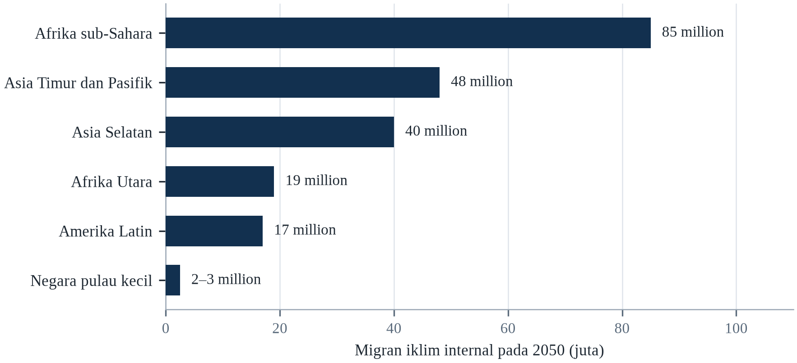||Sumber: Tabel 11.1; estimasi adalah perpindahan internal, bukan pengungsi lintas batas.

Ada dua konsekuensi di sini. Pertama, skala migrasi iklim besar tetapi dapat dikelola jika diperkirakan; bahayanya bukan jumlah orang melainkan ketiadaan sistem untuk menerima mereka. Kedua, sebagian besar migrasi bersifat internal, yang berarti tanggung jawabnya terutama ada pada pemerintah nasional dan kota, bukan pada lembaga internasional.

Pengurangan emisi yang cepat akan mengurangi jumlah orang yang terpaksa pindah, tetapi tidak menghilangkan perpindahan yang sudah terkunci oleh pemanasan yang telah terjadi. Ekspansi besar pembiayaan adaptasi akan memungkinkan lebih banyak orang bertahan di tempatnya. Dan pergeseran opini publik di negara penerima akan membuat jalur hukum lebih layak, yang akan mengurangi biaya manusia dari perpindahan bahkan jika jumlah orang yang pindah tidak berubah.

---

# Bab 12: Konflik, Keamanan dan Stabilitas

*Tema: iklim, konflik dan keamanan negara serta komunitas*

Cekungan Danau Chad pernah menjadi salah satu badan air pedalaman terbesar di Afrika. Pada 1960-an danau itu mencakup sekitar 25.000 kilometer persegi; hari ini sekitar sepersepuluh dari luas itu, setelah menyusut akibat berkurangnya curah hujan, meningkatnya irigasi, dan pertumbuhan penduduk. Air yang surut meninggalkan lanskap dasar danau yang kering, klaim yang bersaing atas wilayah tangkap dan padang rumput, serta populasi yang bergantung pada ekosistem yang tidak lagi mampu menopangnya. Wilayah itu kini menjadi rumah bagi salah satu pemberontakan paling lama di dunia dan sekitar 10,7 juta orang yang membutuhkan bantuan kemanusiaan.

Hubungan antara menyusutnya danau dan pemberontakan itu nyata tetapi tidak sederhana. Boko Haram tidak muncul karena danau mengering; ia muncul dari kombinasi marginalisasi politik, pengabaian ekonomi, radikalisasi agama, dan lembaga yang lemah. Yang dilakukan perubahan lingkungan adalah menghilangkan penghidupan yang mungkin menyediakan alternatif, mengungsi orang ke kamp tempat perekrutan lebih mudah, dan melemahkan ekonomi lokal yang mungkin menopang perlawanan. Perubahan iklim bertindak sebagai pengganda ancaman, bukan sebagai penyebab.

Pola yang sama muncul di wilayah lain. Kekeringan di Sahel memperkuat persaingan antara penggembala dan petani; kelangkaan air di cekungan Nil menaikkan ketegangan antara Mesir, Sudan, dan Ethiopia; lonjakan harga pangan mendahului kerusuhan di puluhan negara. Dalam setiap kasus, stres lingkungan berinteraksi dengan kondisi politik, ekonomi, dan sosial yang menentukan apakah hasilnya kerja sama, protes, atau kekerasan.

Bab ini membahas interaksi itu. Bab ini mengulas apa yang sebenarnya ditunjukkan penelitian tentang iklim dan konflik — literatur dengan klaim kuat dan perbedaan pendapat serius — lalu memeriksa jalur yang melaluinya stres lingkungan dapat berkontribusi pada kekerasan. Peran lembaga menjadi penentu, karena kekeringan yang sama dapat menghasilkan kelaparan di satu negara, protes di negara lain, dan tidak apa-apa di negara ketiga. Bab ini ditutup dengan pertanyaan tentang apa yang dapat dilakukan institusi keamanan, dan apa yang tidak dapat mereka lakukan.

Hubungan antara iklim dan konflik adalah salah satu pertanyaan paling diperdebatkan di bidang ini, dan perdebatannya produktif. Karya awal menemukan kaitan statistik kuat antara suhu dan kekerasan; karya berikutnya mempertanyakan mekanisme kausalnya, kepekaan hasil terhadap spesifikasi model, dan risiko menggeneralisasi dari satu konteks ke konteks lain. Konsensus saat ini lebih sempit dan lebih berguna: perubahan iklim adalah pengali risiko yang bekerja melalui penghidupan, harga, migrasi, dan kapasitas negara, dan efeknya bergantung pada institusi.

## 12.1 Apa yang Ditunjukkan Penelitian

Bidang ini menjadi kuantitatif ketika dua hal datang bersamaan: kumpulan data konflik sipil global dan rekonstruksi iklim berbasis grid yang dapat dipasangkan dengannya. Kombinasi itu memungkinkan peneliti menanyakan apakah tahun atau tempat yang luar biasa panas atau kering juga mengalami lebih banyak kekerasan, dan generasi pertama studi menjawab ya di banyak latar. Metodenya membawa kelemahan yang jelas, karena korelasi antara suhu dan konflik antarnegaran dapat dihasilkan oleh kemiskinan, institusi, atau geografi alih-alih panas, dan perdebatan sejak itu tentang cara memisahkan saluran-saluran itu. Literatur ini karena itu kurang merupakan temuan yang mapan dan lebih merupakan perdebatan panjang tentang identifikasi, dan kesimpulannya menyempit seiring membaiknya metode.

Hasil generasi pertama itu dirangkum dalam meta-analisis yang banyak dikutip oleh Hsiang, Burke dan Miguel (2013), yang kemudian diperluas Hsiang dan Burke (2014) menjadi sintesis yang lebih luas tentang konflik dan stabilitas sosial. Pengaruhnya besar dan perdebatannya sama besar. Kritikus, terutama Buhaug (2015), berargumen bahwa studi-studi itu menderita bias seleksi, bahwa mereka menggabungkan bentuk kekerasan yang sangat berbeda, dan bahwa ukuran efeknya kecil relatif terhadap faktor politik dan ekonomi. Karya berikutnya, termasuk tinjauan di Nature oleh Mach dkk. (2019), menyimpulkan bahwa iklim telah memengaruhi risiko konflik bersenjata di beberapa konteks tetapi bahwa buktinya paling kuat untuk kekerasan tingkat rendah dan paling lemah untuk perang sipil, serta bahwa keyakinan pada hubungan keseluruhan terbatas.

Perbedaan pendapatnya bukan tentang apakah iklim dapat berkontribusi pada konflik; melainkan tentang seberapa besar, di mana, dan dalam kondisi apa. Konsensus yang muncul adalah bahwa iklim adalah pengganda risiko, bukan penyebab independen. Ia bekerja pada masyarakat yang sudah rentan, melalui mekanisme yang bersifat politik dan ekonomi, bukan meteorologis, dan efeknya paling besar di tempat lembaga lemah dan penghidupan bergantung pada sumber daya sensitif iklim.

Tiga alur berjalan melalui literatur kuantitatif. Satu menemukan bahwa suhu lebih tinggi dan anomali curah hujan terkait dengan lebih banyak konflik pada skala besar, dengan Hsiang dkk. (2013) melaporkan bahwa kenaikan satu simpangan baku suhu menaikkan konflik antarkelompok sekitar 14 persen dan kekerasan interpersonal sekitar 4 persen. Alur kedua menemukan efeknya kecil, bersyarat, atau tidak ada setelah faktor politik dan ekonomi dikendalikan. Alur ketiga, termasuk Mach dkk. (2019), menyimpulkan bahwa pengaruhnya nyata tetapi moderat relatif terhadap pendorong lain.

Sebagian perselisihan antarkelompok itu adalah perselisihan tentang apa yang dihitung sebagai konflik. Kerusuhan, perang sipil, dan tingkat pembunuhan adalah fenomena berbeda yang diukur lembaga berbeda dengan ambang berbeda, dan koefisien yang ditaksir pada yang satu tidak dapat langsung dibandingkan dengan koefisien pada yang lain. Studi yang menggabungkannya menemukan efek lebih besar dan lebih konsisten daripada studi yang memisahkannya, yang menunjukkan sebagian pertentangan itu artefak agregasi. Implikasi praktisnya bagi siapa pun yang memakai literatur ini adalah menanyakan hasil apa yang diukur sebelum menanyakan sebesar apa efeknya.

Penelitian iklim dan konflik bergerak dalam tiga fase, dan fase ketiga yang paling berguna. Fase pertama bertanya apakah ada kaitan dan menemukan korelasi berserak yang mudah dibaca berlebihan. Fase kedua membangun basis data kekerasan subnasional dan cuaca berukuran besar dan menemukan asosiasi konsisten tetapi sedang: satu simpangan baku suhu atau curah hujan berkaitan dengan kenaikan kecil risiko kekerasan lokal, konflik komunal, dan kerusuhan, paling andal di tempat yang sudah miskin dan sudah tegang. Fase ketiga bertanya siapa yang terpengaruh, melalui mekanisme apa, dan dalam kondisi apa, dan fase inilah yang menghasilkan kebijakan yang dapat dipakai.

Riset tentang iklim dan konflik telah berpindah dari klaim bahwa iklim menyebabkan perang ke penjelasan yang lebih hati-hati tentang bagaimana iklim menggeser peluang. Meta-analisisnya menemukan asosiasi konsisten antara anomali suhu serta hujan dan insiden konflik pada tingkat lokal, dan asosiasi yang jauh lebih lemah pada tingkat perang saudara, yang punya banyak sebab. Mekanisme yang dikenali modelnya bersifat ekonomi, demografis, dan kelembagaan, dan kekuatan masing-masing bergantung pada negara yang terpapar. Kesimpulan yang didukung bidangnya, iklim bukan pengali ancaman dalam setiap kasus, melainkan dalam kasus ketika negaranya sudah lemah.

## 12.2 Jalur: Penghidupan, Harga dan Migrasi

Jalur pertama adalah ekonomi. Ketika kekeringan menghancurkan panen atau banjir menghancurkan pabrik, pendapatan turun dan pengangguran naik. Pemuda yang tidak dapat menemukan pekerjaan lebih mudah direkrut ke kelompok bersenjata; rumah tangga yang tidak dapat memberi makan diri sendiri lebih bersedia menerima perlindungan dari siapa pun yang menawarkannya. Efeknya tidak otomatis, tetapi merupakan salah satu temuan paling konsisten dalam literatur: guncangan pendapatan negatif meningkatkan risiko kekerasan.

Jalur kedua adalah harga pangan. Ketika harga naik, populasi kota memprotes, dan pemerintah yang merespons dengan represi dapat mengeskalasi protes menjadi konflik. Lonjakan harga pangan 2010–2011 bertepatan dengan kerusuhan di lebih dari tiga puluh negara dan dengan transisi politik Musim Semi Arab, meskipun hubungan kausalnya diperdebatkan dan berbeda menurut negara (FAO, 2023). Mekanismenya masuk akal dan terdokumentasi baik: pangan adalah pengeluaran terbesar rumah tangga miskin, dan kenaikan mendadak dapat membuat perbedaan antara bertahan dan runtuh.

Jalur ketiga adalah migrasi. Perpindahan orang dapat menciptakan ketegangan di wilayah penerima, terutama ketika cepat, ketika dianggap tidak adil, dan ketika negara tidak mampu menyediakan layanan. Tetapi migrasi juga dapat menjadi sumber ketangguhan, melalui remitansi dan tenaga kerja. Hasilnya bergantung pada kapasitas komunitas penerima dan lembaga untuk menyerap orang, itulah sebabnya arus masuk yang sama dapat menghasilkan integrasi di satu tempat dan konflik di tempat lain.

Jalurnya lebih mudah dijelaskan daripada diukur. Guncangan iklim mengurangi pendapatan pertanian, yang menurunkan biaya peluang bergabung dengan kelompok bersenjata; ia menaikkan harga pangan, yang dapat memicu protes dan kerusuhan; ia mengungsikan orang, yang dapat menciptakan persaingan di wilayah penerima; dan ia mengurangi pendapatan negara, yang melemahkan kapasitas merespons. Setiap jalur masuk akal, dan setiap jalur dimediasi institusi, itulah sebabnya kekeringan yang sama dapat menghasilkan kerusuhan di satu negara dan tidak di negara lain.

Jalurnya melalui penghidupan, harga, dan perpindahan, dan masing-masing punya tanda yang teramati. Kekeringan mengurangi pendapatan pertanian, yang mengurangi biaya peluang bergabung dengan kelompok bersenjata dan menaikkan persaingan atas air serta padang. Harga pangan yang lebih tinggi dapat memicu kerusuhan kota, seperti yang diperlihatkan episode 2007–2008 dan 2010–2011 di beberapa benua (FAO, 2023). Pengungsian dapat membanjiri layanan dan struktur sosial kawasan penerima dan menghasilkan ketegangan antara tuan rumah dan pendatang. Tidak satu pun jalur ini deterministik: kekeringan yang sama menghasilkan migrasi di satu tempat dan konflik di tempat lain.

Riset tentang iklim dan konflik mengenali tiga jalur, dan kekuatan masing-masing bergantung pada konteksnya. Pertama ekonomi: guncangan suhu atau hujan menurunkan pendapatan pertanian, menurunkan biaya peluang kekerasan, dan menaikkan insentif bergabung dengan kelompok bersenjata. Kedua migrasi: perpindahan orang ke wilayah yang sudah diperebutkan menciptakan gesekan atas tanah, air, dan representasi politik. Ketiga kelembagaan: negara yang dilemahkan bencana kehilangan kapasitas menengahi dua yang pertama. Bukti statistiknya paling kuat untuk jalur pertama pada tingkat lokal, dan paling lemah untuk klaim bahwa iklim adalah penyebab utama perang tertentu.

## 12.3 Sahel dan Cekungan Danau Chad

Sahel adalah wilayah di mana hubungan iklim-konflik paling sering disebut dan paling sulit dipisahkan. Curah hujan menurun sejak 1970-an, meskipun telah pulih sebagian di beberapa daerah; suhu naik lebih cepat daripada rata-rata global; dan populasi tumbuh pesat. Pastoralis dan petani bersaing atas tanah dan air, dan negara lemah di sebagian besar wilayah itu.

Konflik di Mali, Burkina Faso, dan Niger telah menewaskan ribuan orang dan mengungsi jutaan. Penyebabnya politik dan militer sama besarnya dengan lingkungan: runtuhnya negara Libya pada 2011 membanjiri wilayah itu dengan senjata; kelompok jihadis memanfaatkan keluhan lokal; dan pemerintah merespons dengan strategi yang mengasingkan populasi pedesaan. Stres iklim berkontribusi dengan melemahkan penghidupan dan mempersulit negara menyediakan layanan, tetapi tidak menciptakan konflik itu sendiri.

Cekungan Danau Chad mengulang polanya dengan mekanisme berbeda. Penyusutan danau didorong berkurangnya curah hujan, meningkatnya irigasi, dan pertumbuhan penduduk, dan telah menghancurkan penghidupan perikanan serta pertanian di empat negara. Kemiskinan dan pengungsian yang dihasilkan menciptakan cadangan rekrutan bagi Boko Haram dan turunannya, dan respons militer telah mengungsi jutaan orang lagi. Pelajarannya bukan bahwa danau menyebabkan pemberontakan; melainkan bahwa perubahan lingkungan dapat menciptakan kondisi di mana pemberontakan menjadi mungkin.

Cekungan Danau Chad adalah kasus paling banyak dikutip, dan ia lebih rumit daripada ringkasannya. Danau itu menyusut dari sekitar 25.000 kilometer persegi pada 1960-an menjadi beberapa ribu pada titik terendahnya, tetapi penyusutannya didorong pengambilan air di hulu dan kekeringan regional sekaligus, dan ia memengaruhi wilayah yang sudah miskin, lemah tata kelolanya, dan diperebutkan. Pemberontakan Boko Haram memanfaatkan hilangnya penghidupan yang dihasilkan, tetapi ia juga memiliki pendorong ideologis dan politik sendiri yang tidak dapat dijelaskan akun lingkungan mana pun.

Cekungan Danau Chad menggambarkan bagaimana perubahan lingkungan yang lambat menjadi masalah keamanan melalui penghidupan, bukan melalui kelangkaan semata. Danau itu menyusut dramatis sejak 1960-an, dan kawasan sekitarnya mengalami kemunculan Boko Haram serta perpindahan jutaan orang. Rantai kausalnya diperdebatkan: penyusutan sebagian bersifat iklim dan sebagian akibat irigasi di hulu, dan pemberontakan punya akar politik serta ideologis sendiri. Yang tidak diperdebatkan adalah hilangnya penghidupan nelayan dan petani mencabut basis ekonomi yang menopang populasi padat, dan bahwa pemuda tanpa prospek lebih mudah direkrut.

Cekungan Danau Chad sering dikutip sebagai kasus iklim-konflik dan kutipannya biasanya terlalu disederhanakan. Danau itu menyusut dramatis sejak 1960-an, dan penyusutannya nyata, tetapi digerakkan oleh pengambilan irigasi dan variabilitas hujan sama besarnya dengan pemanasan, dan penduduk cekungan tumbuh beberapa kali lipat pada periode yang sama. Pemberontakan yang menghancurkan kawasan itu muncul dalam konteks tata kelola lemah, pinggiran yang terpinggirkan, dan respons keamanan yang mengasingkan warga. Perubahan iklim hadir dalam cerita sebagai tekanan pada penghidupan dan pendorong pengungsian, bukan sebagai penyebab perang.

Cekungan Danau Chad adalah kasus yang paling baik menunjukkan bagaimana tekanan iklim, tekanan demografi, dan pemberontakan dapat saling menguatkan tanpa satu pun menjadi penyebabnya. Danau itu menyusut drastis sejak 1960-an, dan penyusutannya sebagian iklim dan sebagian akibat air yang dialihkan untuk irigasi di hulu. Penduduk di sekitarnya bertambah, padangnya menyempit, dan penghidupan perikanan serta pertanian yang bergantung pada danau menjadi lebih rapuh. Pemberontakan yang muncul memanfaatkan keluhan yang dihasilkan, dan respons militernya memindahkan penduduk yang ditopang danau, yang melengkapi lingkarannya.

## 12.4 Suriah dan Politik Atribusi

Konflik Suriah sering disebut sebagai perang iklim pertama. Antara 2006 dan 2010, kekeringan parah melanda wilayah pertanian timur laut negara itu, menghancurkan tanaman dan ternak serta mendorong hingga 1,5 juta orang menuju kota. Kekeringan itu terburuk dalam rekaman instrumental, dan studi menemukan bahwa perubahan iklim membuatnya lebih mungkin terjadi.

Rantai kausal dari kekeringan ke perang diperdebatkan. Sebagian analisis berargumen bahwa kekeringan, digabungkan dengan kegagalan pemerintah Assad mengelola air dan pertanian, menciptakan krisis pedesaan yang memicu pemberontakan. Yang lain, terutama Selby dkk. (2017), berargumen bahwa kekeringan adalah satu faktor di antara banyak, bahwa migrasinya tidak sebesar atau secepat yang kadang diklaim, dan bahwa respons represif rezim terhadap protes damai adalah penyebab langsung perang. Pandangan kedua tidak menyangkal peran iklim; ia menuntut penjelasan yang lebih cermat tentang bagaimana peran itu beroperasi.

Kasus Suriah menggambarkan masalah umum dalam penelitian iklim-konflik: godaan untuk menceritakan kisah sederhana yang menghubungkan peristiwa cuaca dengan perang. Kisah itu berguna secara politik karena mendramatisasi taruhannya, dan berbahaya secara analitis karena mengaburkan keputusan politik yang mengubah kerentanan menjadi kekerasan. Pemerintah yang merespons kekeringan dengan redistribusi dan bantuan mungkin menghadapi protes; pemerintah yang merespons dengan represi mungkin menghadapi perang.

Suriah adalah kasus yang atribusinya paling diperdebatkan. Kekeringan 2006–2010 adalah yang terburuk dalam catatan instrumental, dan ia mengungsikan sekitar 1,5 juta orang dari daerah pedesaan ke kota. Kelley dkk. (2015) berargumen bahwa kekeringan itu menjadi lebih mungkin karena perubahan iklim dan berkontribusi pada konflik; Selby dkk. (2017) berargumen bahwa peran kekeringan dilebih-lebihkan dan ekonomi politik menjelaskan lebih banyak. Keduanya sepakat bahwa kekeringan berinteraksi dengan keluhan dan institusi lemah, yang merupakan posisi yang dapat dipertahankan.

Kasus Suriah begitu sering dikutip sehingga perlu dinyatakan secara tepat apa yang didukung bukti dan apa yang tidak. Kelley dan rekan-rekannya memakai model iklim dan catatan curah hujan untuk berargumen bahwa kekeringan 2006–2010 menjadi dua sampai tiga kali lebih mungkin karena pemanasan, dan bahwa gagal panen serta perpindahan pedesaan yang dihasilkannya menyumbang pada kondisi yang menghasilkan pemberontakan 2011. Selby dan rekan-rekannya menjawab bahwa dampak kekeringan sangat bervariasi menurut daerah dan praktik pertanian, dan bahwa kebijakan air serta tanah rezim sendiri yang menentukan siapa yang hancur. Kedua pihak sepakat iklim adalah stresor; mereka berselisih tentang bobotnya.

Suriah adalah kasus tempat atribusi paling diperdebatkan, dan perdebatannya mendidik. Kekeringan parah beberapa tahun antara 2006 dan 2010 memindahkan banyak keluarga petani ke kota yang sudah tertekan oleh pengungsi Irak. Studi menemukan perubahan iklim membuat kekeringan itu lebih mungkin, dan sebagian berargumen kekeringan menyumbang pada keresahan yang menjadi perang sipil. Kesimpulan yang hati-hati: kekeringan adalah satu tekanan di antara beberapa, salah urus air dan pertanian oleh rezim bersifat menentukan, dan tidak ada analis serius yang mengaitkan perang pada iklim semata.

## 12.5 Sengketa Air dan Kerja Sama

Air adalah sumber daya yang paling sering dikaitkan dengan konflik iklim, dan catatannya lebih banyak kerja sama daripada yang disarankan berita. Kronologi Konflik Air Pacific Institute mencatat ribuan insiden terkait air, sebagian besar lokal, dan jauh lebih banyak perjanjian daripada perang. Perjanjian Air Indus bertahan melewati tiga perang antara India dan Pakistan; Inisiatif Cekungan Nil menjaga dialog tetap hidup di antara sepuluh negara dengan klaim yang bersaing; dan Organisasi Sungai Senegal telah mengelola cekungan bersama selama beberapa dekade.

Itu tidak berarti air bukan sumber ketegangan. Bendungan Grand Ethiopian Renaissance di Nil Biru telah menjadi subjek satu dekade negosiasi antara Mesir, Sudan, dan Ethiopia, dan sengketanya belum terselesaikan. Mesir bergantung pada Nil untuk hampir seluruh air tawarnya dan memperlakukan sungai itu sebagai sumber daya eksistensial; Ethiopia berargumen bahwa ia berhak mengembangkan pembangkit listriknya sendiri. Sengketa itu belum menjadi perang, tetapi telah membentuk politik regional dan menunda kerja sama pada isu lain.

Faktor yang menentukan apakah sengketa air meningkat adalah politik, bukan hidrologis. Negara yang memiliki lembaga untuk berbagi informasi, mekanisme penyelesaian sengketa, dan sejarah kerja sama lebih mungkin mengelola kelangkaan tanpa kekerasan. Negara yang tidak memilikinya, atau yang sudah bermusuhan, lebih mungkin memperlakukan air sebagai sumber daya zero-sum. Pelajarannya adalah perjanjian air adalah bentuk adaptasi, dan erosi perjanjian itu adalah risiko keamanan.

Sengketa air antarnegar lebih sering dikelola daripada diperangi. Perjanjian Air Indus bertahan melalui tiga perang antara India dan Pakistan; Inisiatif Cekungan Nil menjaga dialog tetap hidup meski ada sengketa Bendungan Grand Ethiopian Renaissance; dan mekanisme Kerja Sama Mekong telah menciptakan saluran berbagi data. Rekam jejaknya menunjukkan bahwa perjanjian, bahkan yang tidak sempurna, mengurangi risiko kekerasan dengan menciptakan harapan dan prosedur penyelesaian sengketa.

Sengketa air lebih sering dikelola daripada diselesaikan, dan catatan sejarahnya lebih kooperatif daripada yang disiratkan berita. Sengketa Nil antara Mesir, Sudan dan Etiopia atas Bendungan Grand Ethiopian Renaissance telah menghasilkan satu dekade negosiasi tanpa kesepakatan, dan belum menghasilkan perang. Riset atas perjanjian air internasional menemukan bahwa cekungan bersama menghasilkan jauh lebih banyak kesepakatan kerja sama daripada konflik kekerasan, dan bahwa kekerasan yang terjadi biasanya di dalam negara alih-alih antarnegarai. Bahayanya bukan perang air melainkan kegagalan menyesuaikan aturan alokasi dengan pasokan yang berubah.

Sengketa air lebih sering dikelola daripada diselesaikan, dan catatannya lebih menggembirakan daripada beritanya. Ribuan perjanjian dan kesepakatan cekungan mengatur sungai bersama, dan konflik kekerasan karena air jarang dibandingkan frekuensi negosiasi, bahkan antara tetangga yang bermusuhan. Yang berulang adalah pola ketika pembangunan di hulu dianggap ancaman di hilir, dan sengketanya menjadi pengganti ketegangan politik yang lebih luas. Nil, Indus, dan Colorado menunjukkan versi masalah yang sama: alokasi yang ditetapkan pada masa yang tidak lagi cocok dengan iklimnya.

Sengketa air antarnagara lebih sering diselesaikan daripada diperangi, dan mekanisme yang menyelesaikannya biasanya komisi sungai dengan mandat berbagi data. Nil, Mekong, dan Indus masing-masing punya komisi, dan masing-masing diuji proyek sepihak di hulu yang dianggap negara hilir sebagai pelanggaran. Komisi yang bertahan adalah yang menggabungkan alokasi hukum dengan proses teknis pemantauan debit, karena kepercayaan yang dibutuhkan alokasi dibangun pengukuran bersama alih-alih teks perjanjian. Cekungan tanpa komisi adalah yang risikonya paling tinggi.

## 12.6 Perikanan, Batas Laut dan Arktik

Perubahan iklim membuka wilayah laut baru dan menciptakan sengketa baru. Seiring mundurnya es laut Arktik, jalur pelayaran, wilayah tangkap, dan cadangan hidrokarbon menjadi dapat diakses, dan negara-negara yang berbatasan dengan Arktik memiliki klaim yang bersaing atas landas kontinen. Dewan Arktik telah menyediakan forum kerja sama, tetapi penarikan sebagian anggotanya setelah perang di Ukraina telah melemahkannya.

Di tropis, pemanasan menggerakkan stok ikan ke air yang lebih dingin dan melintasi batas maritim. Negara yang armadanya secara historis menangkap ikan di perairannya sendiri mungkin mendapati bahwa stoknya telah berpindah ke perairan tetangga, yang menciptakan sengketa akses dan penegakan. Ketegangan yang dihasilkan jarang kekerasan, tetapi dapat meningkat, terutama ketika perikanan adalah sumber pekerjaan utama dan kapasitas penegakan lemah.

Perikanan juga menggambarkan peran lembaga internasional. Organisasi pengelolaan perikanan regional menetapkan kuota dan mengalokasikan akses, dan efektivitasnya bergantung pada kemauan negara untuk mematuhi. Perubahan iklim mempersulit tugas mereka karena stok yang mereka kelola bergerak, dan karena nasihat ilmiah yang menjadi landasan mereka tidak pasti. Hasilnya adalah celah tata kelola yang diisi oleh tindakan sepihak, yang justru merupakan hasil yang seharusnya dicegah oleh lembaga.

Arktik menggambarkan bagaimana perubahan iklim dapat menciptakan persaingan strategis baru bahkan tanpa kelangkaan sumber daya langsung. Es laut yang menyusut membuka jalur pelayaran, menyingkap perikanan dan cadangan hidrokarbon, dan mengubah geografi militer wilayah itu. Negara Arktik telah menegosiasikan kesepakatan tentang pencarian dan penyelamatan serta perikanan, tetapi persaingan pengaruh yang mendasarinya menguat, dan pengucilan sebagian negara dari Dewan Arktik setelah 2022 mengurangi forum yang tersedia untuk mengelolanya.

Sengketa perikanan adalah contoh paling jelas perubahan iklim yang menggeser sumber daya melintasi batas hukum. Stok ikan bergerak ke arah kutub seiring menghangatnya perairan, dan pergerakannya melintasi zona ekonomi eksklusif yang ditetapkan perjanjian puluhan tahun lalu. Sengketa makarel antara Islandia, Norwegia dan Uni Eropa, serta 'perang makarel' yang menyusul, menunjukkan bagaimana stok yang bergeser dapat menghasilkan konflik diplomatik di antara negara yang sebelumnya berbagi pengaturan stabil. Arktik adalah kasus garis depan: ketika es laut menyusut, wilayah tangkap dan jalur pelayaran baru terbuka di perairan yang status hukumnya diperdebatkan.

Arktik adalah tempat perubahan iklim paling cepat mengubah peta, dan pengubahan itu membawa akibat keamanan. Es laut yang menyusut membuka jalur pelayaran yang memperpendek jarak Asia-Eropa, mengekspos wilayah tangkap yang sebelumnya tak terjangkau, dan membuat endapan hidrokarbon dapat diakses. Ia juga menghapus es yang melindungi garis pantai dan platform tempat komunitas adat berburu. Negara-negara mengajukan klaim bertumpang tindih atas landas kontinen menurut hukum laut, dan Dewan Arktik tetap berfungsi sebagai forum teknis ketika hubungan yang lebih luas memburuk.

Batas maritim digambar untuk dunia ketika ikan tinggal di tempatnya, dan ikannya bergerak. Hukum Laut memberi setiap negara pesisir zona hingga dua ratus mil laut, dan stok yang bermigrasi melintasi garis itu dikelola badan regional yang dirancang mengikuti sebaran historis. Ketika stok bergeser, alokasinya menjadi sengketa tentang siapa berhak atas sumber daya yang pindah ke perairannya, dan sengketanya sulit karena sainsnya diperdebatkan dan kepentingan ekonominya besar. Arktik adalah kasus ekstremnya, ketika mundurnya es membuka samudra baru dan negara di sekitarnya menegaskan hak yang belum diselesaikan hukum.

## 12.7 Kapasitas Negara dan Kerapuhan

Variabel terpenting dalam hubungan iklim-konflik adalah kapasitas negara. Negara yang dapat memberikan bantuan, menjaga ketertiban, dan menyediakan layanan selama guncangan dapat mencegah spiral dari kekeringan ke kelaparan ke kekerasan. Negara yang tidak dapat — karena miskin, korup, tidak sah, atau sudah berperang — adalah tempat spiral paling mungkin terjadi.

Negara rapuh juga paling terpapar perubahan iklim. Mereka cenderung bergantung pada pertanian, memiliki infrastruktur lemah, dan kekurangan kapasitas fiskal untuk merespons bencana. Kombinasinya menciptakan lingkaran umpan balik: guncangan iklim melemahkan negara, dan negara yang melemah kurang mampu merespons guncangan berikutnya. Hasilnya adalah perubahan iklim dapat berkontribusi pada kegagalan negara, dan kegagalan negara dapat membuat dampak iklim jauh lebih buruk.

Implikasi kebijakannya adalah adaptasi iklim dan pembangunan perdamaian merupakan proyek yang sama di negara rapuh. Membangun irigasi, memulihkan padang rumput, dan menyediakan perlindungan sosial adalah tindakan adaptasi, tetapi juga tindakan pencegahan konflik, karena mereka mengurangi persaingan atas sumber daya yang memicu kekerasan. Sebaliknya juga benar: perjanjian perdamaian yang tidak menangani akses ke tanah dan air tidak mungkin bertahan.

Negara dengan institusi efektif dapat menyerap kekeringan dengan mengimpor pangan, memperluas perlindungan sosial, dan mengelola distribusi; negara dengan institusi lemah tidak dapat. Guncangan iklim yang sama yang menghasilkan lonjakan harga dan protes di satu negara menghasilkan krisis kemanusiaan dan rekrutmen bersenjata di negara lain, dan perbedaannya adalah tata kelola alih-alih meteorologi.

Kapasitas negara adalah variabel yang menentukan apakah tekanan iklim menjadi konflik. Pemerintah yang dapat mengirim pangan, mengadili sengketa tanah, membayar tentara dan polisi, serta merespons bencana dapat menyerap guncangan yang akan melumpuhkan negara lemah. Riset tentang kerapuhan menemukan bahwa kombinasi paparan iklim tinggi dan kapasitas tata kelola rendah terkait dengan risiko ketidakstabilan tertinggi, dan kaitannya paling kuat di tempat penghidupan bergantung pada pertanian tadah hujan. Implikasi kebijakannya adalah adaptasi iklim di negara rapuh merupakan pembangunan negara dengan nama lain, dan itulah sebab ia sulit dibiayai dan sulit dievaluasi.

Kapasitas negara adalah variabel yang menjelaskan sebagian besar variasi hasil. Negara yang dapat mengirim peringatan, mengevakuasi pesisir, membayar kompensasi, dan membangun ulang telah mengubah bahaya menjadi ketidaknyamanan; negara yang tidak dapat telah mengubahnya menjadi darurat kemanusiaan dan kadang konflik. Kapasitas bukan sama dengan kekayaan, meski kekayaan membantu; ia gabungan kompetensi administratif, legitimasi, dan basis fiskal. Negara tempat iklim dan konflik paling bertumpuk biasanya yang punya sejarah panjang ketegangan pusat-pinggiran, tempat negara dialami sebagai kehadiran yang mengekstraksi, bukan melindungi.

Kapasitas negara adalah variabel yang menentukan apakah guncangan iklim menjadi krisis keamanan, dan ia diukur dengan cara yang tidak menarik. Negara yang dapat memungut pajak, membayar pegawai negeri, memelihara jalan, dan menyalurkan vaksin punya mesin untuk menyalurkan bantuan, dan negara yang tidak dapat melakukan hal pertama tidak akan melakukan yang terakhir. Kerapuhan bukan biner: banyak negara dapat merespons di ibu kota dan tidak dapat menjangkau provinsi, itulah sebabnya bencana dapat terkelola di kota dan katastrofik di desa. Sistem internasional cenderung menggantikan negara alih-alih membangunnya, yang lebih cepat dalam jangka pendek dan merugikan diri sendiri dalam jangka panjang.

## 12.8 Institusi Keamanan dan Risiko Iklim

Institusi militer dan intelijen mulai memperlakukan perubahan iklim sebagai isu keamanan. Departemen Pertahanan Amerika Serikat menggambarkan perubahan iklim sebagai pengganda ancaman yang akan meningkatkan permintaan misi militer, merusak instalasi, dan mengguncang kawasan. NATO telah memasukkan pertimbangan iklim ke dalam perencanaannya, dan beberapa negara telah menunjuk penasihat keamanan iklim.

Peran militer kontroversial. Sebagian berargumen bahwa membingkai iklim sebagai ancaman keamanan memiliterisasi masalah yang memerlukan pembangunan dan diplomasi; yang lain berargumen bahwa militer adalah salah satu dari sedikit institusi dengan kapasitas logistik untuk merespons bencana dan bahwa asumsi perencanaannya membentuk cara pemerintah memahami risiko. Keseimbangannya bergantung pada negara dan pada apakah institusi keamanan bertanggung jawab kepada otoritas sipil.

Kontribusi paling berguna yang dapat diberikan institusi keamanan sering bersifat analitis dan logistik, bukan kinetik. Sistem peringatan dini, perencanaan skenario, kapasitas respons bencana, dan perlindungan infrastruktur kritis semuanya berada dalam lingkup institusi keamanan dan semuanya berkontribusi pada ketangguhan. Risikonya adalah pembingkaian keamanan menggeser respons pembangunan dan tata kelola yang menangani akar kerentanan.

Institusi keamanan mulai memperlakukan perubahan iklim sebagai pengali ancaman, dan pembingkaian mereka memiliki konsekuensi. Departemen Pertahanan Amerika Serikat menyebut perubahan iklim sebagai risiko bagi instalasi dan operasi; NATO memesan penilaian risiko iklim terhadap misi; dan beberapa badan intelijen nasional memasukkan iklim dalam prakiraan strategisnya. Risikonya adalah pembingkaian keamanan memprioritaskan kontrol perbatasan atas perlindungan, dan memiliterisasi masalah yang solusinya sebagian besar sipil.

Institusi keamanan mulai memperlakukan iklim sebagai asumsi perencanaan alih-alih topik advokasi, dan pergeserannya terlihat dalam dokumen. Departemen Pertahanan Amerika Serikat menggambarkan perubahan iklim sebagai pengganda ancaman dalam tinjauan empat tahunannya sejak 2010, dan NATO telah menambahkan risiko iklim ke dalam konsep strategisnya. Alasannya institusional: pangkalan terendam, jalur pasok terganggu, dan bencana kemanusiaan menimbulkan permintaan logistik militer. Risiko tren ini adalah membingkai iklim sebagai isu keamanan dapat membenarkan respons yang tersekuritisasi — perbatasan, pengawasan, pembentengan — alih-alih investasi pembangunan yang menangani kerentanan dasarnya.

Institusi keamanan mulai memperlakukan iklim sebagai asumsi perencanaan, bukan isu lingkungan. Kementerian pertahanan memetakan instalasi mana yang terpapar banjir dan panas, operasi mana yang terpengaruh kelangkaan air, dan kawasan mana yang mungkin memerlukan dukungan kemanusiaan. Pembingkaiannya diperdebatkan, karena bingkai keamanan dapat membenarkan belanja perbatasan alih-alih adaptasi, dan karena ia dapat mengamankan isu migrasi dengan cara yang merugikan orang yang katanya dilindungi. Versi argumen yang lebih dapat dipertahankan lebih sempit: perubahan iklim menaikkan permintaan respons bencana, penjaga perdamaian, dan logistik kemanusiaan.

Institusi keamanan menjadi institusi iklim entah mandatnya menyebutkan atau tidak, karena merekalah yang dipanggil ketika bencana melampaui kapasitas otoritas sipil. Militer mengevakuasi, mengangkut, membangun jembatan, dan memulihkan ketertiban, dan melakukannya dengan peralatan yang dibeli untuk tujuan lain. Risiko peran itu adalah perluasan misi dan sekuritisasi masalah kemanusiaan; manfaatnya adalah satu-satunya organisasi dengan logistik untuk mencapai lembah terputus sering kali angkatan bersenjata. Reformasi yang membuat peran itu berguna adalah yang membosankan: latihan bersama dengan lembaga sipil dan pembagian tanggung jawab yang jelas.

## 12.9 Pangan, Harga dan Ketidakstabilan Politik

Hubungan antara harga pangan dan ketidakstabilan politik adalah salah satu yang paling terdokumentasi dalam ilmu sosial. Lonjakan harga 2007–2008 diikuti kerusuhan di lebih dari tiga puluh negara, dan lonjakan 2010–2011 bertepatan dengan Musim Semi Arab. Mekanismenya langsung: ketika harga pangan pokok naik melampaui kemampuan rumah tangga, hasilnya adalah kelaparan, kemarahan, dan sering protes.

Efeknya tidak deterministik. Sebagian negara dengan harga pangan tinggi tidak mengalami kerusuhan, dan sebagian kerusuhan terjadi di negara dengan harga relatif rendah. Perbedaannya dijelaskan oleh adanya keluhan lain, kapasitas negara untuk merespons, dan kemauan aparat keamanan untuk menindak. Harga pangan adalah pemicu, bukan penyebab; ia menyalakan konflik yang sudah membara.

Perubahan iklim membuat pemicunya lebih mungkin dengan meningkatkan frekuensi kegagalan panen dan volatilitas harga. Ia juga membuat responsnya lebih sulit, karena pemerintah yang sudah tertekan secara fiskal mungkin tidak mampu mensubsidi pangan atau memberikan bantuan. Hasilnya adalah guncangan harga yang sama dapat diserap di satu negara dan menghasilkan krisis di negara lain.

Mekanisme yang mengubah gagal panen menjadi lonjakan harga global berjalan melalui kebijakan, bukan cuaca. Ketika eksportir besar membatasi atau melarang ekspor untuk melindungi konsumennya sendiri, importir kehilangan pasokan dan menawar apa yang tersisa, dan pembatasan yang diambil tiap pemerintah secara defensif sendirian menghasilkan hasil kolektif yang tidak diinginkan siapa pun. Episode 2007 dan 2008 mengikuti pola itu dengan rapat, dan pelajaran yang diambil lembaga-lembaganya adalah bahwa pemantauan harga dan kebijakan perdagangan berada di sistem peringatan dini yang sama dengan prakiraan hujan dan hasil panen.

Aceh adalah contoh tandingan yang menjaga literatur iklim-konflik tetap jujur. Provinsi itu mengalami pemberontakan tiga puluh tahun, tsunami 2004 yang menghancurkan, dan perjanjian damai pada 2005, dan rekonstruksi yang menyusul termasuk upaya pascabencana terbesar yang pernah dijalankan. Perdamaiannya bertahan karena tsunami menciptakan peluang politik yang dipakai para pihak, dan karena rekonstruksinya memberikan manfaat yang terlihat kepada mantan kombatan dan warga sipil. Pelajarannya bukan bahwa bencana membangun perdamaian — biasanya tidak — melainkan bahwa bencana dapat menciptakan jendela ketika penyelesaian politik menjadi mungkin, dan jendela itu menutup cepat.

Alasan harga pangan diperlakukan sebagai variabel keamanan dan bukan kesejahteraan adalah transmisinya cepat dan penduduk terdampaknya terkonsentrasi. Sembako yang harganya berlipat menular ke anggaran rumah tangga dalam hitungan hari, dan rumah tangga kota yang membelanjakan separuh pendapatannya untuk pangan tidak punya penyangga, itulah sebabnya akibat politiknya tiba sebelum akibat gizinya terlihat di survei mana pun. Negara dengan perlindungan sosial yang berfungsi dapat mengubah guncangan harga menjadi beban anggaran; negara tanpanya mengubah guncangan yang sama menjadi guncangan politik. Itulah saluran yang mengubah kekeringan di satu belahan menjadi kerusuhan di belahan lain, dan itulah sebabnya kebijakan pangan dan kebijakan fiskal adalah percakapan yang sama.

Harga pangan termasuk prediktor kerusuhan kota yang paling andal, dan mekanismenya cukup sederhana sehingga terasa tidak nyaman. Rumah tangga yang membelanjakan separuh penghasilannya untuk pangan tidak punya penyangga ketika harganya berlipat, dan kemarahan yang menyusul diarahkan pada pemerintah yang tampak tidak mampu bertindak. Lonjakan harga 2008, 2011, dan 2022 masing-masing diikuti protes di puluhan negara, dan korelasinya tidak membuktikan harga sebagai satu-satunya sebab. Ia menyarankan bahwa pemerintah yang mengelola harga roti sedang mengelola bentuk risiko politik, dan pengelolaannya lebih murah daripada respons terhadap kerusuhan.

## 12.10 Pencegahan, Peringatan Dini dan Pembangunan Perdamaian

Pencegahan konflik lebih murah daripada respons konflik, dan adaptasi iklim dapat menjadi bentuk pencegahan. Sistem peringatan dini yang mengidentifikasi wilayah berisiko kekeringan atau banjir dapat memicu bantuan sebelum orang terpaksa bermigrasi atau bersaing atas sumber daya. Mekanisme dialog yang mempertemukan penggembala dan petani dapat menyelesaikan sengketa sebelum menjadi kekerasan. Reformasi tanah yang memperjelas kepemilikan dapat mengurangi ketidakpastian yang memicu konflik.

Bukti untuk intervensi ini beragam tetapi menggembirakan. Proyek keamanan iklim Program Pembangunan PBB di Sahel telah mendukung mediasi lokal dan peringatan dini, dan beberapa evaluasi melaporkan penurunan konflik. Tantangannya adalah skala: intervensinya kecil relatif terhadap besarnya masalah, dan bergantung pada lembaga lokal yang sering lemah.

Pelajaran terdalamnya adalah keamanan iklim bukan terutama masalah militer. Ia masalah pembangunan, tata kelola, dan keadilan. Negara yang paling rentan terhadap konflik akibat iklim adalah negara di mana orang kekurangan akses aman ke tanah, air, dan pangan, dan di mana negara tidak mampu atau tidak mau menyediakannya. Menangani kondisi itu adalah kebijakan keamanan paling efektif yang tersedia, dan juga yang paling diabaikan.

Pencegahan lebih murah daripada respons, dan buktinya terkuat untuk pendekatan yang menangani penghidupan serta tata kelola alih-alih yang berfokus pada keamanan. Karya Program Pembangunan Perserikatan Bangsa-Bangsa di Sahel menggabungkan infrastruktur air, koridor pastoral, dan penyelesaian sengketa lokal, dan evaluasinya melaporkan berkurangnya konflik di wilayah yang ditangani. Sistem peringatan dini yang menghubungkan prakiraan hujan dengan risiko konflik dapat memicu tindakan pencegahan, tetapi hanya jika kemauan politik untuk bertindak ada sebelum kekerasan dimulai.

Pencegahan dan pembangunan perdamaian adalah bagian agenda iklim-keamanan dengan bukti terlemah dan potensi tertinggi. Sistem peringatan dini untuk harga pangan dan konflik pastoral telah diuji di Tanduk Afrika dan Sahel, dan evaluasi menunjukkan sistem itu dapat memperpendek waktu respons ketika institusi lokal dilibatkan dalam merancangnya. Kerja pembangunan perdamaian lingkungan UNEP telah memediasi sengketa lahan penggembalaan dan titik air, dengan keberhasilan moderat tetapi nyata. Temuan umumnya adalah intervensi yang bekerja adalah yang memperkuat institusi lokal yang sudah ada, bukan yang menciptakan mekanisme internasional baru.

Pencegahan lebih murah daripada respons dan lebih sulit dibiayai, karena ia tidak menghasilkan apa pun yang terlihat. Tindakan yang menurunkan risiko konflik sama dengan yang membangun kapasitas adaptif: kepastian tenurial, pemerintah lokal yang berfungsi, infrastruktur air, perlindungan sosial yang tidak mengecualikan pemuda, dan sistem peradilan yang menyelesaikan sengketa padang serta air sebelum menjadi kekerasan. Sistem peringatan dini yang menggabungkan hujan, vegetasi, harga, dan laporan warga dapat mengantisipasi saat kekeringan berubah menjadi krisis.

Pencegahan adalah bagian agenda iklim-keamanan dengan bukti terbaik dan pendanaan paling sedikit, karena bekerja melalui institusi yang lambat dan tidak fotogenik. Sistem peringatan dini yang dibagi lintas batas membangun kepercayaan antara pihak yang berbagi sungai, dan pertukaran data sering menjadi kerja sama teknis pertama antara tetangga yang bermusuhan. Program yang dirancang dengan analisis konflik menghindari kesalahan memperkuat elite yang menangkap bantuannya. Perdamaian dan adaptasi iklim biasanya dibiayai dari anggaran berbeda dan dijalankan lembaga berbeda, dan tempat yang membutuhkan keduanya adalah tempat yang tidak dikoordinasikan.

Implikasi literatur konflik bagi kebijakan lebih sempit daripada yang kadang diklaim penulisnya. Jika iklim bertindak sebagai pengganda risiko yang paling berpengaruh di tempat yang lembaganya rapuh, maka intervensi yang efektif bersifat kelembagaan, bukan iklim: otoritas air yang berfungsi, mekanisme sengketa yang dipercaya petani, dana stabilisasi harga, dan layanan kepolisian yang menanggapi keluhan sebelum ia terorganisasi. Itu bukan kebijakan iklim, dan itulah yang didukung bukti. Implikasinya tidak nyaman bagi bidang yang lebih suka merekomendasikan mitigasi, dan ia adalah pembacaan jujur atas dua dekade kerja kuantitatif: sinyal iklimnya nyata, sederhana, dan dimediasi pengaturan yang tidak ada hubungannya dengan cuaca.

## 12.11 Studi Kasus: Cekungan Danau Chad

Danau Chad terletak di persimpangan Chad, Niger, Nigeria, dan Kamerun, dan telah menopang permukiman manusia selama ribuan tahun. Pada 1960-an danau itu mencakup sekitar 25.000 kilometer persegi, menjadikannya salah satu danau terbesar di Afrika. Pada 2000-an ia menyusut menjadi sekitar 2.500 kilometer persegi, penurunan sekitar 90 persen, didorong berkurangnya curah hujan, meningkatnya irigasi, dan meningkatnya kebutuhan populasi yang naik dari beberapa juta menjadi lebih dari 30 juta di cekungan itu.

Danau yang menyusut menghancurkan penghidupan. Komunitas nelayan kehilangan tangkapan; pastoralis kehilangan akses ke air dan padang rumput; petani kehilangan lahan surutan banjir yang dahulu menghasilkan tanaman mereka. Hasilnya adalah populasi yang lebih miskin, lebih mobile, dan lebih bergantung pada pekerjaan apa pun yang tersedia. Pada saat yang sama, wilayah itu dimarginalkan secara politik dan ekonomi, dengan kehadiran negara yang lemah dan sedikit layanan publik.

Boko Haram muncul dalam konteks ini. Kelompok itu didirikan di Nigeria timur laut pada awal 2000-an dan menjadi kekerasan pada 2009 setelah tindakan keras pemerintah. Ideologinya agama, tetapi perekrutannya menarik keluhan yang bersifat ekonomi dan politik: pengangguran, korupsi, pengabaian, dan runtuhnya penghidupan tradisional. Danau yang menyusut tidak menciptakan kelompok itu, tetapi menciptakan kondisi di mana kelompok itu dapat merekrut dan beroperasi.

Konflik telah menewaskan lebih dari 35.000 orang dan mengungsi lebih dari dua juta. Respons militer, yang melibatkan pasukan dari Nigeria, Chad, Niger, dan Kamerun, telah merebut kembali wilayah tetapi belum memulihkan penghidupan yang memungkinkan orang kembali. Akses kemanusiaan terbatas, dan wilayah itu memiliki salah satu tingkat kerawanan pangan tertinggi di dunia. Danau itu sendiri terus berfluktuasi, dan proyek transfer air antarcekungan yang diusulkan untuk memulihkannya belum dibangun.

Kasus ini menggambarkan batas respons yang murni keamanan. Tindakan militer dapat mengurangi kapasitas pemberontakan, tetapi tidak dapat memulihkan penghidupan yang membuat perekrutan menarik. Solusi yang bertahan akan memerlukan investasi dalam irigasi, perikanan, pastoralisme, dan tata kelola lokal, digabungkan dengan proses politik yang menangani keluhan yang dimanfaatkan pemberontakan. Itu tindakan pembangunan, tetapi juga tindakan keamanan, yang merupakan poin utama bab ini.

Cekungan itu juga menunjukkan bagaimana krisis kemanusiaan dan lingkungan saling memperberat. Wilayah tersebut menampung populasi pengungsi dan pengungsi internal yang besar, yang menaikkan tekanan pada air dan padang rumput; penyusutan danau mengurangi penghidupan perikanan dan pertanian; dan pembatasan pergerakan oleh kelompok bersenjata memotong penggembala dari padang rumput yang seharusnya memungkinkan mereka bertahan. Setiap faktor mengurangi kapasitas menyerap faktor berikutnya, yang merupakan definisi perangkap kerapuhan.

Penyusutan Danau Chad adalah kasus ketika perubahan fisiknya nyata, atribusinya rumit, dan akibatnya tidak ambigu. Danau itu menutupi sekitar dua puluh lima ribu kilometer persegi pada 1960-an dan sekitar sepersepuluhnya pada 2000-an, menyusut karena hujan yang berkurang, irigasi yang bertambah, dan kebutuhan penduduk yang tumbuh dari beberapa juta menjadi lebih dari tiga puluh juta. Penyusutan meninggalkan dasar danau yang kering, klaim bertumpang tindih atas wilayah tangkap dan padang, dan penduduk yang bergantung pada ekosistem yang tak lagi menopangnya. Pemberontakan yang menyusul memanfaatkan keluhan itu, bukan menciptakannya.

## 12.12 Skenario dan Prediksi Masa Depan: Risiko Konflik hingga 2050

Perang adalah wilayah tempat penjelasan iklim paling sering dibesar-besarkan. Jumlah konflik bersenjata berfluktuasi, dan berakhirnya Perang Dingin menghasilkan penurunan yang sedikit hubungannya dengan iklim. Yang ditunjukkan rekaman adalah guncangan iklim terkait dengan risiko lebih tinggi kekerasan tingkat rendah, kerusuhan, dan konflik lokal, terutama di tempat yang sudah rapuh.

Kerapuhan adalah penyebut yang sama. Sekitar 2 miliar orang tinggal di negara yang terdampak konflik, dan sebagian besar dari mereka berada di wilayah yang sangat terpapar perubahan iklim (Mach dkk., 2019). Sahel, Tanduk Afrika, Timur Tengah, dan sebagian Asia Selatan menggabungkan paparan iklim tinggi dengan lembaga lemah dan konflik yang sudah ada, yang merupakan kombinasi paling berbahaya menurut penelitian.

Risiko keamanan akan mengikuti jalur emisi, laju pembangunan, dan kualitas tata kelola. Dunia yang mengurangi emisi dan berinvestasi dalam lembaga dapat mengurangi risiko; dunia yang tidak melakukan keduanya akan menghadapi lebih banyak guncangan iklim yang tiba di tempat yang kurang mampu menyerapnya. Skenario di bawah ini merangkum rentangnya, dengan catatan bahwa konflik pada dasarnya tidak pasti dan keyakinan pada proyeksi kuantitatif apa pun rendah.

Risiko konflik tiga dekade ke depan akan terkonsentrasi di sejumlah wilayah tempat paparan tinggi bertumpuk dengan kapasitas rendah: Sahel, Tanduk Afrika, sebagian Timur Tengah, Asia Tengah, dan delta sungai Asia Selatan serta Asia Tenggara. Skenarionya berbeda bukan pada berapa besar iklim berubah melainkan pada berapa besar tata kelola membaik. Di dunia yang berinvestasi pada institusi lokal, air, dan perlindungan sosial, iklim yang lebih hangat menghasilkan kesulitan dan migrasi tetapi belum tentu perang; di dunia yang tidak, iklim yang sama menghasilkan rangkaian krisis lokal yang saling terhubung.

[[TABLE:Tabel 12.1 Paparan iklim dan risiko konflik di wilayah rapuh]]
| Wilayah | Paparan iklim | Kapasitas lembaga | Risiko konflik pada 2 °C | Prioritas |
|---|---|---|---|---|
| Sahel | Sangat tinggi | Rendah | Tinggi | Kepemilikan tanah; koridor pastoral |
| Danau Chad | Sangat tinggi | Rendah | Sangat tinggi | Penghidupan; tata kelola lokal |
| Tanduk Afrika | Sangat tinggi | Rendah | Tinggi | Bantuan kekeringan; peringatan dini |
| Cekungan Nil | Tinggi | Sedang | Sedang | Kesepakatan air; penyimpanan |
| Asia Selatan | Tinggi | Sedang | Sedang | Panas; harga pangan; migrasi |
| Amerika Tengah | Tinggi | Sedang | Sedang | Kekeringan; pekerjaan pedesaan |

Dua hal perlu ditekankan. Pertama, risiko konflik akibat iklim terkonsentrasi di tempat-tempat yang sudah rapuh, yang berarti pencegahan harus ditargetkan, bukan universal. Kedua, pencegahan paling efektif adalah pembangunan: hak atas tanah yang aman, lembaga air yang berfungsi, perlindungan sosial, dan pemerintah lokal yang akuntabel mengurangi persaingan yang mengubah kelangkaan menjadi kekerasan.

Perjanjian perdamaian besar di wilayah rapuh dapat mengurangi risiko secara substansial, demikian pula perbaikan tata kelola yang berkelanjutan. Resesi global berkepanjangan dapat mengurangi sumber daya untuk adaptasi dan meningkatkan risiko. Dan pengurangan emisi yang cepat akan mengurangi frekuensi guncangan yang memicu konflik, meskipun tidak akan menghilangkan kerentanan mendasar yang membuat konflik mungkin terjadi.

---

# Bab 13: Infrastruktur, Perumahan dan Ketangguhan Energi

*Tema: lingkungan binaan, sistem tenaga listrik dan standar desain iklim yang berubah*

Pada Februari 2021, pusaran kutub mendorong udara Arktik ke Texas dan bertahan selama sepekan. Suhu turun di bawah −10 °C di seluruh negara bagian yang sistem tenaganya dirancang untuk puncak musim panas, bukan suhu terendah musim dingin. Sumur gas alam membeku, tekanan pipa hilang, dan pembangkit termal terlepas dari jaringan. Operator jaringan, ERCOT, memerintahkan pemadaman bergilir untuk mencegah keruntuhan total; pada puncaknya, lebih dari 4,5 juta rumah dan usaha tidak memiliki listrik (FERC & NERC, 2021). Pipa pecah di rumah dan di sistem air kota, dan sekitar 14 juta orang diperintahkan merebus air.

Badai itu menewaskan setidaknya 210 orang, menurut perkiraan negara bagian, dan menyebabkan kerusakan sekitar US$195 miliar, menjadikannya bencana termahal dalam sejarah Texas. Kematiannya tidak disebabkan dingin semata. Orang meninggal karena keracunan karbon monoksida dari generator dan pemanggang arang yang digunakan di dalam ruangan, hipotermia di rumah tanpa pemanas, serta kegagalan dialisis dan oksigen ketika klinik kehilangan listrik. Kegagalan infrastruktur mengubah peristiwa cuaca menjadi darurat kesehatan publik.

Texas adalah yurisdiksi kaya dengan jaringan listrik modern, dan itulah poinnya. Kegagalannya bukan disebabkan kemiskinan atau kurangnya kapasitas rekayasa; ia disebabkan standar desain yang mengasumsikan iklim yang tidak lagi ada, struktur pasar yang tidak membayar weatherization, dan saling ketergantungan sistem yang masing-masing direncanakan secara terpisah. Pola yang sama muncul di negara miskin dengan kapasitas respons lebih kecil, tempat konsekuensinya lebih besar dan pemulihannya lebih lambat.

Bab ini membahas lingkungan binaan sebagai masalah iklim. Bab ini melihat perumahan, tenaga listrik, air, transportasi, rumah sakit, dan sekolah, serta standar, pembiayaan, dan rezim pemeliharaan yang menentukan apakah mereka bertahan dari guncangan. Bab ini juga menyoroti saling ketergantungan sistem, karena kegagalan satu sistem sering menyebabkan kegagalan sistem lain, dan pertanyaan siapa yang membayar ketangguhan ketika manfaatnya diperoleh selama beberapa dekade.

Kode teknik ditulis seolah iklim abad kedua puluh akan berlanjut selamanya, dan asumsi itu kini menjadi liabilitas terbesar yang tidak tercatat dalam neraca dunia. Bangunan yang dirancang untuk intensitas hujan dengan peluang satu per lima puluh kali terlampaui dalam setahun akan mengalami hujan rancangan itu jauh lebih sering ketika sebarannya bergeser. Kegagalannya biasanya bukan keruntuhan dramatis; ia berupa jembatan yang ditutup untuk perbaikan, gardu induk yang terendam dua kali satu dekade, dan perumahan yang drainasenya memadai saat dibangun tetapi tidak lagi memadai sekarang.

## 13.1 Infrastruktur dan Asumsi Iklim Stasioner

Desain rekayasa didasarkan pada statistik: banjir 100 tahun, angin 50 tahun, suhu desain yang terlampaui pada beberapa hari setiap tahun. Statistik itu diturunkan dari catatan historis dan mengasumsikan iklim stasioner — bahwa masa depan akan menyerupai masa lalu. Perubahan iklim melanggar asumsi itu, yang berarti infrastruktur yang dirancang dengan statistik lama diminta berkinerja dalam kondisi yang tidak pernah dimaksudkan untuk ditahannya.

Konsekuensinya terlihat di setiap sektor. Jalan melengkung pada panas yang melebihi titik lunak aspal; rel kereta memuai dan tergelincir; kabel listrik melendut dan transformator kepanasan; jembatan tergerus banjir yang lebih besar daripada aliran desain; sistem drainase kewalahan oleh intensitas hujan yang dahulu jarang. Kegagalan itu bukan disebabkan rekayasa yang buruk pada desain awal; ia disebabkan garis dasar yang bergerak, yang menjadi kalibrasi desain.

Mengadaptasi infrastruktur memerlukan pembaruan statistik dan standar yang bergantung padanya. Sebagian negara telah memulainya: Belanda merevisi standar perlindungan banjirnya untuk memperhitungkan kenaikan muka laut; Inggris memperbarui proyeksi curah hujan untuk desain drainase; dan beberapa kota menaikkan suhu desain untuk jalan dan rel. Tetapi pembaruannya lambat, tidak merata, dan sering sukarela, dan infrastruktur yang sudah dibangun tidak dapat didesain ulang dalam semalam.

Kalimat yang mengorganisasi bidang ini ditulis Milly dan rekan-rekannya pada 2008: stasioneritas sudah mati, dan pengelolaan air harus berhenti menganggap masa lalu sebagai panduan yang memadai bagi masa depan. Argumen mereka bersifat teknis, bukan apokaliptik. Debit waduk, frekuensi banjir, dan kapasitas spillway semuanya dihitung dari catatan historis, dan catatan itu tidak lagi menggambarkan sebaran yang akan menjadi sumber dekade berikutnya. Tempat para insinyur dahulu memiliki statistik stabil selama seabad, kini ada sasaran yang bergerak, dan profesi ini merespons dengan lambat karena alternatifnya — memberi probabilitas pada iklim yang sedang diubah secara aktif — mahal dan canggung secara politik.

Infrastruktur dirancang terhadap iklim yang sudah tidak ada, dan ini warisan termahal abad kedua puluh. Jembatan berukuran untuk banjir dengan periode ulang tertentu, gardu induk untuk rentang suhu, jalan untuk intensitas hujan, bandara untuk kecepatan angin. Nilai rancangannya dihitung dari catatan yang berakhir puluhan tahun lalu, dan asumsinya adalah masa depan akan menyerupai masa lalu. Ketika masa depan tidak menyerupai masa lalu, bangunan tidak langsung gagal; ia gagal di ekor, pada pekan ketika air lebih tinggi atau udara lebih panas daripada margin yang diizinkan.

Infrastruktur dirancang terhadap iklim yang diasumsikan berulang, dan asumsinya tertulis dalam setiap standar di buku panduan rekayasa. Jembatan berukuran untuk banjir dengan periode ulang tertentu, rel dipasang dengan kelonggaran pemuaian panas, atap ditentukan untuk beban salju, gardu induk ditempatkan di atas muka banjir yang diestimasi dari catatan. Estimasinya wajar ketika dibuat dan menggambarkan iklim yang tidak lagi ada. Hasilnya adalah timbunan aset yang tidak gagal karena dibangun buruk, melainkan karena dibangun untuk sebaran bahaya yang telah bergeser di bawahnya.

## 13.2 Perumahan dan Tempat Berlindung

Perumahan adalah garis pertahanan pertama terhadap iklim, dan juga stok aset terbesar yang dimiliki rumah tangga. Rumah yang dibangun baik melindungi dari panas, dingin, angin, dan hujan; rumah yang dibangun buruk memaparkan penghuninya pada semuanya. Perbedaannya sebagian besar ditentukan oleh kode bangunan, kualitas konstruksi, dan pemeliharaan, yang pada gilirannya ditentukan oleh pendapatan, regulasi, dan ketersediaan pembiayaan.

Permukiman informal adalah yang paling rentan. Sekitar satu miliar orang tinggal di permukiman kumuh atau informal, sering di tanah yang terpapar banjir, longsor, atau polusi industri, dan sering dalam struktur yang tidak dirancang untuk menahan angin atau panas. Meningkatkan permukiman itu — menyediakan kepemilikan, air, sanitasi, drainase, dan konstruksi yang lebih aman — adalah salah satu tindakan adaptasi paling hemat biaya yang tersedia, tetapi memerlukan komitmen politik dan reformasi tanah yang melampaui rekayasa.

Di negara berpenghasilan tinggi, masalahnya sering usia stok perumahan dan lokasi perumahan. Bangunan yang dibangun sebelum kode modern mungkin tidak memiliki insulasi, pendinginan, perlindungan banjir, atau ketahanan api, dan meretrofitting-nya mahal. Perumahan di dataran banjir dan di garis pantai terpapar bahaya yang diremehkan ketika dibangun. Hasilnya adalah badai yang sama menghasilkan kerugian yang sangat berbeda di lingkungan yang berbeda, dan perbedaannya mengikuti pendapatan serta ras.

Perumahan adalah tempat abstraksi itu menjadi daging. UN-Habitat memperkirakan sekitar 1,1 miliar orang tinggal di permukiman informal, dan sebagian besar hunian itu dibangun tanpa tinjauan teknik apa pun. Kode bangunan, jika ada, mengatur sektor formal; ia tidak mengatur kota yang dibangun sendiri dan menampung seperempat umat manusia perkotaan. Gempa Türkiye–Suriah 2023 menewaskan lebih dari lima puluh ribu orang, dan penyelidikan sesudahnya memusatkan perhatian pada jurang antara tuntutan kode dan apa yang benar-benar dituang ke dalam bekisting, termasuk ribuan bangunan yang dilegalkan melalui amnesti konstruksi berturut-turut.

Permukiman informal bukan kategori sisa yang akan hilang seiring pembangunan; ia adalah bentuk perumahan perkotaan yang tumbuh paling cepat di banyak belahan dunia. UN-Habitat memperkirakan sekitar seperempat penduduk kota dunia tinggal di dalamnya, dan pangsanya naik di kota yang biaya perumahan formalnya melampaui kemampuan rumah tangga. Implikasi adaptasinya lugas: kota tidak dapat meretrofit apa yang belum dipetakannya, dan sebagian besar permukiman informal absen dari catatan kadaster dan drainase yang diandalkan dinas teknik. Pemetaan komunitas, di mana warga dan teknisi menyusun peta bersama, terbukti menjadi cara paling praktis menutup jurang itu.

Perumahan adalah tempat adaptasi iklim paling personal dan paling kurang diatur. Rumah diharapkan melindungi penghuninya dari panas, dingin, hujan, angin, dan banjir, dan standar yang mengatur pembangunannya biasanya paling lemah di tempat bahayanya paling besar. Di permukiman informal, rumah dibangun bertahap oleh rumah tangga itu sendiri, dengan bahan dan teknik yang murah serta akrab, dan sering di lokasi yang tidak diinginkan orang lain: dataran banjir, lereng curam, tepi rel, bekas tempat pembuangan. Memperbaikinya tidak menuntut kota baru; ia menuntut kepastian tenurial, pembiayaan bertahap, dan nasihat teknis.

Perumahan adalah tempat bahaya fisik bertemu rumah tangga, dan mutu tempat berlindung menentukan hasilnya lebih daripada keparahan peristiwanya. Rumah yang dibangun baik dengan ruang aman dan perimeter yang dapat dipertahankan dapat bertahan dari api yang menghancurkan gubuk kayu; flat dengan satu jendela dan tanpa peneduh dapat menjadi mematikan dalam gelombang panas yang hanya terasa tidak nyaman di vila dengan halaman. Kerentanannya terkonsentrasi pada stok informal, tempat rumah tangga termiskin tinggal dan tempat kode bangunan paling jarang diterapkan. Merenovasi stok itu mahal dan lambat, dan merupakan peluang terbesar di lingkungan terbangun.

## 13.3 Sistem Tenaga Listrik

Listrik adalah tulang punggung infrastruktur modern: rumah sakit, pengolahan air, komunikasi, transportasi, dan pendinginan pangan semuanya bergantung padanya. Sistem tenaga listrik juga rentan terhadap iklim dalam beberapa cara. Panas mengurangi efisiensi pembangkit termal dan kapasitas saluran transmisi; kekeringan mengurangi output PLTA dan air yang tersedia untuk pendinginan; badai merusak saluran dan gardu; dan banjir merendam peralatan yang dibangun di permukaan tanah.

Kegagalan Texas 2021 adalah contoh paling banyak dipelajari di negara berpenghasilan tinggi. Jaringan itu dirancang untuk puncak musim panas, dan badai musim dingin memperlihatkan ketiadaan weatherization, ketergantungan pada pasokan gas yang membeku di kepala sumur, dan kurangnya interkoneksi dengan bagian lain negara. Kegagalannya diperparah sistem air: pompa kehilangan listrik, pipa pecah, dan hilangnya tekanan air menciptakan darurat kesehatan publik yang berlangsung berhari-hari setelah listrik kembali.

Solusinya diketahui. Weatherization pembangkit dan pasokan bahan bakar, mengubur atau memperkuat saluran, mendiversifikasi pembangkit, memperbaiki prakiraan, dan menghubungkan jaringan agar listrik berlebih dapat mengalir dari satu wilayah ke wilayah lain semuanya mengurangi risiko. Hambatannya adalah biaya dan insentif: manfaat ketangguhan diperoleh selama beberapa dekade dan sulit dikaitkan dengan keputusan tunggal, sementara biayanya langsung dan terlihat. Pasar yang memberi imbalan pada listrik termurah sering gagal memberi imbalan pada keandalan, itulah sebabnya regulasi diperlukan.

Sistem listrik gagal dengan cara yang terstratifikasi secara sosial. Ketika Badai Musim Dingin Uri menekan suhu Texas di bawah minus sepuluh derajat Celsius pada Februari 2021, lebih dari empat juta pelanggan kehilangan listrik, dan kematian yang menyusul — menurut hitungan resmi, beberapa ratus — terkonsentrasi pada orang yang tidak mampu pergi, tidak mampu membeli genset, dan tinggal di rumah berinsulasi buruk. Jaringan itu dibangun untuk iklim yang jarang menghasilkan pembekuan berkepanjangan, dan desainnya yang terisolasi mencegah impor daya dari interkoneksi tetangga. Standar keandalan yang ditulis untuk cuaca normal berubah menjadi mekanisme yang membagi risiko ke bawah.

Sistem listrik gagal saat panas karena sebab sebagian fisik dan sebagian ekonomi. Pembangkit termal kehilangan efisiensi ketika suhu lingkungan naik dan air pendingin makin langka; saluran transmisi membawa arus lebih kecil saat panas dan melendut ke vegetasi; dan permintaan naik ketika rumah tangga serta usaha menyalakan penyejuk. Hasilnya kebetulan antara tekanan maksimum dan kapasitas minimum, itulah sebabnya gelombang panas menghasilkan pemadaman di sistem yang memadai sepanjang tahun. Membangun untuk puncak itu mahal, dan alternatifnya manajemen permintaan, penyimpanan, dan interkoneksi.

Sistem listrik rentan pada titik ketika iklim bertemu fisika pembangkitan dan transmisi. Pembangkit termal butuh air pendingin, dan sungai yang terlalu hangat atau terlalu rendah memaksa penurunan beban atau pemadaman; saluran transmisi mengangkut arus lebih sedikit ketika udara panas, justru ketika permintaan tertinggi; gardu induk di dataran banjir adalah satu titik kegagalan bagi satu kota. Kegagalan yang paling penting adalah yang bergabung: gelombang panas yang menaikkan permintaan, mengeringkan sungai, dan memanaskan saluran yang harus membawa beban. Texas pada Februari 2021 menunjukkan logika yang sama dalam dingin, dengan empat setengah juta pelanggan tanpa listrik (FERC & NERC, 2021).

## 13.4 Sistem Air dan Sanitasi

Sistem air sensitif iklim pada setiap tahap. Air baku bergantung pada curah hujan dan lelehan salju; pengolahan bergantung pada energi dan kualitas air; distribusi bergantung pada pipa yang bocor dan pompa yang membutuhkan listrik; dan pengolahan limbah bergantung pada aliran yang berubah karena badai dan kekeringan. Kegagalan pada salah satu tahap dapat menghentikan pasokan selama berhari-hari atau berpekan-pekan.

Banjir adalah ancaman paling terlihat. Banjir merendam instalasi pengolahan, mengontaminasi sumur, dan membanjiri saluran limbah, menghasilkan lonjakan penyakit bawaan air. Kekeringan lebih lambat tetapi sama merusaknya: waduk turun, air tanah dipompa berlebihan, dan perusahaan air terpaksa menjatah. Dalam kedua kasus, rumah tangga termiskin paling terdampak, karena mereka paling kecil kemungkinannya memiliki penyimpanan, pasokan cadangan, atau alternatif.

Ketangguhan memerlukan redundansi dan diversifikasi. Beberapa sumber, jaringan yang saling terhubung, listrik cadangan, penyimpanan, dan pengolahan yang dapat beroperasi dalam kondisi bervariasi semuanya mengurangi risiko kegagalan. Demikian pula manajemen permintaan: mengurangi kehilangan dalam jaringan distribusi, yang rata-rata sekitar 30 persen secara global, sering lebih murah daripada membangun pasokan baru. Kasus Windhoek, Namibia, yang mendaur ulang air limbah menjadi pasokan minum sejak 1968, menunjukkan bahwa diversifikasi dapat mengamankan kota di wilayah kering.

Sistem air kehilangan lebih banyak daripada yang ia kirimkan. Bank Dunia memperkirakan air tak berpendapatan — air olahan yang tidak pernah sampai ke pelanggan yang membayar — mencakup sekitar sepertiga pasokan di utilitas negara berkembang, dan kehilangan itu sekaligus menjadi beban keuangan dan kegagalan ketahanan, karena sistem yang sudah bocor sepertiga dari masukannya tidak punya cadangan ketika sumbernya gagal. Pendekatan Cape Town menuju Day Zero pada 2018 menunjukkan kemungkinan sebaliknya: kota berpenduduk empat juta memangkas konsumsi lebih dari separuh dalam tiga tahun melalui tarif, manajemen tekanan dan pelaporan publik, dan krisisnya ditunda alih-alih dijalani. Pemeliharaan lebih murah daripada keadaan darurat.

Drainase adalah infrastruktur iklim paling terabaikan di kota, dan kegagalannya rutin alih-alih luar biasa. Drainase perkotaan dirancang untuk intensitas hujan yang diperkirakan dari catatan, dan catatan itu tidak lagi menggambarkan sebarannya; tetapi bahkan ketika hujan rancangan memadai, pemeliharaan menentukan kinerja. Studi banjir perkotaan di Asia Tenggara menemukan bahwa sebagian besar kegagalan terjadi di saluran yang tersumbat sampah, lumpur atau puing konstruksi. Adaptasi termurah karena itu adalah jadwal pemeliharaan dan pos anggaran, yang juga paling tidak menarik secara politik karena tidak menghasilkan bangunan baru.

Sistem air dan sanitasi adalah infrastruktur yang paling langsung terdampak iklim dan paling tak terlihat ketika bekerja. Instalasi pengolahan bergantung pada sumber yang andal, listrik, bahan kimia, dan staf yang dapat mencapainya; sistem sewer bergantung pada gravitasi dan pompa yang mati saat listrik mati; dan jaringan distribusi bergantung pada pipa yang sudah kehilangan sebagian besar isinya. Banjir mencemari sumur dan membanjiri saluran gabungan; kekeringan memekatkan polutan dan mengurangi pengenceran. Tindakan yang membangun ketangguhan tidak menarik dan sudah dipahami baik.

Sistem air dan sanitasi gagal dengan cara yang tidak terlihat sampai gagal sepenuhnya. Instalasi pengolahan yang terendam berhenti memproduksi air minum, dan pemberitahuan air harus direbus yang menyusul dapat berlangsung berpekan-pekan; saluran limbah yang kemasukan air hujan meluap ke jalan; jaringan pipa yang kehilangan sepertiga airnya melalui kebocoran tidak dapat menyalurkan tekanan yang dibutuhkan pemadaman kebakaran. Kaskade dari air ke kesehatan pendek: kota tanpa air aman dalam tiga hari adalah kota yang menghadapi wabah.

## 13.5 Transportasi dan Rantai Pasok

Jaringan transportasi terpapar panas, banjir, angin, dan erosi pesisir. Jalan melunak dan retak pada panas ekstrem; rel kereta melengkung; jembatan tergerus banjir; pelabuhan ditutup badai; dan bandara terpengaruh panas yang mengurangi kepadatan udara dan memerlukan landasan lebih panjang atau muatan lebih kecil. Kegagalan itu secara individual dapat dikelola, tetapi terakumulasi di seluruh jaringan dan dapat mengisolasi komunitas selama berhari-hari.

Rantai pasok bergantung pada jaringan yang sama. Banjir yang menutup jalan dapat mencegah pangan mencapai kota; gelombang panas yang menutup jalur kereta dapat menunda pengiriman batu bara; badai yang menutup pelabuhan dapat mengganggu impor selama berpekan-pekan. Banjir Thailand 2011 menunjukkan bagaimana satu simpul dalam rantai pasok global dapat memengaruhi produksi di benua lain, dan badai Texas 2021 menunjukkan bagaimana kegagalan listrik dapat merambat menjadi kegagalan air, kesehatan, dan transportasi.

Tindakan ketangguhan mencakup meninggikan dan membuat tahan air pada mata rantai kritis, membangun jalur alternatif, memperbaiki drainase, dan mendiversifikasi pemasok. Tindakan paling hemat biaya sering bersifat organisasional daripada fisik: prakiraan yang lebih baik, pasokan yang ditempatkan sebelumnya, dan rencana kontingensi yang telah diuji. Masalahnya adalah tindakan itu jarang terlihat, dan karena itu jarang dibiayai, sampai kegagalan terjadi.

Jaringan transportasi membawa tanda tangan iklim tempat ia dibangun. Pada November 2021, sungai atmosfer di British Columbia menghanyutkan sebagian Jalan Raya Trans-Kanada dan kedua jalur kereta nasional, memutus Vancouver dari wilayah Kanada lainnya selama berminggu-minggu dan memaksa penjatahan bahan bakar serta pangan. Pada 2022, air rendah di Rhine memaksa tongkang memuat sebagian kecil kapasitas, menaikkan biaya batu bara dan bahan kimia di seluruh Jerman. Pada 2023 dan 2024, pembatasan draf di Terusan Panama memotong transit harian, dan pelayaran dialihkan mengelilingi Afrika. Setiap peristiwa bersifat lokal; setiap peristiwa merambat melalui harga dan jadwal lintas benua.

Adaptasi transportasi biasanya dibingkai sebagai melindungi aset, dan pertanyaan yang lebih penting adalah melindungi akses. Jembatan yang hanyut dapat dibangun ulang, tetapi komunitas yang terputus selama sepekan kehilangan pendapatan, perawatan medis dan pasokan pangan, dan kerugiannya terkonsentrasi pada mereka yang tidak mampu menimbun. Banjir British Columbia 2021 memutus setiap jalan dan jalur kereta ke Vancouver, dan responsnya mencakup penjatahan serta pasokan helikopter. Merancang untuk akses berarti mengidentifikasi titik kegagalan tunggal — satu jembatan, satu celah gunung, satu feri — dan membangun redundansi sebelum peristiwa, yang mahal dan tak terlihat.

Sistem transportasi rentan pada simpulnya, bukan pada panjangnya. Jaringan jalan biasanya tangguh terhadap kehilangan satu ruas karena lalu lintas dapat mengalihkan, tetapi pelabuhan, jembatan, terowongan, atau simpang rel tidak punya pengganti, dan kehilangan satu simpul dapat mengisolasi satu wilayah. Panas melengkungkan rel dan melunakkan aspal; banjir menghanyutkan tanggul kereta dan menenggelamkan jalan layang; pencairan permafrost mengubah bentuk jalan yang dibangun di atasnya; dan banjir pesisir mengancam bandara serta pelabuhan tempat perdagangan bergantung.

Transportasi dan rantai pasok adalah sistem yang melaluinya bahaya lokal menjadi kelangkaan nasional, dan kerentanannya fungsi dari efisiensinya. Rantai pasok yang menyimpan sedikit persediaan dan bergantung pada satu jalur murah dijalankan dan rapuh ketika terganggu; jaringan kereta yang berjalan mendekati kapasitasnya tidak punya kelonggaran ketika satu ruas ditutup banjir. Kegagalannya biasanya biasa: jalan terendam dua hari, pelabuhan ditutup badai, rel melengkung karena panas. Konsekuensinya kelangkaan yang muncul di supermarket seribu kilometer jauhnya, dan penanggulangannya biaya yang hendak dihindari efisiensi sistemnya.

## 13.6 Rumah Sakit, Sekolah dan Fasilitas Kritis

Beberapa bangunan harus tetap berfungsi selama bencana: rumah sakit, klinik, layanan darurat, instalasi pengolahan air, dan tempat penampungan. Kegagalannya mengubah bahaya menjadi malapetaka, karena mereka adalah institusi yang seharusnya menyediakan perawatan dan koordinasi. Rumah sakit yang kehilangan listrik kehilangan ventilator, sterilisasi, pendingin vaksin dan obat, serta kemampuan merawat orang yang cedera akibat peristiwa itu.

Catatannya buruk. Rumah sakit sering berlokasi di dataran banjir, dibangun dengan standar yang tidak memperhitungkan bahaya saat ini, dan bergantung pada jaringan listrik serta air yang sama dengan semua orang. Badai Sandy 2012 memaksa evakuasi beberapa rumah sakit New York; banjir Pakistan 2022 merusak ratusan fasilitas kesehatan; dan pandemi COVID-19 menunjukkan seberapa cepat sistem kesehatan dapat kewalahan ketika permintaan naik dan staf tidak ada (WMO, 2023).

Sekolah sama pentingnya. Sekolah adalah tempat berlindung saat darurat, memberikan kesinambungan bagi anak-anak, dan sering merupakan bangunan dengan fungsi komunitas terbesar. Sekolah yang tidak dapat digunakan selama berbulan-bulan setelah banjir mengganggu pendidikan dan memaksa keluarga memilih antara bekerja dan mengasuh anak. Membangun sekolah dengan standar lebih tinggi, menggunakannya sebagai tempat berlindung yang ditetapkan, dan melengkapinya dengan air, listrik, serta komunikasi adalah intervensi yang relatif murah dengan imbal hasil besar.

Rumah sakit adalah kasus paling jelas dari fasilitas yang harus berfungsi justru ketika lingkungannya tidak berfungsi. Ketika Badai Maria menghantam Puerto Rico pada 2017, rumah sakit berjalan dengan genset selama berbulan-bulan, dan industri farmasi pulau itu — bagian besar konsumsi Amerika Serikat untuk cairan infus tertentu — terganggu lebih lama lagi (Kishore dkk., 2018). Selama banjir 2021 di lembah Ahr, Jerman, panti wreda dan rumah sakit dievakuasi dalam gelap (Kreienkamp dkk., 2021). Pelajaran desainnya lama dan berulang kali dilupakan: daya cadangan, air, oksigen dan komunikasi harus berukuran sesuai durasi gangguan, bukan sesuai durasi uji komisioning.

Daya cadangan adalah contoh paling jelas dari standar yang memenuhi huruf ketahanan dan melewatkan tujuannya. Akreditasi rumah sakit biasanya mewajibkan genset yang mampu memikul beban kritis selama sejumlah jam tertentu, dan kontrak bahan bakar, rezim uji serta perhitungan beban semuanya ditentukan. Kelemahannya adalah standar itu mengasumsikan kegagalan satu fasilitas, bukan pemadaman regional di mana pengiriman bahan bakar berhenti dan staf tidak dapat mencapai gedung. Selama Badai Maria, rumah sakit Puerto Rico menjalankan genset selama berminggu-minggu, dan faktor pembatasnya adalah solar, bukan peralatan. Standar ketahanan perlu menentukan durasi kegagalan sistem, bukan durasi uji genset.

Rumah sakit, sekolah, dan fasilitas darurat adalah bangunan yang kegagalannya paling tidak dapat diterima dan paling mungkin, karena usianya tua, ukurannya besar, dan biaya peningkatannya tinggi. Rumah sakit yang kehilangan listrik saat gelombang panas kehilangan pendinginan, ventilasi, pendingin obat, dan alat penopang hidup; sekolah yang dipakai sebagai penampungan butuh air, sanitasi, dan kapasitas memasak yang tidak pernah dirancang untuknya; pos pemadam yang terendam tidak dapat merespons. Investasi yang penting bersifat spesifik: meninggikan genset dan panel, mengamankan pasokan air mandiri.

Rumah sakit, sekolah, dan pusat operasi darurat adalah fasilitas yang kegagalannya mengubah bahaya menjadi bencana, dan ketahanannya masalah desain dengan solusi yang diketahui. Persyaratannya: lokasi di atas muka banjir, struktur yang memenuhi standar seismik dan angin wilayahnya, pasokan listrik dengan cadangan teruji, pasokan air yang tidak bergantung jaringan kota, dan rencana keberlanjutan layanan selama pemulihan. Biaya membangun dengan standar itu persentase kecil dari biaya fasilitasnya, dan biaya merenovasi yang sudah ada lebih besar. Sekolah penting karena alasan kedua, karena ia pengungsian yang biasanya diandalkan rencana.

## 13.7 Desain Tangguh dan Retrofit

Desain tangguh dimulai dari pemilihan lokasi: menghindari dataran banjir, lereng curam, dan garis pantai terbuka lebih murah daripada mempertahankannya. Ia berlanjut pada bentuk dan material: lantai ditinggikan, atap reflektif, naungan, ventilasi silang, sambungan yang diperkuat, dan material tahan banjir semuanya mengurangi kerentanan. Dan ia bergantung pada redundansi: listrik cadangan, penyimpanan air, banyak jalur keluar, dan jalur alternatif.

Meretrofitting bangunan yang ada lebih sulit dan lebih mahal daripada membangun baru dengan baik. Insulasi, naungan, penguatan atap, peralatan mekanikal yang ditinggikan, dan penghalang banjir dapat ditambahkan, tetapi biayanya mungkin melebihi nilai bangunan, terutama pada perumahan berpenghasilan rendah. Hasilnya adalah retrofit sering ditargetkan pada bangunan publik dan rumah tangga yang mampu membayar, membiarkan orang termiskin terpapar.

Ekonomi desain tangguh menguntungkan jika siklus hidup penuh diperhitungkan. Studi oleh Bank Dunia dan Global Facility for Disaster Reduction and Recovery menemukan bahwa setiap dolar yang diinvestasikan dalam ketangguhan menghemat sekitar empat dolar kerugian di masa depan, dan bahwa rasionya lebih tinggi untuk infrastruktur daripada rekonstruksi pascabencana. Masalahnya adalah penghematannya diperoleh anggaran dan pemerintah masa depan, sementara biayanya ditanggung sekarang, itulah sebabnya ketangguhan secara sistematis kekurangan dana.

Retrofitting biasanya dipresentasikan sebagai biaya, dan bukti mempresentasikannya sebagai imbal hasil. Serangkaian kajian National Institute of Building Sciences di Amerika Serikat menemukan bahwa setiap dolar yang dibelanjakan untuk mitigasi bahaya melalui hibah federal menghemat sekitar enam dolar kerugian di masa depan, dengan rasio di atas sepuluh banding satu untuk perlindungan banjir sungai dan retrofit seismik di kawasan berisiko tinggi. Angka itu tidak memasukkan gangguan yang tidak pernah terjadi dan nyawa yang terus berlanjut, dan justru itulah sebabnya pemerintah kurang berinvestasi: manfaatnya tak terlihat, tersebar dalam puluhan tahun, dan dinikmati orang yang tidak membayarnya.

Kesenjangan infrastruktur di Asia Tenggara dibiayai melalui campuran anggaran publik, pinjaman multilateral dan investasi Tiongkok, dan setiap saluran membawa standar ketahanan yang berbeda. Bank Pembangunan Asia telah menyertakan penyaringan risiko iklim dalam penilaian proyeknya, dan proyek yang lolos cenderung memuat drainase, elevasi dan perlindungan lereng yang tak terlihat setelah dibangun. Proyek Jalur Sutra yang melewati langkah itu menghasilkan jalan yang hanyut pada musim hujan pertama, dan biaya perbaikannya jatuh pada pemerintah pemiliknya. Pelajaran ketahanannya adalah standar ditetapkan di titik pembiayaan, dan sulit diretrofit sesudahnya.

Desain tangguh lebih murah daripada perbaikan dan lebih sulit dijual. Tambahan biaya membangun dengan standar lebih tinggi biasanya persentase kecil dari biaya konstruksi, dan manfaatnya menumpuk puluhan tahun dalam kerusakan yang dihindari; tetapi biayanya dibayar pembangun dan manfaatnya jatuh ke penghuni atau pemilik berikutnya, ketidakselarasan klasik. Kode bangunan menyelesaikannya hanya bila ditegakkan, dan penegakan paling lemah di tempat pembangunan paling cepat. Retrofit stok lama lebih mahal daripada membangun baik sejak awal, dan di situlah sebagian besar peluang di negara kaya.

Desain tangguh telah berpindah dari spesialisasi menjadi persyaratan umum dalam kode bangunan kawasan paling terpapar, dan pergeserannya cukup baru sehingga efeknya terukur. Bangunan yang dirancang menjaga penghuninya hidup dalam gelombang panas butuh peneduh, ventilasi, dan ruangan yang dapat didinginkan tanpa jaringan; yang dirancang bertahan dari banjir butuh peralatan listrik di atas muka banjir, fondasi yang dapat basah, dan jalur drainase. Renovasi yang memberi hasil paling besar per biaya adalah yang murah: menutup atap, menaungi jendela, meninggikan ketel, membersihkan saluran. Yang mahal adalah yang muncul di rendering.

## 13.8 Sistem Terdesentralisasi dan Microgrid

Sistem terpusat efisien dalam kondisi normal dan rapuh dalam kondisi ekstrem. Satu kegagalan dapat memengaruhi jutaan orang; satu titik kendali dapat menentukan apakah listrik mengalir. Sistem terdesentralisasi — microgrid, surya dengan penyimpanan baterai, pengolahan air lokal, tempat berlindung komunitas — mengurangi kerapuhan itu dengan menciptakan pulau-pulau yang dapat beroperasi secara mandiri ketika jaringan utama gagal.

Teknologinya menjadi lebih murah dan lebih andal. Panel surya dan baterai kini dapat menyediakan listrik berkelanjutan untuk klinik atau pusat komunitas dengan biaya yang bersaing dengan generator diesel, dan mereka tidak bergantung pada pengiriman bahan bakar yang mungkin terganggu. Microgrid dapat terhubung ke jaringan utama saat tersedia dan terputus saat tidak, memberikan ketangguhan tanpa mengorbankan efisiensi.

Hambatannya bersifat regulasi dan keuangan, bukan teknis. Perusahaan listrik mungkin menolak pembangkit tersebar karena mengurangi pendapatannya; regulasi mungkin tidak mengizinkan jaringan lokal menjual listrik; dan pembiayaan mungkin tidak tersedia untuk proyek kecil. Komunitas yang paling diuntungkan sering yang paling kecil akses ke modal, itulah sebabnya investasi publik dan pembiayaan konsesional diperlukan untuk membuat ketangguhan terdesentralisasi tersedia bagi orang miskin.

Desentralisasi bukan posisi moral; ia adalah pertukaran teknik. Mikrogrid yang dapat mengislandir diri menjaga klinik tetap terang ketika jaringan transmisi runtuh, tetapi ia juga melipatgandakan jumlah aset yang harus dirawat dan jumlah orang yang harus dilatih. Program solar home Bangladesh, yang memasang lebih dari empat juta sistem melalui Infrastructure Development Company Limited, menunjukkan bahwa perangkat terdistribusi dapat menjangkau rumah tangga yang tidak akan dijangkau jaringan selama satu generasi; ia juga menunjukkan sulitnya menagih iuran dan mengganti baterai satu dekade kemudian. Skala dan ketahanan menarik ke arah yang berbeda.

Sistem terdesentralisasi adalah jawaban ketangguhan bagi tempat yang tidak dijangkau jaringan dengan andal, dan harganya sudah cukup murah untuk bersaing. Sistem surya atap dengan baterai menjaga lemari es vaksin klinik tetap dingin saat gangguan; mikrogrid dapat menjaga pompa air lingkungan berjalan ketika saluran transmisi gagal; sistem surya rumah tangga menggantikan minyak tanah dan memberi cahaya untuk belajar serta bekerja. Teknologinya bukan lagi kendala; kendalanya pembiayaan, pemeliharaan, dan pengaturan kelembagaan yang memungkinkan sistem kecil diperbaiki orang lokal.

Sistem terdesentralisasi dan mikro-grid adalah jawaban infrastruktur atas satu titik kegagalan, dan nilainya diukur dari layanan yang tetap berjalan. Rumah sakit dengan panel surya, baterai, dan kendali sendiri dapat mempertahankan perawatan intensif, rantai dingin, dan kamar operasi saat jaringan turun; mikro-grid desa dapat menjaga pompa air dan klinik berjalan ketika jaringan nasional mati sepekan. Ekonominya membaik seiring turunnya biaya surya dan penyimpanan, dan hambatannya berpindah dari peralatan ke pemeliharaan, karena sistem yang tidak dilatih dan dibayar untuk dirawat gagal dalam beberapa tahun.

## 13.9 Pemeliharaan, Pembiayaan dan Siklus Bangun-Abaikan-Bangun Ulang

Penyebab kegagalan infrastruktur yang paling umum bukan cacat desain melainkan defisit pemeliharaan. Jembatan berkarat, saluran tertimbun, pompa aus, dan tanggul turun. Defisitnya terakumulasi perlahan dan tidak terlihat, dan baru terungkap ketika suatu peristiwa menguji sistem. Pada saat itu, biaya perbaikan jauh lebih tinggi daripada biaya pemeliharaan.

Siklus bangun-abaikan-bangun ulang adalah masalah ekonomi politik. Membangun infrastruktur baru menarik kredit dan visibilitas; memeliharanya tidak. Donor lebih suka membiayai proyek baru; pemerintah lebih suka meresmikannya; dan pemilih tidak melihat pemeliharaan yang tidak gagal. Hasilnya adalah bias sistematis ke arah konstruksi baru dan terhadap belanja rutin yang menjaga sistem yang ada tetap berfungsi.

Memutus siklus itu memerlukan institusi yang membuat pemeliharaan terlihat dan dapat dibiayai: daftar aset, anggaran siklus hidup, kontrak kinerja, dan audit independen. Beberapa negara telah menciptakan dana pemeliharaan khusus dan mewajibkan perusahaan air melaporkan kualitas layanan, yang telah memperbaiki kinerja. Prinsipnya sederhana: ketangguhan bukan proyek melainkan praktik, dan ia harus dianggarkan setiap tahun.

Kecenderungannya bukan kecelakaan; ia yang diberi imbalan oleh sistemnya. Konstruksi baru menghasilkan pita dan foto; pemeliharaan tidak menghasilkan apa pun yang terlihat dan karena itu kalah di setiap negosiasi anggaran. American Society of Civil Engineers telah memberi nilai infrastruktur Amerika Serikat sekitar C selama dua dekade dan memperkirakan tunggakan pekerjaan tertunda bernilai beberapa triliun dolar. Akibatnya, aset gagal lebih awal dari umur rancangannya, dan kegagalan itu kemudian diatribusikan pada cuaca alih-alih pada tiga puluh tahun inspeksi yang dilewati, seal yang tidak diganti, dan baja yang tidak dicat.

Manajemen aset adalah disiplin yang mengubah pemeliharaan dari keadaan darurat menjadi jadwal, dan ia lemah dilembagakan di sektor publik. Keluarga standar ISO 55000 mendefinisikan praktiknya — daftar aset, penilaian kondisi, prioritas berbasis risiko, biaya siklus hidup — dan organisasi yang menerapkannya cenderung tahu apa yang mereka miliki dan berapa biaya menjaganya. Sebagian besar kotamadya tidak, dan itulah sebab anggaran pemeliharaan dipangkas lebih dulu dalam tekanan fiskal dan sebab kegagalan yang menyusul datang sebagai kejutan. Daftar aset bukan artefak birokratis; ia prasyarat untuk menanyakan apakah sebuah jembatan harus diperbaiki atau diganti.

Daur bangun-abai-bangun ulang lebih merupakan masalah ekonomi politik daripada rekayasa. Jembatan baru dapat diresmikan; program pemeliharaan tidak. Anggaran pemeliharaan adalah yang pertama dipotong saat pengetatan fiskal dan terakhir dipulihkan, dan akibatnya penumpukan pekerjaan tertunda yang akhirnya menghasilkan kegagalan yang jauh lebih mahal daripada pekerjaan yang dilewati. Logika yang sama berlaku untuk drainase, tanggul, pengolahan air, dan jaringan listrik. Memutus daur itu menuntut pagar hukum atas belanja pemeliharaan atau biaya politik atas kelalaian yang cukup tinggi.

Siklus bangun-abaikan-bangun ulang adalah pola termahal dalam infrastruktur publik, dan dihasilkan politik, bukan rekayasa. Jembatan baru adalah acara pengguntingan pita, jembatan terawat adalah butir anggaran, dan butir anggaran adalah hal pertama yang dipotong ketika anggaran ketat. Hasilnya aset yang dirawat sampai gagal, dibangun ulang dengan biaya beberapa kali lipat dari pemeliharaan yang ditunda, lalu dirawat tidak lebih baik daripada sebelumnya. Obatnya manajemen aset: register, penilaian kondisi, jadwal pemeliharaan, dan anggaran yang dilindungi hukum. Ini reformasi paling tidak terlihat dalam buku ini dan salah satu yang paling bernilai.

Defisit adaptasi adalah istilah untuk jurang antara perlindungan yang dibutuhkan suatu tempat dan perlindungan yang telah dibayarnya, dan ia adalah angka tunggal paling berguna di bagian buku ini meskipun jarang dihitung. Ia dapat ditaksir dari catatan: ambil kerugian dari peristiwa sebanding terakhir, kurangi kerugian yang akan dicegah standar yang kompeten, dan sisanya adalah defisitnya. Pada sebagian besar kasus dalam buku ini defisitnya lebih besar daripada biaya pekerjaan yang akan menutupnya, dan itulah fakta ekonomi pusat adaptasi serta alasan kata investasi dipakai alih-alih biaya. Pekerjaannya tidak dibangun bukan karena aritmetikanya diperdebatkan, melainkan karena manfaatnya tiba sebagai ketiadaan, dan ketiadaan tidak punya upacara peresmian.

Ada alasan kedua defisit itu bertahan, yaitu bahwa standarnya biasanya ditetapkan oleh bencana terakhir alih-alih oleh iklim berikutnya. Tanggul yang dibangun untuk banjir seratus tahun versi 1980 adalah tanggul untuk banjir yang kini datang setiap empat puluh tahun, dan rekayasanya benar sementara spesifikasinya usang. Negara yang mengelola ini paling baik telah menjadikan standarnya sendiri sasaran bergerak: klausul peninjauan yang mewajibkan banjir desain dihitung ulang setiap data iklim diperbarui, sehingga infrastrukturnya dibangun ulang sesuai jadwal alih-alih setelah kegagalan. Klausul itu tidak menarik, biayanya hampir nol, dan ia adalah pembeda antara pertahanan yang membaik dan pertahanan yang diam-diam lapuk.

## 13.10 Kode, Standar dan Tata Kelola

Kode bangunan dan standar rekayasa adalah instrumen paling ampuh untuk ketangguhan infrastruktur, karena mereka menentukan apa yang dibangun sebelum keputusan individual dibuat. Kode yang mewajibkan fondasi tahan banjir, atap tahan angin, dan material tahan panas membentuk jutaan bangunan selama beberapa dekade. Kode yang tidak ditegakkan tidak membentuk apa pun.

Penegakan adalah mata rantai terlemah. Di banyak negara, kode ada tetapi tidak diterapkan, terutama dalam konstruksi informal dan proyek kecil. Inspektur mungkin kekurangan dana atau korup; pembangun mungkin tidak memiliki keterampilan untuk mematuhi; dan pemilik rumah mungkin tidak mengetahui standarnya. Hasilnya adalah celah antara kode di atas kertas dan bangunan di lapangan, yang sering paling lebar di tempat risikonya paling tinggi.

Tata kelola menentukan apakah standar diperbarui seiring perubahan iklim. Itu memerlukan institusi yang memantau bahaya, merevisi kode, melatih profesional, dan menegakkan kepatuhan, serta sistem politik yang bersedia membebankan biaya pada pengembang dan pemilik rumah untuk manfaat yang mungkin tidak terlihat selama bertahun-tahun. Negara yang melakukannya dengan baik cenderung memiliki badan profesional yang kuat, regulator yang dibiayai baik, dan publik yang memahami risikonya. Negara yang melakukannya dengan buruk cenderung menemukan celahnya hanya setelah bencana.

Kode hanya sekuat penegakannya, dan penegakan adalah tempat jurang antara hukum dan bangunan terbuka. Setelah gempa Haiti 2010, dan lagi setelah Türkiye 2023, penyidik menemukan bahwa standar teknis di atas kertas secara umum memadai dan bahwa bangunan yang membunuh orang tidak mengikutinya. Obatnya tidak glamor: inspeksi independen, lisensi insinyur, tanggung jawab hukum yang bertahan melewati kebangkrutan, dan daftar publik tentang apa yang dibangun dan dengan standar apa. Kode tanpa inspeksi adalah pernyataan niat.

Kode, standar, dan tata kelola menentukan apakah ketangguhan dibangun ke dalam praktik konstruksi biasa atau dibiarkan pada kebijaksanaan pemilik. Kode menetapkan minimum, dan standar menetapkan metode; selisih antara kode yang ditegakkan baik dan yang buruk diukur dengan nyawa saat bencana. Penegakan membutuhkan inspektur, dan inspektur membutuhkan anggaran serta budaya yang melindungi independensinya. Reformasi paling efektif sering tidak menarik: menerbitkan peta banjir, mewajibkan pengungkapan paparan bahaya saat jual beli, dan membuat premi asuransi mencerminkan risikonya.

Kode dan standar adalah bentuk adaptasi termurah yang ada, karena mengubah apa yang dibangun sebelum uangnya dibelanjakan. Kode bangunan yang mewajibkan atap terikat ke dinding, fondasi ditinggikan di atas muka banjir, dan jendela dinaungi berbiaya beberapa persen dari konstruksi dan mencegah sebagian besar kerusakan. Kesulitannya penegakan, yang bergantung pada inspektur yang terlatih, dibiayai, dan independen, serta sektor konstruksi yang tidak menangkap inspeksinya. Kode Florida, diperkuat setelah Badai Andrew, adalah demonstrasi paling dikenal bahwa instrumen itu bekerja ketika ditegakkan.

Kode yang mengatur bangunan baru hanya separuh instrumennya, karena sebagian besar bangunan yang masih berdiri pada 2050 telah dibangun (IPCC, 2022a). Kewajiban renovasi adalah separuh lainnya, dan instrumen yang berhasil mengaitkan persyaratannya pada transaksi alih-alih pada tanggal. Sertifikat kinerja energi yang harus diterbitkan ketika bangunan dijual atau disewakan menciptakan insentif bagi pemiliknya untuk memperbaikinya; pengungkapan risiko banjir yang harus menyertai penjualan mengubah harganya; standar sewa yang harus dipenuhi sebelum kontrak ditandatangani memindahkan biaya ke pihak yang dapat bertindak. Instrumennya kurang ambisius daripada mandat renovasi dan jauh lebih mungkin ditegakkan.

## 13.11 Studi Kasus: Kegagalan Jaringan Texas 2021

Badai Musim Dingin Uri tiba di Texas pada 13 Februari 2021 dan bertahan selama sepekan. Suhu turun ke tingkat yang belum dialami negara bagian itu selama beberapa dekade, dan permintaan listrik naik ke rekor musim dingin. Operator jaringan telah merencanakan puncak musim panas, bukan ekstrem musim dingin, dan interkoneksinya dengan jaringan tetangga yang dapat menyediakan listrik darurat terbatas.

Kegagalannya berantai. Sumur dan pabrik pengolahan gas alam membeku, mengurangi pasokan bahan bakar; pembangkit termal terlepas dari jaringan; turbin angin, sebagian tidak diweatherisasi, juga gagal; dan jaringan kehilangan lebih dari sepertiga kapasitas pembangkitnya. ERCOT memerintahkan pemadaman bergilir, tetapi pemadaman berlangsung berhari-hari di banyak wilayah, dan lebih dari 4,5 juta pelanggan kehilangan listrik pada puncaknya. Pipa pecah di rumah dan di sistem kota, dan sekitar 14 juta orang diperintahkan merebus air.

Biaya manusianya terkonsentrasi pada kelompok rentan. Setidaknya 210 orang meninggal, menurut negara bagian, dan perkiraan independen lebih tinggi. Banyak yang meninggal karena keracunan karbon monoksida dari generator dan pemanggang yang digunakan di dalam ruangan; yang lain meninggal karena hipotermia, dialisis yang tidak dapat dilakukan, dan oksigen yang tidak dapat dikirim. Kematiannya tidak tersebar merata: lebih tinggi di lingkungan berpenghasilan rendah dan di antara orang yang tidak mampu mengungsi atau memanaskan rumahnya.

Biaya ekonominya sekitar US$195 miliar, menjadikannya bencana termahal dalam sejarah Texas. Kerugian yang diasuransikan hanya sebagian kecil dari itu, karena banyak kerusakan tidak diasuransikan. Dampak politiknya kuat: pimpinan operator jaringan mengundurkan diri, legislatif negara bagian mewajibkan weatherization fasilitas pembangkit, dan regulator federal merekomendasikan agar negara bagian menghubungkan jaringannya ke bagian lain negara, rekomendasi yang belum dilaksanakan.

Kasus ini menggambarkan tiga pelajaran. Pertama, kegagalan infrastruktur bersifat sistemik: kegagalan listrik menjadi kegagalan air, yang menjadi kegagalan kesehatan, yang menjadi kegagalan perumahan. Kedua, standar desain penting: jaringan yang dirancang untuk musim panas gagal di musim dingin, bukan karena insinyurnya tidak kompeten tetapi karena asumsinya tidak lengkap. Ketiga, biaya kegagalan ditanggung secara tidak proporsional oleh orang miskin, bahkan di yurisdiksi kaya. Pelajaran yang sama berlaku di negara dengan kapasitas respons jauh lebih kecil.

Rekonstruksi New Orleans setelah Badai Katrina adalah kasus paling banyak dipelajari tentang infrastruktur yang dibangun ulang di bawah asumsi risiko yang berubah. Sistem tanggul dibangun kembali ke standar satu-dalam-seratus-tahun, tingkat perlindungan yang sudah disebut tidak memadai oleh para insinyur sebelum badai, dan populasi kota itu masih belum kembali ke tingkat pra-2005. Pelajarannya bukan bahwa tekniknya gagal — bangunan baru berfungsi sesuai rancangan — melainkan bahwa perlindungan yang didefinisikan oleh periode ulang tidak dapat menyelesaikan pertanyaan seberapa besar risiko yang bersedia dihuni sebuah komunitas.

Badai Musim Dingin Uri mengekspos jaringan yang dirancang untuk puncak musim panas dan diatur untuk iklim yang tidak mencakup sepekan di bawah minus sepuluh. Sumur gas alam membeku, pipa kehilangan tekanan, dan pembangkit termal trip, dan operator memerintahkan pemadaman bergilir untuk mencegah keruntuhan total. Lebih dari empat setengah juta rumah dan usaha kehilangan listrik, pipa pecah di rumah dan sistem air kota, dan sekitar empat belas juta orang berada di bawah pemberitahuan air mendidih. Kegagalan itu bukan kejutan bagi insinyur yang sudah memperingatkannya; ia hasil yang dapat diramalkan.

Kegagalan jaringan Texas Februari 2021 diselidiki regulator federal dan temuannya blak-blakan: unit pembangkitnya tidak dimodifikasi untuk musim dingin, pasokan gasnya tidak dilindungi, dan rancangan pasarnya tidak membayar kapasitas agar tersedia dalam peristiwa ekstrem. Empat setengah juta pelanggan kehilangan listrik, sistem air yang bergantung pada listriknya gagal, dan sekitar empat belas juta orang dikenai pemberitahuan air harus direbus. Negara bagian kemudian mewajibkan modifikasi musim dingin pada pembangkit dan infrastruktur gas, dan reformasinya diuji setiap serangan dingin berikutnya. Kasus ini ilustrasi paling jelas dalam buku ini tentang beda antara pasar yang efisien dan sistem yang andal.

## 13.12 Skenario dan Prediksi Masa Depan: Infrastruktur pada 2050

Infrastruktur gagal pada saat paling dibutuhkan. Jumlah pemadaman listrik terkait cuaca di Amerika Serikat naik dari beberapa ratus per tahun pada 1990-an menjadi beberapa ribu, dan biaya cuaca ekstrem terhadap infrastruktur tumbuh lebih cepat daripada nilai aset yang terpapar. Trennya tidak didorong rekayasa yang lebih buruk; ia didorong cuaca yang lebih ekstrem dan sistem yang menua.

Defisit infrastruktur adalah kendalanya. American Society of Civil Engineers memberi nilai C− untuk infrastruktur Amerika Serikat, dengan celah pendanaan triliunan dolar selama dekade berikutnya. Secara global, Global Infrastructure Hub memperkirakan dunia membutuhkan sekitar US$94 triliun investasi infrastruktur pada 2040, dan belanja saat ini jauh di bawah itu. Sebagian besar investasi baru akan berada di negara yang sangat terpapar perubahan iklim dan memiliki kapasitas terbatas untuk memelihara apa yang mereka bangun.

Hasil infrastruktur akan bergantung pada jalur emisi, laju retrofit, dan standar yang diadopsi. Dunia yang membangun dengan standar lebih tinggi dan memelihara apa yang dimilikinya dapat mengurangi kegagalan bahkan ketika iklim memburuk; dunia yang melanjutkan siklus bangun-abaikan-bangun ulang akan menghadapi biaya naik dan kegagalan berantai yang lebih sering. Skenario di bawah ini merangkum rentangnya menurut sektor.

Infrastruktur 2050 sebagian besar adalah infrastruktur hari ini, itulah sebabnya adaptasi sama besarnya masalah pemeliharaan dengan masalah konstruksi (IPCC, 2022a). Gedung, jalan, pipa, dan jaringan yang akan dipakai tiga puluh tahun lagi sudah dibangun, dan pertanyaannya seberapa banyak dapat ditingkatkan sebelum iklim yang mengujinya tiba. Skenarionya berbeda terutama pada berapa banyak yang diinvestasikan dalam peningkatan itu dan seberapa cepat standar diperketat. Indikatornya: usia stok, porsi fasilitas kritis dengan listrik dan air cadangan, tunggakan pemeliharaan, dan frekuensi gangguan layanan saat cuaca ekstrem.

[[TABLE:Tabel 13.1 Ketangguhan infrastruktur menurut sektor, 2050]]
| Sektor | Stres iklim utama | Mode kegagalan | Adaptasi | Sinyal biaya |
|---|---|---|---|---|
| Listrik | Panas; badai; kekeringan | Pemadaman berantai | Weatherization; microgrid | Modal awal tinggi; imbal hasil tinggi |
| Air | Banjir; kekeringan | Kontaminasi; penjatahan | Penyimpanan; daur ulang; redundansi | Sedang; imbal hasil tinggi |
| Transportasi | Panas; banjir | Isolasi jaringan | Elevasi; jalur alternatif | Tinggi; imbal hasil sedang |
| Rumah sakit | Panas; banjir; pemadaman | Hilangnya perawatan kritis | Listrik cadangan; tahan banjir | Rendah; imbal hasil sangat tinggi |
| Perumahan | Panas; banjir; angin | Pengungsian; kematian | Kode; retrofit; kepemilikan | Sedang; imbal hasil tinggi |
| Sekolah | Panas; banjir | Gangguan pendidikan | Desain tempat berlindung; pendinginan | Rendah; imbal hasil tinggi |

Analisisnya menunjuk pada dua kesimpulan. Pertama, imbal hasil tertinggi datang dari investasi yang paling tidak menarik: pemeliharaan, listrik cadangan, drainase, dan kode bangunan. Kedua, sektor yang paling penting bagi kelangsungan hidup — air, kesehatan, dan tempat berlindung — sering paling sedikit dibiayai relatif terhadap kepentingannya.

Program investasi publik besar dapat menutup celah pemeliharaan, tetapi memerlukan keputusan politik yang sulit di negara dengan anggaran terbatas. Terobosan energi terdistribusi murah dapat mengurangi kerentanan sistem tenaga listrik, tetapi tidak akan menyelesaikan masalah air dan transportasi. Dan perubahan kode bangunan dapat memperbaiki konstruksi baru, tetapi tidak akan menangani stok yang sudah ada. Variabel terpenting sama dengan bab lain: kecepatan pengurangan emisi menentukan berapa banyak adaptasi yang dibutuhkan, dan kecepatan adaptasi menentukan berapa banyak kerusakan yang disebabkan pemanasan yang sudah terkunci.

---

# Bab 14: Literasi Iklim dan Pendidikan

*Tema: literasi iklim, kurikulum dan transmisi pengetahuan yang dapat digunakan*

Pada 2019, Italia menjadi negara pertama yang menjadikan perubahan iklim dan pembangunan berkelanjutan sebagai mata pelajaran wajib di semua sekolah negeri. Undang-undang itu, yang berlaku pada tahun ajaran 2020–2021, mewajibkan sekitar tiga puluh tiga jam pendidikan iklim setiap tahun di setiap jenjang, dari sekolah dasar hingga menengah atas, terintegrasi ke dalam mata pelajaran yang ada alih-alih diajarkan sebagai mata pelajaran terpisah. Guru dilatih, materi dikembangkan, dan kementerian membingkai reformasi itu sebagai kewajiban kepada generasi berikutnya, bukan sebagai preferensi politik.

Kasus Italia tidak biasa karena sebagian besar negara belum menjadikan pendidikan iklim wajib (UNESCO, 2020). Survei UNESCO menemukan bahwa hanya sekitar setengah kurikulum nasional yang menyebut perubahan iklim sama sekali, dan bahwa ketika disebutkan, ia sering terbatas pada satu mata pelajaran, diajarkan tanpa kaitan dengan kondisi lokal, dan dinilai dengan cara yang memberi imbalan pada hafalan alih-alih pemahaman. Hasilnya adalah banyak siswa meninggalkan sekolah tanpa pengetahuan yang mereka butuhkan untuk menafsirkan prakiraan cuaca, mengevaluasi klaim iklim, atau bersiap menghadapi bahaya.

Literasi iklim bukan sama dengan ilmu iklim. Ia mencakup pemahaman mekanisme dasar, tetapi juga kemampuan membaca grafik, menafsirkan ketidakpastian, mengidentifikasi sumber yang dapat dipercaya, dan menghubungkan tren global dengan kondisi lokal. Ia mencakup pengetahuan praktis — apa yang harus dilakukan selama gelombang panas, bagaimana menyimpan air, bagaimana membaca peta banjir — dan mencakup kecenderungan untuk bertindak berdasarkan pengetahuan itu alih-alih mengabaikannya.

Bab ini membahas apa itu literasi iklim, apa yang ditunjukkan bukti tentang seberapa banyak literasi itu ada, dan bagaimana ia dapat diajarkan. Bab ini membedakan informasi dari pemahaman, dan membahas peran guru serta risiko pendidikan iklim menjadi indoktrinasi atau ritual yang dangkal. Bab ini ditutup dengan pertanyaan bagaimana mengukur apakah pendidikan bekerja, yang lebih sulit daripada kedengarannya.

Literasi iklim sering diukur dari apa yang dapat diingat orang, dan ukuran itu adalah hal paling tidak berguna darinya. Petani yang tidak dapat mendefinisikan pemaksaan radiatif tetapi tahu bulan mana hujan kini datang memiliki pengetahuan fungsional yang tidak ditangkap ujian pilihan ganda. Bidang ini karena itu bergeser dari menghitung jawaban benar ke menanyakan apakah orang dapat bertindak, menilai sumber, dan mengenali ketika sebuah klaim dijual kepada mereka. Pergeseran itu penting bagi kebijakan, karena intervensi yang menaikkan skor ujian tidak selalu intervensi yang mengubah perilaku.

## 14.1 Apa Arti Literasi Iklim

Orang yang literat iklim memahami bahwa iklim menghangat, bahwa aktivitas manusia adalah penyebab utamanya, dan bahwa konsekuensinya sudah terukur. Tetapi literasi melampaui fakta utama. Ia mencakup pemahaman tentang bagaimana pengetahuan ilmiah diproduksi, mengapa ketidakpastian tidak sama dengan ketidaktahuan, dan bagaimana membedakan proyeksi dari prediksi. Ia mencakup kemampuan mengevaluasi bukti, yang memerlukan keakraban dengan data, grafik, dan statistik.

Ia juga mencakup kompetensi praktis. Rumah tangga yang tahu cara bersiap menghadapi gelombang panas, menyimpan air, mengamankan atap, atau menafsirkan peringatan banjir adalah literat iklim dalam pengertian yang lebih langsung penting daripada kemampuan menjelaskan gaya radiasi. Kedua bentuk literasi itu terkait: memahami mekanisme membuat nasihat praktis koheren, dan pengalaman praktis membuat mekanismenya konkret.

Akhirnya, literasi mencakup kecenderungan menggunakan pengetahuan. Banyak orang memahami risikonya dan tetap tidak bersiap, karena persiapan mahal, merepotkan, atau menakutkan. Pendidikan dapat menutup celah itu dengan menjadikan kesiapsiagaan normal, menyediakan langkah konkret, dan menghubungkan tindakan individu dengan hasil kolektif. Komponen perilaku adalah yang paling sulit diajarkan dan paling penting diukur.

Model dominan pemahaman publik selama tiga dekade adalah model defisit: ketidaktahuan menghasilkan kelambanan, maka informasi menghasilkan tindakan. Kahan dan rekan-rekannya mengujinya pada 2012 dan menemukan sesuatu yang tidak nyaman — di antara orang dengan literasi sains tinggi, kepedulian iklim menjadi lebih terpolarisasi menurut garis politik, bukan lebih menyatu. Tafsirnya bukan bahwa pengetahuan tidak berguna, melainkan bahwa pengetahuan disaring oleh identitas, dan bahwa pesan yang mengancam kedudukan suatu kelompok akan ditolak dengan lebih terampil oleh anggota yang lebih terdidik. Literasi tanpa kepercayaan tidak berjalan.

Literasi iklim bukan sama dengan tahu bahwa iklim berubah. Ia kemampuan membaca prakiraan, menafsirkan peluang, memahami perbedaan cuaca dan iklim, mengenali grafik yang menyesatkan, dan bertindak atas informasi yang tidak pasti. Orang yang percaya sains tetapi tidak dapat membaca peringatan banjir tidak literat dalam arti yang penting saat darurat. Perbedaan itu menggeser tugas pendidikan: bukan lagi mengirimkan sekumpulan fakta, melainkan membangun seperangkat kompetensi yang dipakai di bawah tekanan. Itulah sebabnya program paling efektif mengajarkan iklim melalui bahaya lokal, pasokan air lokal, dan keputusan lokal.

Literasi iklim bukan kemampuan melafalkan konsentrasi karbon dioksida; ia kemampuan bernalar dengan konsep yang diwakili angka itu. Orang yang literat memahami bahwa iklim adalah sebaran, bukan satu suhu, bahwa tren berbeda dari satu tahun tunggal, bahwa ketidakpastian adalah rentang, bukan kelemahan, dan bahwa pilihan yang menentukan masa depan belum dibuat. Empat gagasan itu cukup untuk menahan sebagian besar misinformasi yang beredar, dan tidak diajarkan oleh daftar fakta. Ujian literasinya adalah apakah seseorang dapat menjelaskan klaim iklim kepada orang lain dan menyebut bukti apa yang akan mengubah pikirannya.

## 14.2 Apa yang Ditunjukkan Bukti tentang Pemahaman Publik

Survei secara konsisten menemukan bahwa sebagian besar orang di sebagian besar negara percaya iklim berubah, tetapi proporsi yang memahami penyebab, konsekuensi, dan solusinya jauh lebih kecil. Di Amerika Serikat, Yale Climate Opinion Maps melaporkan bahwa sekitar 72 persen orang dewasa berpikir pemanasan global sedang terjadi, tetapi hanya sekitar 61 persen memahami bahwa penyebabnya sebagian besar aktivitas manusia, dan angkanya sangat bervariasi menurut negara bagian dan kabupaten.

Pemahaman tidak merata antarnegara dan antarkelompok. Orang dengan pendidikan lebih tinggi, lebih banyak terpapar sains, dan lebih percaya pada institusi cenderung lebih tahu, tetapi hubungannya tidak linear, dan identitas politik dapat mengalahkan pendidikan. Di beberapa negara, jurang antara apa yang diketahui ilmuwan dan apa yang dipercaya publik melebar, bukan karena sainsnya tidak pasti tetapi karena isu itu telah menjadi penanda identitas politik.

Bukti juga menunjukkan bahwa informasi saja tidak mengubah perilaku. Kampanye yang memberikan fakta tanpa menangani konteks sosial, biaya yang dirasakan, dan rasa kemanjuran sering gagal. Yang lebih berhasil adalah kombinasi informasi yang jelas, norma sosial, dukungan praktis, dan penyampai yang dipercaya. Itulah sebabnya pendidikan paling efektif ketika tertanam di komunitas alih-alih disampaikan dari kejauhan.

Survei UNESCO 2021 atas kerangka kurikulum nasional menemukan bahwa hampir separuh negara yang diperiksa tidak menyebut perubahan iklim sama sekali, dan bahwa ketika topik itu muncul ia biasanya terbatas pada sains dengan sedikit perhatian pada dimensi sosial atau emosional (UNESCO, 2021). Survei yang sama melaporkan bahwa hanya sebagian minoritas guru merasa yakin mengajarkan konsekuensi lokal perubahan iklim, bahkan ketika mereka bersedia. Jurangnya karena itu bukan terutama ketidakpedulian publik; ia adalah jurang pasokan guru yang siap, materi yang dapat dipakai, dan ruang dalam jadwal, terkonsentrasi tepat di negara-negara yang paparannya paling tinggi.

Jurang antara apa yang diajarkan kepada siswa dan apa yang mereka butuhkan sebagian merupakan masalah pengukuran. Asesmen internasional seperti PISA menguji literasi sains tetapi memuat sedikit butir tentang sistem iklim, dan ujian nasional jarang menguji penalaran terapan yang dibutuhkan adaptasi. Kurikulum karena itu dapat melaporkan skor sains tinggi sementara siswa tetap tidak mampu menafsirkan peta banjir atau mengevaluasi klaim atribusi. Reformasi yang menyusul bukan lebih banyak konten melainkan asesmen yang lebih baik: tugas yang meminta siswa memakai bukti, membandingkan sumber dan menjelaskan ketidakpastian, yang juga keterampilan yang membuat warga tahan terhadap misinformasi.

Survei pemahaman publik menunjukkan pola konsisten antarnegeri. Sebagian besar orang menerima bahwa iklim berubah, sebagian lebih kecil mengaitkannya terutama dengan aktivitas manusia, dan jauh lebih kecil lagi dapat menjelaskan mekanismenya atau menyebut satu kebijakan. Jurang antara keyakinan dan pemahaman adalah tempat misinformasi bekerja paling efektif, karena orang yang menerima kesimpulan tanpa penalarannya tidak punya cara mengevaluasi tantangan terhadapnya. Polanya juga bervariasi menurut usia, pendidikan, dan identitas politik, dan efek identitas politik terkuat di tempat iklim telah menjadi penanda keanggotaan kelompok.

Bukti tentang pemahaman publik atas iklim tidak mendukung model yang dulu diasumsikan ilmuwan, yaitu orang akan menerima buktinya bila diberi buktinya. Surveinya menemukan kesadaran tinggi, penerimaan sains dasarnya luas, dan celah antara penerimaan dan tindakan dijelaskan nilai, kepercayaan, serta persepsi biaya alih-alih kekurangan informasi. Implikasinya bagi pendidikan, lebih banyak fakta tidak akan menutup celahnya sendiri, dan program yang berhasil melibatkan nilai serta konsekuensi lokal alih-alih mengulang angka global.

## 14.3 Miskonsepsi dan Sumbernya

Sebagian miskonsepsi adalah kesalahan sederhana yang dapat dikoreksi dengan penjelasan jelas: perbedaan antara cuaca dan iklim, peran lubang ozon, perbedaan antara prediksi dan proyeksi. Yang lain lebih sulit diubah karena terkait dengan identitas, ideologi, atau kepentingan ekonomi. Keyakinan bahwa perubahan iklim adalah tipuan, atau bahwa sudah terlambat untuk bertindak, atau bahwa tindakan individu tidak ada gunanya, biasanya bukan akibat kekurangan informasi.

Misinformasi menyebar melalui media sosial, media partisan, dan mekanisme normal komunikasi manusia: cerita yang hidup bergerak lebih jauh daripada statistik, dan klaim yang percaya diri bergerak lebih jauh daripada klaim yang hati-hati. Hasilnya adalah satu grafik menyesatkan dapat beredar bertahun-tahun setelah dibantah, dan koreksi sering gagal mencapai orang yang melihat klaim aslinya.

Pendidikan dapat membantu dengan mengajarkan cara mengevaluasi sumber, mengenali teknik manipulasi, dan memegang ketidakpastian tanpa meninggalkan konsensus. Itu adalah bentuk literasi media dan ilmiah yang berharga jauh melampaui iklim. Ia juga lebih tahan lama daripada menghafal daftar fakta, karena membekali siswa untuk mengevaluasi klaim baru yang belum diantisipasi siapa pun.

Miskonsepsi bukan kesalahan acak; ia adalah teori alternatif yang koheren. Yang paling bertahan adalah pencampuran perubahan iklim dengan lubang ozon, karena keduanya melibatkan atmosfer, keduanya dibingkai sebagai darurat, dan keduanya diatasi dengan melarang sesuatu. Yang kedua adalah keyakinan bahwa karena karbon dioksida hanya sebagian kecil atmosfer ia tidak dapat berarti apa-apa, yang mencampur konsentrasi dengan potensi. Yang ketiga adalah anggapan bahwa konsensus adalah pemungutan suara di antara ilmuwan alih-alih ringkasan bukti. Masing-masing bertahan karena dipelajari dari sumber yang masuk akal dan tidak pernah diuji terhadap pengukuran.

Misinformasi tentang iklim sering akurat secara teknis dan menyesatkan dalam pembingkaian, dan pembedaannya penting bagi pengajaran. Grafik es laut Antarktika dapat disajikan sebagai bukti bahwa planet tidak memanas, karena es laut Antarktika meluas selama beberapa dekade sementara es Arktik menyusut; pembingkaiannya menghilangkan bahwa keduanya diatur mekanisme berbeda dan bahwa tren globalnya tidak ambigu. Mengajari siswa bertanya apa yang diukur, pada wilayah apa dan terhadap garis dasar apa lebih berguna daripada mengajari mereka daftar fakta benar, karena daftarnya akan kedaluwarsa dan trik pembingkaiannya tidak.

Miskonsepsi tentang iklim cenderung mengelompok di sekitar sejumlah intuisi yang masuk akal dalam kehidupan sehari-hari dan salah pada skala planet. Pertama, karbon dioksida dianggap tidak berbahaya karena alami dan kadarnya kecil; kedua, musim dingin yang dingin dianggap menyangkal tren pemanasan; ketiga, iklim memang selalu berubah, jadi perubahan ini pasti alami; keempat, ilmuwan tidak sepakat. Masing-masing punya jawaban singkat dan penjelasan mendalam yang butuh waktu lebih lama, dan bukti dari riset pendidikan menunjukkan bahwa mengoreksi miskonsepsi tanpa mengganti intuisinya menghasilkan pantulan balik.

Miskonsepsi yang dipegang orang tentang iklim tidak acak, dan masing-masing punya sumber yang dapat ditangani. Pencampuran cuaca dan iklim datang dari pengalaman sepekan dingin, yang lebih hidup daripada rata-rata global. Keyakinan bahwa sainsnya belum bulat datang dari penyajian debat tentang kebijakan sebagai debat tentang bukti. Gagasan bahwa masalahnya jauh datang dari cara angka global dilaporkan tanpa konsekuensi lokal. Miskonsepsi yang bertahan adalah yang diperkuat identitas, dan koreksi yang berhasil melibatkan identitasnya alih-alih menyerangnya.

## 14.4 Kurikulum dan Sekolah

Perubahan iklim dapat diajarkan dalam banyak mata pelajaran: geografi, biologi, fisika, kimia, matematika, sejarah, kewarganegaraan, dan ekonomi. Program paling efektif mengintegrasikannya lintas mata pelajaran alih-alih membatasinya pada satu mata pelajaran, karena iklim pada dasarnya interdisipliner. Pelajaran matematika dapat menggunakan data suhu; pelajaran sejarah dapat memeriksa bagaimana masyarakat merespons guncangan lingkungan; pelajaran kewarganegaraan dapat membahas bagaimana keputusan dibuat.

Reformasi Italia adalah contoh integrasi. Ia tidak menciptakan mata pelajaran terpisah; ia mewajibkan guru memasukkan iklim dan keberlanjutan ke dalam pelajaran yang ada, dengan target sekitar tiga puluh tiga jam per tahun. Pendekatan itu menghindari kelebihan beban jadwal, tetapi bergantung pada guru yang memiliki pengetahuan dan kepercayaan diri untuk mengajarkan materinya, itulah sebabnya pelatihan sangat penting.

Reformasi kurikulum lambat dan diperdebatkan. Di sebagian negara, isi pendidikan iklim diperdebatkan secara politik; di negara lain, ia terdesak tekanan ujian dan mata pelajaran yang diuji. Hasilnya adalah pendidikan iklim sering ada di atas kertas tetapi tipis dalam praktik, dan siswa yang paling membutuhkannya — mereka yang berada di sekolah dengan sumber daya kurang — paling kecil kemungkinannya menerimanya.

Kurikulum berubah lambat karena ia adalah dokumen yang dinegosiasikan. Italia menjadi negara pertama yang mewajibkan perubahan iklim dan pembangunan berkelanjutan di sekolah, mengumumkan pada 2019 bahwa setiap jenjang menerima sekitar tiga puluh jam setahun, dan implementasinya memperlihatkan kesulitannya: tiga puluh jam bukanlah mata pelajaran, dan tanpa guru terlatih serta asesmen ia menjadi upacara tahunan alih-alih kompetensi. Kurikulum Merdeka di Indonesia menempuh jalur berbeda, menanamkan tema iklim dalam kerja proyek alih-alih mata pelajaran khusus, yang memberi guru keleluasaan dan membuat cakupannya tidak merata.

Asesmen adalah tempat kurikulum menjadi nyata atau menguap. Topik yang tidak diujikan adalah topik yang dijatah guru, dan perubahan iklim secara historis berada di luar inti yang diujikan di sebagian besar sistem. Reformasi yang penting karena itu bukan unit baru dalam buku teks melainkan perubahan pada apa yang diminta dilakukan siswa: menafsirkan catatan curah hujan lokal, membandingkan dua laporan berita atas peristiwa yang sama, menjelaskan mengapa suatu proyeksi punya rentang. Tugas itu lebih sulit dinilai daripada pertanyaan ingatan, yang merupakan alasan praktis ia menyebar lambat, dan tugas itu juga yang memprediksi apakah siswa dapat bertindak atas informasi iklim sebagai orang dewasa.

Reformasi kurikulum lebih lambat daripada masalahnya dan lebih berkonsekuensi daripada yang diasumsikan banyak pemerintah. Kurikulum nasional butuh bertahun-tahun untuk direvisi, bertahun-tahun untuk dicetak, dan bertahun-tahun untuk sampai ke kelas, dan guru yang menyampaikannya mungkin belum dilatih untuk itu. Keputusan Italia menjadikan iklim dan pembangunan berkelanjutan wajib di semua sekolah negeri patut dicatat bukan karena isinya melainkan ambisinya: ia menanamkan mata pelajaran itu di dalam pelajaran yang sudah ada alih-alih membuat kursus terpisah. Risikonya adalah pengenceran: bila setiap mata pelajaran menyebut iklim, tidak ada yang benar-benar mengajarkannya.

Kurikulum adalah tempat negara memutuskan apa yang akan diketahui setiap anak, dan iklim masuk ke dalamnya secara tidak merata. Di sebagian sistem ia untaian geografi, di sistem lain sains, di sistem lain mata pelajaran terpisah, dan di banyak tempat ia tidak ada atau opsional. Program paling efektif mengintegrasikan topiknya lintas kurikulum alih-alih menambahkan modul, karena iklim menyentuh fisika energi, biologi ekosistem, ekonomi biaya, dan kewargaan sebuah keputusan. Mereka juga mengajarkan kasus lokal, karena murid yang telah mengukur suhu halaman sekolah memahami angka global dengan cara yang tidak dicapai diagram buku teks.

## 14.5 Pelatihan Guru dan Dukungan Profesional

Guru adalah faktor pembatas dalam pendidikan iklim. Sebagian besar guru belum dilatih dalam ilmu iklim, banyak yang tidak yakin tentang faktanya, dan sebagian cemas membahas topik yang bermuatan politik. Survei Royal Meteorological Society Inggris menemukan bahwa banyak guru sekolah dasar kurang percaya diri mengajarkan perubahan iklim, bahkan ketika mereka percaya itu penting.

Pelatihan yang baik menangani pengetahuan dan pedagogi sekaligus. Guru membutuhkan pemahaman yang kuat tentang sains, tetapi mereka juga membutuhkan strategi untuk menangani kontroversi, menghubungkan tren global dengan pengalaman lokal, dan mengajar tanpa menimbulkan keputusasaan. Poin terakhir penting: orang muda yang belajar tentang perubahan iklim tanpa belajar tentang solusinya lebih mungkin mengalami kecemasan dan ketidakterlibatan.

Dukungan profesional dapat datang dari banyak sumber: universitas, pusat sains, asosiasi profesi, dan jaringan sejawat. Program paling efektif berkelanjutan, bukan sekali jalan, dan melibatkan guru dalam merancang materi yang akan mereka gunakan. Lokakarya yang memberi guru satu set slide kurang efektif daripada komunitas praktik yang membantu mereka menyesuaikan materi dengan siswa sendiri.

Pelatihan guru adalah hambatan yang semua orang akui dan sedikit yang membiayai. Guru yang diminta menjelaskan mengapa musim hujan lokal bergeser membutuhkan tiga hal yang jarang disediakan pendidikan pra-jabatan: pengetahuan subjek, data lokal, dan repertoar untuk menangani ketidaknyamanan politik yang menyusul. Di mana program ada, ia cenderung berupa lokakarya singkat tanpa tindak lanjut, dan bukti tentang pengembangan profesional konsisten bahwa pelatihan sekali jalan sangat sedikit mengubah praktik kelas. Model yang efektif adalah pendampingan berkelanjutan dengan materi bersama, yang mahal dan karena itu jarang diperluas.

Bukti tentang pengembangan profesional guru luar biasa konsisten untuk bidang pendidikan. Tinjauan Darling-Hammond dan rekan-rekannya menemukan bahwa program dengan durasi berkelanjutan, pendampingan dan kesempatan berlatih mengubah perilaku kelas, sementara lokakarya sekali jalan tidak. Implikasinya bagi pendidikan iklim adalah guru yang belum pernah memeriksa data curah hujan lokal tidak dapat mengajari siswa melakukannya, dan pelatihannya karena itu harus memuat data serta konteks lokal, bukan hanya sainsnya. Negara yang berhasil memperluasnya menyematkannya dalam pendidikan awal guru alih-alih dalam kegiatan pelatihan berkala.

Pelatihan guru adalah leher botol yang menentukan apakah kurikulum menjadi praktik kelas. Guru yang tidak percaya diri pada sainsnya akan menghindarinya, mengajarkannya sebagai kontroversi, atau bergantung pada buku teks yang usang. Pelatihan paling efektif bersifat spesifik mata pelajaran, praktis, dan berkelanjutan: guru yang pernah mengukur hujan lokal, memetakan risiko banjir, atau menjalankan audit energi sekolah akan mengajarkan materinya dengan keyakinan yang tidak dihasilkan kuliah mana pun. Biayanya sederhana dibandingkan biaya kurikulumnya sendiri, dan ia butir pertama yang dipotong ketika anggaran mengetat.

Pelatihan guru adalah leher botol pendidikan iklim, dan leher botolnya adalah kepercayaan diri sama besarnya dengan pengetahuan. Banyak guru menerima pendidikan sendiri sebelum mata pelajarannya ada, mereka diminta mengajarkan topik yang diperdebatkan secara politik di komunitasnya, dan tidak punya waktu dalam jadwal untuk menyiapkannya. Program yang berhasil memberi guru isi, aktivitas kelas, dan izin mengajarkan kontroversi sebagai kontroversi tentang kebijakan, bukan tentang fisika. Guru yang cukup percaya diri untuk mengatakan bahwa sainsnya selesai dan politiknya tidak akan menangani topik itu dengan baik.

## 14.6 Universitas dan Kapasitas Riset

Universitas menghasilkan riset yang menjadi dasar pemahaman iklim, dan melatih profesional yang akan merancang infrastruktur, mengelola air, merencanakan kota, dan memberikan layanan kesehatan. Kapasitas untuk melakukan itu tidak tersebar merata: sejumlah kecil negara menghasilkan sebagian besar riset, sementara banyak negara yang paling terpapar perubahan iklim memiliki kapasitas riset terbatas dan sedikit peluang pelatihan pascasarjana.

Celah itu penting bagi adaptasi. Negara yang tidak dapat memantau gletser, akuifer, atau curah hujannya sendiri tidak dapat merencanakan perubahannya; negara yang tidak dapat melatih insinyur dalam desain tangguh iklim tidak dapat membangun infrastruktur yang tangguh. Kolaborasi internasional, data terbuka, dan program beasiswa dapat membantu, tetapi bukan pengganti kapasitas domestik.

Universitas juga memiliki tanggung jawab untuk menghindari mereproduksi kondisi yang menghasilkan kerentanan. Agenda riset yang sepenuhnya ditentukan donor eksternal mungkin tidak menangani prioritas lokal; kurikulum yang diimpor mentah-mentah mungkin tidak sesuai konteks lokal. Institusi paling efektif menggabungkan standar internasional dengan relevansi lokal, dan membangun kemitraan yang mentransfer kapabilitas alih-alih ketergantungan.

Universitas lebih penting karena apa yang dapat mereka ukur daripada karena apa yang mereka ajarkan kepada sarjana. Laporan Penilaian Keenam IPCC melibatkan 234 penulis dari enam puluh enam negara, dan geografi kepenulisan masih mencerminkan geografi pendanaan riset: Afrika menyumbang sebagian kecil penulis dan bagian yang lebih kecil lagi dari kajian regional yang dibutuhkan laporan itu (IPCC, 2023). Indonesia memiliki lebih dari empat ribu perguruan tinggi, namun pangsanya dalam riset iklim di jurnal internasional tetap moderat dibanding jumlah penduduk dan paparannya. Kapasitas dibangun dengan membiayai observasi dan menahan peneliti di dalam negeri.

Kapasitas riset diukur dengan lebih dari publikasi, dan ukuran yang penting bagi adaptasi bersifat lokal. Sebuah negara membutuhkan catatan observasinya sendiri, proyeksi downscaling-nya sendiri dan insinyurnya sendiri untuk menafsirkannya, karena model global terlalu kasar untuk menjawab pertanyaan yang diajukan pemerintah kabupaten. Indonesia membelanjakan sebagian kecil PDB-nya untuk riset dan pengembangan dibanding negara yang menghasilkan sebagian besar ilmu iklim, dan jurangnya terlihat pada data yang tersedia untuk kepulauannya sendiri. Membangun kapasitas berarti membiayai jaringan observasi dan mempertahankan peneliti, bukan hanya menerbitkan di jurnal internasional.

Universitas memasok peneliti, insinyur, perencana, dan guru yang menjadi tumpuan adaptasi, dan pasokannya tidak merata. Negara yang paling terpapar perubahan iklim sering memiliki ilmuwan iklim per kapita paling sedikit, dana riset paling kecil, dan kaitan paling lemah antara universitas dan lembaga yang mengambil keputusan. Pembangunan kapasitas karena itu harus kelembagaan, bukan individual: beasiswa yang mendidik mahasiswa di luar negeri menghasilkan lulusan yang mungkin tidak kembali, sementara kemitraan yang membangun laboratorium dan layanan data menghasilkan kapasitas yang tinggal. Data terbuka telah menurunkan biaya partisipasi.

Universitas penting bagi adaptasi karena pengetahuan yang dibutuhkan suatu negara sering pengetahuan yang hanya dapat dihasilkan lembaga lokal. Catatan hujan, uji tanaman, survei air tanah, dan kode bangunan semuanya produk lokal, dan negara yang mengimpornya secara borongan akan menemukan bahwa produk itu tidak cocok. Kesenjangan kapasitas riset antara negara penghasil emisi terbesar dan negara paling terpapar adalah salah satu ketidaksetaraan struktural di bidang ini, dan diperkuat migrasi peneliti terlatih menuju lembaga dengan dana lebih baik. Membangun departemen yang bertahan lebih lambat daripada membiayai beasiswa, dan hanya intervensi itu yang berlipat.

## 14.7 Pembelajaran Informal dan Komunikasi Publik

Sebagian besar pembelajaran tentang iklim terjadi di luar sekolah. Museum, pusat sains, dokumenter, media berita, media sosial, dan organisasi komunitas semuanya membentuk apa yang diketahui dan dipercaya orang. Yang terbaik membuat yang abstrak menjadi konkret: pusat sains yang memungkinkan pengunjung melihat efek penahan panas, museum yang menceritakan banjir lokal, kelompok komunitas yang menyelenggarakan lokakarya kesiapsiagaan.

Komunikasi yang berhasil cenderung lokal, spesifik, dan dapat ditindaklanjuti. Pesan yang mengatakan planet ini menghangat kurang efektif daripada pesan yang mengatakan sungai lokal akan lebih sering banjir dan inilah yang harus dilakukan. Pesan yang hanya menyajikan malapetaka menimbulkan kelumpuhan; pesan yang hanya menyajikan solusi dapat tampak naif. Keseimbangannya adalah harapan yang jujur: penjelasan jelas tentang risiko, digabungkan dengan penjelasan jelas tentang apa yang masih dapat dilakukan.

Jurnalis adalah perantara penting. Pelatihan mereka dalam ilmu iklim sering terbatas, dan tekanan untuk menghasilkan liputan berimbang dapat menciptakan kesetaraan palsu antara konsensus ilmiah dan kritiknya. Organisasi yang menyediakan pelatihan khusus, data, dan jaringan ahli telah memperbaiki liputan di banyak negara, tetapi perbaikannya tidak merata dan rentan terhadap tekanan komersial.

Sebagian besar pembelajaran iklim terjadi di luar sekolah, melalui pembawa acara cuaca, dokumenter, media sosial dan percakapan. Program Yale tentang Komunikasi Perubahan Iklim telah melacak opini publik Amerika selama lebih dari satu dekade dan secara konsisten menemukan bahwa populasi terbagi menjadi segmen — Alarmed, Concerned, Cautious, Disengaged, Doubtful, Dismissive — yang ukurannya relatif stabil dan kebiasaan informasinya berbeda tajam. Pesan yang dirancang untuk Alarmed sampai ke Dismissive sebagai konfirmasi bahwa isu ini penanda budaya. Komunikasi yang efektif dimulai dengan mengetahui audiens mana yang dituju.

Pembelajaran informal telah menjadi lebih penting daripada pendidikan formal bagi sebagian besar orang dewasa, dan ekonomi platform membuatnya lebih terfragmentasi. Film dokumenter menjangkau audiens besar dan dapat menggeser sikap, tetapi efeknya melemah dalam beberapa pekan; museum dan pusat sains menghasilkan perolehan pemahaman yang bertahan di antara pengunjung yang sudah berminat; dan media sosial menghasilkan keterlibatan tanpa pemahaman. Evaluasi komunikasi iklim secara konsisten menemukan bahwa pembawa pesan yang dipercaya lebih penting daripada kualitas produksi, dan itulah sebab dokter lokal atau pembawa acara cuaca dapat mengungguli kampanye nasional.

Pameran museum, dokumenter, laporan berita, dan percakapan dengan tetangga semuanya membentuk apa yang dipercaya orang, dan semuanya tidak terikat pada standar kelas. Pembelajaran informal adalah tempat misinformasi bersaing paling langsung dengan sains, dan tempat para penyampai yang dipercaya biasanya bukan ilmuwan. Program yang berhasil memakai perantara lokal — perawat, petani, tokoh agama, pelatih olahraga — karena pesan tentang risiko panas yang disampaikan perawat yang dipercaya dipercayai dengan cara yang tidak dimiliki kampanye publik.

Sebagian besar pembelajaran iklim terjadi di luar kelas, dan pembawa pesan yang paling penting adalah yang sudah dipercaya orang. Penyampai cuaca televisi termasuk suara paling kredibel tentang topik ini di banyak negara, karena mereka menjelaskan cuaca setiap malam dan penghidupannya bergantung pada ketepatan. Museum, kebun binatang, dan pusat sains menjangkau audiens yang tidak akan pernah mendaftar kursus. Hambatannya adalah norma diam: banyak profesional menghindari topik ini karena takut reaksi politik, dan diamnya dibaca audiensnya sebagai bukti bahwa topiknya tidak pasti.

## 14.8 Literasi untuk Adaptasi

Adaptasi memerlukan jenis literasi tertentu: kemampuan membaca peta bahaya, menafsirkan prakiraan, memahami peringatan, dan bertindak berdasarkan itu. Pengetahuan itu praktis, lokal, dan sering dipegang institusi alih-alih individu. Celah antara institusi dan rumah tangga adalah tempat banyak peringatan gagal.

Mengajarkan literasi adaptasi berarti mengajarkan orang cara bersiap menghadapi bahaya yang mungkin terjadi di wilayahnya, cara menafsirkan informasi resmi, dan cara membantu orang lain. Ia berarti mengajarkan anak-anak apa yang harus dilakukan jika gelombang panas datang saat mereka di sekolah, dan mengajarkan orang dewasa cara membuat rencana rumah tangga. Ia juga berarti mengajarkan batas tindakan individu, agar orang tidak menyalahkan diri sendiri atas risiko yang memerlukan respons kolektif.

Program paling efektif tertanam dalam institusi yang ada: sekolah, klinik, organisasi keagamaan, dan pemerintah lokal. Mereka menggunakan bahasa lokal dan contoh lokal, dan diulang secara berkala agar pengetahuan tidak memudar. Satu kampanye tidak cukup, karena ingatan memudar dan karena orang baru datang ke komunitas. Kesiapsiagaan adalah praktik, bukan pelajaran.

Adaptasi menuntut literasi yang berbeda dari mitigasi. Mitigasi meminta orang memahami mekanisme global dan menerima biaya sekarang untuk manfaat nanti; adaptasi meminta mereka membaca risiko lokal dan mengubah praktik musim ini. Pengetahuan yang penting karena itu bersifat prosedural — cara menafsirkan peta banjir, cara membaca prakiraan musiman, cara menilai apakah rencana drainase kontraktor memadai. Evaluasi pemetaan risiko partisipatif di Asia Selatan dan Afrika Timur menemukan bahwa petanya sendiri sedikit mengubah sesuatu; yang mengubah perilaku adalah proses menyusunnya bersama orang yang akan memakainya.

Layanan informasi iklim adalah bentuk praktis literasi adaptasi, dan rekam jejaknya instruktif. Proyek yang mengirimkan prakiraan musiman kepada petani di Afrika dan Asia Selatan menemukan bahwa prakiraan dipakai ketika tiba sebelum keputusan tanam, dalam bahasa yang dipahami petani, dan melalui pembawa pesan yang dipercaya petani. Ketika salah satu syarat itu gagal, prakiraan diabaikan bahkan ketika akurat. Temuan itu telah direplikasi cukup sering sehingga menjadi prinsip desain: nilai prakiraan ditentukan di titik pemakaian, bukan di titik produksi.

Literasi untuk adaptasi berbeda dari literasi untuk mitigasi, dan lebih mendesak bagi orang yang paling berisiko. Artinya tahu jalan mana yang pertama banjir, berapa lama pasokan air bertahan saat gangguan, apa arti sinyal peringatan, di mana tempat penampungan terdekat, dan siapa yang harus dihubungi. Isinya lokal, praktis, dan paling baik diajarkan melalui latihan daripada pelajaran. Sekolah adalah sistem penyampaian yang efisien karena menjangkau keluarga melalui anak, dan karena seorang anak yang membawa pulang daftar periksa dapat mengubah perilaku rumah tangga. Bukti dari pendidikan bencana: pengetahuan saja sedikit mengubah, latihan mengubah banyak.

Literasi untuk adaptasi adalah keterampilan berbeda dari literasi tentang iklim, dan inilah yang menyelamatkan nyawa. Artinya tahu apa maksud peringatan, berapa banyak air yang dibutuhkan rumah tangga, jalur mana yang di atas muka banjir, apa yang sebenarnya ditanggung polis asuransi, dan siapa yang dihubungi ketika listrik mati dan tetangga butuh bantuan. Sifatnya praktis, lokal, dan dapat diuji, dan jarang diajarkan karena jatuh di antara kurikulum sekolah, badan darurat, dan rumah tangga. Komunitas yang memilikinya cenderung yang punya organisasi lokal kuat.

## 14.9 Pendidikan dalam Keadaan Darurat

Perubahan iklim mengganggu pendidikan secara langsung, melalui kehancuran sekolah dan pengungsian keluarga, dan secara tidak langsung, melalui hilangnya penghidupan yang memaksa anak bekerja atau menikah dini. Banjir Pakistan 2022 merusak ribuan sekolah dan mengganggu pendidikan jutaan anak; siklon Bangladesh 2020 menghancurkan sekolah yang berfungsi sebagai tempat berlindung; dan kekeringan di Sahel mendorong keluarga menarik anak perempuan dari sekolah (WMO, 2023).

Gangguan itu memiliki konsekuensi jangka panjang. Anak yang kehilangan satu tahun sekolah lebih kecil kemungkinannya kembali, terutama anak perempuan; kehilangan pembelajaran mengurangi pendapatan masa depan dan meningkatkan kerentanan terhadap guncangan berikutnya. Pendidikan karena itu korban perubahan iklim sekaligus penentu kapasitas adaptif, itulah sebabnya melindunginya merupakan bentuk adaptasi.

Responsnya mencakup membangun sekolah dengan standar lebih tinggi, menggunakannya sebagai tempat berlindung, menyediakan pembelajaran jarak jauh ketika sekolah tutup, dan mendukung keluarga agar anak tidak terpaksa bekerja. Program paling efektif menggabungkan investasi fisik dengan perlindungan sosial, karena sekolah yang dibangun kembali tetapi siswanya kelaparan atau bekerja tidak akan memulihkan pembelajaran.

Pendidikan adalah salah satu sistem pertama yang terganggu dan salah satu yang terakhir dipulihkan. Banjir 2022 di Pakistan merusak atau menghancurkan lebih dari dua puluh ribu sekolah, dan berbulan-bulan kemudian anak-anak masih belajar di tenda atau tidak sama sekali; penutupan COVID-19 sebelumnya telah menunjukkan bahwa setahun tanpa sekolah menghasilkan kehilangan literasi yang bertahan (WMO, 2023). Perpindahan menambah lapisan kedua, karena anak yang pindah tiga kali dalam setahun kehilangan catatan, guru dan bahasa. Pendidikan darurat karena itu adalah infrastruktur iklim, dan biasanya dibiayai paling akhir.

Filipina melakukan lebih dari sebagian besar negara dalam menyematkan pengurangan risiko bencana ke dalam persekolahan, dan reformasinya instruktif. Undang-Undang Pengurangan dan Pengelolaan Risiko Bencana 2010 menjadikan PRB tanggung jawab pemerintah lokal dan komponen kurikulum sekolah, dan sekolah diwajibkan mengadakan simulasi serta memelihara rencana evakuasi. Evaluasi menemukan simulasi memperbaiki respons segera dan komponen kurikulumnya tidak merata karena bergantung pada pelatihan guru. Kasus Filipina juga menunjukkan batasnya: sekolah dipakai sebagai pusat evakuasi, yang melindungi komunitas dan mengganggu pendidikan anak-anak yang paling membutuhkannya.

Pendidikan dalam keadaan darurat adalah bagian sistem yang paling langsung diserang perubahan iklim. Sekolah yang dipakai sebagai penampungan, banjir yang menghancurkan bangunan, kekeringan yang memaksa anak menempuh jarak lebih jauh mencari air, dan keluarga yang bermigrasi lalu meninggalkan satu tahun ajaran: masing-masing memutus pembelajaran pada saat keberlanjutan paling penting. Pemutusannya tidak netral. Anak yang kehilangan satu tahun jarang mengejar sepenuhnya, dan anak perempuan lebih mungkin putus sekolah permanen setelah pengungsian. Respons yang berhasil: menjaga sekolah tetap berfungsi selama mungkin dan menyelenggarakan kelas di ruang sementara.

Pendidikan dalam keadaan darurat adalah bagian sistem yang menentukan apakah bencana menghasilkan generasi yang hilang atau satu tahun yang terganggu. Sekolah yang dibuka kembali dalam beberapa pekan memberi keberlanjutan, tempat bagi anak-anak selama orang tuanya membangun ulang, dan tanda bahwa kehidupan normal kembali. Hambatannya praktis: bangunannya mungkin dipakai sebagai pengungsian, gurunya mungkin terpindahkan, catatannya mungkin hilang. Kelompok yang paling kehilangan adalah anak perempuan, yang ditarik lebih dulu ketika rumah tangga tertekan, dan anak dengan disabilitas, yang terakhir didaftarkan kembali.

## 14.10 Mengukur Dampak dan Menghindari Indoktrinasi

Mengukur dampak pendidikan iklim sulit. Nilai ujian dapat mengukur pengetahuan tetapi tidak perilaku; survei dapat mengukur sikap tetapi tidak pemahaman; dan hasil yang paling penting — kesiapsiagaan, ketangguhan, keputusan yang terinformasi — sulit dikaitkan dengan satu intervensi. Hasilnya adalah banyak program dievaluasi berdasarkan masukannya, bukan efeknya.

Risiko indoktrinasi nyata dan harus ditanggapi serius. Pendidikan harus mengajarkan siswa cara berpikir, bukan apa yang harus dipikirkan; ia harus menyajikan bukti, menjelaskan ketidakpastian, dan memberi siswa alat untuk mencapai kesimpulan sendiri. Itu tidak berarti menyajikan keseimbangan palsu antara konsensus ilmiah dan kritiknya; itu berarti jujur tentang apa yang diketahui, apa yang tidak pasti, dan mengapa.

Program terbaik menggabungkan ketelitian dengan kerendahan hati. Mereka mengajarkan fisika, bukti, dan ketidakpastian; mereka mengundang siswa memeriksa asumsi mereka sendiri; dan mereka menghubungkan pengetahuan dengan tindakan dengan cara yang menghormati otonomi siswa. Kombinasi itu lebih menuntut daripada advokasi atau netralitas, dan hanya kombinasi itulah yang menghasilkan warga yang dapat berpikir sendiri ketika faktanya berubah.

Tuduhan bahwa pendidikan iklim adalah indoktrinasi layak mendapat jawaban serius alih-alih ditolak. Indoktrinasi adalah mengajarkan kesimpulan sebagai kebal terhadap bukti; pendidikan adalah mengajarkan bukti dan penalaran yang menghubungkannya. Dalam praktik, perbedaannya terlihat pada asesmen: mata pelajaran yang menguji apakah siswa dapat menjelaskan efek rumah kaca dan mengevaluasi suatu kebijakan tidak mengindoktrinasi, sementara yang menguji apakah mereka menyetujui slogan melakukannya. Pertanyaan yang lebih sulit adalah apa yang harus dilakukan dengan siswa yang mencapai kesimpulan berbeda dari bukti yang sama, dan itu pertanyaan tentang batas konsensus, bukan tentang metode mengajar.

Mengevaluasi pendidikan iklim sulit secara metodologis, dan kesulitan itu dipakai sebagai alasan untuk tidak mencoba. Uji acak jarang karena kurikulum tidak disampaikan secara acak, dan desain pra-pasca tidak dapat memisahkan pembelajaran dari pendewasaan atau efek pengujian. Desain yang bekerja bersifat kuasi-eksperimental: membandingkan sekolah yang mengadopsi program dengan sekolah sebanding yang tidak, mengukur pengetahuan, sikap dan perilaku pada beberapa titik, dan melaporkan hasilnya bahkan ketika mengecewakan. Kredibilitas bidang ini bergantung pada penerbitan hasil nol, yang justru paling jarang dilakukan organisasi advokasi.

Mengukur dampak pendidikan iklim itu sulit, dan kesulitannya membuat bidang ini dikuasai anekdot. Hasil yang penting bersifat perilaku dan jangka panjang: apakah rumah tangga bersiap, apakah komunitas bertindak atas peringatan, apakah lulusan memilih karier yang relevan. Hal-hal itu sulit diukur dengan instrumen yang biasa dipakai sistem pendidikan, yang menyukai nilai ujian dan kehadiran. Risiko indoktrinasi nyata dan paling baik ditangani dengan mengajarkan metodenya, bukan kesimpulannya: bagaimana pengukuran dibuat, bagaimana ketidakpastian dinyatakan, bagaimana klaim dapat diperiksa.

Mengukur dampak pendidikan iklim sulit, dan kesulitannya memungkinkan banyak kegiatan tanpa bukti di belakangnya. Tes pengetahuan mengukur daya ingat, bukan perilaku, dan perilaku yang penting; sikap mudah digeser di kelas dan mudah ditinggalkan di luarnya. Desain yang dapat mengatakan sesuatu yang berguna membandingkan sekolah, mengikuti murid bertahun-tahun, dan mengukur apa yang benar-benar dilakukan rumah tangga alih-alih apa yang dikatakan murid. Risiko lainnya indoktrinasi: program yang memberi tahu murid apa yang harus disimpulkan akan menghasilkan penolakan pada sebagian dan kepatuhan pada sebagian lain.

## 14.11 Studi Kasus: Kurikulum Iklim Wajib Italia

Pada November 2019, menteri pendidikan Italia mengumumkan bahwa perubahan iklim dan pembangunan berkelanjutan akan menjadi wajib di semua sekolah negeri. Reformasi itu berlaku pada tahun ajaran 2020–2021 dan mewajibkan sekitar tiga puluh tiga jam pendidikan iklim per tahun di setiap jenjang, dari sekolah dasar hingga menengah atas. Jam itu diintegrasikan ke dalam mata pelajaran yang ada alih-alih diajarkan sebagai kursus terpisah, dan kementerian membingkai perubahan itu sebagai respons terhadap tuntutan siswa dan kewajiban negara.

Desainnya mencerminkan pilihan yang disengaja. Alih-alih menambah mata pelajaran baru ke jadwal yang sudah padat, reformasi meminta guru geografi, sains, sejarah, kewarganegaraan, dan mata pelajaran lain memasukkan konten iklim ke dalam pelajaran mereka. Pendekatan itu menjangkau lebih banyak siswa dan menghubungkan iklim dengan seluruh kurikulum, tetapi bergantung pada guru yang memiliki pengetahuan dan kepercayaan diri untuk mengajarkan materinya.

Pelaksanaannya tidak merata. Pelatihan guru diperluas, dan kementerian menyediakan panduan serta sumber daya, tetapi survei menemukan bahwa banyak guru merasa tidak siap dan bahwa jumlah jam sebenarnya sangat bervariasi antarsekolah. Pandemi COVID-19 mengganggu tahun pertama, dan tekanan kurikulum konvensional membatasi waktu yang tersedia untuk konten baru (UNESCO, 2021).

Kasus ini menggambarkan janji dan batas reformasi kurikulum dari atas. Janjinya adalah kewajiban hukum dapat menciptakan ruang bagi mata pelajaran yang akan diabaikan pasar dan sekolah, dan dapat memberi sinyal kepada guru serta orang tua bahwa iklim adalah bagian inti pendidikan. Batasnya adalah kewajiban di atas kertas tidak menjamin pembelajaran dalam praktik; ia harus didukung pelatihan, sumber daya, penilaian, dan waktu.

Bagi negara lain, pelajarannya spesifik. Pertama, integrasi lintas mata pelajaran lebih efektif daripada kursus terpisah, tetapi memerlukan koordinasi. Kedua, pelatihan guru adalah kendala pembatas, dan harus berkelanjutan, bukan sekali jalan. Ketiga, penilaian membentuk apa yang diajarkan, sehingga konten iklim harus dimasukkan ke ujian agar ditanggapi serius. Keempat, kontennya harus dihubungkan dengan kondisi lokal, karena tren global yang abstrak tidak mempersiapkan siswa menghadapi bahaya yang akan mereka hadapi.

Kasus paling instruktif bukan sebuah negara melainkan sebuah profesi. Meteorolog di beberapa negara telah bergerak dari menyiarkan prakiraan ke menjelaskan atribusi, dan audiens merespons berbeda ketika pembawa acara mengatakan bahwa panas minggu ini menjadi lebih mungkin karena pemanasan alih-alih mengatakan bahwa iklim sedang berubah secara umum. Evaluasi siaran semacam itu menemukan perolehan pemahaman yang moderat tetapi nyata, dan juga menemukan bahwa pembawa acara membutuhkan perlindungan institusional: penyiar publik yang akan membela segmen atribusi terhadap keluhan politik berbuat sebanyak reformasi kurikulum mana pun untuk literasi.

Kurikulum iklim wajib di Italia adalah reformasi nasional paling ambisius yang dicoba sejauh ini, dan pelajaran awalnya tentang implementasi. Undang-undang itu mewajibkan sekitar tiga puluh tiga jam per tahun di setiap jenjang, terintegrasi ke dalam mata pelajaran yang ada, bukan diajarkan terpisah. Desain itu menghindari kerapuhan mata pelajaran pilihan, tetapi menempatkan beban pada guru geografi, sains, dan kewarganegaraan yang belum dilatih untuk itu. Kementerian berinvestasi pada pelatihan guru dan materi, dan reformasi dibingkai sebagai kewajiban kepada generasi berikutnya, bukan preferensi politik.

## 14.12 Skenario dan Prediksi Masa Depan: Pendidikan pada 2050

Tuas terpanjang dalam buku ini adalah pendidikan: tingkat melek huruf naik dari sekitar 12 persen pada 1900 menjadi lebih dari 85 persen hari ini, dan jumlah mahasiswa pendidikan tinggi tumbuh dari beberapa juta menjadi lebih dari 200 juta. Perluasannya tidak merata, dan perubahan iklim kini mengancam membalik sebagian keuntungan itu di wilayah paling terpapar.

Titik awalnya adalah kesenjangan belajar. Sekitar 250 juta anak tidak bersekolah, dan sekitar 222 juta terdampak darurat serta krisis berkepanjangan. Hanya sekitar setengah kurikulum nasional menyebut perubahan iklim, dan porsinya lebih rendah di negara yang paling terpapar. Celah antara kebutuhan literasi iklim dan penyediaannya paling besar di tempat konsekuensi ketidaktahuan paling parah.

Hasil pendidikan akan bergantung pada reformasi kurikulum, pelatihan guru, dan dampak guncangan iklim terhadap persekolahan. Dunia yang berinvestasi dalam pendidikan dapat menghasilkan generasi yang memahami risiko dan mampu beradaptasi; dunia yang gagal bertindak akan menghasilkan generasi yang terpapar bahaya yang tidak dipahaminya dan tidak dapat dipersiapkannya. Skenario di bawah ini merangkum rentangnya.

Skenario pendidikan 2050 berbeda terutama pada asumsi tentang guru dan keberlanjutan (UNESCO, 2021). Dalam satu skenario, literasi iklim tertanam di setiap kurikulum nasional, guru dilatih dan didukung, dan sekolah tetap buka melewati sebagian besar gangguan. Dalam skenario lain, kurikulum direvisi tetapi implementasinya tambal sulam, dan penutupan berulang menghapus keuntungannya. Perbedaannya diukur bukan dari apa yang diketahui siswa tentang efek rumah kaca melainkan dari apakah komunitas bertindak atas peringatan, apakah rumah tangga menyimpan air, dan apakah lulusan dapat merancang sistem drainase.

[[TABLE:Tabel 14.1 Indikator pendidikan iklim, 2050]]
| Indikator | Reformasi rendah | Tren saat ini | Reformasi tinggi | Apa yang dimungkinkan |
|---|---|---|---|---|
| Kurikulum dengan konten iklim | 50% | 70% | 95% | Pemahaman dasar |
| Guru terlatih | 20% | 50% | 85% | Pengajaran efektif |
| Siswa di wilayah rentan iklim | 1,2 miliar | 1,1 miliar | 0,9 miliar | Paparan berkurang |
| Sekolah sebagai tempat berlindung | 20% | 40% | 70% | Perlindungan komunitas |
| Keterampilan hijau di angkatan kerja | 8% | 15% | 30% | Kapasitas transisi |
| Kehilangan pembelajaran akibat bencana | Tinggi | Sedang | Rendah | Modal manusia |

Buktinya mendukung dua kesimpulan. Pertama, literasi iklim adalah prasyarat adaptasi: orang tidak dapat bersiap menghadapi bahaya yang tidak dipahaminya, dan komunitas tidak dapat menuntut perlindungan yang tidak diketahuinya. Kedua, negara yang paling sedikit berinvestasi dalam pendidikan adalah negara yang akan menghadapi kehilangan pembelajaran terbesar akibat guncangan iklim, yang berarti jurang antara kaya dan miskin akan melebar kecuali pendidikan diprioritaskan.

Ekspansi cepat pelatihan guru akan memperbaiki kualitas pendidikan iklim bahkan tanpa reformasi kurikulum. Pergeseran ke pembelajaran daring dan berbasis komunitas dapat menjangkau siswa di wilayah yang sekolahnya tutup, meskipun tidak akan menggantikan fungsi sosial persekolahan. Dan perubahan kebijakan penilaian dapat menjadikan konten iklim bagian inti dari apa yang diajarkan, bukan tambahan opsional. Variabel terpenting, seperti pada bab lain, adalah laju pengurangan emisi, karena ia menentukan berapa banyak adaptasi yang perlu dipelajari generasi berikutnya.

---

# Bab 15: Data, Statistik dan Misinformasi

*Tema: data iklim, penalaran statistik dan perebutan atas bukti*

Pada 26 September 2024, Badai Helene mendarat di Big Bend, Florida, sebagai badai Kategori 4, lalu bergerak ke pedalaman sejauh ratusan kilometer, menumpahkan hujan ekstrem di Georgia, Carolina Selatan, Carolina Utara, dan Tennessee. Banjir di Pegunungan Appalachian selatan bersifat katastrofik: kota-kota terputus, Sungai French Broad di Asheville mencapai level yang tidak terlihat lebih dari satu abad, dan setidaknya 230 orang meninggal di enam negara bagian. Kerusakan diperkirakan melebihi US$78 miliar.

Dalam hitungan jam setelah badai mendarat, peristiwa kedua berlangsung di dunia maya. Unggahan mengklaim bahwa pemerintah federal merekayasa badai itu, bahwa lembaga bantuan menyita donasi, bahwa tim penyelamat menolak membantu orang dengan pandangan politik tertentu, dan bahwa pejabat menyita tanah untuk penambangan litium. Tidak satu pun itu benar. Badan Manajemen Darurat Federal membuat halaman untuk membantah rumor; pejabat lokal memohon agar orang berhenti menyebarkannya; dan ahli meteorologi melaporkan ancaman terhadap staf mereka.

Misinformasi tidak berhenti di dunia maya. Ia memengaruhi apakah orang mengungsi, apakah mereka mengajukan bantuan, dan apakah mereka memercayai peringatan yang datang sebelum badai berikutnya. Dalam bencana, informasi adalah infrastruktur: ia menentukan apakah orang bergerak, apakah mereka berlindung, dan apakah mereka menerima bantuan. Ketika informasi gagal, respons fisik ikut gagal.

Bab ini membahas bagaimana pengetahuan iklim diproduksi, bagaimana ia salah dibaca, dan bagaimana ia sengaja dipelintirkan. Bab ini menjelaskan apa sebenarnya data iklim, bagaimana ilmuwan mengukur konsensus dan mengatribusikan peristiwa ekstrem, dan kesalahan statistik mana yang paling sering berulang. Bab ini kemudian beralih ke mekanika misinformasi dan apa yang benar-benar berhasil melawannya. Tujuannya bukan menjadikan setiap pembaca ahli statistik, tetapi membuat setiap pembaca lebih sulit ditipu.

Angka iklim adalah pengukuran ditambah sekumpulan pilihan, dan pilihan itulah tempat sebagian besar perdebatan publik terjadi. Suhu global yang sama dapat dilaporkan sebagai 1,1, 1,2 atau 1,3 derajat pemanasan tergantung garis dasar, periode perataan dan basis data, dan setiap angka itu dapat dipertahankan (Hersbach dkk., 2020). Memahami hal ini bukan relativisme; ia adalah perbedaan antara memperlakukan angka sebagai fakta dan memperlakukannya sebagai klaim yang dapat diinterogasi. Keterampilan yang dibutuhkan publik bukan aritmetika melainkan asal-usul data.

## 15.1 Apa Arti Sebenarnya Sebuah Angka Iklim

Pernyataan bahwa 2024 adalah tahun kalender pertama yang lebih dari 1,5 °C di atas level praindustri hanya tepat dalam kaitannya dengan garis dasar, dan garis dasar itu adalah pilihan. Praindustri biasanya berarti 1850–1900, periode ketika cakupan instrumen menjadi cukup global untuk memperkirakan rata-rata planet. Ubah garis dasarnya dan angkanya berubah: relatif terhadap 1981–2010, 2024 sekitar 1,2 °C lebih hangat; relatif terhadap maksimum glasial terakhir, itu kuantitas yang sama sekali berbeda.

Angka iklim biasanya dinyatakan sebagai anomali alih-alih suhu absolut, karena anomali lebih dapat dibandingkan antaruang dan waktu. Stasiun di Siberia dan stasiun di Indonesia memiliki suhu absolut yang sangat berbeda, tetapi perubahan tahun-ke-tahunnya dapat dirata-ratakan secara bermakna. Konvensi itu menghindari distorsi akibat sebaran stasiun cuaca yang tidak merata, tetapi juga membuat angkanya abstrak, yang merupakan salah satu alasan angka itu mudah disalahartikan.

Setiap angka iklim juga membawa rentang ketidakpastian, dan rentang itu bukan tanda kelemahan. Ia mencerminkan cakupan yang tidak lengkap, kesalahan instrumen, dan pilihan metode. Suhu permukaan rata-rata global yang diperkirakan NASA, NOAA, Met Office, dan Berkeley Earth sepakat dalam beberapa perseratus derajat, sebuah konvergensi yang luar biasa mengingat mereka menggunakan jaringan stasiun dan metode interpolasi yang berbeda. Konvergensi metode independen adalah bukti terkuat yang dapat diminta pembaca.

Pilihan garis dasar adalah yang paling konsekuensial dan paling jarang dibahas. Angka pemanasan relatif terhadap 1850–1900 menggambarkan perubahan sejak industrialisasi dimulai; suhu absolut yang sama yang dinyatakan relatif terhadap 1981–2010 akan lebih rendah karena periode itu sudah hangat. Target 1,5 derajat didefinisikan terhadap garis dasar pra-industri dan diukur sebagai rata-rata dua puluh tahun, yang berarti satu tahun panas tidak melanggarnya dan satu tahun dingin tidak membantahnya. Sebagian besar perbedaan pendapat publik tentang apakah ambang itu telah terlampaui adalah perbedaan definisi, bukan perbedaan fisika.

Angka iklim adalah pernyataan tentang distribusi, bukan titik. Ketika laporan menyebut suhu global 1,45 °C di atas garis dasar pra-industri, ia menggambarkan rata-rata jutaan pengukuran, dikoreksi terhadap bias yang diketahui, dinyatakan relatif terhadap garis dasar yang juga estimasi. Ketidakpastiannya bukan kelemahan; ia informasi yang memungkinkan keputusan dikalibrasi. Yang penting bagi pembaca adalah mengetahui garis dasar mana, periode mana, variabel mana, dan rentang ketidakpastian mana, karena perubahan pada salah satunya dapat mengubah angka sedang menjadi menakutkan atau sebaliknya.

Angka iklim bermakna hanya ketika dasar, wilayah, dan periodenya dilekatkan padanya. Suhu rata-rata global 1,5 derajat di atas praindustri adalah anomali terhadap dasar yang sendiri direkonstruksi, atas periode puluhan tahun alih-alih satu tahun, dan untuk permukaan yang diukur tidak merata. Angka lokal, misalnya dua derajat pemanasan di suatu kota, dapat lebih besar atau lebih kecil daripada angka global dan tidak dapat dibandingkan langsung. Kegagalan melampirkan kualifikasinya bukan soal teknis: ia mekanisme yang mengubah pernyataan benar menjadi pernyataan menyesatkan.

## 15.2 Dari Mana Datanya Berasal

Rekaman instrumental dirakit dari stasiun darat, pelampung dan kapal laut, balon cuaca, pesawat, dan satelit. Masing-masing memiliki kekuatan dan kelemahan. Stasiun darat memberikan rekaman panjang tetapi sebarannya tidak merata, dengan cakupan padat di Eropa dan Amerika Utara serta jarang di sebagian Afrika dan Amerika Selatan. Pengukuran laut mencakup dua pertiga planet tetapi secara historis diambil oleh kapal dagang di sepanjang jalur pelayaran, meninggalkan celah yang harus diisi model.

Satelit memberikan cakupan global tetapi hanya sejak akhir 1970-an, dan mereka mengukur hal yang berbeda: sounder gelombang mikro memperkirakan suhu troposfer bawah, altimeter radar mengukur muka laut, dan radiometer mengukur suhu permukaan laut (IPCC, 2019b). Rekaman satelit harus dikalibrasi lintas instrumen yang berurutan, dan perbedaan kecil dalam kalibrasi dapat menghasilkan tren yang tampak sebagai artefak alih-alih sinyal — fakta yang telah dimanfaatkan kampanye melawan data.

Produk reanalisis seperti ERA5 menggabungkan observasi dengan model cuaca untuk menghasilkan rekonstruksi atmosfer yang konsisten secara fisik sejak 1940, dan rekaman proksi — cincin pohon, inti es, karang, sedimen — memperluas gambaran hingga ribuan tahun ke belakang. Proksi kurang presisi tetapi menetapkan konteks: pemanasan saat ini jauh lebih cepat daripada apa pun di Holosen, dan konsentrasi karbon dioksida lebih tinggi daripada titik mana pun dalam setidaknya 800.000 tahun, dan mungkin tiga juta tahun.

Rekor suhu global bukan satu instrumen melainkan rekonsiliasi banyak instrumen. Tiga rangkaian permukaan yang independen — GISTEMP milik NASA, NCEI milik NOAA dan HadCRUT milik Hadley Centre — memakai set stasiun, basis data laut dan metode interpolasi yang berbeda, dan semuanya sepakat secara dekat karena sinyal dasarnya besar. Satelit mengukur besaran yang berbeda, suhu troposfer bawah, dan dua produk satelit utama telah berselisih satu sama lain selama puluhan tahun tentang cara menggabungkan instrumen. Adanya perbedaan di tepi-tepi adalah bukti sains yang aktif, bukan bukti bahwa tidak ada yang diketahui.

Data iklim datang dari instrumen, dan setiap instrumen punya sejarah. Termometer punya rumah pelindung, ketinggian, dan paparan; satelit punya kalibrasi yang bergeser dan orbit yang meluruh; pelampung punya sensor yang kotor dan baterai yang habis; pengukur pasang punya pelabuhan yang dikeruk dan tanah yang turun. Arsip yang menyimpan catatan itu dikelola lembaga dengan standar berbeda, dan penggabungan catatannya sendiri adalah proyek riset. Mengetahui ini tidak meruntuhkan datanya; ia menjelaskan mengapa data diterbitkan bersama metadata dan mengapa argumen yang bersandar pada satu stasiun biasanya argumen tentang derau.

Data iklim dihasilkan aparatus yang tidak pernah dilihat sebagian besar pembaca, dan mengetahui bentuknya menjelaskan batasnya. Layanan meteorologi nasional mengoperasikan stasiun, universitas memelihara arsip, lembaga satelit menyediakan cakupan global, dan sejumlah kecil pusat menghasilkan reanalisis yang menggabungkannya. Cakupannya rapat di Eropa dan Amerika Utara serta tipis di sebagian Afrika, Amerika Selatan, dan samudra, dan ketipisannya tidak acak: ia mengikuti sebaran dana riset. Hasilnya, tempat dengan data observasi paling sedikit sering tempat yang proyeksinya paling konsekuensial.

## 15.3 Mengukur Konsensus Ilmiah

Klaim bahwa sekitar 97 persen ilmuwan iklim sepakat bahwa aktivitas manusia memanaskan planet berasal dari beberapa studi independen (Cook et al., 2013). Doran dan Zimmerman (2009) mensurvei ilmuwan Bumi dan menemukan bahwa 97 persen dari mereka yang aktif menerbitkan riset iklim sepakat bahwa aktivitas manusia adalah faktor penyumbang signifikan. Cook dkk. (2013) memeriksa hampir 12.000 abstrak dan menemukan bahwa di antara yang menyatakan posisi, 97,1 persen mendukung konsensus, angka yang kemudian direvisi naik ketika sampel dikoreksi.

Lynas dkk. (2021) meninjau 88.125 makalah terkait iklim yang diterbitkan antara 2012 dan 2020 dan menemukan bahwa lebih dari 99,9 persen mendukung konsensus. Itu adalah tingkat kesepakatan luar biasa untuk pertanyaan ilmiah apa pun, sebanding dengan konsensus tentang tektonik lempeng atau teori kuman penyakit. Itu tidak berarti sains selesai dalam setiap detail; itu berarti klaim utamanya tidak diperdebatkan secara serius oleh para spesialis.

Celah antara konsensus ilmiah dan persepsi publik juga diukur. Survei di Amerika Serikat menemukan bahwa publik memperkirakan porsi ilmuwan yang sepakat sekitar 70 persen, jauh di bawah angka sebenarnya, dan bahwa perkiraan yang terlalu rendah itu terkait dengan dukungan kebijakan yang lebih rendah. Celah itu kadang disebut celah konsensus, dan ia dihasilkan mekanisme yang sama yang menghasilkan miskonsepsi lain: pengulangan, paparan selektif, dan menonjolnya suara yang berbeda pendapat secara tidak proporsional dengan jumlahnya.

Kajian konsensus sering dikutip dan sering disalahpahami. Oreskes memeriksa 928 abstrak pada 2004 dan tidak menemukan satu pun yang membantah posisi konsensus; Cook dan rekan-rekannya mengode hampir dua belas ribu abstrak pada 2013 dan menemukan bahwa di antara yang menyatakan pandangan, 97 persen mendukung sebab manusia; Lynas dan rekan-rekannya memeriksa 88.125 makalah pada 2021 dan menemukan angka di atas 99 persen (Cook dkk., 2013). Tidak satu pun kajian ini membuktikan bahwa teorinya benar — sains tidak bekerja dengan hitungan kepala — tetapi semuanya membantah klaim bahwa komunitas ilmiah terbelah.

Angka konsensus itu sendiri menjadi sasaran misinformasi, dan serangannya punya bentuk yang dapat diramalkan. Sebuah makalah dikutip sebagai bukti bahwa ilmuwan berselisih, kutipannya dilacak ke petisi atau blog alih-alih ke kajian, dan koreksinya tidak pernah menempuh jarak sejauh klaimnya. Angka 97 persen disebut mitos oleh komentator yang mencampur penyebutnya — abstrak yang menyatakan posisi, bukan semua abstrak — dan kebingungan itu sulit dikoreksi dalam sebuah judul. Respons praktisnya adalah menunjukkan metodenya alih-alih angkanya: berapa makalah yang diperiksa, bagaimana dikode, dan apa yang dikatakan penulisnya tentang makna dan batas angka itu.

Mengukur konsensus ilmiah adalah industri kecil dengan hasil konsisten dan salah baca yang menetap. Studi atas literatur peer-review menemukan mayoritas besar makalah yang mengambil posisi tentang penyebab pemanasan terkini mengaitkannya dengan aktivitas manusia, dengan persentase tepat bergantung definisi sampelnya. Survei ilmuwan menemukan hasil serupa, paling kuat di antara mereka yang menulis di bidangnya. Salah bacanya adalah memperlakukan persentase itu sebagai pemungutan suara, padahal ia ringkasan literatur yang buktinya, bukan jumlah kepalanya, yang penting.

Pengukuran konsensus ilmiah adalah industri kecil dengan hasil yang konsisten, dan metodenya lebih penting daripada angkanya. Studi yang menemukan konsensus di atas sembilan puluh persen menghitung makalah peer-review yang mengambil posisi dan menemukan mayoritas besar mendukung penyebab manusia; studi yang menemukan angka lebih rendah menghitung semua makalah, termasuk yang tidak mengambil posisi, yang mengencerkan penyebutnya. Penyajian ketidaksepakatan biasanya ketidaksepakatan tentang pembingkaian, bukan tentang sainsnya. Konsensusnya bukan bukti itu sendiri, dan ia sinyal berguna tentang bobot bukti bagi pembaca yang tidak dapat menilainya langsung.

## 15.4 Ilmu Atribusi

Atribusi peristiwa mengajukan pertanyaan kontrafaktual: seberapa besar kemungkinan gelombang panas, banjir, atau kekeringan ini terjadi di dunia tanpa pengaruh manusia? Metodenya membandingkan ansambel besar simulasi model iklim dengan dan tanpa emisi gas rumah kaca historis, dan kadang menggabungkannya dengan tren teramati. Ia tidak mengatakan bahwa perubahan iklim menyebabkan badai tertentu, karena cuaca selalu memiliki banyak penyebab; ia mengatakan bahwa probabilitas atau intensitas peristiwa itu telah bergeser.

Bidang ini matang dengan cepat. World Weather Attribution, kolaborasi ilmuwan di Eropa dan Amerika Serikat, kini menghasilkan analisis cepat dalam hitungan hari atau pekan setelah suatu peristiwa. Studi menemukan bahwa gelombang panas Pasifik Barat Laut 2021 setidaknya 150 kali lebih mungkin akibat perubahan iklim, bahwa banjir Pakistan 2022 menjadi lebih intens karena pemanasan, dan bahwa panas Eropa 2024 menjadi jauh lebih mungkin dan lebih panas (WMO, 2023).

Atribusi sangat kuat karena menghubungkan statistik global dengan pengalaman lokal, tetapi juga mudah disalahartikan. Temuan bahwa suatu peristiwa menjadi dua kali lebih mungkin tidak berarti peristiwa itu dua kali lebih parah, dan temuan bahwa tidak ada sinyal manusia yang terdeteksi dalam peristiwa tertentu tidak berarti perubahan iklim tidak terjadi. Ketiadaan atribusi untuk satu peristiwa bukan bukti melawan tren yang lebih luas, sebagaimana satu pekan dingin bukan bukti melawan iklim yang menghangat.

Atribusi peristiwa telah mengubah apa yang dapat dikatakan setelah bencana, dan ia memiliki batas yang biasanya hilang dalam penerjemahan. Metode standarnya membandingkan dunia dengan konsentrasi gas rumah kaca teramati terhadap dunia kontrafaktual tanpa gas itu, memakai ansambel model iklim, dan melaporkan perubahan peluang atau perubahan intensitas. World Weather Attribution menerapkannya dalam hitungan minggu setelah gelombang panas besar, menemukan bahwa sebagian peristiwa hampir mustahil tanpa pemanasan. Atribusi berbicara tentang risiko fisik; ia tidak menetapkan tanggung jawab hukum, yang menuntut pembuktian kerugian, kewajiban dan kausalitas yang tidak disediakan model iklim mana pun.

Atribusi telah menjadi layanan praktis di Global Selatan, bukan hanya latihan akademik. World Weather Attribution telah menganalisis gelombang panas di India, kekeringan di Tanduk Afrika dan banjir di Pakistan dalam hitungan minggu setelah peristiwanya, dan analisisnya dipakai pemerintah serta negosiator yang memperjuangkan pembiayaan kerugian dan kerusakan. Kendala metodologisnya adalah data: atribusi menuntut catatan observasi panjang dan model resolusi tinggi, dan keduanya lebih langka di kawasan yang paling membutuhkan jawabannya. Konsekuensi praktisnya adalah atribusi paling meyakinkan di tempat buktinya berlimpah dan paling tidak meyakinkan di tempat kerugiannya terbesar.

Ilmu atribusi menjawab pertanyaan yang sering diajukan terlambat: seberapa besar perubahan iklim menyumbang peristiwa ini? Metodenya membandingkan peluang atau intensitas peristiwa di dunia dengan emisi manusia dan di dunia tanpanya, memakai ansambel simulasi model besar. Jawabannya biasanya pernyataan tentang peluang — gelombang panas ini menjadi dua kali lebih mungkin — bukan tentang besaran. Hasilnya menjadi lebih cepat dan lebih terstandardisasi, dan kini diproduksi untuk peristiwa dalam hitungan pekan. Batasnya besar untuk curah hujan, peristiwa skala kecil, dan peristiwa gabungan.

Sains atribusi masuk kehidupan publik lebih cepat daripada bagian lain riset iklim, dan cara angkanya dilaporkan kini bagian dari subjeknya. Pernyataan bahwa suatu peristiwa dibuat seratus lima puluh kali lebih mungkin adalah pernyataan tentang rasio peluang, dan mudah dibaca sebagai pernyataan bahwa peristiwanya disebabkan iklim, yang tidak benar. Pengadilan mulai memakai temuannya sebagai bukti kausalitas, dan pihak pembela mulai berargumen bahwa ketidakpastian dalam modelnya alasan untuk mengecualikannya. Disiplin yang dibutuhkan pelaporan adalah memberi rasionya, dasarnya, dan tingkat keyakinannya.

## 15.5 Kekeliruan Statistik yang Berulang

Kekeliruan paling umum adalah memilih garis dasar secara curang. Klaim yang banyak diulang bahwa pemanasan berhenti pada 1998 bergantung pada pemilihan tahun dengan El Niño yang sangat kuat sebagai titik awal. Mulai analisis tiga tahun lebih awal atau lebih akhir dan trennya jelas. Teknik yang sama digunakan untuk menyatakan bahwa es laut sedang pulih, bahwa 1930-an lebih panas, atau bahwa gletser tertentu sedang tumbuh: pilih jendela yang menghasilkan kemiringan yang diinginkan.

Kekeliruan kedua adalah mencampuradukkan cuaca dengan iklim. Cuaca dingin di satu wilayah tidak membantah tren global, sebagaimana satu hari panas tidak membuktikannya. Pertanyaan yang relevan adalah apakah frekuensi dan intensitas peristiwa berubah selama beberapa dekade dan lintas wilayah, yang memerlukan agregasi data alih-alih memilih anekdot. Anekdot itu hidup dan statistik itu abstrak, itulah sebabnya kekeliruan ini bertahan.

Kekeliruan ketiga adalah salah membaca korelasi dan kausalitas, biasanya dalam klaim bahwa karbon dioksida mengikuti suhu alih-alih menyebabkannya. Dalam rekaman inti es, karbon dioksida memang naik setelah suhu pada awal terminasi glasial, karena pemanasan awal didorong siklus orbit dan laut kemudian melepaskan karbon dioksida, yang memperkuat pemanasan. Itu umpan balik, bukan bantahan; fisika karbon dioksida yang menyerap radiasi inframerah telah ditetapkan pada abad kesembilan belas dan tidak diperdebatkan.

Kesalahan statistik paling umum dalam argumen iklim adalah pilihan titik ujung. Tren yang dihitung dari 1998 sampai 2012 menunjukkan sedikit pemanasan karena 1998 adalah tahun El Niño yang luar biasa panas dan 2012 tahun La Niña yang lebih dingin; mulailah pada 1997 atau akhiri pada 2015 dan data yang sama menunjukkan kenaikan yang jelas. Ini bukan trik khas iklim — ia muncul dalam keuangan, kedokteran dan olahraga — tetapi luar biasa efektif di sini karena derau besar dan publik tidak punya cara independen untuk menilai apakah jendela yang dipilih sembarang. Uji sensitivitas, di mana tren dihitung ulang pada banyak tahun awal dan akhir, adalah penawarnya dan hampir tidak pernah ditampilkan.

Signifikansi statistik rutin dicampur dengan kepentingan, dan liputan iklim menderitanya. Perkiraan tren dengan interval kepercayaan lebar dapat digambarkan sebagai 'tidak ada tren' di satu media dan 'tren jelas' di media lain, karena keduanya membaca regresi yang sama secara berbeda. Praktik yang lebih baik, yang dianjurkan literatur iklim, adalah melaporkan perkiraan beserta ketidakpastiannya dan menyatakan apa yang akan mengubah kesimpulannya. Riset audiens menemukan bahwa menyajikan ketidakpastian secara jujur tidak menurunkan kepercayaan pada sains; ia menurunkan kepercayaan pada pembawa pesan hanya ketika pembawa pesan tampak menyembunyikannya.

Kesesatan statistik yang berulang dalam argumen iklim sedikit dan mudah dikenali. Memilih tahun awal yang menguntungkan menghasilkan tren datar dari deret yang naik. Mencampur cuaca dengan iklim menghasilkan penyangkalan dari satu pekan dingin. Mengabaikan laju dasar menghasilkan kepanikan dari peristiwa langka. Membandingkan proyeksi model 2100 dengan satu pengamatan menghasilkan ketidaksesuaian palsu. Membaca korelasi sebagai sebab menghasilkan narasi yang hanya didukung asosiasi. Mengutip persentase tanpa penyebutnya menghasilkan angka dramatis dari dasar kecil.

Kesesatan statistik yang sama berulang di hampir setiap argumen iklim, dan menamainya cara tercepat melumpuhkannya. Pertama pilihan tanggal awal, yang dapat membuat tren naik tampak datar dengan memulai dari puncak; kedua pencampuran tingkat dengan tren, yang menghasilkan klaim bahwa musim dingin dingin menyangkal iklim yang memanas; ketiga kesalahan laju dasar, yang memperlakukan peristiwa langka sebagai mustahil; keempat kesalahan satu stasiun, yang menggeneralisasi dari catatan lokal ke globe. Semuanya pelanggaran prinsip yang tercakup dalam kuliah statistik pertama.

## 15.6 Misinformasi dalam Bencana

Bencana menciptakan kondisi ideal bagi misinformasi: ketidakpastian tinggi, informasi resmi lambat, emosi kuat, dan orang putus asa mencari penjelasan. Rumor mengisi kekosongan. Setelah Badai Katrina 2005, laporan tentang kekerasan luas dan ratusan kematian di Superdome beredar luas dan kemudian terbukti sebagian besar salah; setelah gempa Tōhoku 2011, klaim palsu tentang radiasi menyebar lebih cepat daripada imbauan resmi.

Polanya menguat dengan media sosial. Selama Badai Helene 2024, klaim palsu tentang modifikasi cuaca, penyitaan tanah, dan pengalihan bantuan menjangkau jutaan orang, dan pejabat melaporkan bahwa klaim itu mengganggu bantuan. FEMA membuat halaman respons rumor, dan otoritas Carolina Utara memperingatkan bahwa misinformasi menghalangi orang mengajukan bantuan. Efeknya terukur: kepercayaan pada peringatan turun, dan pengambilan langkah evakuasi serta bantuan menurun.

Kecerdasan buatan membuat masalahnya lebih sulit. Gambar hasil generasi tentang jalan tergenang atau permukiman hancur dapat dibuat dalam hitungan menit dan sulit dibedakan dari foto asli, terutama di layar ponsel saat darurat. Alat deteksi tertinggal dari pembuatannya, dan platform yang mendistribusikan konten itu memiliki insentif terbatas untuk memperlambatnya. Hasilnya adalah nilai pembuktian sebuah foto telah turun, yang merupakan masalah bagi jurnalis, perusahaan asuransi, dan pengadilan, serta bagi pengelola darurat.

Bencana menghasilkan kekosongan informasi, dan kekosongan diisi dengan cepat. Setelah topan 2013 di Filipina, laporan palsu tentang penjarahan dan badai kedua menyebar melalui media sosial lebih cepat daripada koreksi resmi, dan setelah kebakaran hutan 2023 di Maui, teori konspirasi tentang senjata energi terarah menjangkau jutaan orang sebelum lembaga menerbitkan dugaan awal penyebabnya. Riset tentang desas-desus selama keadaan darurat menunjukkan bahwa koreksi bekerja paling baik ketika datang dari sumber lokal yang dipercaya, tiba lebih awal, dan menawarkan penjelasan alternatif alih-alih penyangkalan kosong. Kecepatan dan legitimasi lokal lebih penting daripada kualitas produksi.

Kebijakan platform telah menjadi bagian dari respons bencana, dan rekam jejaknya tidak merata. Selama banjir 2024 di Valencia, klaim palsu tentang penyebab dan upaya penyelamatan menyebar lebih cepat daripada pembaruan resmi, dan peringatan pemerintah daerah tiba terlambat relatif terhadap airnya. Riset tentang gangguan informasi dalam bencana membedakan misinformasi, yang salah dan dibagikan dengan itikad baik, dari disinformasi, yang salah dan disengaja, dan dari malinformasi, yang benar tetapi dijadikan senjata. Pembedaan itu penting karena obatnya berbeda: koreksi untuk yang pertama, penghapusan dan atribusi untuk yang kedua, dan konteks untuk yang ketiga.

Misinformasi dalam bencana bukan fenomena baru, tetapi kecepatan dan jangkauannya baru. Selama Badai Helene, klaim palsu tentang respons federal menyebar lebih cepat daripada koreksi resmi, dan pejabat lokal menghabiskan waktu menyanggah rumor alih-alih menyalurkan bantuan. Mekanismenya dipahami baik: ketidakpastian tinggi, perhatian terkonsentrasi, dan algoritma yang memeringkat konten memberi imbalan pada keterlibatan. Penangkal paling efektif disiapkan lebih awal: suara lokal yang dipercaya, satu sumber otoritatif, dan koreksi yang datang sebelum kepalsuan diulang.

Misinformasi saat bencana berbeda dari misinformasi tentang iklim, karena ia membunuh orang dalam hitungan jam. Laporan palsu bahwa pengungsian penuh menahan orang di rumah; desas-desus bahwa airnya aman menunda perebusan; permintaan bantuan yang direkayasa mengalihkan perahu dari rumah yang keluarganya di atap. Dinamikanya banyak diteliti: informasi langka, permintaannya mendesak, dan platform yang memasoknya memberi imbalan pada kecepatan alih-alih ketepatan. Penanggulangannya akun resmi yang cepat, spesifik, dan terbuka mengoreksi, serta jaringan lokal yang dapat memverifikasi klaim dalam hitungan menit.

## 15.7 Membaca Grafik dan Mengenali Trik

Banyak klaim iklim yang menyesatkan dibuat melalui grafik alih-alih kata-kata, karena grafik tampak objektif. Trik umumnya sederhana: memotong sumbu vertikal sehingga perubahan kecil tampak dramatis, atau memperpanjangnya sehingga perubahan besar tampak kecil; memilih tanggal mulai yang menguntungkan tren; memplot jendela pendek dan menarik kesimpulan panjang; dan membandingkan kumpulan data yang mengukur hal berbeda.

Pembaca dapat menerapkan empat pemeriksaan. Pertama, apa garis dasar atau periode referensinya, dan mengapa dipilih? Kedua, apa sumbu vertikalnya, dan apakah ia dimulai dari nol atau dari nilai yang membesarkan perubahan? Ketiga, apa jendela waktunya, dan apakah cukup panjang untuk membedakan tren dari derau? Keempat, siapa yang menghasilkan data itu, dan apakah kumpulan datanya tersedia? Pertanyaan terakhir adalah yang paling kuat, karena grafik yang dimanipulasi jarang disertai data yang dapat diakses.

Komunikasi ilmiah yang sah memiliki konvensi sendiri yang bisa tampak seperti kelemahan. Batang kesalahan, rentang, dan bahasa bersyarat adalah tanda kehati-hatian, bukan penghindaran. Ilmuwan yang mengatakan suatu hasil mungkin terjadi dalam skenario tertentu sedang bersikap presisi; komentator yang mengatakan itu pasti sedang bersikap ceroboh atau tidak jujur. Belajar membaca bahasa yang berhati-hati sebagai tanda ketelitian adalah salah satu keterampilan paling berguna yang dapat diperoleh warga.

Literasi grafik adalah pertahanan yang dapat diajarkan dalam satu jam. Manipulasi yang umum hanya sedikit: sumbu vertikal terpotong yang membuat perubahan kecil tampak dramatis, sumbu ganda yang menyiratkan hubungan antara deret yang tidak berhubungan, grafik kumulatif yang harus naik, dan jendela waktu yang dipilih-pilih. Kontroversi 'hockey stick' pada 2000-an instruktif karena rekonstruksi itu diperiksa National Research Council pada 2006, yang menemukan kesimpulan luasnya sehat dan ketidakpastian statistiknya diremehkan (Mann et al., 1999). Kedua bagian temuan itu benar, dan sebagian besar diskusi publik hanya menyimpan satu.

Membaca grafik adalah keterampilan yang dapat diajarkan dalam satu jam dan melindungi pembaca seumur hidup. Sumbunya penting: sumbu y yang dipotong membesarkan perubahan, yang diperpanjang menyembunyikannya. Garis dasarnya penting: perbandingan dengan tahun dingin memoles tahun hangat. Satuannya penting: perubahan dalam milimeter dan dalam meter adalah klaim berbeda. Skala warnanya penting: palet yang jenuh pada nilai rendah membuat anomali sedang tampak katastrofik. Kebiasaan paling berguna: bertanya bagaimana grafiknya bila penulisnya memilih seperangkat pilihan lain yang sama-sama dapat dipertahankan.

Grafik dapat jujur dan tetap menyesatkan, dan belajar membacanya adalah keterampilan praktis. Pemotongan sumbu vertikal membesar-besarkan perubahan; pilihan seri kumulatif alih-alih tahunan menyembunyikan pelambatan atau percepatan; sumbu ganda memungkinkan dua seri tak berhubungan tampak berkorelasi; rata-rata bergerak menghaluskan lonjakan yang justru intinya. Tidak satu pun tentu tidak jujur, dan semuanya membentuk kesimpulan pembaca. Kebiasaan yang layak dibangun adalah melihat sumbu, satuan, dan periodenya sebelum bentuknya.

## 15.8 Prabantahan, Bantahan dan Inokulasi

Bukti tentang mengoreksi misinformasi beragam tetapi tidak tanpa harapan. Membantah setelah fakta berhasil sebagian: ia mengurangi keyakinan di antara orang yang melihat koreksi, tetapi jarang menjangkau semua orang yang melihat klaim aslinya, dan mengulang kepalsuan dapat memperkuatnya di antara sebagian audiens. Implikasi praktisnya adalah memimpin dengan fakta, menjelaskan tekniknya alih-alih berlarut pada klaimnya, dan menghindari mengulang kepalsuan lebih dari yang diperlukan.

Prabantahan — memperingatkan orang tentang teknik manipulasi sebelum mereka menemukannya — memiliki bukti yang lebih kuat. Teori inokulasi, yang dikembangkan William McGuire pada 1960-an, menyatakan bahwa memaparkan orang pada versi lemah dari argumen menyesatkan membangun ketahanan terhadap versi penuhnya. Eksperimen lapangan oleh van der Linden dan rekan menemukan bahwa video pendek yang menjelaskan teknik seperti manipulasi emosi, dikotomi palsu, dan pencarian kambing hitam meningkatkan kemampuan orang mengidentifikasi misinformasi lintas topik.

Pertahanan paling tahan lama bersifat struktural: mengurangi pasokan misinformasi, meningkatkan salience sumber yang dapat dipercaya, dan membuat informasi akurat mudah ditemukan serta ditindaklanjuti. Itu berarti mendanai penyiaran publik, mewajibkan platform mengungkap bagaimana algoritmanya memperkuat konten, mendukung jurnalisme lokal, dan memastikan peringatan resmi tepat waktu, spesifik, dan konsisten. Literasi individu penting, tetapi ia tidak dapat menggantikan lingkungan informasi yang dirancang untuk membingungkan.

Inokulasi bekerja, dan ia bekerja lebih baik sebelum paparan daripada sesudahnya. Teori yang dikembangkan McGuire pada 1960-an menyatakan bahwa dosis lemah dari argumen menyesatkan, disertai bantahan atas tekniknya, membangun ketahanan terhadap versi yang lebih kuat kemudian. Roozenbeek dan van der Linden menunjukkan efek itu dengan permainan daring di mana pemain belajar mengenali taktik manipulasi alih-alih klaim palsu tertentu, dan perolehannya berpindah ke topik yang tidak berhubungan. Implikasinya bagi komunikasi iklim adalah bahwa mengajarkan gerakan retoris — memetik pilihan, keseimbangan palsu, harapan yang mustahil — mengungguli mengoreksi klaim satu per satu.

Prebunking dan debunking adalah alat berbeda dengan kekuatan berbeda. Debunking mengoreksi klaim tertentu setelah menyebar, dan efektivitasnya bergantung pada pengulangan, penjelasan alternatif yang jelas, dan kredibilitas penyampainya. Prebunking menginokulasi audiens terhadap tekniknya sebelum dipakai: penjelasan singkat tentang bagaimana grafik menyesatkan disusun membuat pembaca tahan terhadap grafik berikutnya, meski subjeknya berbeda. Bukti mendukung prebunking untuk audiens luas dan debunking untuk koreksi spesifik, dan keduanya bekerja lebih baik ketika audiens tidak termotivasi secara politik untuk menolak pesannya.

Prebunking dan debunking adalah strategi berbeda dan paling baik bekerja bergabung. Debunking mengoreksi klaim setelah menyebar, dan riset menunjukkan koreksi bekerja lebih baik ketika memimpin dengan kebenaran, menyebut mitosnya sekali, dan menjelaskan teknik yang menghasilkannya. Prebunking memperingatkan audiens tentang manipulasi sebelum mereka menjumpainya, itulah sebabnya metafora inokulasi dipakai: dosis kecil tekniknya membangun ketahanan terhadap argumennya. Keduanya lebih efektif ketika pembawa pesannya dipercaya, dan tidak satu pun bekerja bila audiensnya sudah mengikat identitasnya pada klaim itu.

## 15.9 Data Terbuka, Reproduksibilitas dan Celah Data

Ilmu iklim luar biasa terbuka. Catatan suhu utama diterbitkan bersama metode dan kodenya; data satelit diarsipkan dan didistribusikan; keluaran model dikontribusikan ke Coupled Model Intercomparison Project dan tersedia bagi peneliti di seluruh dunia; dan laporan Panel Antarpemerintah tentang Perubahan Iklim ditinjau ratusan ilmuwan dan diterbitkan secara lengkap. Keterbukaan ini adalah jawaban terbaik yang tersedia atas klaim konspirasi, karena siapa pun yang memiliki keterampilan dapat mereproduksi analisisnya.

Namun datanya tidak tersebar merata. Cakupan stasiun jarang di sebagian Afrika, Amerika Selatan, dan Asia Tenggara, yang berarti wilayah paling rentan terhadap perubahan iklim sering memiliki rekaman observasi paling lemah. Hasilnya adalah ketidakpastian lebih besar dalam proyeksi lokal tepat di tempat keputusan adaptasi paling mendesak. Program untuk mendigitalkan catatan historis, memperluas stasiun cuaca otomatis, dan mendukung layanan meteorologi nasional karena itu merupakan bentuk ketangguhan iklim.

Reproduksibilitas juga merupakan praktik sosial. Kumpulan data yang diterbitkan tetapi tidak didokumentasikan tidak dapat digunakan; metode yang dijelaskan tetapi tidak dikodekan tidak dapat direplikasi. Institusi paling berharga di ruang ini adalah mereka yang memelihara rekaman panjang, mendokumentasikan metodenya, dan menanggapi kritik di depan publik. Reputasi mereka dibangun atas dasar dapat diperiksa, yang justru merupakan hal yang tidak dapat dilakukan teori konspirasi.

Data terbuka telah mengubah bidang ini dan mereproduksi ketidaksetaraannya. Produk reanalisis seperti ERA5 menyediakan cakupan global per jam, dan arsip CMIP6 membuat keluaran model iklim tersedia bagi peneliti mana pun yang punya lebar pita. Namun jaringan observasi yang menjadi landasan produk itu tersebar tidak merata: stasiun cuaca di Afrika jauh di bawah kepadatan yang direkomendasikan Organisasi Meteorologi Dunia, dan banyak layanan meteorologi nasional tidak mampu merawat yang ada. Akibatnya, tempat yang paling terpapar risiko iklim menghasilkan data lokal paling tidak andal.

Infrastruktur data iklim lebih rapuh daripada anggapan penggunanya. Proyek Perbandingan Model Terpadu bergantung pada pusat pemodelan yang dibiayai pemerintah nasional dan digawangi tim kecil, dan arsipnya hanya selengkap kesediaan mereka berbagi. Downscaling — proses menerjemahkan model global menjadi informasi pada skala cekungan sungai — dilakukan konsorsium regional dengan cakupan tidak merata, dan sebagian besar Afrika serta Asia Tenggara hanya punya sedikit proyeksi resolusi tinggi. Negara yang tidak dapat melakukan downscaling adalah negara yang harus meminjam perkiraan curah hujan masa depannya dari model yang dibangun untuk tempat lain.

Data terbuka telah mengubah sains iklim lebih daripada instrumen tunggal mana pun. Ketika sebuah kumpulan data diterbitkan bersama metadata dan kode pengolahannya, peneliti independen dapat mereproduksi hasilnya, menantang penyesuaiannya, dan memperbaiki metodenya. Catatan suhu utama, arsip satelit, dan inventaris emisi kini terbuka, itulah sebabnya tantangan yang dahulu butuh bertahun-tahun dijawab dalam beberapa pekan. Celahnya sama pentingnya: data dari negara berpendapatan rendah jarang, pengamatan laut tidak merata, dan data swasta yang dapat menjelaskan emisi korporasi sebagian besar tertutup.

Data terbuka dan reproduksibilitas adalah praktik yang memungkinkan klaim diperiksa, dan bidang iklim menjadi perintis sekaligus tertinggal pada saat yang sama. Catatan suhu, arsip satelit, dan keluaran model termasuk dataset yang paling terbuka dibagikan dalam sains, dan kode yang menghasilkan angka utamanya tidak selalu tersedia. Celah dalam catatan observasi terkonsentrasi di kawasan yang akibatnya paling besar, yang merupakan bentuk ketidaksetaraan yang dapat ditangani kebijakan data. Krisis replikasi yang menimpa bidang lain sebagian besar tidak menimpa iklim, dan alasannya keterbukaan data primernya.

## 15.10 Mengomunikasikan Angka Secara Jujur

Angka itu persuasif tetapi mudah salah dibaca, sehingga komunikasi memerlukan kehati-hatian. Kenaikan suhu 1,5 °C terdengar kecil bagi orang yang mengalami 1,5 °C sebagai perbedaan antara hari sejuk dan hangat; perubahan yang sama pada rata-rata planet sangat besar, karena ia mewakili pergeseran distribusi panas, bukan kenaikan seragam. Menjelaskan perbedaan antara suhu lokal dan rata-rata global adalah salah satu hal paling berguna yang dapat dilakukan komunikator.

Bahasa ketidakpastian juga penting. IPCC menggunakan istilah terkalibrasi: hampir pasti berarti probabilitas 99–100 persen, sangat mungkin 90–100 persen, mungkin 66–100 persen, kira-kira sama mungkinnya 33–66 persen (IPCC, 2023). Istilah itu didefinisikan agar pembaca dapat menafsirkannya secara konsisten, tetapi sering dibaca sebagai keraguan yang kabur. Menerjemahkannya ke probabilitas sederhana, tanpa menghilangkan ketidakpastiannya, adalah keterampilan yang layak diajarkan.

Akhirnya, komunikasi harus menghormati audiens. Orang bukan wadah kosong tempat fakta dituangkan; mereka memiliki pengalaman, nilai, dan sumber yang dipercaya. Pesan yang dimulai dengan pengalaman lokal, mengakui apa yang tidak pasti, dan menawarkan tindakan konkret lebih mungkin didengar daripada pesan yang dimulai dengan statistik global dan instruksi moral. Kejujuran tentang ketidakpastian bukan kelemahan dalam persuasi; ia adalah fondasi kepercayaan, dan kepercayaan adalah sumber daya yang paling penting ketika peringatan berikutnya datang.

Komunikasi risiko gagal secara dapat diramalkan pada tingkat angka. 'Banjir satu dalam seratus tahun' didengar sebagian besar orang sebagai banjir yang terjadi sekali seabad alih-alih satu dengan peluang satu persen per tahun, dan kesalahpahaman itu tidak diperbaiki dengan pengulangan. Karya Gerd Gigerenzer tentang literasi risiko menunjukkan bahwa frekuensi alami — satu dalam seratus setiap tahun, dan peluang sekitar satu dalam empat selama tiga puluh tahun — jauh lebih dipahami daripada probabilitas. Reformasinya karena itu sederhana dan jarang diadopsi: laporkan frekuensi, laporkan cakrawala waktu, dan laporkan konsekuensinya bersama peluangnya.

Mengomunikasikan angka secara jujur menuntut keputusan tentang apa yang perlu dilakukan audiens dengan angka itu. Rumah tangga perlu tahu apakah harus mengungsi, bukan selang kepercayaan prakiraannya; dewan kota perlu tahu rentang kenaikan muka laut untuk umur rancangan saluran; negosiator perlu tahu ketidakpastian anggaran karbon. Memberi mereka semua satu siaran pers yang sama adalah kegagalan komunikasi meski angkanya benar. Praktik terbaik: awali dengan keputusan, lalu angka, lalu ketidakpastian, dan nyatakan terus terang apa yang belum diketahui.

Mengomunikasikan angka secara jujur lebih sulit daripada mengomunikasikan fakta, karena angka membawa klaim presisi yang tersirat. Proyeksi kenaikan muka laut sampai 2100 adalah rentang dengan estimasi pusat dan ekor panjang, dan melaporkan hanya estimasi pusatnya mengundang tuduhan alarmisme ketika ekornya dijelaskan dan kelengahan ketika tidak. Praktik yang berhasil memberi rentang, menyebut dasar, menyatakan apa yang akan mengubah estimasi, dan menghindari presisi palsu satu angka desimal. Kejujuran tentang ketidakpastian bukan konsesi kepada skeptis; ia satu-satunya dasar agar klaim bertahan saat diperiksa.

Pelajaran yang paling andal dihasilkan sosiologi bencana adalah bahwa orang biasa bukan masalahnya. Pada hampir setiap peristiwa yang diteliti, penduduk berperilaku lebih kompeten daripada yang diasumsikan rencana: tetangga menyelamatkan tetangga sebelum layanan datang, orang asing membentuk rantai di air banjir, dan respons improvisasi lebih cepat daripada yang resmi. Yang gagal adalah koordinasi antarlebaga, khususnya serah terima — saat ketika upaya sukarela harus tersambung ke sistem formal dan informasi yang dipegang relawan harus masuk ke catatan yang dapat dipakai otoritas. Kegagalan dalam bab ini hampir semuanya kegagalan serah terima itu, dan perbaikannya prosedural alih-alih motivasional: penghubung yang namanya jelas, peta bersama, dan protokol menerima bantuan yang tidak menuntut penolongnya menjadi pegawai.

## 15.11 Studi Kasus: Badai Helene dan Darurat Informasi

Badai Helene mendarat pada 26 September 2024 sebagai badai Kategori 4 di dekat Perry, Florida, lalu bergerak cepat ke pedalaman. Medan anginnya luar biasa luas, dan kelembapannya ditarik dari Teluk Meksiko yang sangat hangat. Hasilnya adalah curah hujan ekstrem di Pegunungan Appalachian selatan, wilayah yang medannya curam menyalurkan air ke lembah sempit dan di mana komunitas sering hanya dapat diakses melalui satu jalan.

Kerusakan fisiknya parah. Setidaknya 230 orang meninggal di enam negara bagian, menjadikan Helene badai daratan paling mematikan sejak Katrina pada 2005. Asheville dan kabupaten sekitarnya terputus; sistem air wilayah itu hancur; dan perkiraan kerusakan melebihi US$78 miliar. Listrik dan komunikasi gagal di wilayah luas, yang berarti banyak orang bergantung pada media sosial untuk informasi justru ketika media itu paling tidak dapat diandalkan.

Lingkungan informasi runtuh lebih cepat daripada jalannya. Klaim bahwa pemerintah federal menciptakan atau mengarahkan badai, bahwa petugas bantuan menyita pasokan, dan bahwa pejabat menyita tanah untuk penambangan menyebar lintas platform dan diperkuat tokoh politik. FEMA menerbitkan halaman respons rumor; pejabat negara bagian mendesak warga memverifikasi sebelum membagikan; dan ahli meteorologi melaporkan ancaman. Survei kemudian menemukan bahwa keyakinan pada klaim palsu terkonsentrasi di antara orang yang tidak memercayai pemerintah secara umum.

Konsekuensi praktisnya terukur. Pejabat melaporkan bahwa sebagian warga tidak mengajukan bantuan karena percaya bantuan itu akan diambil atau menimbulkan kewajiban; yang lain menunda evakuasi sebelum badai berikutnya. Organisasi bantuan menemukan bahwa mereka harus menghabiskan waktu membantah rumor alih-alih menyalurkan pasokan. Episode itu menunjukkan bahwa kepercayaan bukan variabel lunak: ia menentukan apakah peringatan dipatuhi dan apakah bantuan diterima.

Bagi sistem peringatan pelajarannya spesifik. Peringatan harus datang melalui penyampai lokal yang dipercaya, bukan hanya melalui lembaga nasional. Koreksi harus cepat, konkret, dan berulang, karena rumor menyebar di celah antara peristiwa dan respons resmi. Dan platform harus diperlakukan sebagai bagian dari infrastruktur darurat, dengan kewajiban yang sesuai dengan pengaruhnya. Komunitas yang memiliki informasi akurat dan memercayainya pulih lebih cepat daripada komunitas dengan kerusakan fisik yang sama tetapi tanpa kepercayaan.

Episod 'Climategate' 2009 tetap menjadi studi kasus terbaik tentang bagaimana data menjadi bukti. Surel yang dicuri dikutip untuk menyarankan bahwa ilmuwan memanipulasi catatan suhu; enam penyelidikan independen, termasuk satu oleh Royal Society, tidak menemukan kecurangan dan mengkritik justru kerahasiaan serta sikap defensif para peneliti. Episod itu merusak kepercayaan publik lebih besar daripada merusak sainsnya, dan reformasi yang menyusul — pengarsipan data, kode terbuka, korespondensi yang dipublikasikan — lebih efektif daripada bantahan apa pun sesudahnya. Transparansi adalah satu-satunya jawaban yang bertahan terhadap tuduhan menyembunyikan sesuatu.

Badai Helene menghasilkan darurat misinformasi bersamaan dengan darurat banjir. Badai itu mendarat sebagai Kategori 4 di Florida lalu bergerak ke darat, menjatuhkan hujan ekstrem di Appalachia selatan; banjirnya memutus seluruh kota dan menewaskan lebih dari dua ratus orang di enam negara bagian. Pada hari-hari berikutnya, klaim palsu tentang respons menyebar luas — bahwa bantuan ditahan, bahwa badainya direkayasa, bahwa jumlah korban disembunyikan — dan pejabat di negara bagian terdampak menghabiskan waktu serta kredibilitas untuk menyanggahnya. Episode ini templat bagi bencana berikutnya: lingkungan informasi kini bagian dari daruratnya.

Darurat informasi yang menyertai Badai Helene pada 2024 sama merusaknya dengan banjirnya, dan mekanismenya runtuhnya sumber lokal yang dipercaya orang. Badainya menghancurkan stasiun radio dan surat kabar lokal yang seharusnya membawa peringatan resmi, dan kekosongannya diisi platform sosial, tempat klaim palsu tentang responsnya bergerak lebih cepat daripada koreksinya. Lembaga yang merespons paling baik adalah yang punya hubungan dengan penyiar lokal sebelum peristiwanya, dan pelajarannya infrastruktur komunikasi adalah bagian infrastruktur darurat dan harus dibiayai sebagai demikian.

## 15.12 Skenario dan Prediksi Masa Depan: Lingkungan Informasi pada 2050

Klaim palsu bergerak lebih cepat daripada koreksinya, dan selalu begitu. Rumor menyebar dari mulut ke mulut selama gempa Lisbon 1755; radio memperkuat propaganda pada abad kedua puluh; dan media sosial memampatkan siklusnya dari hari menjadi menit. Setiap transisi meningkatkan jangkauan dan mengurangi waktu yang tersedia untuk verifikasi.

Lingkungan informasi adalah garis pertahanan pertama. Sekitar 5 miliar orang menggunakan media sosial, dan survei di banyak negara menemukan bahwa mayoritas memperoleh setidaknya sebagian berita darinya. Kecerdasan buatan generatif telah membuat teks, gambar, dan audio sintetis menjadi murah; riset Reuters Institute dan lainnya menemukan bahwa audiens kesulitan membedakannya dari materi asli. Kepercayaan pada media berita telah menurun di sebagian besar demokrasi kaya, sementara kepercayaan pada ilmuwan relatif tinggi, yang menciptakan peluang bagi ilmuwan yang berkomunikasi langsung.

Lingkungan informasi akan bergantung pada laju regulasi, biaya deteksi, dan ketangguhan institusi lokal. Dunia yang berinvestasi dalam infrastruktur verifikasi, literasi media, dan pelaporan lokal yang dipercaya dapat membatasi kerusakannya; dunia yang membiarkannya akan menghadapi bencana di mana lingkungan informasi gagal bersamaan dengan lingkungan fisiknya. Tabel merangkum rentangnya.

Lingkungan informasi 2050 akan dibentuk dua tren yang menarik ke arah berlawanan. Di satu sisi, model generatif akan membuat produksi teks, gambar, dan video yang meyakinkan menjadi murah, dan biaya pemalsuan mendekati nol. Di sisi lain, alat yang sama akan membuat deteksi manipulasi murah, penerjemahan peringatan ke bahasa lokal murah, dan peringkasan data kompleks untuk keputusan tertentu murah. Tren mana yang dominan bergantung pada institusi: regulasi platform, media layanan publik, literasi digital generasi berikutnya, dan apakah suara lokal yang dipercaya bertahan ketika berita lokal kolaps.

[[TABLE:Tabel 15.1 Indikator lingkungan informasi, 2050]]
| Indikator | Terfragmentasi | Tren saat ini | Tangguh | Konsekuensi |
|---|---|---|---|---|
| Porsi berita dari platform sosial | 70% | 55% | 35% | Kecepatan vs verifikasi |
| Deteksi media sintetis | Buruk | Sedang | Baik | Kepercayaan bukti |
| Media lokal | Sedikit | Menurun | Stabil | Akuntabilitas |
| Kepercayaan pada peringatan resmi | Rendah | Sedang | Tinggi | Kepatuhan evakuasi |
| Literasi media di sekolah | 20% | 45% | 80% | Ketahanan terhadap manipulasi |
| Aturan keterbukaan platform | Tidak ada | Sebagian | Kuat | Transparansi algoritma |

Dua pelajaran muncul dari sini. Pertama, misinformasi adalah pengali risiko bencana: ia tidak menciptakan banjir, tetapi ia menentukan apakah orang melarikan diri darinya. Kedua, pertahanan yang berhasil bersifat lokal dan struktural — penyampai yang dipercaya, jurnalisme yang didanai, data terbuka, dan warga yang literat — bukan satu perbaikan teknologi tunggal.

Regulasi yang mewajibkan platform mengungkap bagaimana mereka memeringkat konten dapat mengurangi amplifikasi kepalsuan, meskipun penegakannya lintas batas sulit. Sistem provenans yang murah dan andal — tanda tangan kriptografis pada gambar dan video — dapat memulihkan sebagian nilai pembuktian sebuah foto. Dan investasi berkelanjutan dalam jurnalisme lokal dapat membangun kembali institusi yang dahulu menyaring rumor. Variabel terpenting tetap sama seperti di bab lain: laju perubahan iklim menentukan seberapa sering sistem informasi akan diuji, dan kualitas sistem itu menentukan berapa banyak orang selamat dari ujian tersebut.

---

# Bab 16: Kesiapsiagaan Rumah Tangga: Air, Pangan, Tempat Berlindung dan Risiko

*Tema: persediaan rumah tangga, tindakan protektif dan 72 jam pertama*

Ketika Badai Maria menghantam Puerto Rico pada 20 September 2017, ia tidak hanya merusak bangunan (Kishore dkk., 2018). Ia menghancurkan sistem listrik pulau, melumpuhkan pengolahan dan pemompaan air, menutup jalan dan pelabuhan, dan meninggalkan 3,4 juta orang tanpa sistem yang mereka andalkan. Pada pekan-pekan berikutnya, rumah tangga yang menyimpan air, pangan, obat-obatan, dan bahan bakar dapat bertahan; yang tidak menyimpan harus mengantre berjam-jam, atau tidak mendapat apa pun.

Jumlah kematian resmi awalnya dilaporkan 64. Studi lanjutan oleh peneliti George Washington University, yang diterbitkan pada 2018, memperkirakan 2.975 kematian berlebih pada bulan-bulan setelah badai. Banyak dari kematian itu bukan disebabkan angin atau air, melainkan terputusnya perawatan penyakit kronis: dialisis yang tidak dapat dilakukan, insulin yang rusak tanpa pendinginan, konsentrator oksigen yang berhenti ketika listrik padam, dan kondisi yang menjadi fatal karena rumah sakit kewalahan.

Kasus Puerto Rico sering diceritakan sebagai kisah kegagalan infrastruktur, dan memang demikian. Tetapi ia juga kisah kesiapsiagaan rumah tangga, karena rumah tangga yang bertahan tidak selalu lebih kaya atau lebih beruntung. Mereka adalah yang memiliki air dalam wadah, pangan yang tidak perlu dimasak, cara menjaga obat tetap dingin, rencana ke mana harus pergi, dan tetangga yang memeriksa keadaan mereka.

Bab ini bersifat praktis. Bab ini memaparkan apa yang sebenarnya dibutuhkan rumah tangga untuk bertahan pada hari-hari dan pekan-pekan pertama gangguan, berapa banyak air dan pangan yang diperlukan, bagaimana berlindung dari panas, asap, dingin, dan banjir, serta bagaimana merencanakan hal-hal yang gagal secara diam-diam: obat-obatan, listrik untuk perangkat medis, dokumen, uang tunai, dan komunikasi. Bab ini juga membahas mengapa begitu sedikit rumah tangga bersiap, dan apa yang benar-benar mengubah perilaku.

Kesiapsiagaan rumah tangga biasanya dijual sebagai daftar belanja, dan daftar itu adalah bagian paling tidak penting. Yang membedakan rumah tangga yang mampu bertahan dari yang tidak jarang bukan peralatan; melainkan apakah seseorang di rumah itu telah memikirkan urutannya — air sebelum pangan, informasi sebelum pergerakan, obat sebelum uang — dan apakah rumah tangga itu punya hubungan dengan tetangga. Peralatan penting di tepi. Rencananya penting di tengah, karena sebagian besar gangguan diselesaikan dengan improvisasi di dalam jaringan yang sudah ada, bukan dengan kotak darurat di lemari.

## 16.1 Rumah Tangga sebagai Penolong Pertama

Dalam sebagian besar bencana, orang pertama yang menolong bukanlah profesional. Mereka adalah tetangga, anggota keluarga, dan orang yang kebetulan lewat, yang menarik orang dari kendaraan, berbagi air, membersihkan puing, dan memeriksa keadaan orang rentan. Riset tentang respons bencana secara konsisten menemukan bahwa bantuan informal mencakup sebagian besar penyelamatan dan dukungan langsung, terutama pada jam-jam pertama ketika layanan formal tidak dapat menjangkau wilayah terdampak.

Model keputusan tindakan protektif yang dikembangkan Lindell dan Perry (2012) menjelaskan mengapa sebagian rumah tangga bertindak dan yang lain tidak. Orang harus menerima peringatan, memahaminya, percaya bahwa peringatan itu kredibel dan relevan secara pribadi, mengidentifikasi tindakan yang layak, serta memiliki sumber daya dan dukungan sosial untuk melaksanakannya. Kegagalan pada salah satu tahap menghasilkan kelambanan. Itulah sebabnya peringatan yang secara teknis akurat tetap gagal: ia datang dalam bentuk yang tidak terhubung dengan apa yang diketahui orang, atau ia merekomendasikan tindakan yang tidak mampu mereka biayai.

Kesiapsiagaan karena itu bukan hanya soal persediaan. Ia soal kapabilitas: mengetahui apa yang harus dilakukan, memiliki sarana untuk melakukannya, dan terhubung dengan orang lain yang dapat membantu. Rumah tangga dengan air dua pekan tetapi tanpa rencana untuk tetangga lanjut usia kurang siap daripada rumah tangga dengan air tiga hari dan jaringan tetangga yang berfungsi, karena yang kedua dapat beradaptasi dengan keadaan yang tidak diantisipasi yang pertama.

Angka yang mengorganisasi bidang ini adalah bahwa sebagian besar orang yang hidup setelah gempa tidak diselamatkan tim profesional. Pada gempa Marmara 1999, dan lagi di Nepal 2015, mayoritas besar orang yang dikeluarkan dari reruntuhan dievakuasi oleh tetangga, kerabat dan orang lewat pada jam-jam pertama, sebelum tim pencari internasional mendarat (Lindell & Perry, 2012). IFRC mendokumentasikan pola yang sama di banyak peristiwa, dan itu membalik citra standar respons: rumah tangga dan jalan adalah penanggap pertama, dan sistem profesional datang untuk menangani minoritas kasus yang membutuhkan ekstrikasi teknis.

Penanggap pertama di hampir setiap bencana adalah rumah tangga itu sendiri, dan alasannya aritmetika. Layanan darurat berukuran untuk permintaan biasa dan tidak dapat menggandakan kapasitasnya dalam satu sore; kota berpenduduk sejuta mungkin punya beberapa ratus petugas pemadam dan beberapa puluh ambulans. Pada jam-jam pertama banjir, gempa, atau gangguan jaringan, yang bertindak adalah tetangga, anggota keluarga, dan siapa pun yang kebetulan dekat, dan keputusan mereka menentukan apakah respons profesional yang datang kemudian masih punya orang untuk ditolong.

Rumah tangga adalah penanggap pertama di hampir setiap bencana, dan asumsi bahwa mereka dapat mandiri selama tujuh puluh dua jam terlalu murah hati bagi banyak dari mereka. Bukti dari riset gempa dan banjir menunjukkan tetangga, bukan lembaga, melakukan sebagian besar penyelamatan segera, dan rumah tangga yang berhasil adalah yang punya rencana, stok, dan hubungan dengan orang di sebelah. Angka tujuh puluh dua jam adalah konvensi perencanaan, bukan jaminan, dan ia mengasumsikan rumah tangga dengan ruang penyimpanan, penghasilan bebas, dan kemampuan fisik membawa air.

## 16.2 Air: Kendala yang Menentukan

Air adalah hal pertama yang gagal dan paling mendesak untuk digantikan. Seseorang membutuhkan sekitar tiga hingga empat liter sehari untuk minum dan kebersihan dasar dalam kondisi normal, dan jauh lebih banyak dalam panas atau selama kerja fisik. Panduan darurat umumnya merekomendasikan satu galon (sekitar 3,8 liter) per orang per hari, dengan tambahan untuk hewan peliharaan, memasak, dan sanitasi; pasokan dua pekan untuk keluarga empat orang karena itu sekitar 100–150 liter, yang lebih berat dan lebih besar daripada dugaan kebanyakan orang.

Penyimpanan dibatasi ruang dan berat. Air berbobot satu kilogram per liter, sehingga pasokan dua pekan tidak dapat dibawa jauh dan harus disimpan di tempat ia akan digunakan. Rumah tangga di apartemen sering memiliki ruang lebih sedikit daripada yang dibutuhkan; rumah tangga di permukiman informal mungkin tidak memiliki ruang sama sekali. Itulah sebabnya penyimpanan tingkat komunitas — tangki di sekolah, masjid, klinik, dan pusat komunitas — sama pentingnya dengan penyimpanan rumah tangga, dan mengapa titik air harus direncanakan ke dalam bangunan sejak awal.

Pengolahan sama pentingnya dengan penyimpanan. Merebus air selama satu menit di ketinggian permukaan laut membunuh sebagian besar patogen; tablet klorin atau pemutih rumah tangga tanpa pewangi dapat mendisinfeksi air jika dosisnya benar; dan filter keramik atau membran menghilangkan patogen serta sedimen. Setelah badai musim dingin Texas 2021, sekitar 14 juta orang berada di bawah imbauan merebus air, banyak selama berhari-hari, dan rumah tangga yang tidak memiliki cara merebus air atau tidak memiliki persediaan bergantung pada titik distribusi yang juga terganggu oleh badai yang sama.

Air adalah kendala yang paling cepat mengakhiri improvisasi, dan angkanya tidak memberi kelonggaran. Standar Sphere menetapkan lima belas liter per orang per hari sebagai minimum untuk kebutuhan domestik dasar, sementara bertahan hidup membutuhkan sekitar tiga liter air minum di iklim sedang dan jauh lebih banyak di panas. Rumah tangga berempat yang menyimpan dua ratus liter memegang sekitar tiga hari pada standar itu, dan dua ratus liter berbobot dua ratus kilogram, sehingga penyimpanan dibatasi oleh daya dukung lantai dan ruang, bukan oleh kemauan. Pengolahan di titik pakai — merebus, klorinasi atau filtrasi — memperluas margin, dan uji coba secara konsisten menemukan penurunan penyakit diare sekitar sepertiga.

Pengolahan air rumah tangga adalah salah satu intervensi kesehatan publik dengan bukti terkuat dalam keadaan darurat dan salah satu yang paling jarang dipakai. Merebus efektif tetapi membutuhkan bahan bakar dan menimbulkan risiko karbon monoksida di dalam ruangan; klorinasi murah dan efektif tetapi meninggalkan rasa yang menurunkan penerimaan; filtrasi menghilangkan patogen tetapi memerlukan perawatan dan penggantian kartrid. Tinjauan sistematis menemukan bahwa pemakaian konsisten menurunkan penyakit diare secara berarti, dan bahwa kendala pengikatnya bukan khasiat melainkan kepatuhan: rumah tangga berhenti mengolah air ketika darurat mereda, dan peralatannya ditinggalkan ketika rantai pasok bahan habis pakai gagal.

Air adalah kendala pengikat di hampir setiap darurat, dan ia mengikat lebih cepat daripada dugaan orang. Seseorang dapat bertahan tanpa makanan berpekan-pekan dan tanpa air beberapa hari, tetapi persediaan rumah tangga biasanya diukur dalam jam. Anjuran standarnya empat liter per orang per hari untuk minum dan kebersihan dasar, yang untuk keluarga empat orang berarti enam belas liter sehari, atau lebih dari seratus liter sepekan, lebih banyak daripada yang dapat disimpan sebagian besar rumah tangga. Jawaban praktisnya gabungan air simpanan, cara mengolah air yang tidak aman, dan pengetahuan tentang sumber terdekat yang andal.

Air adalah kendala pengikat di setiap pengungsian, dan aritmetikanya tidak memberi ampun. Seseorang membutuhkan sekitar tiga liter sehari untuk minum dan memasak, dan rumah tangga beranggotakan empat butuh dua belas liter, yang beratnya dua belas kilogram dan harus dibawa bila pasokan gagal. Higiene dasar menambah beberapa liter lagi, dan selisih antara minimum dan memadai adalah selisih antara bertahan hidup dan penyakit. Penyimpanan dibatasi ruang, pengolahan dibatasi bahan bakar, dan wadah plastik yang dimiliki sebagian besar rumah tangga tidak dirancang untuk dibawa jauh.

Aritmetikanya menjadi daftar belanja setelah rumah tangga memutuskan berapa hari ia bersiap. Sepekan untuk empat orang pada minimum minum dan memasak adalah delapan puluh empat liter, yaitu tujuh wadah dua belas liter dan beratnya sekitar delapan puluh empat kilogram; sepekan yang sama pada standar higiene mendekati dua ratus liter, yang tidak dapat disimpan rumah tangga mana pun di flat. Selisih itulah alasan nasihat praktisnya berbeda untuk kedua penggunaan: simpan air minumnya, dan rencanakan mengolah atau merebus sisanya. Rumah tangga dengan bak mandi, drum penampung hujan, atau tangki atap punya penyangga yang tidak dimiliki rumah tangga lain, dan perbedaan keduanya lebih andal meramalkan pekan pertama daripada jarak ke toko.

## 16.3 Pangan: Kalori, Daya Simpan dan Memasak

Seseorang membutuhkan sekitar 2.000–2.500 kilokalori sehari, dan lebih banyak selama dingin, kerja fisik berat, atau pemulihan. Pasokan dua pekan untuk keluarga empat orang karena itu sekitar 250.000 kilokalori, volume yang cukup besar: beras, kacang-kacangan, minyak, gula, dan makanan kaleng memberikan kalori termurah per kilogram, sementara makanan beku-kering memberikan kepraktisan dengan harga jauh lebih tinggi. Aturan praktisnya adalah menyimpan apa yang sudah dimakan rumah tangga, merotasinya, dan mempertimbangkan cara memasaknya.

Memasak mungkin tidak mungkin dilakukan. Pemadaman listrik melumpuhkan kompor listrik dan microwave; gas mungkin dimatikan; dan penggunaan arang atau kompor gas portabel di dalam ruangan menciptakan bahaya karbon monoksida yang telah membunuh orang di setiap pemadaman besar. Rumah tangga karena itu memerlukan pangan yang dapat dimakan tanpa dimasak — kacang kaleng, biskuit, selai kacang, buah kering, makanan siap saji — serta cara aman memasak di luar ruangan atau di ruang berventilasi baik jika bahan bakar tersedia.

Kelompok tertentu membutuhkan persediaan tertentu. Bayi membutuhkan susu formula dan air bersih; penyandang diabetes membutuhkan pangan yang sesuai dan penyimpanan insulin; penyandang penyakit celiac atau alergi tidak dapat mengandalkan pasokan bantuan umum. Sistem bantuan sering mengasumsikan orang dewasa generik, itulah sebabnya rumah tangga dengan kebutuhan khusus harus merencanakan sendiri dan memberi tahu tetangga atau kerabat di mana persediaan mereka disimpan.

Perencanaan pangan gagal dalam dua arah: rumah tangga menyimpan hal yang salah dan menganggap mereka dapat memasaknya. Beras dan gandum yang disimpan rapat dan kering tetap layak dimakan bertahun-tahun, tetapi keduanya memerlukan bahan bakar dan air, dan dapur yang memakai listrik tidak punya cara merebus beras ketika jaringan mati. Ini kerentanan khas rumah tangga berlistrik di negara berpendapatan menengah, di mana peralihan dari arang dan minyak tanah menghapus cadangan yang masih dimiliki rumah tangga miskin. Rencana yang praktis karena itu menyimpan sebagian pangan yang tidak perlu dimasak, menyiapkan kompor non-listrik, dan merotasi stok agar lemari menjadi dapur, bukan museum.

Perencanaan pangan soal kalori, masa simpan, dan memasak, dan yang ketiga paling sering terlupa. Simpanan beras dan kacang tidak berguna bila listrik mati dan gas habis, dan simpanan makanan kaleng tidak berguna bila tidak ada yang menyukainya. Prinsip praktisnya: simpan apa yang sudah biasa dimakan, putar agar tidak kedaluwarsa, siapkan cara memasak tanpa listrik jaringan, dan sertakan makanan yang tidak perlu dimasak sama sekali. Susu formula, diet medis khusus, dan makanan hewan peliharaan adalah kategori terpisah yang mudah terlewat dan tak mungkin diimprovisasi.

Ketahanan pangan tingkat rumah tangga adalah soal kalori, masa simpan, dan kemampuan memasak. Stok beras, minyak, kacang-kacangan, dan makanan kaleng memberi energi, dan tidak memberi apa pun bila listrik mati dan freezer mencair, atau bila gas habis dan makanannya tidak dapat dimasak. Rumah tangga dengan bayi, dengan orang pada diet khusus, dan dengan kerabat lanjut usia membutuhkan butir yang tidak ada dalam daftar darurat standar. Kesalahan paling umum adalah membeli makanan yang tidak biasa dimakan rumah tangga, yang terbuang, dan kedua adalah menyimpannya di tempat yang banjir.

## 16.4 Tempat Berlindung: Tinggal, Pergi, dan Ruang di Antara

Keputusan pertama dalam suatu bahaya adalah apakah tinggal atau pergi. Tinggal lebih aman untuk bahaya lokal yang singkat seperti gelombang panas, episode asap, atau banjir yang tidak akan mencapai bangunan; pergi lebih aman untuk bahaya yang akan menghancurkan bangunan, seperti gelombang badai, ujung kebakaran hutan, atau banjir yang akan menenggelamkan lantai dasar. Keputusannya bergantung pada bahayanya, bangunannya, jalurnya, dan orangnya, dan harus dibuat sebelum peristiwa terjadi, bukan selama peristiwa berlangsung.

Berlindung di tempat memerlukan ruangan yang sesuai. Untuk panas, ruangan terdingin di lantai terendah, ternaungi dan berventilasi pada malam hari, adalah yang terbaik. Untuk asap, ruangan yang dapat ditutup rapat dengan selotip dan handuk, dengan pembersih udara portabel atau kotak filter buatan sendiri, mengurangi paparan. Untuk badai musim dingin, ruangan yang dapat ditutup dan dihangatkan oleh kehangatan tubuh serta selimut menghemat panas. Untuk banjir, lantai tertinggi lebih aman, tetapi hanya jika bangunan kuat secara struktural dan jalur keluar tetap terbuka.

Evakuasi memerlukan tujuan, jalur, dan sarana transportasi. Rumah tangga tanpa mobil adalah yang paling rentan, dan mereka secara tidak proporsional miskin, lanjut usia, atau penyandang disabilitas. Perencanaan karena itu harus mencakup cara pergi yang tidak mengasumsikan kepemilikan kendaraan pribadi: tetangga yang memiliki mobil, daftar transportasi komunitas, atau titik penjemputan yang ditentukan. Evakuasi yang diperintahkan tetapi tidak dimungkinkan bukanlah rencana.

Keputusan tempat berlindung dibuat di bawah tekanan waktu dengan informasi tidak lengkap, dan kesalahannya sistematis. Orang menunda evakuasi karena meremehkan bahaya, melebihkan kekuatan bangunan, dan menunggu konfirmasi dari tetangga; pola itu terdokumentasi dalam riset badai sebagai bias kewajaran. Evakuasi New Orleans 2005 gagal bukan karena orang menolak pergi, melainkan karena sekitar seratus ribu penduduk tidak punya mobil, uang, dan tujuan. Rencana tempat berlindung yang mengasumsikan mobilitas adalah rencana untuk minoritas yang memiliki kendaraan dan kartu kredit.

Evakuasi adalah masalah logistik yang biasanya diperlakukan sebagai masalah peringatan. Jumlah orang yang dapat meninggalkan kota dalam jendela waktu tertentu bergantung pada jaringan jalan, ketersediaan kendaraan dan jumlah orang yang membutuhkan bantuan, dan ketiganya dapat diukur sebelumnya. Riset badai telah menghasilkan model waktu kliren yang memperkirakan berapa lama evakuasi berlangsung dalam berbagai asumsi, dan model itu konsisten menunjukkan bahwa orang termiskin dan tertua membutuhkan waktu lebih banyak daripada populasi umum. Rencana yang tidak menerbitkan waktu klirennya adalah rencana yang belum diuji.

Keputusan tinggal atau pergi adalah yang paling berkonsekuensi dan seharusnya diambil sebelum darurat, bukan saat darurat. Tinggal lebih aman bila bangunannya kokoh, bahayanya singkat, dan layanan mungkin kembali; pergi lebih aman bila bahayanya berat, bangunannya rentan, atau jalur keluarnya akan segera terputus. Kesalahan di kedua arah adalah memutuskan terlambat: orang yang mengungsi pada menit terakhir adalah yang mati di jalan, dan orang yang bertahan saat air naik adalah yang berakhir di atap. Pemicu tertulis menghapus keputusan itu dari saat panik.

Keputusan tinggal atau pergi adalah yang tersulit bagi rumah tangga, dan biasanya dibuat dengan informasi lebih sedikit daripada keputusan membeli mobil. Tinggal melewati badai yang dapat diatasi rasional bila rumahnya aman dan layanannya pulih dalam hitungan hari; ia fatal bila rumahnya di jalur genangan dan jalan keluarnya banjir lebih awal. Pergi lebih awal lebih aman dan memakan uang, waktu, serta gangguan pekerjaan; pergi terlambat opsi paling berbahaya, karena jalannya macet dan airnya naik. Informasi yang membuat keputusannya rasional, yaitu kedalaman yang diperkirakan dan waktu tiba di alamat tertentu, sering tidak tersedia.

## 16.5 Listrik, Cahaya dan Panas

Listrik adalah ketergantungan diam-diam di balik hampir segala hal: pendinginan, komunikasi, perangkat medis, pemompaan air, dan penerangan. Pemadaman menjadi lebih lama dan lebih sering di banyak negara. Di Amerika Serikat, pelanggan rata-rata mengalami sekitar lima hingga enam jam pemadaman setahun pada awal 2010-an; pada awal 2020-an angkanya meningkat, dan peristiwa ekstrem menghasilkan pemadaman yang diukur dalam pekan. Di Puerto Rico setelah Maria, sebagian pulau menunggu berbulan-bulan untuk pemulihan.

Rumah tangga tidak perlu memberi daya pada segalanya; ia perlu memberi daya pada beberapa hal. Panel surya kecil dengan baterai dapat mengisi telepon dan menyalakan lampu; pembangkit listrik portabel dapat menjalankan lemari es sebagian hari atau perangkat medis; dan generator dapat menjalankan pompa atau pemanas, tetapi hanya di luar ruangan dan jauh dari jendela. Poin terakhir sangat penting: keracunan karbon monoksida secara konsisten termasuk penyebab kematian utama dalam pemadaman badai musim dingin, dan sepenuhnya dapat dicegah.

Pendinginan memiliki hitungan waktu. Lemari es yang tertutup menjaga pangan aman sekitar empat jam; freezer penuh sekitar 48 jam jika pintunya tetap tertutup. Rumah tangga dapat memperpanjangnya dengan membekukan botol air sebelumnya, mengelompokkan pangan, dan menyimpan termometer di dalamnya. Mengetahui kapan harus membuang pangan sama pentingnya dengan mengetahui cara menyimpannya, karena keracunan pangan selama bencana memperburuk situasi yang sudah berbahaya.

Listrik telah menjadi ketergantungan sunyi bagi kelangsungan rumah tangga. Rumah tanpa daya kehilangan pendinginan, penerangan, komunikasi, pompa air di gedung bertingkat, dan kian juga memasak serta pemanasan. Puerto Rico setelah 2017 menunjukkan arti pemadaman panjang: sebagian pulau menunggu hampir setahun untuk pemulihan, dan kematian berlebih didorong oleh perawatan medis yang terputus, bukan oleh badainya sendiri (Kishore dkk., 2018). Panel surya dan baterai turun biaya sekitar sembilan puluh persen sejak 2010, yang membuat sistem rumah tangga sederhana — cukup untuk kulkas, lampu dan telepon — menjadi pembelian ketahanan yang terjangkau di banyak bagian dunia (IRENA, 2023).

Ketergantungan listrik telah menjadi masalah medis bagi sebagian rumah tangga yang kian besar. Konsentrator oksigen rumah, mesin dialisis, insulin yang didinginkan dan alat mobilitas bertenaga semuanya mati ketika jaringan mati, dan rumah tangga yang bergantung padanya sering yang paling tidak mampu pindah. Selama pemadaman Texas 2021, rumah sakit melaporkan pasien datang karena peralatan rumahnya berhenti, dan selama Badai Maria pola yang sama menyumbang angka kematian berlebih. Rencana darurat rumah tangga yang memuat alat medis membutuhkan sumber daya cadangan yang sesuai ukuran alat, dan pendaftaran ke utilitas yang memprioritaskan pemulihan.

Listrik, cahaya, dan panas adalah utilitas yang paling dirindukan rumah tangga dan paling kurang dipahami. Pemadaman mematikan pendinginan, komunikasi, pemompaan air, dan di makin banyak rumah juga pemanasan serta pendinginan. Barang yang membuat perbedaan sederhana: bank baterai atau genset kecil dengan bahan bakar, senter dan baterai cadangan, power bank untuk ponsel, cara menjaga hangat atau sejuk tanpa listrik, dan radio yang menerima siaran resmi ketika jaringan seluler gagal. Aturan keselamatannya lebih penting daripada peralatannya: genset dan kompor arang menghasilkan karbon monoksida.

Listrik, penerangan, dan pemanas adalah layanan yang pertama disadari rumah tangga ketika gagal, dan rencananya bagian kesiapsiagaan yang dapat dibeli dalam satu sore. Bank baterai dan inverter kecil dapat menjalankan lemari es, kipas, dan pengisi ponsel selama sehari; kompor portabel dan persediaan bahan bakar dapat memasak sepekan; lampu kepala dan stok baterai nyaris gratis. Rumah tangga yang bergantung pada pompa listrik untuk airnya, atau pada alat medis yang butuh listrik jaringan, membutuhkan sistem lebih besar dan rencana untuk pemadaman lebih lama, dan percakapan itu milik klinisi serta teknisi listrik.

## 16.6 Kesehatan, Obat-obatan dan Disabilitas

Bagi orang dengan penyakit kronis, kesiapsiagaan adalah urusan medis. Obat untuk satu atau dua pekan, salinan resep, kotak pendingin dan kantong es untuk insulin, baterai cadangan untuk alat bantu dengar dan perangkat medis, serta daftar tertulis kondisi dan alergi dapat menjadi pembeda antara bertahan di rumah dan membutuhkan perawatan darurat. Setelah Maria, terputusnya dialisis dan pasokan oksigen adalah penyumbang utama kematian berlebih.

Peralatan medis yang bergantung pada listrik memerlukan rencana. Konsentrator oksigen, ventilator, mesin hisap, pompa infus, dan obat yang didinginkan semuanya bergantung pada listrik, dan rumah tangga harus mendaftar ke penyedia listrik atau layanan kesehatan untuk pemulihan prioritas di mana skema seperti itu ada. Daya cadangan — baterai, generator, atau relokasi terencana ke lokasi berlistrik — harus diatur sebelum pemadaman, karena setelahnya mungkin mustahil diperoleh.

Disabilitas dan kerapuhan membentuk setiap keputusan lain. Orang yang tidak dapat naik tangga tidak dapat berlindung di lantai atas; pengguna kursi roda tidak dapat mengevakuasi diri melewati puing; penyandang demensia mungkin tidak memahami peringatan. Kesiapsiagaan harus spesifik bagi orangnya, dan harus melibatkan orang-orang di sekitarnya, karena dukungan institusional mungkin tidak datang tepat waktu.

Kesiapsiagaan kesehatan adalah tempat rencana rumah tangga bertemu batas kemandirian. Dialisis, konsentrator oksigen, pendinginan insulin dan kemoterapi tidak dapat diimprovisasi dari kotak darurat, dan orang yang bergantung padanya justru mereka yang paling tidak mampu mengungsi cepat. Kematian di antara penyandang disabilitas pada tsunami Tōhoku 2011 sekitar dua kali lipat populasi umum, jurang yang mencerminkan rute evakuasi dan tempat berlindung yang tidak aksesibel, bukan hanya gelombangnya. Rencana rumah tangga yang tidak menyebut fasilitas terdekat dengan daya cadangan, dan rute ke sana, tidak lengkap justru bagi anggota yang paling membutuhkannya.

Kesiapsiagaan rumah tangga di kota Indonesia diorganisasi melalui rukun tetangga alih-alih melalui kampanye nasional, dan perbedaan hasilnya instruktif. Struktur RT dan RW sudah memelihara daftar penduduk, mengorganisasi ronda dan memungut iuran, yang berarti mereka memiliki informasi dan kepercayaan yang dibutuhkan respons darurat. Program yang bekerja bersama mereka menyalurkan air, memeriksa warga lanjut usia dan membersihkan drainase, dan program yang melewati mereka membangun struktur paralel yang runtuh setelah proyeknya berakhir. Pelajaran desainnya adalah memakai institusi yang sudah punya alasan untuk terus ada.

Kesehatan, obat-obatan, dan disabilitas mengubah ketidaknyamanan menjadi situasi mengancam nyawa bagi minoritas besar rumah tangga. Orang yang bergantung pada insulin, dialisis, oksigen, atau obat yang perlu dingin memiliki rantai pasok yang melewati apotek, klinik, dan jaringan listrik, dan masing-masing dapat gagal sendiri-sendiri. Penyandang disabilitas mobilitas tidak dapat memakai penampungan tanpa pintu aksesibel; orang tuli mungkin tidak mendengar peringatan; orang dengan demensia mungkin tidak memahaminya. Persiapan yang penting bersifat spesifik dan personal.

Kesehatan, obat, dan disabilitas adalah bagian kesiapsiagaan rumah tangga yang paling buruk ditangani daftar periksa generik, dan konsekuensinya berat. Penderita diabetes butuh insulin yang tetap dingin, dan pemadaman listrik adalah darurat medis dalam hitungan jam; pasien dialisis butuh fasilitas dan jalur ke sana; penyandang gangguan mobilitas butuh rencana evakuasi yang tidak mengasumsikan tangga dapat dituruni cepat. Daftar obat, salinan resep, dan kontingensi rantai dingin masuk ke tas siaga, dan percakapan dengan klinisi tentang apa yang harus dilakukan ketika apotek tutup masuk ke rencana.

## 16.7 Dokumen, Uang dan Komunikasi

Bencana menghancurkan catatan yang membuktikan identitas, kepemilikan, dan hak. Akta kelahiran, paspor, sertifikat tanah, polis asuransi, rekam medis, resep, dan data bank harus disalin, disimpan dalam wadah tahan air, dan disimpan di lokasi kedua atau dalam bentuk digital terenkripsi. Rumah tangga yang kehilangan dokumen ini berjuang untuk mengklaim asuransi, mengakses bantuan, atau membuktikan tempat tinggal selama berbulan-bulan setelah peristiwa.

Uang tunai penting karena sistem kartu bergantung pada listrik dan konektivitas. Sejumlah kecil uang tunai pecahan kecil memungkinkan rumah tangga membeli bahan bakar, air, atau transportasi ketika sistem pembayaran gagal. Di negara tempat uang seluler dominan, telepon yang terisi daya dan sumber listrik cadangan menjalankan fungsi yang sama, asalkan jaringannya tetap hidup — itulah sebabnya kegagalan komunikasi sering menjadi bagian paling membingungkan dari suatu bencana.

Komunikasi memerlukan rencana yang dibuat sebelumnya. Keluarga harus menyepakati kontak di luar wilayah yang dapat meneruskan pesan, titik pertemuan, dan cara memberi sinyal bahwa mereka aman. Selama peristiwa besar, jaringan seluler padat, sehingga pesan teks sering berhasil ketika panggilan tidak; peta luring, dokumen yang diunduh, dan pesan yang telah ditulis sebelumnya mengurangi ketergantungan pada konektivitas. Tujuannya bukan tetap berkomunikasi terus-menerus tetapi dapat terhubung kembali ketika jaringan pulih.

Dokumen dan uang tidak menarik sampai keduanya menjadi satu-satunya yang penting. Setelah banjir, perbedaan antara keluarga yang pulih dalam hitungan bulan dan yang menghabiskan bertahun-tahun di hunian sementara sering kali adalah apakah sertifikat tanah, polis asuransi dan dokumen identitas selamat, dan apakah ada uang tunai ketika jaringan pembayaran mati. Program transfer tunai setelah bencana berulang kali menunjukkan bahwa uang yang diberikan langsung dibelanjakan untuk hal yang sama dengan yang akan dipasok lembaga, dan lebih cepat. Persiapan praktisnya membosankan: salinan dalam kantong kedap air, salinan di awan, dan sejumlah kecil uang fisik dalam pecahan kecil.

Dokumen, uang, dan komunikasi adalah butir paling tidak dramatis dalam daftar dan yang menentukan seberapa cepat rumah tangga pulih. KTP, sertifikat tanah, polis asuransi, catatan medis, dan data bank sulit diganti setelah bencana dan penting untuk mengklaim bantuan berikutnya. Folder tahan air berisi salinan, ditambah salinan digital yang disimpan di luar rumah, hampir tidak berbiaya. Uang tunai penting karena jaringan kartu gagal saat listrik mati. Komunikasi penting karena satu pesan ke kerabat di luar wilayah, dikirim sebelum jaringan jenuh, menghemat berhari-hari ketidakpastian.

Dokumen, uang, dan komunikasi adalah tiga hal yang paling sering dilupakan rumah tangga, dan tiga hal yang menentukan kecepatan pemulihannya. Dokumen identitas, sertifikat tanah, polis asuransi, dan rekam medis sulit diganti dan dibutuhkan untuk setiap klaim; map tahan air dan salinan digital menyelesaikan sebagian besar masalahnya. Uang tunai penting karena jaringan kartu gagal saat listrik mati, dan uang kecil penting karena uang kembalian langka. Komunikasi paling rapuh: jaringan ponsel macet dalam hitungan menit setelah bencana, sehingga titik temu dan kontak di luar wilayah lebih andal daripada telepon.

## 16.8 Menilai Risiko Rumah Tangga

Kesiapsiagaan dimulai dengan mengetahui apa yang mungkin terjadi. Rumah tangga harus mengidentifikasi bahaya yang memengaruhi wilayahnya — panas, banjir, kebakaran hutan, badai, longsor, kekeringan, kecelakaan industri — dan paparan spesifik bangunan serta lingkungannya: jarak ke sungai, kemiringan, jenis atap, ketinggian lantai, jalan akses, dan lokasi tempat berlindung serta klinik terdekat. Peta bahaya lokal, jika ada, adalah tempat untuk memulai.

Penilaian harus mencakup hal-hal yang mudah terlewat: berapa lama rumah tangga dapat bertahan tanpa listrik, air, dan transportasi; siapa bergantung pada siapa; bagaimana jalur evakuasi pada malam hari dan dalam hujan; dan apakah asuransi mencakup bahaya yang mungkin terjadi. Banyak rumah tangga baru menyadari setelah bencana bahwa polis mereka mengecualikan banjir, atau bahwa nilai pertanggungan jauh di bawah biaya membangun kembali.

Kesiapsiagaan tidak merata. Survei secara konsisten menemukan bahwa rumah tangga berpenghasilan lebih tinggi lebih mungkin memiliki persediaan, rencana, dan asuransi, sementara rumah tangga berpenghasilan rendah menghadapi bahaya yang sama dengan sumber daya lebih sedikit. Itu bukan kegagalan tanggung jawab individu tetapi masalah struktural: kesiapsiagaan membutuhkan uang dan waktu, dan kebijakan publik yang memperlakukannya sebagai kewajiban pribadi tanpa memberikan dukungan akan menghasilkan ketimpangan dalam peluang bertahan hidup yang dapat diprediksi.

Penilaian risiko rumah tangga gagal karena orang buruk dalam memeringkat peristiwa langka. Heuristik ketersediaan, yang diuraikan Tversky dan Kahneman pada 1973, membuat orang melebihkan risiko yang vivid dan meremehkan yang statistik, sehingga sebuah rumah tangga bisa bersiap untuk gempa yang dilihatnya di televisi dan mengabaikan gelombang panas yang jauh lebih mungkin membunuh anggota lanjut usianya. Bias kewajaran memperparah kesalahan selama peristiwa itu sendiri, menghasilkan penundaan yang mengubah peringatan menjadi korban. Penilaian yang berguna dimulai dari sejarah dan data lokal, bukan dari malapetaka global, dan memeringkat berdasarkan konsekuensi dan peluang, bukan berdasarkan drama.

Menilai risiko rumah tangga berarti memetakan bahaya spesifik yang berlaku pada satu alamat, bukan bahaya umum yang berlaku pada satu wilayah. Pertanyaannya konkret: seberapa dekat sungai terdekat, dan seberapa tinggi ia naik pada banjir terakhir; apakah jalan berada di bawah lereng; berapa usia bangunan dan dari bahan apa; apakah ada jalur keluar yang tidak melewati jembatan; berapa lama pemadaman terakhir berlangsung; dan siapa di rumah yang butuh bantuan bergerak. Jawabannya biasanya tersedia di kantor kecamatan, tetangga yang lebih lama tinggal, atau peta.

Menilai risiko rumah tangga adalah latihan yang memakan satu sore dan mengubah apa yang dibeli keluarga. Ia dimulai dari peta bahaya, yang diterbitkan sebagian besar kota, dan dari riwayat alamatnya, yang dapat diceritakan tetangga. Ia berlanjut dengan pertanyaan yang tidak dapat dijawab peta: bagaimana rumah tangga akan pergi, ke mana, siapa yang butuh bantuan, dan apa yang akan hilang dan tak tergantikan. Keluarannya bukan dokumen melainkan seperangkat keputusan: tas yang dikemas, jalur yang telah dijalani, kontak yang telah disepakati, dan polis yang telah dibaca alih-alih disimpan.

## 16.9 Melampaui Tujuh Puluh Dua Jam

Panduan resmi di banyak negara merekomendasikan persediaan tiga hari, dengan asumsi bantuan dari luar akan tiba dalam 72 jam. Asumsi itu sering salah. Setelah Badai Katrina pada 2005, sebagian New Orleans tanpa layanan dasar selama berpekan-pekan; setelah Maria, pemulihan memakan waktu berbulan-bulan; dan di wilayah terdampak konflik atau terpencil, bantuan mungkin lebih lama lagi (Brunkard dkk., 2008). Tiga hari adalah batas bawah, bukan target.

Standar yang lebih realistis adalah air, pangan, dan obat untuk dua pekan, dengan kapasitas mandiri lebih lama jika perlu. Itu komitmen ruang dan uang yang signifikan, dan tidak setiap rumah tangga dapat memenuhinya. Pendekatan praktisnya berlapis: tas siaga kecil untuk evakuasi segera, persediaan tinggal-di-rumah yang lebih besar untuk berlindung di tempat, dan rencana komunitas untuk kasus-kasus ketika keduanya tidak cukup.

Lapisan-lapisan itu harus diuji. Rumah tangga yang tidak pernah membuka wadah airnya, menjalankan generatornya, atau menyusuri jalur evakuasinya tidak tahu apakah rencananya bekerja. Pemeriksaan tahunan — mengganti pangan dan obat kedaluwarsa, menguji peralatan, memperbarui kontak — mengubah persediaan menjadi kapabilitas. Kesiapsiagaan yang tidak pernah dilatih cenderung gagal tepat pada saat ia dibutuhkan.

Aturan tujuh puluh dua jam adalah kenyamanan yang bertahan melampaui buktinya. Pemulihan infrastruktur setelah peristiwa besar biasanya memakan satu sampai dua minggu, dan dalam kasus berat berbulan-bulan; Badan Manajemen Darurat Federal Amerika Serikat menganjurkan persediaan dua minggu, dan banjir 2021 di British Columbia serta kerusakan badai 2024 di Carolina Utara bagian barat sama-sama meninggalkan komunitas tanpa air layak minum selama berminggu-minggu. Cakrawala perencanaan yang relevan ditetapkan oleh waktu pemulihan sistem yang diandalkan rumah tangga, bukan oleh waktu bertahan orang dewasa sehat, dan sistem itu lebih lambat daripada yang dibayangkan publik.

Pemadaman air, bukan kekurangan pangan, adalah alasan paling umum sebuah rumah tangga melanggar asumsi tujuh puluh dua jamnya. Setelah kerusakan badai 2024 di Carolina Utara bagian barat, sebagian Asheville tanpa air layak minum selama berminggu-minggu, dan warga bergantung pada titik distribusi, air kemasan dan tetangga yang punya sumur. Rumah tangga yang menyimpan pangan tetapi tidak menyimpan air bersiap untuk darurat yang salah, dan rumah tangga yang menyimpan air tetapi tidak dapat mengolah lebih banyak bersiap untuk darurat yang singkat. Standar praktisnya adalah sekitar empat liter per orang per hari selama dua minggu, ditambah metode pengolahan yang tidak bergantung pada jaringan listrik.

Tas tiga hari adalah titik awal yang berguna dan target yang menyesatkan. Sebagian besar bencana yang memindahkan rumah tangga berlangsung lebih lama dari tiga hari: banjir dapat menahan keluarga dari rumahnya berpekan-pekan, gangguan jaringan saat cuaca dingin dapat berhari-hari, dan pandemi dapat mengganggu rantai pasok berbulan-bulan. Rumah tangga yang bertahan adalah yang memperluas logikanya melampaui tas: tampungan air yang dapat diisi ulang, hubungan dengan tetangga yang punya genset atau mobil, rencana untuk sekolah dan pekerjaan, dan penyangga tabungan.

Tujuh puluh dua jam adalah panjang asumsinya, bukan panjang peristiwanya, dan rumah tangga yang merencanakan melampauinya adalah yang pulih. Badai yang mematikan listrik sepekan, banjir yang menahan lingkungan di bawah air sebulan, dan kekeringan yang berlangsung satu musim semuanya menuntut rencana yang melampaui tas darurat. Elemennya sumber penghasilan selama gangguan, tempat tinggal yang bukan pengungsian, cara menjaga anak tetap sekolah, dan hubungan dengan lembaga yang akan memproses klaimnya. Rumah tangga dengan elemen itu adalah yang punya tabungan, asuransi, dan jaringan.

## 16.10 Kesiapsiagaan Komunitas dan Gotong Royong

Rumah tangga tidak bersiap dalam isolasi. Tetangga, keluarga besar, jemaah keagamaan, sekolah, dan asosiasi lokal memberikan sebagian besar bantuan langsung dalam bencana, dan efektivitasnya bergantung pada seberapa baik mereka saling mengenal sebelum peristiwa terjadi. Program seperti Map Your Neighborhood di Negara Bagian Washington dan organisasi kesiapsiagaan mandiri Jepang membangun keakraban itu secara sengaja, dengan memetakan warga rentan, menyepakati peran, dan melatih respons.

Gotong royong paling efektif ketika terorganisasi. Lingkungan yang mengetahui siapa yang memiliki generator, siapa yang memiliki pelatihan medis, siapa yang perlu dibantu mengungsi, dan siapa yang memiliki kendaraan dapat mengalokasikan sumber daya pada jam-jam pertama, ketika sistem formal kewalahan. Itu memerlukan daftar, metode komunikasi, dan sedikit latihan, bukan anggaran besar. Hambatan utamanya bersifat sosial: orang tidak mengenal tetangganya, dan program kesiapsiagaan yang mengabaikan koneksi sosial cenderung menghasilkan persediaan tanpa koordinasi.

Kebijakan publik dapat mendukung ini tanpa mengambil alih. Pemerintah kota dapat mendanai koordinator kesiapsiagaan komunitas, menyediakan pelatihan dan peralatan, serta mengakui kelompok lingkungan dalam rencana resmi. Tempat yang paling tangguh menggabungkan kesiapsiagaan rumah tangga yang kuat dengan jaringan sosial yang kuat dan pemerintah lokal yang berfungsi; tidak satu pun dari ketiganya cukup sendiri, dan mata rantai terlemah menentukan hasilnya.

Kesiapsiagaan komunitas bekerja melalui hubungan yang sudah ada, bukan melalui organisasi baru. Riset tentang asosiasi lingkungan di Jepang dan kelompok penanggulangan bencana masyarakat di Indonesia menemukan bahwa kepadatan ikatan sosial sebelumnya memprediksi partisipasi dalam simulasi dan kecepatan bantuan informal jauh lebih baik daripada keberadaan rencana formal. Implikasi praktisnya adalah program kesiapsiagaan harus membiayai yang sudah ada — masjid, gereja, klub olahraga, perkumpulan penghuni — alih-alih membentuk komite yang rapat dua kali lalu bubar. Kepercayaan adalah infrastruktur yang tidak dapat diadakan setelah peristiwa terjadi.

Kesiapsiagaan komunitas adalah tempat persiapan individu menjadi kapasitas kolektif, dan biasanya diorganisasi di sekitar sesuatu yang sudah ada: masjid, gereja, sekolah, klub olahraga, perkumpulan penghuni, kelompok pedagang pasar. Fungsi yang penting sederhana dan dapat ditugaskan: siapa yang memeriksa warga lanjut usia, siapa yang punya kendaraan, siapa yang punya pelatihan medis, siapa yang memegang kunci balai warga, siapa yang dapat menerjemahkan bagi tetangga yang tidak menguasai bahasa dominan. Bukti dari sosiologi bencana konsisten: kepadatan ikatan sosial lebih baik meramalkan keselamatan daripada pendapatan.

Kesiapsiagaan komunitas adalah lapisan antara rumah tangga dan negara, dan di situlah hasil marginal per usaha paling tinggi. Lingkungan yang telah memetakan warganya yang rentan, menyepakati titik temu, dan mengenali orang dengan perahu, genset, atau keterampilan medis dapat merespons pada jam-jam sebelum lembaga tiba. Pengaturannya informal dan spesifik: daftar siapa yang perlu diketuk pintunya, grup pesan yang diuji, stok peralatan bersama. Yang gagal adalah yang dibentuk setelah bencana dan dibubarkan sebelum bencana berikutnya.

## 16.11 Studi Kasus: Badai Maria dan Ketahanan Rumah Tangga di Puerto Rico

Badai Maria mendarat di Puerto Rico pada 20 September 2017 sebagai badai Kategori 4, dua pekan setelah Badai Irma melintas dekat pulau (Kishore dkk., 2018). Angin dan hujan Maria menghancurkan jaringan listrik, merusak atau menghancurkan puluhan ribu rumah, memblokir jalan dengan puing, dan melumpuhkan air serta komunikasi di seluruh wilayah berpenduduk 3,4 juta orang (WHO & UNICEF, 2023). Kerusakan diperkirakan sekitar US$90 miliar.

Kegagalan jaringan listrik bersifat total. Sistem listrik Puerto Rico, yang sudah lemah akibat kurang investasi dan oleh Irma, runtuh, dan pemulihan berjalan lambat; banyak rumah tangga tetap tanpa listrik selama berbulan-bulan, dan sebagian hampir setahun. Pemompaan air bergantung pada listrik, sehingga hilangnya listrik menjadi hilangnya air, dan hilangnya air menjadi krisis sanitasi dan kesehatan. Rumah sakit beroperasi dengan generator sampai bahan bakar menipis.

Data kematian menceritakan darurat yang lambat. Hitungan resmi awal 64 kematian banyak dikritik, dan studi oleh peneliti George Washington University memperkirakan 2.975 kematian berlebih pada bulan-bulan setelah badai. Banyak yang disebabkan terputusnya perawatan: dialisis, oksigen, pendinginan insulin, dan akses obat. Yang lain disebabkan panas, air yang tidak aman, karbon monoksida dari generator, dan tekanan kumulatif selama berbulan-bulan tanpa layanan dasar.

Rumah tangga yang bertahan memiliki ciri yang sama. Mereka menyimpan air — sering dalam tangki penampung, yang umum di pulau itu — dan pangan yang tidak perlu dimasak. Mereka memiliki obat, atau rencana untuk memperolehnya. Mereka memiliki tetangga yang berbagi generator, bahan bakar, dan informasi. Dan mereka memiliki cara memasak di luar ruangan tanpa menimbulkan kebakaran atau bahaya karbon monoksida. Kekayaan membantu, tetapi koneksi sosial lebih membantu, terutama di daerah pedesaan tempat bantuan formal datang terakhir.

Pelajaran bagi kesiapsiagaan rumah tangga bersifat langsung. Penyimpanan air harus berukuran pekan, bukan hari. Obat dan peralatan yang bergantung pada listrik memerlukan rencana yang mencakup sumber daya cadangan dan opsi relokasi. Memasak harus dimungkinkan tanpa listrik dan tanpa pembakaran di dalam ruangan. Dan kesiapsiagaan harus bersifat sosial, karena rumah tangga yang bertahan paling baik adalah yang tertanam dalam jaringan yang dapat berbagi sumber daya. Persediaan tanpa tetangga adalah rencana yang rapuh.

Gempa dan tsunami Tōhoku 2011 sering digambarkan sebagai kegagalan kesiapsiagaan, dan itu hanya sebagian benar. Sistem peringatan bekerja, simulasi nyata, dan ribuan orang mencapai tanah tinggi karena telah melatih rutenya. Kematian terkonsentrasi pada mereka yang tidak dapat bergerak cepat, mereka yang pulang mengambil barang, dan mereka yang mempercayai tanggul yang dilampaui gelombang. Kasus ini menunjukkan bahwa kesiapsiagaan bukan keadaan biner melainkan sebaran keuntungan, dan bahwa rumah tangga dengan pilihan paling sedikit adalah yang harus menjadi pusat rancangan rencana.

Badai Maria adalah kasus terbaru paling jelas tentang rumah tangga yang menanggung respons. Badai itu menghancurkan jaringan listrik, melumpuhkan pengolahan dan pemompaan air, dan menutup jalan serta pelabuhan, meninggalkan 3,4 juta orang tanpa sistem yang mereka andalkan. Pada pekan-pekan berikutnya, rumah tangga yang menyimpan air, makanan, obat, dan bahan bakar dapat bertahan; yang tidak, mengantre berjam-jam atau tidak mendapat apa pun. Pemulihannya tidak merata dengan cara yang mengikuti pendapatan dan koneksi sosial. Pelajarannya bukan bahwa persiapan cukup, tetapi bahwa ia pembeda antara sebulan buruk dan satu dekade yang hilang.

Respons Puerto Riko terhadap Badai Maria menunjukkan berapa banyak yang dapat dilakukan komunitas dengan apa yang dimilikinya, dan berapa banyak yang ditinggalkan untuk dilakukannya. Jaringan formal mati berbulan-bulan, respons resminya lambat, dan rumah tangga yang pulih paling cepat adalah yang punya kerabat di daratan utama, sistem surya atap, atau dapur komunitas di lingkungannya. Jumlah kematiannya direvisi naik dari hitungan resmi menjadi estimasi hampir tiga ribu, dan revisinya dihasilkan peneliti alih-alih pemerintah. Kasus itu mengubah cara mortalitas bencana dihitung, dan menetapkan bahwa angka resmi sering hitungan catatan alih-alih hitungan kematian.

## 16.12 Skenario dan Prediksi Masa Depan: Kesiapsiagaan Rumah Tangga pada 2050

Kesiapsiagaan diukur dari selisih antara lamanya gangguan dan lamanya rumah tangga bertahan tanpa bantuan. Durasi pemadaman rata-rata telah meningkat di banyak negara, pengungsian akibat bencana bertambah, dan jumlah orang yang terpapar panas ekstrem tumbuh. Sementara itu, data survei menunjukkan bahwa hanya sebagian kecil rumah tangga memenuhi standar kesiapsiagaan dasar: di Amerika Serikat, survei FEMA menemukan bahwa sekitar setengah orang dewasa telah mengambil setidaknya satu tindakan kesiapsiagaan, tetapi jauh lebih sedikit yang memiliki persediaan air dan pangan dua pekan.

Bagi miliaran rumah tangga, persediaan bukan pilihan melainkan keharusan. Sekitar 2 miliar orang kekurangan air minum yang terkelola dengan aman di rumah, dan sekitar 3,6 miliar kekurangan sanitasi yang terkelola dengan aman; bagi mereka, penyimpanan rumah tangga bukan pelengkap sistem yang berfungsi melainkan penggantinya (IFRC, 2022). Di negara kaya, kesiapsiagaan tidak merata: rumah tangga berpenghasilan lebih tinggi, lebih tua, dan pemilik rumah lebih mungkin memiliki persediaan, sementara penyewa, rumah tangga muda, dan keluarga berpenghasilan rendah lebih kecil kemungkinannya, meskipun menghadapi paparan yang sama atau lebih besar.

Kesiapsiagaan rumah tangga akan bergantung pada frekuensi gangguan, harga barang kesiapsiagaan, dan kekuatan jaringan komunitas. Dunia yang berinvestasi dalam kesiapsiagaan rumah tangga dan komunitas dapat menurunkan kematian bahkan ketika bahaya meningkat; dunia yang mengandalkan layanan darurat semata akan melihat kematian terkonsentrasi di antara mereka yang tidak dapat bersiap. Tabel merangkum rentangnya.

Kesiapsiagaan rumah tangga 2050 akan dibentuk dua perubahan yang sudah terlihat (IFRC, 2022). Pertama, gangguan akan lebih sering dan lebih sering bergabung, sehingga jarak antarperistiwa lebih pendek daripada waktu yang dibutuhkan untuk mengisi ulang dan memperbaiki. Kedua, teknologi yang tersedia bagi rumah tangga akan lebih baik dan lebih murah: panel surya dan baterai, penyaring air, pesan satelit, dan sensor yang memperingatkan banjir sebelum tiba. Skenarionya berbeda terutama pada apakah teknologi itu menjangkau rumah tangga yang membutuhkannya.

[[TABLE:Tabel 16.1 Kesiapsiagaan rumah tangga menurut bahaya, 2050]]
| Bahaya | Waktu ancang | Persediaan kritis | Kegagalan umum | Standar minimum |
|---|---|---|---|---|
| Gelombang panas | Hari | Air; pendinginan; kipas | Tidak ada tempat sejuk | Air 2 pekan; ruang sejuk |
| Banjir | Jam | Air minum; dokumen | Evakuasi terlambat | Tas siaga; jalur; lantai atas |
| Asap kebakaran | Hari | Filter; ruang tertutup | Tidak ada udara bersih | Pembersih udara; masker N95 |
| Badai musim dingin | Hari | Pemanas; bahan bakar; pangan | Karbon monoksida | Pemanas aman; alarm CO |
| Badai tropis | Hari | Air; listrik; obat | Listrik dan air hilang | Mandiri 2 pekan |
| Kekeringan | Bulan | Air simpanan; uang tunai | Tanpa rencana jatah | Penyimpanan; rencana hemat |

Ada dua konsekuensi di sini. Pertama, kesiapsiagaan rumah tangga adalah bentuk adaptasi yang dapat segera dilakukan individu, yang membuatnya berharga secara psikologis sekaligus praktis. Kedua, ia tidak dapat menggantikan sistem publik: rumah tangga tanpa air aman atau listrik andal tidak dapat menyimpan jalan keluar dari kegagalan sistemik, dan kebijakan yang mengharapkan mereka melakukannya memindahkan risiko kepada mereka yang paling tidak mampu menanggungnya.

Barang kesiapsiagaan bersubsidi dan insentif asuransi dapat menutup kesenjangan pendapatan dalam persediaan. Kode bangunan yang mewajibkan penyimpanan air, ruang aman, dan daya cadangan pada perumahan baru akan menanamkan kesiapsiagaan dalam struktur alih-alih dalam upaya individu. Dan program komunitas yang memetakan warga rentan serta mengorganisasi gotong royong dapat menutupi erosi koneksi sosial. Variabel terpenting tetap laju perubahan iklim, yang menentukan seberapa sering rumah tangga harus bergantung pada persediaan sendiri, dan berapa lama persediaan itu harus bertahan.

---

# Bab 17: Kesehatan, Respons Darurat dan Kelompok Rentan

*Tema: sistem kesehatan, respons darurat dan risiko yang tidak merata*

Pada Agustus 2003, sistem tekanan tinggi menetap di Eropa dan bertahan selama dua pekan. Suhu siang melebihi 40 °C di sebagian Prancis, suhu malam tetap cukup tinggi untuk mencegah pemulihan, dan panas bertahan cukup lama untuk mengalahkan kemampuan tubuh mengatur dirinya. Di dua belas negara, sekitar 70.000 orang meninggal (Robine et al., 2008). Di Prancis saja, angkanya sekitar 14.800, sebagian besar lanjut usia yang tinggal sendiri.

Kematian tidak tersebar merata. Ia terkonsentrasi di antara orang berusia di atas 75 tahun, di antara penderita penyakit kardiovaskular dan pernapasan, di antara orang yang tinggal di flat lantai atas di bawah atap seng, dan di antara orang tanpa pendingin udara atau kontak sosial. Banyak yang meninggal di rumah, dan banyak yang tidak ditemukan selama berhari-hari. Krisis itu bukan hanya meteorologis; ia juga kegagalan perawatan, karena institusi yang mungkin memeriksa keadaan mereka tutup untuk liburan Agustus.

Gelombang panas 2003 mengubah cara Eropa memikirkan panas. Prancis menciptakan sistem peringatan kesehatan-panas, mendirikan daftar orang rentan, dan mewajibkan panti wreda memiliki ruang sejuk. Gelombang panas berikutnya menghasilkan lebih sedikit kematian per derajat panas, yang menunjukkan bahwa respons, bukan bahayanya, telah berubah. Musim panas Eropa 2022 lebih panas daripada 2003 di banyak tempat, dan jumlah kematian diperkirakan 61.700 — tinggi, tetapi jauh lebih rendah per derajat dibandingkan dua dekade sebelumnya.

Bab ini membahas konsekuensi kesehatan perubahan iklim dan kapasitas sistem kesehatan untuk merespons. Bab ini mencakup panas sebagai peristiwa korban massal, tekanan pada layanan darurat dan rumah sakit, kerentanan khusus kelompok tertentu, dan bayangan panjang kesehatan mental. Bab ini berargumen bahwa kesehatan adalah tempat abstraksi perubahan iklim menjadi terlihat sebagai tubuh, dan bahwa distribusi tubuh-tubuh itu adalah soal kebijakan, bukan takdir.

Sistem kesehatan biasanya digambarkan sebagai bagian dari respons bencana, dan gambaran itu terbalik. Rumah sakit yang terendam saat badai bukan penanggap; ia adalah darurat kedua. Pertanyaan iklim bagi sektor kesehatan karena itu bukan bagaimana merawat lebih banyak pasien setelah peristiwa, melainkan bagaimana menjaga fasilitas, rantai pasok dan tenaga kerja tetap berfungsi selama peristiwa berlangsung, dan bagaimana melakukannya di tempat yang sistem dasarnya sudah rapuh.

## 17.1 Sistem Kesehatan sebagai Infrastruktur Iklim

Sistem kesehatan adalah institusi yang dituju masyarakat ketika perubahan iklim melukai orang, dan sistem itu sendiri rentan terhadapnya. Panas mendorong permintaan layanan ambulans dan unit gawat darurat; banjir merusak rumah sakit dan memutus rantai pasok; badai mengganggu listrik dan air; dan wabah penyakit menular menyusul pengungsian serta kegagalan sanitasi. Sistem kesehatan yang tidak siap menghadapi guncangan ini tidak dapat melindungi populasi yang dilayaninya.

Organisasi Kesehatan Dunia menyebut perubahan iklim sebagai ancaman kesehatan terbesar yang dihadapi umat manusia, dan Lancet Countdown melacak indikatornya setiap tahun. Laporan 2024 menemukan bahwa kematian terkait panas di antara orang berusia di atas 65 tahun telah meningkat 167 persen dibandingkan 1990-an, bahwa 2023 memaparkan miliaran orang pada hari-hari panas berbahaya, dan bahwa sistem kesehatan di sebagian besar negara tetap kurang siap menghadapi risiko yang mereka hadapi.

Kesiapsiagaan memiliki empat komponen: pengawasan, agar ancaman terdeteksi dini; kapasitas, agar layanan dapat menyerap lonjakan; infrastruktur, agar fasilitas tetap berfungsi selama bahaya; dan keadilan, agar yang paling rentan dijangkau lebih dulu. Sebagian besar sistem kesehatan kuat pada satu atau dua komponen dan lemah pada yang lain, dan kelemahannya biasanya keadilan, karena orang yang paling berisiko sering paling tidak mampu menuntut layanan.

WHO memperkirakan sekitar satu miliar orang bergantung pada fasilitas kesehatan tanpa listrik yang andal, dan sebagian besar fasilitas itu tidak punya listrik sama sekali. Satu fakta itu mengorganisasi ulang agenda iklim untuk kesehatan: klinik tanpa daya tidak dapat menjalankan lemari vaksin, konsentrator oksigen atau sterilisator, dan tidak dapat terus bekerja selama gelombang panas atau banjir. Elektrifikasi, pasokan air dan ketahanan bangunan karena itu bukan infrastruktur penunjang melainkan substrat perawatan klinis, dan itulah intervensi yang paling mungkin diabaikan karena tidak menghasilkan foto dokter yang menyelamatkan nyawa.

Menyediakan listrik untuk klinik adalah intervensi yang lebih rumit daripada memasang panel surya. Beban peralatan harus diukur, sirkuit kritis dipisahkan, baterai berukuran cukup untuk sepekan mendung, dan sistemnya dirawat seseorang dengan pelatihan serta anggaran suku cadang. Panduan elektrifikasi WHO menekankan justru kondisi operasional itu, karena proyek yang memasang perangkat tanpa rencana perawatan gagal dalam beberapa tahun. Negara yang maju memperlakukan elektrifikasi fasilitas kesehatan sebagai pengadaan infrastruktur alih-alih donasi, dengan garansi, kontrak layanan dan pos anggaran penggantian.

Sistem kesehatan adalah infrastruktur iklim karena ia lembaga yang menyerap akibat setiap kegagalan lain. Ketika banjir mencemari air, klinik mengobati diare; ketika gelombang panas menaikkan kematian, rumah sakit merawat kasus jantung; ketika kebakaran memenuhi udara dengan asap, instalasi gawat darurat menerima serangan asma. Sistem karena itu terpapar dua kali: sebagai korban bahaya yang sama yang mengenai penduduk, dan sebagai penanggap yang harus tetap berfungsi sementara bangunan, staf, dan rantai pasoknya terganggu. Implikasi perencanaannya: ketangguhan harus dirancang sebelum peristiwa.

Sistem kesehatan adalah infrastruktur iklim karena ia institusi yang menyerap kerugian yang gagal dicegah sistem lain. Klinik yang menangani sengatan panas, laboratorium yang mengenali wabah, rantai pasok yang mengantar obat, dan tenaga kerja yang mengisi lonjakan semuanya bagian dari sistem yang sama, dan sistemnya sekuat mata rantai terlemahnya. Berinvestasi di dalamnya menghasilkan imbal hasil yang diukur dalam nyawa alih-alih emisi, itulah sebabnya argumen kesehatan sering yang paling meyakinkan di kementerian keuangan. Iklim mengubah dasar cakupan semesta dari klaim moral menjadi kebutuhan operasional.

## 17.2 Panas sebagai Peristiwa Korban Massal

Panas membunuh dengan cara yang mudah terlewat. Ia memperburuk penyakit kardiovaskular dan pernapasan, cedera ginjal, dan diabetes; meningkatkan risiko kelahiran prematur dan lahir mati; mengganggu kognisi dan penilaian; dan dalam kasus ekstrem menyebabkan sengatan panas, ketika suhu inti naik lebih cepat daripada kemampuan tubuh mendingin dan organ mulai gagal. Kematiannya sering dicatat sebagai serangan jantung atau gagal ginjal alih-alih panas, itulah sebabnya analisis kematian berlebih diperlukan untuk melihat angka sebenarnya.

Batas fisiologisnya telah mapan. Suhu bola basah — ukuran yang menggabungkan panas dan kelembapan — sekitar 35 °C merupakan titik ketika orang dewasa sehat yang beristirahat tidak dapat membuang panas metabolik, bahkan dengan air dan naungan tak terbatas (Vecellio dkk., 2022). Sherwood dan Huber (2010) mengidentifikasi ambang ini, dan kerja eksperimental berikutnya oleh Vecellio dkk. (2022) menemukan bahwa suhu bola basah yang lebih rendah, sekitar 31 °C, dapat berbahaya bagi orang lanjut usia dan penderita penyakit kronis.

Peristiwa panas korban massal berbagi pola. Kematian naik tajam setelah dua atau tiga hari dan malam yang panas berturut-turut, karena tubuh membutuhkan dinginnya malam untuk pulih; ia terkonsentrasi di antara orang lanjut usia, terisolasi, dan miskin; dan ia diremehkan secara real-time karena kematian dikaitkan dengan penyebab lain. Respons kesehatan publik yang berhasil tidak menarik: peringatan, pusat pendinginan, memeriksa orang rentan, menyesuaikan jam kerja, dan membuka bangunan publik pada malam hari.

Panas adalah bahaya iklim paling mematikan di negara berpendapatan tinggi, dan ia membunuh dengan pola yang mudah terlewat. Gelombang panas Eropa 2003 menyebabkan sekitar tujuh puluh ribu kematian berlebih, gelombang panas Rusia 2010 sekitar lima puluh lima ribu, dan musim panas Eropa 2022 sekitar enam puluh satu ribu, dengan korban terbesar di antara orang di atas delapan puluh tahun yang tinggal sendiri di flat tanpa insulasi (Ebi dkk., 2021). Kematian dicatat sebagai gagal jantung atau pernapasan, sehingga panas muncul dalam statistik hanya setelah analisis mortalitas berlebih. Batas fisiologisnya adalah suhu bola basah mendekati tiga puluh lima derajat Celsius, ketika keringat tidak lagi mendinginkan tubuh, dan kawasan yang mendekatinya bertambah.

Fisiologi kematian akibat panas menjelaskan mengapa hitungannya hampir selalu diremehkan. Ketika suhu inti naik di atas sekitar empat puluh derajat Celsius, protein terdenaturasi, sistem kardiovaskular gagal, dan prosesnya dapat berjalan dari ketidaknyamanan menjadi kegagalan organ dalam waktu kurang dari satu jam. Penderita penyakit kardiovaskular meninggal lebih awal karena jantungnya tidak dapat memenuhi permintaan tambahan termoregulasi, dan itulah sebab panas muncul di surat kematian sebagai peristiwa jantung. Ambang bola basah tiga puluh lima derajat Celsius menggambarkan titik ketika keringat berhenti mendinginkan tubuh, dan Vecellio serta rekan-rekannya menunjukkan pada 2022 bahwa batas praktis bagi orang dewasa sehat lebih rendah daripada angka teoretis itu (Vecellio dkk., 2022).

Gelombang panas adalah peristiwa korban massal yang datang perlahan, dan bentuk itulah yang menyulitkannya. Tidak ada lokasi kejadian, tidak ada tenda triase, dan tidak ada satu saat ketika darurat dimulai; sebaliknya, volume panggilan ambulans naik selama dua atau tiga hari, rumah sakit menerima lebih banyak kasus jantung dan pernapasan, dan kematian menumpuk di antara orang yang tidak pernah meminta bantuan. Respons yang berhasil bersifat antisipatif: jadwal staf disesuaikan sebelum puncak, prosedur elektif ditunda, kapasitas pendinginan diperiksa, dan penjangkauan ke warga yang tinggal sendiri.

Kedatangan yang lambat itu punya akibat operasional: tidak ada satu momen ketika sistem tahu bahwa ia sedang kewalahan. Gempa menghasilkan lonjakan kasus trauma dalam hitungan menit dan sinyal jelas bahwa sistemnya kewalahan; gelombang panas menghasilkan kenaikan kematian yang tersebar berhari-hari dan tak terlihat di ruang gawat darurat sampai laporan kamar mayat. Respons yang berhasil bersifat antisipatif: peringatan yang memicu penjangkauan warga rentan, pembukaan pusat pendinginan, penghentian kerja luar ruang, dan persiapan rumah sakit untuk kenaikan rawat inap jantung serta pernapasan. Kota yang mengadopsi protokolnya telah menurunkan jumlah kematian.

## 17.3 Layanan Darurat dan Kapasitas Lonjakan

Layanan medis darurat adalah lapisan formal pertama respons, dan ia sensitif terhadap iklim. Waktu respons ambulans memanjang dalam panas, karena volume panggilan naik dan petugas lebih lambat dalam peralatan pelindung; banjir memblokir jalan dan membuat kendaraan terdampar; dan kebakaran hutan memaksa evakuasi yang membanjiri pengiriman. Studi di beberapa kota menemukan bahwa panas terkait dengan kenaikan terukur dalam panggilan darurat dan waktu respons.

Rumah sakit menghadapi masalah paralel: lonjakan permintaan bersamaan dengan penurunan kapasitas. Staf mungkin tidak dapat mencapai tempat kerja; listrik dan air mungkin gagal; prosedur elektif mungkin dibatalkan; dan tempat tidur mungkin ditempati orang yang tidak dapat dipulangkan karena rumahnya tidak layak huni. COVID-19 menunjukkan seberapa cepat sistem kesehatan dapat terentang, dan bagaimana tarikan itu paling menimpa orang termiskin dan tertua (WHO, 2023).

Kapasitas lonjakan dibangun sebelum peristiwa. Ia memerlukan rencana perluasan tempat tidur, persediaan obat dan oksigen, protokol triase, dan kesepakatan dengan fasilitas tetangga. Ia juga memerlukan staf yang terlatih dan cukup istirahat, itulah sebabnya perencanaan tenaga kerja merupakan bentuk adaptasi iklim. Rumah sakit dengan rencana tetapi tanpa staf bukanlah kapasitas lonjakan; ia adalah dokumen.

Layanan darurat dirancang untuk sejumlah kecil insiden simultan, dan ekstrem iklim menghasilkan banyak insiden sekaligus. Selama banjir 2021 di lembah Ahr, tim penyelamat tidak dapat mencapai desa selama berjam-jam karena jalan dan jembatan hilang, dan panggilan bantuan melampaui unit yang tersedia beberapa tingkat besaran (Kreienkamp dkk., 2021). Konsep yang menggambarkan jurang itu adalah kapasitas lonjakan: kemampuan memperluas operasi melampaui normal, yang dalam sistem kesehatan bergantung pada cadangan staf, stok dan kesepakatan bantuan timbal balik. Sebagian besar layanan merencanakan insiden korban massal di satu lokasi; sedikit yang merencanakan kegagalan simultan transportasi, komunikasi dan listrik di seluruh kawasan.

Kapasitas lonjakan biasanya digambarkan dalam tempat tidur, dan kendala pengikatnya biasanya staf. Rumah sakit dapat menambah tempat tidur di koridor, tetapi tidak dapat menambah perawat yang sudah bekerja lembur, dan bencana yang memenuhi tempat tidur juga mencegah staf mencapai tempat kerja. Perencanaan karena itu bergantung pada pengaturan yang telah disepakati: bantuan timbal balik antarfasilitas, kredensial relawan, penitipan anak bagi staf, dan sistem komunikasi yang bertahan ketika jaringan seluler hilang. Rumah sakit yang berfungsi baik dalam bencana adalah yang melatih pengaturan itu, bukan yang paling banyak peralatannya.

Kapasitas cadangan adalah kemampuan sistem melakukan lebih dari maksimum normalnya, dan ia dibangun dari kepingan kecil yang harus dirakit lebih dulu. Rumah sakit dapat menambah tempat tidur di koridor, tetapi hanya bila ada staf untuk menanganinya, oksigen untuk memasoknya, dan farmasi untuk menstoknya. Layanan ambulans dapat memanggil kru di luar tugas, tetapi hanya bila ada daftar dan protokol. Instalasi gawat darurat dapat memulangkan pasien lebih awal, tetapi hanya bila ada tempat tujuan. Setiap tindakan bergantung pada keputusan yang harus dibuat sebelum darurat.

Layanan gawat darurat adalah bagian sistem kesehatan yang diukur waktu responsnya, dan pengukurannya runtuh dalam bencana. Volume panggilan yang berlipat membanjiri pusat dispatch sebelum membanjiri rumah sakit; ambulansnya mengantre di gawat darurat karena tempat tidurnya penuh; staf yang seharusnya menjawab panggilan juga terdampak peristiwanya. Kapasitas lonjakan yang berhasil bukan timbunan peralatan melainkan seperangkat kesepakatan awal: bantuan timbal balik dengan layanan tetangga, protokol yang mengizinkan rumah sakit membuka bangsal yang biasanya tidak berstaf, dan rencana bagi staf yang tidak dapat datang karena rumahnya kebanjiran.

## 17.4 Rumah Sakit dan Fasilitas Kesehatan dalam Ancaman

Fasilitas kesehatan sering berlokasi di wilayah rawan bahaya dan sering gagal. Badai Sandy 2012 memaksa evakuasi beberapa rumah sakit New York setelah listrik dan sistem cadangan gagal; Badai Katrina 2005 meninggalkan Memorial Medical Center di New Orleans terdampar tanpa listrik, air, atau pasokan memadai; dan banjir Pakistan 2022 merusak atau menghancurkan lebih dari 2.000 fasilitas kesehatan (WMO, 2023).

Modus kegagalannya dapat diprediksi. Banjir memasuki ruang bawah tanah dan panel sakelar; angin merusak atap dan jendela; panas mengalahkan sistem pendingin; dan pemadaman listrik melumpuhkan ventilator, pencitraan, sterilisasi, dan pendinginan. Generator cadangan sering gagal karena bahan bakar habis atau karena ditempatkan di ruang bawah tanah yang terendam. Gangguan air melumpuhkan operasi, dialisis, dan sanitasi, itulah sebabnya rumah sakit memerlukan penyimpanan dan pengolahan air di lokasi.

Meretrofit rumah sakit mahal tetapi hemat biaya. Meninggikan peralatan kritis, memindahkan generator di atas level banjir, memasang air dan listrik di lokasi, serta memperkuat selubung bangunan mengurangi risiko evakuasi, yang sendirinya berbahaya bagi pasien. Bank Dunia memperkirakan bahwa menjadikan fasilitas kesehatan tangguh mengembalikan beberapa dolar dalam kerugian yang dihindari untuk setiap dolar yang diinvestasikan, dan manfaatnya tertinggi untuk fasilitas layanan primer di wilayah terpapar.

Rumah sakit juga menjadi sasaran, dan era iklim tidak mengubahnya. Pemantauan WHO atas serangan terhadap layanan kesehatan mencatat ribuan insiden di zona konflik, dengan Ukraina sendiri mencatat lebih dari seribu sejak 2022, dan efeknya melampaui bangunan: staf pergi, jalur pasok menutup, dan populasi kehilangan fasilitas yang diandalkannya (WHO, 2023). Bahaya iklim memperparah kerentanan yang sama dari arah berbeda, membanjiri ruang bawah tanah, memutus listrik dan memaksa evakuasi. Respons desainnya sama dalam kedua kasus — utilitas redundan, lokasi terlindungi, dan kemampuan beroperasi sebagai unit lapangan ketika bangunannya hilang.

Ketahanan fasilitas kesehatan kini merupakan standar yang terukur alih-alih cita-cita. Indeks Keselamatan Rumah Sakit WHO menilai fasilitas pada keselamatan struktural, non-struktural dan fungsional, dan penilaian di beberapa negara menemukan bahwa sebagian besar rumah sakit tidak akan tetap berfungsi setelah gempa atau banjir sedang. Intervensi yang memperbaiki skornya tidak glamor: mengikat rak, memperkuat angkur genset, melindungi tangki air, dan memastikan instalasi gawat darurat punya sirkuit daya cadangan. Meretrofit rumah sakit mahal, dan ia lebih murah daripada kehilangan satu-satunya pusat trauma di suatu kawasan pada peristiwa yang menghasilkan korban.

Rumah sakit termasuk bangunan paling terpapar iklim di kota dan paling sulit dipindahkan. Ukurannya besar, konsumsi energi dan airnya besar, bergantung pada listrik tanpa putus untuk alat penopang hidup, dan sering berada di lokasi yang dipilih puluhan tahun lalu untuk aksesibilitas, bukan untuk risiko banjir. Rumah sakit yang terendam harus dievakuasi, dan mengevakuasi rumah sakit adalah salah satu operasi paling berbahaya dalam kedokteran. Tindakan penurunan risikonya dikenal baik: meninggikan genset dan panel, mengamankan pasokan air mandiri, memperkuat selubung.

Rumah sakit adalah bangunan yang tidak boleh gagal, dan termasuk yang paling terpapar. Banyak dibangun sebelum peta banjir sekarang, beberapa berada di pesisir atau di tepi sungai, dan listrik cadangannya berukuran untuk pemadaman singkat alih-alih sepekan. Mengevakuasi rumah sakit adalah operasi lambat yang menuntut ambulans, tempat tidur penerima, dan pertimbangan klinis tentang pasien mana yang dapat dipindahkan, dan itu bukan rencana yang dapat diimprovisasi. Ukuran yang penting tidak menarik: kajian banjir setiap fasilitas, genset yang diuji dengan beban, pasokan air yang tidak bergantung jaringan kota, dan kesepakatan dengan fasilitas di pedalaman.

## 17.5 Kelompok Rentan dan Risiko yang Tidak Merata

Risiko iklim terdistribusi menurut fisiologi, pekerjaan, dan posisi sosial. Orang lanjut usia kurang mampu mengatur suhu dan lebih mungkin memiliki penyakit kronis; anak anak memiliki rasio permukaan-terhadap-massa lebih tinggi dan lebih rentan dehidrasi; ibu hamil menghadapi risiko kelahiran prematur dan komplikasi yang meningkat; dan penyandang disabilitas mungkin tidak dapat mengevakuasi diri atau mengakses informasi.

Paparan kerja adalah sumber risiko utama yang sering tidak terlihat. Pekerja luar ruang di konstruksi, pertanian, pengiriman, dan utilitas terpapar panas dalam waktu lama, sering dengan upah borongan yang menghambat istirahat. Studi di Amerika Serikat dan India menemukan tingkat cedera ginjal yang tinggi di antara pekerja pertanian, dan standar panas lemah atau tidak ada di banyak yurisdiksi.

Posisi sosial menentukan apakah orang dapat melindungi diri. Orang tanpa tempat tinggal tidak memiliki ruang sejuk dan tidak dapat menyimpan air; narapidana dikurung di fasilitas yang sering tanpa pendingin udara; komunitas adat mungkin terpencil dari layanan dan terbebani perampasan historis; dan rumah tangga berpenghasilan rendah mungkin tidak mampu membiayai pendinginan atau mengungsi. Setiap kelompok memerlukan respons spesifik, dan nasihat generik tidak akan menjangkau mereka.

Risiko tidak tersebar merata di dalam populasi, dan sektor kesehatan melihat gradiennya paling jelas. Orang lanjut usia, ibu hamil, bayi, penderita penyakit jantung dan pernapasan, serta penyandang disabilitas memikul beban tidak proporsional, dan mekanismenya berbeda: tekanan panas, obat yang terputus, tempat berlindung yang tidak aksesibel, hilangnya pendamping. Riset tentang kelahiran prematur dan paparan panas menemukan risiko yang meningkat di beberapa negara, dan efeknya paling kuat pada perempuan dengan akses paling sedikit ke pendinginan dan perawatan antenatal. Rencana kesehatan yang melaporkan angka kematian rata-rata tanpa memilahnya akan sistematis melewatkan orang yang paling perlu dilindungi.

Kehamilan adalah kerentanan iklim yang kurang dikenali dalam riset maupun kebijakan. Paparan panas dikaitkan dengan kelahiran prematur dan berat lahir rendah dalam kajian di beberapa negara, dan mekanismenya mencakup dehidrasi, gangguan aliran darah plasenta dan gangguan tidur. Perpindahan menambah risiko berbeda: perawatan antenatal yang terputus, persalinan dalam kondisi tidak aman dan hilangnya catatan. Rencana respons yang menghitung 'perempuan dan anak' sebagai satu kategori akan melewatkan kebutuhan spesifik ibu hamil, yang memerlukan transportasi, penolong terlatih dan fasilitas rujukan yang masih berfungsi.

Populasi khusus menanggung bagian risiko yang tidak proporsional, dan sebabnya sistem yang dirancang untuk orang rata-rata gagal pada mereka lebih dulu. Orang tua yang tinggal sendiri, penyandang disabilitas, perempuan hamil, bayi, penderita penyakit kronis, penghuni lembaga seperti penjara dan panti, serta orang tunawisma atau tanpa dokumen semuanya menghadapi hambatan yang tak terlihat dalam rencana umum. Perbaikannya bukan rencana terpisah untuk tiap kelompok melainkan pertanyaan rutin pada setiap rencana: siapa yang tidak dapat menjalankan instruksi ini, dan apa yang mereka butuhkan agar dapat menjalankannya.

Populasi khusus membawa risiko yang tidak tertangkap rata-rata, dan celahnya paling besar di tempat datanya paling lemah. Perempuan hamil, penyandang disabilitas, penghuni panti jompo, tahanan, dan migran tanpa dokumen semuanya menghadapi gabungan paparan lebih tinggi dan akses lebih rendah, dan setiap kelompok menuntut adaptasi berbeda. Banjir New Orleans 2005 menenggelamkan penghuni panti jompo yang evakuasinya tidak diatur, dan penyelidikan sesudahnya menetapkan kewajiban yang belum ditulis ke dalam hukum sebagian besar yurisdiksi.

## 17.6 Kesehatan Mental dan Bayangan Panjang

Konsekuensi kesehatan mental bencana lebih lama daripada konsekuensi fisiknya. Studi setelah banjir, badai, dan kebakaran hutan secara konsisten menemukan tingkat gangguan stres pascatrauma, depresi, kecemasan, dan penyalahgunaan zat yang meningkat, sering bertahan bertahun-tahun. Meta-analisis oleh Galea dan rekan menemukan bahwa sebagian signifikan orang yang terpapar bencana mengalami PTSD, dengan tingkat tertinggi di antara mereka yang mengalami cedera, kehilangan, atau pengungsian.

Peristiwa yang lambat menghasilkan beban tersendiri. Kekeringan telah dikaitkan dengan peningkatan angka bunuh diri di antara pria pedesaan di Australia; pengungsian mengikis jaringan sosial dan identitas; dan kehilangan rumah atau penghidupan dapat menghasilkan duka yang tidak diakui sistem formal. Di kalangan orang muda, bukti survei menunjukkan kecemasan luas tentang perubahan iklim, yang kadang disebut eco-anxiety dan yang harus dibedakan dari patologi: ia adalah respons rasional terhadap ancaman nyata.

Layanan kesehatan mental biasanya bagian terlemah dari sistem kesehatan, dan jarang dimasukkan dalam perencanaan bencana. Mengintegrasikan dukungan psikososial ke dalam respons darurat, melatih tenaga kesehatan komunitas, dan menyediakan kesinambungan perawatan bagi orang dengan kondisi yang sudah ada adalah langkah berbiaya rendah dengan manfaat besar. Alternatifnya adalah populasi yang selamat dari banjir dan membawa konsekuensinya selama puluhan tahun.

Beban kesehatan jiwa bertahan bertahun-tahun setelah peristiwa fisiknya. Survei pasca-bencana secara konsisten menemukan tingginya gangguan stres pascatrauma, depresi dan kecemasan, biasanya pada kisaran lima belas sampai dua puluh persen populasi terpapar, dengan keparahan mengikuti derajat paparan dan hilangnya dukungan sosial, bukan hanya besarnya bahaya. Konsep solastalgia, yang diajukan Glenn Albrecht pada 2005, menggambarkan distres akibat degradasi lingkungan tempat tinggal, dan ia menangkap sesuatu yang terlewat oleh kategori klinis: duka atas tempat yang masih ada tetapi tidak lagi sama (Albrecht, 2005).

Konsekuensi kesehatan jiwa akibat panas dimediasi oleh tidur, dan mediasinya kian terdokumentasi. Durasi dan kualitas tidur menurun ketika suhu malam tetap di atas sekitar dua puluh derajat Celsius, dan kurang tidur kronis terkait dengan gangguan kognisi, lekas marah, serta risiko depresi dan kecemasan yang meningkat. Di tempat pendingin udara langka, malam yang panas menghasilkan stresor fisiologis yang tidak dapat dikompensasi pendinginan siang hari. Ini salah satu sebab rencana aksi panas yang berfokus pada pekerja luar ruangan melewatkan orang lanjut usia dan terisolasi, yang terpapar panas dalam ruangan dua puluh empat jam sehari.

Akibat kesehatan jiwa dari bencana bertahan bertahun-tahun melampaui kerusakan fisik, dan terkonsentrasi pada orang yang sudah kesulitan sebelumnya. Stres pascatrauma, depresi, kecemasan, dan duka yang rumit adalah yang paling umum, dan diperberat oleh terganggunya layanan yang biasanya menanganinya. Respons sistem kesehatan yang berhasil bukan terutama spesialis: ia pemeliharaan perawatan rutin, pelatihan staf layanan primer untuk mengenali dan menangani reaksi umum, dan pelestarian rutinitas sosial seperti sekolah dan pekerjaan.

Konsekuensi kesehatan jiwa akibat bencana hidup lebih lama daripada rekonstruksi, dan layanan yang menanganinya biasanya yang terakhir dibiayai. Tingkat stres pascatrauma, depresi, dan kecemasan naik setelah peristiwa dan tetap tinggi bertahun-tahun, dan paling tinggi di antara orang yang sudah rentan, yang kehilangan kerabat, atau yang terpindahkan lama. Kesenjangan pengobatannya lebar bahkan di negara kaya, dan paling lebar di tempat stigmanya paling besar. Mengintegrasikan kesehatan jiwa ke layanan primer, alih-alih membangun layanan terpisah, adalah pendekatan yang menjangkau paling banyak orang dengan biaya paling sedikit.

## 17.7 Pengawasan dan Peringatan Dini

Persyaratan pertama respons kesehatan yang efektif adalah mengetahui bahwa sesuatu sedang terjadi. Sistem peringatan kesehatan-panas menghubungkan prakiraan meteorologi dengan data kesehatan dan memicu tindakan ketika ambang terlampaui. Rencana aksi panas Ahmedabad, yang dikembangkan setelah gelombang panas 2010 menewaskan lebih dari 1.300 orang, menggabungkan peringatan, pusat pendinginan, dan penjangkauan kelompok rentan; evaluasi berikutnya oleh Hess dkk. (2018) memperkirakan bahwa rencana itu mencegah sekitar 1.190 kematian per tahun.

Pengawasan sindromik — memantau kunjungan unit gawat darurat, panggilan ambulans, dan penjualan apotek hampir secara real-time — dapat mendeteksi wabah dan dampak panas lebih awal daripada pelaporan formal. Analisis kematian berlebih, yang membandingkan kematian teramati dengan kematian yang diharapkan, adalah standar emas untuk mengukur angka sebenarnya gelombang panas atau pandemi. Negara yang berinvestasi dalam sistem ini selama COVID-19 lebih siap menghadapi guncangan kesehatan terkait iklim.

Pengawasan harus terhubung dengan tindakan. Peringatan yang tidak memicu respons hanya informasi. Sistem yang efektif menetapkan siapa melakukan apa pada setiap ambang: lembaga mana yang membuka pusat pendinginan, klinik mana yang memperpanjang jam, petugas komunitas mana yang mengunjungi warga rentan, dan bagaimana publik diberi tahu. Rencana harus diuji sebelum peristiwa, karena ujian pertamanya seharusnya bukan darurat itu sendiri.

Surveilans adalah bagian sistem kesehatan yang mengubah bahaya menjadi angka, dan kelemahannya adalah sejenis kebutaan. Kematian berlebih selama gelombang panas tidak terlihat secara real-time karena kematian dikode berminggu-minggu kemudian dan diatribusikan pada sebab proksimat; surveilans sindromik, yang memantau penerimaan gawat darurat dan penjualan apotek, dapat mendeteksi sinyal lebih awal. Evaluasi sistem peringatan dini panas di kota-kota Eropa menemukan penurunan kematian sekitar sepertiga ketika peringatan dipasangkan dengan tindakan — pusat pendinginan, kunjungan rumah, jam kerja yang disesuaikan — dan hampir tanpa efek ketika peringatan diterbitkan tanpa protokol respons.

Surveilans sindromik adalah sistem peringatan dini sistem kesehatan, dan ia bergantung pada data yang sudah dikumpulkan. Kunjungan gawat darurat, penjualan apotek, panggilan ambulans dan ketidakhadiran sekolah semuanya dapat dipantau hampir real-time, dan kenaikan pada salah satunya dapat mendahului konfirmasi laboratorium beberapa hari. Hambatannya institusional, bukan teknis: data berada di lembaga berbeda, perjanjian berbagi tidak ada, dan aturan privasi ditafsirkan secara konservatif. Yurisdiksi yang membangun sistem berfungsi, seperti jaringan sindromik New York City, melakukannya dengan menjadikan berbagi data sebagai syarat partisipasi alih-alih negosiasi.

Pengawasan adalah peringatan dini sistem kesehatan, dan nilainya diukur dari wabah yang tidak terjadi. Sistem yang mendeteksi kumpulan penyakit diare di penampungan dalam sehari dapat menghentikan wabah kolera; sistem yang mendeteksi kenaikan admisi terkait panas dapat memicu peringatan publik. Sistem paling efektif menggabungkan pelaporan rutin dari klinik dengan pelaporan berbasis kejadian dari warga, dan dibangun pada masa biasa. Setelah bencana, godaannya adalah membangun ulang infrastruktur yang terlihat dan menganggap pengawasan sebagai biaya administratif.

Surveilans dan peringatan dini adalah dinas intelijen kesehatan publik, dan kronis kurang didanai karena keberhasilannya tidak terlihat. Sistem yang mendeteksi wabah demam berdarah dua pekan lebih awal dapat menggerakkan pengendalian vektor sebelum rumah sakit penuh, dan nilai peringatan itu diukur dari kasus yang tidak pernah terjadi. Komponennya diketahui: pelaporan kasus dari klinik, konfirmasi laboratorium, data vektor dan cuaca, serta model yang menggabungkannya. Celahnya di langkah terakhir, karena datanya sering dikumpulkan dan tidak dianalisis, dan analisisnya sering dihasilkan dan tidak ditindaklanjuti.

## 17.8 Wabah Setelah Bencana

Bencana menciptakan kondisi penyakit menular: populasi mengungsi, air tercemar, tempat berlindung padat, vaksinasi terganggu, dan layanan kesehatan kewalahan. Kolera menyusul gempa Haiti 2010 dan menewaskan lebih dari 10.000 orang; wabah kolera Yaman, yang diperburuk konflik dan runtuhnya sistem air, menghasilkan lebih dari satu juta kasus suspek; dan malaria serta demam berdarah melonjak setelah banjir Pakistan 2022 (Cissé dkk., 2022).

Risikonya tidak tak terelakkan. Penyediaan air bersih dan sanitasi yang cepat, kampanye vaksinasi, pengendalian vektor, dan pengawasan dapat mencegah sebagian besar wabah. Kegagalan yang menghasilkan epidemi biasanya kegagalan koordinasi dan pendanaan, bukan kegagalan pengetahuan. Kerangka respons Organisasi Kesehatan Dunia sudah berkembang baik; celahnya ada pada pelaksanaan, terutama di lingkungan terdampak konflik dan berpenghasilan rendah.

Perubahan iklim memperluas jangkauan penyakit tular vektor. Demam berdarah, yang dibawa nyamuk Aedes, menyebar ke wilayah baru: 2024 mencatat wabah rekor di Amerika, dengan lebih dari 12 juta kasus suspek, dan penularan lokal dilaporkan di sebagian Eropa (Cissé dkk., 2022). Malaria menyebar ke daerah dataran tinggi yang sebelumnya terlalu dingin untuk penularan. Pergeseran ini menuntut pengawasan dan pengendalian vektor bergerak lebih cepat daripada nyamuknya.

Epidemiologinya lebih spesifik daripada slogannya, dan kekhususan itulah yang membuatnya berguna. Gempa bumi jarang menghasilkan epidemi, karena patogennya harus sudah ada sebelum tanahnya bergetar; banjir dan pengungsian menghasilkannya ketika keduanya memusatkan orang di sekitar air yang sekaligus membawa limbah. Wabah yang menyusul karena itu dapat diramalkan menurut jenisnya: kolera di tempat pasokan airnya tercemar, dengue di tempat air tergenang bertahan setelah banjir surut, dan campak di tempat cakupan vaksinasinya sudah rendah. Masing-masing punya jeda berbeda — kolera dalam hitungan pekan, dengue dalam satu sampai dua bulan, campak pada tahun berikutnya — dan masing-masing karena itu menuntut jendela surveilans berbeda, yaitu perincian yang akan dilewatkan rencana yang ditulis sebagai peringatan umum.

Puskesmas adalah tingkat sistem kesehatan yang menentukan apakah wabah dapat ditahan, dan kapasitasnya sangat bervariasi di seluruh nusantara. Puskesmas di Jawa biasanya memiliki dokter, laboratorium dan jalur rujukan; puskesmas di kabupaten terpencil mungkin hanya memiliki perawat dan tanpa listrik yang andal. Selama banjir Pakistan 2022, fasilitas tingkat pertama yang setara adalah yang mendeteksi lonjakan malaria, dan di Indonesia surveilans demam berdarah berjalan melalui tingkat yang sama (WMO, 2023). Memperkuat layanan primer karena itu investasi paling langsung pada kesehatan yang tangguh iklim, dan ia kronis kurang dibiayai relatif terhadap rumah sakit.

Wabah setelah bencana lebih jarang daripada yang dibayangkan publik dan lebih berkonsekuensi daripada yang ditunjukkan statistik. Risiko klasiknya penyakit bawaan air setelah banjir, ketika sumur dan saluran limbah tercemar dan penduduk terkonsentrasi di penampungan. Infeksi pernapasan menyebar di ruang padat, dan penyakit yang dapat dicegah vaksin kembali ketika imunisasi rutin terputus. Responsnya standar dan efektif: air aman, sanitasi, pengawasan, dan vaksinasi cepat di tempat cakupan menurun. Kegagalannya biasanya di mil terakhir.

Wabah setelah bencana mengikuti pola yang berbeda dari gambaran populer. Jenazah tidak menyebabkan epidemi, dan dana yang dibelanjakan untuk pengurusan jenazah sering dialihkan dari ukuran yang benar-benar penting: air bersih, pangan aman, tempat berlindung, pengendalian vektor, dan vaksinasi. Penyakit yang benar-benar naik adalah yang sudah endemik dan kini terpindahkan bersama inangnya, dan kepadatan di pengungsian mempercepat penularan apa pun yang menyebar lewat udara atau kontak. Kolera, leptospirosis, dan malaria adalah ancaman berulang, dan masing-masing dicegah intervensi berbeda.

## 17.9 Tenaga Kerja, Obat-obatan dan Rantai Pasok

Sistem kesehatan hanya sekuat tenaga kerjanya dan persediaannya. Banyak negara menghadapi kekurangan kronis dokter, perawat, dan tenaga kesehatan komunitas, dan kekurangan itu paling parah di wilayah yang paling terpapar perubahan iklim. Migrasi tenaga kesehatan dari negara berpenghasilan rendah ke negara berpenghasilan tinggi memperburuk masalah, meninggalkan sistem termiskin dengan staf paling sedikit.

Rantai pasok sama rapuhnya. Obat, oksigen, vaksin, dan peralatan medis bergantung pada transportasi, listrik, dan pendinginan. Jalan yang terblokir, pelabuhan yang tergenang, atau pemadaman listrik dapat mengosongkan apotek rumah sakit dalam hitungan hari. Pandemi COVID-19 menunjukkan seberapa cepat rantai pasok global untuk oksigen dan peralatan pelindung dapat gagal, dan seberapa tidak merata sisa pasokan didistribusikan.

Ketangguhan memerlukan persediaan, produksi lokal, dan pemasok yang terdiversifikasi. Ia juga memerlukan rantai dingin yang dapat bertahan dari pemadaman listrik, yang berarti pendinginan bertenaga surya dan sistem cadangan di setiap tingkat. Biayanya moderat relatif terhadap konsekuensi stok vaksin yang rusak atau pasokan oksigen yang terputus, dan manfaatnya melampaui iklim ke setiap jenis darurat.

Tenaga kerja dan obat adalah dua sumber daya yang tidak dapat diimprovisasi. WHO memperkirakan bahwa sebagian besar fasilitas kesehatan di negara berpendapatan rendah kekurangan obat esensial, dan kekurangan itu menjadi akut ketika rantai pasok terganggu oleh peristiwa yang sama yang meningkatkan permintaan. Pandemi COVID-19 memperlihatkan kerapuhan pasokan oksigen di negara berpendapatan menengah, di mana lonjakan permintaan menyingkap ketergantungan pada sedikit produsen. Migrasi tenaga kesehatan memperparah masalah: negara dengan paparan iklim tertinggi sering menjadi sumber staf terlatih yang direkrut ke luar, meninggalkan fasilitas dengan staf di bawah ambang perawatan rutin, apalagi lonjakan.

Obat yang paling cepat habis dalam bencana biasanya yang tidak dapat digantikan. Oksigen, insulin, cairan dialisis dan antibiotik intravena semuanya besar, sensitif suhu atau bergantung pada satu pemasok, dan kekurangannya dapat diramalkan. Krisis oksigen COVID-19 di India pada 2021 menyingkap seberapa cepat permintaan dapat melampaui produksi ketika lonjakan satu penyakit bertepatan dengan transportasi yang terganggu. Menimbun mahal dan kedaluwarsa, sehingga strategi praktisnya adalah kombinasi cadangan regional, pemasok yang beragam dan rencana distribusi yang memprioritaskan fasilitas menurut pasien yang dilayaninya.

Tenaga kerja, obat, dan rantai pasok adalah tiga sumber daya yang tidak dapat diimprovisasi sistem kesehatan, dan masing-masing rentan dengan cara berbeda. Staf tidak dapat mencapai rumah sakit bila jalan terendam atau keluarganya sendiri terdampak; obat habis ketika gudang terputus atau produsen mengalihkan pasokan; dan rantai pasok gagal di pelabuhan, perbatasan, atau kilometer terakhir. Tindakan yang membangun ketangguhan tidak menarik: daftar staf yang dapat menginap, stok penyangga obat esensial, pengadaan darurat yang disepakati lebih awal.

Tenaga kesehatan, pasokan obat, dan rantai dingin adalah tiga sistem yang menentukan apakah layanan kesehatan dapat berfungsi di bawah tekanan. Distrik dengan perawat terlalu sedikit tidak dapat menambah kapasitas; negara yang mengimpor seluruh obat esensialnya tidak dapat mengisi ulang ketika pelabuhan tutup; rantai dingin yang bergantung pada satu lemari es gagal ketika listrik mati. Reformasi yang membangun ketahanan bersifat sistemik, bukan heroik: rasio staf yang memungkinkan ketidakhadiran, stok penyangga obat esensial, rantai dingin dengan cadangan surya, dan kesepakatan regional yang memungkinkan pasokan melintasi batas.

## 17.10 Cakupan Kesehatan Universal dan Sistem yang Tangguh

Perlindungan paling efektif terhadap risiko kesehatan terkait iklim adalah sistem kesehatan yang dapat diakses orang tanpa kehancuran finansial. Cakupan kesehatan universal mengurangi kerentanan karena ia memastikan orang mencari perawatan lebih awal, kondisi kronis terkelola, dan biaya penyakit terkait bencana tidak mendorong rumah tangga ke kemiskinan. Negara dengan sistem layanan primer yang kuat secara konsisten menunjukkan hasil lebih baik dalam bencana daripada negara dengan sistem terfragmentasi berbasis pasar.

Kerangka operasional Organisasi Kesehatan Dunia untuk sistem kesehatan tangguh iklim mengidentifikasi enam blok bangunan: kepemimpinan dan tata kelola, pembiayaan, tenaga kerja, produk medis, sistem informasi, dan penyampaian layanan. Masing-masing harus dinilai untuk risiko iklim dan diperkuat sesuai kebutuhan. Kerangka itu berguna karena menjadikan ketangguhan urusan manajemen rutin alih-alih proyek terpisah.

Pembiayaan adalah kendala pembatas. Celah pembiayaan adaptasi untuk kesehatan besar: Organisasi Kesehatan Dunia memperkirakan negara berpenghasilan rendah dan menengah membutuhkan beberapa miliar dolar per tahun untuk memperkuat sistem kesehatan terhadap risiko iklim, sementara arus aktual hanya sebagian kecil dari itu. Menutup celah itu bukan hanya soal uang; ia soal prioritas, karena kesehatan secara konsisten kurang didanai relatif terhadap kontribusinya bagi kesejahteraan.

Cakupan kesehatan universal adalah strategi adaptasi iklim, meskipun jarang disebut demikian. WHO dan Bank Dunia memperkirakan bahwa sekitar separuh penduduk dunia tidak tercakup penuh layanan kesehatan esensial, dan bahwa pembayaran langsung mendorong sekitar seratus juta orang jatuh miskin setiap tahun. Rumah tangga yang harus memilih antara pengobatan dan pangan setelah bencana adalah rumah tangga yang pemulihannya sudah terkompromi, dan utang yang timbul selama darurat membentuk dekade berikutnya. Perlindungan finansial karena itu bukan domain kebijakan terpisah; ia menentukan apakah sistem kesehatan dapat menyerap guncangan tanpa memindahkannya ke rumah tangga.

Cakupan kesehatan universal adalah adaptasi tunggal paling efektif di sektor kesehatan, karena ia menentukan apakah rumah tangga mencari perawatan sebelum kondisinya menjadi darurat. Keluarga yang harus memilih antara kunjungan klinik dan seminggu makanan akan menunggu, dan penantian itulah yang mengubah infeksi yang dapat diobati menjadi rawat inap dan penyakit kronis yang terkelola menjadi krisis. Cakupan juga menentukan apakah biaya bencana diserap sistem kesehatan atau rumah tangga, yang merupakan beda antara tahun buruk dan tahun katastrofik.

Cakupan kesehatan semesta adalah kebijakan adaptasi iklim, dan kaitannya finansial sebelum klinis. Rumah tangga yang harus membayar sendiri ketika anaknya sakit menunda perawatan, dan penundaannya paling panjang ketika penyakitnya bertepatan dengan bencana yang telah menghancurkan penghasilannya. Cakupan yang menghapus biaya di titik layanan mengubah guncangan iklim menjadi peristiwa kesehatan alih-alih bencana finansial. Sistem yang mencapainya menggabungkan mekanisme pembiayaan publik, platform layanan primer yang menjangkau pinggiran, dan paket manfaat yang memuat kondisi yang makin umum akibat iklim.

## 17.11 Studi Kasus: Gelombang Panas Eropa 2003

Pada dua pekan pertama Agustus 2003, sistem tekanan tinggi yang bertahan lama membawa panas luar biasa ke Eropa barat dan tengah. Suhu di Prancis melebihi 40 °C di banyak tempat, suhu malam tetap tinggi, dan panas bertahan cukup lama untuk menghabiskan cadangan fisiologis orang rentan. Di dua belas negara, sekitar 70.000 orang meninggal; Prancis saja mencatat sekitar 14.800 kematian berlebih (Robine et al., 2008).

Kematian terkonsentrasi di antara orang lanjut usia yang tinggal sendiri, sering di flat dengan isolasi buruk dan tanpa pendingin udara. Banyak yang tidak ditemukan selama berhari-hari, karena tetangga dan keluarga sedang berlibur dan karena sistem yang mungkin memeriksa keadaan mereka tidak ada. Panti wreda kewalahan; rumah sakit terentang; dan kamar jenazah kehabisan kapasitas. Peristiwa itu menyingkap jurang antara peringatan meteorologis dan respons kesehatan publik.

Reaksi politiknya keras. Menteri kesehatan Prancis mengundurkan diri, dan pemerintah memerintahkan penyelidikan yang mengkritik tidak adanya rencana panas. Pada tahun-tahun berikutnya, Prancis menciptakan sistem peringatan kesehatan-panas, mendirikan daftar orang lanjut usia yang terisolasi, mewajibkan panti wreda menyediakan ruang sejuk, dan menjalankan kampanye informasi publik. Sistem serupa dikembangkan di seluruh Eropa.

Sistemnya tampaknya bekerja setelah 2003. Ketika Eropa mengalami panas ekstrem pada 2022, dengan suhu melebihi 40 °C di beberapa negara, perkiraan kematian sekitar 61.700 — masih sangat tinggi, tetapi jauh lebih rendah daripada 2003 relatif terhadap intensitas dan durasi panas. Analisis oleh Ballester dkk. (2023) mengaitkan penurunan itu dengan kesiapsiagaan, adaptasi, dan kesadaran publik yang lebih baik.

Bagi kesehatan publik, pelajarannya jelas. Panas adalah peristiwa korban massal yang memerlukan respons kesehatan publik, bukan sekadar peringatan cuaca. Yang paling rentan adalah lanjut usia yang terisolasi, yang membutuhkan penjangkauan aktif alih-alih nasihat umum. Kesiapsiagaan menyelamatkan nyawa bahkan ketika bahayanya memburuk, yang merupakan argumen utama untuk adaptasi. Dan ukuran respons bukan jumlah peringatan yang dikeluarkan tetapi jumlah orang yang dijangkau dan dilindungi.

Gelombang panas Chicago 1995 tetap menjadi kasus kanonis karena mortalitasnya begitu jelas bersifat sosial (Klinenberg, 2002). Lebih dari tujuh ratus orang meninggal dalam sepekan, dan kematian terkonsentrasi di lingkungan kulit hitam miskin dengan tingkat kejahatan tinggi dan kohesi sosial rendah, sementara kawasan serupa secara demografis dengan jaringan komunitas lebih rapat bertahan lebih baik. Kajian Eric Klinenberg atas peristiwa itu menunjukkan bahwa pembedanya bukan suhu melainkan jumlah orang yang akan menyadari seorang tetangga lanjut usia tidak muncul. Pelajaran bagi sistem kesehatan adalah bahwa mil terakhir respons panas adalah ketukan di pintu, dan tidak ada prakiraan yang menggantikannya.

Gelombang panas Eropa 2003 adalah kasus pendiri perencanaan kesehatan-panas, dan masih demonstrasi paling jelas tentang apa yang dapat dan tidak dapat diserap sistem kesehatan. Di dua belas negara, sekitar 70.000 orang meninggal dalam dua pekan, sebagian besar orang tua yang tinggal sendiri di kota, dan banyak di Prancis yang mencatat sekitar 14.800 (Robine et al., 2008). Sistemnya tidak gagal karena kekurangan data; ia gagal karena tidak ada yang menghubungkan prakiraan dengan rumah sakit, panti, dan apartemen. Reformasi yang menyusul — sistem peringatan panas, daftar warga rentan, kampanye media, protokol rumah sakit — dikreditkan dengan penurunan kematian pada gelombang panas berikutnya.

Gelombang panas Eropa 2003 menghasilkan sekitar tujuh puluh ribu kematian dan reformasi yang telah ditiru di seluruh dunia. Pemerintah Prancis dikritik karena tidak adanya rencana, rumah sakit yang kekurangan staf saat liburan, dan kamar mayat yang tidak dapat menampung; responsnya rencana panas nasional dengan sistem peringatan, daftar orang rentan, dan jaringan ruang pendingin. Rencananya diaktifkan setiap musim panas sejak itu dan kelebihan kematian pada tahun-tahun sesudahnya lebih rendah, meski perbandingannya diperumit perubahan penduduk dan stok perumahan. Kasus ini bukti paling jelas dalam buku ini bahwa jumlah kematian dapat diturunkan institusi yang dirancang untuknya.

## 17.12 Skenario dan Prediksi Masa Depan: Sistem Kesehatan pada 2050

Masa depan kematian akibat panas lebih bergantung pada respons daripada pada suhu. Kematian terkait panas di antara orang dewasa lanjut usia telah naik tajam sejak 1990-an, jangkauan geografis penyakit tular vektor telah meluas, dan jumlah orang yang terpapar panas ekstrem telah bertambah. Pada saat yang sama, adaptasi telah menurunkan kematian per derajat panas di negara yang berinvestasi dalam sistem peringatan, yang berarti masa depan bergantung pada bahaya dan responsnya.

Garis dasarnya adalah sistem kesehatan yang sudah tertekan. Sekitar setengah populasi dunia kekurangan akses ke layanan kesehatan esensial, dan pengeluaran langsung mendorong jutaan orang ke kemiskinan setiap tahun. Sistem kesehatan di negara berpenghasilan rendah menghadapi kekurangan kronis staf, obat, dan infrastruktur, dan justru di negara-negara itulah risiko iklim tumbuh paling cepat. Di negara berpenghasilan tinggi, sistem lebih banyak sumber dayanya tetapi menua, dan menghadapi permintaan yang meningkat dari populasi yang menua.

Hasil kesehatan akan mengikuti laju pemanasan, investasi dalam sistem kesehatan, dan efektivitas adaptasi. Dunia yang berinvestasi dalam layanan primer, pengawasan, dan fasilitas tangguh dapat menurunkan kematian bahkan ketika bahaya meningkat; dunia yang tetap pada jalur sekarang akan melihat kemajuan kesehatan berbalik, terutama di negara yang paling sedikit bertanggung jawab atas emisi. Tabel merangkum rentangnya.

Sistem kesehatan 2050 akan dinilai dari cara bekerjanya pada pekan terburuk tahun itu, bukan dari kinerja rata-ratanya (WHO, 2023). Skenarionya berbeda terutama pada investasi dan cakupan: sistem dengan akses universal, fasilitas tangguh, staf terlatih, dan pengawasan yang berfungsi dapat menyerap bahaya jauh lebih besar daripada yang tanpa semua itu. Indikatornya konkret: porsi fasilitas dengan listrik dan air cadangan, jumlah tenaga kesehatan per seribu penduduk, cakupan imunisasi rutin, dan waktu yang dibutuhkan untuk mendeteksi serta merespons wabah.

[[TABLE:Tabel 17.1 Indikator sistem kesehatan, 2050]]
| Indikator | Adaptasi rendah | Tren saat ini | Adaptasi tinggi | Hasil kesehatan |
|---|---|---|---|---|
| Kematian berlebih akibat panas (tahunan) | ~700.000 | ~500.000 | ~250.000 | Kematian yang dapat dicegah |
| Populasi di zona endemik dengue | 5,5 miliar | 5 miliar | 4 miliar | Penyakit menular |
| Fasilitas kesehatan tangguh iklim | 20% | 45% | 80% | Kesinambungan layanan |
| Cakupan kesehatan universal | 60% | 75% | 95% | Perlindungan finansial |
| Cakupan layanan kesehatan mental | 15% | 30% | 60% | Beban psikososial |
| Pembiayaan adaptasi kesehatan | Rendah | Sedang | Tinggi | Kapasitas sistem |

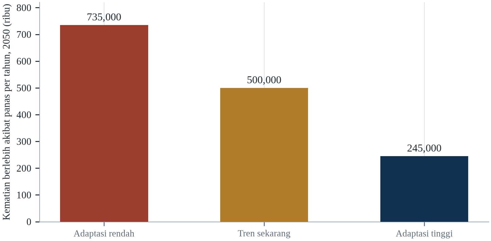||Sumber: Tabel 17.1.

Kolom tengah perlu penjelasan. 'Kecenderungan sekarang' bukan ramalan masa depan yang paling mungkin; ia lintasan yang mengikuti kebijakan yang sudah diundangkan, belanja adaptasi yang sudah dijanjikan, dan investasi kesehatan yang sudah dianggarkan, dengan jalur emisi ditahan pada kasus menengah. Itu kolom yang didapat suatu pemerintah bila tidak mengubah apa pun, dan itu pembanding bagi dua kolom lainnya. 

Dua hal perlu ditekankan. Pertama, kesehatan adalah tempat perubahan iklim paling langsung dialami, dan karena itu tempat adaptasi memiliki imbal hasil paling jelas. Kedua, distribusi risiko kesehatan mengikuti ketimpangan yang ada, sehingga negara dan komunitas dengan kapasitas paling sedikit menghadapi beban terbesar.

Ekspansi cepat layanan primer dan tenaga kesehatan komunitas akan memperbaiki ketangguhan bahkan tanpa infrastruktur baru. Rencana aksi panas yang menjangkau lanjut usia terisolasi dapat menurunkan kematian secara substansial dengan biaya rendah. Dan pergeseran pembiayaan ke arah adaptasi kesehatan dapat menutup celah antara kebutuhan dan penyediaan. Variabel terpenting tetap laju pengurangan emisi, karena ia menentukan berapa banyak adaptasi yang harus disampaikan sistem kesehatan, dan berapa banyak orang akan membutuhkan perawatan yang tidak dapat diberikan.

---

# Bab 18: Modal Sosial, Gotong Royong dan Tata Kelola

*Tema: jaringan sosial, institusi publik dan politik perlindungan*

Pada dini hari 15 Juli 2021, hujan lebat turun di Lembah Ahr, Jerman barat. Antara 100 dan 200 milimeter turun dalam waktu kurang dari 24 jam di tanah yang sudah basah, dan sungai kecil itu naik dalam hitungan jam dari aliran tenang menjadi arus deras. Di distrik Ahrweiler, 134 orang meninggal; di seluruh Jerman dan Belgia, lebih dari 180 orang meninggal, dan kerusakan mencapai puluhan miliar euro (Kreienkamp et al., 2021).

Rantai peringatan telah bekerja sebagian. Layanan meteorologi Jerman mengeluarkan peringatan, beberapa otoritas lokal mengevakuasi, dan sebagian warga pergi. Tetapi di banyak tempat peringatan tidak berubah menjadi tindakan. Orang tidak percaya sungai bisa naik secepat itu; sebagian pejabat lokal tidak memerintahkan evakuasi; dan Jerman belum memiliki sistem nasional untuk mengirim peringatan langsung ke telepon seluler, celah yang baru ditutup kemudian.

Banjir Lembah Ahr adalah kasus tentang tata kelola, bukan meteorologi. Curah hujannya ekstrem tetapi tidak tak terbayangkan; model telah memperingatkan bahwa peristiwa semacam itu menjadi lebih mungkin. Yang gagal adalah rantai yang menghubungkan prakiraan ke keputusan, keputusan ke peringatan, dan peringatan ke rumah tangga yang bertindak. Setiap mata rantai dalam rantai itu adalah institusi, dan institusi dapat dirancang dengan baik atau buruk.

Bab ini membahas infrastruktur sosial dan politik untuk bertahan hidup: jaringan yang membantu tetangga, institusi yang mengeluarkan peringatan dan mengorganisasi respons, serta pengaturan tata kelola yang menentukan apakah perlindungan menjangkau orang yang membutuhkannya. Bab ini berargumen bahwa modal sosial dan institusi publik bukan alternatif melainkan saling melengkapi, dan bahwa kualitas tata kelola adalah salah satu prediktor terkuat berapa banyak orang meninggal ketika bahaya melanda (Aldrich & Meyer, 2015).

Respons bencana biasanya dibayangkan sebagai struktur komando, dan dalam praktik ia adalah jaringan. Orang yang menarik tetangga dari reruntuhan, berbagi genset, membuka dapur umum dan menyebarkan peringatan tidak mengikuti bagan komando insiden; mereka bertindak atas hubungan yang sudah ada sebelum peristiwa. Modal sosial adalah aset ketahanan termurah dan paling sulit dibeli, karena ia dihasilkan oleh pergaulan biasa selama bertahun-tahun dan dihancurkan dengan cepat oleh perpindahan, ketakutan dan ketidaksetaraan.

## 18.1 Modal Sosial sebagai Sumber Daya Bertahan Hidup

Modal sosial merujuk pada jaringan, norma, dan kepercayaan yang memungkinkan orang bertindak bersama. Ia bukan metafora: ia dapat diukur, dan ia memprediksi hasil. Sosiolog membedakan modal perekat, yang menghubungkan orang yang serupa dan dekat, modal penjembatan, yang menghubungkan orang lintas kelompok berbeda, dan modal penghubung, yang menghubungkan warga dengan institusi yang memiliki kekuasaan. Masing-masing berperan berbeda dalam bencana.

Modal perekat memberikan bantuan segera: tetangga yang memeriksa warga lanjut usia, keluarga yang berbagi air, jemaah yang membuka aula. Modal penjembatan memberikan akses ke sumber daya di luar lingkaran langsung: kelompok komunitas yang tahu cara mengajukan bantuan, jaringan yang dapat memobilisasi relawan (Cutter et al., 2008). Modal penghubung menentukan apakah komunitas dapat memengaruhi institusi yang memutuskan di mana tanggul dibangun dan siapa yang menerima kompensasi (Berkes & Ross, 2013).

Daniel Aldrich, dalam rangkaian studi tentang pemulihan bencana di Jepang, India, dan Amerika Serikat, menemukan bahwa modal sosial memprediksi pemulihan lebih baik daripada pendapatan, kerusakan, atau belanja pemerintah. Komunitas dengan jaringan padat pulih lebih cepat karena mereka dapat berbagi informasi, mengalokasikan sumber daya, dan menuntut akuntabilitas institusi. Temuan itu penting karena menunjukkan bahwa ketangguhan tidak hanya dibeli dengan uang; ia juga dibangun melalui hubungan.

Konsepnya memiliki sejarah panjang dan diperdebatkan. Pierre Bourdieu memperlakukan modal sosial sebagai sumber daya yang dimobilisasi individu untuk mereproduksi keuntungan; Robert Putnam memperlakukannya sebagai sifat komunitas, diukur melalui partisipasi dalam asosiasi dan kepercayaan pada tetangga. Pembeda antara modal perekat, yang menghubungkan orang yang serupa, modal penjembatan, yang menghubungkan orang melintasi perbedaan, dan modal penghubung, yang menghubungkan komunitas dengan institusi, adalah bagian paling berguna dari kerangka ini untuk kerja kebencanaan. Modal perekat membawa orang melewati malam pertama; modal penjembatan membuka akses ke sumber daya di luar kelompoknya sendiri; modal penghubung menentukan apakah bantuan benar-benar tiba.

Modal sosial dapat menjadi liabilitas sekaligus aset, dan literaturnya jujur soal itu. Jaringan perekat yang padat dapat menegakkan penyingkiran, membungkam keluhan dan melindungi anggota yang berkuasa; komunitas dengan ikatan internal kuat kadang menolak bantuan luar karena menerimanya mengancam hierarki lokal. Riset pemulihan pascabencana menemukan komunitas homogen yang terikat erat dapat pulih cepat tetapi juga mereproduksi ketidaksetaraan yang ada, sementara komunitas dengan ikatan penjembatan ke institusi luar mengakses sumber daya lebih cepat. Implikasi kebijakannya adalah tujuannya bukan lebih banyak modal sosial secara umum melainkan campuran ikatan perekat, penjembatan dan penghubung yang tepat.

Modal sosial adalah sumber daya yang paling sulit diukur dan paling andal dalam bencana, dan sebabnya ia mengerjakan hal yang tidak dapat dibeli uang pada saat dibutuhkan. Isinya ikatan antarmanusia: siapa mengenal siapa, siapa memercayai siapa, siapa berutang budi pada siapa, dan siapa akan menjawab telepon pukul tiga pagi. Dalam darurat, ikatan itu menjalankan fungsi yang tidak dapat dijalankan lembaga mana pun dengan cepat: mengidentifikasi orang yang hilang, berbagi genset, menggendong tetangga menuruni tangga, dan mengetahui rumah mana yang penghuninya lansia dan belum keluar. Buktinya konsisten: kepadatan jaringan sosial lebih baik meramalkan keselamatan daripada pendapatan.

Modal sosial adalah sumber daya yang dimiliki komunitas dalam hubungannya, dan pembedaan yang penting bagi bencana adalah antara tiga jenisnya. Modal pengikat adalah kepercayaan di dalam kelompok orang yang saling mengenal baik, dan itulah yang membuat tetangga mengetuk pintu. Modal penjembatan adalah kepercayaan antarkelompok yang berbeda, dan itulah yang memungkinkan lingkungan bekerja dengan masjid, gereja, dan klub olahraga. Modal penghubung adalah kepercayaan antara komunitas dan institusi yang memegang sumber daya, dan itulah yang menentukan apakah bantuan yang ada benar-benar tiba. Yang pertama menyelamatkan nyawa pada jam pertama; yang ketiga menentukan pemulihannya.

## 18.2 Bukti: Lingkungan dan Peluang Bertahan

Studi klasik tentang modal sosial dan panas adalah analisis Eric Klinenberg atas gelombang panas Chicago 1995, yang menewaskan lebih dari 700 orang dalam sepekan (Klinenberg, 2002). Klinenberg membandingkan dua lingkungan dengan demografi serupa dan menemukan tingkat kematian yang sangat berbeda. Di Little Village yang sebagian besar warga Latin, jaringan sosial padat, kehidupan jalanan yang aktif, dan institusi yang berfungsi melindungi warga; di North Lawndale, penurunan populasi, bangunan terbengkalai, dan rasa takut membuat orang terisolasi di dalam rumah.

Mekanismenya sosial, bukan fisiologis. Warga lanjut usia di Little Village dikunjungi, dikenal tetangganya, dan keluar rumah; warga lanjut usia di North Lawndale takut membuka pintu dan tidak ada yang memeriksa keadaan mereka. Pendingin udara dan pendapatan penting, tetapi tidak menjelaskan jurang itu. Yang menjelaskannya adalah apakah orang terhubung dengan orang lain yang akan menyadari ketidakhadiran mereka.

Temuan serupa muncul dalam studi tentang banjir, badai, dan kebakaran hutan. Isolasi sosial secara konsisten terkait dengan kematian yang lebih tinggi, dan kohesi lingkungan dengan kematian yang lebih rendah. Implikasi kebijakannya adalah program yang membangun koneksi — pusat komunitas, asosiasi lingkungan, jaringan relawan, penjangkauan warga terisolasi — adalah bentuk kesiapsiagaan bencana, bahkan ketika tidak dibingkai demikian.

Kasus empirisnya paling kuat justru di tempat yang paling mengejutkan. Kajian Daniel Aldrich atas gempa Kobe 1995 menemukan bahwa kekuatan ikatan sosial lingkungan memprediksi pemulihan sekuat kerusakan fisik hunian, dan karyanya kemudian di Jepang, India dan Amerika Serikat mereproduksi temuan itu: komunitas dengan jaringan lebih padat pulih lebih cepat, terlepas dari pendapatan dan belanja pemerintah. Mekanismenya tidak misterius. Tetangga berbagi informasi, meminjamkan alat, mengawasi anak, dan mengadvokasi satu sama lain di hadapan lembaga, dan setiap tindakan itu menggantikan layanan formal yang sedang kewalahan.

Mekanisme di balik efek lingkungan adalah efikasi kolektif, bukan keramahan. Sampson dan rekan-rekannya mendefinisikan efikasi kolektif sebagai gabungan kohesi sosial dan kesediaan warga untuk ikut campur demi kebaikan bersama, dan riset pemulihan bencana menemukan bahwa ia memprediksi seberapa cepat lingkungan terorganisasi, seberapa banyak bantuan informal dipertukarkan, dan apakah warga mempercayai informasi resmi. Kualitas itu tidak tersebar merata, dan tidak dihasilkan kemakmuran semata: sebagian lingkungan miskin dengan jaringan padat mengungguli lingkungan lebih kaya dengan ikatan lemah. Mengukurnya memerlukan survei, dan itulah sebab ia jarang dimasukkan dalam penilaian kerentanan.

Studi tentang lingkungan dan keselamatan dimulai dari perbandingan yang belum pernah sepenuhnya terjelaskan. Pada gelombang panas Chicago 1995, dua komunitas bertetangga dengan demografi dan paparan serupa menghasilkan jumlah kematian yang sangat berbeda, dan perbedaannya mengikuti kehidupan sosial jalannya: berapa banyak orang duduk di beranda, berapa banyak toko buka, seberapa baik warga mengenal lansia yang tinggal sendiri (Klinenberg, 2002). Temuannya direplikasi pada banjir, gempa, dan kebakaran, dan bertahan setelah dikendalikan pendapatan serta perumahan. Mekanismenya tidak misterius: koneksi menghasilkan informasi, bantuan, dan kewajiban.

Bukti bahwa lingkungan menentukan kelangsungan hidup paling kuat pada gelombang panas, dan telah direplikasi lintas kota. Studi Chicago yang membandingkan dua komunitas berdekatan dengan demografi serupa menemukan bahwa komunitas dengan jaringan sosial lebih kuat, ruang publik lebih banyak, dan organisasi warga lebih aktif kehilangan jauh lebih sedikit orang, dan perbedaannya tidak dijelaskan pendapatan atau lingkungan fisiknya. Karya sesudahnya menemukan pola serupa di Jepang setelah tsunami dan di Amerika Serikat setelah badai. Pengukuran modal sosial tidak sempurna, itulah sebabnya temuannya kadang ditolak.

## 18.3 Gotong Royong dan Respons Relawan

Ketika sistem formal kewalahan, orang mengorganisasi diri. Setelah Badai Katrina, Cajun Navy — jaringan longgar relawan dengan perahu — menyelamatkan ribuan orang dari lingkungan yang tergenang. Setelah Badai Sandy, Occupy Sandy mengorganisasi relawan untuk mengirim pasokan ke wilayah yang belum dijangkau bantuan resmi. Setelah gempa Mexico City 2017, brigade sipil yang dikenal sebagai topos menggali korban dari puing sebelum tim profesional tiba.

Gotong royong paling efektif ketika terhubung dengan sistem formal alih-alih menggantikannya. Relawan mengetahui kondisi lokal dan dapat bergerak lebih cepat, tetapi mereka kurang peralatan, pelatihan, dan kapasitas koordinasi. Hasil terbaik terjadi ketika lembaga formal menciptakan ruang bagi relawan, menyediakan informasi dan logistik, dan menghindari memperlakukan mereka sebagai ancaman terhadap komando dan kendali.

Banjir Kerala 2018 menggambarkan poin itu. Pemerintah negara bagian memobilisasi komunitas nelayan, yang perahu dan pengetahuannya tentang perairan lokal sangat penting untuk menyelamatkan orang dari wilayah tergenang. Kolaborasi itu berhasil karena pemerintah mengakui nelayan sebagai mitra dan menyediakan bahan bakar, koordinasi, serta informasi. Itu bukan harmoni spontan; itu kerja sama yang terorganisasi.

Bantuan timbal balik adalah praktik yang mengubah modal sosial menjadi pertolongan nyata, dan biasanya lebih efektif daripada yang diakui. Selama banjir Kerala 2018, komunitas nelayan memakai perahu mereka untuk menyelamatkan ribuan orang sebelum tim resmi dapat menjangkau mereka; selama bencana Tōhoku 2011, relawan dan organisasi lokal mendistribusikan pangan lebih cepat daripada sistem kotamadya; setelah Badai Sandy, jaringan bantuan gerakan Occupy mengungguli beberapa lembaga pada pekan pertama. Masalahnya juga nyata: relawan membanjiri tempat yang salah, menggandakan upaya, dan tidak punya asuransi serta koordinasi, sehingga praktik terbaiknya adalah membiayai dan mengintegrasikan kelompok yang sudah ada alih-alih memformalkannya ke dalam respons.

Literatur tentang konvergensi relawan tegas soal masalahnya dan optimistis soal solusinya. Setelah hampir setiap bencana besar, relawan yang datang sendiri tiba dalam jumlah yang melampaui kapasitas daerah terdampak untuk menyerapnya, dan mereka memakai bahan bakar, pangan dan ruang jalan yang dibutuhkan respons. Lembaga yang mengelolanya dengan baik melakukannya dengan menetapkan titik konvergensi, mendaftar relawan, dan memberi mereka tugas yang berguna alih-alih memulangkan mereka. Alternatifnya — kordon yang menahan semua orang — mustahil secara politik dan kontraproduktif secara praktis, karena warga lokal akan tetap menolong.

Bantuan timbal balik adalah yang dilakukan orang satu sama lain ketika respons resmi belum datang, dan itulah sebabnya jam-jam pertama bencana biasanya bukan adegan panik. Tetangga membersihkan puing, berbagi makanan, mengantar orang ke rumah sakit dengan mobil pribadi, dan mendirikan penampungan informal di gereja serta sekolah. Fenomenanya tua, dan versi digitalnya baru: grup perpesanan dan media sosial memungkinkan organisasi pada skala yang sebelumnya mustahil, dan koordinasi dengan orang asing. Risikonya, bantuan informal mereproduksi ketidaksetaraan yang ingin diatasinya, karena orang dengan koneksi terbanyak menerima bantuan paling banyak.

Gotong royong adalah yang dilakukan orang sebelum lembaga tiba, dan ia bentuk respons paling efektif pada jam-jam pertama. Tetangga menggali reruntuhan, berbagi air, dan menggendong lansia menuruni tangga, dan melakukannya tanpa mandat, seragam, atau anggaran. Persoalannya bukan kemauan melainkan koordinasi: relawan membanjiri lokasi, menghalangi jalan yang dibutuhkan ambulans, dan menduplikasi pekerjaan. Pengaturan yang berhasil memberi kelompok yang muncul peran, frekuensi radio, dan titik kontak, kebalikan dari naluri menjauhkan warga dari lokasi.

## 18.4 Rantai Peringatan dan Mil Terakhir

Peringatan adalah rantai penerjemahan: dari observasi ke prakiraan, dari prakiraan ke keputusan, dari keputusan ke pesan, dari pesan ke rumah tangga, dan dari rumah tangga ke tindakan. Setiap mata rantai dapat gagal, dan kegagalannya biasanya tidak terlihat sampai peristiwa terjadi. Banjir Lembah Ahr gagal di beberapa mata rantai: prakiraan tersedia tetapi tidak dipahami, keputusan tertunda, dan pesan tidak menjangkau semua orang.

Mil terakhir adalah yang paling sulit. Bahkan ketika peringatan dikeluarkan, ia mungkin tidak menjangkau orang yang tidur, yang tidak berbicara bahasa itu, yang tidak memiliki telepon, atau yang tidak memercayai penyampainya. Sistem yang efektif menggunakan banyak saluran — sirene, siaran seluler, radio, media sosial, dari pintu ke pintu — dan mengulang pesan dalam bahasa sederhana dengan instruksi spesifik. Peringatan yang mengatakan sungai akan banjir kurang berguna daripada yang mengatakan tinggalkan jalan ini sekarang dan pergi ke lokasi ini.

Kepercayaan menentukan apakah pesan dipercaya. Komunitas yang pernah mengalami peringatan akurat lebih mungkin merespons peringatan berikutnya; komunitas yang pernah diabaikan atau disesatkan lebih kecil kemungkinannya. Membangun kepercayaan memerlukan konsistensi, keterbukaan tentang ketidakpastian, dan tindak lanjut yang terlihat. Ia lambat dibangun dan cepat hilang, itulah sebabnya ia termasuk kategori yang sama dengan infrastruktur fisik.

Rantai peringatan hanya sekuat mata rantai terakhirnya, dan mata rantai terakhir adalah manusia yang memutuskan bergerak. Tsunami Samudra Hindia 2004 menewaskan sekitar 230.000 orang karena tidak ada sistem peringatan, tetapi gempa dan tsunami Sulawesi 2018 menewaskan ribuan orang di negara yang memilikinya, karena peringatan tidak menjangkau orang yang tepat pada waktu yang tepat dan sirene telah rusak. Studi perilaku evakuasi menemukan bahwa orang bertindak atas peringatan ketika ia dikonfirmasi oleh seseorang yang dipercaya, ketika mereka tahu ke mana harus pergi, dan ketika rutenya dapat dilalui — tiga syarat yang bersifat sosial dan fisik, bukan semata teknis.

Mil terakhir sebuah peringatan adalah proses sosial, dan kegagalannya konsisten lintas negara. Setelah Topan Haiyan 2013, banyak orang tidak mengungsi karena pemahaman mereka tentang risiko gelombang badai rendah dan bahasa peringatannya asing; setelah gempa Maroko 2023, peringatan yang penting adalah guncangan pertama, dan kematian terkonsentrasi di desa yang belum pernah dipetakan. Siaran sel, yang mengirim pesan ke setiap telepon di wilayah geografis, memperbaiki jangkauan di tempat ia diterapkan, tetapi jangkauan tidak sama dengan pemahaman. Pesannya harus menyebut apa yang harus dilakukan, ke mana harus pergi dan sampai kapan.

Rantai peringatan punya mata rantai terlemah, dan hampir selalu mil terakhir. Prakiraan dihasilkan lembaga meteorologi, diterjemahkan menjadi peringatan oleh badan penanggulangan bencana, disiarkan telekomunikasi dan media, dan diterima rumah tangga yang harus memutuskan apa yang dilakukan. Setiap langkah menambah jeda dan penerjemahan, dan keputusan akhir dibuat seseorang yang mungkin tidak memercayai penyampainya, tidak memahami bahasanya, tidak dapat pergi, atau menerima pesan setelah air naik. Negara yang paling berhasil menurunkan kematian berinvestasi pada mil terakhir itu: relawan dengan megafon, sirene, pengeras suara masjid, peringatan seluler yang tidak menuntut ponsel pintar, dan latihan.

Rantai peringatan adalah rangkaian penyerahan, dan setiap penyerahan tempat pesan dapat hilang. Peramal menghasilkan peluang, lembaga mengubahnya menjadi peringatan, penyiar menyampaikannya, otoritas lokal memutuskan apakah memerintahkan evakuasi, rumah tangga memutuskan apakah mematuhinya. Setiap langkah melibatkan penerjemahan dan pertimbangan, dan kegagalan di salah satunya meniadakan kerja yang lain. Mil terakhir adalah langkah terakhirnya, dan di situlah uang paling sedikit dibelanjakan: pesan yang tiba di ponsel yang mati, dalam bahasa yang tidak dibaca penerimanya, tanpa instruksi jelas, bukanlah peringatan.

## 18.5 Institusi, Kepercayaan dan Tata Kelola Risiko

Kualitas pemerintah adalah salah satu penentu terkuat hasil bencana. Negara dengan birokrasi efektif, layanan darurat yang didanai baik, dan pengadaan yang jujur mengalami lebih sedikit kematian dan pulih lebih cepat daripada negara dengan paparan bahaya yang sama dan institusi yang lebih lemah. Kontras antara gempa Haiti dan Chile 2010 sering dikutip: gempa berkekuatan 7,0 di Haiti menewaskan lebih dari 200.000 orang, sementara gempa berkekuatan 8,8 di Chile tiga pekan kemudian menewaskan sekitar 500 orang, sebagian besar karena standar bangunan, kesiapsiagaan, dan kapasitas respons.

Kepercayaan penting karena kepatuhan bergantung padanya. Orang yang memercayai peringatan resmi lebih mungkin mengungsi, menerima pembatasan, dan bekerja sama dengan bantuan. Kepercayaan dibangun melalui kompetensi, kejujuran, dan keadilan, dan dirusak oleh kegagalan, pertentangan, serta kesan pilih kasih. Pandemi menggambarkan seberapa cepat kepercayaan dapat terkikis ketika pesannya tidak konsisten, dan seberapa mahal erosi itu.

Tata kelola risiko memerlukan koordinasi lintas tingkat dan sektor. Rencana panas melibatkan kesehatan, meteorologi, layanan sosial, utilitas, dan masyarakat sipil; rencana banjir melibatkan pengelolaan air, tata guna lahan, layanan darurat, dan infrastruktur. Modus kegagalannya adalah fragmentasi, ketika setiap lembaga mengoptimalkan mandatnya sendiri dan tidak ada yang bertanggung jawab atas keseluruhan. Tata kelola yang efektif menetapkan tanggung jawab yang jelas, menyediakan sumber daya, dan menuntut koordinasi.

Kepercayaan adalah variabel yang menentukan apakah peringatan menjadi tindakan. Riset survei tentang tata kelola risiko secara konsisten menemukan bahwa kepercayaan pada otoritas memprediksi perilaku protektif lebih kuat daripada akurasi informasi, dan bahwa satu pengkhianatan yang dirasakan dapat membatalkan bertahun-tahun komunikasi yang kredibel. Mekanismenya bekerja dua arah: populasi yang percaya pada institusinya mematuhi bahkan nasihat yang tidak sempurna, dan populasi yang tidak percaya tidak mematuhi bahkan ketika nasihatnya benar. Membangun kembali kepercayaan setelah kegagalan — peringatan yang terlewat, evakuasi yang tertunda, dana bantuan yang tidak tiba — adalah kerja lambat yang dimulai dengan mengakui kegagalan.

Gotong royong adalah bentuk budaya yang diambil modal sosial di nusantara, dan sejarah modernnya menunjukkan kekuatan sekaligus batasnya. Praktik itu menggerakkan komunitas setelah tsunami 2004 dan gempa Yogyakarta 2006, dan ia diakui secara formal dalam undang-undang penanggulangan bencana sebagai prinsip respons. Ia juga bergantung pada timbal balik dan rasa kewajiban bersama, yang berarti ia melemah di tempat komunitas terbelah agama, etnis atau sengketa tanah, dan ia dapat ditangkap elite lokal. Implikasi kebijakannya adalah mendukung praktiknya tanpa menganggap ia akan muncul dengan sendirinya.

Institusi, kepercayaan, dan tata kelola risiko menentukan apakah peringatan menjadi tindakan dan apakah pemulihan menjadi pembangunan ulang. Kepercayaan dibangun perlahan melalui kompetensi biasa — sampah yang diangkut, bus yang tepat waktu, klinik yang berstaf — dan dibelanjakan cepat ketika peringatan salah atau kompensasi terlambat. Pemerintah yang dipercaya dapat meminta orang mengungsi, berasuransi, dan menerima kode bangunan; yang tidak dipercaya akan mendapati instruksinya diabaikan. Paradoks tata kelola risiko: keputusan terpenting dibuat ketika tidak ada apa-apa, oleh pejabat yang insentifnya menyukai proyek terlihat.

Kepercayaan adalah sumber daya yang menentukan apakah peringatan dipercaya dan apakah evakuasi dipatuhi, dan ia dibangun bertahun-tahun serta dihancurkan dalam hitungan jam. Komunitas yang merespons paling baik adalah yang telah melihat lembaganya menepati pada hari biasa: klinik yang buka, jalan yang diperbaiki, janji yang ditepati. Ketidakpercayaan yang menyusul respons yang salah kelola bertahan ke peristiwa berikutnya, dan ia rasional, karena rumah tangga yang dikecewakan telah belajar sesuatu yang benar. Membangun kembali kepercayaan lebih lambat daripada membangun tanggul dan ia satu-satunya pertahanan terhadap desas-desus yang bersaing dengan pesan resmi.

## 18.6 Desentralisasi dan Kapasitas Lokal

Sebagian besar kerja respons bencana terjadi di tingkat lokal, tempat pengetahuan tentang medan, populasi, dan hubungan paling besar. Desentralisasi dapat memperbaiki responsivitas, tetapi hanya jika pemerintah lokal memiliki sumber daya, keterampilan, dan akuntabilitas untuk bertindak. Di banyak negara, desentralisasi telah memindahkan tanggung jawab tanpa memindahkan pendapatan, meninggalkan kota dengan mandat yang tidak dapat mereka biayai.

Undang-Undang Desa Indonesia, yang memberikan anggaran dan kewenangan besar kepada desa, adalah salah satu contoh upaya membangun kapasitas lokal. Sistem panchayat India dan struktur barangay Filipina menjalankan fungsi serupa. Di tempat institusi lokal berfungsi baik, mereka dapat mengorganisasi evakuasi, memelihara drainase, dan mengelola bantuan; di tempat mereka dikuasai elite atau kekurangan dana, mereka dapat mengecualikan orang yang paling membutuhkan pertolongan.

Pertanyaan desainnya adalah bagaimana membangun kapasitas lokal tanpa menciptakan penguasaan lokal. Itu memerlukan anggaran transparan, perencanaan partisipatif, audit eksternal, dan dukungan dari tingkat pemerintahan yang lebih tinggi. Itu juga memerlukan waktu, karena institusi berkembang melalui praktik. Desentralisasi yang dimulai lima tahun sebelum bencana tidak mungkin menghasilkan institusi yang mampu pada saat bencana tiba.

Desentralisasi memindahkan keputusan lebih dekat ke orang yang menanggung konsekuensinya, dan ia juga memindahkan masalah kapasitas lebih dekat kepada mereka. Dana Desa di Indonesia, yang mengalokasikan sekitar satu miliar rupiah per desa setiap tahun, memberi komunitas anggaran untuk drainase, jalan dan kesiapsiagaan yang sebelumnya hanya ada di atas kertas, dan ia menghasilkan variasi besar dalam seberapa baik uang itu dipakai. Pelajarannya bukan bahwa desentralisasi gagal, melainkan bahwa ia membutuhkan pelengkap yang tidak glamor: nasihat teknis lokal, penganggaran transparan, dan cara mengaudit belanja yang tidak bergantung pada kementerian jauh.

Desentralisasi berhasil di tempat pemerintah lokal punya pendapatan, staf dan kewenangan, dan gagal di tempat mereka hanya punya yang pertama. Sistem barangay di Filipina memberi komunitas peran hukum dalam pengurangan risiko bencana dan bagian dari sumber daya pemerintah lokal, dan hasilnya sangat bergantung pada kapasitas kepala barangay. Federalisasi Nepal setelah 2015 membentuk pemerintah kotamadya baru dengan mandat bencana dan staf teknis terbatas, dan jurangnya diisi LSM serta konsultan. Pelajaran desainnya adalah kewenangan tanpa kapasitas menghasilkan kertas kerja, dan kapasitas tanpa kewenangan menghasilkan frustrasi.

Desentralisasi adalah reformasi yang direkomendasikan setiap tinjauan bencana dan jarang diselesaikan pemerintah. Pemerintah lokal paling dekat dengan bahaya, mengenal jalan dan orangnya, dan dapat bertindak sebelum ibu kota memproses beritanya; tetapi mereka sering kekurangan pendapatan, kapasitas teknis, dan kewenangan. Hasilnya sistem formal ketika pemerintah nasional memiliki mandat dan pemerintah lokal memiliki masalahnya. Reformasi yang berhasil memindahkan uang bersama tanggung jawab, membangun kapasitas teknis alih-alih mengasumsikannya, dan memberi pejabat lokal perlindungan hukum untuk memutuskan cepat.

Desentralisasi adalah reformasi struktural yang paling banyak diadopsi dan paling sedikit dibiayai. Argumennya, pemerintah lokal mengenal bahaya, rumah tangga, dan jalurnya, dan keputusan di ibu kota lebih lambat serta kurang terinformasi. Argumen sebaliknya, kapasitas menggunakan kewenangan tersebar tidak merata, sehingga satu kota dapat mengelola banjir dan distrik sebelah tidak. Penyelesaiannya bukan sentralisasi kembali melainkan membangun kapasitas: transfer dana bersama transfer fungsi, program pelatihan, dan layanan teknis yang dapat dihubungi kota kecil.

## 18.7 Korupsi, Penguasaan Elite dan Rekonstruksi

Bencana menciptakan arus uang besar, dan arus uang besar menciptakan peluang korupsi. Kontrak rekonstruksi, distribusi bantuan, dan transaksi tanah semuanya rentan. Dalam beberapa kasus, hasilnya adalah bantuan tidak menjangkau korban; dalam kasus lain, bantuan menjangkau mereka dalam bentuk yang lebih buruk, dengan bangunan yang gagal pada peristiwa berikutnya.

Penguasaan elite adalah masalah yang lebih halus. Bantuan dan rekonstruksi dapat memperkuat ketimpangan yang ada jika orang yang mengendalikan distribusi juga mengendalikan akses ke informasi, tanah, dan kredit. Perampasan tanah pascabencana telah didokumentasikan di beberapa negara, terutama di tempat kepemilikan tanah bersifat informal sebelum peristiwa. Perempuan, penyewa, dan warga informal sering paling terpapar dinamika ini.

Penawarnya adalah transparansi. Menerbitkan daftar penerima manfaat, pemberian kontrak, dan data belanja memungkinkan komunitas dan jurnalis menuntut akuntabilitas institusi. Audit independen, pemantauan komunitas, dan mekanisme pengaduan dapat menangkap masalah lebih awal. Tidak satu pun cukup sendiri, tetapi bersama-sama mereka membuat korupsi lebih sulit dan lebih terlihat, yang sering cukup untuk mengubah perilaku.

Rekonstruksi bencana adalah salah satu aktivitas paling rawan korupsi yang dilakukan negara, karena ia menggabungkan anggaran besar, pengadaan darurat, pengawasan lemah dan populasi yang tidak bisa menunggu. Studi tentang rekonstruksi pascabencana telah mendokumentasikan tingkat kebocoran seperlima atau lebih dalam beberapa program, dan kerugiannya bukan hanya finansial: sekolah yang dibangun dengan beton di bawah standar adalah korban di masa depan. Setelah tsunami 2004, upaya rekonstruksi Aceh, salah satu yang terbesar yang pernah dijalankan, memperlihatkan sekaligus besarnya risiko dan nilai pemantauan independen, daftar penerima yang terbuka dan audit komunitas dalam menguranginya.

Korupsi rekonstruksi punya anatomi khas yang dapat diantisipasi. Ia terkonsentrasi di pengadaan, dalam sertifikasi pekerjaan selesai, dan dalam pemilihan daftar penerima, dan ia difasilitasi oleh urgensi serta ketiadaan pengawasan independen. Setelah gempa Haiti 2010, audit menemukan bahwa sebagian besar uang bantuan dibelanjakan pada kontraktor dan biaya umum alih-alih rekonstruksi yang bertahan, dan pelajarannya bukan bahwa bantuan secara inheren korup melainkan bahwa verifikasi bersifat opsional. Tindakan yang mengurangi kebocoran sudah diketahui: kontrak terbuka, pemantauan komunitas, inspeksi teknik independen dan pembayaran atas penyelesaian yang terverifikasi.

Korupsi dan penguasaan adalah mekanisme yang membuat uang rekonstruksi gagal menjadi rekonstruksi. Bentuknya akrab: kontrak diberikan pada perusahaan terhubung, material diganti yang lebih murah, daftar penerima ditambahi nama yang tidak ada, dan sertifikat tanah diterbitkan bagi yang punya koneksi pada pekan-pekan setelah bencana. Akibatnya bukan hanya kehilangan uang tetapi kehilangan kepercayaan, yang mengurangi kepatuhan pada perintah evakuasi berikutnya. Penangkal yang berhasil tidak menarik: daftar penerima yang terbuka, audit independen, pemantauan warga, dan pembayaran lewat uang seluler yang menciptakan jejak.

Rekonstruksi adalah fase ketika korupsi paling merusak, karena uangnya besar, pengawasannya lemah, dan urgensinya nyata. Kontrak diberikan tanpa kompetisi, bahannya tidak diperiksa, dan rumah yang dibangun ulang adalah yang akan gagal pada peristiwa berikutnya. Penanggulangannya diketahui: register kontrak yang terbuka, pemantau warga dengan akses ke lokasi, audit independen yang melapor ke legislatif alih-alih kementerian, dan saluran pengaduan yang berfungsi. Satu ukuran paling efektif adalah mempublikasikan daftar penerima manfaat, karena ia membuat alokasi politiknya terlihat.

## 18.8 Pembiayaan Risiko Bencana dan Akuntabilitas

Uang sangat menentukan setelah bencana, dan kecepatan kedatangannya menentukan apakah rumah tangga pulih atau jatuh ke utang. Pembiayaan tradisional bergantung pada seruan pascabencana, yang lambat dan tidak pasti. Pembiayaan yang telah diatur sebelumnya — kredit kontinjen, asuransi, obligasi bencana, kumpulan risiko regional — dapat mencairkan dana dengan cepat dan dapat diprediksi.

Caribbean Catastrophe Risk Insurance Facility, yang didirikan pada 2007, adalah contoh kumpulan regional yang membayar cepat setelah peristiwa yang memenuhi syarat. African Risk Capacity dan Pacific Catastrophe Risk Assessment and Financing Initiative menjalankan fungsi serupa. Instrumen ini bukan pengganti investasi nasional dalam ketangguhan, tetapi mereka mengurangi guncangan fiskal bencana dan memungkinkan pemerintah merespons tanpa mengalihkan anggaran pembangunan.

Akuntabilitas adalah sisi lain pembiayaan. Pemerintah yang menerima dana adaptasi dan bantuan harus diwajibkan melaporkan bagaimana dana itu dibelanjakan, dan parlemen, lembaga audit, serta masyarakat sipil harus memiliki kapasitas untuk memeriksanya. Tanpa akuntabilitas, pembiayaan dapat diserap tanpa mengurangi risiko, yang merupakan salah satu alasan mengapa korelasi antara bantuan yang diterima dan ketangguhan yang dicapai lebih lemah daripada seharusnya.

Pembiayaan risiko bencana adalah upaya memindahkan biaya malapetaka dari pascakejadian ke instrumen yang dapat diprediksi. Kumpulan risiko berdaulat, seperti Caribbean Catastrophe Risk Insurance Facility dan African Risk Capacity, menjual perlindungan parametrik yang membayar ketika pemicu terukur terpenuhi — kecepatan angin, curah hujan, magnitudo gempa — alih-alih setelah penilaian kerugian. Keunggulannya kecepatan; kelemahannya risiko basis, karena pemicu mungkin tidak sesuai kerusakan, meninggalkan pemerintah dengan pembayaran yang tidak menutup kebutuhan atau tanpa pembayaran meski kerugian berat. Asuransi melengkapi cadangan dan perlindungan sosial; ia tidak menggantikannya.

Asuransi parametrik menyelesaikan masalah arus kas dan menciptakan masalah baru. Obligasi bencana Meksiko, diterbitkan pada 2006, termasuk instrumen berdaulat pertama yang membayar berdasarkan pemicu terukur, dan fasilitas Karibia telah membayar dalam hitungan minggu setelah badai, yang justru dibutuhkan pemerintah untuk membeli air dan bahan bakar sebelum donor tiba. Masalah barunya adalah pembayaran dipicu bahaya, bukan kerugian, sehingga negara dapat menerima uang yang tidak dibutuhkannya atau tidak menerima apa pun ketika membutuhkannya. Pemerintah yang memakainya dengan baik menempatkannya bersama cadangan dan dana kontingensi, bukan sebagai pengganti.

Pembiayaan risiko bencana adalah mekanisme yang menentukan apakah pemerintah dapat merespons sebelum harus berutang. Negara dengan kredit kontinjen yang disiapkan, kumpulan risiko sovereign, dan perlindungan sosial yang dapat menaikkan skala dapat menyalurkan uang tunai dalam hitungan hari; negara tanpa itu menunggu banding, janji, dan pencairan, dan jedanya diukur dengan nyawa serta aset yang dijual. Instrumennya membaik: kumpulan risiko regional di Karibia dan Afrika, asuransi parametrik yang membayar atas pemicu, dan aksi antisipatif yang mencairkan dana ketika prakiraan melewati ambang.

Pembiayaan risiko bencana hanya akuntabel bila uangnya dapat dilacak dari janji ke rumah tangga. Celah di antaranya adalah ruang tempat dana dialihkan, ditunda, atau diserap perantara, dan audit yang akan menutupnya jarang dibiayai. Instrumen yang memperbaiki catatannya adalah satu rekening kas negara untuk respons, jadwal pencairan yang dipublikasikan, dan audit pascaperistiwa yang selesai dalam setahun alih-alih sedekade. Nilainya bukan hanya uang yang dipulihkan; ia harapan bahwa respons berikutnya akan diawasi.

## 18.9 Kerja Sama Regional dan Internasional

Bahaya iklim tidak mengenal batas. Badai melintasi garis pantai, sungai mengalir lintas negara, dan pengungsian meluap melewati perbatasan. Kerja sama regional dapat memperbaiki peringatan dini, berbagi sumber daya, dan mengoordinasikan respons. Pusat Koordinasi ASEAN untuk Bantuan Kemanusiaan dalam Penanggulangan Bencana (AHA Centre) adalah contoh: ia memelihara persediaan, mengoordinasikan respons regional, dan mendukung negara anggota selama darurat.

Kerja sama internasional paling efektif ketika mendukung institusi lokal alih-alih menggantikannya. Respons yang dikelola eksternal sering datang terlambat, lebih mahal, dan meninggalkan sedikit kapasitas. Grand Bargain, seperangkat komitmen untuk memperbaiki pembiayaan kemanusiaan, menekankan lokalisasi karena alasan ini, meskipun kemajuannya lambat.

Pembiayaan iklim juga merupakan bentuk tata kelola. Komitmen negara kaya untuk menyediakan US$100 miliar per tahun dalam pembiayaan iklim telah dipenuhi terlambat dan tidak merata, dan porsi adaptasi tetap jauh di bawah kebutuhan negara rentan (OECD, 2023). Celah itu bukan hanya soal uang; ia soal kepercayaan, karena negara yang berjanji dan tidak menepati memiliki kredibilitas lebih rendah ketika meminta kerja sama dalam emisi.

Kerja sama regional penting karena bahaya tidak menghormati perbatasan dan karena negara kecil tidak dapat memikul biayanya sendiri. Perjanjian ASEAN tentang Penanggulangan Bencana dan Respons Darurat membentuk kerangka respons bersama dan pengaturan pasokan bantuan siaga, meskipun aktivasinya terbatas oleh prinsip non-intervensi asosiasi. Kerangka Sendai, yang diadopsi pada 2015, mengalihkan perhatian global dari respons bencana ke pengurangan risiko dan menetapkan target untuk mortalitas, populasi terdampak dan kerugian ekonomi, tetapi indikatornya bergantung pada pelaporan nasional yang tidak merata kualitas dan cakupannya (UNDRR, 2015).

Kerja sama internasional dalam respons bencana lebih berkembang daripada dalam adaptasi iklim, dan perbedaannya instruktif. Kelompok Penasihat Pencarian dan Penyelamatan Internasional mengoordinasikan tim penyelamatan perkotaan lintas negara dalam hitungan jam, dan sistem Penilaian serta Koordinasi Bencana Perserikatan Bangsa-Bangsa mengerahkan ahli dalam sehari. Adaptasi iklim tidak punya kapasitas tetap setara, karena ia investasi jangka panjang alih-alih keadaan darurat, dan karena ia menyentuh kedaulatan atas tanah, air dan keuangan. Hasilnya, dunia dapat merespons bencana lebih cepat daripada mencegahnya.

Kerja sama regional dan internasional adalah lapisan yang menangani bahaya yang melintasi batas: siklon yang menghantam tiga negara, sungai yang mengalir melalui lima, kekeringan yang menutupi satu kawasan. Mekanismenya perjanjian, badan regional, dan sistem kemanusiaan, dan kinerjanya tidak merata. Pengaturan paling efektif bersifat teknis dan spesifik: prakiraan sungai bersama, peringatan dini bersama, stok yang ditempatkan lebih awal, dan kesepakatan yang memungkinkan tim serta peralatan melintasi batas dengan cepat. Yang paling tidak efektif adalah deklarasi besar yang tidak menghasilkan perubahan operasional.

Kerja sama regional adalah lapisan yang memungkinkan respons nasional ketika peristiwanya melampaui kapasitas nasional. Pusat Koordinasi Bantuan Kemanusiaan ASEAN menyimpan stok dan telah mengirim bantuan ke negara anggota dalam hitungan hari; mekanisme perlindungan sipil Eropa menyatukan peralatan dan tim; pengaturan Pasifik memungkinkan tetangga mengirim pesawat sebelum dokumennya lengkap. Nilainya diukur dari jam yang dihemat, dan hambatannya kedaulatan yang enggan dibagi negara. Kesepakatan yang berhasil adalah yang disimulasikan, karena mekanisme yang dipanggil pertama kali dalam krisis akan gagal.

## 18.10 Tata Kelola Polisentris dan Pembelajaran

Tidak ada institusi tunggal yang dapat mengelola risiko iklim. Sistem paling efektif bersifat polisentris: banyak pusat pengambilan keputusan, terhubung oleh aturan dan informasi, masing-masing mampu bertindak dalam domainnya. Karya Elinor Ostrom tentang pengelolaan sumber daya bersama menunjukkan bahwa komunitas dapat mengelola sumber daya bersama secara efektif ketika mereka memiliki batas yang jelas, aturan yang sesuai kondisi lokal, dan mekanisme pilihan kolektif.

Sistem polisentris tangguh karena tidak bergantung pada satu titik kegagalan. Jika lembaga nasional lambat, kota dapat bertindak; jika kota dikuasai elite, kelompok komunitas dapat mengorganisasi. Tetapi polisentrisme bukan anarki: ia memerlukan koordinasi, informasi bersama, dan akuntabilitas. Tantangannya adalah merancang sistem yang memungkinkan inisiatif lokal sekaligus memastikan yang paling rentan tidak tertinggal.

Pembelajaran adalah persyaratan terakhir. Institusi yang memperlakukan setiap bencana sebagai pelajaran, menyelidiki apa yang terjadi, dan mengubah prosedurnya lebih tangguh daripada yang tidak. Penyelidikan banjir Lembah Ahr menghasilkan pengenalan peringatan siaran seluler di Jerman; penyelidikan Badai Katrina menghasilkan reformasi manajemen darurat. Pembelajaran memerlukan kemauan politik untuk menerima kritik, yang sering langka ketika kesalahan dipertaruhkan.

Gagasan yang paling menggambarkan cara kerja ketahanan sebenarnya adalah tata kelola polisentris, yang dikembangkan Elinor Ostrom: banyak pusat pengambilan keputusan, secara formal independen, yang menyesuaikan diri melalui pembelajaran timbal balik alih-alih melalui satu hierarki. Sistem polisentris lebih berantakan daripada sistem komando dan lebih adaptif, karena kegagalan di satu simpul tidak merambat ke semua. Implikasi desainnya bukan menghapus otoritas pusat melainkan memastikan rumah tangga, lingkungan, kotamadya, provinsi dan lembaga nasional masing-masing memiliki kapasitas nyata dan batas yang jelas, dan bahwa informasi mengalir di antara mereka dalam dua arah.

Tata kelola adaptif adalah istilah yang menggambarkan bagaimana sistem polisentris belajar, dan temuan sentralnya adalah pembelajaran terjadi melalui organisasi penjembatan (Folke et al., 2010). Folke dan rekan-rekannya menggambarkannya sebagai entitas yang menghubungkan pengalaman lokal ke tingkat pengambilan keputusan lebih tinggi, dan dalam konteks bencana ia sering berupa LSM, pusat universitas atau asosiasi profesi. Jembatan itu penting karena pengetahuan lokal tidak naik dengan sendirinya, dan kebijakan nasional tidak turun tanpa penerjemahan. Di tempat jembatannya tidak ada, kesalahan yang sama berulang di setiap kotamadya, dan evaluasi tidak pernah terakumulasi melampaui laporan lokal.

Tata kelola polisentris adalah nama akademis bagi sistem ketika banyak pusat pengambilan keputusan hidup bersama dan berkoordinasi tanpa satu otoritas tunggal. Kedengarannya seperti gambaran kekacauan dan sering justru sebaliknya, karena redundansi adalah bentuk ketangguhan: kota dengan wali kota yang kuat, perkumpulan warga yang aktif, utilitas yang berfungsi, dan sektor swasta yang terlibat dapat merespons bahkan bila salah satunya gagal. Syaratnya, pusat-pusat itu berbagi informasi dan menerima standar bersama, itulah sebabnya contoh paling berhasil dibangun di sekitar protokol teknis, bukan hierarki politik.

Tata kelola polisentris adalah gagasan bahwa sistem banyak pusat keputusan yang bertumpang tindih dapat lebih adaptif daripada satu hierarki, dan bukti dari manajemen bencana mendukungnya dengan satu catatan. Banyak pusat dapat bereksperimen, belajar dengan laju berbeda, dan merespons lokal, itulah sebabnya kota yang paling baik mengelola risiko biasanya yang memiliki lingkungan, perusahaan, utilitas, dan lembaga swadaya yang aktif selain pemerintah kota yang cakap. Catatannya, sistem polisentris butuh kerangka yang membagi tanggung jawab dan berbagi informasi, karena tanpanya banyak pusat menduplikasi dan meninggalkan celah.

Bagi pembaca yang ingin memakai gagasannya alih-alih mengaguminya, langkah praktisnya adalah menggambar peta pusat-pusat yang benar-benar menentukan apa yang terjadi di satu lingkungan. Petanya biasanya memuat lebih banyak pusat daripada yang diduga dan lebih sedikit daripada yang disarankan bagan organisasi: dinas drainase kota, utilitas pemilik gardu induk, sekolah yang akan dipakai sebagai pengungsian, klinik yang menyimpan daftar pasien pengguna oksigen, masjid atau gereja yang akan membuka aula, asosiasi pedagang yang menguasai jalan akses, dan kelompok relawan yang punya perahu. Masing-masing punya alasan bertindak dan kendala yang menahannya, dan latihannya adalah menemukan satu mata rantai yang tidak dapat dipasok satu pusat mana pun sendirian. Di sebagian besar lingkungan mata rantai itu ternyata informasi — siapa butuh bantuan, di mana air naik, kapan listrik mati — dan lembaga yang dapat memasoknya hampir tidak pernah yang memegang anggarannya.

## 18.11 Studi Kasus: Banjir Lembah Ahr, Jerman 2021

Pada 14 dan 15 Juli 2021, sistem tekanan rendah yang bergerak lambat menghasilkan curah hujan ekstrem di Jerman barat, Belgia, dan Belanda. Di Lembah Ahr, hingga 200 milimeter turun dalam waktu kurang dari 24 jam, dan sungai naik dalam hitungan jam. Banjir menghancurkan rumah, jalan, dan jembatan, memutus listrik dan komunikasi, dan menewaskan 134 orang di distrik Ahrweiler saja; di seluruh Jerman dan Belgia jumlah kematian melebihi 180, dan kerusakan diperkirakan lebih dari €30 miliar (Kreienkamp dkk., 2021).

Layanan meteorologi telah mengeluarkan peringatan, dan beberapa otoritas lokal bertindak. Tetapi banyak orang tidak mengungsi, sebagian karena tidak percaya sungai bisa naik secepat itu, sebagian karena peringatannya tidak cukup spesifik, dan sebagian karena tidak ada mekanisme untuk mengirim peringatan langsung ke setiap telepon di wilayah terdampak. Jerman baru memperkenalkan peringatan siaran seluler pada 2023, setelah peristiwa itu.

Kegagalan tersebar di seluruh rantai. Prakiraan tersedia tetapi tidak diterjemahkan menjadi instruksi lokal yang jelas; sebagian pejabat menunda evakuasi karena takut alarm palsu; dan sistem komunikasi gagal ketika infrastruktur hancur. Hasilnya adalah bencana yang lebih buruk daripada yang dapat dijelaskan curah hujan semata, yang merupakan definisi kegagalan tata kelola dalam risiko bencana.

Respons setelah peristiwa besar. Penyelidikan dilakukan, tanggung jawab diperjelas, dan sistem peringatan diperbaiki. Banjir itu menjadi titik rujukan kebijakan bencana Jerman, dan ia mengubah harapan publik tentang peringatan dan kesiapsiagaan. Pelajarannya bukan bahwa Jerman kekurangan kapasitas; pelajarannya adalah kapasitas harus diorganisasi menjadi rantai yang menjangkau rumah tangga terakhir.

Bagi negara lain, pelajarannya spesifik. Peringatan harus spesifik dan dapat ditindaklanjuti, bukan sekadar meteorologis. Banyak saluran harus digunakan, termasuk yang tidak bergantung pada listrik atau internet. Pejabat lokal memerlukan wewenang dan pelatihan yang jelas untuk memerintahkan evakuasi. Dan publik harus diedukasi tentang apa arti peringatan, agar peringatan tidak diabaikan sebagai hal rutin. Masing-masing adalah tugas tata kelola, bukan tugas teknologi.

Demonstrasi paling jelas modal sosial dalam bencana modern adalah perbandingan antara Badai Katrina 2005 dan respons banjir Louisiana 2016. Pada kedua peristiwa sistem formal kewalahan, tetapi di Louisiana 'Cajun Navy' — armada longgar pemilik perahu swasta yang dikoordinasikan melalui media sosial — menyelamatkan ribuan orang pada hari-hari pertama. Kelompok itu bukan pengganti layanan publik, dan kehadirannya yang tidak diatur menciptakan masalah koordinasi. Namun ia adalah ungkapan temuan yang berjalan sepanjang bab ini: kapasitas merespons tersebar di dalam populasi jauh sebelum ia diorganisasi menjadi sebuah lembaga.

Banjir Lembah Ahr adalah kasus yang memisahkan prakiraan dari peringatan, dan peringatan dari tindakan. Badan meteorologi menjalankan tugasnya: model menunjukkan hujan ekstrem sehari sebelumnya dan peringatannya dikeluarkan. Yang gagal adalah penerjemahan peringatan regional menjadi keputusan lokal, di lembah yang airnya naik dalam hitungan jam dan di mana pesan umum tentang hujan lebat tidak memberi tahu rumah tangga apakah harus pergi. Penyelidikan berikutnya memusatkan perhatian pada tiga pertanyaan yang berulang pada hampir setiap kegagalan semacam ini: apakah peringatannya menyebut tempat yang akan banjir, apakah ia mencapai orang yang sedang tidur atau bekerja, dan apakah ada satu pejabat yang berwenang memerintahkan evakuasi tanpa menunggu tingkat pemerintahan di atasnya.

## 18.12 Skenario dan Prediksi Masa Depan: Tata Kelola pada 2050

Bencana tidak menciptakan tata kelola; bencana mengungkapnya. Negara dengan institusi kuat telah menurunkan kematian dari bahaya yang sebanding selama satu abad terakhir, sementara negara dengan institusi lemah belum. Trennya tidak otomatis: ia bergantung pada investasi, akuntabilitas, dan pembelajaran.

Garis dasarnya adalah defisit kepercayaan. Kepercayaan pada pemerintah telah menurun di banyak demokrasi, sementara tuntutan pada pemerintah meningkat. Pemerintah lokal, yang menjalankan sebagian besar kerja operasional, sering kekurangan dana. Pembiayaan iklim internasional belum memenuhi komitmen, dan pembiayaan adaptasi hanya mencapai sebagian kecil dari yang dibutuhkan. Sementara itu, bahayanya menjadi lebih parah dan lebih sering.

Hasil tata kelola akan mengikuti kualitas institusi, pembiayaan, dan kerja sama internasional. Dunia yang berinvestasi dalam kapasitas lokal, transparansi, dan kerja sama regional dapat mengelola risiko yang meningkat; dunia yang merespons terlambat akan melihat bencana menjadi krisis politik. Tabel merangkum rentangnya.

Tata kelola 2050 akan dinilai dari kemampuannya mengambil keputusan cepat dalam sistem yang punya banyak pusat dan tidak ada otoritas tunggal (UNDRR, 2015). Skenarionya berbeda terutama pada kepercayaan dan kapasitas: masyarakat yang percaya pada peringatan, kompensasi, dan kode bangunan dapat beradaptasi dengan biaya sebagian kecil dibandingkan masyarakat yang tidak. Indikatornya yang sulit dipalsukan: porsi pemerintah lokal dengan anggaran kebencanaan yang didanai, waktu antara prakiraan dan peringatan publik, proporsi kontrak rekonstruksi yang dipublikasikan, dan tingkat kepercayaan pada institusi publik menurut survei biasa.

[[TABLE:Tabel 18.1 Indikator tata kelola, 2050]]
| Institusi | Fungsi inti | Kegagalan umum | Reformasi | Indikator |
|---|---|---|---|---|
| Pemerintah lokal | Evakuasi; tempat berlindung | Kurang dana; wewenang kabur | Desentralisasi fiskal; pelatihan | Waktu respons |
| Sistem peringatan | Prakiraan ke rumah tangga | Celah mil terakhir | Multi-saluran; siaran seluler | Jangkauan dan kepatuhan |
| Layanan darurat | Penyelamatan; koordinasi | Fragmentasi | Komando bersama; latihan | Cakupan |
| Perlindungan sosial | Uang tunai; pangan; hunian | Kesalahan eksklusi | Registri; manfaat portabel | Cakupan orang miskin |
| Antikorupsi | Integritas pengadaan | Penguasaan elite | Kontrak terbuka; audit | Temuan audit |
| Badan regional | Persediaan bersama | Koordinasi lambat | Protokol yang disepakati | Waktu respons |

Analisisnya menunjuk pada dua kesimpulan. Pertama, tata kelola adalah penentu peluang bertahan hidup, bukan kondisi latar; perbedaan antara respons yang terorganisasi baik dan yang tidak terorganisasi diukur dalam nyawa. Kedua, reformasi yang paling penting tidak menarik: wewenang yang jelas, pembiayaan lokal yang memadai, pengadaan yang transparan, dan prosedur yang dilatih.

Investasi berkelanjutan dalam kapasitas pemerintah lokal akan memperbaiki respons bahkan tanpa teknologi baru. Perlindungan sosial universal akan mengurangi eksklusi yang meninggalkan orang termiskin tanpa bantuan. Dan kerja sama regional yang lebih kuat dapat mengimbangi kapasitas nasional yang lemah di negara kecil. Variabel terpenting tetap laju perubahan iklim, yang menentukan seberapa sering institusi akan diuji, dan apakah mereka memiliki waktu untuk belajar di antara ujian.

---

# Bab 19: Energi Terbarukan dan Teknologi Tepat Guna

*Tema: listrik terdesentralisasi, penyimpanan dan ekonomi energi bersih*

Di char Bangladesh utara — pulau-pulau lumpur yang muncul dan hilang bersama sungai — listrik jaringan datang terlambat, jika sama sekali. Rumah tangga bergantung pada lampu minyak tanah untuk penerangan, yang menghasilkan cahaya buruk, asap dalam ruangan, dan pengeluaran berulang yang menghabiskan sebagian signifikan pendapatan rumah tangga. Anak-anak belajar di bawah cahaya berkedip; toko tutup saat senja; dan klinik tidak dapat mendinginkan vaksin.

Sejak akhir 1990-an, program yang dijalankan Infrastructure Development Company Limited dan didukung Bank Dunia serta donor lain mulai membiayai sistem surya rumah tangga melalui kredit mikro. Rumah tangga membayar uang muka kecil dan angsuran selama dua hingga tiga tahun. Pada awal 2020-an, lebih dari empat juta sistem telah dipasang, menjangkau sekitar dua puluh juta orang, dan Bangladesh memiliki salah satu program surya di luar jaringan terbesar di dunia.

Hasilnya terlihat pada anggaran rumah tangga. Penggunaan minyak tanah turun; anak-anak mendapat jam belajar tambahan; toko memperpanjang jam buka; dan rumah tangga melaporkan kualitas udara lebih baik serta lebih sedikit luka bakar. Sistemnya kecil — biasanya 50 hingga 100 watt — dan tidak memberi daya pada industri. Tetapi mereka menunjukkan sesuatu yang penting: teknologi modular, dibiayai secara tepat, dapat memberikan layanan dasar kepada orang-orang yang belum dijangkau jaringan dan tidak akan dijangkau selama bertahun-tahun.

Bab ini membahas energi terbarukan dan teknologi tepat guna sebagai instrumen ketangguhan. Bab ini mencakup surya dan angin, penyimpanan dan fleksibilitas jaringan, mini-grid dan sistem di luar jaringan, memasak bersih, efisiensi, serta rantai pasok dan politik yang menentukan apakah teknologi ini menyebar cukup cepat. Argumennya bukan bahwa teknologi saja akan menyelesaikan krisis iklim, tetapi bahwa turunnya biaya energi bersih modular telah mengubah apa yang mungkin bagi rumah tangga, komunitas, dan negara.

Energi terbarukan biasanya diperdebatkan sebagai kebijakan iklim, dan justifikasi terkuatnya sebenarnya adalah ketahanan. Deretan fotovoltaik di atap menghasilkan listrik ketika saluran transmisi mati; ladang angin tidak membutuhkan konvoi bahan bakar; mikrogrid dapat mengislandir diri dan menjaga klinik tetap berjalan. Teknologi yang sama yang menurunkan emisi juga memendekkan rantai ketergantungan antara rumah tangga dan energi yang dibutuhkannya, dan pemendekan itu bernilai sama besar dalam krisis dengan karbon yang dihemat.

## 19.1 Mengapa Energi Terbarukan adalah Teknologi Ketangguhan

Energi terbarukan biasanya dibahas sebagai strategi mitigasi — cara mengurangi emisi. Ia juga strategi adaptasi, karena ia mengubah modus kegagalan sistem energi. Pembangkit batu bara bergantung pada rantai pasok bahan bakar, air pendingin, dan jaringan terpusat; panel surya bergantung pada sinar matahari. Ketika banjir memblokir jalan atau kekeringan mengurangi debit sungai, panel surya tetap memproduksi, dan sistem yang dibangun dari banyak unit kecil gagal secara bertahap alih-alih sekaligus.

Modularitas adalah sifat kuncinya. Pembangkit terpusat besar efisien tetapi rapuh: satu kegagalan dapat menghilangkan satu gigawatt dari jaringan. Sistem terdistribusi yang terdiri dari ribuan atap, baterai, dan pembangkit kecil dapat kehilangan sebagian tanpa kehilangan keseluruhan. Itulah sebabnya rumah sakit, klinik, dan tempat berlindung komunitas semakin menggabungkan koneksi jaringan dengan surya atap dan baterai, agar dapat beroperasi ketika jaringan gagal.

Energi terbarukan juga mengurangi paparan guncangan harga bahan bakar. Negara pengimpor minyak dan gas rentan terhadap lonjakan harga akibat konflik, gangguan pelayaran, atau manipulasi pasar; krisis energi 2022, setelah invasi Rusia ke Ukraina, menaikkan biaya listrik dan pemanas di seluruh Eropa dan mendorong jutaan rumah tangga ke kemiskinan energi. Surya dan angin, setelah dibangun, tidak memiliki biaya bahan bakar, yang membuat ekonomi operasionalnya dapat diprediksi bahkan ketika pasar komoditas tidak.

Proyeksi Badan Energi Internasional telah direvisi ke atas begitu sering sehingga arah perjalanannya tidak lagi diragukan: energi terbarukan memasok sekitar tiga puluh persen listrik global pada 2023 dan berada di jalur mendekati separuh pada 2030 dengan kebijakan yang berlaku sekarang (IEA, 2023). Pertanyaan yang menarik telah bergeser dari apakah transisi akan terjadi ke di mana kapasitasnya akan diproduksi dan siapa yang akan memilikinya. Tiongkok memproduksi mayoritas besar modul, wafer dan sel surya, yang membuat transisi energi menjadi pertanyaan rantai pasok sama besarnya dengan pertanyaan teknologi, dan memberi sejumlah kecil negara daya tawar atas kecepatan adaptasi negara lain.

Argumen ketahanan untuk energi terbarukan paling kuat di tempat alternatifnya adalah konvoi bahan bakar. Genset diesel adalah sumber daya default bagi rumah sakit, menara telekomunikasi dan mikrogrid di tempat tanpa jaringan andal, dan bahan bakarnya harus dikirim lewat jalan, yang gagal justru ketika jalan terendam atau terputus. Sistem surya-dengan-penyimpanan menghapus ketergantungan itu, dan ekonominya telah membaik sampai sering lebih murah dalam sepuluh tahun daripada diesel, bahkan tanpa harga karbon. Hambatannya adalah modal: genset diesel adalah belanja operasional dan sistem surya adalah belanja modal, dan institusi yang membelinya diorganisasi sekitar yang pertama.

Energi terbarukan adalah teknologi ketangguhan sebelum menjadi teknologi iklim, dan perbedaannya penting bagi tempat yang paling membutuhkannya. Panel surya di atap klinik memasok listrik ketika jaringan gagal, ketika pasokan diesel terputus, dan ketika harga bahan bakar melonjak; ia tidak menuntut konvoi dan tidak menuntut kontrak. Itulah sebabnya negara dengan jaringan terlemah memimpin penyebaran surya terdistribusi, dan mengapa teknologinya menyebar lebih cepat daripada kebijakan iklim yang seharusnya mendorongnya. Argumen yang lebih besar tetap argumen iklim, tetapi argumen ketangguhan menjelaskan mengapa ia diadopsi pemerintah yang tidak peduli emisi.

Energi terbarukan adalah teknologi ketahanan karena alasan yang tidak ada hubungannya dengan emisi: ia tidak butuh konvoi bahan bakar. Genset diesel seandal apa pun bergantung pada jalan yang membawa tangkinya, dan setelah siklon jalan biasanya hal pertama yang hilang; panel surya dengan baterai terus memproduksi selama matahari terbit dan inverter-nya bertahan. Nilai kemandirian itu terbukti di Puerto Riko setelah Badai Maria, ketika surya atap dan penyimpanan menjaga lampu, lemari es, dan alat medis berjalan di wilayah yang jaringannya mati berbulan-bulan. Poin rekayasanya, sistem terdistribusi gagal berkeping-keping, dan sistem terpusat gagal sekaligus.

## 19.2 Surya: Kurva Pembelajaran

Modul fotovoltaik surya telah mengikuti penurunan biaya tercepat dari teknologi energi mana pun dalam sejarah. Harga modul turun sekitar 90 persen antara 2010 dan 2023, dari lebih dari satu dolar per watt menjadi sekitar dua puluh sen, dan biaya sistem terpasang turun hampir secepat itu. Penurunan didorong skala manufaktur, pembelajaran sambil bekerja, dan persaingan, dan ia mengubah surya dari teknologi ceruk menjadi sumber listrik baru termurah di banyak pasar.

Penyebaran mengikuti harga. Kapasitas surya global melewati satu terawatt pada 2022 dan terus tumbuh pada tingkat rekor, dengan penambahan tahunan melebihi 400 gigawatt pada 2023 dan terus meningkat (IRENA, 2023). Tiongkok menyumbang porsi terbesar baik manufaktur maupun instalasi, tetapi pertumbuhannya menyebar ke India, Amerika Serikat, Eropa, Brasil, dan Timur Tengah. Di banyak negara, surya kini memasok porsi signifikan listrik siang hari.

Teknologinya memiliki batas. Surya hanya memproduksi pada siang hari, sehingga memerlukan penyimpanan atau pembangkit pelengkap untuk memenuhi permintaan malam; keluarannya bervariasi dengan cuaca dan musim; dan ia memerlukan lahan atau ruang atap. Pada musim dingin lintang tinggi, keluarannya dapat turun tajam. Batas itu dapat dikelola dengan penyimpanan, transmisi, dan pembangkit yang terdiversifikasi, tetapi berarti surya saja bukan sistem yang lengkap. Tantangan integrasi, bukan biaya pembangkit, kini menjadi kendala utama.

Surya mengikuti kurva pembelajaran yang begitu teratur sehingga kini dipakai sebagai contoh buku teks. Harga modul turun sekitar sembilan puluh persen sejak 2010, dan penurunannya mengikuti kapasitas terpasang kumulatif alih-alih waktu, yang menjelaskan mengapa prakiraan yang mengasumsikan penurunan biaya linear salah setiap tahun selama dua dekade. Konsekuensinya, surya kini menjadi sumber listrik baru termurah di sebagian besar pasar, dan hambatan penyebarannya berpindah dari biaya ke koneksi jaringan, lahan, perizinan dan penyimpanan — bagian sistem yang lebih lambat dan lebih politis.

Konsentrasi manufaktur telah menjadi kendala pengikat bagi kecepatan penyebaran. Tiongkok memproduksi mayoritas besar modul, sel dan wafer, dan pada 2023 serta 2024 pabriknya menambah kapasitas lebih cepat daripada dunia memasangnya, yang meruntuhkan harga modul dan mendorong produsen di tempat lain merugi. Respons kebijakannya bersifat industrial alih-alih lingkungan: Undang-Undang Pengurangan Inflasi Amerika Serikat mensubsidi manufaktur domestik, Uni Eropa mengusulkan penyesuaian perbatasan karbon, dan India memakai tarif serta insentif produksi. Hasilnya adalah rantai pasok lebih terfragmentasi yang lebih tangguh secara politik dan kurang efisien secara ekonomi, yang merupakan pertukaran alih-alih kegagalan.

Fotovoltaik surya adalah kasus kurva pembelajaran paling jelas dalam sejarah energi. Biaya modul turun sekitar sembilan puluh persen sejak 2010, dan penurunannya didorong skala manufaktur, perbaikan bertahap efisiensi sel, dan persaingan antarpabrikan. Akibatnya surya kini sumber listrik baru termurah di sebagian besar dunia, dan kendalanya berpindah dari panel ke jaringan, lahan, perizinan, dan penyimpanan. Pelajaran kebijakannya, penyebaran dan penurunan biaya saling menguatkan, itulah sebabnya negara yang menyebar lebih awal menangkap manufaktur dan penurunan harga yang menyusul.

Biaya listrik surya turun begitu jauh dan begitu cepat sehingga prakiraan historisnya menjadi lelucon bagi para peramalnya. Harga modul turun sekitar sembilan puluh persen sejak 2010, dan penurunannya berlanjut melalui periode ketika industrinya merugi, yang merupakan tanda kurva belajar alih-alih siklus subsidi. Konsekuensinya, surya kini sumber listrik baru termurah di sebagian besar tempat yang cerah, dan kendalanya berpindah dari biaya panel ke biaya lahan, sambungan jaringan, dan penyimpanan yang membuat keluarannya stabil. Manufakturnya terkonsentrasi di satu negara, dan itu kini pertanyaan ketahanan tersendiri.

## 19.3 Tenaga Angin dan Masalah Variabilitas

Tenaga angin adalah teknologi terbarukan matang lainnya. Kapasitas global melewati 1.000 gigawatt pada 2023, dengan instalasi terbesar di Tiongkok, Amerika Serikat, Jerman, India, dan Spanyol. Angin lepas pantai tumbuh cepat karena turbin dapat lebih besar dan angin lebih stabil di laut, serta lokasi lepas pantai dekat dengan pusat permintaan pesisir. Biaya angin lepas pantai turun tajam sebelum naik lagi pada 2022–2023 ketika rantai pasok mengetat dan suku bunga naik.

Angin berbagi variabilitas surya tetapi tidak pola hariannya. Di beberapa wilayah, keluaran angin lebih tinggi pada malam hari dan musim dingin, yang melengkapi surya; di wilayah lain, kemarau angin — periode angin yang luar biasa rendah — dapat berlangsung berhari-hari atau berpekan-pekan. Kemarau angin 2021 di Eropa mengurangi keluaran pada saat permintaan tinggi, yang berkontribusi pada lonjakan harga energi. Sistem yang sangat bergantung pada angin memerlukan penyimpanan, interkoneksi, dan cadangan yang dapat diatur untuk mengelola periode ini.

Angin juga memiliki kendala sosial. Turbin terlihat, dapat berisik, dan memengaruhi lanskap serta satwa liar; oposisi telah memperlambat proyek di beberapa negara. Kendalanya nyata tetapi dapat dikelola dengan penempatan yang lebih baik, pembagian manfaat komunitas, dan konsultasi awal. Alternatifnya — terus bergantung pada bahan bakar fosil — membawa biaya lingkungan dan sosial lebih besar, tetapi perbandingan itu tidak selalu dibuat dalam debat perencanaan lokal.

Masalah angin bukan biaya melainkan bentuk. Turbin modern mengubah tiga puluh sampai empat puluh lima persen energi angin yang melewatinya menjadi listrik, luar biasa untuk sebuah mesin, tetapi anginnya sendiri datang kapan ia datang. Operator jaringan karena itu merencanakan kredit kapasitas alih-alih kapasitas terpasang, dan perbedaannya penting: sistem dengan satu terawatt angin terpasang mungkin hanya punya kontribusi pasti sebagian kecil dari itu pada malam terdingin yang paling tenang dalam setahun. Jawaban teknisnya adalah portofolio pembangkit, interkoneksi, penyimpanan dan kelenturan permintaan; jawaban politiknya biasanya berdebat tentang angka terpasang.

Tenaga angin adalah terbarukan matang lainnya dan menghadapi masalah berbeda: sumbernya bervariasi dan sering jauh dari permintaan. Angin lepas pantai telah menjadi industri besar di Eropa utara dan Tiongkok, dengan faktor kapasitas yang menyaingi pembangkit termal dan turbin yang kini lebih tinggi daripada sebagian besar gedung. Angin darat lebih murah dan lebih diperdebatkan, karena memakai lahan dan terlihat. Variabilitasnya dapat dikelola dengan prakiraan, interkoneksi, dan penyimpanan, dan pengalaman jaringan yang paling banyak mengintegrasikan angin menunjukkan batas teknisnya jauh melampaui dugaan satu dekade lalu.

Tenaga angin bervariasi dengan cara yang dapat diserap jaringan bila ladangnya tersebar luas, dan sulit bila terkonsentrasi. Keluaran satu turbin naik turun bersama hembusan, keluaran satu ladang lebih halus, dan keluaran sekumpulan ladang yang terpisah ratusan kilometer lebih halus lagi, karena cuaca yang menghentikan satu kecil kemungkinannya menghentikan semua. Musim dan tahun menambah lapisan lain: kekeringan angin di Eropa pada 2021 memotong keluaran berpekan-pekan dan memaksa beralih kembali ke gas. Angin lepas pantai punya faktor kapasitas lebih tinggi dan lebih konsisten, dan biaya pembangunan serta penyambungannya lebih besar.

## 19.4 Penyimpanan, Fleksibilitas dan Jaringan

Tantangan utama jaringan dengan porsi terbarukan tinggi adalah mencocokkan pasokan dengan permintaan. Listrik tidak dapat disimpan murah dalam jumlah besar untuk periode panjang, sehingga operator sistem harus menyeimbangkan pembangkitan dan konsumsi secara real-time. Baterai, pompa hidro, respons permintaan, dan interkoneksi adalah alat utama untuk melakukannya.

Biaya baterai lithium-ion turun sekitar 85 persen antara 2010 dan 2023, dan penyimpanan skala jaringan tumbuh cepat, dari beberapa gigawatt menjadi puluhan gigawatt secara global. Baterai cocok untuk menggeser keluaran surya dari tengah hari ke malam dan untuk menyediakan respons frekuensi cepat, tetapi kurang cocok untuk menyimpan energi lintas musim. Pompa hidro, yang menyimpan energi sebagai air di waduk atas, tetap menjadi bentuk penyimpanan jaringan terbesar dan dapat menyediakan kapasitas durasi panjang di tempat geografinya memungkinkan.

Fleksibilitas juga datang dari bagaimana permintaan dikelola. Tarif berdasarkan waktu, termostat pintar, penggeseran beban industri, dan pengisian kendaraan listrik dapat memindahkan konsumsi ke waktu ketika pasokan melimpah. Interkoneksi memungkinkan wilayah dengan cuaca berbeda berbagi listrik, yang mengurangi total penyimpanan yang dibutuhkan. Kombinasi penyimpanan, fleksibilitas permintaan, interkoneksi, dan pembangkit terdiversifikasi adalah yang membuat jaringan berponsi terbarukan tinggi andal, bukan teknologi tunggal mana pun.

Penyimpanan adalah teknologi yang mengubah pembangkitan intermiten menjadi kapasitas pasti, dan biayanya turun lebih cepat daripada dugaan sebagian besar analis. Paket baterai litium-ion sekitar sembilan puluh persen lebih murah daripada 2010, dan pemasangan skala jaringan tumbuh dari keanehan menjadi kelas aset standar dalam satu dekade. Penyimpanan empat jam kini menjadi konfigurasi bawaan, yang cocok untuk siklus harian tetapi tidak untuk kemarau angin selama sepekan yang harus dilalui sistem andal. Pumped hydro masih menyumbang mayoritas besar energi tersimpan di seluruh dunia, dan masalah durasi panjang tetap sebagian besar belum terpecahkan di luar geografi yang memungkinkan waduk.

Garis depan penyimpanan adalah durasi, bukan biaya. Sebagian besar baterai jaringan yang dipasang pada 2023 dikonfigurasi untuk empat jam atau kurang, yang cukup untuk menggeser pembangkit surya ke puncak petang dan tidak cukup untuk menutup sepekan angin lemah. Teknologi durasi panjang — besi-udara, natrium-ion, udara terkompresi, penyimpanan termal — sedang didemonstrasikan, dan belum ada yang mencapai biaya serta skala litium-ion. Implikasinya bagi perencanaan adalah jaringan yang dibangun di sekitar penyimpanan durasi pendek akan membutuhkan kapasitas pasti dari sumber lain, entah itu hidro, nuklir, hidrogen atau pembangkit fosil dengan penangkapan karbon, dan berpura-pura sebaliknya adalah optimisme yang mahal.

Penyimpanan dan fleksibilitas adalah jawaban atas variabilitas, dan jawabannya menjadi lebih murah lebih cepat daripada perkiraan. Baterai lithium-ion mengikuti kurva biaya serupa surya, didorong kendaraan listrik dan proyek skala jaringan, dan kini menyediakan respons frekuensi serta kapasitas puncak di pasar yang mengizinkannya bersaing. Pompa hidro tetap bentuk penyimpanan terbesar dan termurah untuk durasi panjang, di tempat geografinya mendukung. Respons permintaan, interkoneksi, dan pembangkit fleksibel mengisi sisanya. Jaringan masa depan kurang berupa hierarki dengan pembangkit besar di puncak dan lebih berupa pasar yang mengoordinasikan banyak sumber kecil.

Penyimpanan adalah teknologi yang mengubah pasokan bervariasi menjadi pasokan stabil, dan ekonominya didominasi durasi. Baterai yang dapat melepaskan daya selama dua jam cocok untuk menggeser puncak petang dan memberi respons frekuensi cepat yang dibutuhkan jaringan; ia tidak berguna untuk menutup sepekan angin lemah. Durasi lebih panjang menuntut pompa hidro, udara terkompresi, atau hidrogen, dan masing-masing punya biaya serta geografi yang membatasi tempat pembangunannya. Jaringan itu sendiri perangkat penyimpanan bila besar dan terinterkoneksi, itulah sebabnya saluran transmisi sering bentuk fleksibilitas termurah.

## 19.5 Mini-Grid dan Surya di Luar Jaringan

Sekitar 700 juta orang masih kekurangan akses listrik, sebagian besar di Afrika sub-Sahara dan Asia Selatan. Memperluas jaringan ke wilayah terpencil mahal dan lambat, dan di beberapa tempat mungkin tidak akan pernah ekonomis. Mini-grid — sistem pembangkit dan distribusi lokal yang kecil, sering surya dengan penyimpanan baterai — dapat menyediakan listrik andal bagi komunitas yang tidak dijangkau jaringan.

Ekonominya telah membaik secara dramatis. Mini-grid surya kini dapat menyediakan listrik dengan biaya yang bersaing dengan diesel di banyak wilayah di luar jaringan, dan jauh di bawah biaya minyak tanah atau lilin per unit cahaya. Hambatan utamanya adalah pembiayaan, regulasi, dan pemeliharaan: mini-grid memerlukan modal awal, aturan jelas tentang tarif dan kedatangan jaringan, serta kapasitas lokal untuk mengoperasikan dan memperbaiki peralatan.

Program surya rumah tangga Bangladesh menggambarkan potensi dan batas pendekatan di luar jaringan. Ia menjangkau jutaan rumah tangga dengan penerangan dasar dan pengisian telepon, tetapi sistemnya terlalu kecil untuk penggunaan produktif, dan ketika jaringan meluas, sebagian menjadi mubazir. Generasi program berikutnya menggabungkan sistem lebih besar, pembiayaan peralatan, dan penggunaan produktif — pompa irigasi, pendingin dingin, penggilingan — sehingga listrik menghasilkan pendapatan alih-alih hanya cahaya.

Mikrogrid adalah tempat transisi energi bertemu satu miliar orang terakhir. Badan Energi Internasional memperkirakan sekitar tujuh ratus enam puluh juta orang masih tanpa listrik, sebagian besar di Afrika sub-Sahara dan Asia Selatan, dan memperluas jaringan utama ke banyak dari mereka tidak terjangkau maupun cepat. Mikrogrid surya dengan penyimpanan baterai menjadi jalur termurah ke layanan di banyak daerah pedesaan, dan model hibrida yang menggabungkan mikrogrid dengan surya rumah tangga dan penggunaan produktif — pompa irigasi, penggilingan, penyimpanan dingin — telah memperbaiki ekonominya secara berarti. Mode kegagalannya komersial, bukan teknis: tarif yang tidak menutup biaya penggantian, dan pelanggan yang tidak mampu membayar.

Ekonomi mikrogrid bergantung pada basis pelanggan yang mampu membayar, dan itulah kendala yang menutup sebagian besar proyek. Badan Energi Internasional memperkirakan mikrogrid akan menjadi opsi termurah bagi sekitar separuh koneksi baru yang dibutuhkan di pedesaan Afrika, dan analisis yang sama mencatat sebagian besar koneksi itu membutuhkan subsidi karena pelanggannya miskin. Program yang berhasil menggabungkan hibah modal, tarif yang menutup biaya operasi, dan penggunaan produktif yang menaikkan permintaan pada siang hari. Program yang hanya membiayai perangkat menghasilkan sistem yang ditinggalkan ketika baterainya rusak.

Mikrogrid dan surya lepas jaringan adalah teknologi yang menjangkau orang yang tidak dijangkau jaringan pusat, dan keduanya telah menjadi kisah sukses pembangunan. Sistem surya rumah tangga berbiaya lebih murah daripada setahun minyak tanah dan memberi cahaya lebih baik, dan mikrogrid dapat memasok desa dengan listrik cukup untuk menggiling, mengairi, dan mendinginkan. Kendalanya bukan perangkat keras melainkan model bisnis: sistem yang dijual tanpa pengaturan pemeliharaan gagal dalam beberapa tahun, dan tarif yang terlalu rendah untuk menutup penggantian akhirnya meninggalkan desa dalam gelap lagi.

Mikro-grid dan surya di luar jaringan adalah cara menjangkau ratusan juta orang terakhir tanpa listrik, dan teknologinya bukan lagi hambatan. Sistem surya rumah dapat menerangi ruangan, mengisi ponsel, dan menjalankan kipas dengan harga yang mampu dicicil rumah tangga, dan mikro-grid desa dapat menggerakkan penggilingan, klinik, dan pompa air. Hambatannya komersial dan kelembagaan: tarif yang menutup pemeliharaan, teknisi yang tinggal dekat, rantai pasok suku cadang, dan regulator yang mengizinkan sistemnya ada. Proyek yang gagal biasanya yang dipasang sebagai hadiah dan dirawat siapa pun.

## 19.6 Memasak Bersih dan Energi Rumah Tangga

Sekitar 2,3 miliar orang masih memasak dengan bahan bakar padat — kayu, arang, kotoran hewan, residu tanaman — di api terbuka atau kompor tidak efisien (WHO, 2023). Polusi udara dalam ruangan yang dihasilkan diperkirakan menyebabkan 3,7 juta kematian dini per tahun, terutama di antara perempuan dan anak-anak, akibat penyakit pernapasan, penyakit jantung, dan stroke (Watts dkk., 2021). Itu salah satu beban kesehatan lingkungan terbesar di dunia, dan ia terkonsentrasi di antara rumah tangga termiskin.

Transisi ke memasak bersih memerlukan lebih dari kompor. Gas minyak bumi cair memerlukan pasokan andal dan tabung yang terjangkau; listrik memerlukan daya andal dan kompor yang sesuai; kompor biomassa yang lebih baik memerlukan pengolahan bahan bakar dan pemeliharaan. Rumah tangga sering menggunakan kombinasi bahan bakar — praktik yang disebut penumpukan kompor — karena tidak ada satu opsi yang memenuhi semua kebutuhan. Program yang mengasumsikan satu peralihan cenderung gagal.

Manfaat kesehatan dan iklimnya besar. Memasak bersih mengurangi polusi udara dalam ruangan, menghemat waktu untuk mengumpulkan bahan bakar, mengurangi deforestasi di tempat kayu dipanen secara tidak berkelanjutan, dan memotong emisi karbon hitam. Hambatannya bersifat ekonomi dan logistik, bukan teknis, itulah sebabnya kemajuan lambat meskipun upaya telah berlangsung puluhan tahun dan mengapa subsidi berkelanjutan, pengembangan rantai pasok, dan perubahan perilaku semuanya diperlukan.

Memasak adalah bagian transisi energi yang paling jarang dibahas dan paling besar dampaknya bagi kesehatan. Sekitar 2,3 miliar orang masih memasak dengan bahan bakar padat atau minyak tanah, dan polusi udara rumah tangga dari bahan bakar itu terkait dengan jutaan kematian dini setiap tahun, tidak proporsional pada perempuan dan anak (Watts dkk., 2021). Konversi minyak tanah ke gas elpiji di Indonesia pada 2000-an menjangkau puluhan juta rumah tangga dan menjadi model peralihan bahan bakar cepat, tetapi ia juga menciptakan subsidi yang terbukti sulit dihapus secara politik. Memasak dengan listrik adalah jawaban jangka panjang yang lebih bersih dan menuntut jaringan yang mampu memikul beban pada puncak petang.

Biaya fiskal bahan bakar memasak adalah alasan transisi ini tersendat. Konversi minyak tanah ke gas elpiji di Indonesia pada 2000-an menjangkau puluhan juta rumah tangga dalam beberapa tahun, dan subsidi yang membuatnya terjangkau menjadi salah satu pos terbesar dalam anggaran energi, rentan terhadap setiap kenaikan harga internasional. Memasak dengan listrik akan mengurangi tagihan impor dan polusi udara dalam ruangan, dan ia menuntut jaringan yang mampu memikul beban induksi pada puncak petang, yang tidak dimiliki banyak jaringan distribusi. Transisinya karena itu masalah jaringan distribusi yang menyamar sebagai masalah peralatan rumah tangga.

Memasak bersih adalah transisi energi paling tidak bergengsi dan salah satu yang paling berkonsekuensi bagi kesehatan. Sekitar 2,3 miliar orang memasak dengan bahan bakar padat, dan asap dari perapian itu menewaskan beberapa juta orang per tahun, sebagian besar perempuan dan anak, karena penyakit pernapasan dan kardiovaskular (WHO, 2023). Transisi ke bahan bakar lebih bersih — LPG, listrik, kompor biomassa yang diperbaiki — menurunkan beban itu langsung dan mengurangi emisi karbon hitam. Hambatannya bukan teknologi melainkan biaya dan kebiasaan: rumah tangga yang selalu memasak dengan kayu tidak akan beralih ke bahan bakar yang harus dibeli bila pasokannya tidak andal.

Memasak bersih adalah transisi energi yang menyelamatkan paling banyak nyawa per dolar dan paling sedikit diperhatikan, karena penerima manfaatnya perempuan yang memasak di atas api terbuka di ruangan tanpa ventilasi. Asap dari bahan bakar padat dikaitkan dengan jutaan kematian dini per tahun, dan bebannya jatuh pada rumah tangga yang tidak mampu membeli alternatif lebih bersih. Transisinya bukan soal kompor lebih baik saja: bahan bakarnya harus tersedia, terjangkau, dan andal, dan rumah tangganya harus dapat memakainya tanpa mengubah pola makannya. Program yang gagal membagikan kompor tanpa pasokan bahan bakar; yang berhasil memperlakukan bahan bakarnya sebagai produk.

## 19.7 Teknologi Tepat Guna dan Kapasitas Lokal

Teknologi tepat guna adalah teknologi yang sesuai konteks: terjangkau, dapat diperbaiki, dapat dipelihara dengan keterampilan lokal, dan cocok dengan kondisi setempat. Sistem surya rumah tangga yang dapat diperbaiki teknisi lokal lebih berguna daripada sistem yang lebih efisien tetapi tidak dapat diperbaiki. Pompa air yang dapat dipelihara komunitas lebih berkelanjutan daripada sistem rumit yang memerlukan spesialis eksternal.

Konsep itu dikritik sebagai merendahkan ketika menyiratkan bahwa komunitas miskin harus menerima teknologi lebih rendah. Kritik itu adil ketika teknologi tepat guna berarti pilihan kedua; tidak adil ketika ia berarti sesuai tujuan. Pertanyaan yang relevan bukan apakah suatu teknologi canggih, tetapi apakah ia dapat dipertahankan, diperbaiki, dan dibiayai sepanjang umurnya, serta apakah ia memenuhi kebutuhan orang yang memakainya.

Manufaktur dan perakitan lokal dapat memperbaiki keberlanjutan dengan menciptakan lapangan kerja, mengurangi ketergantungan impor, dan membangun kapasitas perbaikan. Beberapa negara menggunakan kebijakan industri untuk mengembangkan manufaktur surya, perakitan baterai, dan produksi peralatan, dengan keberhasilan yang beragam. Program paling efektif menggabungkan alih teknologi dengan pelatihan dan pembiayaan, sehingga perusahaan lokal dapat memelihara dan menyesuaikan peralatan alih-alih hanya menjualnya.

Teknologi tepat guna adalah gagasan lama dengan rekam jejak campuran. Argumen E. F. Schumacher dalam Small Is Beautiful — bahwa teknologi harus sesuai dengan sumber daya, keterampilan dan skala orang yang memakainya — mengantisipasi banyak agenda energi terdesentralisasi, tetapi penerjemahan ke praktik sering gagal karena teknologinya tepat dan sistem perawatannya tidak. Kasus yang berhasil berbagi pola: perakitan lokal, teknisi lokal, suku cadang tersedia dalam perjalanan sehari, dan model pembiayaan yang cocok dengan arus kas pelanggan. Industri surya bayar-sesuai-pakai di Kenya, yang menjual sistem dengan angsuran uang seluler, adalah contoh paling jelas dari keempatnya bekerja bersama.

Ledakan surya atap di Vietnam adalah penyebaran tercepat di Asia Tenggara dan bukti paling jelas bahwa desain kebijakan menentukan kecepatan. Tarif feed-in yang diperkenalkan pada 2019 dan 2020 menghasilkan lebih dari enam belas gigawatt kapasitas atap dalam dua tahun, sebagian besar di pabrik dan gudang, dan lonjakannya menjenuhkan jaringan distribusi di beberapa provinsi. Pemerintah kemudian beralih ke lelang dan Perjanjian Pembelian Daya Langsung, yang memperlambat penyebaran dan memperbaiki integrasi jaringan. Pelajarannya adalah tarif dapat membeli kapasitas dengan cepat dan tidak dapat membeli jaringan, dan fase kedua transisi lebih sulit daripada yang pertama.

Teknologi tepat guna adalah prinsip bahwa teknologi terbaik adalah yang dapat dipelihara secara lokal, dengan keterampilan dan suku cadang lokal. Pompa surya yang membutuhkan pengendali impor akan menganggur berbulan-bulan setelah kegagalan; pompa tangan yang dapat diperbaiki montir desa akan bekerja puluhan tahun. Prinsipnya bukan argumen untuk teknologi rendah melainkan untuk desain yang cocok dengan sistem pemeliharaannya. Implikasinya pada pengadaan, pelatihan, dan cara donor menyusun proyek: sistem yang dipasang lalu diserahkan tanpa rencana pemeliharaan adalah sistem dengan tanggal berakhir yang sudah diketahui.

Teknologi tepat guna adalah prinsip bahwa sistem yang tidak dapat diperbaiki secara lokal bukanlah teknologi tepat guna seefisien apa pun. Pompa surya dengan pengendali yang tidak dapat didiagnosis teknisi mana pun di distriknya menjadi pompa rusak dalam setahun; kompor yang membutuhkan pelet yang tidak dijual setempat menjadi hiasan. Proyek yang bertahan adalah yang dirancang dengan suku cadang, alat, dan pelatihan yang masuk anggaran, dan yang melatih lebih dari satu orang agar pengetahuannya bertahan setelah pemasangnya pergi. Pelajarannya tidak menarik dan itulah bedanya program dengan kuburan peralatan.

## 19.8 Mineral Kritis dan Rantai Pasok

Teknologi energi bersih memerlukan mineral: litium, kobalt, nikel, grafit, dan mangan untuk baterai; tembaga dan aluminium untuk jaringan; logam tanah jarang untuk magnet; serta perak dan silikon untuk sel surya. Badan Energi Internasional memperkirakan bahwa permintaan mineral kritis dapat tiga kali lipat pada 2030 di bawah komitmen yang diumumkan, dan pasokan mungkin tidak mengikuti tanpa investasi baru.

Pasokan terkonsentrasi. Tiongkok memurnikan sebagian besar litium, kobalt, dan grafit dunia, serta mendominasi manufaktur surya; Republik Demokratik Kongo memasok sebagian besar kobalt dunia; dan Indonesia merupakan sumber nikel utama. Konsentrasi menciptakan risiko ketangguhan, karena satu gangguan — pembatasan ekspor, konflik, bencana alam — dapat memengaruhi pasokan global.

Diversifikasi, daur ulang, dan substitusi dapat mengurangi risiko. Daur ulang memulihkan litium, kobalt, dan nikel dari baterai dan dapat memasok porsi permintaan yang tumbuh seiring bertambahnya stok baterai terpasang. Substitusi — baterai natrium-ion, kimia berbasis besi, motor tanpa tanah jarang — dapat mengurangi ketergantungan pada material yang terbatas. Penambangan juga membawa biaya sosial dan lingkungan, termasuk penggunaan air, konflik lahan, dan pelanggaran tenaga kerja, yang harus ditangani jika transisi ingin adil.

Transisi ini bersifat material sebelum bersifat elektrik. Kendaraan listrik memakai sekitar enam kali kandungan mineral mobil konvensional, dan angin lepas pantai memakai beberapa kali tembaga dan seng per megawatt dibanding pembangkit gas. Badan Energi Internasional memproyeksikan permintaan litium dapat naik empat puluh kali lipat pada 2040 dalam jalur net-zero, dan rantai pasok pengolahan mineral itu bahkan lebih terkonsentrasi daripada rantai pasok modul: Tiongkok memurnikan mayoritas litium, kobalt dan logam tanah jarang dunia. Risiko geopolitik transisi terbarukan bukanlah bahwa ia akan gagal karena kekurangan sumber daya, melainkan bahwa ia akan mereproduksi ketergantungan yang ingin dihindari.

Daur ulang adalah bagian kisah mineral yang paling jarang dibahas dan akan paling penting pada 2030-an. Modul surya bertahan dua puluh lima sampai tiga puluh tahun, baterai kendaraan sepuluh sampai lima belas tahun, dan kohort besar pertama keduanya kini mencapai akhir masa pakainya. Daur ulang memulihkan tembaga, aluminium dan perak secara efisien, serta litium dan kobalt lebih rendah, dan itulah sebab standar desain serta sistem pengumpulan sama pentingnya dengan teknologi pengolahan. Negara yang membangun kapasitas daur ulang sekarang akan lebih sedikit bergantung pada penambangan baru nanti, dan negara yang tidak akan mengekspor skrap serta mengimpor logam olahan.

Mineral kritis adalah kerentanan rantai pasok transisi energi. Panel surya, turbin angin, baterai, dan jaringan membutuhkan litium, kobalt, nikel, tembaga, logam tanah jarang, dan grafit, dan produksi beberapa di antaranya terkonsentrasi di sejumlah kecil negara dan lebih sedikit perusahaan. Konsentrasinya menciptakan risiko lonjakan harga dan pengaruh politik, dan penambangannya sendiri menimbulkan masalah lingkungan serta sosial di tempat terjadinya. Daur ulang, substitusi, dan diversifikasi sumber adalah jawabannya, dan semuanya butuh waktu. Transisi bukan jalan keluar dari geopolitik; ia cara mengubah geopolitik mana yang penting.

Transisi energi adalah transisi material, dan materialnya terkonsentrasi di beberapa tempat. Litium berasal dari segelintir danau garam dan tambang batuan keras, kobalt dari Republik Demokratik Kongo, grafit dari Tiongkok, dan pemurnian ketiganya didominasi satu negara. Konsentrasinya masalah ketahanan sejenis konsentrasi minyak, dan ditangani melalui diversifikasi, substitusi, dan daur ulang. Daur ulang adalah jawaban jangka panjang, karena baterai yang didaur ulang adalah tambang yang tidak perlu dibuka, dan industrinya masih kecil dibandingkan volume baterai yang akan pensiun pada 2030-an.

## 19.9 Efisiensi dan Permintaan

Unit energi termurah adalah yang tidak digunakan. Efisiensi energi — isolasi lebih baik, peralatan lebih efisien, lampu LED, pompa panas, motor efisien — mengurangi permintaan, menurunkan tagihan, dan memotong emisi, sering dengan biaya negatif. Badan Energi Internasional berulang kali menemukan bahwa langkah efisiensi dapat memberikan porsi besar pengurangan emisi yang dibutuhkan pada 2030, dan bahwa banyak di antaranya lebih murah daripada pasokan baru.

Pendinginan adalah kasus kritis. Permintaan pendingin udara tumbuh cepat di negara panas seiring naiknya pendapatan dan suhu, dan ia dapat menjadi salah satu sumber permintaan listrik terbesar. Pendingin udara efisien, desain bangunan lebih baik, naungan, dan pendinginan pasif dapat mengurangi permintaan itu secara substansial. Amendemen Kigali atas Protokol Montreal, yang mengurangi hidrofluorokarbon, diperkirakan menghindari pemanasan signifikan sekaligus memperbaiki efisiensi peralatan.

Kebijakan efisiensi menghadapi paradoks: ia tidak terlihat, tersebar, dan sering memerlukan investasi awal untuk penghematan yang diperoleh selama bertahun-tahun. Rumah tangga dan perusahaan secara sistematis kurang berinvestasi dalam efisiensi karena insentif terbelah — pemilik properti membayar isolasi sementara penyewa membayar tagihan — dan karena keterbatasan perhatian serta modal. Standar, pelabelan, pembiayaan, dan dukungan teknis dapat mengatasi hambatan ini, dan mereka termasuk kebijakan iklim paling hemat biaya yang tersedia.

Efisiensi adalah sumber daya yang tidak perlu ditambang, dan ia kronis kurang dibeli. Badan Energi Internasional menyebut efisiensi energi sebagai bahan bakar pertama, dan perkiraan penghematan yang tersedia di bangunan, industri dan transportasi melampaui keluaran sumber energi mana pun. Hambatannya bukan teknologi melainkan struktur insentif: pemilik yang membayar ketel tidak membayar tagihan, utilitas yang menjual kilowatt-jam punya sedikit alasan menjual lebih sedikit, dan rumah tangga yang menghadapi biaya modal mendiskon arus penghematan masa depan secara tajam. Standar peralatan, kode bangunan dan pembiayaan lewat tagihan adalah instrumen yang benar-benar menggerakkan angkanya.

Sisi permintaan transisi energi adalah tempat pengurangan emisi termurah tersisa, dan tempat kebijakan paling sedikit glamornya. Pompa panas memindahkan tiga sampai empat unit panas untuk setiap unit listrik, dan adopsinya adalah tuas terbesar untuk dekarbonisasi bangunan di negara beriklim sedang. Efisiensi industri — motor, kompresor, tungku — menawarkan imbal hasil yang kembali dalam hitungan bulan, dan perusahaan rutin mengabaikannya karena anggaran modal dan anggaran energi berada di departemen berbeda. Standar, audit dan pembiayaan lewat tagihan adalah instrumen yang menutup jurang itu.

Efisiensi adalah sumber energi termurah dan paling diabaikan, karena ia tak terlihat dan tidak menghasilkan pemotongan pita. Gedung yang diisolasi, motor yang berukuran tepat, pusat data yang didinginkan efisien, kota yang dirancang untuk berjalan kaki: masing-masing mengurangi permintaan tanpa menambah pasokan, dan masing-masing lebih murah daripada pembangkitan yang dihindarinya. Hambatannya struktural, bukan teknis: insentif terbelah antara pemilik dan penyewa, kendala modal rumah tangga, dan tarif yang memberi imbalan pada konsumsi. Negara yang berhasil memisahkan pertumbuhan dari permintaan listrik melakukannya lewat standar, harga, dan investasi publik.

Efisiensi adalah sumber energi termurah karena satuan yang tidak dikonsumsi tidak perlu dibangkitkan, ditransmisikan, atau dibayar. Bangunan yang terisolasi, motor yang berukuran tepat, alat berlabel baik, dan lampu jalan LED masing-masing mengurangi permintaan yang harus dipenuhi sistem, dan pengurangannya berlipat. Efek pantulan nyata: lampu yang lebih murah mendorong penerangan lebih banyak, dan mesin yang lebih efisien mendorong berkendara lebih jauh. Buktinya, pantulannya sebagian, dan standar yang menyingkirkan produk paling tidak efisien dari pasar memberi penghematan yang tidak diberikan harga.

Efisiensi industri adalah bagian terbesar dan paling tidak terlihat dari cerita permintaan, karena pabrik yang menghemat energi tidak mengiklankannya. Tungku semen, dapur baja, dan pusat data masing-masing mengonsumsi lebih banyak daripada satu blok rumah, dan masing-masing punya menu ukuran yang balik modal dalam beberapa tahun. Hambatannya bukan teknis: modalnya terikat pada jalur produksi, periode balik modalnya lebih panjang daripada masa jabatan manajernya, dan tagihan energinya bagian kecil dari biaya total. Kebijakan yang berhasil membuat efisiensinya terlihat, melalui kewajiban audit, pembandingan, dan harga pada energi yang dihemat ukurannya.

Bagi rumah tangga atau perusahaan yang memutuskan apa yang harus dilakukan, asimetri antara mitigasi dan adaptasi punya konsekuensi praktis yang mudah dinyatakan dan sulit diterima. Mitigasi adalah barang publik global, sehingga pengurangan satu pelaku mana pun dapat diabaikan dan rasional untuk ditunda; adaptasi sebagian besar barang privat, sehingga hasilnya jatuh kepada yang membayarnya. Asimetri itulah yang menjelaskan mengapa belanja adaptasi naik setelah setiap bencana sementara belanja mitigasi naik setelah setiap negosiasi, dan mengapa keduanya diatur logika politik yang sama sekali berbeda. Kota yang tidak dapat memengaruhi konsentrasi karbon dioksida global tetap dapat memutuskan apakah drainasenya dipelihara, dan sebaliknya juga benar: negara yang mendekarbonisasi dengan cepat tetap akan kehilangan wilayah pesisir yang sudah dikomitmenkan untuk hilang.

## 19.10 Ekonomi Politik Transisi

Transisi energi bersifat politik. Subsidi bahan bakar fosil, yang totalnya melebihi satu triliun dolar pada 2022 selama krisis harga, mendistorsi pasar demi kepentingan pemain lama. Perencanaan jaringan, perizinan, dan aturan pasar menentukan apakah energi terbarukan dapat terhubung. Model bisnis utilitas yang dirancang untuk pembangkit terpusat dapat menolak produksi terdistribusi. Dan komunitas yang bergantung pada lapangan kerja fosil menolak perubahan yang mengancam penghidupan mereka.

Transisi yang adil memerlukan penanganan kepentingan itu alih-alih mengabaikannya. Itu berarti pelatihan ulang dan dukungan pendapatan bagi pekerja, diversifikasi ekonomi bagi wilayah yang bergantung pada batu bara, dan konsultasi dengan komunitas yang terdampak infrastruktur baru. Itu juga berarti memastikan bahwa manfaat transisi — listrik lebih murah, udara lebih bersih, lapangan kerja baru — menjangkau orang-orang yang menanggung biayanya.

Laju transisi kini menjadi variabel utama. Energi terbarukan lebih murah daripada pembangkit fosil baru di sebagian besar pasar, dan kendalanya semakin menjadi kapasitas jaringan, perizinan, penyimpanan, dan kemauan politik alih-alih biaya teknologi. Negara yang membangun cepat akan menikmati biaya lebih rendah dan keamanan energi lebih besar; negara yang menunda akan menghadapi biaya lebih tinggi, aset terbengkalai, dan paparan lebih besar terhadap guncangan harga bahan bakar.

Ekonomi politik transisi adalah kontes antara pemain lama dengan aset dan pendatang baru dengan biaya yang terus turun. Subsidi konsumsi bahan bakar fosil mencapai tingkat tertinggi pada 2022 ketika harga energi melonjak, dan pemerintah yang paling banyak membelanjakan subsidi itu sering yang paling sedikit punya ruang fiskal untuk beradaptasi. Utilitas menghadapi aritmetika berbeda: ketika lebih banyak pelanggan memasang surya dan baterai, biaya tetap jaringan tersebar pada lebih sedikit unit yang terjual, yang menaikkan tarif, yang membuat pembangkitan sendiri lebih menarik. Spiral kematian tidak tak terhindarkan, tetapi ia adalah hasil yang dapat diramalkan dari mengatur sistem terdistribusi dengan alat sistem tersentralisasi.

Ekonomi politik transisi adalah bagian yang menentukan lajunya. Industri bahan bakar fosil mempekerjakan orang, membayar pajak, dan membiayai kampanye politik, dan asetnya terkonsentrasi di tempat yang penutupannya langsung terasa. Transisi menciptakan lapangan kerja, tetapi tidak selalu di tempat yang sama atau bagi orang yang sama, dan ketidaksesuaian itulah sumber resistensi politik yang menunda kebijakan. Kerangka transisi berkeadilan yang berhasil menggabungkan pelatihan ulang, dukungan relokasi, dan jaminan pekerjaan atau pendapatan bagi pekerja terdampak, dan dibiayai pemerintah yang sama yang menutup pabriknya.

Ekonomi politik transisi adalah pertarungan antara pemilik aset lama dan pendatang pemilik aset baru, dan pertarungannya diperjuangkan dengan subsidi, tarif, dan aturan. Pembangkit batu bara yang sudah dibangun punya biaya marginal mendekati nol dan utang yang harus dilunasi, sehingga ia akan berjalan selama diizinkan; ladang surya punya biaya modal yang dibayar di muka dan biaya marginal nol, sehingga ia akan menurunkan harga kapan pun diizinkan. Yang kalah adalah pemilik aset terbengkalai dan komunitas yang bergantung padanya, itulah sebabnya transisinya kebijakan tenaga kerja sama besarnya dengan kebijakan energi.

## 19.11 Studi Kasus: Program Sistem Surya Rumah Tangga Bangladesh

Pada 1990-an, sebagian besar rumah tangga pedesaan Bangladesh tidak memiliki listrik. Minyak tanah adalah sumber cahaya utama, dan biayanya signifikan bagi keluarga miskin. Jaringan listrik menjangkau wilayah perkotaan dan beberapa kota kecil pedesaan, tetapi memperluasnya ke char dan desa terpencil mahal dan lambat. Pemerintah, dengan dukungan Bank Dunia dan donor lain, mendirikan program untuk membiayai sistem surya rumah tangga melalui lembaga kredit mikro.

Modelnya sederhana. Rumah tangga membayar uang muka kecil, biasanya 10 hingga 15 persen dari biaya sistem, dan sisanya dalam angsuran selama dua hingga tiga tahun, yang dibiayai kredit mikro. Sistemnya kecil — 50 hingga 100 watt — cukup untuk lampu, pengisi telepon, dan televisi kecil. Teknisi lokal dilatih untuk memasang dan memeliharanya, dan standar mutu ditegakkan melalui pengujian dan sertifikasi.

Program itu tumbuh cepat. Pada awal 2020-an, lebih dari empat juta sistem telah dipasang, menjangkau sekitar dua puluh juta orang. Evaluasi menemukan bahwa penggunaan minyak tanah turun, jam belajar meningkat, toko memperpanjang jam buka, dan rumah tangga melaporkan kualitas udara lebih baik serta lebih sedikit luka bakar. Program itu juga menciptakan jaringan teknisi dan usaha lokal, yang membangun kapasitas untuk pengembangan energi terbarukan berikutnya.

Batasnya sama instruktifnya. Sistemnya terlalu kecil untuk penggunaan produktif seperti irigasi, penggilingan, atau pendinginan, sehingga tidak menghasilkan pendapatan. Ketika jaringan meluas, sebagian rumah tangga beralih ke listrik jaringan dan meninggalkan sistemnya. Dan model pembiayaannya bergantung pada kredit mikro, yang mengecualikan rumah tangga termiskin yang tidak mampu membayar uang muka atau angsuran.

Pelajaran bagi negara lain bersifat spesifik. Surya di luar jaringan dapat memberikan layanan dasar dengan cepat dan dalam skala besar, tetapi ia memerlukan standar mutu, kapasitas pemeliharaan lokal, dan pembiayaan yang menjangkau orang termiskin. Ia bekerja paling baik sebagai pelengkap perluasan jaringan alih-alih pengganti permanen, dan harus dirancang untuk mendukung penggunaan produktif, bukan hanya penerangan. Program Bangladesh bukan solusi lengkap, tetapi ia menunjukkan bahwa teknologi modular, pembiayaan tepat, dan institusi lokal dapat mengubah jutaan kehidupan.

Kasus energi paling instruktif bukan sebuah negara melainkan sebuah pulau. Setelah Badai Maria menghancurkan sebagian besar sistem transmisi Puerto Rico pada 2017, sejumlah komunitas membangun mikrogrid surya-dengan-penyimpanan yang menjaga pompa air dan klinik tetap berjalan sementara jaringan utama butuh berbulan-bulan untuk pulih (Kishore dkk., 2018). Proyeknya kecil, mahal per kilowatt dan sangat bergantung pada dana hibah, dan semuanya menunjukkan sesuatu yang tidak dapat ditunjukkan ekonomi skala: sistem yang dirancang untuk ketahanan harus mampu gagal sepotong-sepotong. Kebijakan energi pulau itu sesudahnya mencoba, dengan keberhasilan terbatas, mengubah pelajaran tersebut menjadi kerangka regulasi.

Program sistem surya rumah tangga Bangladesh adalah upaya elektrifikasi lepas jaringan terbesar di dunia dan studi kasus tentang bagaimana institusi menentukan apakah teknologi menyebar. Pada 1990-an sebagian besar rumah tangga pedesaan tidak punya listrik, dan minyak tanah adalah sumber cahaya utama. Pemerintah, dengan dukungan Bank Dunia dan donor lain, membentuk program pembiayaan sistem surya rumah tangga melalui lembaga kredit mikro, dan lembaga itu sudah punya hubungan serta infrastruktur angsuran yang dibutuhkan pasar baru. Hasilnya jutaan sistem terpasang, jaringan teknisi lokal, dan pasar yang berlanjut setelah subsidinya berubah.

Program sistem surya rumah Bangladesh menjangkau lebih dari empat juta rumah tangga, dan alasan ia menjangkaunya model usaha alih-alih subsidi. Sistemnya dijual dengan cicilan oleh perusahaan lokal, pembayarannya ditagih teknisi yang tinggal di desa, dan kontrak layanannya mencakup penggantian baterai. Program itu menciptakan jaringan teknisi surya yang penghidupannya bergantung pada sistemnya terus berfungsi, yang merupakan beda antara sistem terpasang dan sistem terawat. Tantangan tersisa adalah limbahnya: baterai dan panel yang kini mencapai akhir hidupnya membutuhkan rantai daur ulang yang baru mulai dibangun negara itu.

## 19.12 Skenario dan Prediksi Masa Depan: Energi pada 2050

Transisi energi adalah satu-satunya ramalan dalam buku ini yang berulang kali terlalu pesimistis. Energi terbarukan memasok sekitar 30 persen listrik global pada 2023, naik dari sekitar 20 persen satu dekade sebelumnya, dan surya serta angin menyumbang sebagian besar penambahan kapasitas baru (IEA, 2023). Biaya turun lebih cepat daripada yang diperkirakan hampir semua prakiraan, dan penyebaran berulang kali melebihi proyeksi. Trennya kini didorong ekonomi sebanyak kebijakan.

Garis dasarnya adalah kemiskinan energi di tengah sistem yang tumbuh. Sekitar 700 juta orang kekurangan listrik dan 2,3 miliar kekurangan memasak bersih, sementara permintaan energi global terus naik (WHO, 2023). Bahan bakar fosil masih memasok sekitar 80 persen energi primer, dan subsidi terus menguntungkannya (IEA, 2023). Jaringan, penyimpanan, dan perizinan adalah kendala pembatas di banyak negara, dan rantai pasok mineral kritis terkonsentrasi.

Transisi energi akan bergantung pada penurunan biaya, investasi jaringan, dan kekuatan kebijakan. Dunia yang berinvestasi dalam jaringan, penyimpanan, dan manufaktur dapat mencapai sistem listrik yang sebagian besar terbarukan pada 2050; dunia yang mengutamakan pasar akan terus bergantung pada bahan bakar fosil dan menghadapi biaya lebih tinggi serta volatilitas lebih besar (IEA, 2023). Tabel merangkum rentangnya.

Sistem energi 2050 akan dibentuk tiga tren yang sudah terlihat: turunnya biaya surya dan baterai, elektrifikasi pemanasan dan transportasi, dan naiknya porsi listrik dalam penggunaan energi akhir (IRENA, 2023). Skenarionya berbeda terutama pada laju investasi jaringan dan kekuatan kebijakan, karena teknologinya bukan lagi kendala pengikat di sebagian besar tempat. Indikatornya: porsi terbarukan dalam listrik, biaya penyimpanan, laju pembangunan jaringan, dan jumlah orang yang memperoleh akses memasak bersih. Semuanya terukur setiap tahun, yang membuat transisi energi menjadi transisi paling mudah dilacak dalam buku ini.

Skenario energi 2050 berbeda bukan pada teknologinya melainkan pada kecepatan jaringan dibangun ulang (IEA, 2023). Dalam satu skenario, surya dan angin memasok mayoritas listrik, penyimpanannya cukup menutup sepekan tanpa angin, dan bangunan serta kendaraannya terelektrifikasi; dalam skenario lain, transisinya sebagian, gas mengisi celahnya, dan emisinya turun lebih lambat daripada yang dituntut target. Perbedaannya bukan biaya panelnya, yang telah turun, melainkan biaya jaringan, perizinan, rantai pasok, dan perlawanan politik pemain lama. Indikatornya: porsi listrik terbarukan, kapasitas penyimpanan, panjang antrean interkoneksi, dan harga baterai durasi panjang.

[[TABLE:Tabel 19.1 Indikator energi bersih, 2050]]
| Teknologi | Tren biaya | Penggunaan terbaik | Kendala | Manfaat ketangguhan |
|---|---|---|---|---|
| Surya PV | −90% sejak 2010 | Daya siang; atap | Lahan; keluaran malam | Modular; tanpa bahan bakar |
| Angin | Turun; fluktuatif | Daya malam dan musim dingin | Penempatan; variabilitas | Tanpa bahan bakar; dapat diskalakan |
| Baterai | −85% sejak 2010 | Per geser harian; cadangan | Durasi; mineral | Respons cepat; pulau |
| Mini-grid | Turun | Komunitas luar jaringan | Pembiayaan; regulasi | Kendali lokal |
| Memasak bersih | Sedang | Kesehatan rumah tangga | Pasokan bahan bakar; biaya | Udara dalam ruangan; hutan |
| Pompa panas | Sedang | Pemanas dan pendingin | Retrofit; beban jaringan | Efisiensi; tanpa bahan bakar |
| Pompa surya | Turun | Irigasi | Muka air tanah | Ketangguhan kekeringan |

Buktinya mendukung dua kesimpulan. Pertama, transisi energi kini terutama tantangan integrasi dan infrastruktur, bukan tantangan biaya: teknologinya cukup murah, tetapi jaringan, penyimpanan, perizinan, dan rantai pasok menentukan seberapa cepat ia menyebar. Kedua, teknologi terdesentralisasi memiliki nilai ketangguhan spesifik yang tidak dapat ditandingi sistem terpusat, karena ia memungkinkan komunitas menjaga layanan esensial tetap berjalan ketika jaringan gagal.

Terobosan dalam penyimpanan durasi panjang akan mengurangi kebutuhan pembangkit cadangan dan membuat jaringan berponsi terbarukan tinggi lebih murah. Ekspansi cepat investasi jaringan di negara berpenghasilan rendah akan membuka permintaan yang kini terbatas oleh pasokan tidak andal. Dan penurunan berkelanjutan biaya baterai serta mineral akan mempercepat elektrifikasi transportasi dan pemanas. Yang menentukan hasilnya adalah laju kebijakan dan investasi, karena teknologinya sudah tersedia dan kurva biayanya sudah menurun.

---

# Bab 20: Psikologi Iklim dan Kesehatan Mental

*Tema: trauma, duka, ketangguhan dan psikologi iklim yang berubah*

Pada pagi 8 November 2018, saluran transmisi rusak memicu kebakaran di kaki Pegunungan Sierra Nevada, California utara. Didorong angin kencang, Kebakaran Camp bergerak melalui kota Paradise dalam beberapa jam. Delapan puluh lima orang meninggal, sebagian besar lanjut usia atau penyandang disabilitas, dan hampir 19.000 bangunan hancur. Kota berpenduduk 26.000 orang itu berhenti ada sebagai komunitas yang berfungsi.

Pemulihan fisik dimulai segera. Pemulihan psikologis lebih lambat dan kurang terlihat. Korban yang selamat menceritakan mimpi buruk, kewaspadaan berlebihan saat mencium bau asap, rasa bersalah karena lolos sementara tetangga tidak, dan duka atas tempat yang tidak lagi ada. Klinisi di Butte County melaporkan lonjakan permintaan layanan kesehatan mental yang bertahan bertahun-tahun setelah api padam, dan survei terhadap korban menemukan tingkat gangguan stres pascatrauma, depresi, dan penyalahgunaan zat yang tinggi.

Kebakaran Camp diikuti pandemi COVID-19, yang tiba saat banyak korban masih mengungsi, dan oleh musim kebakaran berikutnya yang memenuhi langit dengan asap dan mentrauma ulang orang yang kehilangan rumah. Urutannya khas: bencana iklim jarang datang sebagai peristiwa tunggal, dan beban psikologis terakumulasi lintas paparan berulang, layanan yang terganggu, dan masa depan yang tidak pasti.

Bab ini membahas psikologi perubahan iklim: trauma bencana, stres perubahan yang lambat, duka atas kehilangan, dan kecemasan yang dirasakan banyak orang, terutama yang muda, tentang masa depan. Bab ini juga membahas apa yang membantu: dukungan sosial, makna, tindakan, dan layanan yang dirancang baik. Argumennya adalah bahwa kesehatan mental bukan tambahan lunak bagi kebijakan iklim tetapi dimensi inti dari bagaimana masyarakat mengalami dan merespons perubahan.

Konsekuensi kesehatan jiwa akibat perubahan iklim biasanya diletakkan di akhir daftar, setelah kerusakan fisik dihitung, dan urutan itu salah dalam dua hal. Distres psikologis sering merupakan efek kesehatan paling luas dari peristiwa ekstrem, dan ia yang paling lama bertahan; dan cara sebuah masyarakat berbicara tentang masa depan membentuk apakah orang bertindak, yang berarti keputusasaan bukan hanya perasaan pribadi melainkan variabel kebijakan publik.

## 20.1 Beban Kesehatan Mental Perubahan Iklim

Perubahan iklim memengaruhi kesehatan mental melalui berbagai jalur. Peristiwa akut seperti banjir, kebakaran, dan badai menyebabkan cedera, kehilangan, pengungsian, dan kehancuran, yang masing-masing meningkatkan risiko gangguan terkait trauma. Perubahan yang lambat seperti kekeringan, kenaikan muka laut, dan salinisasi mengikis penghidupan dan tempat, menghasilkan stres kronis dan duka. Dan antisipasi perubahan di masa depan menghasilkan kecemasan, kemarahan, dan keputusasaan, terutama di kalangan orang muda.

Bebannya besar tetapi kurang terukur. Kesehatan mental jarang dimasukkan dalam statistik kematian bencana, dan layanan di sebagian besar negara terlalu tipis untuk menangkap permintaannya. Di tempat studi tersedia, mereka menemukan efek substansial: meta-analisis oleh Galea, Nandi, dan Vlahov (2005) menemukan bahwa sebagian signifikan orang yang terpapar bencana mengalami gangguan stres pascatrauma, dan bahwa tingkatnya lebih tinggi setelah peristiwa yang melibatkan cedera, kehilangan, atau pengungsian.

Bebannya juga tidak merata. Orang dengan penyakit mental yang sudah ada lebih rentan terhadap gangguan perawatan; orang yang hidup dalam kemiskinan memiliki lebih sedikit sumber daya untuk mengatasinya; dan orang yang mengungsi, terisolasi, atau didiskriminasi menghadapi risiko lebih tinggi. Hasilnya adalah perubahan iklim memperkuat ketimpangan kesehatan mental yang sudah ada alih-alih menciptakan masalah baru yang terpisah.

Basis buktinya telah membaik tanpa menjadi presisi. WHO memperkirakan sekitar satu miliar orang hidup dengan gangguan jiwa dan bahwa jurang pengobatan di negara berpendapatan rendah dan menengah melampaui tujuh puluh lima persen, yang berarti garis dasarnya sudah tidak memadai sebelum efek iklim ditambahkan. Tinjauan literatur iklim menemukan hubungan konsisten antara cuaca ekstrem dan kecemasan, depresi serta stres pascatrauma yang meningkat, tetapi juga memperingatkan bahwa perkiraan prevalensi sangat bervariasi menurut metode, budaya dan waktu sejak paparan. Ringkasan jujurnya adalah arahnya jelas dan besarnya bergantung konteks.

Perkiraan prevalensi setelah bencana bervariasi begitu lebar sehingga harus dibaca sebagai rentang alih-alih angka. Kajian atas banjir yang sama melaporkan stres pascatrauma pada lima sampai lima puluh persen populasi terpapar, tergantung instrumen penyaringan, waktu survei, metode pengambilan sampel dan makna budaya gejala. Instrumen yang dikembangkan di satu tempat sering berkinerja buruk di tempat lain, dan hasilnya adalah pemerintah dapat memesan survei dan menerima angka apa pun yang dihasilkan metode kontraktornya. Menstandarkan pengukuran karena itu bukan urusan teknis; ia menentukan apakah masalahnya terlihat.

Beban kesehatan jiwa akibat perubahan iklim biasanya disebut isu yang baru muncul, dan itu meremehkan betapa banyak yang sudah diketahui. Epidemiologi psikiatri telah mempelajari bencana setengah abad, dan temuannya konsisten: minoritas dari populasi terpapar mengembangkan gangguan yang bermakna secara klinis, bagian lebih besar mengembangkan gejala subklinis yang mereda dengan waktu dan dukungan, dan bebannya paling berat pada orang dengan kerentanan sebelumnya. Yang ditambahkan perubahan iklim adalah frekuensi. Komunitas yang mengalami satu banjir per generasi punya waktu pulih di antara peristiwa; komunitas yang mengalaminya tiap tiga tahun menumpuk stres lebih cepat daripada kemampuannya mereda.

Beban kesehatan jiwa akibat perubahan iklim besar, tersebar, dan terhitung buruk, kombinasi yang membuatnya mudah diabaikan. Estimasi yang ada menggabungkan prevalensi gangguan jiwa umum setelah bencana, prevalensi kecemasan tentang masa depan dalam survei, dan beban penyakit yang dibebankan panas serta perpindahan pada orang yang sudah sakit. Hasilnya rentang, bukan angka, dan rentangnya lebar karena instrumen pengukurannya dirancang untuk tujuan lain. Yang sudah dipastikan buktinya, bebannya jatuh pada populasi yang sama yang menanggung beban fisik, yang berarti keduanya tidak dapat diperlakukan sebagai masalah terpisah.

## 20.2 Trauma Bencana

Gangguan stres pascatrauma adalah konsekuensi bencana yang paling banyak diteliti. Gejalanya — ingatan intrusif, penghindaran, keyakinan negatif, hiperarousal — dapat bertahan bertahun-tahun dan dapat mengganggu pekerjaan, hubungan, dan kesehatan. Faktor risiko mencakup keparahan paparan, kehilangan orang yang dicintai, cedera, pengungsian, kurangnya dukungan sosial, dan trauma sebelumnya.

Namun PTSD bukan satu-satunya hasil, dan sering bukan yang paling umum. Depresi, kecemasan, penyalahgunaan zat, dan duka tersebar luas, dan mungkin tidak memenuhi ambang diagnostik sementara tetap menyebabkan penderitaan substansial. Studi setelah Badai Katrina menemukan tingkat tekanan psikologis yang tinggi di seluruh populasi terdampak, dan riset setelah gempa Christchurch 2011 mendokumentasikan kecemasan dan gangguan tidur yang persisten.

Lintasannya penting. Sebagian besar orang pulih dengan waktu dan dukungan, tetapi sebagian kecil mengalami kondisi kronis. Faktor yang memprediksi pemulihan bersifat sosial: jaringan yang kuat, perumahan yang stabil, keamanan finansial, dan akses layanan. Itulah sebabnya pemulihan kesehatan mental tidak terpisahkan dari perumahan, pekerjaan, dan kebijakan sosial, dan mengapa layanan klinis saja tidak dapat menangani bebannya.

Trauma bencana mengikuti paparan dengan keteraturan yang hampir mekanis. Meta-analisis Norris atas literatur menemukan bahwa sekitar lima belas sampai dua puluh persen orang yang terpapar bencana berat mengalami stres pascatrauma, dengan angka naik seiring cedera, kehilangan anggota keluarga, kehilangan rumah dan ancaman yang dirasakan terhadap nyawa. Tinjauan yang sama menemukan bahwa faktor protektif terkuat adalah dukungan sosial, dan faktor risiko terkuat adalah jumlah stresor sebelumnya — yang berarti komunitas yang berulang kali dihantam memikul beban kumulatif yang akan terlewat oleh respons peristiwa tunggal. Trauma tidak tersebar merata di dalam bencana; ia mengikuti garis patahan yang sudah ada.

Bukti longitudinal tentang trauma bencana menunjukkan pola yang terlewat oleh survei potong lintang. Sebagian besar orang yang terpapar peristiwa berat pulih dalam setahun, minoritas mengembangkan gejala kronis, dan lintasannya bergantung pada kesehatan jiwa sebelumnya, besarnya kerugian, dan ketersediaan dukungan pada bulan-bulan sesudahnya. Studi atas tsunami 2004 dan Badai Katrina menemukan gejala menurun seiring waktu bagi populasi secara keseluruhan sementara tetap tinggi bagi mereka yang kehilangan kerabat atau rumah. Itulah sebab respons kesehatan jiwa harus melampaui tahun pertama, yang justru saat sebagian besar program berakhir.

Trauma bencana adalah jalur yang paling banyak diteliti, dan bentuknya dapat diramalkan. Pada masa sesudahnya, sebagian besar orang mengalami distress, gangguan tidur, bayangan yang mengganggu, dan respons kaget yang meningkat, dan sebagian besar pulih tanpa pengobatan ketika rutinitas kembali. Kelompok lebih kecil — biasanya antara lima dan lima belas persen, bergantung peristiwa dan populasinya — mengembangkan gangguan stres pascatrauma, dan risikonya lebih tinggi bagi yang terpapar langsung, yang kehilangan seseorang, yang punya riwayat gangguan jiwa, dan yang tidak mendapat dukungan sosial sesudahnya. Faktor pelindung tunggal terkuat adalah pulihnya kehidupan biasa: pekerjaan, sekolah, rumah yang berfungsi.

Trauma bencana mengikuti pola yang lebih penuh harapan daripada gambaran populer tentang generasi yang rusak. Sebagian besar orang yang terpapar bencana tidak mengalami gangguan kejiwaan; mereka mengalami tekanan yang mereda dalam berbulan-bulan, ditopang keluarga, komunitas, dan pulihnya rutinitas. Minoritas mengalami stres pascatrauma, depresi, atau duka berkepanjangan, dan risikonya lebih tinggi bagi yang terpapar kematian, kehilangan kerabat dekat, terpindahkan lama, atau punya riwayat penyakit jiwa. Menyaring seluruh populasi tidak efisien; mengenali minoritas berisiko dan mendampinginya adalah yang didukung bukti.

## 20.3 Perubahan Lambat, Kekeringan dan Solastalgia

Perubahan yang lambat menghasilkan jenis tekanan yang berbeda. Kekeringan, salinisasi, desertifikasi, dan erosi pesisir mengikis lanskap dan penghidupan yang diandalkan orang, sering selama bertahun-tahun. Filsuf Glenn Albrecht menciptakan istilah solastalgia pada 2005 untuk menggambarkan tekanan yang dihasilkan perubahan lingkungan saat masih tinggal di tempat asal — rasa rindu kampung halaman yang dialami tanpa meninggalkan rumah (Albrecht, 2005).

Bukti dari kekeringan substansial. Studi di Australia menemukan kaitan antara kekeringan dan bunuh diri, terutama di antara pria pedesaan, dengan Hanigan dkk. (2012) memperkirakan bahwa kekeringan terkait dengan kenaikan kecil tetapi signifikan dalam angka bunuh diri di antara pria berusia 30 hingga 49 tahun. Mekanismenya kemungkinan ekonomi dan sosial: hilangnya pendapatan, utang, isolasi, dan erosi identitas maskulin yang terkait dengan bertani.

Peristiwa lambat lebih sulit ditanggapi karena tidak memiliki awal dan akhir yang jelas. Tidak ada bencana tunggal untuk dipulihkan, tidak ada program rekonstruksi, dan tidak ada titik jelas ketika layanan harus diperluas. Hasilnya adalah stres kronis terakumulasi tanpa memicu respons institusional yang akan dipicu peristiwa akut, yang merupakan salah satu alasan mengapa kebutuhan kesehatan mental akibat peristiwa lambat begitu sering diabaikan.

Peristiwa lambat menghasilkan jenis cedera berbeda, yang terakumulasi tanpa momen tunggal untuk berduka. Glenn Albrecht menciptakan istilah solastalgia pada 2005 untuk menggambarkan distres akibat perubahan lingkungan pada tempat tinggal seseorang, dan konsep itu terbukti berguna justru karena tidak menuntut perpindahan: orang dapat mengalami distres oleh degradasi lanskap yang masih mereka huni (Albrecht, 2005). Riset tentang kekeringan dan bunuh diri di pedesaan Australia menemukan angka yang meningkat di daerah terdampak kekeringan, dan mekanismenya bukan semata ekonomi; ia menggabungkan kerugian finansial, isolasi, erosi identitas petani, dan hilangnya masa depan yang selama ini dianggap pasti.

Kaitan kekeringan dan bunuh diri adalah salah satu temuan paling sensitif secara politik di bidang ini, dan buktinya lebih kuat untuk sebagian populasi daripada yang lain. Studi di pedesaan Australia menemukan angka bunuh diri yang meningkat di daerah terdampak kekeringan, dan riset di India mengaitkan gagal panen serta utang dengan bunuh diri petani, meskipun atribusinya diperumit praktik pelaporan dan stigma seputar bunuh diri. Temuan yang konsisten adalah mekanismenya berjalan melalui kerugian ekonomi, isolasi dan runtuhnya identitas penghidupan, dan bahwa akses ke perawatan kesehatan jiwa di pedesaan adalah faktor yang paling dapat diintervensi kebijakan.

Perubahan lambat menghasilkan bentuk distress yang tidak ditangkap baik oleh buku pedoman diagnosis. Kekeringan, salinisasi, erosi pesisir, dan hilangnya penghidupan secara bertahap tidak menghasilkan satu peristiwa traumatis, sehingga kategori stres pascatrauma tidak cocok; yang digambarkan orang adalah suasana hati rendah yang menetap, rasa tak berdaya, dan duka atas tempat serta cara hidup yang menghilang. Istilah solastalgia diciptakan untuk distress akibat perubahan lingkungan pada rumah seseorang, dan telah didokumentasikan di antara petani Australia, penggembala Sahel, dan komunitas adat di Arktik.

Perubahan lambat menghasilkan duka yang tidak punya pemakaman, dan konsep yang menggambarkannya adalah solastalgia. Petani yang hujannya tidak lagi datang tepat waktu, komunitas pesisir yang makamnya tergerus, penggembala yang jalur migrasinya menjadi jalan, semuanya kehilangan tempat yang masih ada secara fisik tetapi tidak lagi berfungsi seperti dulu. Kerugiannya sulit diukur karena tidak ada peristiwa tunggal yang dapat diatribusikan, dan sulit diobati karena nasihat biasa untuk menerima dan melanjutkan adalah nasihat meninggalkan identitas. Riset tentang kekeringan dan bunuh diri di pedesaan Australia menunjukkan efek kesehatan jiwa dari perubahan lambat termasuk yang paling serius.

## 20.4 Panas dan Penyakit Mental

Panas memengaruhi kesehatan mental secara langsung dan tidak langsung. Secara langsung, suhu tinggi terkait dengan mudah tersinggung, agresi, gangguan kognisi, dan memburuknya gejala pada orang dengan gangguan psikotik (Obradovich et al., 2018). Secara tidak langsung, panas mengganggu tidur, meningkatkan penggunaan zat, dan mengurangi kapasitas bekerja, yang semuanya memengaruhi kesejahteraan mental.

Dimensi farmakologis sering terlewat. Banyak obat psikiatri — antipsikotik, antidepresan, litium — mengganggu kemampuan tubuh mengatur suhu, meningkatkan risiko kelelahan panas dan sengatan panas. Orang yang mengonsumsi obat ini memerlukan nasihat spesifik tentang hidrasi, pendinginan, dan pemantauan selama gelombang panas, dan klinisi perlu memasukkan risiko panas dalam keputusan peresepan.

Kaitan dengan bunuh diri terdokumentasi baik, meskipun mekanismenya kompleks. Studi menemukan angka bunuh diri lebih tinggi selama periode panas, dan sebagian riset menunjukkan bahwa panas meningkatkan impulsivitas dan agresi. Carleton (2016) meninjau bukti dan berargumen bahwa hubungannya cukup kuat untuk dimasukkan dalam perencanaan pencegahan bunuh diri, terutama karena gelombang panas menjadi lebih sering dan intens.

Panas memengaruhi gangguan jiwa melalui setidaknya tiga jalur, dan jalur klinisnya yang paling jarang diketahui. Banyak obat antipsikotik dan antidepresan mengganggu termoregulasi dan mengurangi rasa haus, sehingga pasien lebih rentan terhadap heatstroke; orang dengan gangguan jiwa berat juga memiliki angka penyakit kardiovaskular dan pernapasan lebih tinggi, hunian lebih buruk, dan akses lebih kecil ke pendinginan. Karya epidemiologi menemukan hubungan antara suhu lebih tinggi dan angka bunuh diri, dan heat dome British Columbia 2021 menewaskan ratusan orang, sebagian besar darinya memiliki penyakit kronis dan tinggal sendiri di bangunan yang tidak dapat didinginkan.

Panas dan bunuh diri telah dikaitkan dalam studi lintas negara, dan mekanismenya sebagian fisiologis dan sebagian sosial. Suhu lebih tinggi terkait dengan meningkatnya lekas marah, agresi dan perilaku impulsif, dan kaitannya dengan bunuh diri muncul dalam data dari Amerika Serikat, Meksiko, Jepang dan Australia. Efeknya kecil per derajat tetapi besar pada tingkat populasi, dan ia berinteraksi dengan tekanan ekonomi di daerah pertanian. Klinisi yang bekerja di daerah terdampak panas mulai menyesuaikan pengobatan dan menjadwalkan kontak selama gelombang panas, yang merupakan adaptasi praktis yang belum diadopsi sebagian besar sistem kesehatan.

Panas memengaruhi gangguan jiwa melalui beberapa mekanisme sekaligus, dan efeknya lebih besar daripada yang diakui sebagian besar pelatihan klinis. Secara fisiologis, panas mengganggu tidur, menaikkan kortisol, dan mengganggu termoregulasi orang yang mengonsumsi antipsikotik atau litium, sebagian di antaranya mengganggu keringat atau kemampuan tubuh mengatur suhu. Secara perilaku, panas menaikkan mudah tersinggung, agresi, dan impulsivitas, dan kaitannya dengan insiden kekerasan salah satu temuan paling kokoh dalam literatur. Secara praktis, penyandang gangguan jiwa berat lebih mungkin tunawisma, lebih terisolasi, dan lebih jarang punya penyejuk.

Panas memengaruhi penyakit jiwa melalui setidaknya tiga mekanisme, dan masing-masing punya implikasi berbeda bagi layanan. Pertama fisiologis: panas mengganggu tidur, menaikkan agitasi, dan merusak pertimbangan yang menjaga keselamatan seseorang. Kedua farmakologis: sebagian antipsikotik dan antidepresan mengganggu kemampuan tubuh mengatur suhu, yang membuat penggunanya lebih rentan terhadap panas itu sendiri. Ketiga sistemik: gelombang panas yang menutup pusat kegiatan harian atau menghentikan kunjungan rumah menghilangkan dukungan yang diandalkan orang yang tinggal sendiri. Kaitan panas dengan bunuh diri dan rawat inap kini terdokumentasi di banyak negara.

## 20.5 Anak, Orang Muda dan Eco-Anxiety

Orang muda terpapar perubahan iklim secara berbeda dari orang dewasa: tubuh mereka lebih rentan terhadap panas dan penyakit, pendidikan mereka terganggu bencana, dan masa depan mereka dibentuk keputusan yang tidak mereka buat. Mereka juga lebih sadar akan isu ini, karena ia diajarkan di sekolah dan karena ia memenuhi media sosial.

Survei oleh Hickman dkk. (2021), yang diterbitkan di Lancet Planetary Health, menjajak 10.000 orang muda berusia 16 hingga 25 tahun di sepuluh negara. Ia menemukan bahwa 59 persen sangat atau amat sangat khawatir tentang perubahan iklim, 84 persen setidaknya cukup khawatir, dan 45 persen melaporkan bahwa perasaan mereka tentang perubahan iklim berdampak negatif pada kehidupan dan fungsi sehari-hari. Banyak yang melaporkan merasa dikhianati pemerintah dan ditinggalkan orang dewasa.

Istilah eco-anxiety kadang digunakan untuk menggambarkan perasaan ini, tetapi bisa menyesatkan. Kecemasan adalah respons normal terhadap ancaman nyata, bukan gangguan, dan mempatologiskannya dapat mengaburkan dimensi politik dan sosialnya. Yang dibutuhkan orang muda bukan pengobatan karena peduli, melainkan dukungan, agensi, informasi akurat, dan orang dewasa yang menanggapi kekhawatiran mereka dengan serius.

Anak dan orang muda memikul beban yang khas karena dibentuk oleh antisipasi alih-alih pengalaman. Survei atas sepuluh ribu orang muda di sepuluh negara, terbit pada 2021, menemukan bahwa mayoritas besar menggambarkan masa depan sebagai menakutkan dan bahwa minoritas besar melaporkan kekhawatiran iklim memengaruhi kehidupan dan fungsi harian mereka (Hickman et al., 2021). Temuan itu bukan bukti patologi; ia bukti respons rasional terhadap ancaman nyata, dan memperlakukannya sebagai penyakit berisiko mengindividualisasi masalah politik. Pertanyaan klinisnya adalah kapan distres menjadi gangguan, dan pertanyaan kebijakannya adalah apa yang dilakukan orang dewasa terhadap hal yang dikhawatirkan anak-anak itu.

Eko-kecemasan bukan diagnosis, dan memperlakukannya sebagai diagnosis merugikan orang muda. Panduan klinis beberapa tahun terakhir membedakan distres yang proporsional terhadap ancaman nyata dari kecemasan yang mengganggu fungsi, dan menganjurkan yang kedua diobati sementara yang pertama diakui. Pembedaan itu penting karena generasi yang diberi tahu bahwa kekhawatirannya adalah gejala belajar bahwa penilaiannya tidak dapat dipercaya, yang merupakan kebalikan dari yang dibutuhkan seorang warga. Tugas terapeutiknya adalah membantu orang muda bertindak atas apa yang mereka ketahui, bukan meyakinkan mereka bahwa mereka keliru.

Anak dan remaja menanggung beban yang khas karena bersifat antisipatif. Survei di banyak negara menemukan mayoritas besar anak muda mengaku khawatir tentang perubahan iklim, minoritas besar mengaku hal itu memengaruhi kehidupan sehari-hari serta keputusan tentang masa depan, dan kelompok lebih kecil melaporkan distress yang cukup berat untuk mengganggu fungsi. Polanya tidak seragam: kecemasan lebih tinggi pada yang merasa lembaga tidak merespons, dan lebih rendah pada yang terlibat dalam bentuk aksi kolektif, salah satu temuan paling berguna bagi perancang intervensi. Menganggap kekhawatiran itu histeria tidak akurat sekaligus kontraproduktif.

Bukti tentang anak muda dan kecemasan iklim mengubah cara isu ini dibicarakan, karena angkanya sulit diabaikan. Survei di banyak negara menemukan mayoritas orang muda cemas tentang iklim, minoritas besar melaporkan kecemasannya mengganggu fungsi harian, dan banyak melaporkan hilangnya kepercayaan pada pemerintah untuk merespons. Temuan penting bagi praktisi, tekanan lebih rendah di antara anak muda yang terlibat aksi kolektif, yang menunjukkan jawabannya bukan menenangkan melainkan memberi daya. Mengatakan bahwa masalahnya tidak seburuk yang mereka pikir kurang berguna daripada memberi mereka sesuatu yang efektif untuk dilakukan.

## 20.6 Pengungsian, Kehilangan dan Tempat

Pengungsian mengganggu hubungan, rutinitas, dan identitas yang menopang kesehatan mental. Orang yang kehilangan rumah kehilangan bukan hanya tempat berlindung tetapi juga tetangga, sekolah, rumah ibadah, jalan yang dikenal, dan rasa memiliki yang menyertainya. Kehilangan itu diperberat ketika pengungsian berlangsung lama, ketika komunitas tuan rumah bermusuhan, dan ketika kemungkinan kembali tidak pasti.

Keterikatan pada tempat adalah faktor pelindung dalam kondisi normal dan sumber duka ketika tempat itu rusak atau hilang. Riset tentang komunitas yang menghadapi relokasi akibat kenaikan muka laut dan erosi pantai mendokumentasikan duka antisipatif, konflik tentang apakah tinggal atau pergi, dan erosi ikatan sosial yang terjadi ketika sebagian rumah tangga pindah dan yang lain tetap. Proses relokasi terkelola, meskipun kadang perlu, mahal secara psikologis dan harus dirancang dengan hati-hati.

Kehilangan budaya adalah dimensi tersendiri. Komunitas adat yang menghadapi hilangnya tanah leluhur, situs sakral, dan penghidupan tradisional mengalami bentuk duka yang tidak tertangkap kategori klinis. Hilangnya bahasa, upacara, dan pengetahuan antargenerasi memperberat hilangnya tanah, dan tekanan yang dihasilkan bersifat kolektif sekaligus individual.

Perpindahan melipatgandakan risiko kesehatan jiwa karena ia menghapus dua hal yang paling melindungi orang: tempat dan jaringan. Orang yang pindah setelah bencana kehilangan tetangga, rutinitas, sekolah, dan dukungan informal yang membuat hidup biasa mungkin, dan mereka sering pindah ke hunian sementara yang berdesakan, tidak aman dan jauh dari pekerjaan. Riset tentang relokasi terencana secara konsisten menemukan hasil lebih baik ketika orang pindah bersama, ketika tujuan punya peluang penghidupan, dan ketika keputusan dibuat bersama komunitas alih-alih dipaksakan. Dimensi kesehatan jiwa karena itu tidak terpisahkan dari rancangan relokasinya.

Keikatan pada tempat menjelaskan mengapa perpindahan traumatik bahkan ketika hunian barunya lebih baik. Scannell dan Gifford menggambarkan keikatan tempat sebagai ikatan yang menggabungkan identitas pribadi, komunitas dan latar fisik, dan riset relokasi menemukan bahwa hilangnya latar memutus dua yang lain. Orang yang pindah ke lokasi lebih aman sering melaporkan kehilangan tetangga yang membuat tempat itu rumah, dan kerugiannya berlipat ketika perpindahannya permanen dan lokasi lama dibongkar. Kebijakan relokasi yang memperlakukan perumahan sebagai satu-satunya variabel akan menghasilkan hasil yang memadai secara fisik dan merusak secara sosial.

Pengungsian dan kehilangan tempat menghasilkan duka yang tidak punya pemakaman. Keluarga yang meninggalkan pulau, lembah, atau desa kehilangan bukan hanya rumah tetapi seperangkat hubungan, bahasa tempat, keterampilan, dan leluhur. Kerugiannya diperberat fakta bahwa kepergian biasanya dibingkai sebagai pilihan, yang membuatnya lebih sulit diratapi, dan bahwa tujuan jarang menawarkan kepadatan koneksi sosial yang sama. Studi atas komunitas yang direlokasi konsisten menemukan depresi dan penggunaan zat yang meningkat, dan efeknya terkuat ketika relokasi diputuskan tanpa konsultasi. Pelajaran praktisnya: jaringan sosial adalah aset yang harus dipindahkan bersama orangnya.

Perpindahan merusak kesehatan jiwa melalui hilangnya tempat, dan kerusakannya tidak sebanding dengan jarak yang ditempuh. Rumah tangga yang dipindahkan dua puluh kilometer tetapi kehilangan tanahnya, masjidnya, tetangganya, dan makam kakek-neneknya mengalami perpecahan yang lebih dekat pada duka daripada pada pindah alamat. Riset tentang relokasi terencana menemukan hasilnya lebih baik ketika komunitas pindah bersama, ketika lokasi barunya punya akses yang sama ke penghidupan dan layanan, dan ketika keputusannya dibuat bersama orangnya alih-alih untuk mereka. Syaratnya jarang terpenuhi, itulah sebabnya relokasi jalan terakhir.

## 20.7 Duka, Penyangkalan dan Cedera Moral

Perubahan iklim menghasilkan duka atas kehilangan yang sudah terjadi dan yang diantisipasi. Duka ini kadang disebut duka ekologis atau duka iklim, dan ia respons rasional terhadap kehilangan nyata alih-alih gejala patologi. Mengakuinya sebagai duka, bukan sebagai depresi atau kecemasan, dapat membantu orang memahami pengalamannya dan menemukan cara hidup dengannya.

Penyangkalan adalah respons terkait tetapi berbeda. Ia dapat bersifat literal — menolak menerima bukti — atau interpretatif, dalam bentuk minimalisasi, fatalisme, atau pengalihan perhatian. Psikolog telah menggambarkan mekanisme pertahanan yang dibangkitkan perubahan iklim: penghindaran informasi yang mengancam, menjauhkan diri dari masalah, dan keyakinan bahwa orang lain akan menyelesaikannya. Mekanisme itu normal, tetapi menghambat tindakan.

Cedera moral semakin dikenali di antara orang yang bekerja pada isu iklim: ilmuwan, tenaga kesehatan, petugas darurat, dan pejabat yang merasa terlibat dalam sistem yang gagal. Ia muncul ketika orang diharuskan bertindak melawan nilai mereka, atau ketika mereka menyaksikan kerugian yang tidak dapat mereka cegah. Menanganinya memerlukan dukungan institusional, bukan hanya ketangguhan individu, karena cedera itu dihasilkan kondisi kerja alih-alih kelemahan pribadi.

Duka, penyangkalan dan cedera moral adalah tiga nama untuk respons yang sering dicampuradukkan. Duka adalah respons yang tepat terhadap kehilangan, termasuk kehilangan tempat atau masa depan, dan ia tidak memerlukan pengobatan; penyangkalan adalah pertahanan yang melindungi dari informasi yang membanjiri dan dapat adaptif dalam jangka pendek serta berbahaya dalam jangka panjang; cedera moral adalah kerusakan yang terjadi ketika seseorang dipaksa bertindak melawan nilainya, dan ia kian banyak dilaporkan di antara pemadam kebakaran, tenaga kesehatan dan staf bantuan yang tidak dapat menolong semua orang. Menamai keadaan itu dengan tepat penting karena masing-masing menuntut respons berbeda, dan pelatihan ketahanan generik tidak melayani satu pun dengan baik.

Orang muda di Filipina dan Indonesia memikul beban yang khas karena tumbuh di negara kepulauan yang terpapar topan, banjir dan kenaikan muka laut, dan survei menemukan kekhawatirannya berlipat oleh kesan bahwa orang dewasa tidak bertindak. Riset tentang anak muda Filipina setelah Topan Haiyan menemukan gejala pascatrauma yang meningkat dan kaitannya kuat dengan perpindahan serta kehilangan sekolah, dan studi lanjutan menemukan partisipasi dalam pembangunan kembali komunitas mengurangi distres. Temuannya konsisten dengan literatur yang lebih luas: faktor protektifnya bukan penenangan melainkan peran, dan orang muda yang diberi sesuatu untuk dikerjakan lebih mampu menghadapi daripada yang diminta tenang.

Duka, penyangkalan, dan luka moral adalah tiga respons yang mudah tertukar dan penting dibedakan. Duka adalah respons yang tepat atas kehilangan dan tidak memerlukan pengobatan kecuali ia macet. Penyangkalan adalah pertahanan yang melindungi orang dari kesimpulan yang menuntutnya mengubah sesuatu yang belum siap ia ubah, dan lebih baik ditangani dengan menghapus biaya pengakuan daripada dengan argumen. Luka moral adalah distress yang menyusul perbuatan, atau kegagalan berbuat, yang melanggar nilai sendiri: pejabat yang menandatangani izin, insinyur yang tahu tanggulnya kurang, orang tua yang tidak mampu pindah.

Duka, penyangkalan, dan luka moral adalah tiga respons yang paling sulit ditangani literatur klinis, dan masing-masing respons rasional terhadap kehilangan nyata. Penyangkalan bukan ketidaktahuan; ia sering pertahanan yang melindungi seseorang dari ketakutan yang akan melumpuhkan, itulah sebabnya informasi saja tidak menggesernya. Luka moral, yang dijelaskan pada tentara dan kini dikenali pada tenaga kesehatan serta penanggap darurat, adalah tekanan karena bertindak melawan nilai sendiri di bawah batasan: dokter yang harus memilih siapa menerima ventilator, pejabat yang harus menandatangani izin pembangunan di dataran banjir. Obatnya bukan pil melainkan pengakuan dan perbaikan.

## 20.8 Apa yang Membantu: Dukungan, Makna dan Tindakan

Bukti tentang apa yang membantu konsisten. Dukungan sosial adalah faktor pelindung terkuat: orang yang terhubung dengan keluarga, teman, dan komunitas pulih lebih baik daripada yang terisolasi. Dukungan praktis — perumahan, pendapatan, pengasuhan anak, informasi — sama pentingnya dengan dukungan psikologis, karena ketidakamanan material mendorong tekanan.

Pertolongan psikologis pertama, yang dikembangkan Komite Tetap Antarlembaga dan pihak lain, menyediakan kerangka untuk dukungan awal: keselamatan, stabilisasi, koneksi, informasi, dan rujukan. Ia tidak memerlukan pelatihan spesialis dan dapat diberikan oleh pekerja komunitas, guru, dan relawan. Hobfoll dan rekan mengidentifikasi lima elemen esensial — keselamatan, menenangkan, kemanjuran diri, keterhubungan, dan harapan — yang harus memandu intervensi awal.

Makna dan tindakan juga membantu. Orang yang merasa tindakannya berarti, dan yang menjadi bagian dari upaya kolektif, melaporkan lebih sedikit keputusasaan daripada yang merasa tidak berdaya. Itulah sebabnya aksi iklim dapat bersifat protektif secara psikologis, bukan hanya berguna secara politik. Tujuannya bukan menyangkal keparahan situasi tetapi menggabungkan kejujuran tentang risiko dengan rasa agensi, yang kadang disebut harapan konstruktif.

Apa yang membantu tidak semisterius yang kadang disiratkan bidang ini. Pertolongan psikologis pertama — keselamatan, stabilisasi, koneksi ke dukungan, informasi praktis — adalah intervensi awal yang dianjurkan, dan ia mengungguli debriefing, yang telah ditunjukkan tidak efektif dan berpotensi merugikan. Di luar masa segera, faktor protektif terkuat berbasis bukti adalah koneksi sosial, rasa agensi, dan pemaknaan. Partisipasi dalam aksi kolektif ditemukan mengurangi distres dalam beberapa kajian, terutama di antara orang muda, karena ia mengubah ketidakberdayaan menjadi efikasi. Tugas terapeutiknya bukan meyakinkan orang bahwa semuanya baik-baik saja melainkan memulihkan rasa bahwa apa yang mereka lakukan berarti.

Aksi kolektif tampaknya melindungi kesehatan jiwa, dan buktinya paling kuat bagi orang muda. Studi tentang aktivisme iklim melaporkan tingkat harapan dan efikasi lebih tinggi serta distres lebih rendah di antara peserta, meskipun arah kausalitasnya tidak jelas karena orang yang tertekan mungkin juga lebih cenderung bergabung. Mekanisme yang diajukan literatur adalah efikasi diri Bandura: tindakan memulihkan keyakinan bahwa seseorang dapat memengaruhi hasil, dan keyakinan itu protektif bahkan ketika hasilnya tidak pasti. Itulah sebab intervensi yang hanya menawarkan informasi, tanpa jalur ke tindakan, dapat menaikkan distres alih-alih menurunkannya.

Yang membantu tidak misterius, dan jarang berupa intervensi spesialis. Buktinya menunjuk tiga hal: pulihnya rutinitas, kehadiran dukungan sosial, dan pengalaman berdaya. Rutinitas memberi struktur pada hari yang kehilangan bentuknya; dukungan memberi seseorang untuk diajak bicara dan diandalkan; keberdayaan memberi rasa bahwa tindakannya berarti, itulah sebabnya aksi kolektif berkaitan dengan distress lebih rendah, bukan lebih tinggi. Layanan klinis penting bagi minoritas yang membutuhkannya, dan paling efektif bila terintegrasi ke layanan primer, sekolah, dan organisasi warga alih-alih disampaikan dari gedung terpisah yang berstigma.

Yang menolong, menurut bukti, adalah gabungan dukungan sosial, makna, dan tindakan. Dukungan sosial prediktor pemulihan terkuat, dan paling mudah dimobilisasi: tetangga yang berkunjung, kelompok yang bertemu, keluarga yang tetap bersama. Makna adalah kerangka yang memungkinkan seseorang menempatkan kehilangan dalam kisah lebih besar, dan sering disediakan iman, komunitas, atau tujuan. Tindakan komponen yang paling diabaikan dan paling kuat, karena ia mengubah ketidakberdayaan menjadi daya, dan efeknya terukur pada tekanan orang yang bergabung dalam usaha kolektif.

## 20.9 Layanan, Celah Pengobatan dan Integrasi

Layanan kesehatan mental adalah bagian terlemah dari sebagian besar sistem kesehatan. Organisasi Kesehatan Dunia memperkirakan bahwa celah pengobatan untuk gangguan mental umum melebihi 75 persen di banyak negara berpenghasilan rendah dan menengah, dan bahwa belanja kesehatan mental adalah sebagian kecil dari total belanja kesehatan. Dalam lingkungan bencana, celahnya melebar karena layanan terganggu justru ketika permintaan naik.

Menutup celah itu memerlukan pengalihan tugas: melatih tenaga kesehatan komunitas, guru, dan relawan untuk memberikan dukungan psikologis dasar dan mengenali kapan rujukan diperlukan. Program mhGAP Organisasi Kesehatan Dunia menyediakan protokol untuk pendekatan ini, dan bukti dari lingkungan berpenghasilan rendah menunjukkan bahwa ia dapat efektif ketika supervisi dan pasokan memadai.

Integrasi adalah prinsip kuncinya. Kesehatan mental harus menjadi bagian dari perencanaan bencana, layanan primer, kesehatan sekolah, dan perlindungan sosial, bukan silo terpisah yang diaktifkan hanya setelah krisis. Itu berarti memasukkan dukungan psikososial ke dalam respons darurat, penapisan di layanan primer, dan kesinambungan perawatan bagi orang dengan kondisi yang sudah ada. Itu juga berarti mengumpulkan data, karena kesehatan mental tidak terlihat dalam sebagian besar statistik bencana.

Jurang pengobatan adalah masalah layanan yang sentral. Di negara berpendapatan tinggi, perawatan kesehatan jiwa kurang dibiayai relatif terhadap kebutuhan; di banyak negara berpendapatan rendah, ada kurang dari satu psikiater per satu juta orang, dan sebagian besar orang yang membutuhkan perawatan tidak pernah bertemu spesialis. Program mhGAP WHO menjawabnya dengan melatih tenaga kesehatan umum untuk memberikan serangkaian intervensi tertentu, dan pengalihan tugas semacam ini memiliki basis bukti terkuat dalam kesehatan jiwa global. Mengintegrasikan kesehatan jiwa ke dalam respons bencana dan layanan primer karena itu bukan cita-cita melainkan satu-satunya jalur yang menjangkau populasi pada skala yang dibutuhkan masalahnya.

Pengalihan tugas memiliki basis bukti terkuat dalam kesehatan jiwa global, dan ia rutin kurang dibiayai. Komisi Lancet untuk kesehatan jiwa global berargumen pada 2018 bahwa jurang pengobatan dapat dipersempit secara berarti dengan melatih kader kesehatan komunitas menyampaikan paket intervensi psikologis tertentu, dengan supervisi dari spesialis yang langka (Watts dkk., 2021). Uji coba di beberapa negara menemukan program semacam itu mengungguli perawatan biasa untuk depresi dan kecemasan. Hambatannya bukan khasiat melainkan pembiayaan dan supervisi, karena program yang bergantung pada relawan tak dibayar runtuh ketika relawan membutuhkan penghasilan.

Jurang pengobatan kesehatan jiwa adalah yang terbesar dalam kedokteran, dan perubahan iklim melebarkannya. Di banyak negara, lebih dari tiga perempat orang yang membutuhkan perawatan tidak menerima apa pun, dan kekurangannya paling parah di tempat bahayanya paling besar. Respons yang punya bukti adalah pengalihan tugas: melatih tenaga kesehatan komunitas, guru, dan staf layanan primer untuk memberikan intervensi singkat yang terstruktur, dan menyupervisinya dari jarak jauh. Pendekatan ini tidak menggantikan spesialis; ia melipatgandakan jumlah orang yang dapat mengenali masalah dan memberi respons pertama.

Kesenjangan pengobatan kesehatan jiwa adalah yang terlebar dalam kesehatan global, dan menutupnya menuntut model berbeda dari yang dibangun negara kaya. Tenaga spesialis tidak akan muncul di distrik berpenduduk seratus ribu orang, sehingga tugasnya harus dialihkan ke tenaga layanan primer yang dilatih, disupervisi, dan didukung spesialis dari jarak jauh. Modelnya telah diuji di lingkungan berpendapatan rendah dan bekerja untuk depresi serta kecemasan, dan ia menuntut jalur rujukan untuk kasus berat, pasokan obat yang benar-benar mencapai klinik, dan supervisor yang dapat dihubungi. Integrasi ke layanan primer juga yang membuat layanan tersedia setelah bencana.

## 20.10 Berkomunikasi Tanpa Keputusasaan

Bagaimana perubahan iklim dikomunikasikan memengaruhi bagaimana orang merasa dan bertindak. Pesan yang hanya menekankan malapetaka dapat menghasilkan kelumpuhan, penyangkalan, atau fatalisme; pesan yang hanya menekankan solusi dapat tampak naif dan dapat merusak kepercayaan ketika masalah berlanjut. Keseimbangannya adalah harapan yang jujur: penjelasan jelas tentang risiko digabungkan dengan penjelasan jelas tentang apa yang dapat dilakukan.

Pembingkaian penting. Riset komunikasi iklim menunjukkan bahwa pesan yang terhubung dengan nilai yang sudah dipegang orang, yang menggunakan contoh lokal dan konkret, dan yang menawarkan tindakan spesifik lebih efektif daripada peringatan global yang abstrak. Pesan yang menekankan identitas bersama dan kemanjuran kolektif lebih memotivasi daripada yang menekankan rasa bersalah individu.

Bagi orang yang mengalami tekanan, respons paling membantu sering kali pengakuan alih-alih perdebatan. Mengatakan bahwa duka mereka dapat dipahami, bahwa mereka tidak sendiri, dan bahwa ada hal yang dapat mereka lakukan lebih mendukung daripada membantah perasaan mereka atau menawarkan jaminan palsu. Tujuannya bukan menghilangkan kecemasan tetapi membantu orang hidup dengan ketidakpastian sambil tetap terlibat, yang merupakan padanan psikologis dari adaptasi.

Berkomunikasi tanpa keputusasaan adalah masalah teknis dengan literatur empiris. Seruan takut meningkatkan perhatian dan dapat meningkatkan penghindaran; pesan yang menggabungkan ancaman dengan jalur efikasi yang konkret — inilah yang terjadi, inilah yang bekerja, inilah yang dapat Anda lakukan — menghasilkan keterlibatan lebih besar daripada menenangkan atau menakut-nakuti saja. Harapan konstruktif, berbeda dari optimisme, adalah harapan yang berpijak pada agensi alih-alih pada ramalan bahwa keadaan akan baik. Bukti menunjukkan audiens dapat menoleransi informasi sulit, dan yang tidak dapat mereka toleransi adalah diberi tahu bahwa tidak ada yang mereka lakukan berarti.

Seruan takut memiliki efek terukur tetapi terbatas, dan buktinya lebih berlapis daripada anggapan para kampanyer. Meta-analisis Tannenbaum dan rekan-rekannya menemukan bahwa pesan takut mengubah sikap dan niat lebih daripada perilaku, dan bahwa pesan itu dapat menghasilkan penghindaran defensif ketika respons yang dianjurkan tampak tidak efektif. Prinsip desain yang menyusul adalah memasangkan ancaman dengan tindakan spesifik yang dapat dilakukan dan menghindari kesan bahwa situasinya tanpa harapan. Itu bukan seruan optimisme; itu seruan ketepatan tentang apa yang masih dapat dilakukan.

Cara sebuah masyarakat berbicara tentang masa depan membentuk apakah orang bersiap menghadapinya, dan buktinya berasal dari riset komunikasi risiko alih-alih psikologi semata. Pesan yang menyajikan ancaman tanpa respons menghasilkan penghindaran, dan pesan yang menyajikan respons tanpa ancaman menghasilkan kepuasan diri; kombinasi yang bekerja adalah ancaman spesifik yang dipasangkan dengan jalur efikasi yang spesifik. Itulah sebab kampanye kesiapsiagaan paling efektif menampilkan tetangga yang menolong tetangga alih-alih dinding air, dan yang paling tidak efektif menggambarkan kiamat dengan sangat rinci.

Berkomunikasi tanpa keputusasaan adalah masalah desain, dan buktinya berlawanan dengan intuisi. Pesan yang diawali bencana menghasilkan keterputusan pada sebagian besar audiens, karena ancaman yang terasa melampaui kemampuan menghasilkan penghindaran alih-alih tindakan; pesan yang diawali solusi dapat menghasilkan kepuasan diri. Yang bekerja adalah kombinasi: pernyataan risiko yang jelas, tindakan spesifik yang dapat diambil audiens, dan pengakuan realistis atas ketidakpastian. Penyampainya sama pentingnya dengan pesannya, itulah sebabnya suara lokal yang dipercaya mengalahkan kampanye nasional. Komunikasi paling efektif memperlakukan audiens sebagai orang dewasa yang berhak atas gambaran penuh.

Mengomunikasikan iklim tanpa menghasilkan keputusasaan adalah keahlian, dan bukti tentang apa yang berhasil lebih spesifik daripada nasihat umum agar berharap. Pesan yang menggabungkan pernyataan jelas tentang risikonya dengan tindakan spesifik yang dapat diambil audiensnya menghasilkan keterlibatan lebih besar daripada salah satunya saja. Pesan yang menekankan keparahannya tanpa tindakan menghasilkan keterputusan, terutama di kalangan anak muda, dan pesan yang menekankan tindakannya tanpa keparahannya menghasilkan kelengahan. Pembingkaian yang berhasil memperlakukan audiensnya sebagai orang dewasa cakap yang berhak atas kabar buruk dan atas peran dalam responsnya.

## 20.11 Studi Kasus: Kebakaran Camp dan Dampak Setelahnya

Kebakaran Camp dimulai pada 8 November 2018 dekat Pulga, California, dan menyebar cepat melalui kota Paradise. Dalam beberapa jam, sebagian besar kota hancur. Delapan puluh lima orang meninggal, sebagian besar warga lanjut usia atau penyandang disabilitas yang tidak dapat mengevakuasi diri dengan cepat, dan hampir 19.000 bangunan hilang. Itu adalah kebakaran hutan paling mematikan dan paling merusak dalam sejarah California.

Respons langsung kewalahan. Jalur evakuasi terblokir, komunikasi gagal, dan korban yang selamat tersebar di kabupaten sekitarnya. Banyak yang menghabiskan pekan di tempat penampungan, motel, dan rumah kerabat, dan banyak yang tidak pernah kembali. Sistem air kota tercemar limpasan beracun, dan pembangunan kembali diperlambat pembersihan puing, sengketa asuransi, dan perizinan.

Konsekuensi kesehatan mentalnya parah dan persisten. Klinisi melaporkan peningkatan stres pascatrauma, depresi, kecemasan, dan penyalahgunaan zat, dan survei terhadap korban menemukan bahwa sebagian signifikan memenuhi kriteria kondisi tersebut bertahun-tahun setelah kebakaran. Anak-anak yang dievakuasi menunjukkan gejala trauma, dan korban lanjut usia yang kehilangan rumah serta jaringan sosial sangat rentan.

Pandemi COVID-19 datang ketika banyak korban masih mengungsi, memperberat isolasi dan mengganggu layanan. Musim kebakaran berikutnya membawa asap dan evakuasi baru, mentrauma ulang orang yang sudah kehilangan rumah. Urutannya menggambarkan bagaimana paparan berulang terakumulasi, dan bagaimana satu peristiwa dapat menjadi kondisi kronis ketika pemulihan lambat.

Bagi layanan, pelajarannya spesifik. Layanan kesehatan mental harus diperluas bersamaan dengan tempat berlindung dan pasokan, bukan pekan kemudian. Dukungan harus menjangkau orang di tempat mereka berada, termasuk yang tidak mencari bantuan. Sekolah, layanan primer, dan organisasi komunitas harus dilengkapi untuk mengenali tekanan dan memberikan dukungan dasar. Dan pemulihan harus menangani perumahan, pendapatan, dan koneksi sosial, karena pemulihan psikologis bergantung pada stabilitas material.

Pascabanjir Kerala 2018 menghasilkan eksperimen alami yang instruktif dalam kesehatan jiwa komunitas. Negara bagian itu memiliki sistem layanan primer yang relatif kuat dan sejarah perencanaan terdesentralisasi, dan ia mengerahkan relawan komunitas untuk menyaring distres bersamaan dengan upaya bantuan. Evaluasi menggambarkan model di mana kesehatan jiwa bukan program vertikal terpisah melainkan bagian dari cara respons diorganisasi, dan kendala utamanya adalah supervisi: relawan dapat mengidentifikasi orang yang membutuhkan bantuan, tetapi jalur rujukan ke klinisi terlatih tipis. Penyaringan tanpa layanan menghasilkan daftar, bukan pengobatan.

Konsekuensi kesehatan jiwa Kebakaran Camp diteliti bertahun-tahun sesudahnya, dan temuannya menggambarkan lintasan yang lazim pada bencana kebakaran. Pada tahun pertama, tingkat stres pascatrauma dan depresi tinggi di seluruh populasi, bukan hanya di antara yang kehilangan rumah. Seiring waktu, bebannya bergeser ke orang yang pemulihannya macet: yang tidak dapat membangun ulang, yang asuransinya kurang, yang pindah jauh dari jaringan dukungannya. Komunitas yang dibangun kembali lebih kecil, lebih tua, dan lebih cemas daripada yang terbakar, dan pemulihan psikologisnya mengikuti pemulihan perumahan, bukan sebaliknya. Itulah sebabnya literatur kesehatan jiwa bencana terus sampai pada kesimpulan kebijakan yang sama: cara tercepat mengobati trauma penduduk yang tercerabut adalah mengakhiri ketercerabutannya.

## 20.12 Skenario dan Prediksi Masa Depan: Kesehatan Mental pada 2050

Biaya psikologis bencana bertahan lebih lama daripada kerusakan fisiknya. Studi setelah peristiwa besar secara konsisten menemukan tingkat stres pascatrauma, depresi, dan kecemasan yang tinggi, dan efeknya dapat bertahan bertahun-tahun. Seiring bahaya iklim menjadi lebih sering dan parah, beban kumulatifnya kemungkinan tumbuh, terutama di wilayah yang mengalami peristiwa berulang.

Garis dasarnya adalah kesenjangan pengobatan. Layanan kesehatan mental kurang didanai dan kurang tenaga di sebagian besar negara, dan celah pengobatan melebihi 75 persen di banyak lingkungan berpenghasilan rendah (Clayton, 2020). Permintaan sudah meningkat: survei terhadap orang muda menemukan kecemasan yang luas, dan komunitas terdampak bencana melaporkan kenaikan kebutuhan yang berkelanjutan. Pada saat yang sama, stigma menurun di banyak tempat, yang dapat meningkatkan permintaan lebih jauh.

Hasil kesehatan mental akan mengikuti frekuensi bahaya, ketersediaan layanan, dan kekuatan dukungan sosial. Dunia yang berinvestasi dalam kesehatan mental berbasis komunitas, mengintegrasikan dukungan psikososial ke dalam respons bencana, dan menangani pendorong material tekanan dapat membatasi bebannya; dunia yang menunda akan melihat sistem kesehatan mental kewalahan. Tabel merangkum rentangnya.

Masa depan kesehatan jiwa yang diuraikan bab ini lebih bergantung pada layanan dan jaringan sosial yang menerimanya daripada pada iklimnya. Dalam satu skenario, kesehatan jiwa terintegrasi ke layanan primer dan perencanaan bencana, jaringan komunitas kuat, dan bebannya terkelola meski bahayanya meningkat. Dalam skenario lain, layanan tetap vertikal dan kurang didanai, peristiwa berulang menguras penduduk, dan bebannya menumpuk tanpa terlihat dalam tingkat penggunaan zat, kekerasan domestik, dan bunuh diri. Indikatornya: jurang pengobatan, jumlah tenaga kesehatan jiwa per seratus ribu penduduk, dan ketersediaan dukungan psikososial dalam respons bencana.

Skenario kesehatan jiwa 2050 bergantung pada apakah layanannya diintegrasikan sebelum permintaannya datang (Clayton, 2020). Dalam satu skenario, layanan primer memuat tenaga kesehatan jiwa, sekolah punya konselor, rencana bencana memuat komponen psikososial, dan organisasi komunitas dibiayai untuk melakukan apa yang sudah mereka lakukan; dalam skenario lain, layanannya tetap spesialistik, permintaannya dijawab dengan daftar tunggu, dan bebannya jatuh pada keluarga. Beda biayanya tidak besar dan beda hasilnya besar, dan pilihannya dibuat dalam anggaran yang jarang menyebut kesehatan jiwa.

[[TABLE:Tabel 20.1 Indikator kesehatan mental, 2050]]
| Populasi | Stresor utama | Respons tipikal | Faktor risiko | Dukungan |
|---|---|---|---|---|
| Anak-anak | Gangguan; ketakutan | Kecemasan; regresi | Kehilangan sekolah | Rutinitas; dukungan sekolah |
| Remaja | Ketidakpastian; kemarahan | Eco-anxiety; penarikan diri | Media sosial | Agensi; kelompok sebaya |
| Lanjut usia | Panas; kehilangan; isolasi | Depresi; duka | Tinggal sendiri | Penjangkauan; pendinginan; kontak |
| Pengungsi | Kehilangan tempat | PTSD; duka | Pengungsian berkepanjangan | Perumahan; komunitas |
| Petugas darurat | Paparan berulang | Kelelahan; cedera moral | Jam kerja panjang | Rotasi; dukungan |
| Petani | Kekeringan; utang | Depresi; risiko bunuh diri | Kerugian finansial | Dukungan pendapatan; layanan |
| Penyandang gangguan jiwa | Panas; gangguan layanan | Kekambuhan | Efek obat | Kesinambungan perawatan |

Dua pelajaran muncul dari sini. Pertama, kesehatan mental adalah dampak iklim tersendiri, bukan konsekuensi sekunder kerusakan fisik, dan ia memerlukan investasi serta pengukuran tersendiri. Kedua, intervensi paling efektif bersifat sosial dan material sekaligus klinis: perumahan, pendapatan, koneksi, dan agensi melindungi kesehatan mental lebih andal daripada pengobatan semata.

Ekspansi besar tenaga kesehatan mental komunitas akan menutup sebagian celah pengobatan dengan biaya moderat. Mengintegrasikan dukungan psikososial ke dalam respons bencana akan mengurangi kronisitas. Dan menangani pendorong material tekanan — perumahan, utang, pengungsian — akan menurunkan insiden gangguan sejak awal. Seberapa cepat iklim berubah tetap menjadi faktor penentu, karena ia menentukan berapa banyak orang akan mengalami kehilangan, dan berapa banyak dukungan yang mereka butuhkan.

---

# Bab 21: Tata Kelola, Keadilan dan Partisipasi Warga

*Tema: tanggung jawab, kerugian dan kerusakan serta politik pemulihan*

Pada musim panas 2022, curah hujan monsun di Pakistan mencapai sekitar tiga kali rata-rata nasional (WMO, 2023). Sungai Indus naik, danau glasial meluap, dan pada September sekitar sepertiga negara itu terendam. Lebih dari 33 juta orang terdampak, setidaknya 1.700 meninggal, 2 juta rumah rusak atau hancur, dan kerugian diperkirakan melebihi US$30 miliar.

Kontribusi Pakistan terhadap emisi gas rumah kaca kumulatif global kurang dari satu persen. Emisi per orangnya sekitar sepersepuluh dari Amerika Serikat. Negara yang mengalami bencana bukanlah negara yang menyebabkan pemanasan yang membuatnya lebih mungkin, dan ia tidak memiliki kapasitas fiskal untuk membangun kembali tanpa bantuan eksternal. Jurang antara tanggung jawab dan kerugian itulah inti keadilan iklim.

Banjir itu bertepatan dengan persiapan Konferensi Para Pihak kedua puluh tujuh di Sharm el-Sheikh, tempat pertanyaan kerugian dan kerusakan telah lama ada dalam agenda tanpa penyelesaian. Pada konferensi itu, para pihak sepakat mendirikan dana untuk menangani kerugian dan kerusakan, tuntutan yang pertama kali diajukan negara pulau kecil pada 1991 (UNEP, 2023). Itu keputusan bersejarah, dan juga keputusan yang belum lengkap: dana dibentuk, tetapi skalanya, kontributor, dan aturannya diserahkan pada perundingan berikutnya.

Bab ini membahas tata kelola perubahan iklim melalui lensa keadilan: siapa yang bertanggung jawab atas emisi, siapa yang menanggung kerugian, dan institusi apa yang ada untuk mendistribusikan biaya serta memulihkan ketidakadilan. Bab ini mencakup tanggung jawab historisd, kerugian dan kerusakan, litigasi, transisi yang adil, dimensi adat dan gender, partisipasi orang muda, serta reformasi institusi internasional. Argumennya adalah bahwa kebijakan iklim tanpa teori keadilan bukan hanya tidak adil tetapi tidak efektif, karena kesepakatan tentang pembagian beban itulah yang memungkinkan kerja sama (Schlosberg, 2007).

Perubahan iklim adalah masalah keadilan sebelum menjadi masalah teknis, karena orang yang paling sedikit mengemisi paling banyak terpapar, dan karena obatnya — mengakhiri penggunaan bahan bakar fosil, mengubah tata guna lahan, membayar kerugian — mendistribusikan biaya dan manfaat dengan cara yang tidak dirancang untuk dikelola institusi yang ada. Memperlakukan keadilan sebagai renungan susulan menghasilkan kebijakan yang efisien secara teknis dan rapuh secara politik; memperlakukannya sebagai kendala desain menghasilkan kebijakan yang benar-benar dapat dilaksanakan.

## 21.1 Mengapa Perubahan Iklim adalah Masalah Keadilan

Perubahan iklim adalah masalah keadilan karena tiga alasan struktural. Pertama, kerugiannya tidak merata: negara dan komunitas yang paling sedikit menyumbang emisi sering paling terpapar konsekuensinya, karena geografi, ketergantungan pada pertanian, dan kapasitas adaptasi yang terbatas. Kedua, biaya tindakan tidak merata: mengurangi emisi memerlukan perubahan produksi dan konsumsi yang menimpa kelompok berbeda secara berbeda. Ketiga, kapasitas bertindak tidak merata: negara kaya dan rumah tangga kaya memiliki sumber daya yang tidak dimiliki yang miskin.

Distribusi emisi membuat poin itu konkret. Oxfam dan Stockholm Environment Institute memperkirakan bahwa 10 persen terkaya populasi dunia menyumbang sekitar 48 persen emisi kumulatif antara 1990 dan 2015, sementara separuh termiskin menyumbang sekitar 7 persen. Polanya berlaku di dalam negara maupun antarnegar: rumah tangga kaya lebih banyak mengemudi, lebih sering terbang, dan memanaskan rumah yang lebih besar.

Keadilan juga merupakan syarat praktis bagi kesepakatan. Perundingan iklim internasional menuntut negara menerima biaya yang tidak segera kembali, dan mereka hanya akan melakukannya jika percaya distribusinya adil. Kegagalan menyelesaikan pertanyaan keadilan — siapa memotong, seberapa banyak, dan siapa membayar — adalah salah satu alasan perundingan bergerak lambat, dan mengapa bahasa keadilan bergeser dari pinggiran ke pusat agenda.

Literatur filsafat membedakan tiga dimensi keadilan yang sering dilebur dalam perdebatan publik. Keadilan distributif menyangkut siapa yang menanggung biaya dan siapa yang menerima manfaat; keadilan prosedural menyangkut siapa yang berhak memutuskan dan apakah prosesnya adil; dan pengakuan menyangkut apakah orang terdampak diperlakukan sebagai peserta penuh alih-alih sebagai objek kebijakan. Sebuah proyek dapat adil secara distributif dan tidak adil secara prosedural, atau benar secara prosedural dan merugikan secara substantif, dan sebagian besar konflik tentang proyek adaptasi melibatkan ketiganya sekaligus. Menamai dimensinya membantu menjelaskan mengapa pembayaran kompensasi tidak menyelesaikan keluhan tentang penyingkiran.

Perubahan iklim adalah masalah keadilan karena alasannya aritmetika sebelum moral. Negara yang paling banyak mengemisikan punya kapasitas adaptasi paling besar, dan negara yang paling sedikit mengemisikan paling terpapar; orang di dalam setiap negara yang paling terpapar biasanya yang paling kecil suara politiknya. Sebarannya bukan kebetulan geografi. Ia dihasilkan sejarah ketika industrialisasi dibiayai kapasitas atmosfer menyerap karbon, dan ketika manfaat industrialisasi itu ditangkap secara tidak merata. Diskusi iklim yang serius karena itu harus menjawab pertanyaan yang distributif sekaligus fisik: siapa membayar transisinya, dan siapa menerima perlindungannya.

Keadilan dalam kebijakan iklim punya tiga dimensi, dan kebijakan dapat memenuhi satu sambil melanggar yang lain. Distribusi soal siapa menanggung biaya dan siapa menerima manfaat; pengakuan soal pengetahuan dan kerugian siapa yang dihitung sah; prosedur soal siapa yang ada di ruang keputusan. Dana kompensasi dapat dermawan secara distribusi dan tetap gagal secara pengakuan, bila komunitas penerimanya tidak punya suara dalam rancangannya. Proses konsultasi dapat sempurna secara prosedur dan tetap menghasilkan hasil tidak adil, bila orang paling terdampak tidak punya sumber daya untuk berpartisipasi. Kerangkanya berguna karena memaksa pertanyaan dimensi mana yang ditangani.

## 21.2 Tanggung Jawab Historis dan Anggaran Karbon

Karbon dioksida terakumulasi di atmosfer, sehingga pemanasan yang kita alami hari ini adalah hasil emisi kumulatif selama lebih dari satu abad. Itu menjadikan tanggung jawab historis penting bagi setiap perhitungan keadilan. Amerika Serikat telah mengemisikan sekitar seperempat karbon dioksida kumulatif sejak 1750; Uni Eropa dan Inggris bersama sekitar seperlima; Tiongkok sekitar 14 persen, meskipun emisinya naik tajam sejak 2000. Afrika menyumbang kurang dari 4 persen.

Anggaran karbon yang tersisa — jumlah yang masih dapat diemisikan sambil menjaga pemanasan dalam batas tertentu — mengubah sejarah menjadi kendala saat ini. Pada saat Laporan Penilaian Keenam Panel Antarpemerintah tentang Perubahan Iklim, anggaran yang konsisten dengan peluang 50 persen membatasi pemanasan pada 1,5 °C sekitar 500 gigaton karbon dioksida, atau sekitar satu dekade emisi saat ini. Membagi anggaran itu secara adil adalah pertanyaan politik, bukan ilmiah.

Prinsip berbeda menghasilkan jawaban berbeda. Grandfathering memberi setiap negara porsi berdasarkan emisi saat ini; konvergensi menyamakan emisi per orang seiring waktu; dan tanggung jawab historis membobot anggaran berdasarkan kontribusi masa lalu. Setiap prinsip memiliki pembela dan setiap prinsip akan menghasilkan distribusi upaya yang sangat berbeda. Hasil praktisnya adalah hibrida: kontribusi yang ditentukan secara nasional yang dipilih sendiri, digabungkan dengan janji pembiayaan yang terus-menerus tidak terpenuhi.

Tanggung jawab historis biasanya diperdebatkan dengan emisi kumulatif, dan angkanya mencolok. Amerika Serikat menghasilkan sekitar seperempat karbon dioksida kumulatif sejak 1751, Uni Eropa sekitar tujuh belas persen, dan Tiongkok sekitar empat belas persen, meskipun emisi tahunan Tiongkok kini melampaui negara mana pun. Angka per kapita membalik peringkatnya, dan akuntansi berbasis konsumsi menggesernya lagi dengan mengatribusikan emisi ke negara tempat barang dikonsumsi alih-alih tempat diproduksi. Prinsip tanggung jawab bersama yang dibedakan ditulis ke dalam konvensi 1992 justru karena tidak ada satu metrik pun yang menyelesaikan pertanyaan siapa yang harus membayar.

Akuntansi berbasis konsumsi mengubah gambaran moral dan memperumit politiknya. Ketika emisi diatribusikan ke negara tempat barang dikonsumsi, Uni Eropa dan Amerika Serikat memikul lebih banyak, dan Tiongkok serta India lebih sedikit, karena bagian besar emisi mereka terkandung dalam ekspor. Perbedaannya cukup besar untuk mengubah peringkat tanggung jawab, dan itulah sebab negara pengekspor berargumen bahwa mereka memproduksi untuk konsumsi orang lain. Tidak ada konvensi akuntansi yang netral, dan justru itulah sebab pilihan konvensi merupakan pertanyaan politik alih-alih statistik.

Tanggung jawab historis diukur dari emisi kumulatif, dan ukurannya mengubah gambaran sepenuhnya. Secara tahunan, Tiongkok penghasil emisi terbesar dan Amerika Serikat kedua; secara kumulatif sejak 1850, Amerika Serikat telah mengemisikan lebih banyak daripada negara lain, Uni Eropa sebagai blok sebanding, dan total kumulatif Tiongkok masih lebih kecil meski laju tahunannya kini jauh lebih tinggi. Pilihan ukurannya bukan soal teknis; ia menentukan siapa diminta membayar. Anggaran karbon menyatakan hal yang sama dengan cara lain: atmosfer tidak peduli kapan satu ton dilepaskan, sehingga negara yang memakai anggaran lebih awal meninggalkan lebih sedikit bagi yang lain.

Anggaran karbon adalah jumlah tetap karbon dioksida yang dapat dilepaskan sebelum ambang suhu terlampaui, dan membaginya adalah pertanyaan distributif tersulit dalam kebijakan iklim. Negara yang berindustrialisasi lebih awal memakai anggaran itu ketika belum dikenali sebagai anggaran, dan negara yang berindustrialisasi sekarang diminta meninggalkan sumber daya di bawah tanah yang telah dibakar pemain awal. Prinsip tanggung jawab bersama tetapi berbeda adalah rumus diplomatik untuk asimetri itu, dan belum pernah dioperasionalkan dengan cara yang memuaskan kedua pihak. Hasilnya, anggarannya dikonsumsi siapa yang mampu mengonsumsinya.

## 21.3 Kerugian dan Kerusakan

Kerugian dan kerusakan merujuk pada dampak perubahan iklim yang tidak dapat dihindari melalui mitigasi atau adaptasi. Ia mencakup kerugian ekonomi seperti infrastruktur yang hancur dan panen yang hilang, serta kerugian non-ekonomi seperti hilangnya wilayah, budaya, keanekaragaman hayati, dan nyawa. Bagi negara pulau kecil, dimensi non-ekonomi bersifat eksistensial: negara yang kehilangan tanahnya kehilangan kenegaraannya.

Tuntutan kompensasi berakar pada 1991, ketika Vanuatu mengusulkan mekanisme asuransi atas nama Aliansi Negara Pulau Kecil. Tuntutan itu ditolak selama beberapa dekade, terutama karena negara kaya takut akan tanggung jawab tanpa batas. Pada COP27 tahun 2022, para pihak sepakat mendirikan dana, dan pada COP28 serta COP29 pengaturannya dielaborasi, dengan janji awal dalam ratusan juta dolar. Jumlahnya kecil relatif terhadap kebutuhan: perkiraan kerugian dan kerusakan tahunan di negara berkembang berkisar dari US$200 miliar hingga lebih dari US$500 miliar pada 2030 (UNEP, 2023).

Dana itu karena itu awal, bukan solusi. Skalanya tidak memadai, kontributornya hanya sebagian dari yang bertanggung jawab, dan aturan kelayakannya diperdebatkan. Tetapi ia menetapkan prinsip yang telah ditolak selama tiga puluh tahun: bahwa kerugian iklim menciptakan kewajiban melampaui amal sukarela. Bagaimana prinsip itu dilaksanakan akan menentukan apakah ia menjadi mekanisme bermakna atau isyarat simbolis.

Kerugian dan kerusakan bergerak dari frasa akademik menjadi blok negosiasi menjadi dana dalam rentang satu dekade. Konferensi iklim 2022 membentuk dana untuk negara rentan, dan pada 2023 janjinya mencapai beberapa ratus juta dolar, angka yang kecil relatif terhadap perkiraan kebutuhan: kajian atas kerusakan sisa yang tidak dapat dicegah adaptasi menempatkan kebutuhan pada ratusan miliar dolar per tahun pada 2030. Masalah rancangan dananya sama sulitnya dengan ukurannya — siapa yang berhak, apa yang dihitung sebagai kerugian, bagaimana menghindari insentif untuk tidak bertindak — dan itulah sebab negosiasinya lambat.

Kerugian dan kerusakan bukan hanya soal uang; ia soal apa yang dihitung sebagai kerugian. Negara yang hilang di bawah laut kehilangan kedaulatan, komunitas yang pindah kehilangan makam dan bahasa, dan rumah tangga yang bermigrasi kehilangan penghidupan yang tidak dapat dikompensasi pembayaran. Negosiasinya karena itu bergulat dengan kerugian non-ekonomi, yang sulit dikuantifikasi dan mustahil dipulihkan. Konsekuensi praktisnya adalah kategori dana akan menentukan kerugian mana yang diakui, dan pengakuan itu sendiri merupakan bentuk keadilan.

Kerugian dan kerusakan adalah bagian negosiasi yang menangani kerusakan yang tidak dapat diadaptasi. Ia mencakup kerugian mendadak akibat bencana dan kerugian lambat berupa wilayah, budaya, serta penghidupan, dan telah menjadi butir paling kontroversial selama tiga dekade karena mengangkat soal tanggung jawab hukum. Dana yang disepakati di Sharm el-Sheikh pada 2022 adalah terobosan sekaligus kecil: janjinya diukur dalam ratusan juta dolar terhadap kebutuhan ratusan miliar, dan pengaturan pencairannya lambat diselesaikan. Persoalan lebih dalamnya, dana bersifat transfer sukarela, sementara tanggung jawab bersifat kewajiban.

Dana Kerugian dan Kerusakan disepakati pada 2022 dan arsitekturnya menjadi bahan negosiasi sejak itu, karena arsitektur menentukan siapa mengendalikan uangnya (UNEP, 2023). Pertanyaannya teknis sekaligus politik: apakah dana berada di dalam atau di luar mekanisme keuangan konvensi, apakah dewan pengawasnya berimbang antara kontributor dan penerima, apakah kelayakannya dibatasi pada yang paling rentan, dan apakah uangnya hibah atau pinjaman. Negara yang menolak dana itu selama puluhan tahun kini berargumen dana harus kecil dan sempit; negara yang menuntutnya berargumen apa pun di bawah dana berskala adalah gestur.

Dana Kerugian dan Kerusakan berada di ujung sejarah kelembagaan yang panjang, dan sejarahnya menjelaskan mengapa dananya kecil. Mekanisme Internasional Warsawa, disepakati 2013, diberi mandat meningkatkan pengetahuan dan memfasilitasi pembiayaan, dan secara eksplisit bukan saluran kompensasi; Perjanjian Paris, dua tahun kemudian, mengakui isunya dan mengecualikan tanggung jawab hukum. Dana yang disepakati 2022 karena itu penyimpangan, dan negara yang menerimanya menegaskan sifat sukarelanya serta bahwa ia tidak menciptakan preseden kompensasi. Selisih antara kebutuhan dan janjinya mengukur berapa banyak tuntutan awal yang bertahan.

## 21.4 Litigasi Iklim

Pengadilan telah menjadi arena penting bagi tata kelola iklim. Sabin Center for Climate Change Law melacak lebih dari 2.600 kasus terkait iklim di seluruh dunia, dan jumlahnya bertambah. Kasus-kasus itu terbagi dalam beberapa kategori: gugatan terhadap pemerintah karena tindakan yang tidak memadai, gugatan terhadap perusahaan karena kerugian, gugatan yang menantang izin proyek bahan bakar fosil, dan gugatan komunitas terhadap negara karena gagal beradaptasi.

Kasus Urgenda di Belanda adalah tonggak. Pada 2019, Mahkamah Agung Belanda menguatkan putusan bahwa negara memiliki kewajiban hukum mengurangi emisi setidaknya 25 persen di bawah level 1990 pada 2020, berdasarkan hak atas hidup dan hak atas kehidupan keluarga dalam Konvensi Eropa tentang Hak Asasi Manusia. Putusan itu belum pernah terjadi sebelumnya dan menginspirasi kasus serupa di yurisdiksi lain.

Gugatan terhadap perusahaan juga maju. Pada 2021, pengadilan Belanda memerintahkan Shell mengurangi emisinya 45 persen pada 2030, putusan yang kemudian dibatalkan pada banding 2024 tetapi menandakan bahwa tanggung jawab korporasi adalah pertanyaan yang hidup. Di Amerika Serikat, Held v. Montana pada 2023 menemukan bahwa kegagalan negara bagian mempertimbangkan perubahan iklim saat mengizinkan proyek bahan bakar fosil melanggar hak konstitusional orang muda atas lingkungan yang bersih. Litigasi lambat dan tidak pasti, tetapi ia menciptakan daya tekan, membangun catatan, dan menggeser harapan.

Litigasi telah menjadi sistem tata kelola iklim paralel, dan rekam jejaknya campuran dengan cara yang instruktif. Kasus Urgenda di Belanda menetapkan bahwa negara memiliki kewajiban kehati-hatian kepada warganya, dan putusan Shell 2021 memerintahkan perusahaan menurunkan emisi, meskipun kemudian dibatalkan pada tingkat banding. Gugatan terhadap pemerintah paling sering berhasil ketika hukum domestik sudah memuat kewajiban, dan gugatan yang semata berbasis hukum hak asasi internasional lebih sulit. Nilai strategis litigasi sering bukan putusannya melainkan proses penemuan bukti dan publisitasnya, yang keduanya mengubah perilaku sebelum vonis.

Jumlah kasus iklim telah tumbuh melampaui dua ribu di seluruh dunia, dan polanya bergeser dari gugatan terhadap pemerintah ke gugatan terhadap perusahaan. Kasus awal menuntut penurunan emisi; kasus kemudian menuntut ganti rugi kerugian, pengungkapan risiko iklim, dan tanggung jawab atas iklan yang menyesatkan. Kasus yang berhasil cenderung bersandar pada hukum yang sudah ada — regulasi sekuritas, perlindungan konsumen, aturan tata ruang — alih-alih hak baru, dan itulah sebab ia lebih mudah berpindah yurisdiksi. Litigasi lambat, mahal dan tidak dapat diprediksi, dan ia telah mengubah perilaku korporasi dengan cara yang tidak dilakukan legislasi.

Litigasi iklim menjadi salah satu bidang hukum paling cepat tumbuh, dan pentingnya karena ia mengubah insentif aktor yang paling tidak responsif terhadap tekanan demokratis. Gugatan diajukan kota terhadap perusahaan minyak besar, anak muda terhadap pemerintah, negara pulau terhadap pencemar, dan pemegang saham terhadap direksi yang gagal mengungkap risiko iklim. Hasilnya campuran, tetapi polanya, gugatan yang berhasil cenderung bersandar pada pengungkapan, hukum perencanaan, atau hak asasi manusia alih-alih kausalitas langsung. Efeknya sering bukan ganti rugi melainkan biaya membela perkara, itulah sebabnya litigasi menjadi bentuk regulasi dengan cara lain.

Litigasi iklim menghasilkan sedikit putusan yang mengubah kerangka debat, dan masing-masing bersandar pada teori hukum berbeda. Kasus Urgenda di Belanda menetapkan bahwa negara punya kewajiban kehati-hatian kepada warganya yang dapat ditegakkan pengadilan. Putusan Shell di Belanda mengikat perusahaan pada kewajiban yang meluas ke pemasok dan pelanggannya. Putusan Montana di Amerika Serikat menemukan bahwa izin proyek bahan bakar fosil oleh negara bagian melanggar hak konstitusional atas lingkungan bersih. Tidak satu pun menurunkan emisi banyak-banyak, dan masing-masing mengubah apa yang dapat diargumenkan pemerintah atau direksi sebagai sah secara hukum.

## 21.5 Transisi yang Adil dan Tenaga Kerja

Transisi menjauh dari bahan bakar fosil akan menghilangkan sebagian pekerjaan dan menciptakan yang lain, dan distribusi perubahan itu adalah soal keadilan. Penambang batu bara, pekerja minyak, dan komunitas yang bergantung pada ekstraksi fosil menghadapi hilangnya penghidupan yang sering berbahaya dan bergaji rendah tetapi memberikan identitas dan stabilitas. Transisi yang mengabaikan mereka tidak adil sekaligus rapuh secara politik.

Organisasi Buruh Internasional memperkirakan bahwa sekitar 1,2 miliar pekerjaan bergantung pada lingkungan yang sehat, termasuk pertanian, kehutanan, perikanan, dan pariwisata, dan bahwa transisi ke ekonomi hijau dapat menciptakan jutaan pekerjaan baru di energi terbarukan, efisiensi, dan restorasi. Pertanyaannya adalah apakah pekerjaan baru berada di tempat yang sama, memerlukan keterampilan yang sama, dan menawarkan keamanan yang sama dengan yang lama. Sering kali tidak.

Kebijakan transisi yang adil mencakup pelatihan ulang, dukungan pendapatan, pensiun dini, diversifikasi ekonomi lokal, dan jaminan pekerjaan layak di industri baru. Kebijakan itu memerlukan konsultasi dengan serikat pekerja dan komunitas, serta pendanaan. Negara yang paling maju — komisi batu bara Jerman, kesepakatan transisi adil Spanyol, pelatihan transisi Skotlandia — melakukannya dengan memperlakukan pekerja sebagai mitra alih-alih penghalang.

Transisi yang adil adalah pembeda antara kebijakan iklim yang dapat dipertahankan dan yang dibalik pada pemilu berikutnya. Penghentian batu bara Jerman disertai paket multi-miliar euro untuk daerah terdampak, dan Kemitraan Transisi Energi yang Adil Afrika Selatan, diumumkan pada 2021 dengan janji awal delapan setengah miliar dolar, dirancang membiayai pelatihan ulang dan diversifikasi ekonomi bersamaan dengan penutupan pembangkit. Kemitraan Indonesia, diumumkan pada 2022, mengikuti model yang sama pada skala lebih besar. Rekam jejak sejauh ini menunjukkan uang itu perlu tetapi tidak cukup: pekerja membutuhkan jalur yang kredibel ke pekerjaan sebanding, bukan sekadar cek.

Transisi berkeadilan adalah prinsip bahwa biaya dekarbonisasi tidak boleh jatuh pada pekerja dan komunitas yang memproduksi energi yang digantikan. Penambang batu bara, pekerja kilang, dan kota yang bergantung pada keduanya punya klaim sah atas dukungan, dan klaimnya lebih kuat karena mereka tidak memilih sistem yang mempekerjakan mereka. Kerangka yang berhasil menggabungkan dukungan pendapatan, pelatihan ulang yang berujung pada pekerjaan nyata, dan investasi di ekonomi lokal, dan dibiayai bertahun-tahun alih-alih diumumkan sekali. Kerangka yang gagal menawarkan pelatihan untuk pekerjaan yang tidak ada.

Transisi berkeadilan dimulai sebagai tuntutan serikat pekerja dan menjadi kerangka kebijakan dengan institusi serta butir anggarannya sendiri. Dana Transisi Berkeadilan Eropa mengalokasikan uang ke wilayah yang bergantung pada batu bara, dengan syarat uangnya dibelanjakan untuk diversifikasi alih-alih memperpanjang asetnya. Pertanyaan rancangannya sulit: bagaimana mengenali pekerja yang terdampak, bagaimana mengompensasi komunitas yang basis pajaknya hilang, dan bagaimana menghindari membayar pemilik aset untuk penutupan yang dituntut iklim. Program yang berhasil memperlakukan transisi sebagai masalah pembangunan wilayah.

## 21.6 Masyarakat Adat dan Hak atas Tanah

Masyarakat adat mengelola atau memiliki hak atas sebagian besar hutan dan keanekaragaman hayati yang tersisa di dunia, dan sistem pengetahuan mereka memuat pengamatan rinci tentang perubahan lingkungan. Mereka juga termasuk yang paling rentan terhadap dampak iklim, karena penghidupan, budaya, dan identitas mereka terikat pada tanah dan perairan tertentu yang semakin terpapar kebakaran, kekeringan, banjir, dan ekstraksi.

Hak atas tanah adalah pusatnya. Di tempat komunitas adat memiliki hak milik yang aman, tingkat deforestasi lebih rendah dan pengelolaan hutan lebih efektif; di tempat hak miliknya tidak aman, komunitas rentan terhadap perampasan tanah, penambangan, penebangan, dan proyek infrastruktur yang dibenarkan sebagai aksi iklim. Prinsip persetujuan bebas, didahulukan, dan berdasarkan informasi dimaksudkan untuk melindungi komunitas dari keputusan yang diambil tanpa persetujuan mereka, tetapi sering diabaikan dalam praktik.

Kebijakan iklim karena itu dapat merugikan masyarakat adat bahkan ketika niatnya baik. Hidroelektrik skala besar, perkebunan bioenergi, offset karbon, dan ekstraksi mineral untuk teknologi bersih dapat memindahkan komunitas dan merusak ekosistem. Transisi yang adil menuntut proyek-proyek itu dinilai dampak sosialnya, komunitas memiliki suara yang sungguh-sungguh, dan manfaatnya dibagi alih-alih diambil.

Masyarakat adat terpapar tidak proporsional dan efektif secara tidak proporsional sebagai pengelola. Perkiraan menunjukkan wilayah adat memuat bagian besar keanekaragaman hayati yang tersisa, dan laju deforestasi lebih rendah di dalam wilayah adat yang diakui daripada di luarnya. Prinsip hukum yang muncul dari bukti itu adalah persetujuan bebas, didahulukan dan berdasarkan informasi, yang menuntut lebih daripada konsultasi setelah keputusan dibuat. Implementasinya tidak merata: pengakuan hutan adat di Indonesia maju lambat, dan proses demarkasi di Brasil berayun mengikuti pergantian pemerintah, yang sendiri merupakan pelajaran tentang seberapa cepat hak dapat dibalik.

Persetujuan bebas, didahulukan dan berdasarkan informasi adalah standar yang lebih kuat daripada konsultasi, dan implementasinya adalah tempat hak atas tanah dimenangkan atau hilang. Dalam praktik, persetujuan menuntut komunitas memiliki informasi untuk menilai proyek, waktu untuk berunding, dan kemampuan mengatakan tidak tanpa pembalasan, dan sedikit sistem hukum menyediakan ketiganya. Pengakuan konstitusional atas hutan adat di Indonesia setelah 2013 merupakan kemajuan berarti, dan luas yang diakui tumbuh lambat relatif terhadap luas yang diklaim. Jurang antara pengakuan dan penegakan adalah tempat sebagian besar sengketa terjadi.

Sebagian besar hutan utuh dunia, dan banyak keanekaragaman hayatinya, berada di wilayah yang dikelola komunitas adat, dan perlindungannya sering lebih baik di tempat tenurialnya pasti. Komunitas yang sama menghadapi hilangnya bentang yang membawa bahasa, hukum, dan identitas mereka, dan menghadapinya sambil dikecualikan dari forum tempat keputusan dibuat. Prinsip persetujuan bebas, didahulukan, dan berdasarkan informasi adalah ekspresi hukum klaim itu, dan lebih dihormati dalam deklarasi daripada dalam praktik.

Hak atas tanah masyarakat adat adalah instrumen kebijakan iklim sekaligus kewajiban hak asasi manusia, dan bukti untuk klaim itu kini substansial. Wilayah yang dikelola masyarakat adat menyimpan sebagian besar hutan utuh dunia, dan laju deforestasi di dalam tanah adat yang bersertifikat lebih rendah daripada di tanah sebanding di luarnya. Pengakuan hak itu karena itu bentuk penyimpanan karbon dan perlindungan keanekaragaman yang murah, dan ditentang kepentingan yang sama yang menginginkan akses ke tanahnya. Prinsip persetujuan bebas, didahulukan, dan berdasarkan informasi adalah instrumen hukumnya, dan celah antara prinsip dan praktik adalah tempat sebagian besar konflik terjadi.

## 21.7 Gender dan Interseksionalitas

Perubahan iklim memengaruhi perempuan dan laki-laki secara berbeda, dan perbedaannya dihasilkan peran sosial alih-alih biologi. Perempuan lebih mungkin bertanggung jawab atas pengumpulan air, penyiapan pangan, dan kerja perawatan, yang semuanya menjadi lebih sulit ketika sumber daya langka. Mereka lebih mungkin bekerja di sektor informal dan sensitif iklim, dan lebih kecil kemungkinannya memiliki akses ke tanah, kredit, dan pengambilan keputusan.

Kematian akibat bencana menunjukkan polanya. Studi tentang beberapa peristiwa menemukan kematian perempuan yang lebih tinggi di tempat perempuan memiliki status sosial dan ekonomi lebih rendah, mobilitas terbatas, dan akses informasi yang dibatasi. Gelombang panas Eropa 2003 menewaskan lebih banyak perempuan daripada laki-laki di Prancis, sebagian besar karena perempuan hidup lebih lama dan lebih mungkin menjanda serta tinggal sendiri. Polanya tidak universal, tetapi cukup umum untuk memerlukan perhatian dalam perencanaan.

Interseksionalitas penting karena kerugian bertumpuk. Perempuan miskin dengan disabilitas di daerah pedesaan menghadapi profil risiko yang berbeda dari laki-laki kaya di kota, dan kebijakan generik tidak akan menjangkau dirinya. Adaptasi yang efektif memerlukan data terpilah, partisipasi kelompok terdampak, dan langkah yang ditargetkan seperti transfer tunai, pengasuhan anak, tempat berlindung yang aksesibel, dan bantuan hukum.

Gender bukan tambahan pada analisis kerentanan; ia membentuk paparan, kapasitas dan suara. Di banyak masyarakat perempuan memiliki akses lebih kecil ke tanah, kredit, mobilitas dan pengambilan keputusan, dan kerugian itu menentukan apa yang dapat mereka lakukan sebelum, selama dan setelah bencana. Data kematian dari beberapa peristiwa menunjukkan angka kematian perempuan lebih tinggi, dijelaskan oleh mobilitas yang terbatas, pakaian, dan harapan bahwa perempuan akan merawat orang lain alih-alih mengungsi. Responsnya bukan memperlakukan perempuan sebagai kelompok rentan melainkan menyertakan mereka dalam perencanaan, pekerjaan dan kepemimpinan, yang menurut bukti memperbaiki hasil bagi seluruh komunitas.

Gender dan iklim bertemu paling konkret di pertanian dan perikanan Indonesia, di mana perempuan mengerjakan sebagian besar penanaman, pengolahan dan pemasaran serta sangat sedikit memiliki tanah. Ketika kekeringan atau banjir menghancurkan panen, kerugiannya jatuh pada rumah tangga dan kerja pemulihannya tidak proporsional pada perempuan, yang juga memikul air dan perawatan. Program yang menyalurkan bantuan kepada pemegang tanah terdaftar karena itu melewatkan orang yang mengerjakan dan akan menanam ulang. Reformasi yang penting bersifat prosedural: daftarkan perempuan sebagai petani, sertakan mereka dalam perkumpulan pemakai air, dan salurkan transfer ke rumah tangga alih-alih ke bidang tanah bersertifikat.

Gender dan interseksionalitas bukan hal terpisah dari kebijakan iklim; keduanya menentukan siapa terpapar dan siapa dapat bertindak. Perempuan lebih mungkin meninggal dalam sebagian bencana karena pakaian, mobilitas, dan norma tentang siapa yang diperingatkan lebih dulu; lebih mungkin bertanggung jawab atas pengambilan air dan bahan bakar, yang makin memberat ketika sumbernya mundur; dan lebih jarang memegang hak atas tanah yang menentukan kompensasi. Pada saat yang sama, mereka kurang terwakili dalam lembaga yang mengalokasikan respons. Respons kebijakan yang berhasil bukan program terpisah melainkan analisis rutin tentang siapa yang terdampak.

Gender membentuk dampak setiap bahaya, dan mekanismenya jarang bahayanya sendiri. Perempuan lebih mungkin bertanggung jawab atas air, bahan bakar, dan pengasuhan anak serta lansia, yang berarti kekeringan menjadi hari kerja lebih panjang dan banjir menjadi beban lebih berat. Mereka lebih mungkin dikecualikan dari sertifikat tanah yang menentukan kompensasi dan dari komite yang mengalokasikan bantuan. Mereka lebih jarang dapat meninggalkan pengungsian yang tidak aman, dan lebih mungkin terpapar kekerasan di pengungsian yang padat. Intervensi yang berhasil bukan program terpisah melainkan analisis rutin tentang siapa yang terdampak, diterapkan pada setiap keputusan.

## 21.8 Orang Muda dan Keadilan Antargenerasi

Perubahan iklim mengangkat pertanyaan khas tentang keadilan antargenerasi: keputusan yang diambil sekarang akan menentukan kondisi kehidupan anak-anak hari ini dan keturunan mereka, dan orang-orang masa depan itu tidak memiliki suara dalam keputusan tersebut. Masalah etisnya bukan hal baru, tetapi skala dan ketakterbalikan dampak iklim membuatnya luar biasa akut.

Orang muda merespons dengan mengorganisasi. Mogok sekolah, litigasi yang dipimpin orang muda, dan kampanye advokasi telah mengubah percakapan politik di banyak negara, dan mereka melakukannya dengan kejernihan moral yang sulit diabaikan. Gerakan itu juga menghasilkan reaksi balik, dengan sebagian kritikus berargumen bahwa anak-anak dimanfaatkan dan yang lain bahwa protesnya mengganggu.

Respons institusional mulai muncul. Beberapa negara menurunkan usia pemilih untuk pemilihan tertentu, menunjuk penasihat pemuda, atau membentuk komisioner generasi masa depan. Pengadilan di beberapa yurisdiksi menerima bahwa orang muda memiliki kedudukan hukum untuk menantang kebijakan iklim. Inovasi itu tidak sempurna, tetapi mereka mengakui masalah struktural: sistem demokrasi mendiskon masa depan, dan kebijakan iklim memerlukan institusi yang tidak melakukannya.

Keadilan antargenerasi mengangkat pertanyaan yang sulit dijawab ekonomi: berapa banyak generasi sekarang harus berkorban untuk masa depan? Perselisihan antara Stern Review dan analisis biaya-manfaat yang lebih konvensional sebagian besar berkisar pada tingkat diskonto, dan pilihan parameter itu menentukan apakah tindakan agresif tampak rasional atau boros. Pada 2023 Komite Hak Anak Perserikatan Bangsa-Bangsa menerbitkan komentar umum yang menegaskan bahwa negara memiliki kewajiban melindungi anak dari kerusakan lingkungan yang dapat diperkirakan, yang memberi prinsip abstrak itu pijakan hukum. Kasus iklim oleh orang muda memakainya untuk berargumen bahwa masa depan bukan negeri asing.

Tingkat diskonto adalah angka paling konsekuensial dalam ekonomi iklim, dan ia adalah penilaian nilai yang menyamar sebagai parameter teknis. Stern Review memakai tingkat rendah dan menyimpulkan tindakan agresif dibenarkan; analisis yang lebih konvensional memakai tingkat lebih tinggi dan menyimpulkan tindakan bertahap optimal. Tingkat lebih tinggi berarti kerusakan masa depan dihitung lebih kecil, yang dapat dipertahankan jika seseorang mengasumsikan generasi mendatang lebih kaya, dan tidak dapat dipertahankan jika kerusakannya tidak dapat dipulihkan. Perselisihannya bukan tentang aritmetika melainkan tentang berapa bobot yang diberikan kepada orang yang belum ada.

Anak muda dan keadilan antargenerasi mengangkat pertanyaan yang tidak dapat diangkat konstituensi lain: orang yang akan hidup dengan akibatnya tidak punya suara dalam keputusan yang menghasilkannya. Gugatan anak muda terhadap pemerintah bersandar pada asimetri itu, dan gerakan politik yang bergerak di sekitarnya telah mengubah kerangka debat meski tidak mengubah kebijakan. Argumen filosofisnya, keputusan yang membebankan biaya tak dapat dibalik pada orang yang tidak dapat memberi persetujuan menuntut standar pembenaran lebih tinggi daripada pilihan kebijakan biasa. Argumen praktisnya, institusi mendiskontokan masa depan dengan berat, dan diskonto itu pilihan, bukan fakta.

Keadilan antargenerasi mengangkat pertanyaan teknis yang ternyata moral: tingkat diskonto. Ekonom yang mendiskontokan manfaat masa depan sebesar lima persen per tahun menilai satu dolar kerusakan lima puluh tahun lagi sekitar sembilan sen hari ini, yang membuat hampir semua kerugian masa depan tampak kecil; ekonom yang memakai laju mendekati nol menilainya hampir setara. Pilihan laju itu bukan temuan empiris melainkan pertimbangan etis tentang berapa banyak generasi sekarang berutang kepada yang akan datang, dan ia menentukan hasil sebagian besar analisis biaya-manfaat kebijakan iklim.

## 21.9 Partisipasi Warga dan Demokrasi

Kebijakan iklim dibuat dan dibatasi institusi politik, dan kualitas institusi itu menentukan apakah kebijakannya ambisius, tahan lama, dan adil. Demokrasi dengan partisipasi warga yang kuat cenderung menghasilkan kebijakan iklim lebih ambisius, tetapi juga rentan terhadap reaksi balik ketika biaya dibebankan tanpa konsultasi. Sistem otoriter dapat memaksakan kebijakan dengan cepat, tetapi sering kekurangan akuntabilitas dan responsivitas.

Eksperimen deliberatif menawarkan satu jalan menuju legitimasi. Majelis Warga Irlandia, yang dibentuk pada 2016 dan 2017, membahas perubahan iklim di antara isu lain dan menghasilkan rekomendasi yang menginformasikan legislasi berikutnya. Konvensi Warga untuk Iklim Prancis, yang mempertemukan 150 warga yang dipilih secara acak pada 2019 dan 2020, menghasilkan proposal yang sebagian diadopsi. Bukti menunjukkan bahwa deliberasi dapat meningkatkan pemahaman dan dukungan publik, meskipun tidak menjamin pelaksanaannya.

Partisipasi warga juga mencakup protes, litigasi, jurnalisme, aksi konsumen, dan pengorganisasian lokal. Bentuk partisipasi itu bukan pengganti politik formal, tetapi mereka membentuk lingkungan tempat politik formal beroperasi. Demokrasi yang sehat memerlukan ruang bagi semuanya, dan kebijakan iklim yang hanya mengandalkan keputusan teknokratis akan sulit mempertahankan legitimasi ketika biayanya terlihat.

Keterlibatan sipil adalah mekanisme yang membuat kebijakan lingkungan menjadi sah, dan ia sedang tertekan. Konvensi Aarhus menetapkan hak atas akses informasi, partisipasi dan keadilan dalam urusan lingkungan, dan hak itu telah dipakai menggugat proyek di seluruh Eropa. Di tempat lain ruang sipil menyempit: pembela lingkungan termasuk pembela hak asasi manusia yang paling sering dibunuh, dan kedudukan hukum untuk gugatan kepentingan publik dibatasi di banyak yurisdiksi. Demokrasi yang tidak dapat mendengar keluhan tentang sebuah proyek adalah demokrasi yang akan membangun hal yang salah secara efisien.

Keterlibatan warga adalah mekanisme yang mengubah klaim keadilan menjadi kebijakan, dan kesehatannya sangat beragam. Demokrasi dengan pers bebas, pemerintah lokal yang berfungsi, dan tradisi berorganisasi dapat menyalurkan keluhan iklim menjadi regulasi; negara yang membatasi saluran itu menghasilkan apati atau konfrontasi. Strategi warga paling efektif menggabungkan tekanan dari dalam dan luar: litigasi serta lobi bersama protes dan aksi konsumen, dan keahlian teknis bersama kejelasan moral. Bukti satu dekade terakhir, gerakan dapat mengubah agenda dengan cepat dan implementasinya tetap bergantung pada pekerjaan membosankan institusi.

Keterlibatan warga bekerja melalui institusi yang lebih dekat ke warga daripada pertemuan puncak internasional, dan yang paling efektif adalah pemerintah lokal. Kota dapat berkomitmen pada kode bangunan, standar pengadaan, rencana transportasi, dan strategi panas tanpa menunggu perjanjian, dan agregat keputusan itu di ribuan kota merupakan bagian besar dari pengurangan yang dijanjikan komitmen nasional. Proses deliberatif, ketika sekelompok warga yang dipilih acak diberi bukti dan waktu untuk mempertimbangkannya, telah menghasilkan rekomendasi yang lebih ambisius daripada yang diadopsi pemerintahnya. Syarat keduanya adalah demokrasi lokal yang berfungsi.

Organisasi profesi adalah bentuk keterlibatan warga yang diremehkan, karena anggotanya memegang otoritas teknis yang dibutuhkan kebijakan dan lisensi yang dapat dicabut pemerintah. Insinyur yang menolak mensertifikasi pembangunan di dataran banjir, dokter yang menerbitkan kelebihan kematian sebuah gelombang panas, perencana yang menuntut standar drainase, dan akuntan yang mengungkap risiko iklim semuanya menjalankan bentuk pengaruh yang tidak bergantung pada pawai. Organisasi yang mengambil posisi telah menggeser praktik anggotanya lebih cepat daripada regulasi, dan yang tetap diam membiarkan anggotanya terpapar tekanan politik yang akan diserap suara kolektif.

## 21.10 Reformasi Institusi Internasional

Institusi yang mengatur pembiayaan iklim dibangun untuk era yang berbeda. Bank Dunia dan Dana Moneter Internasional didirikan pada 1944, ketika sebagian besar negara hari ini belum ada sebagai negara merdeka, dan tata kelolanya mencerminkan distribusi kekuasaan pascaperang. Proposal reformasi telah beredar selama beberapa dekade, dan menjadi semakin mendesak seiring kebutuhan pembiayaan iklim tumbuh.

Inisiatif Bridgetown, yang diluncurkan Barbados pada 2022, mengusulkan serangkaian reformasi: memperluas pinjaman bank pembangunan multilateral, mengaitkan pembayaran dengan kerentanan iklim, dan menciptakan mekanisme baru untuk kerugian dan kerusakan (UNEP, 2023). Inisiatif itu memengaruhi diskusi di Dana Moneter Internasional dan Bank Dunia, dan sebagian elemennya diadopsi, tetapi skala perubahannya masih sederhana relatif terhadap kebutuhan.

Reformasi juga memerlukan perhatian pada utang. Banyak negara rentan iklim membelanjakan lebih banyak untuk pembayaran utang daripada untuk kesehatan dan pendidikan, dan bencana dapat mendorong mereka ke gagal bayar. Pertukaran utang, ketika kreditur menghapus utang sebagai imbalan investasi konservasi atau adaptasi, telah digunakan dalam beberapa kasus, dan dapat diperluas. Tanpa ruang fiskal, bahkan rencana adaptasi yang dirancang baik tidak dapat dilaksanakan, dan jurang antara janji dan praktik akan terus melebar.

Reformasi institusi internasional lambat karena institusi itu dirancang untuk sebaran kekuasaan yang berbeda. UNFCCC beroperasi dengan konsensus, yang memberi setiap pihak hak veto; Dewan Keamanan memperlakukan iklim sebagai isu keamanan hanya secara berkala; dan lembaga Bretton Woods dibobot berdasarkan kontribusi finansial alih-alih paparan. Reformasi yang paling bergerak adalah reformasi finansial, bukan konstitusional: pemulihan utang yang dikaitkan dengan investasi iklim, reformasi bank pembangunan multilateral agar meminjamkan lebih banyak terhadap risiko, dan usulan Inisiatif Bridgetown untuk memperluas likuiditas bagi negara rentan. Perubahan institusional mengikuti uang lebih mudah daripada mengikuti argumen.

Reformasi dengan konsekuensi paling langsung tidak berada dalam perjanjian iklim melainkan dalam sistem keuangan. Bank pembangunan multilateral meminjamkan jauh lebih sedikit daripada yang diizinkan neraca mereka, karena dibatasi lembaga pemeringkat dan kehati-hatian pemegang saham, dan Inisiatif Bridgetown mengusulkan mengubahnya dengan memperluas pinjaman terhadap modal yang dapat dipanggil. Pemulihan utang yang dikaitkan dengan investasi iklim akan membebaskan ruang fiskal di negara yang membelanjakan lebih banyak untuk bunga daripada adaptasi. Ini reformasi teknis dengan konsekuensi politik, dan ia bergerak lebih cepat daripada negosiasi emisi karena tidak menuntut keunaniman.

Reformasi lembaga internasional adalah bagian agenda paling lambat dan yang menentukan apakah sisanya mungkin. Konvensi iklim beroperasi dengan konsensus, yang memberi setiap negara hak veto dan menjadikan ambisi sebagai penyebut terkecil; lembaga keuangan dirancang pada 1944 dan meminjamkan pada suku bunga yang mengasumsikan iklim stabil dan peminjam solven; sistem perdagangan tidak punya mandat iklim. Usulan reformasinya beragam, dari perjanjian non-proliferasi bahan bakar fosil sampai harga karbon global sampai restrukturisasi bank multilateral, dan semuanya menghadapi hambatan yang sama.

Reformasi lembaga internasional lambat karena lembaganya dirancang untuk lambat, dan rancangannya mencerminkan kepentingan negara yang membentuknya. Aturan konsensus dalam konvensi iklim memberi setiap negara hak veto dan membuat usulan paling ambisius paling kecil kemungkinannya bertahan. Pemungutan suara berbobot di lembaga keuangan memberi pemegang saham terbesar suara menentukan. Sistem penyelesaian sengketa rezim perdagangan tidak punya mandat iklim. Masing-masing dipertahankan sebagai pengaman kedaulatan, dan masing-masing menghasilkan sistem yang tidak dapat bertindak secepat masalahnya.

## 21.11 Studi Kasus: Dana Kerugian dan Kerusakan

Pada perundingan 1991, Vanuatu mengusulkan mekanisme asuransi untuk mengompensasi negara pulau kecil atas dampak kenaikan muka laut. Proposal itu tidak diadopsi, dan selama tiga dekade berikutnya pertanyaan kerugian dan kerusakan tetap di pinggiran perundingan iklim. Negara maju menolak bahasa yang dapat menyiratkan tanggung jawab hukum, dan diskusi berfokus pada asuransi dan pengalihan risiko alih-alih kompensasi.

Isu itu memperoleh momentum setelah serangkaian bencana. Badai Maria 2017, Siklon Idai 2019, banjir Pakistan 2022, dan gelombang panas di Eropa serta Asia menciptakan catatan kerugian yang sulit dikaitkan dengan nasib buruk semata (WMO, 2023). Pada COP27 di Sharm el-Sheikh November 2022, para pihak sepakat mendirikan dana kerugian dan kerusakan, dengan rincian yang akan dirundingkan kemudian (UNEP, 2023).

Kesepakatan itu bersejarah tetapi terbatas. Ia menetapkan prinsip — bahwa negara rentan harus menerima dukungan finansial atas kerugian iklim — tetapi tidak menetapkan skala, rumus kontribusi wajib, atau jadwal. Pada COP28 di Dubai, dana itu dioperasionalkan dengan janji awal beberapa ratus juta dolar, jauh di bawah perkiraan kebutuhan ratusan miliar per tahun.

Maknanya sebagian simbolis. Ia mengakui bahwa perubahan iklim menciptakan kewajiban melampaui amal, dan ia menyediakan mekanisme yang melaluinya kewajiban itu dapat dituntut. Tetapi dana ratusan juta tidak dapat menangani masalah ratusan miliar, dan jurang antara keduanya adalah ujian utama apakah sistem internasional dapat memberikan keadilan pada skala yang dibutuhkan.

Bagi perundingan pelajarannya spesifik. Prinsip penting, karena ia menetapkan syarat perundingan masa depan. Institusi penting, karena ia menentukan apakah prinsip dilaksanakan. Dan skala penting, karena mekanisme yang memadai secara prinsip tetapi kecil dalam praktik dapat menjadi pengganti tindakan alih-alih jalan menuju tindakan. Fase berikutnya debat adalah apakah dana itu menjadi instrumen redistribusi yang sungguh-sungguh atau simbol yang memungkinkan ketidakadilan dasarnya tetap berlangsung.

Kasus yang paling menggambarkan dimensi keadilan adalah sengketa atas anggaran karbon yang tersisa. Anggaran itu adalah besaran fisik, tetapi setiap alokasinya melibatkan pilihan moral: bagian sama per orang, bagian sebanding emisi historis, atau bagian yang cukup untuk pembangunan. Pemerintah India berargumen bahwa emisinya harus naik untuk memenuhi kebutuhan pembangunan dan bahwa anggaran yang tersisa harus dialokasikan atas dasar per kapita, sementara negara pulau kecil berargumen bahwa alokasi apa pun yang konsisten dengan 1,5 derajat tidak menyisakan anggaran bagi mereka. Tidak ada resolusi teknis untuk perselisihan ini, dan itulah sebab ia berulang di setiap konferensi.

Dana Kerugian dan Kerusakan adalah studi kasus tentang bagaimana tuntutan keadilan menjadi institusi dan berapa banyak tuntutan itu bertahan melalui prosesnya. Vanuatu mengusulkan mekanisme asuransi pada 1991, dan usulan itu tidak diadopsi; tiga dekade kemudian pertanyaannya tetap di pinggiran sementara negara maju menolak bahasa yang dapat menyiratkan tanggung jawab. Terobosannya datang di Sharm el-Sheikh 2022, ketika dana disepakati, dan tahun-tahun sesudahnya dihabiskan untuk rincian yang menentukan apakah ia berarti: siapa menyumbang, siapa berhak, seberapa cepat uang bergerak, dan apakah dana ditempatkan di lembaga yang dipercaya negara paling rentan.

Dana Kerugian dan Kerusakan beroperasi dengan dewan yang berimbang antara kontributor dan penerima, pengaturan penempatan pada Bank Dunia yang ditentang negara yang menginginkan dana itu independen, dan seperangkat janji yang kecil relatif terhadap kebutuhannya. Perdebatan kelayakan yang paling sulit, karena negara yang diminta menyumbang ingin dana dibatasi pada yang paling rentan, dan negara yang dikecualikan dari definisi itu keberatan. Pencairan pertama akan menjadi ujian apakah dana ini mekanisme atau gestur, dan ujiannya diawasi setiap negara yang tiga dekade berargumen bahwa kerugiannya tidak sukarela.

## 21.12 Skenario dan Prediksi Masa Depan: Keadilan pada 2050

Jarak antara pihak yang menyebabkan pemanasan dan pihak yang menanggungnya adalah fakta politik utama abad ini. Emisi kumulatif terkonsentrasi di sejumlah kecil negara, sementara kerugian akibat perubahan iklim terkonsentrasi di negara dengan kapasitas adaptasi terbatas. Rekaman juga menunjukkan bahwa institusi merespons lambat: tuntutan kerugian dan kerusakan membutuhkan tiga dekade untuk menghasilkan dana, dan dananya tetap kecil.

Garis dasarnya adalah kesenjangan pendanaan. Komitmen pembiayaan iklim telah dipenuhi terlambat dan tidak merata, pembiayaan adaptasi tetap sebagian kecil dari kebutuhan, dan banyak negara rentan membelanjakan lebih banyak untuk pembayaran utang daripada untuk adaptasi iklim. Litigasi meningkat, dan pengadilan di beberapa yurisdiksi mengakui kewajiban iklim, tetapi penegakannya tetap sulit. Dukungan publik untuk aksi iklim luas tetapi dangkal di banyak negara, dan menurun ketika biaya menjadi terlihat.

Keadilan iklim akan bergantung pada laju perubahan iklim, kekuatan institusi internasional, dan tingkat tekanan warga. Dunia yang memperkuat redistribusi, memperluas pembiayaan kerugian dan kerusakan, serta melindungi ruang sipil dapat mengurangi ketidakadilan bahkan ketika iklim memburuk; dunia yang gagal bertindak akan melihat beban jatuh pada mereka yang paling tidak bertanggung jawab. Tabel merangkum rentangnya.

Skenario keadilan 2050 berbeda bukan pada iklimnya melainkan pada institusinya (Schlosberg, 2007). Dalam satu skenario, pembiayaan kerugian dan kerusakan diskalakan sesuai kebutuhan, utang direstrukturisasi, dan uang adaptasi sampai ke tingkat lokal tempat ia dibelanjakan untuk air, perumahan, serta sistem peringatan. Dalam skenario lain, dananya tetap kecil, beban utang tumbuh, dan adaptasi yang terjadi bersifat swasta dan tidak merata, yang menghasilkan dunia yang lebih panas dan lebih terbelah. Indikatornya: volume dan kecepatan pembiayaan adaptasi, porsi yang sampai ke aktor lokal, rasio pembayaran utang negara paling terpapar, dan jumlah perkara hukum yang menetapkan kewajiban kehati-hatian.

Variabel yang memisahkan kedua versi bukan besar dananya melainkan kecepatan pencairannya. Mekanisme yang menuntut proposal proyek, penilaian, dan siklus pengadaan menyalurkan uang dua sampai tiga tahun setelah banjir, yaitu skala waktu rekonstruksi alih-alih bantuan darurat, dan pada saat itu rumah tangga yang tidak dapat menunggu sudah menjual aset dan menarik anaknya dari sekolah. Usulan yang mengubah aritmetikanya adalah yang mengakreditasi lebih dahulu lembaga nasional dan kota untuk membelanjakan berdasarkan pemicu, sehingga uangnya bergerak melalui saluran yang sudah ada. Perbedaan antara kedua skenario karena itu dapat diukur dalam pekan, dan pekan adalah yang menurut data kemiskinan pascabencana paling menentukan.

[[TABLE:Tabel 21.1 Indikator keadilan iklim, 2050]]
| Aktor | Tanggung jawab | Paparan | Instrumen | Celah |
|---|---|---|---|---|
| Negara berpenghasilan tinggi | Historis tinggi | Rendah hingga sedang | Pembiayaan; mitigasi | Pelaksanaan |
| Ekonomi berkembang utama | Meningkat | Sedang hingga tinggi | NDC; adaptasi | Pembiayaan |
| Perusahaan fosil | Tinggi | Rendah | Litigasi; regulasi | Tanggung jawab |
| Bank multilateral | Memungkinkan | Tidak langsung | Pembiayaan konsesional | Skala |
| Negara rentan | Rendah | Sangat tinggi | Adaptasi; kerugian dan kerusakan | Ruang fiskal |
| Masyarakat adat | Sangat rendah | Sangat tinggi | Hak tanah; FPIC | Pengakuan |
| Orang muda | Tidak ada | Warisan | Partisipasi; litigasi | Suara |

Ada dua konsekuensi di sini. Pertama, keadilan bukan tambahan moral bagi kebijakan iklim tetapi syarat efektivitasnya, karena kerja sama bergantung pada distribusi beban yang adil. Kedua, instrumen yang ada tidak memadai skalanya, dan jurang antara prinsip dan praktik adalah masalah utama tata kelola iklim.

Ekspansi substansial pembiayaan kerugian dan kerusakan, yang didanai pungutan atas ekstraksi bahan bakar fosil atau pelayaran, akan menutup sebagian celahnya. Reformasi bank multilateral dan keringanan utang akan menciptakan ruang fiskal untuk adaptasi. Dan partisipasi warga yang lebih kuat akan membuat pemerintah lebih akuntabel atas janjinya. Seberapa cepat iklim berubah tetap menjadi faktor penentu, karena ia menentukan skala kerugian yang harus dibagi, dan apakah institusi keadilan dapat mengikuti.

---

# Bab 22: Studi Kasus: Panas, Kebakaran, Banjir dan Ekstrem Perkotaan

*Tema: kasus bencana komparatif dan anatomi kegagalan perkotaan*

Pada 29 Juni 2021, desa Lytton di British Columbia mencatat 49,6 °C, suhu tertinggi yang pernah diukur di Kanada (Philip dkk., 2022). Rekor sebelumnya 45 °C, tercatat pada 1937. Panas tidak datang perlahan: punggungan tekanan tinggi bertahan di atas Pacific Northwest dan mendorong suhu 5 °C di atas apa pun dalam catatan lokal, di wilayah yang sebagian besar rumahnya tidak memiliki pendingin udara (Philip dkk., 2022).

Konsekuensinya segera dan parah. Jalan melengkung, kabel listrik melendut dan gagal, dan ratusan orang meninggal di British Columbia, Washington, dan Oregon. Di British Columbia saja, koroner mengaitkan sekitar 619 kematian dengan panas, sebagian besar orang lanjut usia yang tinggal sendiri di rumah yang berubah menjadi tungku. Dua hari setelah rekor itu, kebakaran hutan menyapu Lytton dan menghancurkan sebagian besar desa.

Kubah panas itu adalah kasus ekstremitas statistik yang menjadi bencana fisik. Suhunya bukan sekadar panas; ia jauh di luar rentang yang menjadi dasar desain bangunan, infrastruktur, dan perilaku wilayah itu. Pendingin udara jarang, suhu malam tetap tinggi, dan layanan darurat kewalahan oleh panggilan dari orang yang tidak memiliki pengalaman dengan kondisi semacam itu.

Bab ini membahas bencana secara komparatif. Bab ini melihat peristiwa panas, kebakaran, banjir, dan ekstrem perkotaan lintas wilayah dan dekade, dan menanyakan apa yang mereka miliki bersama: mengapa sebagian peristiwa menewaskan ribuan orang dan yang lain puluhan, mengapa bahaya serupa menghasilkan hasil berbeda, dan apa yang diungkap perbedaan itu tentang paparan, kerentanan, tata kelola, dan respons. Kasus dipilih bukan karena dramanya tetapi karena ajarannya.

Studi kasus adalah argumen yang menyamar sebagai cerita, dan mutu argumennya bergantung pada apa kasus itu dibandingkan. Banjir yang sama dapat diceritakan sebagai kisah hujan yang luar biasa atau sebagai kisah drainase yang tidak pernah dirawat, dan kedua penceritaan dapat akurat sambil menunjuk kebijakan yang sama sekali berbeda. Membaca kasus dengan baik karena itu menuntut pertanyaan tentang kontrafaktualnya: apa yang akan terjadi jika bahayanya sama dan institusinya berbeda.

## 22.1 Cara Membaca Kasus Bencana

Bencana tidak sama dengan bahaya. Bahaya adalah peristiwa fisik — badai, panas, banjir — dan bencana adalah kerugian yang ditimbulkannya, yang bergantung pada siapa yang terpapar, seberapa rentan mereka, dan seberapa baik institusi merespons. Bahaya yang sama dapat menghasilkan beberapa lusin kematian di satu tempat dan ratusan ribu di tempat lain, dan perbedaannya hampir selalu sosial dan politik alih-alih meteorologis.

Analisis kasus yang berguna memisahkan lima elemen. Paparan menggambarkan siapa dan apa yang berada di jalur bahaya. Kerentanan menggambarkan kondisi yang membuat kerugian lebih mungkin, seperti kemiskinan, usia, disabilitas, perumahan buruk, atau kurangnya informasi. Kapasitas menggambarkan sumber daya yang tersedia untuk bersiap dan merespons. Tata kelola menggambarkan keputusan yang membentuk paparan dan kapasitas. Dan waktu menggambarkan bagaimana peristiwa berlangsung, karena urutan penting: gelombang panas yang diikuti kebakaran hutan lebih buruk daripada masing-masingnya.

Kasus dalam bab ini dipilih untuk menggambarkan variasi lintas elemen itu. Sebagian menunjukkan apa yang terjadi ketika negara kaya tidak siap menghadapi bahaya yang tidak biasa; yang lain menunjukkan apa yang terjadi ketika negara miskin kewalahan oleh bahaya yang sudah biasa. Dibaca bersama, mereka menunjukkan bahwa kesiapsiagaan bukan fungsi kekayaan semata, dan bahwa penentu peluang bertahan hidup yang paling penting sering yang paling tidak terlihat.

Wawasan pendiri riset bencana adalah bahwa tidak ada yang namanya bencana alam. O'Keefe, Westgate dan Wisner berargumen di Nature pada 1976 bahwa bencana dihasilkan oleh perpotongan bahaya alam dengan kerentanan manusia, dan bahwa menyebutnya alamiah mengaburkan keputusan yang menempatkan orang di jalur bahaya. Wawasan itu telah diperhalus alih-alih ditinggalkan: Wisner dan rekan-rekannya kemudian menggambarkan penciptaan risiko bencana sebagai proses yang berlangsung selama puluhan tahun melalui pasar tanah, praktik pembangunan dan kelalaian politik. Studi kasus yang dimulai dari bahayanya sudah memilih kesimpulannya.

Pemilihan kasus adalah tempat sebagian besar pelajaran bencana salah, dan kesalahannya adalah bias penyintas. Analis mempelajari peristiwa yang cukup dramatis untuk didokumentasikan, yang berarti kasusnya tidak proporsional adalah kasus yang gagal secara kasat mata, dan keberhasilan yang sunyi — banjir yang diperkirakan lalu dievakuasi, gelombang panas yang dihadapi dengan pusat pendinginan — kurang diteliti karena tidak ada yang terjadi. Bias ini membuat catatannya tampak lebih fatal daripada kenyataannya, dan membuatnya lebih sulit belajar dari apa yang berhasil. Obatnya adalah pemilihan kasus pembanding secara sengaja, termasuk yang berakhir tanpa bencana.

Kasus bencana adalah eksperimen alami ketika iklim memberikan perlakuan dan masyarakat memberikan hasilnya. Membacanya dengan benar menuntut pemisahan tiga hal yang biasanya tercampur: bahaya, yaitu peristiwa fisik dan peluangnya; paparan, yaitu siapa dan apa yang berada di jalurnya; dan kerentanan, yaitu mengapa bahaya yang sama menewaskan sebagian orang dan tidak yang lain. Perbandingan yang menghasilkan pelajaran hampir selalu antara dua kasus yang berbagi bahaya dan berbeda paparan atau kerentanan, atau berbagi kerentanan dan berbeda bahaya. Satu kasus dapat mengilustrasikan mekanisme; hanya perbandingan yang dapat mengenali apa yang membuat perbedaan.

Membaca kasus bencana menuntut perhatian pada sumber datanya sama seperti pada peristiwanya, karena sumbernya menentukan apa yang dapat dikatakan. Basis data bencana internasional menghitung peristiwa di atas ambang dan mencatat korban, terdampak, serta biayanya, dan secara sistematis melewatkan peristiwa kecil yang berakumulasi menjadi kerugian besar. Laporan penyelidikan nasional memuat rincian yang tidak dimiliki basis data, dan ditulis lembaga yang sedang diperiksa. Wawancara dengan penyintas memuat pengalaman yang dihilangkan laporan, dan paling sulit diperoleh. Kasus yang dibangun hanya dari basis data akan menggambarkan peristiwanya dan melewatkan alasannya.

## 22.2 Panas: Chicago 1995 dan Eropa 2003

Gelombang panas Chicago Juli 1995 menewaskan lebih dari 700 orang dalam lima hari (Klinenberg, 2002). Suhu mencapai 41 °C dengan kelembapan tinggi, suhu malam tetap di atas 27 °C, dan layanan darurat kota kewalahan. Sebagian besar korban adalah lanjut usia, miskin, dan terisolasi secara sosial, dan banyak ditemukan di apartemen dengan jendela tertutup karena alasan keamanan.

Studi Eric Klinenberg atas peristiwa itu menemukan bahwa tingkat kematian sangat bervariasi antarlingkungan dengan demografi serupa. Di wilayah dengan jaringan sosial padat, kehidupan jalanan yang aktif, dan institusi yang berfungsi, orang saling memeriksa dan kematian lebih rendah; di wilayah dengan bangunan terbengkalai, rasa takut, dan isolasi, orang tetap di dalam dan meninggal sendiri. Temuan itu menetapkan bahwa kematian akibat panas adalah fenomena sosial sebanyak fenomena fisik.

Gelombang panas Eropa 2003 menghasilkan korban jauh lebih besar di seluruh benua: sekitar 70.000 kematian, termasuk sekitar 14.800 di Prancis. Perbedaan antarnegara instruktif. Prancis tidak memiliki rencana panas, tidak memiliki daftar orang rentan, dan sistem kesehatannya sedang libur; Italia dan Spanyol, dengan iklim lebih hangat dan keakraban lebih besar dengan panas, memiliki kematian berlebih lebih rendah relatif terhadap anomali. Perbandingan itu menunjukkan bahwa pengalaman dan kesiapsiagaan lebih penting daripada garis lintang.

Perbandingan antara Chicago dan Eropa bergantung pada pertanyaan metodologis yang menentukan bagaimana angka kematian dipahami. Mortalitas berlebih menghitung semua orang yang meninggal di atas garis dasar yang diharapkan selama peristiwa, tetapi sebagian dari mereka akan meninggal dalam beberapa pekan juga, fenomena yang dikenal sebagai pergeseran mortalitas atau pemanenan. Studi atas gelombang panas Eropa 2003 menemukan sedikit pergeseran pada bulan-bulan berikutnya, yang menunjukkan sebagian besar kematian berlebih benar-benar dipercepat secara bermakna, bukan dimajukan beberapa hari (Ebi dkk., 2021). Respons Prancis setelah 2003 — rencana panas nasional, daftar orang rentan, dan sistem peringatan yang terhubung dengan tindakan — menjadi templat yang diadaptasi negara lain.

Reformasi Prancis setelah 2003 adalah bukti terbaik bahwa kematian akibat panas dapat dicegah dalam skala besar. Rencana panas nasional memperkenalkan sistem peringatan yang terhubung dengan tindakan spesifik, daftar orang rentan yang dikelola kotamadya, dan kewajiban panti wreda memiliki ruang berpendingin. Kematian pada gelombang panas berikutnya turun secara berarti relatif terhadap prediksi model, meskipun perbandingannya diperumit perubahan populasi dan hunian. Pelajarannya adalah intervensi yang bekerja bukan prakiraan melainkan daftar nama dan seseorang yang akan mengetuk pintu.

Chicago 1995 dan Eropa 2003 adalah studi pendiri mortalitas panas dan keduanya menunjuk arah yang sama dari sudut berbeda (Klinenberg, 2002). Di Chicago, lebih dari tujuh ratus orang meninggal dalam lima hari, dan kematiannya terkonsentrasi pada orang tua yang tinggal sendiri di lingkungan yang jaringan sosialnya menipis; respons kota lambat, dan kepolisian serta kamar mayat kewalahan. Di Eropa, tujuh puluh ribu orang meninggal di dua belas negara dalam dua pekan, dan sistem yang seharusnya memperingatkan, mengangkut, serta merawat korban tidak terhubung satu sama lain. Keduanya kegagalan koneksi, bukan kegagalan prakiraan.

Reformasi yang menyusul Chicago dan Eropa adalah templat tata kelola panas, dan layak didaftar karena murah. Pertama, sistem peringatan yang memicu serangkaian tindakan tertentu pada suhu tertentu, bukan imbauan umum yang tidak diketahui cara menindaklanjutinya. Kedua, daftar warga rentan yang disusun dari rekam kesehatan dan layanan sosial, yang memungkinkan kota menelepon orang yang tinggal sendiri. Ketiga, jaringan pusat pendinginan dan transportasi untuk menjangkaunya. Keempat, protokol bagi rumah sakit dan ambulans yang mengantisipasi lonjakan. Masing-masing diadopsi di sebagian kota dan tidak di kota lain, dan perbedaannya terlihat pada jumlah kematian.

## 22.3 Panas: Pacific Northwest 2021

Kubah panas Pacific Northwest 2021 belum pernah terjadi sebelumnya dalam catatan instrumental (Philip dkk., 2022). Lytton mencapai 49,6 °C, Portland 46,7 °C, dan Seattle 42,2 °C, dan anomalinya — perbedaan dari normal — lebih besar daripada hampir semua peristiwa panas yang pernah tercatat (Philip dkk., 2022). Studi atribusi oleh World Weather Attribution menyimpulkan bahwa peristiwa itu hampir mustahil tanpa perubahan iklim akibat manusia, dan bahwa ia menjadi setidaknya 150 kali lebih mungkin.

Korban manusianya terkonsentrasi di antara orang yang tidak memiliki pengalaman panas semacam itu dan tidak memiliki sarana untuk menghindarinya. Di British Columbia, sekitar 619 kematian dikaitkan dengan peristiwa itu, sebagian besar orang berusia di atas 70 tahun yang tinggal sendiri di rumah tanpa pendingin udara. Di Oregon, pejabat melaporkan lebih dari 100 kematian; di Washington, puluhan. Banyak yang meninggal di dalam ruangan, yang merupakan ciri peristiwa panas di kota beriklim sedang tempat perumahan dirancang untuk menahan panas.

Peristiwa itu menyingkap celah perencanaan. Rencana darurat di wilayah itu berfokus pada badai musim dingin, gempa bumi, dan kebakaran hutan, bukan panas; pusat pendinginan ada tetapi tidak banyak diketahui atau tidak dapat diakses; dan pesan publik mengasumsikan orang dapat pergi ke mal atau rumah teman. Pelajarannya adalah kesiapsiagaan harus spesifik bahaya dan harus menjangkau orang yang paling tidak mampu bertindak atas nasihat generik.

Heat dome Pasifik Barat Laut memperlihatkan bentuk kerentanan yang sebagian besar diabaikan perencanaan iklim: bangunan yang dirancang menahan panas di iklim sejuk. Sedikit rumah di Seattle atau Vancouver memiliki pendingin udara, dan panas terakumulasi di dalam ruangan selama beberapa hari berturut-turut, yang menjelaskan mengapa sebagian besar kematian terjadi di dalam apartemen alih-alih di luar. Kajian atribusi menyimpulkan bahwa peristiwa itu hampir mustahil terjadi tanpa pemanasan akibat manusia, dan laporan koroner menggambarkan populasi yang terisolasi, lanjut usia dan tidak sadar bahwa suhu di dalam berbahaya.

Yang membuat peristiwa Pacific Northwest mematikan bukan puncaknya melainkan perumahannya. Stok bangunan wilayah itu dirancang untuk musim panas yang sejuk, yang dalam praktik berarti jendela besar menghadap barat, isolasi tipis, dan hampir tanpa penyejuk, dan panasnya bertahan sepanjang malam alih-alih mereda setelah gelap. Kematian terkonsentrasi di dalam ruangan, di apartemen yang dibangun untuk menahan hangat pada musim dingin dan tidak dapat melepasnya pada musim panas, dan di antara orang yang tinggal sendiri. Peristiwa ini kini dipakai dalam literatur sebagai kasus paling jelas tentang bahaya yang belum pernah perlu direncanakan negara kaya, yaitu kategori yang akan mencakup sebagian besar dekade berikutnya dalam buku ini: bahaya tiba di tempat yang infrastrukturnya dioptimalkan untuk iklim yang sudah tidak ada.

Kubah panas Pasifik Barat Laut mengekspos asumsi infrastruktur wilayah beriklim sedang, dan paparannya bukan terutama soal rumah sakit. Jaringan listrik bertahan, tetapi jalan melengkung, jalur kereta melambat karena panas, bus tidak berpenyejuk, dan bangunan yang dirancang menahan panas menjadi perangkap. Penduduknya tidak teraklimatisasi, kerugian fisiologis yang tidak dapat dihapus peringatan apa pun, dan layanan daruratnya distafkan untuk wilayah yang tidak pernah membutuhkan rencana panas. Pelajaran bagi kota beriklim sedang, asumsi desain yang tertanam di lingkungan terbangun adalah bentuk kerentanan yang butuh puluhan tahun diubah.

## 22.4 Kebakaran: Black Saturday dan Camp Fire

Kebakaran Black Saturday di Australia pada 7 Februari 2009 menewaskan 173 orang dan menghancurkan lebih dari 2.000 rumah di Victoria (Victorian Bushfires Royal Commission, 2010). Kebakaran menyusul gelombang panas ketika Melbourne mencatat tiga hari berturut-turut di atas 43 °C, dan didorong angin yang berubah arah tanpa peringatan (Ebi dkk., 2021). Banyak korban memilih tinggal untuk mempertahankan rumah mereka, mengikuti kebijakan yang mendorong warga bersiap berlindung atau bertahan alih-alih pergi lebih awal.

Komisi Kerajaan yang menyusul merekomendasikan pergeseran ke kebijakan pergi lebih awal pada hari-hari bahaya kebakaran ekstrem, dan ke sistem peringatan yang lebih jelas. Komisi itu juga menemukan bahwa kebijakan “tinggal atau pergi” telah disalahpahami banyak warga, yang percaya rumah mereka dapat dipertahankan ketika kondisinya melampaui kapasitas layanan pemadam mana pun. Kasus itu menggambarkan bagaimana kebijakan yang masuk akal dalam kondisi moderat dapat menjadi mematikan dalam kondisi ekstrem.

Kebakaran Camp di California pada 2018 menghasilkan pola berbeda. Ia bergerak begitu cepat sehingga evakuasi menjadi satu-satunya pilihan, dan kematian terkonsentrasi di antara warga lanjut usia serta penyandang disabilitas yang tidak dapat pergi dengan cepat. Kebakaran menghancurkan kota Paradise dalam hitungan jam, dan jalur evakuasinya kewalahan. Bersama-sama, kedua kasus menunjukkan bahwa keselamatan kebakaran bukan satu kebijakan tunggal melainkan serangkaian keputusan yang bergantung pada kecepatan dan intensitas peristiwa.

Kasus kebakaran Australia dan California sama-sama bergantung pada kebijakan evakuasi, dan keduanya menunjuk arah berbeda. Setelah Black Saturday, Komisi Kerajaan menemukan bahwa doktrin 'tetap atau pergi' disalahpahami penduduk yang tidak pergi lebih awal maupun mempertahankan rumahnya secara efektif, dan komisi merekomendasikan peralihan ke pergi lebih awal dengan kategori peringatan yang lebih jelas. Di Paradise, perintah evakuasi datang terlambat dan jaringan jalan tidak mampu memikul lalu lintas, yang menghasilkan kemacetan yang menjebak orang di dalam mobil. Pelajarannya bukan bahwa satu kebijakan benar, melainkan bahwa kapasitas evakuasi adalah besaran fisik dan sosial yang harus diukur sebelum kebakaran dimulai.

Paradise adalah kasus yang menunjukkan bagaimana pemulihan mereproduksi risiko. Setelah kebakaran 2018 menghancurkan sebagian besar kota, hukum California mewajibkan pembangunan ulang sesuai kode terkini, dan biaya kepatuhannya membuat banyak mantan warga tidak dapat kembali. Mereka yang membangun ulang menghadapi premi asuransi yang mencerminkan risiko baru, dan populasi kota itu masih jauh di bawah tingkat pra-kebakaran. Kasus ini sering digambarkan sebagai kegagalan pemulihan, dan lebih tepat digambarkan sebagai pasar yang menyingkap bahwa tempat itu telah menjadi tidak dapat diasuransikan pada kepadatan yang dimilikinya sebelumnya.

Black Saturday dan Kebakaran Camp terpisah sembilan tahun dan setengah dunia, dan keduanya berbagi mekanisme: api yang datang lebih cepat daripada peringatan. Di Victoria pada 2009, 173 orang meninggal pada hari ketika muka api bergerak dengan kecepatan yang membuat evakuasi mematikan, dan komisi kerajaan yang menyusul menulis ulang pendekatan Australia terhadap peringatan kebakaran dan anjuran pergi lebih awal (Victorian Bushfires Royal Commission, 2010). Di California pada 2018, delapan puluh lima orang meninggal di kota yang terbakar dalam beberapa jam, sebagian besar warga lanjut usia atau penyandang disabilitas yang tidak dapat mengungsi.

Kasus kebakaran bergantung pada variabel yang sama di kedua negara: apakah orang berisiko dapat bergerak dalam waktu yang tersedia. Black Saturday menghasilkan kebijakan pergi lebih awal pada hari berbahaya ekstrem, dan kebijakan itu gagal di tempat orang menunggu peringatan yang tiba setelah jalannya tidak dapat dilewati. Kebakaran Camp menghasilkan kegagalan berbeda, ketika evakuasi kota berpenduduk dua puluh tujuh ribu orang bertemu jaringan jalan yang tidak dirancang untuk volume itu. Pelajaran bersamanya, waktu peringatan adalah kuantitas fisik yang bergantung pada perilaku api, dan waktu evakuasi kuantitas fisik yang bergantung pada jalan, kendaraan, dan mobilitas warga.

## 22.5 Kebakaran: Kanada 2023 dan Masalah Asap

Pada 2023, Kanada mengalami musim kebakaran hutan paling parah dalam catatan. Sekitar 18,5 juta hektar terbakar — kira-kira tujuh kali rata-rata sepuluh tahun — dan lebih dari 200.000 orang dievakuasi. Kebakaran membakar dari pantai ke pantai, dan asapnya menempuh ribuan kilometer, menyelimuti kota-kota di Kanada dan Amerika Serikat, termasuk New York, tempat langit berwarna oranye pada Juni.

Asapnya merupakan peristiwa kesehatan tersendiri. Partikulat halus (PM2.5) dari asap kebakaran menembus jauh ke dalam paru-paru dan aliran darah serta terkait dengan penyakit pernapasan dan kardiovaskular (IPCC, 2022a). Studi memperkirakan bahwa paparan asap kebakaran menyebabkan ribuan kematian dini per tahun di Amerika Utara, dan bahwa beban kesehatannya jatuh secara tidak proporsional pada pekerja berpenghasilan rendah dan pekerja luar ruangan yang tidak dapat menghindari paparan.

Kasus Kanada juga menggambarkan batas pemadaman. Kebakaran adalah bagian alami dari banyak ekosistem hutan, dan beberapa dekade pemadaman telah meningkatkan beban bahan bakar, membuat kebakaran lebih intens ketika terjadi. Perubahan iklim menambahkan panas dan kekeringan yang membuat hutan lebih mudah terbakar. Hasilnya adalah umpan balik di mana pemadaman, pengelolaan lahan, dan pemanasan berinteraksi menghasilkan kebakaran yang lebih besar dan lebih merusak.

Kebakaran Kanada 2023 menghasilkan peristiwa kesehatan yang melampaui jauh zona terbakarnya. Asap menempuh ribuan kilometer dan mendorong konsentrasi partikel halus di New York, Toronto dan Washington ke tingkat yang biasanya terlihat di kota berpolusi berat, dan anjuran kesehatan publik — tetap di dalam ruangan, gunakan filtrasi — sulit bagi orang yang bekerja di luar atau tidak punya pendingin udara. Episod itu juga menyingkap masalah pengelolaan kebakaran: seabad pemadaman telah membuat hutan lebih padat dan lebih mudah terbakar, dan praktik pembakaran masyarakat adat yang dahulu mengurangi beban bahan bakar dilarang selama beberapa generasi.

Masalah asap telah mengubah cara kebakaran dipahami dalam kesehatan publik, dan perubahannya baru. Partikulat halus dari kebakaran hutan dapat menempuh ribuan kilometer dan menaikkan konsentrasi jauh dari nyalanya, dan studi memperkirakan paparan asap menyebabkan ribuan kematian dini setiap tahun di Amerika Serikat saja. Musim kebakaran Kanada 2023 menghasilkan episode asap di New York dan Chicago yang sempat menjadikan kedua kota itu berkualitas udara terburuk di dunia. Implikasinya bagi kesiapsiagaan adalah peringatan kualitas udara, filtrasi dan tempat berlindung udara bersih termasuk dalam rencana yang sama dengan rute evakuasi.

Kebakaran hutan Kanada 2023 menghasilkan bahaya yang baru dalam jangkauannya: asap yang menyeberangi samudra dan menurunkan mutu udara di kota ribuan kilometer dari nyala mana pun. Lebih dari delapan belas juta hektar terbakar, area lebih luas daripada Inggris, dan bulu asapnya dilacak melintasi Atlantik hingga Eropa. Efek kesehatannya diukur dari kunjungan gawat darurat karena asma dan anjuran tetap di dalam ruangan, bentuk perlindungan yang tidak dapat dijalankan semua orang. Kasus ini mengilustrasikan kategori yang makin umum: bahaya dengan kerusakan lokal berat dan efek jauh yang difus.

Asap Kanada 2023 mengubah mutu udara menjadi isu lintas batas yang tidak dapat dikelola satu yurisdiksi, dan pengelolaannya improvisasi. Indeks Kesehatan Mutu Udara, yang dirancang untuk polusi lokal, diterapkan pada bulu asap yang menempuh ribuan kilometer; sekolah di New York dan Washington membatalkan kegiatan luar ruang berdasarkan angka yang tidak dikalibrasi untuk sumber itu; dan pekerja luar ruang tidak punya panduan jelas kapan harus berhenti. Peristiwanya menunjukkan efek kesehatan kebakaran tidak terbatas pada wilayah yang terbakar, dan lembaga yang melindungi orang dari asap lebih lemah daripada lembaga yang memadamkan api.

## 22.6 Banjir: Pakistan 2022

Banjir Pakistan 2022 didorong curah hujan monsun sekitar tiga kali rata-rata nasional, digabungkan dengan lelehan glasial dari Himalaya dan gelombang panas awal tahun yang mengeringkan tanah (WMO, 2023). Pada September, sekitar sepertiga negara terendam, 33 juta orang terdampak, setidaknya 1.700 meninggal, dan 2 juta rumah rusak atau hancur.

Banjir itu menyingkap kerentanan struktural. Populasi Pakistan terkonsentrasi di sepanjang Indus dan anak-anak sungainya, tempat tanah subur dan akses air menarik permukiman selama ribuan tahun. Tanggul dan pekerjaan irigasi yang dibangun untuk mengendalikan sungai membatasi kapasitasnya menyebar, dan ketika gagal, air bergerak cepat dan dalam. Kemiskinan, perumahan buruk, dan asuransi terbatas berarti rumah tangga memiliki sedikit penyangga.

Responsnya besar tetapi tidak memadai. Lembaga nasional dan provinsi, militer, badan PBB, dan organisasi lokal bergerak, dan bantuan mencapai jutaan orang. Tetapi skala peristiwa mengalahkan kapasitas, dan berbulan-bulan kemudian banyak keluarga pengungsi masih tanpa tempat berlindung yang memadai. Banjir itu menjadi simbol jurang antara tanggung jawab dan kerugian, karena emisi Pakistan hanya sebagian kecil dari total global.

Banjir Pakistan 2022 tidak biasa dalam cara kerusakannya tersebar (WMO, 2023). Curah hujannya ekstrem, tetapi sebagian besar kerugian terjadi di daerah yang sudah rentan: desa di dataran banjir, infrastruktur irigasi yang gagal, dan rumah tangga yang menyimpan tabungan dalam bentuk ternak alih-alih di bank. Kebutuhan rekonstruksi dinilai lebih dari enam belas miliar dolar, dan janji pada konferensi Jenewa hanya menutup sebagian kecilnya. Kasus ini menggambarkan pola yang berulang dalam bab ini: bahayanya global, kerentanannya nasional, dan pembiayaannya sukarela.

Posisi fiskal Pakistan setelah banjir menggambarkan bagaimana bencana iklim menjadi masalah utang. Tagihan rekonstruksinya melampaui anggaran pembangunan tahunan negara, dan pemerintah sudah berada dalam program Dana Moneter Internasional ketika banjir datang. Janji pada konferensi Jenewa murah hati dibanding permohonan sebelumnya dan kecil dibanding kebutuhan yang dinilai, dan sebagian besar uangnya berupa pinjaman alih-alih hibah. Kasus ini adalah contoh terkini paling jelas dari argumen bahwa pembiayaan kerugian dan kerusakan harus tambahan terhadap bantuan pembangunan, bukan realokasi daripadanya.

Pakistan 2022 adalah kasus yang paling baik mengilustrasikan sifat gabungan banjir modern (WMO, 2023). Gelombang panas musim semi melelehkan gletser lebih awal dan membakar tanah menjadi kerak, sistem monsun membawa uap air dari Laut Arab selama delapan pekan, dan air yang seharusnya meresap mengalir di permukaan. Sepertiga negara terendam pada puncaknya, tiga puluh tiga juta orang terdampak, seribu tujuh ratus meninggal, dan kerusakannya melewati tiga puluh miliar dolar. Studi atribusi menemukan perubahan iklim membuat hujan ekstrem lebih mungkin, dan pemulihannya memunculkan bahaya kedua: krisis utang yang membatasi kemampuan pemerintah membangun ulang.

Pemulihan di Pakistan dibatasi bukan oleh kerusakan fisik melainkan oleh posisi fiskal, dan batasan itu kini ciri standar bencana iklim di negara berutang. Pemerintah harus berutang untuk membangun ulang sambil membayar utang yang menyerap sebagian besar pendapatannya, dan janji yang dibuat pada konferensi internasional lambat datang dan sebagian berbentuk pinjaman. Hasilnya, rekonstruksinya dibiayai orang-orang yang kebanjiran, melalui gabungan layanan yang berkurang dan harga yang naik, yang merupakan mekanisme bagaimana bencana menjadi penurunan kesejahteraan permanen.

## 22.7 Banjir: Jerman dan Belgia 2021

Banjir Juli 2021 di Jerman barat dan Belgia dimulai sebagai peristiwa meteorologis yang biasa dan berakhir sebagai peristiwa kelembagaan. Sistem tekanan rendah yang bergerak lambat menumpahkan hujan ekstrem di atas tanah yang sudah jenuh, sehingga hampir seluruh airnya menjadi limpasan dalam beberapa jam. Di lembah yang sempit, limpasan itu terkumpul di satu saluran, dan sungai yang biasanya dangkal naik menjadi arus yang memindahkan jembatan. Kerusakan fisiknya terkonsentrasi pada bangunan yang dibangun di dataran banjir karena dataran itu sudah lama tidak kebanjiran, yang merupakan pola yang berulang di seluruh buku ini: peta risiko tertinggal dari iklimnya.

Kasus itu penting karena terjadi di wilayah kaya dengan institusi kuat dan prakiraan modern. Peringatan dikeluarkan, tetapi tidak berubah menjadi tindakan. Banyak warga tidak percaya sungai bisa naik secepat itu; sebagian otoritas lokal menunda evakuasi; dan Jerman belum memiliki sistem siaran seluler nasional. Kegagalannya ada di mil terakhir rantai peringatan alih-alih di prakiraan.

Bagian yang instruktif adalah perbandingan dengan Pakistan. Kedua peristiwa melibatkan curah hujan ekstrem dan keduanya menghasilkan kerugian besar, tetapi mekanisme kerugiannya berbeda: di Jerman, kegagalannya dalam penerjemahan dan respons; di Pakistan, dalam paparan struktural dan kapasitas. Pelajarannya adalah investasi dalam prakiraan perlu tetapi tidak cukup, dan mata rantai terlemah menentukan hasilnya.

Reformasi yang menyusul adalah bagian yang biasanya dilewatkan. Jerman memperkenalkan siaran sel pada 2023, mewajibkan rencana perlindungan banjir diperbarui dan diuji, dan menempatkan peringatan pada tingkat yang memiliki kewenangan mengeluarkan perintah, bukan hanya kewenangan mengeluarkan prakiraan. Pada tingkat Eropa, arahan banjir direvisi untuk memasukkan skenario iklim yang diperbarui dan kewajiban berbagi data secara real-time antarpemerintah. Perubahan-perubahan itu tidak dramatis dan mudah dibatalkan ketika tidak ada banjir besar selama beberapa tahun, itulah sebabnya laporan pascakegiatan yang menyebut nama dan tenggat lebih berharga daripada rekomendasi umum: ia dapat diperiksa.

Pelaksanaan reformasi itu adalah bagian yang layak diamati, karena mode kegagalan perundang-undangan pascalencana adalah teks yang tidak pernah dioperasionalkan. Siaran sel menuntut setiap ponsel dikonfigurasi, setiap jaringan terintegrasi, dan setiap otoritas lokal tahu pesan mana yang berwenang dikirimnya, dan masing-masing adalah kontrak alih-alih undang-undang. Hari peringatan nasional 2023 adalah uji pertama pada skala penuh, dan kegagalan yang dilaporkan terkonsentrasi justru di tempat yang telah ditunjuk penyelidikan: pejabat kotamadya tidak yakin apakah peringatan itu wewenangnya. Undang-undang yang memperjelas rantai di atas kertas belum memperjelasnya di ruang kendali sampai ruang kendali itu berlatih mengambil keputusannya.

Banjir Lembah Ahr Juli 2021 adalah kasus yang paling jelas memisahkan peringatan dari tindakan (Kreienkamp dkk., 2021). Prakiraan memberi tahu sehari sebelumnya, layanan meteorologi mengeluarkan peringatan, namun 134 orang meninggal di satu distrik dan lebih dari 180 di Jerman serta Belgia. Penyelidikan menemukan peringatannya umum, otoritas lokal tidak menerjemahkannya menjadi evakuasi lembah sempit, dan sistem peringatan ponsel belum dipakai. Kasus ini menjadi acuan reformasi perlindungan sipil Eropa, karena menunjukkan kapasitas teknis meramalkan tidak sama dengan kapasitas kelembagaan bertindak.

Perubahan yang paling berkonsekuensi bukan teknologinya melainkan format peringatannya. Prakiraan berbasis dampak menyatakan apa yang akan dilakukan air terhadap tempat yang disebut namanya — jalan ini, jembatan ini, ruang bawah tanah ini — alih-alih berapa milimeter akan turun di suatu distrik, dan pergeseran itu penting karena total milimeter tidak memuat instruksi yang dapat dijalankan rumah tangga. Sistem Eropa kini menerbitkan peringatan per ruas sungai dengan perkiraan genangan, dan layanan yang paling awal mengadopsi format itu melaporkan evakuasi palsu yang lebih sedikit dan kepatuhan yang lebih cepat. Reformasinya karena itu perubahan penerjemahan, bukan deteksi, dan di situlah hasil marginalnya berada selama satu dekade: prakiraannya sudah cukup baik sejak lama, dan yang hilang adalah kalimat yang memberi tahu orang apa yang harus dilakukan dengannya.

## 22.8 Ekstrem Perkotaan: Chennai, Cape Town dan Seoul

Banjir perkotaan menyingkap interaksi infrastruktur, perencanaan, dan ketimpangan. Banjir Chennai 2015, yang dipicu curah hujan rekor, diperberat perambahan lahan basah dan saluran drainase, serta konstruksi yang mengurangi kapasitas kota menyerap air. Lebih dari 400 orang meninggal, dan kerusakan diperkirakan beberapa miliar dolar.

Krisis air Cape Town 2018 adalah darurat perkotaan yang lambat. Setelah tiga tahun kekeringan, waduk kota turun ke level kritis, dan pejabat bersiap menghadapi “Day Zero”, ketika keran dimatikan dan warga mengantre air. Kota itu menghindari hasil tersebut melalui pembatasan ketat, pengelolaan tekanan, dan kampanye publik, tetapi krisis itu menyingkap kerentanan kota yang tumbuh dan bergantung pada pasokan air yang bervariasi.

Banjir Seoul 2022 adalah pengingat bahwa kota kaya tidak kebal. Curah hujan rekor pada Agustus 2022 membanjiri ruang bawah tanah dan apartemen semi-basement, menewaskan setidaknya 141 orang, banyak di antaranya warga miskin yang tinggal di perumahan termurah. Peristiwa itu menyoroti cara pasar perumahan mendorong rumah tangga berpenghasilan rendah ke ruang paling berbahaya, dan bagaimana infrastruktur yang dirancang untuk iklim berbeda dapat gagal secara tiba-tiba.

Chennai, Cape Town dan Seoul biasanya diceritakan sebagai kisah terpisah, dan bila dibaca bersama semuanya menggambarkan satu masalah perkotaan: infrastruktur yang dirancang untuk iklim stasioner dan dikelola institusi dengan insentif lemah untuk merawatnya. Banjir Chennai diperparah hilangnya lahan basah yang dahulu menyerap air monsun; kekeringan Cape Town dikelola melalui tarif dan penurunan tekanan alih-alih pasokan baru; banjir Seoul 2022 menewaskan orang yang tinggal di apartemen semi-basement, dan kota itu kemudian mengumumkan rencana menghapusnya bertahap. Dalam setiap kasus bahayanya meteorologis dan bencananya municipal.

Pengalaman Chennai menunjukkan bagaimana banjir dan kekeringan dapat merupakan kegagalan tata kelola yang sama. Banjir 2015 diperparah hilangnya lahan basah dan saluran drainase yang telah dibangun di atasnya, dan krisis air kota pada 2019 diperparah kegagalan yang sama mengelola air permukaan dan air tanah secara terpadu. Kedua peristiwa biasanya diperlakukan sebagai bencana terpisah, dan lebih baik dipahami sebagai satu sistem yang dikelola secara terfragmentasi. Kota yang mengelola air secara terpadu — memanen curah hujan, melindungi dataran banjir, mengisi ulang akuifer — lebih tangguh terhadap kedua ujung siklus.

Transformasi Odisha dalam kesiapsiagaan bencana adalah kasus yang paling jelas menunjukkan bahwa mortalitas adalah variabel kebijakan. Siklon super 1999 menewaskan sekitar sepuluh ribu orang di pantai negara bagian itu; ketika Siklon Phailin dengan intensitas serupa mendarat pada 2013, korbannya di bawah lima puluh, karena negara bagian itu telah membangun tempat berlindung siklon, melatih relawan, memperbaiki prakiraan dan mengevakuasi hampir satu juta orang. Perbandingannya tidak sempurna — Phailin sedikit melemah sebelum mendarat — dan perbedaan tingkat besaran itu dapat diatribusikan pada institusi. Odisha adalah argumen tandingan terhadap fatalisme, dan biayanya sebagian kecil dari rekonstruksi yang dihindarinya.

Chennai, Cape Town, dan Seoul adalah tiga kasus air perkotaan yang berbeda iklim dan bertemu dalam tata kelola. Waduk Chennai turun ke satu persen pada 2019 setelah monsun gagal dan puluhan tahun perambahan danau yang dahulu mengimbuh akuifer; bendungan Cape Town turun ke tingkat krisis pada 2018 dan kota menjatahkan air lima puluh liter per orang per hari; banjir Seoul 2022 mengekspos ketidaksetaraan perumahan di flat semi-basement. Masing-masing merespons dengan campuran pasokan, permintaan, dan infrastruktur, dan masing-masing menemukan bahwa kendala pengikatnya bukan volume air melainkan kecepatan institusi mengubah perilaku.

Tiga kota yang hampir kehabisan air menemukan bahwa aritmetika pasokan kurang penting daripada aritmetika kehilangan. Kota yang kehilangan sepertiga airnya melalui kebocoran punya waduk yang sepertiga lebih kecil daripada tampaknya, dan program perbaikannya tidak menarik serta lambat. Krisis São Paulo sama banyak soal jaringan distribusinya dengan curah hujannya, dan krisis Chennai sama banyak soal perambahan danau dengan monsunnya. Ukuran yang penting adalah neraca air: berapa yang masuk, berapa yang hilang, berapa yang ditagih, dan berapa yang dipakai, dan sedikit kota mempublikasikannya.

## 22.9 Peristiwa Majemuk dan Berantai

Banyak bencana paling merusak bersifat majemuk: dua atau lebih bahaya terjadi bersamaan atau berurutan, dan efeknya saling berinteraksi. Gelombang panas diikuti kebakaran hutan, kekeringan diikuti banjir, badai diikuti wabah penyakit — setiap kombinasi lebih buruk daripada jumlah bagiannya karena kapasitas respons sudah terentang.

Kegagalan berantai terjadi ketika kegagalan satu sistem memicu kegagalan sistem lain. Badai musim dingin Texas 2021 adalah contoh: kegagalan pasokan gas menyebabkan kegagalan pembangkit listrik, yang menyebabkan kegagalan pemompaan air, yang menyebabkan darurat kesehatan publik. Kebakaran Camp menunjukkan pola serupa: infrastruktur listrik memicu api, api menghancurkan komunikasi, dan hilangnya komunikasi menghambat evakuasi.

Peristiwa majemuk menjadi lebih mungkin seiring perubahan iklim, karena bahaya yang dahulu independen kini lebih sering terjadi bersamaan. Perencanaannya memerlukan pergeseran dari pemikiran satu bahaya ke penilaian risiko sistemik, dan dari tanggung jawab sektoral ke respons terkoordinasi. Kasus dalam bab ini menunjukkan bahwa sebagian besar kegagalan bersifat sistemik, dan bahwa institusi yang mengelolanya biasanya terorganisasi menurut sektor.

Peristiwa majemuk dan peristiwa berantai adalah dua hal berbeda dan pembedaannya penting bagi kesiapsiagaan. Peristiwa majemuk menggabungkan bahaya yang saling berinteraksi — gelombang panas dan kekeringan, badai dan gelombang badai — sehingga efek gabungannya melampaui jumlah bagiannya. Peristiwa berantai dimulai dari satu kegagalan dan merambat melalui sistem yang saling bergantung: listrik mati melumpuhkan pompa, yang melumpuhkan pasokan air, yang melumpuhkan rumah sakit. Pescaroli dan Alexander berargumen pada 2015 bahwa risiko berantai kurang tertangkap oleh penilaian bahaya konvensional karena ia bergantung pada konektivitas antarsistem, bukan pada keparahan satu bahaya.

Badai musim dingin Texas 2021 adalah contoh terbersih kegagalan berantai di negara kaya. Hilangnya listrik melumpuhkan pengolahan dan pemompaan air, yang menghasilkan pemberitahuan merebus air bagi jutaan orang, yang menutup sekolah dan usaha, yang memperbesar kerugian ekonomi melampaui sektor energi. Sistem-sistem itu diatur dan direncanakan secara terpisah, dan ketergantungan antaranya bukan tanggung jawab siapa pun. Pelajarannya adalah ketahanan merupakan sifat jaringan, bukan sifat setiap simpul, dan regulator yang diorganisasi per sektor akan sistematis melewatkannya.

Peristiwa gabungan dan berantai adalah kategori yang paling buruk ditangani kerangka satu-bahaya. Gelombang panas yang bertepatan dengan kekeringan menghasilkan kebakaran yang menghasilkan asap yang menghasilkan darurat kesehatan; topan yang mematikan jaringan melumpuhkan pompa air yang seharusnya memadamkan api; banjir yang menutup pelabuhan menunda bahan bakar yang dibutuhkan genset. Peluang satu komponen rendah, dan peluang kombinasinya lebih rendah, tetapi akibatnya jauh lebih besar daripada jumlahnya, itulah sebabnya model risiko yang memperlakukan bahaya secara independen secara sistematis meremehkan ekornya.

Pemodelan peristiwa gabungan adalah bidang muda, dan hambatannya statistik sekaligus kelembagaan. Hambatan statistiknya datanya jarang: kombinasi gelombang panas dan kegagalan listrik mungkin terjadi sekali dalam satu generasi, yang tidak cukup untuk mengestimasi peluang. Hambatan kelembagaannya, bahayanya dikelola lembaga berbeda dengan peta dan anggaran berbeda, sehingga kombinasinya bukan tanggung jawab siapa pun. Respons praktis yang muncul adalah uji tekanan, ketika kota atau utilitas mensimulasikan rangkaian yang masuk akal dan bertanya apa yang akan gagal, dan latihannya lebih berguna daripada peluang yang tidak dapat diestimasi.

## 22.10 Apa yang Dimiliki Bersama oleh Kasus-Kasus Itu

Lintas konteks yang sangat berbeda, kasus-kasus itu berbagi beberapa ciri. Pertama, kematian terkonsentrasi di antara orang dengan kapasitas paling sedikit untuk bertindak: lanjut usia, miskin, penyandang disabilitas, terisolasi, dan mereka yang tinggal di perumahan tidak aman. Kedua, peringatan perlu tetapi tidak cukup: jurang antara peringatan dan tindakan adalah tempat banyak kematian terjadi. Ketiga, keputusan infrastruktur dan tata guna lahan menentukan paparan jauh sebelum peristiwa datang.

Keempat, kualitas tata kelola lebih penting daripada keparahan bahaya dalam menjelaskan hasil. Negara dengan institusi kuat, layanan yang didanai baik, dan pengambilan keputusan yang akuntabel secara konsisten mengalami lebih sedikit kematian dari bahaya yang sebanding. Kelima, pemulihan lebih lambat daripada respons, dan ekor panjang pengungsian, utang, serta penyakit adalah tempat sebagian besar biaya manusia terakumulasi.

Implikasinya praktis. Kesiapsiagaan harus ditargetkan pada orang yang paling berisiko, bukan pada warga rata-rata. Peringatan harus spesifik, diulang, dan disampaikan melalui saluran yang dipercaya. Infrastruktur harus dirancang untuk bahaya yang akan datang, bukan yang telah lewat. Dan pemulihan harus direncanakan sebelum bencana, karena bulan-bulan setelah peristiwa menentukan apakah komunitas kembali atau bubar.

Dibaca bersama, kasus-kasus itu mendukung kesimpulan sederhana dan tidak nyaman: pelajaran dari satu bencana jarang diterapkan pada bencana berikutnya. Karya Birkland tentang peristiwa yang memfokuskan perhatian menemukan bahwa perhatian melonjak setelah bencana dan menyusut sebelum reformasi dilaksanakan, dan bahwa reformasi yang bertahan adalah yang sudah ada dalam agenda. Pengecualiannya instruktif. Rencana panas yang menyusul 2003 di Eropa bertahan karena dilembagakan di badan kesehatan publik, dan kode bangunan yang menyusul gempa besar bertahan di tempat penegakannya dibiayai. Belajar bukan laporan; ia adalah pos anggaran.

Pelajaran komparatif yang bertahan adalah tentang waktu, bukan geografi. Dalam setiap kasus, kematian terkonsentrasi pada jam dan hari pertama, ketidaksetaraan pemulihan ditetapkan pada bulan-bulan pertama, dan risiko direproduksi pada tahun-tahun pertama. Jendela pencegahan adalah sebelum peristiwa, jendela keadilan adalah selama pemulihan, dan jendela pengurangan risiko adalah selama rekonstruksi. Sebagian besar perhatian kebijakan tiba setelah ketiganya tertutup, dan itulah sebab bencana yang sama berulang dengan profil mortalitas yang sama.

Kasus dalam bab ini berbagi empat ciri yang lebih penting daripada perbedaannya. Pertama, dalam setiap kasus bahayanya berada dalam rentang yang telah diproyeksikan ilmu iklim, yang berarti kegagalannya kegagalan kesiapsiagaan, bukan kegagalan pengetahuan. Kedua, dalam setiap kasus kematiannya terkonsentrasi pada orang yang kerentanannya sudah diketahui sebelumnya: tua, terisolasi, disabilitas, miskin. Ketiga, dalam setiap kasus respons yang berhasil bersifat antisipatif dan lokal, bukan pusat dan reaktif. Keempat, hampir di setiap kasus reformasi yang menyusul dipicu penyelidikan publik, yang menunjukkan mekanisme belajarnya bersifat politik.

Kasus-kasus di bagian buku ini diikuti penyelidikan publik, dan penyelidikan adalah bagian mekanisme bagaimana pelajarannya diperoleh. Komisi kerajaan, komite parlemen, atau tinjauan independen punya wewenang memaksa kesaksian, mengakses dokumen, dan mempublikasikan temuan yang tidak dapat diabaikan pemerintah, dan reformasi yang menyusul di Australia, Jerman, dan Britania dihasilkan proses itu. Batasnya, penyelidikan butuh bertahun-tahun, rekomendasinya tidak mengikat, dan ingatannya pudar sebelum peristiwa berikutnya. Negara yang menginstitusikan tinjauan dan membiayai pelaksanaan temuannya adalah yang membaik.

Metode perbandingan punya batas yang tidak dapat dihapus kasus-kasusnya, dan versi jujur dari argumen bab ini menyebutkannya. Kasusnya tidak dipilih acak; mereka yang terdokumentasi, dan dokumentasinya lebih rapat di negara yang punya institusi penghasil penyelidikan, yang sekaligus alasan negara itu belajar lebih cepat. Sepasang kasus dapat menunjukkan bahwa paparan atau kerentanan membuat perbedaannya, dan tidak dapat menunjukkan seberapa sering perbedaan yang sama tidak muncul. Pelajaran yang lolos dari kedua keberatan itu yang paling lemah sekaligus paling berguna: dalam setiap kasus terdokumentasi, margin antara peristiwa yang dapat dilewati dan bencana dihasilkan pengaturan yang dipilih pemerintah, kota, atau komunitas untuk ada atau untuk tidak ada.

## 22.11 Studi Kasus: Lytton dan Kubah Panas 2021

Pada akhir Juni 2021, punggungan tekanan tinggi bertahan di atas Pacific Northwest dan menghasilkan suhu yang belum pernah terjadi dalam catatan instrumental. Lytton, desa berpenduduk sekitar 250 orang di Fraser Canyon, mencatat 49,6 °C pada 29 Juni, suhu tertinggi yang pernah diukur di Kanada (Philip dkk., 2022). Rekor nasional sebelumnya 45 °C, tercatat pada 1937, dan marginnya begitu besar sehingga sebagian ilmuwan awalnya mempertanyakan pengukurannya.

Panas itu bukan peristiwa musim panas normal. Ia adalah pencilan statistik dengan magnitudo yang membuat asumsi desain yang ada menjadi usang: jalan melengkung, jalur kereta dibatasi, kabel listrik melendut, dan rumah sakit melaporkan lonjakan penerimaan terkait panas. Di British Columbia, koroner mengaitkan sekitar 619 kematian dengan panas, sebagian besar orang berusia di atas 70 tahun yang tinggal sendiri di rumah tanpa pendingin udara.

Dua hari setelah rekor itu, kebakaran hutan menyapu Lytton dan menghancurkan sebagian besar desa. Api didorong angin dan kekeringan vegetasi selama panas, dan ia bergerak lebih cepat daripada kemampuan warga mengevakuasi diri. Kombinasi panas dan api — peristiwa majemuk — menghasilkan kerugian yang tidak akan ditimbulkan salah satunya sendiri.

Responsnya menyingkap celah. Pusat pendinginan tersedia tetapi tidak banyak diketahui, dan sebagian tidak dapat diakses orang tanpa transportasi. Pesan publik menyarankan orang mencari pendingin udara, tetapi banyak yang tidak memilikinya dan tidak dapat bepergian. Layanan darurat kewalahan oleh panggilan, dan laporan koroner merekomendasikan agar panas diperlakukan sebagai darurat kesehatan publik dengan penjangkauan proaktif kepada orang rentan.

Bagi perencanaan panas pelajarannya spesifik. Rencana panas harus dirancang untuk orang yang paling berisiko, bukan untuk warga rata-rata. Peringatan harus mencakup tindakan dan lokasi konkret. Bangunan harus diadaptasi untuk panas, bukan hanya untuk dingin. Dan kemungkinan peristiwa majemuk harus dimasukkan dalam perencanaan, karena urutan panas dan kebakaran menjadi lebih umum. Lytton menunjukkan bahwa bahaya di luar rentang historis dapat mengalahkan wilayah kaya dan terkelola baik ketika sistemnya dirancang untuk iklim yang tidak lagi ada.

Kasus bencana yang paling terdokumentasi dalam mengubah institusi sebuah negara adalah gelombang panas Eropa 2003. Angka kematiannya mengejutkan sebagian karena tak terlihat: orang meninggal di rumah, sendiri, dan peristiwa itu awalnya dilaporkan sebagai soal cuaca alih-alih soal kebijakan. Reformasi sesudahnya spesifik dan bertahan — sistem peringatan kesehatan panas, daftar orang rentan, pusat pendinginan, perubahan protokol rumah sakit — dan evaluasi menunjukkan penurunan kematian pada peristiwa berikutnya. Kasus ini menunjukkan bahwa bencana dapat menghasilkan pembelajaran institusional, asalkan pembelajarannya ditulis ke dalam praktik rutin alih-alih ke dalam monumen.

Dua hari setelah rekor itu, kebakaran menyapu desa dan menghancurkan sebagian besarnya, dan urutannya adalah bagian yang penting bagi kesiapsiagaan. Panas telah mengeringkan vegetasi, angin yang sama yang mendorong panas juga menggerakkan api, dan perintah evakuasi datang setelah api memotong jalan keluar. Komunitas sebesar itu tidak memiliki manajer darurat purnawaktu, dan sistem peringatan provinsi yang seharusnya menjangkau setiap ponsel sudah diuji tetapi belum pernah dipakai pada skala itu. Kasus ini biasanya dikisahkan sebagai cerita tentang rekor suhu; ia lebih berguna sebagai cerita tentang dua bahaya yang datang pada pekan yang sama dan menemukan satu rencana yang hanya mampu menangani salah satunya.

Setelah kebakaran Lytton adalah kasus tentang ekonomi tempat kecil yang tidak dibangun ulang. Desa itu hancur dalam hitungan jam, penduduknya tersebar ke kota tetangga, dan keputusan apakah membangun ulang di lokasi yang sama menjadi negosiasi dengan perusahaan asuransi, provinsi, dan suku yang memegang tanah di sekitarnya. Kebakarannya menyusul peristiwa panas yang memecahkan rekor nasional hampir lima derajat, dan kombinasinya membuat lokasinya sulit diasuransikan. Kasus ini menunjukkan bahwa pemulihan komunitas bukan jumlah pemulihan rumah-rumahnya, dan bahwa tempat dapat hilang meski tanahnya tetap ada.

## 22.12 Skenario dan Prediksi Masa Depan: Ekstrem Perkotaan pada 2050

Cuaca ekstrem sedang menjadi kondisi biasa kota-kota. Gelombang panas yang dahulu jarang kini umum; musim kebakaran lebih panjang; curah hujan lebih terkonsentrasi; dan banjir pesisir lebih sering. Rekaman juga menunjukkan bahwa dampaknya terkonsentrasi di kota, tempat populasi, infrastruktur, dan ketimpangan berpotongan.

Garis dasarnya adalah abad perkotaan. Lebih dari separuh populasi dunia tinggal di wilayah perkotaan, dan porsinya naik. Banyak kota berkembang ke dataran banjir, lereng curam, dan zona pesisir, dan sebagian besar warga kota tinggal di permukiman informal dengan layanan terbatas. Pada saat yang sama, pemerintah kota sering kekurangan pembiayaan, wewenang, dan data yang mereka butuhkan untuk mengelola risiko.

Hasil perkotaan akan bergantung pada laju pemanasan, urbanisasi, dan kualitas tata kelola kota. Dunia yang berinvestasi dalam rencana panas, drainase, peringatan dini, dan perlindungan sosial dapat menurunkan kematian perkotaan bahkan ketika bahaya meningkat; dunia yang membiarkannya akan melihat bencana terkonsentrasi di lingkungan termiskin. Tabel merangkum rentangnya.

Ekstrem perkotaan 2050 akan ditentukan perpotongan tiga tren: bahaya yang lebih sering, penduduk kota yang tumbuh, dan mutu tata kelola kota. Kota yang berinvestasi pada rencana aksi panas, drainase, peringatan dini, dan perlindungan sosial dapat menurunkan kematian meski bahayanya meningkat; kota yang melebar ke dataran banjir dan bergantung pada respons darurat tidak dapat. Skenarionya berbeda terutama pada variabel ketiga, karena dua yang pertama sudah banyak ditentukan. Indikatornya: porsi penduduk yang tercakup rencana panas, standar drainase jaringan, jumlah hari di atas 35 °C, dan jarak warga ke pusat pendinginan (Ebi dkk., 2021).

Masa depan kasus bencana adalah peristiwanya makin sulit diklasifikasikan dan kesiapsiagaannya makin spesifik. Peristiwa gabungan, ketika gelombang panas bertepatan dengan kegagalan listrik dan kekeringan, tidak dapat dikelola dengan rencana yang ditulis untuk satu bahaya, dan kota yang akan bertahan adalah yang memetakan ketergantungannya alih-alih bahayanya. Skenario yang muncul dari kasus-kasus di bagian ini bukan dunia dengan lebih banyak bencana melainkan dunia dengan bencana yang sama dan hasil berbeda, dan perbedaannya mutu institusi yang menghadapinya.

[[TABLE:Tabel 22.1 Kasus bencana komparatif, 2050]]
| Peristiwa | Bahaya | Kematian | Yang gagal | Pelajaran |
|---|---|---|---|---|
| Chicago 1995 | Panas | 739 | Isolasi sosial | Jaringan melindungi |
| Eropa 2003 | Panas | ~70.000 | Tanpa rencana panas | Kesiapsiagaan menurunkan kematian |
| Black Saturday 2009 | Kebakaran | 173 | Kebijakan tinggal-pergi | Pergi lebih awal |
| Camp Fire 2018 | Kebakaran | 85 | Kapasitas evakuasi | Jangkau yang rentan |
| Lytton 2021 | Panas dan api | 619 (BC) | Asumsi desain | Rencanakan untuk ekstrem |
| Jerman 2021 | Banjir | >180 | Peringatan mil terakhir | Instruksi spesifik |
| Pakistan 2022 | Banjir | 1.700+ | Paparan dan kapasitas | Kerentanan struktural |
| Seoul 2022 | Banjir | 141 | Ketimpangan perumahan | Lindungi penghuni basement |

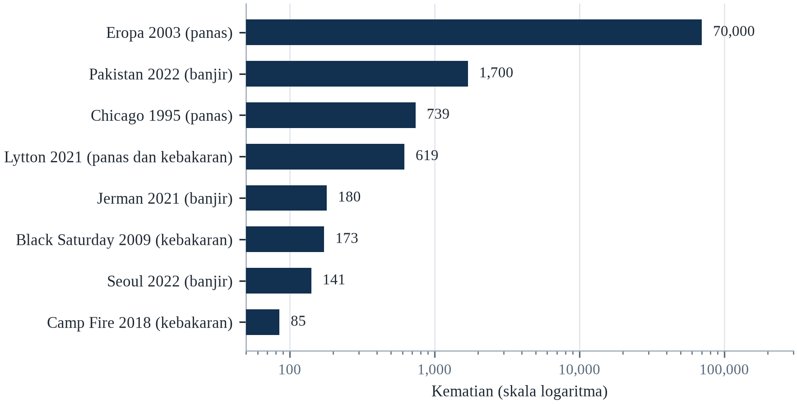||Sumber: Tabel 22.1. Lytton menunjukkan kematian di British Columbia pada 2021.

Dua hal perlu ditekankan. Pertama, bahaya yang sama menghasilkan hasil sangat berbeda tergantung paparan, kerentanan, dan tata kelola, yang berarti sebagian besar kematian akibat bencana dapat dicegah secara prinsip. Kedua, kasus yang paling instruktif bukan yang paling besar tetapi yang paling diagnostik: mereka menyingkap sistem mana yang gagal dan mengapa.

Ekspansi cepat rencana aksi panas dan infrastruktur pendinginan akan menurunkan kematian akibat bahaya yang tumbuh paling cepat. Investasi dalam drainase dan pengelolaan dataran banjir akan mengurangi kerugian banjir perkotaan. Dan data yang lebih baik tentang permukiman informal akan membuat terlihat orang-orang yang saat ini tidak ada dalam peta risiko resmi. Seberapa cepat pemanasan berlangsung tetap menentukan, karena ia menentukan seberapa jauh di luar pengalaman historis ekstrem masa depan akan terjadi.

---

# Bab 23: Studi Kasus: Kekeringan, Pangan, Air dan Keamanan

*Tema: darurat lambat, hak atas pangan dan politik kelangkaan*

Pada Juli 2011, Perserikatan Bangsa-Bangsa menyatakan kelaparan di dua wilayah Somalia selatan (Checchi & Robinson, 2013). Pernyataan itu datang setelah berbulan-bulan peringatan dari Famine Early Warning Systems Network, yang telah memproyeksikan krisis jauh sebelumnya dan menerbitkan peta wilayah berisiko. Pada saat kelaparan dinyatakan, puluhan ribu orang telah meninggal, dan jumlah akhirnya diperkirakan sekitar 258.000, separuhnya anak di bawah lima tahun.

Peringatannya bekerja; responsnya tidak. Akses ke Somalia selatan dibatasi konflik dengan al-Shabaab, yang membatasi operasi kemanusiaan, dan oleh kebijakan donor serta lembaga yang enggan beroperasi di wilayah yang dikuasai kelompok itu. Pangan tersedia di sebagian pasar, tetapi orang tidak mampu membelinya, dan ternak yang menjadi dasar penghidupan pastoralis telah mati karena kekeringan.

Kelaparan Somalia adalah kasus tentang hak atas pangan, bukan tentang pangan. Analisis Amartya Sen tentang kelaparan, pertama diterbitkan pada 1981, berargumen bahwa kelaparan terjadi ketika orang kehilangan kemampuan menguasai pangan — melalui pekerjaan, harga, aset, atau transfer — bukan ketika pangan secara fisik tidak ada (Sen, 1981). Wawasan itu membingkai ulang kelaparan sebagai masalah ekonomi politik, dan menjelaskan mengapa kelaparan terjadi di tengah kelimpahan dan mengapa peringatan dini saja tidak mencegahnya.

Bab ini membahas darurat yang lambat: kekeringan, krisis pangan, kelangkaan air, dan persinggungannya dengan konflik. Bab ini melihat Sahel, Etiopia, Somalia, Suriah, Yaman, Cape Town, São Paulo, dan California, serta krisis harga pangan global 2007–08 dan 2010–11 (FAO, 2023). Kasus-kasus itu menunjukkan bahwa darurat lambat menewaskan lebih banyak orang daripada yang cepat dan menerima perhatian lebih sedikit, karena mereka tidak memiliki satu momen dramatis dan karena korbannya biasanya miskin dan jauh.

Darurat lambat lebih sulit dilihat daripada banjir, dan ketidakterlihatannya sendiri adalah penyebab kematian. Kekeringan yang berkembang selama tiga musim tidak menghasilkan gambar dramatis sampai orang sudah kelaparan, dan pada saat itu intervensi termurah sudah tidak mungkin. Masalah sentral dalam bab ini karena itu bukan ketiadaan informasi — sistem peringatan dini kelaparan telah memprediksi sebagian besar kelaparan terkini — melainkan jurang antara prediksi dan tindakan.

## 23.1 Membaca Kasus yang Lambat

Darurat yang lambat berkembang selama berbulan-bulan atau bertahun-tahun, dan lebih sulit dilihat daripada banjir atau badai. Kekeringan bukan peristiwa tunggal melainkan defisit curah hujan kumulatif yang menghabiskan kelembapan tanah, air tanah, padang rumput, dan waduk; efeknya muncul perlahan dalam hasil panen, kematian ternak, harga pangan, migrasi, dan malnutrisi. Pada saat kelaparan dinyatakan, prosesnya telah berlangsung setahun atau lebih.

Kematiannya juga lambat dan tersebar. Orang meninggal bukan karena satu penyebab tetapi karena interaksi malnutrisi, penyakit, dan kelelahan; kematian dicatat sebagai malnutrisi, campak, diare, atau infeksi pernapasan alih-alih kekeringan. Hasilnya adalah darurat lambat secara sistematis kurang terhitung, dan skalanya dikenali hanya dalam survei retrospektif.

Kasus dalam bab ini karena itu dibaca dengan tiga pertanyaan. Siapa yang terpapar, dan mengapa mereka tidak mampu mengatasinya? Institusi apa yang gagal, dan pada titik mana? Dan apa yang akan mencegah hasilnya — peringatan dini, transfer tunai, investasi air, penyelesaian konflik, atau semuanya? Jawabannya jarang teknologis, karena pengetahuannya biasanya sudah ada sebelum krisis.

Perangkat teknis untuk mengukur krisis pangan telah membaik cukup jauh. Klasifikasi Fase Ketahanan Pangan Terpadu, dikenal sebagai IPC, memberi peringkat kerawanan pangan akut pada skala lima titik dan menyatakan kelaparan hanya ketika ambang tertentu terpenuhi: setidaknya dua puluh persen rumah tangga menghadapi kekurangan pangan ekstrem, malnutrisi akut di atas tiga puluh persen, dan mortalitas di atas dua kematian per sepuluh ribu orang per hari. Jaringan Sistem Peringatan Dini Kelaparan telah menerbitkan proyeksi selama puluhan tahun, dan rekam jejaknya baik. Kegagalan yang bertahan bersifat politis: pemerintah menolak deklarasi kelaparan di wilayahnya, dan donor merespons deklarasi alih-alih proyeksi.

Peringatan dini kelaparan bekerja, dan justru itulah sebab kegagalannya bersifat politik. Jaringan Sistem Peringatan Dini Kelaparan telah memprediksi sebagian besar krisis pangan besar di Tanduk Afrika dan Sahel berbulan-bulan sebelumnya, dan proyeksinya cukup akurat sehingga persistensi kelaparan tidak dapat diatribusikan pada ketidaktahuan. Jurang antara peringatan dan respons telah didokumentasikan dalam banyak kasus, dan penjelasannya konsisten: pemerintah menolak mendeklarasikan kelaparan di wilayahnya, donor menunggu deklarasi, dan uangnya tiba setelah kematian. Tindakan antisipatif adalah upaya memutus urutan itu dengan membiayai prakiraan alih-alih deklarasi.

Kasus lambat lebih sulit dibaca daripada banjir, karena tidak ada satu saat ketika bencananya dimulai. Hujan gagal pada satu musim dan panennya buruk; musim berikutnya gagal dan ternaknya dijual; musim ketiga gagal dan anak-anaknya pergi. Ketika krisisnya terlihat dalam statistik kematian, rumah tangga sudah melewati rangkaian strategi bertahan yang mengupas asetnya satu per satu: tabungan, lalu ternak, lalu tanah, lalu migrasi. Tugas analitisnya adalah mengenali titik ketika bertahan berubah menjadi kemiskinan, dan bertanya apa yang dapat memutus rangkaian itu. Jawabannya hampir selalu peringatan dini, uang tunai, dan waktu keputusan.

Pengukuran krisis lambat bergantung pada instrumen yang dirancang untuk tujuan lain, dan pilihan instrumennya menentukan siapa dihitung sebagai terdampak. Skor konsumsi pangan merangkum keragaman dan frekuensi apa yang dimakan rumah tangga; indeks strategi bertahan menghitung perilaku yang diadopsi rumah tangga ketika kekurangan; pendekatan ekonomi rumah tangga memperkirakan selisih antara kebutuhan rumah tangga dan yang dapat diperolehnya. Masing-masing menghasilkan angka berbeda untuk populasi yang sama, dan angkanya dipakai mengalokasikan bantuan. Ketidaksepakatan di antaranya bukan soal teknis; ia menentukan rumah tangga mana yang menerima transfer.

## 23.2 Kelaparan Sahel

Sahel mengalami kekeringan dan krisis pangan berulang sejak akhir 1960-an. Kekeringan 1968–1974 mengeringkan padang rumput dan tanaman di seluruh wilayah, dan kelaparan yang menyusul menewaskan sekitar 100.000 orang. Krisis besar kedua pada 1984–1985 berdampak pada jutaan orang lainnya, dan gambaran kelaparan di Etiopia serta Sudan membentuk kesadaran global tentang kelaparan.

Curah hujan bukan satu-satunya penyebab. Kebijakan kolonial dan pascakolonial telah mendorong pastoralis ke tanah marginal, membatasi pergerakan mereka, dan melemahkan mekanisme penanggulangan tradisional. Produksi tanaman ekspor menggantikan tanaman pangan di beberapa wilayah, dan konflik di Chad, Etiopia, dan Sudan mengganggu pasar serta bantuan. Kekeringannya parah, tetapi kelaparannya dihasilkan interaksi kekeringan dengan kemiskinan, pengungsian, dan institusi yang lemah.

Adaptasi juga mungkin di sana. Sejak 1980-an, regenerasi alami yang dikelola petani — perlindungan dan pemangkasan pohon di lahan pertanian — telah memulihkan jutaan hektar di Niger, memperbaiki kesuburan tanah, dan meningkatkan hasil. Praktik itu dikembangkan secara lokal, menyebar melalui jaringan petani, dan didukung kebijakan. Ia tidak mencegah semua krisis, tetapi mengurangi kerentanan di wilayah yang mengadopsinya.

Kelaparan Sahel pada 1970-an dan 1980-an menghasilkan salah satu narasi paling berpengaruh dan paling diperdebatkan dalam sejarah lingkungan. Citra gurun yang maju, dipopulerkan pada 1970-an, menyiratkan bahwa penggembalaan berlebih dan pertumbuhan penduduk mengubah lahan semi-kering menjadi gurun, dan respons kebijakannya mencakup pembatasan pergerakan pastoral yang membuat penggembala lebih rentan. Riset kemudian menemukan bahwa kisah 'desertifikasi' itu dilebih-lebihkan dan bahwa beberapa daerah justru menghijau ketika curah hujan pulih, sebagian melalui regenerasi alami yang dikelola petani. Episod ini adalah peringatan tentang seberapa yakin sebuah narasi dapat dibangun di atas catatan yang pendek.

Tembok Hijau Besar adalah upaya paling ambisius membalik degradasi lahan Sahel, dan evolusinya instruktif. Ia dimulai sebagai usulan menanam dinding pohon melintasi benua, dan menjadi program restorasi lahan, pemanenan air dan dukungan penghidupan dalam mosaik proyek. Evaluasi menemukan bahwa komponen yang berhasil adalah yang bekerja bersama petani dan penggembala alih-alih melawan mereka, dan bahwa target penanaman pohon selalu slogan politik alih-alih rencana ekologis. Restorasi bekerja ketika ia menjadi praktik, bukan monumen.

Kelaparan Sahel 1970-an dan 1980-an menewaskan sekitar seratus ribu orang pada kekeringan 1968 sampai 1974, dan gambar dari periode itu membentuk cara dunia memikirkan kelaparan. Penjelasan yang lama mendominasi bersifat lingkungan: terlalu banyak orang, terlalu banyak ternak, terlalu sedikit hujan. Riset berikutnya merumitkan gambaran itu. Hujan memang menurun, tetapi kerentanannya dihasilkan kebijakan kolonial dan pascakolonial yang mendorong penggembala ke tanah marginal, oleh runtuhnya perdagangan ternak, dan oleh kegagalan pemerintah serta donor merespons peringatan dini. Kelaparan itu kegagalan hak atas pangan sama besarnya dengan kegagalan hujan.

Sahel adalah wilayah ketika perdebatan tentang tanah, hujan, dan konflik paling keras diperjuangkan, dan perdebatannya telah bergerak. Gambaran gurun yang maju digantikan gambaran lebih akurat tentang wilayah yang hujannya pulih sebagian sejak 1980-an dan penduduknya tumbuh lebih cepat daripada yang dapat ditopang tanah dengan praktik sekarang. Tembok Hijau Besar, yang dimulai sebagai usulan deretan pohon melintasi benua dan menjadi program restorasi lahan, adalah respons paling terlihat. Bukti dari lokasi yang direstorasi, praktiknya bekerja bila tenurial tanahnya pasti dan komunitasnya terlibat, dan gagal bila dipaksakan.

## 23.3 Etiopia 1984–1985 dan Debat Hak atas Pangan

Kelaparan Etiopia 1984–1985 menewaskan sekitar satu juta orang (de Waal, 1997). Ia menyusul dua musim hujan yang gagal, tetapi juga dihasilkan konflik, kebijakan pemukiman ulang, dan pengalihan sumber daya untuk perang. Pangan tersedia di sebagian pasar, dan respons pemerintah dibentuk prioritas militernya serta kecurigaannya terhadap lembaga internasional.

Pendekatan hak atas pangan Sen menjelaskan paradoks itu. Orang kelaparan ketika mereka tidak dapat menguasai pangan, entah karena asetnya runtuh, pekerjaannya hilang, harga naik di luar jangkauan, atau transfer gagal. Di Etiopia, pastoralis kehilangan ternak, petani kehilangan panen, dan orang yang mengungsi kehilangan akses ke keduanya, sementara pasar di wilayah lain terus berfungsi.

Kelaparan itu juga mengubah praktik kemanusiaan. Ia mendorong pembentukan Famine Early Warning Systems Network, perluasan bantuan pangan, dan debat tentang pembangunan alih-alih bantuan darurat. Debatnya berlanjut: lembaga kini menekankan transfer tunai, perlindungan sosial, dan ketangguhan, tetapi masalah dasarnya — bahwa peringatan tidak otomatis menghasilkan respons — tetap ada.

Analisis Amartya Sen atas kelaparan Bengal 1943 mengubah cara kelaparan dipahami, dan Etiopia 1984–85 menguji teori itu dalam kondisi berbeda. Sen berargumen bahwa kelaparan dapat terjadi tanpa penurunan ketersediaan pangan, karena orang yang membutuhkan pangan mungkin tidak memiliki hak — pendapatan, tanah, akses pasar — untuk memperolehnya. Di Etiopia, pangan tersedia di beberapa pasar sementara orang kelaparan di tempat lain, dan program pemukiman ulang serta kampanye kontrainsurgensi pemerintah mengalihkan sumber daya dan membatasi pergerakan. Karya de Waal kemudian menggambarkan kelaparan sebagai proses yang dapat dipercepat atau diperlambat pemerintah dan pemberontak, yang menjadikannya peristiwa politik.

Pendekatan hak Sen sering diringkas sebagai klaim bahwa kelaparan terjadi tanpa kekurangan pangan, dan ringkasan itu benar sekaligus terlalu sederhana. Argumennya adalah orang kelaparan ketika hak mereka atas pangan runtuh, entah karena kehilangan pekerjaan, jatuhnya harga ternak atau gagal panen, dan bahwa keruntuhan itu dapat terjadi sementara pasar masih penuh. Implikasi kebijakannya adalah pencegahan kelaparan menuntut dukungan pendapatan dan akses pasar, bukan hanya bantuan pangan, dan itulah sebab transfer tunai telah menjadi pusat respons kelaparan modern.

Etiopia 1984 dan 1985 adalah kasus yang menghasilkan teori entitlement tentang kelaparan, dan teorinya mengubah cara dunia merespons. Argumen Amartya Sen, kelaparan terjadi ketika orang kehilangan kemampuan mengakses pangan melalui haknya — melalui produksi sendiri, tenaga kerja, aset, atau transfer — bukan ketika pangan tidak ada di pasar. Di Etiopia, pangan diekspor dari wilayah terdampak sementara orang kelaparan, dan respons pemerintah dibentuk perang serta kebijakan permukiman kembali yang tidak melayani orang yang dipindahkan. Jumlah kematian diperkirakan sekitar satu juta, dan krisis itu menghasilkan sistem peringatan dini serta bantuan pangan internasional pertama yang serius.

Respons Etiopia terhadap kelaparan 1984 mengubah institusi negaranya sekaligus sistem internasional, dan perubahannya salah satu yang paling penuh harapan dalam buku ini. Program Jaring Pengaman Produktif, yang dimulai 2005, memberi uang tunai atau pangan kepada rumah tangga sebagai imbalan pekerjaan restorasi lahan, dan dirancang agar dapat diprediksi alih-alih berbasis darurat, sehingga rumah tangga dapat merencanakan. Program itu diakui mengurangi kebutuhan bantuan darurat pada tahun buruk, dan telah ditiru di seluruh kawasan. Pelajarannya, sistem perlindungan sosial yang sudah ada sebelum krisis lebih murah dan efektif.

## 23.4 Somalia 2011 dan 2022

Kelaparan Somalia 2011 dinyatakan setelah berbulan-bulan peringatan, dan menewaskan sekitar 258.000 orang (Checchi & Robinson, 2013). Krisis 2022 berbeda dalam hal penting: tindakan awal oleh lembaga kemanusiaan dan organisasi lokal, termasuk transfer tunai dan dukungan ternak, diyakini mencegah kelaparan yang dinyatakan, meskipun jumlah kematiannya tetap tinggi. Studi yang diterbitkan pada 2023 memperkirakan sekitar 43.000 kematian berlebih di Somalia pada 2022, separuhnya anak di bawah lima tahun.

Perbandingannya instruktif karena defisit curah hujannya serupa. Pada 2011, akses dibatasi, respons tertunda, dan krisis dibiarkan berkembang; pada 2022, lembaga dan kelompok lokal bertindak lebih awal, uang tunai mencapai orang lebih cepat, dan pengobatan malnutrisi diperluas. Perbedaan hasilnya sebagian besar perbedaan kecepatan dan keluwesan respons.

Pelajarannya adalah kelaparan bukan peristiwa cuaca. Ia hasil politik dan ekonomi yang dapat dicegah dengan tindakan tepat waktu, dan pengetahuan yang diperlukan untuk bertindak biasanya tersedia sebelum krisis memuncak. Yang sering hilang adalah kemauan melepaskan dana lebih awal, akses untuk menyalurkannya, dan perhatian politik untuk mempertahankan respons setelah kamera pergi.

Masalah ambangnya punya obat praktis yang kini dipakai beberapa lembaga, dan layak dijelaskan karena dapat ditiru. Alih-alih menunggu bukti bahwa kelaparan sudah dimulai, pemicunya adalah prakiraan: prospek curah hujan musiman digabung dengan harga pasar dan surveilans gizi, disepakati lebih dahulu dengan donor, dan mencairkan uang ketika kemungkinan krisis melampaui tingkat tertentu. Karena uangnya diikat sebelum hasilnya diketahui, donornya membeli asuransi alih-alih amal, dan pembayarannya tidak menuntut deklarasi yang membawa biaya politik bagi pemerintah penerimanya. Nilainya kecil dibandingkan respons yang dicegahnya, dan evaluasi program pertama menemukan bahwa uangnya mencapai rumah tangga dua sampai empat bulan lebih awal daripada seruan konvensional.

Respons Somalia 2022 menunjukkan bahwa tindakan antisipatif dapat bekerja dalam skala besar ketika organisasi lokal dibiayai lebih awal. Lembaga kemanusiaan melepaskan uang tunai sebelum kelaparan dideklarasikan, dan komite lokal menyalurkannya bersama dukungan ternak dan truk air. Literatur evaluasi program semacam itu menemukan rumah tangga yang menerima uang tunai lebih awal lebih kecil kemungkinannya menjual aset produktif dan lebih besar kemungkinannya mempertahankan anak di sekolah. Batasnya adalah pemicu harus disepakati sebelumnya dan uangnya harus tersedia sebelum puncak, yang menuntut donor menerima belanja atas dasar prakiraan alih-alih hitungan korban.

Pembedanya operasional, dan perinciannya adalah pelajarannya. Pada 2022 sistem kemanusiaan mulai menyalurkan uang tunai dan mendukung ternak sebelum kelaparan dideklarasikan, memakai organisasi lokal yang sudah punya akses ke distrik terdampak, dan seruannya didanai lebih awal serta lebih penuh daripada 2011. Urutannya penting karena indikator yang meramalkan kelaparan — harga ternak, nilai tukar bagi peternak, penerimaan rawat inap karena malnutrisi — sudah terlihat pada kedua episode berbulan-bulan sebelum krisis memuncak. Yang berubah bukan informasinya melainkan kemauan bertindak atas informasi itu ketika hasilnya masih belum pasti, yaitu kendala yang sama yang dibahas bab-bab pembiayaan buku ini dengan kosakata berbeda.

Ambang IPC sengaja ditetapkan pada titik ketika kerugian sudah besar, dan konsekuensi politiknya berjalan dua arah. Bagi pemerintah yang wilayahnya akan dinyatakan kelaparan, deklarasi berarti pengakuan kegagalan dan sering berarti hilangnya kendali atas distribusi bantuan; karena itu penundaan kadang merupakan keputusan politik yang disengaja, bukan kelalaian teknis. Bagi donor, deklarasi adalah pemicu anggaran dan perhatian media, sehingga uang sering tiba setelah kebutuhan memuncak. Reformasi yang paling banyak dibahas karena itu bukan menurunkan ambangnya, yang akan menghasilkan alarm palsu dan melemahkan kredibilitas sistem, melainkan memisahkan pencairan dana dari deklarasi: prakiraan memicu pembayaran, dan deklarasi tetap menjadi pernyataan teknis tentang apa yang sudah terjadi.

## 23.5 Suriah: Kekeringan, Pengungsian dan Konflik

Antara 2006 dan 2010, Suriah mengalami kekeringan multi-tahun terburuk dalam catatan instrumental (Kelley dkk., 2015). Curah hujan turun menjadi sebagian kecil dari normal di timur laut, panen gagal, dan ternak musnah. Sekitar 1,5 juta orang bergerak dari daerah pedesaan ke kota yang sudah berjuang menyerap pengungsi Irak serta menyediakan pekerjaan dan perumahan.

Kekeringan itu tidak menyebabkan perang saudara yang dimulai pada 2011, dan analis memperingatkan agar tidak membuat klaim kausal sederhana. Tetapi ia berkontribusi pada kondisi tempat perang berlangsung: penghidupan pedesaan runtuh, harga pangan naik, dan kegagalan pemerintah merespons mengikis legitimasi di wilayah terdampak. Studi, termasuk karya Kelley dkk. (2015) dan Selby dkk. (2017), memperdebatkan bobot kekeringan relatif terhadap faktor politik, tetapi sepakat bahwa ia berinteraksi dengannya.

Kasus Suriah menggambarkan konsep pengali ancaman. Perubahan iklim tidak menentukan konflik, tetapi ia dapat memperkuat stres yang sudah ada — pengangguran, ketimpangan, migrasi, institusi lemah — dan mengurangi kapasitas negara mengelolanya. Implikasi kebijakannya bukan bahwa iklim menyebabkan perang tetapi bahwa adaptasi iklim dan pencegahan konflik harus dirancang bersama.

Kekeringan Suriah menjadi kasus uji bagi argumen 'iklim sebagai pengganda ancaman', dan perdebatan di sekitarnya lebih instruktif daripada kesimpulannya. Kelley dan rekan-rekannya berargumen pada 2015 bahwa kekeringan 2006–2010, yang menjadi lebih mungkin karena perubahan iklim, berkontribusi pada keruntuhan pertanian, perpindahan pedesaan dan karena itu pada kondisi yang menghasilkan pemberontakan. Selby dan rekan-rekannya menantang rantai kausal itu pada 2017, mencatat bahwa kekeringan memengaruhi daerah berbeda secara berbeda dan bahwa ekonomi politik, bukan curah hujan, menentukan siapa yang terpapar. Pertukaran itu memperjelas bahwa iklim dapat menjadi kondisi penyumbang tanpa menjadi sebab yang memadai.

Kasus Suriah sering dikutip sebagai bukti bahwa perubahan iklim menyebabkan konflik, dan keilmuan mendukung klaim yang lebih terbatas. Kekeringannya berat dan sebagian dapat diatribusikan pada iklim, dan ia memindahkan ratusan ribu orang pedesaan ke kota yang sudah tertekan. Apakah perpindahan itu menyumbang pada pemberontakan 2011 bergantung pada faktor yang tidak dapat ditangkap model iklim: respons rezim, distribusi patronase, peran dinas keamanan dan konteks regional. Iklim adalah stresor dalam sistem yang sudah rapuh, dan itulah temuan yang penting bagi kebijakan.

Suriah adalah kasus ketika kekeringan, perang, dan kegagalan kebijakan terjerat, dan jeratannya adalah pelajarannya. Antara 2006 dan 2010, negara itu mengalami kekeringan multi-tahun terburuk dalam catatan instrumental, dan ratusan ribu keluarga petani pindah ke kota. Respons pemerintah berpihak pada pertanian beririgasi dengan air tanah, yang menipiskan akuifer dan memberi imbalan pada yang punya koneksi, sementara petani kecil yang bergantung pada tadah hujan menerima sedikit dukungan. Kekeringan tidak menyebabkan perang, dan ia menyumbang pada keluhan serta pengungsian yang dimanfaatkan perang.

Atribusi kekeringan Suriah menjadi studi kasus bagaimana temuan ilmiah dipakai dan disalahgunakan dalam argumen politik. Risetnya menemukan kekeringan itu lebih mungkin karena pemanasan akibat manusia, dan temuannya cepat diterjemahkan menjadi judul bahwa perubahan iklim menyebabkan perang. Versi hati-hatinya, kekeringan menyumbang pada perpindahan pedesaan yang membebani kota, respons pemerintah terhadap kekeringan adalah pilihan politik, dan perangnya punya banyak sebab yang salah satunya iklim. Politisasi temuannya merusak kredibilitas sains di kalangan yang tidak setuju dengan kebijakannya.

## 23.6 Yaman: Air, Konflik dan Penyakit

Yaman adalah salah satu negara paling kekurangan air di dunia, dan akuifernya terkuras lebih cepat daripada pengisian ulangnya. Sana'a, ibu kota, diproyeksikan kehabisan air yang dapat diakses secara ekonomis dalam beberapa dekade, dan daerah pedesaan bergantung pada sumur yang semakin dalam. Pertanian mengonsumsi sebagian besar air, termasuk qat beririgasi, tanaman tunai dengan kebutuhan air tinggi.

Konflik yang dimulai pada 2014 menghancurkan sebagian besar infrastruktur air dan mengganggu rantai pasok. Pada 2017, wabah kolera menghasilkan lebih dari satu juta kasus suspek, terbesar dalam sejarah modern, didorong air tercemar dan sanitasi yang kewalahan. Wabah itu tidak disebabkan kekeringan, tetapi dimungkinkan oleh runtuhnya sistem air dan sanitasi.

Yaman menggambarkan interaksi kelangkaan air, konflik, dan penyakit. Setiap stresor mengurangi kapasitas mengelola yang lain: perang merusak infrastruktur, kelangkaan menaikkan harga, penyakit mengalahkan layanan kesehatan, dan ketidakstabilan yang dihasilkan membuat rekonstruksi lebih sulit. Kasus itu menunjukkan bahwa keamanan air bukan hanya soal pasokan tetapi soal tata kelola, infrastruktur, dan perdamaian.

Krisis air Yaman mendahului perangnya dan menjadi malapetaka karena perang itu. Akuifer ibu kota telah disedot selama puluhan tahun, dan penggunaan air pertanian, terutama untuk qat, mencakup mayoritas besar konsumsi. Perang menghancurkan infrastruktur pompa, memindahkan jutaan orang, dan menciptakan kondisi bagi wabah kolera terbesar di dunia. Truk tangki air menjadi jalur pasokan utama bagi sebagian besar penduduk, dengan biaya yang tidak dapat ditanggung rumah tangga. Kasus ini menunjukkan bagaimana penipisan sumber daya yang lambat dan konflik yang cepat saling berinteraksi: masing-masing membuat yang lain lebih sulit dilalui.

Ekonomi air Yaman adalah studi kasus tentang bagaimana subsidi dapat bertahan melampaui tujuannya. Subsidi solar membuat pemompaan air tanah murah, yang mendorong perluasan qat beririgasi dan penipisan akuifer, dan ketika perang mengganggu pasokan bahan bakar pemompaan berhenti dan harga air naik. Urutannya mengingatkan bahwa penipisan sumber daya sering didorong kebijakan alih-alih iklim, dan bahwa sinyal iklim tiba dalam sistem yang sudah tertekan oleh keputusan puluhan tahun sebelumnya.

Yaman adalah kasus ketika kelangkaan air, konflik, dan penyakit saling menguatkan dalam lingkaran tertutup. Negara itu termasuk paling langka air di dunia, dan pertaniannya bergeser ke qat, tanaman haus air dengan pasar andal, yang mengurangi lahan untuk pangan. Perang menghancurkan infrastruktur yang seharusnya menyalurkan air dan layanan kesehatan, dan wabah kolera yang dihasilkan termasuk yang terbesar dalam catatan. Lingkarannya khas krisis gabungan: perang mencegah investasi air yang akan mengurangi kelangkaan, kelangkaan menajamkan keluhan yang memicu perang, dan runtuhnya layanan kesehatan mengubah penyakit yang dapat diobati menjadi epidemi.

Krisis air Yaman adalah kasus ketika ekonomi dan hidrologi adalah sistem yang sama. Pertaniannya didominasi qat, yang beririgasi dan menguntungkan serta mengonsumsi sebagian besar air, dan pergeseran ke qat adalah respons rasional terhadap pasar yang membayar lebih baik daripada tanaman pangan. Perang kemudian menghancurkan pompa, pipa, dan bahan bakar, dan air yang tersedia terlalu mahal bagi rumah tangga termiskin. Instalasi desalinasi yang akan mengurangi tekanan pada akuifer menuntut energi dan modal yang tidak dimiliki negara itu, yang merupakan definisi jebakan.

## 23.7 Cape Town dan São Paulo: Krisis Air Perkotaan

Krisis Cape Town 2018 membawa kota besar hampir kehabisan air. Setelah tiga tahun kekeringan, level waduk turun ke sekitar 20 persen, dan pejabat bersiap menghadapi Day Zero, ketika keran dimatikan dan warga mengambil air di titik distribusi. Kota itu menghindari hasil tersebut melalui pembatasan ketat, pengelolaan tekanan, perbaikan kebocoran, dan kampanye publik, tetapi krisis itu menyingkap kerentanan kota yang tumbuh dan bergantung pada pasokan yang bervariasi.

São Paulo menghadapi krisis serupa pada 2014–2015. Sistem waduk Cantareira, yang memasok sekitar separuh air wilayah metropolitan, turun di bawah 5 persen kapasitas, dan pejabat mempertimbangkan penjatahan. Krisis itu dikelola melalui pembatasan, transfer antarcekam air, dan curah hujan, tetapi ia menyingkap risiko bergantung pada satu sistem waduk untuk wilayah metropolitan lebih dari 20 juta orang.

Kedua kasus menunjukkan bahwa krisis air perkotaan biasanya dihasilkan kombinasi kekeringan, pertumbuhan permintaan, kebocoran, dan perencanaan buruk alih-alih curah hujan semata. Kota yang berinvestasi dalam sumber yang beragam, pengelolaan permintaan, pengurangan kebocoran, dan komunikasi publik dapat bertahan dari kekeringan parah; kota yang tidak dapat mendekati keruntuhan bahkan di negara kaya.

Cape Town dan São Paulo adalah dua kasus paling terdokumentasi tentang kota besar yang mendekati akhir airnya, dan keduanya lolos melalui manajemen permintaan alih-alih pasokan baru. Sistem Cantareira di São Paulo turun di bawah lima persen kapasitasnya pada 2015, dan negara bagian merespons dengan penurunan tekanan, bonus konservasi dan transfer darurat antardas. Respons Cape Town menggabungkan tarif, pembatasan, perbaikan kebocoran dan kampanye komunikasi publik yang membuat konsumsi terlihat. Dalam kedua kasus krisisnya ditunda, bukan diselesaikan: pertumbuhan permintaan yang mendasar dan paparan terhadap kekeringan multi-tahun tetap ada.

Cape Town menghindari Day Zero bergantung pada kampanye komunikasi yang membuat air terlihat. Kota menerbitkan level waduk setiap hari, menamai ambang ketika keran akan ditutup, dan menerjemahkan konsumsi menjadi angka per orang yang dapat dibandingkan warga dengan tetangganya. Konsumsi turun lebih dari separuh dalam tiga tahun, dan penurunannya bertahan setelah kekeringan berakhir. Pelajarannya bukan bahwa orang merespons kelangkaan melainkan bahwa mereka merespons ukuran kelangkaan yang dibagi dan terbaca, yang merupakan pencapaian tata kelola alih-alih pencapaian teknologi.

Kekeringan di Indonesia adalah darurat lambat yang jarang sampai ke berita utama, dan mekanismenya sama dengan di tempat lain. Tahun El Niño mengurangi curah hujan di Jawa, Sumatra dan Sulawesi, waduk turun, tanam padi tertunda atau ditinggalkan, dan rumah tangga pedesaan bertahan dengan menjual ternak, berutang dan bermigrasi ke kota mencari kerja. Pemerintah merespons dengan penyemaian awan, truk air dan impor beras, dan intervensinya tiba setelah keputusan tanam diambil. Pelajarannya adalah nilai prakiraan musiman ditentukan oleh apakah ia menjangkau petani sebelum keputusan, yang merupakan pertanyaan layanan penyuluhan alih-alih pertanyaan sains.

Cape Town dan São Paulo adalah dua krisis air perkotaan yang datang melalui jalur berbeda dan diselesaikan dengan cara berbeda. Waduk São Paulo turun ke tingkat berbahaya pada 2014 dan 2015 setelah gabungan deforestasi di daerah tangkapan, kebocoran jaringan distribusi, dan kegagalan berinvestasi pada tampungan, dan negara bagian merespons dengan campuran penjatahan, penurunan tekanan, dan transfer darurat antarcelungan. Krisis Cape Town pada 2018 digerakkan kekeringan tiga tahun yang tidak dirancang sistemnya, dan respons kota itu menjadi model tentang apa yang dapat dilakukan kota ketika alternatifnya kehabisan air.

Respons Cape Town terhadap prospek kehabisan air adalah contoh terbaik terdokumentasi tentang manajemen permintaan pada skala kota, dan dokumentasinya jujur tentang apa yang berhasil dan tidak. Kota menerbitkan angka harian tingkat bendungan, menamai hari ketika keran akan ditutup, dan menegakkan pembatasan dengan tarif serta inspektur. Konsumsinya turun hampir separuh dalam setahun, dan penurunannya dicapai rumah tangga serta usaha, bukan pasokan baru. Risiko pendekatannya, ia bergantung pada kepercayaan publik, dan kepercayaan lebih mudah hilang daripada dibangun.

## 23.8 California: Air Tanah dan Kekeringan Panjang

Kekeringan California 2012–2016 adalah salah satu yang paling parah dalam catatan sejarah negara bagian. Level waduk turun, lapisan salju mencapai rekor terendah, dan petani memompa air tanah untuk mengompensasi. Hasilnya adalah penurunan permukaan tanah di Central Valley, tempat tanah turun hingga beberapa meter di sebagian wilayah, merusak kanal serta jalan, dan secara permanen mengurangi kapasitas akuifer.

Kekeringan itu menyingkap kegagalan tata kelola. Air tanah sebagian besar tidak diatur, dan pemompaan diperlakukan sebagai hak pribadi. Pada 2014, negara bagian mengesahkan Sustainable Groundwater Management Act, yang mewajibkan lembaga lokal mengembangkan rencana menyeimbangkan akuifer pada 2040-an. Undang-undang itu reformasi signifikan, tetapi disahkan setelah puluhan tahun pengurasan dan akan memerlukan puluhan tahun untuk dilaksanakan.

California juga menggambarkan interaksi kekeringan dan kebakaran. Kekeringan menewaskan jutaan pohon, dan kayu mati menjadi bahan bakar kebakaran berikutnya. Kebakaran Camp 2018 dan musim kebakaran 2020 sebagian merupakan produk tahun-tahun kekeringan. Urutannya menunjukkan bahwa bahaya lambat dan cepat saling terhubung, dan mengelola salah satunya memerlukan perhatian pada yang lain.

Kebijakan kekeringan California dibentuk oleh doktrin hukum yang mendahului ilmu iklim. Prior appropriation, prinsip bahwa pengguna pertama yang mengklaim air memiliki hak tertua, mengalokasikan air berdasarkan penggunaan historis alih-alih kebutuhan kini, dan ia menjadikan air tanah sebagai penyangga yang disedot petani ketika pasokan permukaan dipangkas. Hasilnya adalah penurunan muka tanah di Central Valley, di mana permukaan tanah turun beberapa meter di sebagian daerah, secara permanen mengurangi kapasitas akuifer menyimpan air. Undang-Undang Pengelolaan Air Tanah Berkelanjutan 2014 adalah upaya serius pertama untuk mengatur pengambilan itu, dan implementasinya masih diperdebatkan.

Kesepakatan Sungai Colorado 2023 adalah pratinjau bagaimana politik air akan bekerja di Barat yang lebih panas. Setelah dua dekade kekeringan, negara bagian cekungan sepakat memangkas konsumsi secara berarti dengan imbalan kompensasi federal, dan kesepakatan itu bersifat sementara karena aturan alokasi dasarnya berasal dari 1922 dan mengasumsikan debit yang tidak lagi ada. Negosiasinya melibatkan negara bagian, suku bangsa dan Meksiko, dan suku bangsa dilibatkan terlambat meskipun memegang hak tertua. Kasus ini menunjukkan bahwa adaptasi air lebih tentang merenegosiasi hak lama daripada menemukan pasokan baru.

California adalah kasus yang menunjukkan bagaimana kekeringan panjang dapat dilewati dan tetap meninggalkan warisan penipisan. Pertanian negara bagian itu paling produktif di dunia dan sangat bergantung pada air tanah, yang dipompa pada laju tak berkelanjutan selama kekeringan 2012–2016 dan lagi pada 2020–2022. Undang-Undang Pengelolaan Air Tanah Berkelanjutan yang disahkan 2014 menciptakan kerangka untuk menyeimbangkan cekungan, dan implementasinya kini memaksa perhitungan: sebagian lahan pertanian paling produktif harus dihentikan, dan komunitas yang bergantung padanya harus mencari ekonomi lain.

Undang-Undang Pengelolaan Air Tanah Berkelanjutan California adalah hukum pertama dalam sejarah negara bagian itu yang mewajibkan cekungan diseimbangkan, dan implementasinya kini eksperimen paling menarik dalam kebijakan air di dunia. Undang-undangnya tidak menyebut bagaimana keseimbangan dicapai; ia mendelegasikannya ke lembaga lokal yang harus menyusun rencana dan menyerahkannya ke negara bagian, dan rencananya diuji terhadap syarat bahwa akuifernya tidak ditipiskan. Konsekuensinya, sebagian lahan pertanian paling produktif di negeri itu akan dihentikan, dan komunitas yang bergantung padanya menegosiasikan kompensasi.

## 23.9 Harga Pangan, Larangan Ekspor dan Krisis 2007–2008

Pada 2007 dan 2008, harga pangan dunia naik tajam (FAO, 2023). Harga gandum lebih dari dua kali lipat, harga beras tiga kali lipat, dan jagung serta kedelai mencapai rekor tertinggi. Kenaikan itu didorong kombinasi faktor: permintaan biofuel, harga minyak yang naik, panen buruk di beberapa negara pengekspor, stok rendah, dan investasi spekulatif dalam futures komoditas.

Pemerintah merespons dengan pembatasan ekspor. India dan Vietnam membatasi ekspor beras, Argentina mengenakan pajak ekspor kedelai, dan Rusia kemudian melarang ekspor gandum setelah kekeringan 2010. Pembatasan itu rasional bagi masing-masing negara secara individual dan katastrofik secara kolektif: mereka menarik pasokan dari pasar dunia, mendorong harga lebih tinggi bagi pengimpor, dan menciptakan pembelian panik. Lebih dari 30 negara mengalami kerusuhan pangan.

Krisis itu menunjukkan bahwa ketahanan pangan bergantung pada perdagangan sebanyak pada produksi. Negara yang bergantung pada impor terpapar guncangan harga, dan negara yang membatasi ekspor mengekspor ketidakstabilan. Pelajaran bagi kebijakan iklim adalah adaptasi harus mencakup aturan perdagangan dan kerja sama regional, karena kekeringan di satu lumbung pangan dapat menjadi krisis pangan di benua lain.

Krisis harga pangan 2007–2008 menunjukkan bahwa guncangan iklim dapat menjadi peristiwa global melalui pasar alih-alih melalui panen (FAO, 2023). Harga gandum dan beras lebih dari dua kali lipat, dan kenaikannya diperkuat pembatasan ekspor: ketika produsen besar melarang ekspor, importir panik dan membeli, yang mendorong harga lebih tinggi. Kerusuhan menyusul di lebih dari tiga puluh negara. Episod itu menetapkan pola yang berulang setelah 2022, ketika perang di Ukraina mengganggu pengiriman gandum dan kontrol ekspor kembali memperkuat guncangan. Ketahanan pangan karena itu merupakan fungsi kebijakan dagang sama besarnya dengan fungsi curah hujan.

Yang membedakan 2022 dari 2008 adalah kecepatan respons internasionalnya, dan batas kecepatan itu sendiri adalah pelajarannya. Gangguan terlihat jelas — pelabuhan diblokade, kapal tidak bergerak, dan harga melonjak dalam hitungan pekan — sehingga negosiasi dapat difokuskan pada satu masalah yang dapat digambarkan: jalur laut. Inisiatif Gandum Laut Hitam memulihkan sebagian besar pengiriman dan menurunkan harga sebelum runtuh pada 2023, dan keruntuhannya menunjukkan bahwa kesepakatan yang hanya bergantung pada satu perantara dapat berakhir bersamanya. Kegagalan panen yang lambat tidak memiliki satu titik fokus semacam itu, yang menjelaskan mengapa dunia bertindak lebih cepat terhadap blokade yang dapat difoto daripada terhadap kekeringan yang dapat dihitung.

Krisis 2007–2008 menghasilkan seperangkat reformasi yang masih menjadi dasar kebijakan ketahanan pangan. Cadangan Beras Darurat ASEAN Plus Three dibentuk untuk menyimpan cadangan fisik dan finansial, Sistem Informasi Pasar Pertanian dibuat untuk memperbaiki transparansi, dan G20 berkomitmen menghindari pembatasan ekspor. Masing-masing merupakan jawaban parsial: cadangannya kecil relatif terhadap permintaan regional, sistem informasinya bergantung pada pelaporan sukarela, dan pembatasan ekspor kembali pada 2022. Pelajarannya adalah institusi yang dibuat dalam krisis cenderung dirancang untuk krisis terakhir.

Krisis harga pangan 2007 dan 2008 adalah saat dunia menemukan bahwa sistem pangannya memiliki kelonggaran lebih sedikit daripada yang dikiranya (FAO, 2023). Rangkaian guncangan cuaca di negara produsen utama, kenaikan tajam harga minyak dan pupuk, gelombang pembatasan ekspor, dan perebutan stok menghasilkan lonjakan harga yang menggandakan biaya bahan pokok dalam setahun dan mendorong puluhan juta orang ke kemiskinan. Kerusuhan yang menyusul terjadi di lebih dari tiga puluh negara, dan akibat politiknya terasa bertahun-tahun. Episode itu menetapkan pola yang berulang sejak itu.

Krisis 2007 dan 2008 menghasilkan seperangkat aturan yang seharusnya mencegah pengulangan, dan aturannya diuji pada 2022 dan gagal sebagian. Disiplin Organisasi Perdagangan Dunia atas pembatasan ekspor lemah, dan kewajiban notifikasinya dilanggar; stok yang seharusnya menstabilkan pasar dipegang negara yang membatasi ekspornya sendiri. Reformasi yang dibicarakan adalah cadangan regional, kode perilaku pembatasan ekspor, dan mekanisme transparansi stok, dan tidak satu pun disepakati. Polanya, pelajarannya diambil dalam krisis dan dilupakan sebelum krisis berikutnya.

## 23.10 Apa yang Diajarkan Kasus-Kasus Itu

Lintas kasus, tiga pelajaran berulang. Pertama, kelaparan dan krisis air biasanya kegagalan hak atas pangan dan tata kelola alih-alih kelangkaan absolut. Pengetahuan yang diperlukan untuk mencegahnya ada, dan pangan atau airnya sering tersedia; yang gagal adalah akses, keterjangkauan, dan kemauan politik.

Kedua, peringatan dini perlu tetapi tidak cukup. Somalia 2011 memiliki peringatan dan tetap mengalami kelaparan; Etiopia 1984–85 memiliki peringatan dan pemerintah yang memprioritaskan perang (Checchi & Robinson, 2013). Yang mengubah hasil adalah penerjemahan peringatan menjadi tindakan awal, yang memerlukan pembiayaan yang telah diatur, pemrograman yang luwes, dan akses.

Ketiga, darurat lambat bersifat kumulatif dan saling terhubung. Kekeringan menguras air tanah, pengurasan air tanah mengurangi ketangguhan terhadap kekeringan berikutnya, dan kekeringan yang digabungkan dengan konflik menghasilkan kelaparan. Mengelolanya memerlukan investasi jangka panjang dalam infrastruktur air, perlindungan sosial, dan penyelesaian konflik, bukan hanya bantuan darurat. Kasus-kasus itu menunjukkan bahwa intervensi paling efektif sering yang paling tidak dramatis: transfer tunai, sumur bor, pengelolaan padang rumput, dan kesepakatan damai.

Kasus-kasus itu bertemu pada pelajaran yang mudah dinyatakan dan sulit dilembagakan: kelaparan biasanya kegagalan akses, informasi dan kemauan politik alih-alih kegagalan produksi pangan. Instrumen yang bekerja sudah diketahui — peringatan dini, transfer tunai, perlindungan sosial, akses pasar, dan negosiasi kemanusiaan — dan semuanya lebih murah daripada respons darurat yang menyusul deklarasi. Yang hilang adalah mandat untuk bertindak atas proyeksi alih-alih atas malapetaka, yang merupakan masalah politik yang menyamar sebagai masalah teknis.

Tindakan antisipatif adalah reformasi paling menjanjikan dalam respons kemanusiaan, dan basis buktinya tumbuh. Prinsipnya adalah melepaskan dana ketika prakiraan melewati ambang, sebelum krisis memuncak, alih-alih setelah deklarasi, dan uji coba di Sahel, Tanduk Afrika dan Asia Selatan menemukan bahwa rumah tangga yang menerima uang tunai lebih awal lebih kecil kemungkinannya menjual aset atau melewatkan makan. Hambatannya institusional: donor akuntabel atas belanja berdasarkan bukti kebutuhan, dan prakiraan tidak sama dengan hitungan korban. Mengubahnya menuntut jenis audit yang berbeda.

Kasus lambat dalam bab ini mengajarkan empat pelajaran yang berlaku jauh melampaui tempat-tempat itu. Pertama, peringatan dini hanya berguna bila memicu tindakan dini, dan tindakan dini menuntut uang yang tersedia sebelum krisis dinyatakan. Kedua, konflik dan iklim berinteraksi dengan cara yang memperburuk keduanya, dan akses kemanusiaan sering kendala pengikat respons. Ketiga, keadaan akuifer, waduk, dan padang adalah indikator awal yang diukur dalam bulan dan tahun, yang memberi pembuat keputusan lebih banyak waktu daripada yang biasanya mereka pakai. Keempat, rumah tangga termiskin paling kurang mampu menyerap guncangan.

Pelajaran yang berjalan melalui kasus-kasus lambat adalah waktu uang menjadi variabel yang menentukan hasilnya. Transfer yang tiba sebelum rumah tangga menjual ternaknya menjaga asetnya; transfer yang sama setelah penjualan mengompensasi rumah tangga yang sudah kehilangan sarana untuk pulih. Program aksi antisipatif yang diuji satu dekade terakhir mencairkan dana berdasarkan prakiraan alih-alih deklarasi, dan evaluasinya menemukan uangnya dibelanjakan lebih baik dan rumah tangganya pulih lebih cepat. Hambatannya aturan fiskal yang menuntut bencana dinyatakan sebelum uang dapat dicairkan, dan aturan itu pilihan.

Bukti tentang apa yang berhasil dalam krisis lambat membaik karena intervensinya dievaluasi, dan hasilnya cukup konsisten untuk ditindaklanjuti. Transfer tunai yang datang lebih awal melindungi aset, dan rumah tangga yang menerimanya lebih jarang menjual ternak atau menarik anak dari sekolah. Pembiayaan berbasis prakiraan, yang mencairkan uang berdasarkan peluang alih-alih deklarasi, telah diuji di belasan negara dan evaluasinya menemukan bahwa ia menjangkau lebih banyak rumah tangga per dolar daripada seruan bantuan konvensional. Hambatannya aturan fiskal, yang menuntut deklarasi yang datang setelah kerusakannya, dan aturan itu pilihan politik.

Pembedaan antara kekeringan dan kelaparan adalah pembedaan paling penting secara operasional di bagian buku ini, dan mencampur keduanya menghasilkan kegagalan klasik. Kekeringan adalah defisit curah hujan, dan ia terukur berbulan-bulan sebelum merugikan siapa pun; kelaparan adalah runtuhnya hak yang memungkinkan rumah tangga memperoleh pangan, dan ia dihasilkan harga, konflik, akses, serta waktu bantuan sama besarnya dengan hujan. Pemerintah yang memperlakukan kekeringan sebagai masalahnya akan berinvestasi pada air dan menunggu panen; rumah tangga yang kehilangan ternaknya dalam selang itu tidak akan dapat memakai airnya ketika tiba. Intervensi yang berhasil bertindak pada haknya, bukan pada hujannya: uang tunai sebelum ternak dijual, pangan sebelum harga memuncak, dan akses yang dirundingkan sebelum jalan ditutup.

## 23.11 Studi Kasus: Kelaparan Somalia 2011

Kelaparan 2011 di Somalia selatan menyusul dua musim hujan gagal berturut-turut dan kekeringan yang melanda seluruh Tanduk Afrika (Checchi & Robinson, 2013). Pastoralis kehilangan ternak, petani kehilangan panen, dan harga pangan naik tajam. Pada Juli, Perserikatan Bangsa-Bangsa menyatakan kelaparan di dua wilayah, dan jumlah kematian akhirnya diperkirakan sekitar 258.000, separuhnya anak di bawah lima tahun.

Sistem peringatannya bekerja. Famine Early Warning Systems Network telah memproyeksikan krisis berbulan-bulan sebelumnya dan menerbitkan peta yang mengidentifikasi wilayah berisiko. Lembaga kemanusiaan memiliki rencana dan sumber daya. Tetapi akses ke Somalia selatan dibatasi konflik dengan al-Shabaab, dan lembaga enggan beroperasi di wilayah yang dikuasai kelompok itu. Hasilnya adalah jurang antara pengetahuan dan tindakan.

Kelaparan itu juga kegagalan penghidupan. Pastoralis bergantung pada ternak untuk pendapatan dan pangan, dan ketika ternak mati, rumah tangga kehilangan keduanya. Petani bergantung pada curah hujan, dan ketika panen gagal, mereka tidak memiliki penyangga. Orang bermigrasi ke kamp, tempat kepadatan dan sanitasi buruk meningkatkan penyakit. Kematian dihasilkan interaksi malnutrisi, penyakit, dan pengungsian alih-alih kelaparan semata.

Responsnya, ketika datang, besar tetapi terlambat. Bantuan pangan, transfer tunai, pemberian makan terapeutik, dan layanan kesehatan menjangkau jutaan orang, dan tingkat kematian turun. Tetapi keterlambatannya menelan puluhan ribu nyawa, dan krisis itu memindahkan ratusan ribu orang ke negara tetangga. Pelajarannya dimasukkan ke perencanaan berikutnya, dan respons 2022 lebih cepat serta lebih luwes.

Kasus itu menggambarkan argumen utama bab ini: darurat lambat bersifat politik. Curah hujan adalah pemicu, tetapi kelaparan dihasilkan konflik, akses terbatas, penghidupan yang gagal, dan respons yang terlambat. Mencegah yang berikutnya memerlukan tindakan awal sekaligus peringatan dini, dan memerlukan penanganan konflik serta kemiskinan yang membuat kekeringan mematikan.

Kelaparan Etiopia 1984–85 adalah kasus yang membuat kelaparan terlihat oleh dunia, dan warisannya bermata dua (de Waal, 1997). Laporan televisi menghasilkan respons publik yang belum pernah terjadi, termasuk konser Live Aid, dan menetapkan model kemanusiaan selebriti yang masih membentuk penggalangan dana bencana. Laporan itu juga menyederhanakan darurat politik yang kompleks menjadi kisah kekeringan dan kemurahan hati, mengaburkan peran konflik dan kebijakan pemukiman ulang. Kasus ini mengingatkan bahwa keterlihatan tidak sama dengan pemahaman, dan bahwa cerita yang dibawa sebuah bencana dapat menentukan apakah bencana berikutnya dicegah.

Ketika deklarasi kelaparan akhirnya keluar pada Juli, puluhan ribu orang sudah meninggal, dan pertanyaannya bukan mengapa peringatannya terlambat melainkan mengapa peringatan yang datang tepat waktu tidak mengubah belanja. Jaringan peringatan dini telah memetakan wilayah berisiko berbulan-bulan sebelumnya; yang tidak tersedia adalah uang yang dapat dicairkan sebelum deklarasi, staf yang dapat dikerahkan ke daerah yang dikuasai kelompok bersenjata, dan kesepakatan dengan pihak yang menguasai jalan. Kendala pengikatnya politik, bukan informasi, dan itulah sebabnya kasus ini dipakai sebagai contoh pertama dalam argumen tentang pembiayaan antisipatif: sistem yang hanya membayar setelah ambang kematian terlampaui secara struktural membayar terlambat.

Yang sebenarnya gagal adalah kewenangan untuk mengakui bahwa ambangnya telah terlampaui. Peringatan tersedia, petanya dipublikasikan, dan lembaga bantuan sudah bersiap; yang tidak tersedia adalah keputusan politik untuk menyatakan kelaparan dan pihak yang berwenang membukanya bagi organisasi yang dapat menjangkau daerah yang dikuasai kelompok bersenjata. Ketika deklarasi akhirnya keluar, operasinya sudah tertunda beberapa bulan, dan penundaan itulah yang dihitung dalam kematian. Pelajaran yang diambil sistem kemanusiaan bukan bahwa peringatannya kurang baik melainkan bahwa rantai keputusan dari peringatan ke uang dan akses harus disiapkan sebelum krisis, bukan dinegosiasikan di tengahnya.

## 23.12 Skenario dan Prediksi Masa Depan: Ketahanan Pangan dan Air pada 2050

Kelaparan bukan lagi terutama kisah tentang pangan; ia kisah tentang akses, konflik, dan peringatan dini. Jumlah orang yang terdampak krisis pangan meningkat dalam beberapa tahun terakhir, didorong konflik, guncangan ekonomi, dan ekstrem iklim. Kelangkaan air juga meningkat, dengan lebih dari dua miliar orang kini hidup di negara yang mengalami stres air.

Garis dasarnya adalah krisis kelaparan yang sudah berlangsung. Sekitar 735 juta orang menghadapi kelaparan pada 2022, dan hampir 3 miliar tidak mampu membiayai pola makan sehat. Irigasi bergantung pada akuifer yang terkuras di banyak wilayah, dan sistem pangan terpapar guncangan melalui konsentrasi perdagangan dan pembatasan ekspor. Pada saat yang sama, sistem peringatan dini, perlindungan sosial, dan transfer tunai telah membaik.

Ketahanan pangan dan air akan mengikuti laju pemanasan, investasi dalam air dan perlindungan sosial, serta intensitas konflik. Dunia yang berinvestasi dalam efisiensi irigasi, pengelolaan air tanah, tindakan awal, dan perdamaian dapat mengurangi kelaparan bahkan ketika iklim berubah; dunia yang tetap pada jalur sekarang akan melihat krisis pangan dan air lebih sering. Tabel merangkum rentangnya.

Ketahanan pangan dan air 2050 akan ditentukan perpotongan tiga kurva: permintaan, yang naik bersama penduduk dan pendapatan; pasokan, yang turun ketika akuifer menipis dan gletser menyusut; dan frekuensi guncangan, yang naik bersama pemanasan (Zemp dkk., 2019). Wilayah tempat kurvanya paling cepat berpotongan sudah diketahui — Tanduk Afrika, Sahel, Timur Tengah, dataran Indo-Gangetika, dan lahan kering Asia Tengah — dan perbedaan antarskenario sebagian besar soal investasi dan konflik. Indikatornya: muka air tanah di cekungan besar, rasio stok global terhadap konsumsi, harga biji-bijian pokok, dan jumlah orang dalam kerawanan pangan akut.

[[TABLE:Tabel 23.1 Kasus darurat lambat, 2050]]
| Kasus | Pendorong | Kematian | Yang gagal | Pelajaran |
|---|---|---|---|---|
| Sahel 1972–74 | Kekeringan; kebijakan lahan | ~100.000 | Akses pastoralis | Lindungi mobilitas |
| Etiopia 1984–85 | Kekeringan; konflik | ~1.000.000 | Hak atas pangan | Pasar dan transfer |
| Somalia 2011 | Kekeringan; konflik | ~258.000 | Akses; respons terlambat | Tindakan awal |
| Somalia 2022 | Kekeringan; harga | ~43.000 | Celah pendanaan | Uang tunai dalam skala |
| Suriah 2006–10 | Kekeringan; kebijakan | Pengungsian | Pedesaan diabaikan | Beradaptasi sebelum konflik |
| Yaman 2017 | Air; konflik | Kolera | Sanitasi runtuh | Air sebagai keamanan |
| Cape Town 2018 | Kekeringan; permintaan | Tidak ada | Keragaman pasokan | Kelola permintaan lebih awal |
| São Paulo 2014–15 | Kekeringan; ketergantungan | Tidak ada | Sumber tunggal | Diversifikasi pasokan |

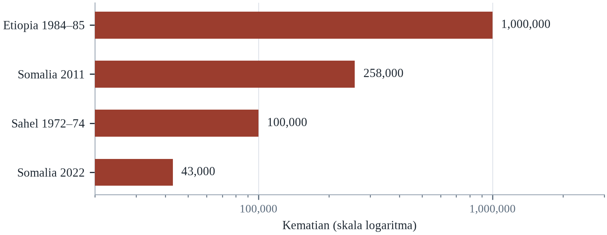||Sumber: Tabel 23.1. Suriah 2006–10 tidak dimasukkan karena tabel mencatat perpindahan, bukan kematian.

Analisisnya menunjuk pada dua kesimpulan. Pertama, krisis pangan dan air dapat dicegah dengan pengetahuan dan sumber daya yang ada; yang gagal adalah kemauan politik, akses, dan waktu. Kedua, darurat lambat memerlukan investasi jangka panjang dalam air, perlindungan sosial, dan perdamaian, karena bantuan saja tidak dapat membalikkan pengurasan akuifer atau keruntuhan penghidupan.

Pembiayaan yang telah diatur untuk tindakan awal akan mengurangi jurang antara peringatan dan respons. Investasi dalam pengisian ulang air tanah dan efisiensi irigasi akan mengurangi paparan kekeringan. Dan penyelesaian konflik akan menghilangkan faktor yang mengubah panen buruk menjadi kelaparan. Seberapa cepat pemanasan berlangsung tetap menentukan, karena ia menentukan seberapa sering sistem akan diuji, dan apakah mereka memiliki waktu untuk pulih di antara guncangan.

---

# Bab 24: Rencana Aksi dan Daftar Periksa untuk Bertahan Hidup

*Tema: siklus kesiapsiagaan, prioritas dan praktik kesiapan*

Pada 12 November 1970, Siklon Bhola menghantam pantai Pakistan Timur, kini Bangladesh. Gelombang badainya mencapai beberapa meter dan menyapu pulau-pulau dataran rendah dengan sedikit peringatan. Jumlah kematian diperkirakan 300.000 hingga 500.000 orang, salah satu siklon tropis paling mematikan dalam sejarah tercatat. Tidak ada sistem peringatan yang efektif, sedikit tempat berlindung, dan hampir tidak ada evakuasi terorganisasi.

Lima puluh tahun kemudian, pada Mei 2020, Siklon Amphan mendarat di wilayah yang telah berubah karena kesiapsiagaan. Bangladesh telah membangun ribuan tempat berlindung siklon, melatih relawan, membangun sistem peringatan yang menjangkau desa melalui pengeras suara dan telepon seluler, serta melatih evakuasi setiap tahun. Lebih dari 2,4 juta orang dipindahkan ke tempat aman sebelum badai, dan jumlah kematian berada dalam hitungan puluhan alih-alih ratusan ribu.

Perbandingan itu bukan argumen bahwa bencana telah terpecahkan. Amphan tetap menghancurkan rumah dan penghidupan, dan COVID-19 mempersulit evakuasi. Tetapi ia adalah argumen bahwa kesiapsiagaan bekerja, dan bahwa perbedaan antara 1970 dan 2020 bukan badainya melainkan sistemnya: tempat berlindung, peringatan, relawan, latihan, dan komitmen politik yang dipertahankan selama puluhan tahun.

Bab terakhir ini mengubah analisis buku menjadi tindakan. Bab ini memaparkan apa yang dapat dilakukan rumah tangga, lingkungan, kota, usaha, dan pemerintah, dalam urutan apa, dan bagaimana mengetahui apakah upaya itu bekerja. Bab ini diorganisasi menurut cakrawala waktu — jam pertama, pekan pertama, tahun pertama — dan menurut tingkat organisasi, dari rumah tangga hingga negara. Tujuannya bukan daftar segala hal yang dapat dilakukan tetapi urutan hal yang paling penting.

Rencana aksi gagal karena alasan yang dipahami dengan baik dan jarang dirancang untuknya: rencana itu mengasumsikan bahwa rencananya akan diikuti. Dalam praktik, respons diimprovisasi dari apa pun yang tersedia, oleh orang yang takut dan lelah, di bawah informasi yang salah. Rencana yang berguna karena itu bukan dokumen yang menentukan setiap langkah melainkan seperangkat keputusan yang dibuat sebelumnya — siapa yang memutuskan, siapa yang dihubungi, apa yang disimpan, apa yang ditinggalkan — sehingga improvisasinya dimulai dari tempat yang lebih baik.

## 24.1 Siklus Kesiapsiagaan

Kesiapsiagaan adalah siklus alih-alih proyek: menilai risiko, merencanakan respons, melaksanakan rencana, memeriksa apakah berhasil, dan beradaptasi. Siklus itu dikenal dari manajemen keselamatan dan perbaikan mutu, dan ia berlaku bagi rumah tangga, perusahaan, dan pemerintah. Kegagalan paling umum bukan ketiadaan rencana tetapi ketiadaan langkah pemeriksaan dan adaptasi, itulah sebabnya rencana menjadi usang ketika bahaya dan populasi berubah.

Penilaian dimulai dengan bahaya dan paparan: apa yang dapat terjadi di sini, seberapa sering, dan kepada siapa. Ia berlanjut dengan kerentanan dan kapasitas: siapa yang paling terdampak, sumber daya apa yang ada, dan celah apa yang tersisa. Penilaian yang baik menggunakan pengetahuan lokal sekaligus data teknis, karena warga tahu jalan mana yang banjir, tetangga mana yang perlu bantuan, dan di mana air menggenang.

Perencanaan mengubah penilaian menjadi keputusan: siapa melakukan apa, dengan sumber daya apa, dan kapan. Rencana yang baik singkat, spesifik, dan dilatih. Rencana yang belum pernah diuji adalah hipotesis, dan ujian pertamanya seharusnya bukan darurat itu sendiri. Latihan menyingkap celah komunikasi, wewenang, dan logistik yang tidak dapat diantisipasi dokumen mana pun.

Siklus kesiapsiagaan — menilai, merencanakan, berlatih, mengevaluasi, merevisi — dipinjam dari manajemen keselamatan dan memiliki kelemahan yang diketahui. Latihan cenderung menguji rencana alih-alih kapasitas, karena skenarionya ditulis orang yang menulis rencananya, dan evaluasinya memberi imbalan pada kepatuhan alih-alih penemuan. Program latihan Amerika yang dikenal sebagai HSEEP mencoba mengoreksinya dengan mewajibkan tinjauan pasca-aksi dengan tindakan korektif dan tenggat spesifik. Bukti dari organisasi yang memakainya dengan baik menunjukkan bahwa nilainya terletak bukan pada latihannya melainkan pada tindak lanjutnya, yang juga bagian yang paling sering dilewati.

Kegagalan paling umum dalam perencanaan kesiapsiagaan adalah mencampur rencana dengan kapasitas. Rencana menggambarkan apa yang seharusnya terjadi; kapasitas adalah apa yang benar-benar terjadi ketika orang, peralatan dan kewenangan diuji bersama. Organisasi yang mencampur keduanya menghasilkan dokumen yang memuaskan auditor dan gagal dalam praktik, dan organisasi yang menguji kapasitas menemukan jurang yang tidak akan terungkap oleh tinjauan dokumen. Aturan praktisnya adalah setiap rencana harus dilatih dengan orang yang akan menjalankannya, dalam kondisi yang mencakup informasi buruk dan komunikasi yang gagal.

Siklus kesiapsiagaan adalah lingkar sederhana yang banyak digambarkan institusi dan sedikit yang dituntaskan: menilai risiko, merencanakannya, membiayai rencananya, mengujinya, merespons saat peristiwa datang, belajar dari responsnya, dan merevisi penilaiannya. Setiap langkahnya tidak menarik, dan lingkar itu paling sering putus di dua titik yang sama. Pertama pembiayaan: rencana tanpa anggaran hanyalah dokumen. Kedua pembelajaran: tinjauan pascakejadian yang menghasilkan laporan tetapi tidak menghasilkan perubahan mengajari semua orang bahwa latihan itu sandiwara. Organisasi yang berkinerja baik hampir selalu yang menutup lingkarnya, dan mekanismenya sejumlah kecil komitmen spesifik dengan pemilik dan tenggat.

Latihan adalah langkah dalam siklus kesiapsiagaan yang paling sering dilewati dan paling mungkin mengungkap kebenaran. Latihan meja, ketika staf membicarakan skenario, mengekspos asumsi yang belum diperiksa siapa pun; latihan fungsional, ketika radio dan pusat operasi digunakan, mengekspos kegagalan komunikasi; latihan skala penuh menguji semuanya dan memakan biaya. Nilai latihan bukan pada penampilannya melainkan pada temuannya, dan temuan itu hanya berguna bila ditulis dalam laporan pascakegiatan yang menamai perbaikannya dan menugaskannya kepada orang. Latihan tanpa laporan adalah pagi yang dihabiskan di tempat parkir.

## 24.2 Jam Pertama, Hari Pertama dan Pekan Pertama

Pada jam pertama, prioritasnya keselamatan jiwa dan informasi. Rumah tangga harus pindah ke tempat teraman di bangunan, menghindari jendela dan air banjir, serta memeriksa tetangga, terutama yang tinggal sendiri. Jika evakuasi diperintahkan, ia harus dilakukan lebih awal dan melalui jalur yang ditentukan, dengan membawa dokumen, obat, dan air. Kesalahan paling umum adalah menunggu terlalu lama, mengemudi melewati air, dan menggunakan peralatan berbahan bakar di dalam ruangan.

Pada hari pertama, prioritasnya air, pangan, tempat berlindung, obat, dan komunikasi. Rumah tangga harus memastikan airnya aman, menjatahnya, dan mulai mengolahnya jika pasokan tidak pasti. Mereka harus memeriksa waktu pendinginan, membuang pangan yang rusak, dan memastikan generator berada di luar ruangan. Mereka juga harus mendaftar ke sistem bantuan jika membutuhkan, karena pendaftaran awal sering menentukan akses kemudian.

Pada pekan pertama, prioritasnya stabilisasi dan dokumentasi. Rumah tangga harus memotret kerusakan sebelum perbaikan, menghubungi perusahaan asuransi, menyimpan kwitansi, dan mengajukan bantuan. Mereka harus mewaspadai risiko kesehatan — air tercemar, jamur, panas, karbon monoksida — dan efek kesehatan mental akibat kehilangan. Komunitas harus mengorganisasi berbagi informasi, karena saluran resmi sering lambat dan terfragmentasi.

Jam pertama didominasi ketidakpastian, dan persiapan yang paling berguna adalah yang menguranginya. Rumah tangga yang telah menyepakati titik temu, kontak konfirmasi di luar daerah terdampak, dan aturan keputusan untuk evakuasi tidak perlu menegosiasikan pertanyaan itu sambil bangunannya bergoyang. Logika yang sama berlaku untuk utilitas: mengetahui di mana katup gas dan cara menutupnya adalah keterampilan lima menit yang mencegah kebakaran. Sebagian besar kematian pada jam pertama dapat dicegah melalui tindakan yang lebih cepat dipelajari daripada kursus pertolongan pertama.

Jam pertama adalah ujian persiapan yang gagal dilalui sebagian besar rumah tangga karena tidak adanya satu keputusan yang dibuat sebelumnya. Riset perilaku evakuasi menemukan orang menunda karena menunggu konfirmasi, karena tidak tahu harus ke mana, dan karena tidak ingin pergi tanpa anggota keluarga. Rumah tangga yang telah menyepakati titik temu dan kontak di luar daerah menghapus dua dari tiga penundaan itu. Yang ketiga — keputusan pergi — lebih mudah ketika aturannya dinyatakan sebelumnya: jika air mencapai jalan ini, kita pergi.

Jam, hari, dan pekan pertama punya prioritas berbeda, dan mencampurkannya adalah kesalahan paling umum dalam perencanaan rumah tangga maupun institusi. Pada jam pertama, prioritasnya keselamatan jiwa: keluar dari air, menjauh dari api, turun dari jalan, dan masuk ke tempat yang tidak akan banjir atau terbakar. Pada hari pertama, prioritasnya air, tempat berlindung, kehangatan, obat, dan informasi tentang apa yang terjadi serta di mana bantuan tersedia. Pada pekan pertama, prioritasnya keberlanjutan: menjaga keluarga tetap bersama, mengembalikan anak ke bentuk sekolah tertentu, mengajukan klaim asuransi sebelum tenggat, dan mencari tahu bantuan apa yang tersedia.

Rencana rumah tangga untuk tiga hari pertama adalah seperangkat keputusan yang lebih mudah dibuat sebelum peristiwa daripada saat peristiwa. Di mana keluarga akan bertemu bila telepon tidak berfungsi, siapa menjemput anak dari sekolah, jalur mana yang menuju tanah lebih tinggi, tetangga mana yang punya kunci, dan apa yang akan dibawa bila hanya ada waktu membawa satu tas. Rencananya harus ditulis, dibagikan kepada semua anggota rumah tangga, dan dijalani setidaknya sekali, karena nilai latihannya mengubah keputusan menjadi kebiasaan. Rumah tangga yang melewati hari pertama dengan baik jarang yang paling bagus berimprovisasi; mereka yang sudah memikirkannya.

## 24.3 Bulan Pertama: Pemulihan dan Hak

Pemulihan adalah fase tempat ketimpangan direproduksi atau dikurangi, dan ia fase yang paling sedikit mendapat perhatian. Pada bulan pertama, rumah tangga harus menavigasi asuransi, bantuan pemerintah, tuan rumah, pemberi kerja, dan pemberi pinjaman, sering sambil mengungsi dan trauma. Mereka yang memiliki dokumen, tabungan, pengetahuan hukum, dan jaringan sosial pulih lebih cepat; yang tidak mungkin tidak pernah pulih sepenuhnya.

Langkah praktisnya penting. Simpan catatan tertulis kontak, klaim, dan pembayaran. Foto dan inventarisasi kerugian. Baca polis asuransi untuk pengecualian, terutama banjir, dan banding keputusan yang tampak salah. Ajukan ke setiap program yang mungkin memenuhi syarat, dan cari bantuan dari bantuan hukum, organisasi komunitas, atau manajer kasus bencana jika tersedia.

Penyewa sangat terpapar. Mereka dapat kehilangan tempat tinggal tanpa kehilangan aset, dan mereka sering memiliki hak lebih sedikit serta akses bantuan lebih kecil daripada pemilik. Pemerintah lokal dapat melindungi mereka dengan menegakkan standar kelayakan huni, memperpanjang perlindungan penggusuran setelah bencana, dan membuat bantuan dapat dipindahkan. Tanpa langkah itu, program pemulihan dapat mempercepat pengungsian dan gentrifikasi.

Bulan pertama adalah negosiasi dengan institusi, dan hasilnya bergantung pada dokumentasi dan kegigihan. Klaim asuransi rutin dibayar di bawah nilai pada tawaran pertama, dan rumah tangga yang tidak mengajukan keberatan meninggalkan uang di meja; program bantuan publik menuntut dokumen yang mungkin tidak dimiliki orang terlantar. Penipuan kontraktor umum setelah bencana karena permintaannya mendesak dan verifikasinya lambat. Perlindungan praktisnya tidak glamor: simpan salinan, foto semuanya, jangan menandatangani kontrak pertama, dan gunakan layanan manajemen kasus gratis yang biasanya disediakan bencana.

Pemulihan asuransi adalah tempat ekonomi bencana ditentukan, dan prosesnya menghukum orang yang paling tidak mampu berperkara. Perusahaan asuransi rutin memberi tawaran awal di bawah penyelesaian akhir, dan pemegang polis yang menerimanya kehilangan selisihnya. Penilai publik dan bantuan hukum dapat membantu, tetapi keduanya langka setelah peristiwa besar, dan rumah tangga dengan klaim terkuat sering yang paling tidak mampu mendokumentasikannya. Hasilnya adalah pembayaran pemulihan yang regresif, dan itulah salah satu sebab dokumentasi pra-bencana serta dukungan hukum komunitas lebih penting daripada yang terlihat.

Bulan pertama adalah fase ketika pemulihan ditentukan, dan keputusannya bersifat hukum serta keuangan sama besarnya dengan fisik. Klaim yang tidak diajukan sebelum tenggat dapat hilang; sewa yang tidak diamankan dapat membuat keluarga tinggal di pengungsian setahun; kontraktor yang meminta pembayaran di muka dapat menghilang dengan uangnya. Orang yang melewati fase ini dengan baik biasanya yang punya pendamping kasus, kerabat berpengalaman administratif, atau organisasi pemberi bantuan hukum. Yang tertinggal biasanya yang sudah marginal sebelumnya: yang buta huruf, tanpa dokumen, lanjut usia, dan terisolasi.

Bulan pertama adalah ketika mesin hukum dan keuangan pemulihan aktif, dan orang yang paling kurang mampu menggunakannya adalah yang paling membutuhkannya. Klaim asuransi menuntut dokumen yang mungkin hancur, kontrak dengan pembangun menuntut uang muka yang mungkin tidak ada, dan permohonan bantuan menuntut bukti alamat yang mungkin tidak dimiliki rumah tangga terpindahkan. Klinik bantuan hukum, pendamping kasus, dan organisasi warga mengisi celahnya, dan celahnya paling lebar di tempat bencananya paling besar. Sistem yang berhasil mendaftarkan rumah tangga rentan lebih dahulu, agar permohonannya tidak bergantung pada dokumen yang diambil banjir.

## 24.4 Tahun Pertama: Membangun Kembali Lebih Baik

Tahun setelah bencana adalah jendela ketika keputusan rekonstruksi diambil, dan keputusan itu menentukan kerentanan selama puluhan tahun. Membangun kembali di tempat yang sama, dengan standar yang sama, mereproduksi risiko yang sama. Membangun kembali dengan elevasi, sambungan lebih kuat, drainase lebih baik, dan material lebih sejuk menguranginya, sering dengan biaya tambahan yang moderat.

Rumah tangga dan komunitas harus menuntut membangun kembali lebih baik, dan pemerintah harus mewajibkannya sebagai syarat bantuan. Itu berarti kode yang mencerminkan bahaya saat ini dan yang diproyeksikan, inspeksi yang benar-benar dilakukan, dan bantuan teknis bagi rumah tangga yang tidak mampu membayar insinyur. Itu juga berarti menangani kepemilikan tanah, karena orang tanpa hak yang aman tidak dapat berinvestasi dalam perbaikan.

Tahun itu juga waktu untuk memperkuat infrastruktur sosial. Jaringan lingkungan, kelompok relawan, dan organisasi komunitas yang terbentuk selama respons dapat diformalkan dan didukung. Pengetahuan mereka tentang siapa yang perlu bantuan adalah aset yang tidak mudah direplikasi basis data pemerintah mana pun, dan keberadaan mereka mengurangi biaya respons berikutnya.

Jendela rekonstruksi adalah periode ketika profil risiko sebuah komunitas ditetapkan untuk puluhan tahun, dan ia menutup lebih cepat daripada yang dibayangkan orang. Keputusan tentang elevasi, garis sempadan, material dan infrastruktur dibuat di bawah tekanan, sering oleh lembaga yang tidak punya kepentingan jangka panjang di tempat itu. Bukti lebih mendukung rekonstruksi yang digerakkan pemilik, di mana rumah tangga membangun kembali dengan bantuan teknis dan uang tunai, daripada program yang digerakkan kontraktor, karena ia menahan uang di ekonomi lokal dan menghasilkan bangunan yang sesuai cara orang benar-benar tinggal. Ia juga menuntut supervisi, bagian yang sulit dibiayai donor.

Membangun kembali lebih baik adalah slogan yang membutuhkan definisi agar berguna. Kerangka Sendai memakai frasa itu untuk berarti rekonstruksi yang mengurangi risiko masa depan, dan isi operasionalnya spesifik: elevasi di atas level banjir yang dimodelkan, perkuatan struktur sesuai kode terkini, garis sempadan dari garis pantai, dan kepemilikan tanah yang memungkinkan rumah tangga berinvestasi. Evaluasi program perumahan pascabencana menemukan program yang mencapai kondisi itu adalah yang menggabungkan bantuan teknis dengan pembangunan oleh pemilik dan pembayaran bertahap yang dikaitkan dengan inspeksi.

Tahun pertama adalah ketika rekonstruksi menjadi uji apakah ada yang dipelajari. Rumah yang dibangun kembali dengan standar lama di tempat lama adalah taruhan bahwa bahayanya tidak akan kembali, dan taruhannya biasanya buruk. Rumah tangga yang membangun lebih baik adalah yang punya asuransi memadai, akses nasihat teknis, dan hibah yang dibayarkan bertahap terikat standar alih-alih sekaligus. Program yang berhasil menyertakan pengawas teknis yang mengunjungi lokasi, standar yang ditegakkan pada saat pembangunan bukan pada saat inspeksi, dan mekanisme sengketa untuk kasus yang salah. Tidak satu pun dramatis, dan semuanya menentukan.

Membangun lebih baik adalah slogan yang menggambarkan seperangkat praktik, dan praktiknya diketahui. Pertama model digerakkan pemilik, ketika rumah tangga menerima hibah dan nasihat teknis lalu mengelola pembangunannya, alih-alih model digerakkan kontraktor ketika rumah tangga menerima rumah jadi dengan mutu bervariasi. Kedua standar yang ditegakkan pada saat pembangunan, dengan pengawas di lokasi, alih-alih pada saat inspeksi ketika betonnya sudah mengeras. Ketiga pembayaran bertahap yang dicairkan berdasarkan kemajuan. Bukti dari Asia Selatan dan Amerika Tengah, model ini menghasilkan rumah lebih baik dengan biaya serupa, dan lebih lambat serta lebih sulit diadministrasikan.

## 24.5 Daftar Periksa Kota dan Pemerintah Daerah

Kota adalah tempat sebagian besar risiko iklim terkonsentrasi dan tempat sebagian besar keputusan adaptasi diambil. Kota yang ingin siap memerlukan rencana aksi panas dengan pusat pendinginan dan penjangkauan warga rentan; rencana banjir dengan pemeliharaan drainase, pengendalian tata guna lahan, dan jalur evakuasi; sistem peringatan yang menjangkau setiap lingkungan; dan daftar orang yang memerlukan bantuan.

Ia juga memerlukan infrastruktur yang membosankan: saluran yang terpelihara, pompa yang berfungsi, pohon dan naungan, air yang andal, listrik cadangan untuk klinik dan tempat berlindung, serta kode bangunan yang ditegakkan. Itu bukan investasi menarik, dan jarang mendapat kredit politik, itulah sebabnya ia kronis kekurangan dana. Kota yang membelanjakan untuk acara tetapi tidak untuk drainase tidak siap, apa pun kata rencananya.

Akhirnya, kota memerlukan institusi yang dapat berkoordinasi. Panas melibatkan kesehatan, layanan sosial, utilitas, dan transportasi; banjir melibatkan air, perencanaan, layanan darurat, dan infrastruktur. Seseorang harus bertanggung jawab atas keseluruhan, dan koordinasinya harus dilatih sebelum peristiwa. Kota yang menunjuk pejabat ketangguhan kepala dan melatih komando bersama berkinerja lebih baik daripada yang tidak.

Kota memiliki kendali paling langsung atas penentu risiko iklim, dan intervensinya sudah diketahui. Rencana aksi panas, yang dirintis di Ahmedabad setelah gelombang panas 2010, menggabungkan peringatan dini, pusat pendinginan, jangkauan ke warga rentan dan perubahan jam kerja; evaluasi menunjukkan penurunan kematian (Hess dkk., 2018). Perawatan drainase, permukaan permeabel dan lahan basah yang dipulihkan mengurangi puncak banjir dengan biaya sebagian kecil dari saluran beton. Hambatannya bukan pengetahuan melainkan kenyataan bahwa pemeliharaan tidak punya acara peresmian, dan manfaatnya dinikmati orang yang tidak memilih pada pemilu berikutnya.

Rencana aksi panas menyebar karena murah, terlihat dan efektif. Unsur intinya adalah pemicu prakiraan, peringatan yang menjangkau orang rentan, pusat pendinginan, dan jangkauan melalui kader kesehatan serta relawan. Kota yang mengangkat chief heat officer menemukan bahwa nilai peran itu adalah koordinasi alih-alih keahlian: seseorang yang tugasnya membuat dinas kesehatan, utilitas dan dinas perumahan bertindak atas prakiraan yang sama. Rencana yang gagal adalah yang ada di atas kertas tanpa anggaran untuk pusat pendinginan atau waktu staf.

Daftar periksa kota yang paling penting di Indonesia bukan dokumen melainkan pos anggaran, dan contoh paling jelasnya adalah perawatan drainase. Sebagian besar kota Indonesia memiliki rencana induk drainase yang menggambarkan saluran dan kolam retensi yang dibutuhkan, dan sebagian besarnya hanya terimplementasi sebagian karena anggaran pemeliharaan adalah yang pertama dipangkas. Konsekuensinya, hujan yang masih dalam standar rancangan menghasilkan banjir di lingkungan yang salurannya tersumbat. Pemeriksaan praktis bagi kota mana pun karena itu bukan apakah ia punya rencana melainkan apakah ia dapat menunjukkan, pada tahun anggaran berjalan, berapa meter saluran yang dikeruk dan berapa yang dibelanjakan.

Daftar periksa kota adalah tempat prinsip umum menjadi tugas spesifik yang benar-benar dapat ditugaskan pemerintah kota. Butir yang paling penting tidak menarik dan dapat diaudit: peta bahaya yang terbuka, sistem peringatan yang mencapai mil terakhir, standar drainase yang mencerminkan iklim sekarang, daftar warga rentan, rencana pengungsian yang memuat akses bagi penyandang disabilitas, stok peralatan yang terawat, dan pos anggaran yang dilindungi hukum bukan kemurahan hati. Kota dengan enam hal ini akan mengungguli kota dengan dokumen strategi iklim sepuluh kali lebih panjang tanpa satu pun dari keenamnya.

Kota yang ingin tahu apakah dirinya siap dapat memakai kartu skor, dan beberapa kartu skor dirancang untuk itu. Pertanyaannya adalah yang menentukan hasil: apakah peta bahayanya mutakhir dan terbuka, apakah peringatannya mencapai mil terakhir, apakah drainasenya memenuhi standar yang mencerminkan iklim sekarang, apakah pengungsiannya dapat diakses, apakah warga rentannya terdaftar, dan apakah anggarannya dilindungi. Kartu skor hanya berguna bila diulang, dipublikasikan, dan dipakai untuk mengalokasikan anggaran berikutnya, karena penilaian diri yang tidak dibaca siapa pun adalah bentuk penenangan alih-alih pengukuran.

Kota yang belum memiliki keenam butirnya tidak boleh mencoba memperoleh semuanya dalam satu siklus anggaran, karena upayanya akan menghasilkan dokumen strategi tanpa perubahan. Urutan yang berhasil di kota dengan ukuran sangat berbeda dimulai dari dua butir yang paling murah dan paling banyak mengungkap: peta bahaya yang terbuka dan daftar warga rentan. Petanya dapat disusun dari data yang sudah ada dalam hitungan bulan, dan ia menyelesaikan perdebatan tentang ke mana uang harus pergi; daftarnya dapat dibangun dari rekam kesehatan, akun utilitas, dan daftar yang sudah disimpan klinik setempat, dan ia mengubah kewajiban umum menjadi sekumpulan nama dan alamat. Sistem peringatan dan standar drainase menyusul, karena keduanya membutuhkan spesifikasi teknis dan pengadaan. Rencana pengungsian dan pos anggaran yang dilindungi datang terakhir, dan keduanya yang menentukan apakah sisanya bertahan ketika pemerintahan berganti.

## 24.6 Daftar Periksa Kebijakan Nasional

Pemerintah nasional menetapkan kerangka tempat semua pihak lain bertindak. Hal-hal esensialnya diketahui: kode bangunan yang mencerminkan bahaya saat ini dan yang diproyeksikan; sistem peringatan dini yang menjangkau mil terakhir; perlindungan sosial yang dapat diperluas dengan cepat; sistem kesehatan yang dapat menyerap lonjakan; dan pembiayaan yang dapat dicairkan sebelum bencana alih-alih setelah seruan.

Pemerintah juga mengendalikan insentif yang membentuk keputusan swasta. Harga asuransi, subsidi, aturan pengadaan, dan persyaratan pengungkapan dapat mendorong atau menghambat pengurangan risiko. Pemerintah yang mensubsidi pembangunan di dataran banjir lalu membayar rekonstruksi memprivatisasi keuntungan dan menyosialisasikan kerugian, yang tidak efisien sekaligus tidak adil.

Keputusan nasional terpenting adalah memperlakukan adaptasi sebagai infrastruktur publik inti alih-alih rangkaian proyek. Itu berarti pos anggaran, rezim pemeliharaan, indikator kinerja, dan audit. Itu juga berarti menerima bahwa sebagian tempat tidak dapat dipertahankan tanpa batas, dan merencanakan relokasi terkelola di tempat yang tidak terhindarkan — keputusan yang menyakitkan secara politik dan rumit secara administratif, tetapi lebih murah daripada keruntuhan yang tidak terkelola.

Pemerintah nasional menetapkan aturan yang menentukan apakah tindakan lokal mungkin. Instrumen yang paling penting tidak glamor: kode bangunan dengan penegakan, sistem peringatan dini yang menjangkau mil terakhir, perlindungan sosial yang dapat diperluas cepat, dan dana kontingensi yang dapat dibelanjakan sebelum bencana dideklarasikan. Perlindungan sosial adaptif — transfer tunai yang otomatis meningkat ketika pemicu terpenuhi — adalah inovasi terkini yang paling menjanjikan, karena ia memakai sistem penyaluran yang sudah ada alih-alih membangun yang baru selama darurat.

Perlindungan sosial adaptif adalah instrumen adaptasi paling skalabel yang sudah dimiliki sebagian besar negara. Program transfer tunai yang ada dapat ditambah ketika pemicu terpenuhi, memakai daftar dan sistem pembayaran yang sudah tersedia, yang lebih cepat dan lebih murah daripada membuat program darurat baru. Negara Sahel telah menguji pendekatan ini dengan pemicu kekeringan, dan hasilnya menunjukkan rumah tangga yang menerima transfer terprediksi sebelum krisis lebih tangguh daripada yang menerima bantuan sesudahnya. Syaratnya adalah daftar yang mencakup penduduk termiskin dan aturan fiskal yang melepaskan dana secara otomatis.

Kode bangunan adalah instrumen adaptasi paling hemat biaya yang sudah dimiliki sebagian besar negara, dan kelemahannya penegakan alih-alih desain. Kode yang menyusul gempa besar — di Jepang, Chile, California dan Turki — telah terbukti menurunkan kematian pada peristiwa berikutnya, tetapi hanya di tempat inspeksi dan tanggung jawab hukum dibiayai. Pengalaman Turki adalah kasus peringatan: amnesti konstruksi berturut-turut melegalkan bangunan yang tidak mematuhi, dan gempa 2023 menewaskan orang justru di bangunan itu. Kode adalah janji, dan nilainya bergantung pada institusi yang menepatinya.

Daftar periksa nasional berisi instrumen yang hanya dapat dibuat pemerintah pusat: mandat hukum pengelolaan risiko bencana, kerangka fiskal yang memungkinkan belanja sebelum krisis dinyatakan, sistem perlindungan sosial yang dapat diskalakan, kode bangunan yang ditegakkan, dan sistem data yang terbuka. Yang paling penting adalah yang fiskal, karena waktu uang menentukan jumlah kematian. Negara yang dapat mencairkan dana dalam hitungan hari setelah prakiraan, dan yang telah menyepakati aturannya lebih dulu, telah menyelesaikan masalah yang kebanyakan negara selesaikan terlambat dan terlalu mahal.

Daftar periksa nasional pendek, dan setiap butirnya adalah hal yang hanya dapat dilakukan pemerintah pusat. Mandat hukum yang membagi tanggung jawab risiko bencana antarkementerian; aturan fiskal yang mengizinkan uang dicairkan berdasarkan prakiraan; sistem perlindungan sosial yang dapat diskalakan; kode bangunan yang ditegakkan; sistem data yang terbuka; dan latihan nasional yang diambil serius. Negara yang punya keenamnya jarang, dan yang punya tiga di antaranya adalah yang berkinerja baik dalam perbandingan. Daftarnya bukan ukuran ambisi melainkan mesin yang mengubah niat menjadi tindakan.

## 24.7 Usaha, Pekerjaan dan Kesinambungan

Usaha adalah korban sekaligus vektor risiko iklim. Pabrik yang terendam kehilangan produksi; pemasok yang gagal mengganggu rantai global; tempat kerja tanpa perlindungan panas membahayakan pekerja. Perencanaan kesinambungan — mengidentifikasi fungsi kritis, lokasi cadangan, pemasok alternatif, dan protokol komunikasi — mengurangi kerugian dan melindungi lapangan kerja.

Standar panas di tempat kerja adalah isu yang tumbuh. Pekerja luar dan dalam ruangan di lingkungan panas memerlukan istirahat, air, naungan, dan jadwal yang disesuaikan, dan ketiadaan standar adalah penyebab utama penyakit yang dapat dicegah. Sebagian yurisdiksi telah mengadopsi aturan panas; banyak yang belum. Pengusaha yang memperlakukan panas sebagai isu produktivitas alih-alih isu keselamatan bersikap lalai sekaligus tidak rasional secara ekonomi, karena panas mengurangi keluaran sekaligus membahayakan pekerja.

Rantai pasok memerlukan perhatian khusus. Perusahaan yang bergantung pada satu pemasok, satu pelabuhan, atau satu wilayah terpapar gangguan, dan banjir Thailand 2011 menunjukkan bagaimana satu peristiwa dapat memengaruhi produksi di seluruh dunia. Diversifikasi, penyangga persediaan, dan penilaian risiko pemasok mahal, tetapi gangguan juga mahal, dan keseimbangannya bergeser seiring peristiwa ekstrem menjadi lebih sering.

Kelangsungan usaha biasanya diajarkan sebagai disiplin teknis, dan pelajaran terpentingnya adalah tentang ketergantungan. Perusahaan yang mencadangkan datanya tetapi bergantung pada satu pemasok di zona banjir tidak tangguh, dan perusahaan yang punya genset tetapi tidak punya kontrak bahan bakar juga tidak tangguh. Usaha kecil dan menengah adalah yang paling rentan dan paling sedikit bersiap, dan sebagian besar dari mereka yang tutup setelah bencana tidak pernah buka lagi. Langkah praktisnya adalah memetakan rantai — pemasok, utilitas, transportasi, staf — dan mengidentifikasi titik kegagalan tunggal yang dapat dihilangkan dengan investasi moderat.

Perencanaan kelangsungan usaha gagal ketika berhenti di pintu pabrik. Kemampuan perusahaan beroperasi bergantung pada pemasok, transportasi, utilitas, pekerja dan pelanggan, dan ketergantungan kritisnya biasanya di luar kendali perusahaan. Memetakan rantai pasok dan mengidentifikasi titik kegagalan tunggal adalah latihan paling bernilai, dan ia jarang dilakukan karena menuntut menanyakan hal tidak nyaman kepada pemasok. Perusahaan yang pulih paling cepat setelah bencana biasanya yang tahu input mana yang berasal dari dataran banjir dan telah menyiapkan sumber kedua.

Keberlangsungan usaha adalah padanan kesiapsiagaan rumah tangga di sektor swasta, dan penting karena alasan yang sama: sebagian besar ekonomi bersifat swasta, dan usaha yang gagal setelah bencana membawa serta lapangan kerja dan basis pajaknya. Ukuran yang berhasil sama dengan yang berhasil bagi rumah tangga: penilaian risiko, rencana menghadapi kehilangan listrik, air, dan transportasi, cadangan data, daftar pemasok alternatif, dan polis asuransi yang benar-benar dibaca. Usaha yang pulih tercepat biasanya yang kecil dan punya rencana serta jalur kredit, dan yang tidak pulih biasanya yang menganggap pemerintah akan membantu.

Keberlangsungan usaha adalah versi sektor swasta dari rencana rumah tangga, dan penting karena sebagian besar ekonomi bersifat swasta. Usaha yang telah mengenali fungsi kritisnya, ketergantungannya pada listrik, air, transportasi, dan data, serta pemasok alternatifnya, dapat beroperasi kembali dalam hitungan hari; usaha yang tidak mengenalinya mungkin tidak pernah buka lagi. Riset tentang firma kecil setelah bencana menemukan yang punya rencana dan jalur kredit pulih, dan yang tidak punya gagal dengan laju tinggi. Asuransi bagian dari rencana, dan polisnya harus dibaca sebelum peristiwa, karena pengecualiannya tempat sengketa terjadi.

## 24.8 Mengukur Kesiapan

Yang diukur akan dikelola, dan kesiapan sering diukur dengan buruk. Rencana dihitung alih-alih diuji; latihan dilakukan untuk penampilan alih-alih pembelajaran; dan indikator berfokus pada masukan — lokakarya yang diadakan, dokumen yang dihasilkan — alih-alih hasil. Ukuran kesiapan yang berguna menanyakan apakah orang tahu apa yang harus dilakukan, apakah sistem bekerja di bawah tekanan, dan apakah yang paling rentan dijangkau.

Indikator praktis mencakup porsi rumah tangga dengan air dan pangan dua pekan; porsi warga rentan yang terdaftar untuk bantuan; waktu yang diperlukan untuk mengeluarkan dan menyampaikan peringatan; jumlah ruang tempat berlindung relatif terhadap kebutuhan; proporsi fasilitas kritis dengan listrik cadangan; dan waktu yang diperlukan untuk memulihkan air dan listrik setelah peristiwa. Masing-masing dapat diukur sebelum bencana dan dibandingkan antartempat.

Latihan adalah ujian paling informatif. Latihan yang menyingkap tautan komunikasi yang putus, wewenang yang tidak jelas, atau tempat berlindung yang tidak dapat diakses sangat berharga, karena ia menyingkap masalah ketika masih dapat diperbaiki. Organisasi yang paling cepat belajar adalah yang memperlakukan latihan sebagai eksperimen alih-alih pertunjukan, dan yang menerbitkan temuannya.

Kesiapan sulit diukur karena yang diukur adalah kapasitas, bukan dokumen. Indikator cenderung menghitung masukan: rencana tertulis, latihan diadakan, lokakarya dilaksanakan. Pendekatan yang lebih baik adalah menguji kinerja dalam kondisi realistis dan mengukur waktu yang dibutuhkan untuk memulihkan fungsi kritis — air, listrik, komunikasi, layanan kesehatan — setelah guncangan simulasi. Pelajaran dari sektor yang melakukannya dengan baik, seperti penerbangan dan tenaga nuklir, adalah bahwa pengukuran hanya mengubah perilaku ketika independen dan hasilnya dipublikasikan.

Uji tekanan adalah satu-satunya ukuran kesiapan yang andal mengubah perilaku. Latihan meja menyingkap asumsi; uji tekanan menyingkap kapasitas, karena ia menuntut organisasi beroperasi dalam skenario yang menghapus sistem yang diandalkannya. Regulator keuangan telah memakai uji tekanan selama puluhan tahun dan belajar bahwa nilainya terletak pada pengungkapan hasil, bukan pada latihannya. Prinsip yang sama berlaku bagi kota dan rumah sakit: publikasikan waktu yang dibutuhkan untuk memulihkan air, listrik dan komunikasi, dan percakapan anggaran berikutnya berubah.

Mengukur kesiapsiagaan adalah disiplin yang memisahkan program serius dari latihan hubungan masyarakat. Indikator yang penting dapat diamati dan dibandingkan antartahun: porsi penduduk yang tercakup sistem peringatan, waktu antara peringatan dan perintah evakuasi, jumlah tempat pengungsian per kapita, stok persediaan pokok, frekuensi latihan, dan waktu rata-rata pemulihan listrik serta air setelah peristiwa. Pengukuran yang tidak dipublikasikan bukan pengukuran; ia kenyamanan internal. Program yang membaik adalah yang mempublikasikan angkanya, termasuk yang memalukan.

Mengukur kesiapsiagaan adalah disiplin, dan disiplinnya adalah intinya. Kota yang mempublikasikan porsi penduduk tercakup peringatan, waktu pemulihan listrik, jumlah tempat pengungsian, dan hasil latihan terakhirnya telah menciptakan garis dasar yang dapat dibandingkan tahun berikutnya. Angkanya tidak menyanjung, itulah sebabnya jarang dipublikasikan, dan publikasinya yang menciptakan tekanan untuk memperbaikinya. Alternatifnya adalah dokumen strategi dengan target yang tidak diukur, dan bedanya adalah beda antara rencana dan harapan.

Kota atau negara yang belum pernah mengukur kesiapsiagaannya tidak boleh menunggu garis dasar yang sempurna, karena ketiadaan angka itu sendiri adalah temuannya. Metode retrospektif murah: rekonstruksi tiga peristiwa terakhir dari catatan utilitas, rumah sakit, dinas pemadam, dan sistem persekolahan, lalu hitung metrik yang telah didaftar bab ini untuk peristiwa-peristiwa itu. Berapa lama listrik mati, berapa orang di pengungsian, berapa hari sekolah hilang, berapa klaim dibayar dan berapa lama prosesnya. Rekonstruksinya akan tidak lengkap, dan celahnya akan menunjukkan lembaga mana yang tidak menyimpan catatan yang diandalkan responsnya sendiri. Temuan itu adalah perbaikan pertama, dan biayanya beberapa pekan waktu seorang staf junior alih-alih kontrak konsultan.

## 24.9 Pembiayaan dan Urutan

Sumber daya terbatas, jadi urutan penting. Imbal hasil tertinggi biasanya datang dari langkah yang murah, cepat, dan melindungi lintas banyak bahaya: peringatan dini, rencana panas, pemeliharaan drainase, penyimpanan air, vaksinasi, dan perlindungan sosial. Itu bukan investasi paling terlihat, itulah sebabnya ia sering dilewati demi infrastruktur besar.

Bukti tentang imbal hasilnya kuat. Studi tentang sistem peringatan dini menemukan rasio manfaat-biaya sekitar 4:1 hingga 10:1, dan lebih tinggi dalam beberapa konteks; investasi dalam infrastruktur tangguh diperkirakan mengembalikan sekitar 4:1; dan rencana aksi panas diakui menurunkan kematian dengan biaya rendah (Hess dkk., 2018). Polanya konsisten: kesiapsiagaan membayar, tetapi manfaatnya diperoleh kemudian dan oleh orang yang tidak hadir ketika anggaran diputuskan.

Mekanisme pembiayaan harus sesuai garis waktu. Pembiayaan kontinjen yang telah diatur untuk respons, asuransi dan obligasi bencana untuk kerugian besar, pos anggaran untuk pemeliharaan, dan pembiayaan konsesional untuk adaptasi di negara berpenghasilan rendah masing-masing melayani tujuan berbeda. Kegagalan umumnya adalah bergantung pada seruan pascabencana, yang lambat, tidak pasti, dan tidak memadai relatif terhadap kebutuhan.

Membiayai adaptasi adalah masalah urutan sama besarnya dengan masalah jumlah. Tindakan dengan imbal hasil tertinggi sering yang termurah dan tercepat: peringatan dini, rencana panas, perawatan drainase, vaksinasi, perlindungan sosial. Semuanya juga paling tidak menarik bagi donor karena sulit diatribusikan dan tidak menghasilkan monumen yang terlihat. Investasi lebih besar — tanggul laut, leve, relokasi — diperlukan di beberapa tempat dan harus menyusul, bukan mendahului, tindakan rendah penyesalan yang membeli waktu dan kredibilitas.

Argumen urutan memiliki dimensi fiskal yang sering terlewat. Belanja adaptasi bersaing dengan pembayaran utang, dan di negara yang pembayaran bunganya melampaui anggaran kesehatan atau pendidikan, ruang fiskal untuk pencegahan sangat kecil. Instrumen utang yang mengaitkan pembayaran kembali dengan investasi ketahanan terverifikasi, seperti obligasi ketahanan dan pertukaran utang-untuk-adaptasi yang kini diuji, adalah upaya keluar dari jebakan itu. Ia bukan pengganti hibah bagi negara termiskin, dan ia adalah cara membuat investasi mungkin di tempat yang sekarang mustahil.

Pembiayaan dan urutan adalah tempat rencana bagus gagal, karena rencana yang menuntut semuanya sekaligus akan dibiayai nol. Urutan yang berhasil dimulai dari ukuran termurah dengan efek terbesar: peringatan, simulasi, rencana panas, tampungan air, pemeliharaan drainase, dan perlindungan sosial. Semuanya berbiaya sebagian kecil dari proyek infrastruktur besar dan menyelamatkan nyawa dalam jangka pendek. Ukuran mahal — tanggul laut, bendungan, peningkatan jaringan — datang kemudian, ketika ukuran murah telah membangun modal politik dan kapasitas institusional. Kegagalannya adalah mengumumkan proyek mahal lebih dulu.

Urutan investasi adalah tempat sebagian besar program kesiapsiagaan gagal, karena imbalan politiknya ada pada proyek yang terlihat alih-alih yang tidak menarik. Ukuran yang menghasilkan penurunan kematian terbesar per dolar adalah yang murah: sistem peringatan, simulasi, rencana panas, tampungan air, pemeliharaan drainase, dan perlindungan sosial. Infrastruktur besar datang kemudian, dan datang lebih mudah ketika ukuran murah telah menunjukkan bahwa institusinya mampu melaksanakan. Program yang dimulai dengan tembok laut dan tidak pernah membiayai sistem peringatan memiliki urutan terbalik, dan urutannya pilihan yang dibuat anggaran setiap tahun.

## 24.10 Apa yang Dibutuhkan untuk Bertahan Hidup

Argumen buku ini, diringkas, adalah bahwa bertahan hidup merupakan fungsi persiapan, kerja sama, dan keadilan. Persiapan mengurangi peluang bahaya menjadi katastrofi; kerja sama memungkinkan orang bertindak bersama ketika institusi kewalahan; dan keadilan memastikan perlindungan menjangkau mereka yang paling membutuhkannya. Tidak satu pun dari ketiganya cukup sendiri, dan ketiganya dapat dibangun.

Bukti untuk klaim itu ada dalam kasus-kasus. Bangladesh menurunkan kematian akibat siklon dengan urutan besaran melalui tempat berlindung, peringatan, dan relawan. Negara Eropa menurunkan kematian akibat panas setelah 2003 melalui rencana dan penjangkauan. Kota yang berinvestasi dalam drainase dan peringatan mengalami kerugian lebih kecil daripada yang tidak. Perbaikannya tidak dihasilkan cuaca yang lebih baik; ia dihasilkan institusi yang lebih baik.

Masa depan akan menguji institusi itu lebih keras. Pemanasan sudah terkunci, ekstrem semakin intens, dan jendela untuk menghindari hasil terburuk menyempit. Tetapi pilihannya bukan antara optimisme dan keputusasaan; ia antara persiapan dan kelalaian. Buku ini ditutup dengan klaim sederhana: masyarakat yang bertahan dalam dekade mendatang adalah mereka yang memperlakukan pandangan ke depan sebagai barang publik, membangun institusi yang belajar, dan melindungi orang yang tidak dapat melindungi diri sendiri.

Kesimpulan yang dicapai buku ini bukan bahwa kelangsungan hidup bergantung pada bunker, stok pribadi atau rencana pelarian pribadi. Ia bergantung pada kapasitas biasa yang dibangun masyarakat ketika mereka memutuskan untuk membangunnya: infrastruktur yang berfungsi, institusi yang dapat dipercaya, jaringan sosial, dan distribusi risiko yang adil. Kesiapsiagaan adalah praktik, bukan pembelian, dan ia diukur pada tahun-tahun antara bencana, ketika tampaknya tidak terjadi apa-apa dan pekerjaannya adalah pemeliharaan.

Argumen akhir buku ini adalah kelangsungan hidup merupakan pencapaian kolektif, bukan pencapaian individu. Rumah tangga dengan stok pangan dan tanpa tetangga lebih tidak aman daripada jalan dengan rencana, dan jalan dengan rencana lebih tidak aman daripada kota dengan infrastruktur yang berfungsi serta pemerintah yang dapat dimintai pertanggungjawaban. Kesiapsiagaan karena itu bukan kebajikan pribadi melainkan barang publik, dan ia dihasilkan oleh kerja tidak glamor berupa pemeliharaan, pelatihan dan kepercayaan yang terjadi pada tahun-tahun ketika tampaknya tidak terjadi apa-apa.

Yang dibutuhkan untuk bertahan hidup, pada akhirnya, bukan timbunan atau tembok melainkan seperangkat pengaturan yang menghubungkan rumah tangga ke komunitas dan komunitas ke institusi. Rumah tangga membutuhkan air, pangan, penerangan, obat, dan rencana. Komunitas membutuhkan orang yang saling mengenal, tempat berkumpul, dan cara menjangkau orang yang tidak dapat bergerak. Institusi membutuhkan mandat, anggaran, peta, dan sistem peringatan yang berfungsi. Bila ketiganya ada, bahaya menghasilkan ketidaknyamanan; bila salah satu hilang, bahaya yang sama menghasilkan bencana. Bab-bab buku ini menguraikan pengaturan itu.

Yang dibutuhkan untuk bertahan hidup, pada akhirnya, adalah ingatan sama seperti rencana. Komunitas yang telah hidup dengan bahaya selama beberapa generasi menyimpan catatan lisan tentang peristiwa yang hendak dicegah institusinya, dan catatan itu bentuk kesiapsiagaan yang tidak dapat dipasok lembaga mana pun. Penanda Jepang yang mencatat ketinggian tsunami masa lalu, tanda banjir di dinding kota Eropa, dan cerita kakek-nenek semuanya bagian dari arsip yang sama. Risikonya, ingatannya memudar ketika penduduknya berpindah dan peristiwanya menjauh, itulah sebabnya simulasi dan monumen bukan seremoni melainkan instrumen ingatan kelembagaan.

Posisi pembaca menentukan bagian mana dari buku ini yang dapat ditindaklanjuti pekan ini. Rumah tangga dapat mengemas tas, menyepakati titik temu, menjalani jalur menuju tanah lebih tinggi, mendaftar obat yang harus tetap dingin, dan mengetuk pintu tetangga yang tinggal sendiri. Profesional di utilitas, rumah sakit, sekolah, atau kantor kota dapat menemukan satu dokumen yang hilang dari rencana keberlanjutan lembaganya dan menulis paragraf yang menyediakannya. Pejabat dengan anggaran dapat melindungi pos pemeliharaan, mempublikasikan peta bahaya, atau mewajibkan latihan yang belum dijadwalkan siapa pun. Tidak satu pun cukup sendiri, dan masing-masing adalah jenis hal yang ditunjukkan studi kasus dalam buku ini sedang dilakukan atau tidak dilakukan sebelum peristiwa yang membuat perbedaan.

Jujur soal batas dari semua ini. Kesiapsiagaan tidak menghapus kerugian, dan kota yang siap pun akan mengubur orang pada peristiwa yang cukup buruk; argumen buku ini tentang margin, dan margin itulah tempat sebagian besar kematian. Kesiapsiagaan juga bukan pengganti pengurangan emisi yang menetapkan peluangnya, karena dunia yang beradaptasi sempurna terhadap iklim yang terus diperburuk sedang berlari di tempat. Keduanya saling melengkapi dengan konstanta waktu berbeda: mitigasi menentukan iklim yang diwarisi abad berikutnya, dan adaptasi menentukan siapa yang bertahan pada dekade berikutnya di iklim yang sudah ada sekarang. Pembaca yang bertindak pada salah satunya baru mengerjakan separuh, dan separuh adalah yang ditunjukkan catatan sedang dilakukan sebagian besar institusi.

## 24.11 Studi Kasus: Dari Bhola ke Amphan

Siklon Bhola November 1970 menewaskan sekitar 300.000 hingga 500.000 orang di delta dataran rendah Pakistan Timur. Tidak ada sistem peringatan yang mampu menjangkau desa pesisir, hampir tidak ada tempat berlindung siklon, dan tidak ada evakuasi terorganisasi. Gelombang badai datang pada malam hari, dan sebagian besar korban tenggelam di rumah mereka.

Institusi yang menyusul dibentuk olehnya. Setelah kemerdekaan 1971, Bangladesh berinvestasi dalam kesiapsiagaan siklon: jaringan relawan, sistem peringatan yang terhubung radio dan pengeras suara, ribuan tempat berlindung yang ditinggikan, dan latihan tahunan. Cyclone Preparedness Programme melatih puluhan ribu relawan, banyak di antaranya perempuan, untuk memperingatkan dan mengevakuasi tetangga mereka.

Perbandingan yang penting bukan antara kedua badai melainkan antara dua masyarakat yang menghadapinya. Pada 1970 pesisir itu belum punya sistem memindahkan orang sebelum gelombang, dan kematiannya dihitung dalam ratusan ribu. Pada 2020 pesisir yang sama punya rantai peringatan yang menjangkau desa lewat pengeras suara dan ponsel, korps relawan yang menggiring orang ke pengungsian, dan penduduk yang pernah dievakuasi sehingga memercayai peringatannya. Lebih dari dua juta orang berpindah ke daratan selama pandemi, yaitu perincian operasional yang paling mengesankan para perencana: sistemnya bekerja pada skala dan kondisi yang tidak diantisipasi rencana mana pun, karena lembaganya sudah melatih bagian-bagian yang penting.

Perbandingan itu bukan kisah sukses sempurna. Tempat berlindung tersebar tidak merata, evakuasi lebih sulit bagi orang dengan ternak atau disabilitas, dan COVID-19 mempersulit kepadatan. Tetapi penurunan kematian adalah salah satu contoh terjelas kesiapsiagaan yang bekerja dalam skala besar, dan ia dicapai melalui investasi publik berkelanjutan selama lima dekade.

Bagi negara yang membangun sistem peringatan, pelajarannya dapat ditransfer. Peringatan harus menjangkau mil terakhir, dan harus diulang melalui penyampai lokal yang dipercaya. Tempat berlindung harus cukup dekat untuk dicapai dengan berjalan kaki, dan aksesibel bagi penyandang disabilitas. Evakuasi harus dilatih, karena orang tidak mengikuti instruksi yang tidak dikenal di bawah tekanan. Dan sistem harus dipelihara di antara peristiwa, karena kesiapsiagaan memudar ketika perhatian berpindah.

Kasus yang paling berguna bagi pembaca yang ingin bertindak bukan malapetaka melainkan kota yang bersiap sebelum malapetaka datang. Rencana aksi panas Ahmedabad, yang dikembangkan setelah gelombang panas 2010 menewaskan lebih dari seribu orang, menjadi model karena spesifik: pemicu prakiraan, peringatan berkode warna, pusat pendinginan di gedung publik, jangkauan melalui tenaga kesehatan komunitas, dan perubahan jam sekolah dan kerja (Hess dkk., 2018). Evaluasi memperkirakan rencana itu mencegah ratusan kematian pada tahun-tahun berikutnya. Biayanya sebagian kecil dari kerugian yang dihindari, dan itulah argumen kesiapsiagaan dalam bentuknya yang paling konkret.

Lima puluh tahun antara Siklon Bhola 1970 dan Siklon Amphan 2020 adalah catatan paling jelas tentang apa yang dapat dicapai kesiapsiagaan. Bhola menewaskan sekitar tiga ratus sampai lima ratus ribu orang di delta rendah Pakistan Timur, tanpa sistem peringatan yang mampu menjangkau desa pesisir, hampir tanpa tempat pengungsian siklon, dan tanpa evakuasi terorganisasi. Bangladesh kemudian membangun sistem peringatan yang menjangkau desa lewat pengeras suara dan ponsel, jaringan tempat pengungsian yang ditinggikan, serta jaringan relawan yang memindahkan orang sebelum gelombang datang. Ketika Amphan mendarat pada 2020, badainya setara kuatnya dan kematiannya puluhan, bukan ratusan ribu.

Yang membedakan program itu bukan pengungsiannya melainkan pemeliharaannya dan latihannya. Tempat pengungsian yang tidak diperbaiki adalah bangunan, bukan perlindungan, dan pengungsian program ini dirawat oleh komunitas yang memakainya, sehingga komunitas itu punya kepentingan pada kondisinya dan klaim atas penggunaannya. Relawannya dilatih dan dilatih ulang alih-alih diangkat sekali, dan rantai peringatannya diuji setiap musim, sehingga pengumuman lewat pengeras suara datang dari orang yang sudah dikenal desa. Sistemnya juga belajar mengevakuasi lebih awal dan lebih jauh ke daratan daripada yang secara teknis diminta peta gelombang badai, karena pengalaman siklon berulang mengajari operatornya bahwa keputusan marginal lebih murah daripada keputusan yang terlambat. Tidak satu pun mahal dibandingkan kerugian yang dicegahnya, dan semuanya bergantung pada pos anggaran yang harus dilindungi pemerintah pada tahun-tahun ketika tidak terjadi apa-apa.

## 24.12 Skenario dan Prediksi Masa Depan: Dunia yang Siap pada 2050

Kesiapsiagaan berhasil, dan catatan menunjukkan seberapa besar. Kematian akibat siklon di Bangladesh turun dengan urutan besaran selama lima dekade; kematian akibat panas di Eropa turun setelah 2003; dan kota yang berinvestasi dalam peringatan serta drainase mengalami kerugian lebih kecil. Rekaman juga menunjukkan bahwa kemajuannya tidak merata dan dapat berbalik.

Garis dasarnya adalah kesiapsiagaan yang tidak merata. Kesiapsiagaan tidak merata di dalam dan antarnegar: rumah tangga dan kota yang lebih kaya lebih siap, dan orang yang paling berisiko sering paling sedikit terlindungi. Pembiayaan adaptasi tetap jauh di bawah kebutuhan, dan pemeliharaan kronis kekurangan dana. Pada saat yang sama, teknologi peringatan, komunikasi, dan energi terdistribusi menjadi lebih murah dan lebih mampu.

Kesiapsiagaan akan bergantung pada laju pemanasan, investasi, dan kualitas tata kelola. Dunia yang berinvestasi dalam langkah-langkah yang dijelaskan bab ini dapat menurunkan kematian bahkan ketika bahaya meningkat; dunia yang merespons terlambat akan melihat beban jatuh pada mereka yang paling tidak mampu menanggungnya. Tabel merangkum rentangnya.

Dunia yang siap pada 2050 bukan dunia tanpa bencana; ia dunia ketika bahaya yang sama menghasilkan jauh lebih sedikit kematian. Skenario dalam bab ini berbeda terutama pada tingkat investasi dan mutu tata kelola, karena teknologi dan pengetahuannya sudah memadai. Dunia yang berinvestasi pada sistem peringatan, tempat pengungsian, air, layanan kesehatan, dan perlindungan sosial tetap akan kehilangan nyawa, dan akan kehilangan jauh lebih sedikit daripada dunia yang tidak. Indikatornya yang telah didaftar bab ini: porsi penduduk tercakup peringatan, waktu pemulihan layanan, jumlah orang dengan asuransi atau perlindungan sosial, dan jarak antara prakiraan dan respons.

Dunia yang siap pada 2050 diukur dari hal-hal yang tidak terjadi, dan pengukurannya bagian tersulit dari argumennya. Negara yang berinvestasi pada peringatan, tempat berlindung, air, dan perlindungan sosial akan mencatat lebih sedikit kematian dari badai yang sama, dan perbedaannya tidak akan muncul sebagai berita utama karena ia ketiadaan berita. Skenario yang disusun bab ini karena itu bukan prediksi tentang iklimnya, yang sebagian besar sudah ditentukan, melainkan tentang institusinya, yang belum. Pilihan yang menentukan skenario mana tiba dibuat dalam anggaran, kode, simulasi, dan pengangkatan pejabat.

Pembaca yang ingin tahu dalam beberapa tahun apakah skenario siap sedang tiba dapat mengamati sejumlah kecil indikator pendahulu yang bergerak sebelum jumlah kematian. Pertama, apakah anggaran nasional atau kota memuat pos pembiayaan yang disiapkan lebih dahulu dan dapat dicairkan berdasarkan prakiraan, karena pos itu bukti paling jelas bahwa pemerintah memutuskan bertindak sebelum deklarasi. Kedua, apakah latihan terakhir menghasilkan laporan pascakegiatan terbuka dengan perbaikan yang ditugaskan kepada orang, karena latihan tanpa laporan adalah pagi di tempat parkir. Ketiga, apakah daftar warga rentan mutakhir, yang dapat diuji dengan menanyakan satu klinik apakah ia dapat menyebut pasiennya yang bergantung pada oksigen atau dialisis dalam satu jam. Keempat, apakah standar drainase dan kode bangunan telah diperbarui ke iklim sekarang alih-alih iklim dekade ketika keduanya ditulis. Tidak satu pun indikator itu dramatis, dan bersama-sama mereka meramalkan arah dekade berikutnya lebih baik daripada tabel skenario mana pun.

[[TABLE:Tabel 24.1 Prioritas kesiapsiagaan menurut cakrawala, 2050]]
| Cakrawala | Tindakan prioritas | Pelaku | Biaya | Tanda keberhasilan |
|---|---|---|---|---|
| Jam pertama | Peringatkan dan berlindung | Rumah tangga; pemerintah lokal | Rendah | Orang mencapai keselamatan |
| Pekan pertama | Air; pangan; obat | Rumah tangga; lembaga | Rendah hingga sedang | Tanpa kematian yang dapat dicegah |
| Tahun pertama | Bangun kembali lebih baik | Pemilik; pemerintah | Tinggi | Stok lebih kuat |
| Dekade | Kode; drainase; tempat berlindung | Pemerintah; utilitas | Tinggi | Kerugian lebih rendah |
| Generasi | Tata guna lahan; relokasi terkelola | Semua tingkat | Sangat tinggi | Paparan berkurang |
| Berkelanjutan | Pemeliharaan; latihan; data | Semua aktor | Sedang | Skor kesiapan |

Buktinya mendukung dua kesimpulan. Pertama, tindakan paling penting bukan yang paling mahal: peringatan, latihan, rencana panas, penyimpanan air, dan perlindungan sosial memberikan manfaat besar dengan biaya moderat. Kedua, kesiapsiagaan harus dipertahankan, karena sistem memudar dan karena bahaya berubah; rencana yang ditulis sekali dan tidak pernah dilatih bukanlah kesiapsiagaan.

Ekspansi besar pembiayaan adaptasi akan memungkinkan negara berpenghasilan rendah berinvestasi pada skala yang dibutuhkan. Data yang lebih baik tentang populasi rentan akan membuat penjangkauan lebih efektif. Dan institusi lokal yang lebih kuat akan memungkinkan komunitas bertindak sebelum bantuan datang. Variabel terpenting tetap laju pengurangan emisi, karena ia menentukan berapa banyak adaptasi yang dibutuhkan dan apakah sistem yang dijelaskan buku ini akan memadai.

---

# Ceklis dan Panduan

## Ceklis Darurat Utama

- Air: empat liter per orang per hari selama sedikitnya tiga hari, ditambah filter atau tablet penjernih.
- Pangan: stok tiga hari yang tidak perlu dimasak, dan pembuka kaleng manual.
- Obat: persediaan tujuh hari untuk resep rutin, kotak P3K, dan daftar dosis tertulis.
- Dokumen: KTP, polis asuransi, sertifikat properti dan catatan imunisasi dalam map tahan air, dengan salinan di awan.
- Daya: power bank terisi, baterai cadangan, senter, dan radio baterai atau engkol tangan.
- Panas: rencana untuk ruangan terdingin, tirai penghalang panas, dan daftar tempat umum berpendingin dalam jarak jalan kaki.
- Banjir: jalur pasti ke tanah lebih tinggi, titik temu, dan aturan bahwa tidak seorang pun berjalan atau berkendara melewati air mengalir.
- Uang: uang tunai cukup untuk tiga hari, karena mesin kartu mati saat listrik padam.
- Tanggungan: perlengkapan untuk anak, orang tua, hewan peliharaan, dan siapa pun yang tidak bisa mengungsi sendiri.
- Tetangga: nama dan nomor telepon dua rumah terdekat, serta satu kontak luar kota yang bisa dihubungi semua orang.

## Ceklis Komunitas dan Kota

- Peta pusat pendingin dan tempat pengungsian yang dipublikasikan, lengkap dengan jam buka dan rute angkutan.
- Keterbukaan risiko banjir untuk setiap alamat, tersedia sebelum kontrak sewa atau jual beli ditandatangani.
- Saluran peringatan dini yang menjangkau orang tanpa ponsel pintar, lewat sirene, radio, atau SMS.
- Daya cadangan untuk klinik, unit dialisis dan apotek, diuji dengan beban penuh setahun sekali.
- Jadwal pemeliharaan drainase dan tanggul yang dipublikasikan, dibiayai, dan diaudit.
- Pejabat yang namanya bertanggung jawab atas setiap ambang peringatan, sehingga keputusan mengungsi punya pemilik.

## Lembar Kerja: Profil Risiko Lokal Anda

- Bahaya: mana di antara panas, banjir, kebakaran, kekeringan atau badai yang pernah melanda tempat ini dalam dua puluh tahun terakhir, dan seberapa sering?
- Paparan: jalan, pekerjaan dan layanan mana yang berada di zona terdampak?
- Kerentanan: siapa yang tidak bisa berpindah, membayar, atau bertahan melewati gangguan tiga hari?
- Kapasitas: lembaga mana yang sudah memiliki kepercayaan, kendaraan dan staf untuk bertindak lebih dulu?
- Pemicu: pengukuran apa, pada ambang berapa, yang akan membuat Anda pergi atau menutup usaha?

## Panduan Debat Akademik

Buku ini ditulis untuk dibantah. Saat Anda mempersoalkan atau memperluas salah satu klaimnya:

- Selalu sitasi sumber primer (paper peer-reviewed, laporan IPCC).
- Bedakan antara observasi, atribusi, dan proyeksi.
- Akui ketidakpastian dan tingkat kepercayaan.
- Pertimbangkan berbagai jalur sosioekonomi (SSP).
- Sertakan dimensi keadilan dan kesetaraan.
- Perbarui klaim seiring munculnya bukti baru.

# Glosarium

- Adaptasi: Menyesuaikan diri dengan dampak iklim yang aktual atau yang diharapkan.
- Mitigasi: Mengurangi emisi gas rumah kaca.
- Resiliensi: Kapasitas untuk menyerap gangguan dan bereorganisasi.
- Kerentanan: Kepekaan terhadap kerugian.
- Paparan: Kehadiran orang atau aset di area rawan bahaya.
- Sensitivitas: Tingkat di mana sistem terpengaruh oleh iklim.
- Kapasitas adaptif: Kemampuan untuk menyesuaikan diri dengan perubahan iklim.
- Titik balik: Ambang batas di mana perubahan menjadi mandiri.
- Efek rumah kaca: Penjeratan panas oleh gas atmosfer.
- Jejak karbon: Total emisi gas rumah kaca yang disebabkan oleh suatu entitas.
- SSP: Shared Socioeconomic Pathway (kerangka skenario).
- RCP: Representative Concentration Pathway.
- Pemanasan terkunci: Pemanasan yang terkunci dari emisi masa lalu.

# Catatan Analitis

**Kematian akibat panas adalah estimasi, bukan hitungan.** Gelombang panas Eropa 2003 biasanya disebut sekitar 70.000 kematian berlebih dan musim panas 2022 sekitar 61.700. Keduanya angka model, dihasilkan dengan membandingkan kematian teramati dengan yang diperkirakan terjadi, dan keduanya direvisi setelah terbit pertama kali. Arah perbandingan di Bab 4 — musim yang lebih panas dengan kematian lebih sedikit karena institusinya berubah — bertahan pada setiap revisi; angka persisnya tidak.

**Atribusi menyatakan perubahan peluang, bukan sebab.** Kubah panas Pasifik Barat Laut 2021 disebut nyaris mustahil tanpa pemanasan akibat manusia, dan itu pernyataan tentang peluang, bukan tentang kerugian satu rumah tangga (Bab 4, Bab 15).

**Angka perpindahan menghitung pergerakan, bukan orang.** Seseorang yang berpindah dua kali dihitung dua kali dalam total global, dan seseorang yang pindah tanpa melewati batas negara mungkin tidak tercatat sama sekali. Total 2023 yang dibahas di Bab 11 sebaiknya dibaca dengan kemungkinan penghitungan ganda itu.

**Literatur konflik memang diperdebatkan.** Studi yang dikutip di Bab 12 berbeda pendapat tentang ukuran efek dan tentang bentuk kekerasan apa yang dihitung. Buku ini melaporkan perdebatan itu alih-alih menyelesaikannya, dan setiap koefisien tunggal sebaiknya diperlakukan sebagai satu estimasi dalam sebaran (Bab 12).

**Neraca pangan adalah rata-rata nasional.** Angka per kapita di Bab 7 menyembunyikan bagaimana pangan terdistribusi di dalam negeri, dan sebuah negara bisa menjadi eksportir bersih sementara sebagian penduduknya rawan pangan (Bab 23).

**Estimasi kerugian bergantung pada tingkat diskonto.** Dua ekonom dengan data yang sama dapat menghasilkan biaya kelambatan yang sangat berbeda karena memberi bobot berbeda pada masa depan. Itulah sebabnya angka di Bab 10 dan Bab 21 disajikan sebagai rentang, bukan satu bilangan.

# Catatan Sumber Peristiwa

Angka untuk peristiwa bernama yang dipakai sebagai studi kasus dalam buku ini diambil dari dokumentasi di bawah. Bila suatu angka peristiwa muncul dalam teks tanpa sitasi dalam kurung, daftar ini menunjukkan sumbernya.

- Banjir Pakistan, 2022 — WMO (2023), State of the Global Climate 2023; penilaian kebutuhan pascabencana pemerintah.
- Gelombang panas Eropa, 2003 — Robine dkk. (2008), Comptes Rendus Biologies 331(2).
- Gelombang panas Chicago, 1995 — Klinenberg (2002), Heat Wave: A Social Autopsy of Disaster in Chicago.
- Badai Maria, Puerto Rico, 2017 — Kishore dkk. (2018), New England Journal of Medicine 379.
- Badai Katrina, New Orleans, 2005 — Brunkard dkk. (2008), Disaster Medicine and Public Health Preparedness 2(4).
- Kubah panas Pacific Northwest, 2021 — Philip dkk. (2022), Earth System Dynamics 13.
- Banjir lembah Ahr, Jerman dan Belgia, 2021 — Kreienkamp dkk. (2021), World Weather Attribution.
- Kebakaran Black Saturday, Victoria, 2009 — Victorian Bushfires Royal Commission (2010), Final Report.
- Kebakaran Camp, Paradise, California, 2018 — CAL FIRE (2019), laporan insiden Camp Fire.
- Kebakaran hutan Kanada, 2023 — CIFFC (2023), National Wildland Fire Situation Report.
- Badai musim dingin Texas Uri, 2021 — FERC & NERC (2021), The February 2021 cold weather outages.
- Kelaparan Somalia, 2011 — Checchi & Robinson (2013), studi mortalitas FAO/FSNAU.
- Kelaparan Etiopia, 1984–1985 — Kerangka hak Sen (1981); analisis kelaparan de Waal (1997).
- Kekeringan Sahel, 1968–1974 dan 1984–1985 — IPCC (2019), Climate Change and Land; FAO (2023).
- Banjir Chennai, 2015 — IPCC (2022), Impacts, Adaptation and Vulnerability, bab perkotaan.
- Krisis air Cape Town, 2018 — Gleick (2023), Water, Climate and Governance Crises.
- Kekeringan Suriah, 2006–2010 — Kelley dkk. (2015), PNAS 112(11); Selby dkk. (2017), Political Geography 60.
- Ambang deforestasi Amazon — IPCC (2019), Climate Change and Land.
- Penurunan es laut Arktik — Notz & Stroeve (2016), Science 354(6313).
- Rekor suhu global — Lenssen dkk. (2019); Morice dkk. (2021); Rohde & Hausfather (2020); WMO (2023).

# Daftar Pustaka

## Karya yang Dikutip

- Adger, W.N. 2006. Vulnerability. *Global Environmental Change* 16(3): 268–281.
- Albrecht, G. 2005. Solastalgia: A new concept in health and identity. *PAN: Philosophy Activism Nature* 3: 44–59.
- Aldrich, D.P. & Meyer, M.A. 2015. Social capital and community resilience. *American Behavioral Scientist* 59(2): 254–269.
- Armstrong McKay, D.I. dkk. 2022. Exceeding 1.5°C global warming could trigger multiple climate tipping points. *Science* 377(6611): eabn7950.
- Arrhenius, S. 1896. On the influence of carbonic acid in the air upon the temperature of the ground. *Philosophical Magazine* 41(251): 237–276.
- Ballester, J. dkk. 2023. Heat-related mortality in Europe during the summer of 2022. *Nature Medicine* 29: 1857–1866.
- Berkes, F. & Ross, H. 2013. Community resilience: toward an integrated approach. *Society & Natural Resources* 26(1): 5–20.
- Brunkard, J., Namulanda, G. & Ratard, R. 2008. Hurricane Katrina deaths, Louisiana, 2005. *Disaster Medicine and Public Health Preparedness* 2(4): 215–223.
- Buhaug, H. 2015. Climate-conflict research: some reflections on the way forward. *WIREs Climate Change* 6(3): 269–275.
- Burke, M., Hsiang, S.M. & Miguel, E. 2015. Global non-linear effect of temperature on economic production. *Nature* 527: 235–239.
- Caesar, L. dkk. 2021. Current Atlantic meridional overturning circulation weakest in last millennium. *Nature Geoscience* 14: 118–120.
- CAL FIRE. 2019. *Camp Fire incident report*. California Department of Forestry and Fire Protection, Sacramento.
- Carleton, T.A. & Hsiang, S.M. 2016. *Social and economic impacts of climate*. Science 353(6304): aad9837.
- Checchi, F. & Robinson, W.C. 2013. *Mortality among populations of southern and central Somalia affected by severe food insecurity and famine during 2010–2012*. FAO/FSNAU, Rome.
- Chen, I.-C. dkk. 2011. Rapid range shifts of species associated with high levels of climate warming. *Science* 333(6045): 1024–1026.
- Cheng, L. dkk. 2024. New record ocean temperatures and related climate indicators in 2023. *Advances in Atmospheric Sciences* 41: 1068–1082.
- CIFFC. 2023. *National wildland fire situation report 2023*. Canadian Interagency Forest Fire Centre, Winnipeg.
- Cissé, Gilbert dkk. 2022. *Health, Wellbeing and the Changing Structure of Communities*. IPCC AR6 WG2 Chapter 7. Cambridge University Press.
- Clarke, B. dkk. 2022. Extreme weather impacts of climate change: an attribution perspective. *Environmental Research: Climate* 1(1): 012001.
- Clayton, S. 2020. Climate anxiety: Psychological responses to climate change. *Journal of Anxiety Disorders* 74: 102263.
- Cook, John dkk. 2013. Quantifying the consensus on anthropogenic global warming. *Environmental Research Letters* 8(2): 024024.
- Cutter, S.L. dkk. 2008. A place-based model for understanding community resilience. *Global Environmental Change* 18(4): 598–606.
- de Waal, A. 1997. *Famine Crimes: Politics and the Disaster Relief Industry in Africa*. James Currey, Oxford.
- Dessler, Andrew. 2021. *Introduction to Modern Climate Change*. Cambridge University Press.
- Doran, P.T. & Zimmerman, M.K. 2009. Examining the scientific consensus on climate change. *EOS* 90(3): 22–23.
- Ebi, K.L. dkk. 2021. Hot weather and heat extremes: health risks. *The Lancet* 398(10301): 698–708.
- FAO. 2021. *Climate Change: Unpacking the Burden on Food Safety*. FAO, Rome.
- FAO. 2022. *The State of the World's Land and Water Resources (SOLAW 2021)*. FAO, Rome.
- FAO. 2023. *The State of Food Security and Nutrition in the World*. FAO, Rome.
- FERC & NERC. 2021. *The February 2021 cold weather outages in Texas and the South Central United States*. Federal Energy Regulatory Commission, Washington DC.
- Folke, C. dkk. 2010. Resilience thinking. *Ecology and Society* 15(4): 20.
- Friedlingstein, P. dkk. 2024. Global Carbon Budget 2024. *Earth System Science Data*.
- Friedlingstein, Pierre dkk. 2023. *Global Carbon Budget 2023: carbon cycle and sinks*. Earth System Science Data.
- Galea, S., Nandi, A. & Vlahov, D. 2005. The epidemiology of post-traumatic stress disorder after disasters. *Epidemiologic Reviews* 27(1): 78–91.
- Gleick, Peter H. 2023. *Water, Climate and Governance Crises*. Pacific Institute, Oakland.
- Haigh, Joanna D. 2020. *Solar Variability and Climate*. Imperial College Press.
- Hanigan, I.C. dkk. 2012. Suicide and drought in New South Wales, Australia, 1970–2007. *PNAS* 109(35): 13950–13955.
- Hausfather, Zeke dkk. 2023. *Berkeley Earth Global Temperature Report 2023*. Berkeley Earth.
- Hersbach, H. dkk. 2020. The ERA5 global reanalysis. *Quarterly Journal of the Royal Meteorological Society* 146(730): 1999–2049.
- Hess, J.J. dkk. 2018. Building resilience to climate change: pilot evaluation of the impact of India's first heat action plan on all-cause mortality. *Journal of Environmental and Public Health* 2018: 7973519.
- Hickman, C. dkk. 2021. *Climate anxiety in children and young people*. The Lancet Planetary Health 5(12): e863–e873.
- Howden, S.M. dkk. 2007. Adapting agriculture to climate change. *PNAS* 104(50): 19691–19696.
- Hsiang, S.M. & Burke, M. 2014. Climate, conflict, and social stability. *Climatic Change* 123: 39–55.
- Hsiang, S.M., Burke, M. & Miguel, E. 2013. Quantifying the influence of climate on human conflict. *Science* 341(6151): 1235367.
- IEA. 2023. *World Energy Outlook 2023*. International Energy Agency, Paris.
- IFRC. 2022. *World Disasters Report 2022*. IFRC, Geneva.
- ILO. 2019. *Working on a warmer planet: the impact of heat stress on labour productivity and decent work*. ILO, Geneva.
- IMBIE. 2018. Mass balance of the Antarctic Ice Sheet from 1992 to 2017. *Nature* 558: 219–222.
- IMF. 2022. *World Economic Outlook: War Sets Back Global Recovery*. IMF, Washington DC.
- IPBES. 2019. *Global Assessment Report on Biodiversity and Ecosystem Services*. IPBES Secretariat, Bonn.
- IPCC. 2018. *Global Warming of 1.5 C (SR15)*. IPCC, Geneva.
- IPCC. 2019a. *Climate Change and Land (SRCCL)*. IPCC, Geneva.
- IPCC. 2019b. *Special Report on the Ocean and Cryosphere in a Changing Climate (SROCC)*. IPCC, Geneva.
- IPCC. 2021. *Climate Change 2021: The Physical Science Basis (AR6 WG1)*. Cambridge University Press.
- IPCC. 2022a. *Climate Change 2022: Impacts, Adaptation and Vulnerability (AR6 WG2)*. Cambridge University Press.
- IPCC. 2022b. *Climate Change 2022: Mitigation of Climate Change (AR6 WG3)*. Cambridge University Press.
- IPCC. 2023. *Climate Change 2023: Synthesis Report*. IPCC, Geneva.
- IRENA. 2023. *World Energy Transitions Outlook 2023*. IRENA, Abu Dhabi.
- Iungman, T. dkk. 2023. Cooling cities through urban green infrastructure: a health impact assessment of European cities. *The Lancet* 401(10376): 577–589.
- Kelley, C.P. dkk. 2015. Climate change in the Fertile Crescent and implications of the recent Syrian drought. *PNAS* 112(11): 3241–3246.
- Kishore, N. dkk. 2018. Mortality in Puerto Rico after Hurricane Maria. *New England Journal of Medicine* 379: 162–170.
- Klinenberg, E. 2002. *Heat Wave: A Social Autopsy of Disaster in Chicago*. University of Chicago Press.
- Kotz, M., Levermann, A. & Wenz, L. 2024. The economic commitment of climate change. *Nature* 628: 551–557.
- Kreienkamp, F. dkk. 2021. *Rapid attribution of heavy rainfall events leading to the severe flooding in Western Europe during July 2021*. World Weather Attribution.
- Kulp, S.A. & Strauss, B.H. 2019. New elevation data triple estimates of global vulnerability to sea-level rise. *Nature Communications* 10: 4844.
- Le Quéré, Corinne dkk. 2023. Global Carbon Budget 2023. *Earth System Science Data* 15(12): 5301–5369.
- Lenssen, N.J.L. dkk. 2019. Improvements in the GISTEMP uncertainty model. *Journal of Geophysical Research: Atmospheres* 124(12): 6307–6326.
- Lenton, T.M. dkk. 2008. Tipping elements in the Earth's climate system. *PNAS* 105(6): 1786–1793.
- Lindell, M.K. & Perry, R.W. 2012. The protective action decision model: theoretical modifications and additional evidence. *Risk Analysis* 32(4): 616–632.
- Lobell, D.B., Schlenker, W. & Costa-Roberts, J. 2011. Climate trends and global crop production since 1980. *Science* 333(6042): 616–620.
- Lynas, M. dkk. 2021. Greater than 99% consensus on human caused climate change in the peer-reviewed scientific literature. *Environmental Research Letters* 16(11): 114005.
- Mach, K.J. dkk. 2019. Climate as a risk factor for armed conflict. *Nature* 571: 193–197.
- Mann, M.E., Bradley, R.S. & Hughes, M.K. 1999. *Northern Hemisphere temperatures during the past millennium*. Geophys. Res. Lett., 26(6), 759-762 (hockey stick).
- Morice, C.P. dkk. 2021. *An updated assessment of near-surface temperature change from 1850: the HadCRUT5 dataset*. Journal of Geophysical Research: Atmospheres 126(3): e2019JD032361.
- NOAA. 2024. *State of the Climate*. ncei.noaa.gov.
- NOAA. 2025. *Trends in Atmospheric Carbon Dioxide*. Global Monitoring Laboratory, Boulder.
- Notz, D. & Stroeve, J. 2016. Observed Arctic sea-ice loss directly follows anthropogenic CO2 emission. *Science* 354(6313): 747–750.
- Obradovich, N. dkk. 2018. Empirical evidence of mental health risks posed by climate change. *PNAS* 115(43): 10953–10958.
- OECD. 2021. *Managing Climate Risks, Facing Essential Challenges*. OECD, Paris.
- OECD. 2023. *Climate Finance Provided and Mobilised by Developed Countries*. OECD, Paris.
- Otto, F.E.L. dkk. 2021. *Attribution of the 2021 Pacific Northwest heatwave — virtually impossible without human-caused climate change*. World Weather Attribution.
- Philip, S.Y. dkk. 2022. Rapid attribution analysis of the extraordinary heatwave on the Pacific coast of the US and Canada in June 2021. *Earth System Dynamics* 13: 1689–1713.
- Red Cross. 2020. *Heat Waves: A Silent Killer*. IFRC, Geneva.
- Robine, J.-M. dkk. 2008. Death toll exceeded 70,000 in Europe during the summer of 2003. *Comptes Rendus Biologies* 331(2): 171–178.
- Rohde, R.A. & Hausfather, Z. 2020. The Berkeley Earth land/ocean temperature record. *Earth System Science Data* 12: 3469–3479.
- Romanello, M. dkk. 2023. The 2023 report of the Lancet Countdown. *The Lancet* 402(10419): 2346–2394.
- Romanello, M. dkk. 2024. The 2024 report of the Lancet Countdown on health and climate change. *The Lancet* 404(10465): 1847–1896.
- Schlosberg, D. 2007. *Defining Environmental Justice: Theories, Movements, and Nature*. Oxford University Press.
- Selby, J. dkk. 2017. Climate change and the Syrian civil war revisited. *Political Geography* 60: 232–244.
- Sen, A. 1981. *Poverty and Famines: An Essay on Entitlement and Deprivation*. Oxford University Press.
- Shepherd, A. dkk. 2020. Mass balance of the Greenland Ice Sheet from 1992 to 2018. *Nature* 579: 233–239.
- Sherwood, S.C. & Huber, M. 2010. An adaptability limit to climate change due to heat stress. *PNAS* 107(21): 9552–9555.
- Steffen, W. dkk. 2018. Trajectories of the Earth System in the Anthropocene. *PNAS* 115(33): 8252–8259.
- Stern, N. 2007. *The Economics of Climate Change: The Stern Review*. Cambridge University Press.
- Stott, P.A., Stone, D.A. & Allen, M.R. 2004. Human contribution to the European heatwave of 2003. *Nature* 432: 610–614.
- Trenberth, K.E., Fasullo, J.T. & Kiehl, J. 2009. Earth's global energy budget. *Bulletin of the American Meteorological Society* 90(3): 311–323.
- Tyndall, J. 1861. The Bakerian Lecture: on the absorption and radiation of heat by gases and vapours. *Philosophical Transactions of the Royal Society* 151: 1–36.
- UNDRR. 2015. *Sendai Framework for Disaster Risk Reduction 2015-2030*. UNDRR, Geneva.
- UNDRR. 2022. *Global Assessment Report on Disaster Risk Reduction 2022: Our World at Risk*. UNDRR, Geneva.
- UNDRR. 2023. *Global Assessment Report on Disaster Risk Reduction 2023: Mapping Resilience for the Sustainable Development Goals*. UNDRR, Geneva.
- UNEP. 2022. *Emissions Gap Report 2022*. UNEP, Nairobi.
- UNEP. 2023. *Adaptation Gap Report 2023*. UNEP, Nairobi.
- UNESCO. 2020. *Education for Sustainable Development: A Roadmap*. UNESCO, Paris.
- UNESCO. 2021. *Getting Every School Climate-Ready*. UNESCO, Paris.
- UNHCR. 2023. *Climate Change and Displacement*. unhcr.org.
- United Nations. 2015a. *2030 Agenda for Sustainable Development*. UN, New York.
- United Nations. 2015b. *Paris Agreement*. unfccc.int.
- Vecellio, D.J. dkk. 2022. Evaluating the 35°C wet-bulb temperature adaptability threshold for young, healthy subjects. *Journal of Applied Physiology* 132(2): 340–345.
- Vicedo-Cabrera, A.M. dkk. 2021. Burden of heat-related mortality attributable to recent human-induced climate change. *Nature Climate Change* 11: 492–500.
- Victorian Bushfires Royal Commission. 2010. *Final report*. Parliament of Victoria, Melbourne.
- Warren, R. dkk. 2018. The projected effect on insects, vertebrates, and plants of limiting global warming to 1.5°C rather than 2°C. *Science* 360(6390): 791–795.
- Watts, N. dkk. 2021. The 2021 report of the Lancet Countdown on health and climate change. *The Lancet* 398(10311): 1619–1662.
- WHO & UNICEF. 2023. *Progress on Household Drinking Water, Sanitation and Hygiene 2000-2022*. JMP.
- WHO. 2021. *COP26 Special Report on Climate Change and Health*. WHO, Geneva.
- WHO. 2023. *Climate Change and Health Fact Sheet*. who.int.
- WMO. 2022. *Early Warnings for All*. WMO, Geneva.
- WMO. 2023. *State of the Global Climate 2023*. World Meteorological Organization, Geneva.
- WMO. 2025. *State of the Global Climate 2024*. World Meteorological Organization, Geneva.
- World Bank. 2021. *Groundswell: Acting on Internal Climate Migration*. World Bank, Washington DC.
- World Bank. 2022. *What You Need to Know About Food Security and Climate Change*. World Bank, Washington DC.
- WWF. 2022. *Living Planet Report 2022: building a nature-positive society*. WWF, Gland.
- Yohe, G. & Tol, R.S.J. 2002. Indicators for social and economic coping capacity. *Global Environmental Change* 12(1): 25–40.
- Zemp, M. dkk. 2019. Global glacier mass changes and their contributions to sea-level rise from 1961 to 2016. *Nature* 568: 382–386.
- Zhao, C. dkk. 2017. Temperature increase reduces global yields of major crops. *PNAS* 114(35): 9326–9331.

## Bacaan Lanjutan

Karya berikut memperkaya latar penulisan tetapi tidak dikutip dalam teks.

- Chancel, L. 2022. Global carbon inequality over 1990–2019. *Nature Sustainability* 5: 931–938.
- Ditlevsen, P. & Ditlevsen, S. 2023. Warning of a forthcoming collapse of the Atlantic meridional overturning circulation. *Nature Communications* 14: 4254.
- Ghosh, Amitav. 2016. *The Great Derangement: Climate Change and the Unthinkable*. University of Chicago Press.
- Gore, Al. 2006. *An Inconvenient Truth: The Planetary Emergency of Global Warming and What We Can Do About It*. Rodale Press.
- Hansen, J. dkk. 2016. *Ice melt, sea level rise and superstorms: evidence from paleoclimate data, climate modeling, and modern observations that 2°C global warming could be dangerous*. Atmos. Chem. Phys. 16: 3761–3812.
- Hayhoe, K. 2021. *Saving Us: A Climate Scientist’s Case for Hope and Healing in a Divided World*. One Signal Publishers.
- Hegerl, G.C. dkk. 1996. Detecting greenhouse-gas-induced climate change with an optimal fingerprint method. *Journal of Climate* 9(10): 2281–2306.
- Klein, Naomi. 2014. *This Changes Everything: Capitalism vs*. The Climate. Simon & Schuster.
- Kolbert, Elizabeth. 2014. *The Sixth Extinction: An Unnatural History*. Henry Holt and Co.
- McKibben, Bill. 2019. *Falter: Has the Human Game Begun to Play Itself Out?*. Henry Holt and Co.
- NASA. 2024. *Global Climate Change: Vital Signs*. climate.nasa.gov.
- Neumann, B. dkk. 2015. *Future coastal population growth and exposure to sea-level rise and coastal flooding*. PLOS ONE 10(3): e0118571.
- Oppenheimer, M. dkk. 2019. *Sea Level Rise and Implications for Low-Lying Islands, Coasts and Communities*. SROCC Chapter 4.
- Oreskes, Naomi & Conway, Erik M. 2010. *Merchants of Doubt: How a Handful of Scientists Obscured the Truth on Issues from Tobacco Smoke to Global Warming*. Bloomsbury Press.
- Robinson, Kim Stanley. 2020. *The Ministry for the Future*. Orbit Books.
- Rockström, J. dkk. 2009. *A safe operating space for humanity*. Nature, 461, 472-475; Richardson dkk. (2023). Planetary boundaries update. Sci. Adv., 9.
- Roy, Joyashree dkk. 2019. *Sustainable Land Management and Climate*. IPCC SRCCL Chapter 4.
- Steffen, W. dkk. 2015. Planetary boundaries: guiding human development on a changing planet. *Science* 347(6223): 1259855.
- UNDP. 2022. *Human Development Report 2021/22*. UNDP, New York.
- Wallace-Wells, David. 2019. *The Uninhabitable Earth: Life After Warming*. Crown Publishing.
- Wheeler, T. & von Braun, J. 2013. Climate change impacts on global food security. *Science* 341(6145): 508–513.
# Indeks

- Adaptasi
- Agroforestri
- Air tanah
- Akuifer
- Albedo
- Anggaran karbon
- Asuransi
- Atribusi
- Badai
- Banjir
- Banjir bandang
- Bendungan
- Deforestasi
- Dekarbonisasi
- Dengue
- Desalinasi
- Desertifikasi
- Ekosistem
- El Niño
- Elektrifikasi
- Es laut
- Gelombang badai
- Gelombang panas
- Gizi
- Gletser
- Gotong royong
- Hasil panen
- Hidrogen
- Infrastruktur
- Irigasi
- Jaringan listrik
- Kapasitas adaptif
- Keadilan
- Kebakaran hutan
- Kekeringan
- Kematian akibat panas
- Kematian berlebih
- Kemiskinan energi
- Kenaikan muka laut
- Kepadatan
- Kerentanan
- Kesehatan
- Kesehatan mental
- Kesehatan publik
- Ketahanan pangan
- Kolera
- Konflik
- Kubah panas
- Kumuh
- Lapisan es
- Limbah pangan
- Malaria
- Mangrove
- Migrasi
- Mitigasi
- Modal sosial
- Model iklim
- Monsun
- Panas ekstrem
- Pantai
- Paparan
- Partikulat
- Pemadaman
- Pendingin udara
- Pengasaman laut
- Pengungsi iklim
- Pengungsian
- Penyakit tular vektor
- Perikanan
- Peringatan dini
- Permafrost
- Permukiman
- Permukiman informal
- Pertanian
- Polusi udara
- Rantai pasok
- Relokasi
- Rencana aksi panas
- Resiliensi
- Retret terkelola
- SSP
- Salinisasi
- Sanitasi
- Sensitivitas
- Subsidi
- Suhu bola basah
- Sungai atmosfer
- Tanah longsor
- Tata ruang
- Terumbu karang
- Titik kritis
- Topan
- Waduk

# Tentang Penulis

**Setyo Wisodo** adalah sarjana pendidikan sejarah (S.Pd.), alumni Universitas Negeri Malang. Gelarnya adalah gelar keguruan dalam ilmu sejarah, dan kebiasaan yang ditanamkannya adalah kebiasaan yang diandalkan buku ini: membaca catatan primer dengan teliti, menimbang satu sumber terhadap sumber lain, dan memisahkan apa yang dibuktikan bukti dari apa yang diasumsikan penuturnya. Disiplin itulah yang dibawanya ke catatan iklim.

Metodenya adalah metode sejarah yang diterapkan pada subjek yang bergerak lebih cepat. Pola masa lalu — urutan bagaimana sebuah bahaya menjadi kelaparan, bagaimana sebuah peringatan menjadi kegagalan, bagaimana sebuah pesisir menjadi kota — dibaca berdampingan dengan data hari ini: catatan suhu, jumlah perpindahan, taksiran kerugian, harga roti. Ketika keduanya bersesuaian, pengulangan itu diperlakukan sebagai sinyal, bukan kebetulan. Ketika keduanya berselisih, buku ini mengatakannya alih-alih meratakan perbedaan itu.

Memprediksi masa depan dari perbandingan itu bukan ramalan. Klaimnya lebih sempit: sistem manusia cenderung gagal dalam urutan yang dapat dikenali, dan urutan itu dapat dipelajari dari catatan dua dekade terakhir. Buku prediksi hanya layak dibaca bila dapat diperiksa, itulah sebabnya setiap bab di sini ditutup dengan menyebut pengamatan yang akan membuktikannya salah.

Ia tinggal di Indonesia, tempat bahaya yang diuraikan di halaman-halaman ini — panas, banjir, kekeringan, dan perpindahan — adalah pengalaman sehari-hari, bukan proyeksi. Kedekatan itu membentuk argumen buku ini: perbedaan antara bahaya dan bencana biasanya adalah keputusan, dan keputusan dapat diambil secara berbeda. Apa yang menyusul adalah usaha membuat keputusan itu terbaca selagi masih ada waktu untuk mengambilnya.
